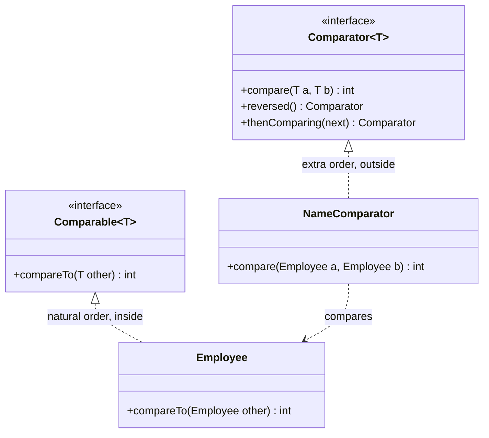
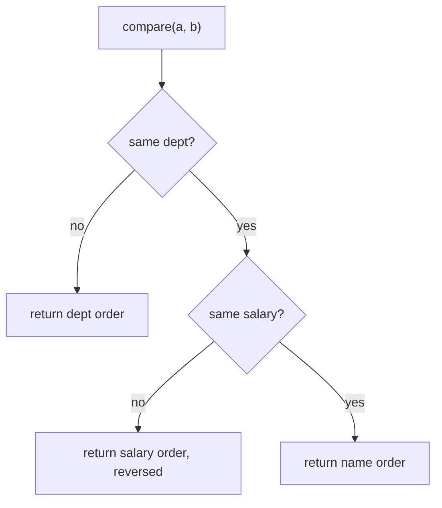
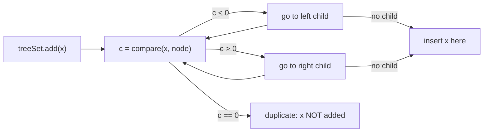

## In One Line
`Comparable` gives a class its **one natural order**, written *inside* the class as `compareTo(other)`; `Comparator` is an **external, pluggable order** — you can have as many as you like — written as `compare(a, b)` and, since Java 8, built fluently with `comparing(...).thenComparing(...).reversed()`.

## Mental Model
Think of a **library**.

- Every book has an **ISBN printed on its cover**. That is its *natural order*: the book itself knows how it compares to another book. This is `Comparable` — the ordering is part of the class (`Book implements Comparable<Book>`), there is exactly one, and anything that "just sorts books" uses it.
- The librarian also has a drawer full of **sorting cards**: "by author", "by title", "by year, newest first", "by genre, then author". None of them are printed on the books; the librarian picks one for the job at hand. Those cards are `Comparator`s — separate objects you hand to `sort`, `TreeSet` or `PriorityQueue`.
- A sorting card can be **combined** ("genre, then author") or **flipped** ("newest first") — `thenComparing` and `reversed`.
- Important: a shelf that uses the card "by title" will think two *different* books with the same title are **the same book** and keep only one — `TreeSet` treats `compare(...) == 0` as "duplicate".

## Concept
### The two interfaces
| | `Comparable<T>` | `Comparator<T>` |
|---|---|---|
| Package | `java.lang` | `java.util` |
| Method | `int compareTo(T other)` | `int compare(T a, T b)` |
| Where the logic lives | Inside the class being sorted | In a separate class, lambda or method reference |
| How many orders | Exactly **one** (the *natural* order) | **Unlimited** |
| Need to edit the class? | Yes | No — works for classes you don't own (`String`, third-party types) |
| Used automatically by | `Collections.sort(list)`, `list.sort(null)`, `Arrays.sort(arr)`, `new TreeSet<>()`, `new TreeMap<>()`, `new PriorityQueue<>()`, `stream.sorted()` | Every overload that takes a comparator: `list.sort(cmp)`, `new TreeSet<>(cmp)`, `stream.sorted(cmp)`, `max(cmp)`, `Collections.min(coll, cmp)` |
| Functional interface? | Technically one method, but it is meant to be implemented by the class itself | Yes, `@FunctionalInterface` since Java 8 — perfect for lambdas |
| JDK examples | `String`, `Integer` and all wrappers, `BigDecimal`, `LocalDate`, enums, `UUID`, `Path` | `String.CASE_INSENSITIVE_ORDER`, `Comparator.reverseOrder()`, `Map.Entry.comparingByValue()` |

> [!INTERVIEW] "Comparable = *natural* order, one per class, implemented by the class itself. Comparator = *custom* orders, as many as you want, defined outside the class."

### What the return value means
Both methods return an `int` whose **sign** is what matters:
- **negative** → first argument comes **before** the second
- **zero** → they are **equal in this ordering**
- **positive** → first argument comes **after** the second

The value is **not** guaranteed to be -1/0/1. `"apple".compareTo("banana")` is `-1`, but `"Apple".compareTo("apple")` is `-32` (the difference between the char codes of `A` and `a`) and `"app".compareTo("apple")` is `-2` (the length difference). Always test `< 0`, `== 0`, `> 0`, never `== -1`.

### The contract (from the `Comparable` / `Comparator` Javadoc)
For a correct ordering:
1. **Antisymmetric:** `sgn(compare(x, y)) == -sgn(compare(y, x))`.
2. **Transitive:** if `x > y` and `y > z` then `x > z`.
3. **Consistent zeros:** if `compare(x, y) == 0` then `x` and `y` compare the same way against every `z`.
4. **Strongly recommended — consistent with equals:** `compare(x, y) == 0` exactly when `x.equals(y)`.
5. `x.compareTo(null)` should throw `NullPointerException` (unlike `equals(null)`, which returns `false`).

Break 1–3 and sorting may silently give garbage or throw `IllegalArgumentException: Comparison method violates its general contract!` (TimSort detects some violations). Break 4 and sorted collections behave oddly, because `TreeSet`/`TreeMap` decide "same element" with `compare() == 0`, **not** `equals()`. The JDK's own example is `BigDecimal`: `new BigDecimal("1.0").equals(new BigDecimal("1.00"))` is `false` but `compareTo` is `0`, so a `HashSet` holds both and a `TreeSet` holds one.

### Implementing `Comparable` correctly
```java
record Employee(int id, String name, String dept, int salary) implements Comparable<Employee> {
    @Override
    public int compareTo(Employee other) {
        return Integer.compare(this.id, other.id);   // NOT this.id - other.id
    }
}
```
Multi-field natural order, the classic way:
```java
public int compareTo(Employee o) {
    int c = dept.compareTo(o.dept);
    if (c != 0) return c;
    c = Integer.compare(o.salary, salary);           // arguments swapped = descending
    if (c != 0) return c;
    return name.compareTo(o.name);
}
```
Or the modern way (Effective Java Item 14) — build the comparator once and delegate:
```java
private static final Comparator<Employee> ORDER =
        Comparator.comparing(Employee::dept)
                  .thenComparing(Employee::salary, Comparator.reverseOrder())
                  .thenComparing(Employee::name);
public int compareTo(Employee o) { return ORDER.compare(this, o); }
```
Always use the generic form `Comparable<Employee>` — the raw `Comparable` forces `compareTo(Object)` and casts.

### Never compare by subtraction
`return a - b;` looks neat but **overflows**: `Integer.MIN_VALUE - 1` wraps to `Integer.MAX_VALUE`, a positive number, so the smallest `int` is ordered *after* 1. Use `Integer.compare(a, b)`, `Long.compare`, `Double.compare` (which also handles `-0.0` and `NaN` correctly), or `Comparator.comparingInt`.

### Writing a `Comparator` — from Java 1.2 style to Java 8 style
```java
// 1. Separate class
class NameComparator implements Comparator<Employee> {
    public int compare(Employee a, Employee b) { return a.name().compareTo(b.name()); }
}
// 2. Anonymous class (pre-Java 8)
Comparator<Employee> byName = new Comparator<Employee>() {
    public int compare(Employee a, Employee b) { return a.name().compareTo(b.name()); }
};
// 3. Lambda
Comparator<Employee> byName2 = (a, b) -> a.name().compareTo(b.name());
// 4. Key-extractor factory + method reference (best)
Comparator<Employee> byName3 = Comparator.comparing(Employee::name);
```

### The Java 8 `Comparator` toolkit
| Method | Kind | What it does |
|---|---|---|
| `comparing(keyExtractor)` | static | Compare by a `Comparable` key: `comparing(Employee::name)` |
| `comparing(keyExtractor, keyComparator)` | static | Compare a key with its own comparator: `comparing(Employee::name, String.CASE_INSENSITIVE_ORDER)` |
| `comparingInt / Long / Double(f)` | static | Primitive key, **no boxing** |
| `naturalOrder()` / `reverseOrder()` | static | Natural order and its reverse (same as `Collections.reverseOrder()`) |
| `nullsFirst(cmp)` / `nullsLast(cmp)` | static | Wrap a comparator so `null` elements go first/last instead of throwing NPE |
| `reversed()` | default | Reverse **everything built so far** |
| `thenComparing(cmp)` / `thenComparing(key)` / `thenComparing(key, keyCmp)` | default | Tie-breaker used only when the previous comparison returned 0 |
| `thenComparingInt / Long / Double(f)` | default | Primitive tie-breaker |

Plus `Map.Entry.comparingByKey()` / `comparingByValue()` (with optional comparator) for sorting map entries.

### Where orderings are used
| API | Uses | Notes |
|---|---|---|
| `Collections.sort(list)`, `list.sort(null)` | natural order | Compile error if the element type is not `Comparable` |
| `list.sort(cmp)` (Java 8), `Collections.sort(list, cmp)` | comparator | `Collections.sort` just calls `list.sort` |
| `Arrays.sort(Object[])` | natural / comparator | **TimSort**: stable, O(n log n), fast on partly sorted data |
| `Arrays.sort(int[])` etc. | numeric order only | Dual-Pivot Quicksort; there is **no** `Arrays.sort(int[], Comparator)` — use `Integer[]` or streams |
| `TreeSet`, `TreeMap` | natural or constructor comparator | `compare() == 0` means "same key"; kept sorted on every insert |
| `PriorityQueue` | natural or comparator | Min-heap: `peek()` gives the smallest by the ordering |
| `stream.sorted()`, `max`, `min`, `Collectors.maxBy` | natural or comparator | `sorted()` without argument needs `Comparable` elements |

**Stability:** object sorting in Java (TimSort) is *stable* — elements that compare equal keep their previous relative order. That is why sorting by salary after sorting by name leaves equal salaries in name order. A single chained comparator is still clearer than relying on multiple passes.

### Why `Collections.sort` is declared `<T extends Comparable<? super T>>`
The `? super T` allows a class to *inherit* its natural order: if `Manager extends Employee` and `Employee implements Comparable<Employee>`, then `Manager` is a `Comparable<Employee>`, not a `Comparable<Manager>`. Without `? super`, you could not sort a `List<Manager>`. (PECS: the comparable *consumes* `T`, so it is a *super* bound — see [wildcards](lesson:a04-generics/05-wildcards).)

### Comparing strings for humans
`String.compareTo` compares UTF-16 char codes: all uppercase letters (65–90) come before all lowercase letters (97–122), so natural order gives `[Cherry, apple, banana]`. Use `String.CASE_INSENSITIVE_ORDER` (or `compareToIgnoreCase`) for case-insensitive sorting, and `java.text.Collator.getInstance(locale)` for real, language-aware alphabetical order (accents, local rules).

### Choosing between them
- The class has one obvious, universal order (numbers, dates, IDs, version numbers)? → implement **`Comparable`**.
- You need a different order, several orders, or you can't modify the class? → **`Comparator`**.
- Most real classes: implement `Comparable` for the natural order *and* use `Comparator`s at call sites for everything else. Sorting with a Comparator is the [Strategy pattern](lesson:a10-patterns/21-strategy): the sort algorithm stays the same, the comparison strategy is plugged in.

## Diagram

The natural order is implemented by the class itself; every other order is a separate object that compares two instances from the outside.


How `comparing(dept).thenComparing(salary, reverseOrder()).thenComparing(name)` decides: each tie-breaker runs only when everything before it returned 0.


`TreeSet`/`TreeMap` never call `equals()` — `compare() == 0` alone decides that two elements are "the same".

## Code
**1. One natural order, many comparators** — every way of sorting you will be asked about:
```java
import java.util.ArrayList;
import java.util.Collections;
import java.util.Comparator;
import java.util.List;
import java.util.PriorityQueue;
import java.util.TreeSet;

public class SortingDemo {
    public static void main(String[] args) {
        List<Employee> staff = new ArrayList<>(List.of(
                new Employee(3, "Ravi",  "IT",    70_000),
                new Employee(1, "Asha",  "HR",    50_000),
                new Employee(4, "Kiran", "IT",    90_000),
                new Employee(2, "Meena", "HR",    50_000),
                new Employee(5, "Arjun", "Sales", 60_000)));

        // 1. Natural order (Comparable): by id
        Collections.sort(staff);
        print("natural (id)", staff);

        // 2. Comparator as a separate class
        staff.sort(new NameComparator());
        print("by name (class)", staff);

        // 3. Comparator as a lambda, reversed
        staff.sort((a, b) -> Integer.compare(b.salary(), a.salary()));
        print("salary desc (lambda)", staff);

        // 4. Comparator factory + chaining: dept asc, then salary desc, then name asc
        Comparator<Employee> byDeptThenPay = Comparator
                .comparing(Employee::dept)
                .thenComparing(Employee::salary, Comparator.reverseOrder())
                .thenComparing(Employee::name);
        staff.sort(byDeptThenPay);
        print("dept, salary desc, name", staff);

        // 5. Sorted collections take a Comparator too
        TreeSet<Employee> byName = new TreeSet<>(Comparator.comparing(Employee::name));
        byName.addAll(staff);
        print("TreeSet first / last", byName.first() + " / " + byName.last());

        PriorityQueue<Employee> richestFirst =
                new PriorityQueue<>(Comparator.comparingInt(Employee::salary).reversed());
        richestFirst.addAll(staff);
        print("PriorityQueue head", richestFirst.peek());

        // 6. Streams: sorted / max / min
        print("stream sorted by name", staff.stream()
                .sorted(Comparator.comparing(Employee::name, String.CASE_INSENSITIVE_ORDER))
                .toList());
        print("lowest paid (min)", staff.stream()
                .min(Comparator.comparingInt(Employee::salary)).orElseThrow());
    }

    static void print(String label, Object value) {
        System.out.printf("%-24s: %s%n", label, value);
    }
}

// Natural ordering lives INSIDE the class
record Employee(int id, String name, String dept, int salary) implements Comparable<Employee> {
    @Override
    public int compareTo(Employee other) {
        return Integer.compare(this.id, other.id);   // never "this.id - other.id"
    }

    @Override
    public String toString() { return id + ":" + name; }
}

// An extra ordering lives OUTSIDE the class
class NameComparator implements Comparator<Employee> {
    @Override
    public int compare(Employee a, Employee b) {
        return a.name().compareTo(b.name());
    }
}
```
```output
natural (id)            : [1:Asha, 2:Meena, 3:Ravi, 4:Kiran, 5:Arjun]
by name (class)         : [5:Arjun, 1:Asha, 4:Kiran, 2:Meena, 3:Ravi]
salary desc (lambda)    : [4:Kiran, 3:Ravi, 5:Arjun, 1:Asha, 2:Meena]
dept, salary desc, name : [1:Asha, 2:Meena, 4:Kiran, 3:Ravi, 5:Arjun]
TreeSet first / last    : 5:Arjun / 3:Ravi
PriorityQueue head      : 4:Kiran
stream sorted by name   : [5:Arjun, 1:Asha, 4:Kiran, 2:Meena, 3:Ravi]
lowest paid (min)       : 1:Asha
```

**2. The traps interviewers love**, all in one run:
```java
import java.math.BigDecimal;
import java.util.ArrayList;
import java.util.Arrays;
import java.util.Comparator;
import java.util.HashSet;
import java.util.List;
import java.util.Set;
import java.util.TreeSet;

public class ComparisonTraps {
    record Person(String name, String city) { }
    static class Box { }                                   // does NOT implement Comparable

    public static void main(String[] args) {
        // 1. The subtraction trick overflows
        Comparator<Integer> bySubtraction = (a, b) -> a - b;          // WRONG
        Comparator<Integer> byCompare     = Integer::compare;         // RIGHT
        System.out.println("MIN - 1 via subtraction: " + bySubtraction.compare(Integer.MIN_VALUE, 1));
        System.out.println("MIN vs 1 via compare   : " + byCompare.compare(Integer.MIN_VALUE, 1));
        Integer[] nums = {5, Integer.MIN_VALUE, 0, Integer.MAX_VALUE, -3};
        Arrays.sort(nums, bySubtraction);
        System.out.println("sorted by subtraction  : " + Arrays.toString(nums));
        Arrays.sort(nums, byCompare);
        System.out.println("sorted by compare      : " + Arrays.toString(nums));

        // 2. TreeSet treats compare() == 0 as "duplicate"
        Set<Person> byName = new TreeSet<>(Comparator.comparing(Person::name));
        byName.add(new Person("Asha", "Pune"));
        byName.add(new Person("Asha", "Delhi"));                     // different person, same name
        System.out.println("TreeSet by name        : " + byName);

        // 3. compareTo inconsistent with equals: BigDecimal
        BigDecimal a = new BigDecimal("1.0"), b = new BigDecimal("1.00");
        System.out.println("equals / compareTo     : " + a.equals(b) + " / " + a.compareTo(b));
        System.out.println("HashSet size           : " + new HashSet<>(List.of(a, b)).size());
        System.out.println("TreeSet size           : " + new TreeSet<>(List.of(a, b)).size());

        // 4. Nulls
        List<Person> people = new ArrayList<>(Arrays.asList(
                new Person("Ravi", null), new Person("Asha", "Pune"), new Person("Kiran", "Delhi")));
        try {
            people.sort(Comparator.comparing(Person::city));
        } catch (NullPointerException e) {
            System.out.println("sort with null key     : NullPointerException");
        }
        people.sort(Comparator.comparing(Person::city, Comparator.nullsLast(Comparator.naturalOrder())));
        System.out.println("nullsLast              : " + people);

        // 5. A sorted collection of non-Comparable objects
        try {
            new TreeSet<Box>().add(new Box());
        } catch (ClassCastException e) {
            // print the message without the class-loader details (they contain a hash code)
            System.out.println("TreeSet<Box>.add       : " + e.getMessage().replaceAll(" \\(.*", ""));
        }

        // 6. String natural order is by UTF-16 code: uppercase letters come first
        System.out.println("\"apple\" vs \"banana\"   : " + "apple".compareTo("banana"));
        System.out.println("\"Apple\" vs \"apple\"    : " + "Apple".compareTo("apple"));
        System.out.println("\"app\" vs \"apple\"      : " + "app".compareTo("apple"));
        List<String> words = new ArrayList<>(List.of("banana", "Cherry", "apple"));
        words.sort(null);                                            // null = natural order
        System.out.println("natural                : " + words);
        words.sort(String.CASE_INSENSITIVE_ORDER);
        System.out.println("case-insensitive       : " + words);
    }
}
```
```output
MIN - 1 via subtraction: 2147483647
MIN vs 1 via compare   : -1
sorted by subtraction  : [0, 5, 2147483647, -2147483648, -3]
sorted by compare      : [-2147483648, -3, 0, 5, 2147483647]
TreeSet by name        : [Person[name=Asha, city=Pune]]
equals / compareTo     : false / 0
HashSet size           : 2
TreeSet size           : 1
sort with null key     : NullPointerException
nullsLast              : [Person[name=Kiran, city=Delhi], Person[name=Asha, city=Pune], Person[name=Ravi, city=null]]
TreeSet<Box>.add       : class ComparisonTraps$Box cannot be cast to class java.lang.Comparable
"apple" vs "banana"   : -1
"Apple" vs "apple"    : -32
"app" vs "apple"      : -2
natural                : [Cherry, apple, banana]
case-insensitive       : [apple, banana, Cherry]
```

**3. A comparator that breaks the contract** can make TimSort throw:
```java
import java.util.ArrayList;
import java.util.List;
import java.util.Random;

public class BrokenContract {
    public static void main(String[] args) {
        Random random = new Random(42);                  // fixed seed: same data every run
        List<Integer> list = new ArrayList<>();
        for (int i = 0; i < 2000; i++) list.add(random.nextInt(10));

        // Never returns 0: for equal values, compare(a,b) and compare(b,a) are BOTH 1
        try {
            list.sort((a, b) -> a < b ? -1 : 1);
            System.out.println("sorted (by luck)");
        } catch (IllegalArgumentException e) {
            System.out.println(e.getMessage());
        }

        list.sort(Integer::compare);                     // a correct comparator
        System.out.println("first " + list.get(0) + ", last " + list.get(list.size() - 1));
    }
}
```
```output
Comparison method violates its general contract!
first 0, last 9
```

## Walkthrough
### `SortingDemo`
- **The data.** `new ArrayList<>(List.of(...))` — `List.of` is unmodifiable and cannot be sorted in place, so it is copied into an `ArrayList`. `Employee` is a record: its accessors are `id()`, `name()`, `dept()`, `salary()`.
- **`record Employee(...) implements Comparable<Employee>`** — the natural order is by `id`. `compareTo` uses `Integer.compare(this.id, other.id)`, which returns negative/zero/positive without overflow. The overridden `toString()` prints `id:name` to keep the output short.
- **`class NameComparator implements Comparator<Employee>`** — an ordering defined *outside* `Employee`. `a.name().compareTo(b.name())` delegates to `String`'s natural (lexicographic) order.
- **Step 1 — `Collections.sort(staff)`** uses `compareTo`: `[1:Asha, 2:Meena, 3:Ravi, 4:Kiran, 5:Arjun]`. It compiles only because `Employee` is `Comparable`.
- **Step 2 — `staff.sort(new NameComparator())`** (`List.sort`, Java 8): alphabetical — `Arjun, Asha, Kiran, Meena, Ravi`. Note `Arjun` < `Asha` because at index 1 `'r'` (114) < `'s'` (115).
- **Step 3 — a lambda** `(a, b) -> Integer.compare(b.salary(), a.salary())`: swapping the arguments reverses the order, giving salary descending. Asha and Meena both earn 50,000; they stay in the order they had after step 2 (Asha before Meena) because the sort is **stable**.
- **Step 4 — the chained comparator** `comparing(Employee::dept)` → alphabetical by department (HR < IT < Sales); `.thenComparing(Employee::salary, Comparator.reverseOrder())` → inside a department, highest salary first; `.thenComparing(Employee::name)` → if salaries tie, by name. Result: HR (Asha 50k, Meena 50k — tie broken by name), IT (Kiran 90k, Ravi 70k), Sales (Arjun).
- **Step 5 — `TreeSet` with a comparator** keeps elements sorted by name: `first()` is `5:Arjun`, `last()` is `3:Ravi`. **`PriorityQueue`** with `comparingInt(Employee::salary).reversed()` becomes a *max*-heap on salary: `peek()` is Kiran (90,000). `comparingInt` avoids boxing each salary into an `Integer`.
- **Step 6 — streams.** `sorted(Comparator.comparing(Employee::name, String.CASE_INSENSITIVE_ORDER))` uses the two-argument `comparing`: extract the name, then compare names ignoring case. `toList()` (Java 16) collects the result. `min(comparingInt(Employee::salary))` returns an `Optional`; Asha and Meena tie at 50,000 and `min` keeps the **first** one it met, Asha. `orElseThrow()` unwraps it.
- **`print(...)`** uses `printf("%-24s: %s%n", ...)` — `%-24s` left-aligns the label in 24 characters so the output lines up.

### `ComparisonTraps`
1. **Subtraction overflow.** `Integer.MIN_VALUE - 1` wraps around to `2147483647`, i.e. "MIN is *greater* than 1". `Integer.compare` correctly returns `-1`. Sorting with the subtraction comparator produces nonsense (`[0, 5, 2147483647, -2147483648, -3]`), with **no exception** — the most dangerous kind of bug. The correct comparator gives ascending order.
2. **`TreeSet` with a name comparator** keeps only `Asha/Pune`: when adding `Asha/Delhi`, `compare` returned 0, so the set decided it already had that element — even though the two records are not `equals`.
3. **`BigDecimal`**: `1.0` and `1.00` are not `equals` (different *scale*) but `compareTo` returns 0. `HashSet` (uses `equals`/`hashCode`) keeps 2; `TreeSet` (uses `compareTo`) keeps 1. Same data, different set sizes.
4. **Nulls.** `Comparator.comparing(Person::city)` calls `city.compareTo(...)` on Ravi's `null` city → NPE. Wrapping the key comparator in `nullsLast(naturalOrder())` puts the null city at the end: Delhi, Pune, null. (The list itself contains no null *elements* — only a null *field* inside one element — so `List.of` would have worked as well as `Arrays.asList`; either way the elements are copied into a sortable `ArrayList`.)
5. **Non-`Comparable` element in a `TreeSet`.** `new TreeSet<Box>()` compiles (the type parameter has no bound), but the first `add` fails at **runtime** with `ClassCastException: ... cannot be cast to class java.lang.Comparable` — `TreeMap.put` compares the key with itself to check it. `Collections.sort(List<Box>)`, by contrast, is rejected at **compile time**, because its signature requires `T extends Comparable<? super T>`. The `replaceAll(" \\(.*", "")` only trims the end of the message, which names the class loader and includes a hash code that changes between runs.
6. **String comparison.** `"apple".compareTo("banana")` = `'a' - 'b'` = -1. `"Apple".compareTo("apple")` = `'A' - 'a'` = 65 − 97 = -32. `"app".compareTo("apple")` — no differing character, so the result is the length difference 3 − 5 = -2. `words.sort(null)` means "natural order": `Cherry` comes first because uppercase `C` (67) is less than lowercase `a` (97). `String.CASE_INSENSITIVE_ORDER` fixes that.

### `BrokenContract`
- `new Random(42)` — a fixed seed produces the same 2,000 numbers every run, so the output is reproducible.
- `(a, b) -> a < b ? -1 : 1` never returns 0. For two equal values both `compare(a, b)` and `compare(b, a)` return 1, which violates antisymmetry. TimSort noticed an impossible state while merging runs and threw `IllegalArgumentException: Comparison method violates its general contract!`. With other data it might not notice and just produce a wrongly ordered list — either way the comparator is a bug.
- `list.sort(Integer::compare)` — the correct version; the smallest value is 0 and the largest 9.

## Traps
- **Subtraction comparators overflow** (`a - b`) for large or negative values — use `Integer.compare`/`Long.compare`/`Double.compare` or `comparingInt`.
- **`TreeSet`/`TreeMap` use `compare() == 0` for equality.** A comparator on only some fields silently drops "duplicates" (`TreeSet`) or overwrites values (`TreeMap`). With `new TreeMap<>(String.CASE_INSENSITIVE_ORDER)`, `put("a", 1); put("A", 2);` leaves `{a=2}` — the old key stays, the value is replaced. Add tie-breakers (e.g. `thenComparing(Person::id)`) to keep distinct elements distinct.
- **`reversed()` reverses the whole chain built so far.** `comparing(len).thenComparing(natural).reversed()` reverses both keys. To reverse only the first key: `comparing(len).reversed().thenComparing(natural)`; to reverse only a later key: `thenComparing(key, Comparator.reverseOrder())`.
- **Lambda + `reversed()` loses the type.** `Comparator.comparing(p -> p.name()).reversed()` does not compile — *cannot find symbol: method name(), location: variable p of type Object* — because the target type does not flow through a chained call. Fix: a method reference `comparing(Person::name).reversed()`, an explicit parameter type `(Person p) -> p.name()`, or `Comparator.<Person, String>comparing(...)`.
- **Nulls throw.** Both natural order and `comparing(key)` throw NPE on a null element or null key. Use `nullsFirst`/`nullsLast`.
- **Checking for `-1`/`1`.** `compareTo` may return any negative or positive number (`-32` above). Test the sign.
- **Natural order of `String` is case-sensitive** (`"Z" < "a"`) and not language-aware — use `CASE_INSENSITIVE_ORDER` or a `Collator`.
- **Sorting an unmodifiable list** (`List.of(...).sort(...)`) throws `UnsupportedOperationException`; `Arrays.asList(...)` can be sorted (it only can't change size).
- **No comparator for primitive arrays.** `Arrays.sort(int[], Comparator)` does not exist. To sort `int[]` descending: sort ascending and reverse, or `Arrays.stream(a).boxed().sorted(Comparator.reverseOrder())`.
- **Comparing floating-point values with `<`/`>`** mishandles `NaN` (every comparison is false). `Double.compare` puts `NaN` last and `-0.0` before `0.0`.
- **Mutating a field used by the comparator while the object is inside a `TreeSet`/`TreeMap`/`PriorityQueue`** corrupts the structure — lookups and removals then fail. Keys of sorted collections should be immutable.

> [!WARNING] An ordering "inconsistent with equals" is legal (BigDecimal does it), but then a sorted set violates the general `Set` contract, which is defined in terms of `equals`. Document it if you do it on purpose.

## Tips & Tricks
- **Mnemonic: "Comparable is *-able* — the object is *able* to compare *itself*. Compar*ator* is an *outsider* (an operator) that compares *two others*."**
- **Method names:** Comparable has **To** — `compareTo(one other)`; Comparator has **two** — `compare(a, b)`.
- **Packages:** Comparable is in `java.lang` (so fundamental that `String` and `Integer` need it); Comparator is a utility in `java.util`.
- **Descending trick:** swap the arguments (`compare(b, a)`), or use `.reversed()` / `Comparator.reverseOrder()`. Never negate the result with `-compare(a, b)` — `-Integer.MIN_VALUE` is still negative.
- **Read a chained comparator left to right as a sentence:** "by department, then by salary high-to-low, then by name".
- **Prefer `comparingInt/Long/Double`** for primitive keys (no boxing), and method references over lambdas (better type inference, more readable).
- **Make sorted-collection comparators total:** end the chain with a unique key (an id) so two different objects never compare as 0.
- `Collections.max(coll, cmp)`, `stream.max(cmp)` and `Collectors.maxBy(cmp)` all reuse the same comparators — write one, use it everywhere.

## Interview Q&A
### [Basic] What is the difference between Comparable and Comparator?
`Comparable<T>` (in `java.lang`) is implemented **by the class itself** and defines its single **natural order** via `int compareTo(T other)`; it is used automatically by `Collections.sort(list)`, `TreeSet`, `TreeMap` and `stream.sorted()`. `Comparator<T>` (in `java.util`) is a **separate object** with `int compare(T a, T b)`; you can define any number of them, for classes you can't modify, and pass them to `list.sort(cmp)`, `new TreeSet<>(cmp)`, `stream.sorted(cmp)` and so on. Since Java 8 `Comparator` is a functional interface with factory and combinator methods:
```java
staff.sort(Comparator.comparing(Employee::dept)
                     .thenComparing(Employee::salary, Comparator.reverseOrder()));
```
**Follow-up:** *When would you use both?* — Almost always: `Comparable` for the one obvious order (id, date), `Comparator`s for display- or use-case-specific orders.

### [Basic] What does `compareTo` return and what rules must it follow?
A negative number if `this` should come before the argument, zero if they are equal in this ordering, a positive number if it comes after — any magnitude, not necessarily -1/0/1. It must be antisymmetric (`sgn(x.compareTo(y)) == -sgn(y.compareTo(x))`), transitive, and consistent for equal elements (if `x` equals `y` in the ordering, they compare the same against every `z`). It should throw NPE for `null` and it is strongly recommended to be consistent with `equals`.

**Follow-up:** *What happens if you break these rules?* — Sorting may silently produce a wrong order or throw `IllegalArgumentException: Comparison method violates its general contract!`, and `TreeSet`/`TreeMap` may lose or duplicate elements.

### [Intermediate] How do you sort a list of objects by multiple fields?
Java 8+: chain comparators — each `thenComparing` is consulted only when everything before it returned 0.
```java
list.sort(Comparator.comparing(Employee::dept)
          .thenComparing(Employee::salary, Comparator.reverseOrder())
          .thenComparing(Employee::name));
```
Before Java 8, write the comparison by hand: compare the first field; if the result is non-zero return it, else compare the next field, and so on. Because Java's object sort is stable you *could* also sort several times from the least to the most significant key, but one chained comparator is clearer and faster.

**Follow-up:** *How do you make only the salary descending?* — `thenComparing(Employee::salary, Comparator.reverseOrder())` or `thenComparing(Comparator.comparingInt(Employee::salary).reversed())`; a `reversed()` at the end would reverse the department and name order too.

### [Intermediate] Why is `return this.age - other.age;` a bad `compareTo`?
Integer subtraction can overflow. For `Integer.MIN_VALUE` compared with `1`, `MIN_VALUE - 1` wraps to `Integer.MAX_VALUE`, a positive result, so the smallest number is sorted *after* 1 — silently, with no exception. Ages happen to be small, but the habit is dangerous with ids, timestamps or negative values. Use `Integer.compare(this.age, other.age)` or `Comparator.comparingInt(Person::age)`. For `double`, `Double.compare` also handles `NaN` and `-0.0`.

**Follow-up:** *Can you negate a comparator result to reverse it?* — Not safely: `-Integer.MIN_VALUE` is still `Integer.MIN_VALUE`. Swap the arguments or use `reversed()`.

### [Intermediate] What does "consistent with equals" mean, and why does it matter?
A natural order is consistent with equals when `x.compareTo(y) == 0` exactly when `x.equals(y)`. It matters because sorted collections (`TreeSet`, `TreeMap`) use only `compareTo`/`compare` to decide whether two elements are the same, while hash-based collections and the `Set` contract use `equals`. `BigDecimal` is the classic inconsistent class: `new BigDecimal("1.0")` and `"1.00"` are not equal but compare as 0, so a `HashSet` holds 2 elements and a `TreeSet` holds 1. The same happens with a comparator on only some fields: a `TreeSet` sorted by name drops a second person with the same name.

**Follow-up:** *How do you fix a comparator that drops elements?* — Add tie-breakers until the order is total, typically ending with a unique id.

### [Intermediate] What happens if you sort or put into a `TreeSet` objects that don't implement `Comparable`?
`Collections.sort(List<Box>)` is a **compile-time** error, because its signature is `<T extends Comparable<? super T>> void sort(List<T>)`. `new TreeSet<Box>()` compiles (no bound on the type parameter), but the first `add` throws `ClassCastException: Box cannot be cast to class java.lang.Comparable` at **runtime**. `Arrays.sort(Object[])` also fails at runtime with `ClassCastException` (as soon as there are two elements to compare). The fix is to implement `Comparable` or pass a `Comparator`.

**Follow-up:** *Does a single-element `TreeSet` still throw?* — Yes, since Java 7 `TreeMap.put` compares the first key with itself precisely to fail fast.

### [Intermediate] How do you sort in reverse order?
For natural order: `list.sort(Comparator.reverseOrder())` or `Collections.sort(list, Collections.reverseOrder())`. For a comparator: `cmp.reversed()` or `Collections.reverseOrder(cmp)`. For a key: `Comparator.comparing(Employee::salary).reversed()` or `Comparator.comparing(Employee::salary, Comparator.reverseOrder())`. In a hand-written comparator, swap the arguments: `Integer.compare(b.salary(), a.salary())`. Primitive arrays have no comparator overload, so sort ascending and reverse, or box them.

**Follow-up:** *Why does `comparing(p -> p.getName()).reversed()` not compile?* — The lambda's parameter type can't be inferred through the chained call, so `p` becomes `Object`. Use `Person::getName` or `(Person p) -> p.getName()`.

### [Intermediate] Comparator has `compare` and `equals` — how is it a functional interface?
A functional interface must have exactly one **abstract** method *not counting* public methods of `java.lang.Object`. `Comparator` redeclares `boolean equals(Object)` only to document it, and every implementation inherits `equals` from `Object` anyway, so it doesn't count. The only real abstract method is `compare`. All the other methods (`reversed`, `thenComparing`, `comparing`, ...) are `default` or `static`.

**Follow-up:** *Is `Comparable` a functional interface?* — Structurally yes (one abstract method) and you *can* assign a lambda to it, but it isn't annotated `@FunctionalInterface` because it is meant to be implemented by the class that is being compared.

### [Advanced] How do you handle nulls when sorting?
Natural order and `Comparator.comparing(key)` throw `NullPointerException` on null elements or null keys. Wrap a comparator with `Comparator.nullsFirst(...)` or `nullsLast(...)`:
```java
list.sort(Comparator.nullsLast(Comparator.naturalOrder()));                 // null elements
people.sort(Comparator.comparing(Person::city,
                                 Comparator.nullsLast(Comparator.naturalOrder())));  // null keys
```
The wrapper treats two nulls as equal and a null as smaller (`nullsFirst`) or larger (`nullsLast`) than any non-null value, delegating the rest to the wrapped comparator.

**Follow-up:** *What does `TreeSet` do with a null element?* — With natural ordering, `add(null)` throws NPE; with a `nullsFirst/Last` comparator it is allowed.

### [Advanced] Which sort algorithms does Java use, and are they stable?
`Arrays.sort(Object[])`, `List.sort` and `Collections.sort` use **TimSort** (since Java 7; merge sort before): a hybrid of merge sort and binary insertion sort that exploits existing runs, O(n log n) worst case, O(n) on already-sorted input, and **stable**. `ArrayList.sort` sorts its internal array directly; the default `List.sort` copies to an array, sorts it and writes the elements back. Primitive arrays use **Dual-Pivot Quicksort** (not stable, which is irrelevant for primitives because equal values are indistinguishable). `Arrays.parallelSort` uses a parallel merge sort for large arrays.

**Follow-up:** *What is "Comparison method violates its general contract!"?* — An `IllegalArgumentException` thrown by TimSort when it detects that the comparator is inconsistent (e.g. never returns 0, uses random values, or compares mutable state that changes during the sort).

### [Advanced] Why is `Collections.sort` declared as `<T extends Comparable<? super T>> void sort(List<T> list)`?
The bound `Comparable<? super T>` accepts types whose natural order is defined by a **superclass**. If `Employee implements Comparable<Employee>` and `Manager extends Employee`, then `Manager` is a `Comparable<Employee>`, not a `Comparable<Manager>`. With `T extends Comparable<T>` you couldn't sort a `List<Manager>`; with `? super T` you can. It's the PECS rule: the comparable *consumes* values of type `T`, so it gets a `super` wildcard. `Comparator<? super T>` in `sort(List<T>, Comparator<? super T>)` works the same way — a `Comparator<Object>` or `Comparator<Employee>` can sort a `List<Manager>`.

**Follow-up:** *Should `Manager` override `compareTo` to compare bonuses?* — It can't narrow the parameter to `Manager`; doing so via `instanceof` breaks symmetry with plain `Employee`s. Use a separate `Comparator<Manager>` instead.

## Quiz
### What does this print?
```java
Set<String> set = new TreeSet<>(Comparator.comparing(String::length));
set.addAll(List.of("one", "two", "three", "four"));
System.out.println(set);
```
- [ ] [four, one, three, two]
- [x] [one, four, three]
- [ ] [one, two, four, three]
- [ ] [one, two, three, four]
> The `TreeSet` only knows the comparator: `"two"` has the same length as `"one"` (compare returns 0), so it is treated as a duplicate and dropped. The rest are ordered by length: 3, 4, 5. Alphabetical order would be the natural order, which this set does not use.

### What does this print?
```java
List<String> w = new ArrayList<>(List.of("bb", "a", "ccc", "aa"));
w.sort(Comparator.comparing(String::length).reversed().thenComparing(Comparator.naturalOrder()));
System.out.println(w);
```
- [ ] [ccc, bb, aa, a]
- [x] [ccc, aa, bb, a]
- [ ] [a, aa, bb, ccc]
- [ ] Compile error
> `reversed()` applies only to what was built **before** it (length), so length is descending, and the tie-breaker added afterwards (natural order) is ascending: `aa` before `bb`. Putting `.reversed()` at the very end would reverse both and give `[ccc, bb, aa, a]`.

### What is `"Apple".compareTo("apple")`?
- [ ] -1
- [x] -32
- [ ] 0
- [ ] 32
> `String.compareTo` returns the difference of the first differing chars: `'A'` (65) − `'a'` (97) = -32. It is case-sensitive (use `compareToIgnoreCase` for 0) and the result is not limited to -1/0/1.

### Spot the bug: this comparator sometimes sorts large values wrongly.
```java
Comparator<Account> byBalance = (a, b) -> (int) (a.balance() - b.balance());   // balance() is long
```
- [ ] It should return `a.balance() > b.balance()`
- [x] The subtraction can overflow, and casting the `long` difference to `int` can change its sign
- [ ] Comparators cannot use lambdas with casts
- [ ] It needs `@Override`
> A large difference overflows, and `(int)` keeps only the low 32 bits, so the sign can flip (e.g. a difference of 2^32 becomes 0). Use `Long.compare(a.balance(), b.balance())` or `Comparator.comparingLong(Account::balance)`.

### Which statement is TRUE?
- [ ] `Comparator` is in `java.lang` and `Comparable` in `java.util`
- [ ] A class can implement `Comparable` several times to get several natural orders
- [x] `TreeSet` decides that two elements are duplicates when `compare`/`compareTo` returns 0, without calling `equals`
- [ ] `compareTo` must return exactly -1, 0 or 1
> Sorted collections rely only on the ordering. The packages are the other way round (`Comparable` is `java.lang`), a class can implement `Comparable<T>` only once (one natural order), and only the sign of the result matters.

### What happens?
```java
class Box { }
Set<Box> boxes = new TreeSet<>();
boxes.add(new Box());
```
- [ ] Compile error: Box is not Comparable
- [ ] The box is added; the error only comes when a second box is added
- [x] `ClassCastException` at runtime on the first `add`
- [ ] `NullPointerException`
> `TreeSet<Box>` has no type bound, so it compiles. Since Java 7 `TreeMap.put` compares even the first key with itself, which casts it to `Comparable` and fails immediately. Pass a `Comparator<Box>` to the constructor or make `Box` implement `Comparable<Box>`.

### Why does `comparing(p -> p.getName()).reversed()` fail to compile when `comparing(Person::getName).reversed()` works?
- [ ] `reversed()` does not exist on `Comparator`
- [x] The lambda's parameter type cannot be inferred through the chained call, so `p` is treated as `Object`
- [ ] Lambdas cannot be used with `Comparator.comparing`
- [ ] Method references are always faster, so the compiler requires them
> Target typing only reaches the outermost expression (`...reversed()`), not the `comparing(...)` call inside it, so the compiler infers `Comparator<Object>` and `p.getName()` is "cannot find symbol". A method reference carries its own type (`Person`), or you can write `(Person p) -> p.getName()`.

## Takeaways
- `Comparable` (`java.lang`, `compareTo(other)`) = the one natural order implemented inside the class; `Comparator` (`java.util`, `compare(a, b)`) = any number of external orders.
- Only the sign of the result matters; the ordering must be antisymmetric and transitive, and should be consistent with `equals`.
- Never compare by subtraction — use `Integer.compare`, `Long.compare`, `Double.compare` or `comparingInt/Long/Double`.
- Build comparators with `comparing(key)`, `thenComparing(...)`, `reversed()`, `reverseOrder()`, `nullsFirst/Last`; `reversed()` flips everything built before it.
- `TreeSet`/`TreeMap` treat `compare() == 0` as "same element" — partial-field comparators silently drop or overwrite entries (`BigDecimal` 1.0 vs 1.00: HashSet 2, TreeSet 1).
- `Collections.sort` on a non-Comparable type fails at compile time; `TreeSet.add` fails at runtime with `ClassCastException`.
- Java sorts objects with stable TimSort and primitives with Dual-Pivot Quicksort; a contract-breaking comparator can trigger "Comparison method violates its general contract!".
