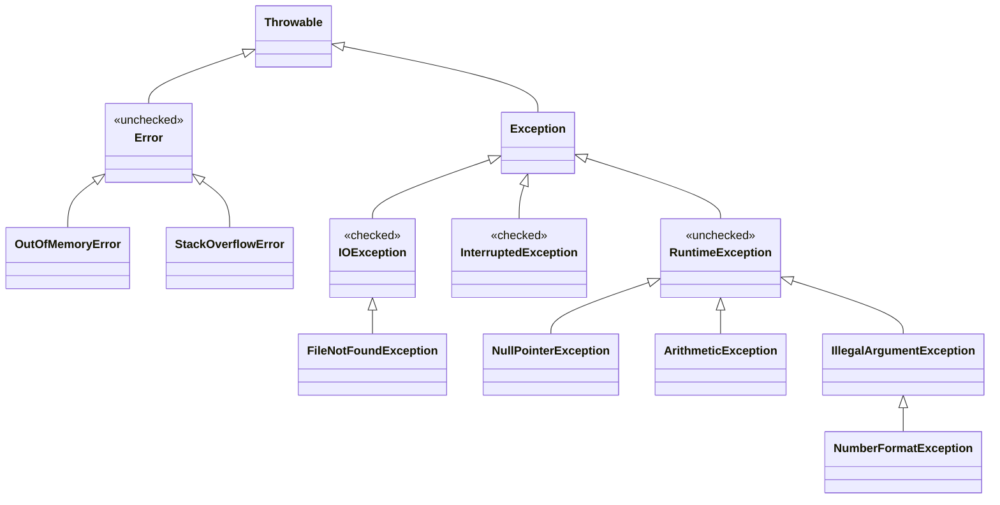
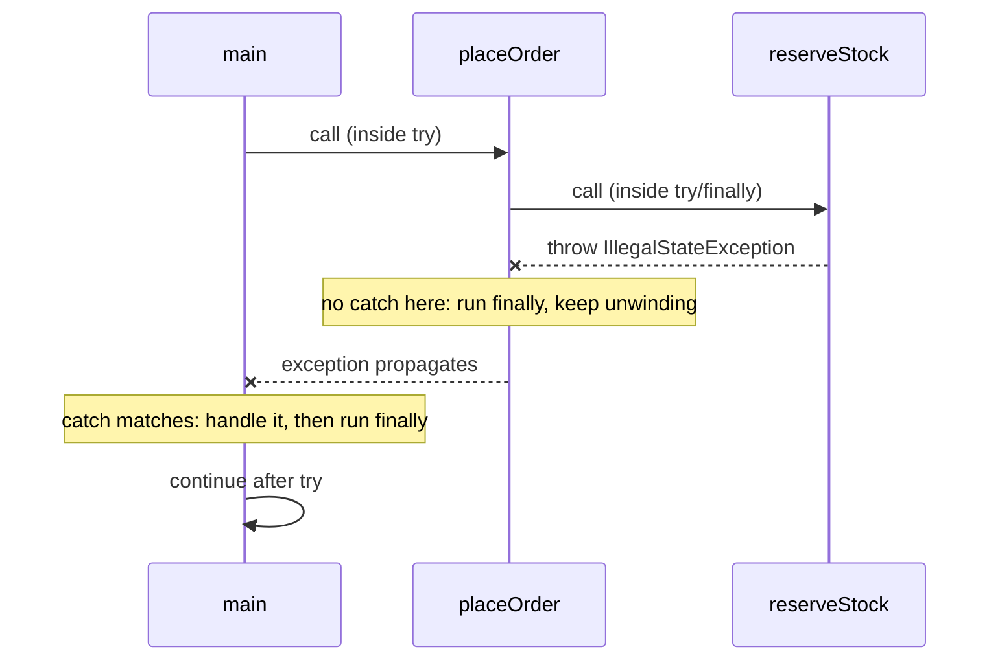
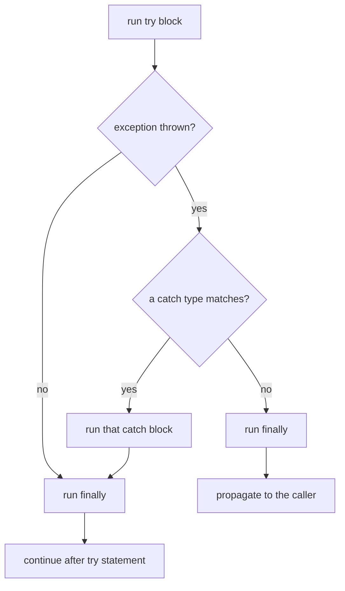

## In One Line
An exception is an **object** describing something that went wrong; `throw` hands it to the JVM, which **unwinds the call stack** until a matching `catch` is found (running every `finally` on the way), and the compiler forces you to catch-or-declare **checked** exceptions while **unchecked** ones (`RuntimeException`, `Error`) are left to you.

## Mental Model
Think of a **fire alarm in an office building**.

- A fire starts in one room — a method hits a problem and **throws** an exception object that describes it ("kitchen, grease fire").
- The alarm goes up **floor by floor** — the exception travels up the **call stack**, from the method that threw it to the method that called it, and so on.
- On each floor, if there is a warden **trained for that kind of fire**, they deal with it — a `catch` block whose type matches. Nobody else hears the alarm after that; the building carries on.
- Whatever happens, every floor's **fire doors close** on the way — the `finally` blocks run.
- If no warden anywhere is trained for it, the building is **evacuated** — the thread dies, the JVM prints `Exception in thread "main"` with the stack trace, and the program exits with status 1.
- The building code says some hazards are **known in advance** — "every room with a gas stove must have a plan". Those are **checked exceptions**: the compiler refuses to build the office unless each one is handled or declared. Other problems are simply **mistakes** (someone left a cable across the corridor) — **unchecked exceptions**: nobody forces a plan, you fix the bug.

## Concept
### What an exception is
When a method cannot do its job, it creates an object of a subclass of `java.lang.Throwable` and **throws** it. Normal execution stops at that point; the JVM searches the current method, then its caller, then *its* caller, and so on, for a `catch` block that accepts the exception's type. This is called **stack unwinding** or **propagation**. Exceptions separate the *normal path* of the code from the *error-handling path*, and they cannot be silently ignored the way C-style error codes can.

### The hierarchy
```text
Throwable                       (everything that can be thrown; implements Serializable)
├── Error                       serious JVM/environment problems - don't catch
│   ├── OutOfMemoryError, StackOverflowError      (VirtualMachineError)
│   ├── NoClassDefFoundError, ExceptionInInitializerError   (LinkageError)
│   └── AssertionError
└── Exception                   conditions an application may want to handle
    ├── IOException             CHECKED  (FileNotFoundException, NoSuchFileException, EOFException...)
    ├── SQLException            CHECKED
    ├── InterruptedException    CHECKED
    ├── ClassNotFoundException  CHECKED  (ReflectiveOperationException)
    ├── CloneNotSupportedException, ParseException, TimeoutException, ExecutionException  CHECKED
    └── RuntimeException        UNCHECKED - usually programming bugs
        ├── NullPointerException, ArithmeticException, ClassCastException
        ├── IllegalArgumentException  (NumberFormatException)
        ├── IllegalStateException, UnsupportedOperationException
        ├── IndexOutOfBoundsException (ArrayIndexOutOfBounds..., StringIndexOutOfBounds...)
        └── ConcurrentModificationException, NoSuchElementException, NegativeArraySizeException
```

### Checked vs unchecked
| | Checked | Unchecked |
|---|---|---|
| Which classes | `Exception` and its subclasses **except** `RuntimeException` | `RuntimeException`, `Error` and all their subclasses |
| Compiler rule | **Catch or specify**: every checked exception that can be thrown must be caught or declared in `throws` | No rule — catch or declare only if you want |
| Typical meaning | A recoverable condition outside the program's control: missing file, network down, interrupted thread | A **programming error** (null, bad index, bad argument) or a JVM problem (`Error`) |
| Examples | `IOException`, `SQLException`, `InterruptedException`, `ClassNotFoundException` | `NullPointerException`, `IllegalArgumentException`, `ArithmeticException`, `OutOfMemoryError` |
| Error if unhandled | Compile error: *unreported exception X; must be caught or declared to be thrown* | Compiles; fails at runtime |

> [!INTERVIEW] "Checked vs unchecked is a **compile-time** distinction only. The JVM treats every Throwable the same way at runtime."

### `Error` vs `Exception`
`Error` signals problems a reasonable application should **not** try to recover from — the JVM ran out of memory or stack, a class file is missing or broken, an assertion failed. `Exception` signals conditions the application might handle. You may catch an `Error` technically (it is still a `Throwable`), but after an `OutOfMemoryError` the program's state is often unreliable; the usual right move is to log and let the process die.

### `try` / `catch` / `finally` syntax and rules
```java
try {
    // code that may throw
} catch (FileNotFoundException e) {        // most specific first
    // handle
} catch (IOException | SQLException e) {   // multi-catch (Java 7)
    // handle both the same way
} finally {
    // always runs: cleanup
}
```
- A `try` needs at least one `catch` or a `finally` (or resources — try-with-resources, see [advanced exceptions](lesson:b01-fundamentals/11-exceptions-advanced)); a bare `try { }` is a compile error: *'try' without 'catch', 'finally' or resource declarations*.
- The JVM tests the `catch` clauses **top to bottom** and runs the **first** one whose type matches (the exception is an instance of it). At most one catch block runs.
- **Specific before general.** If `catch (IOException e)` comes before `catch (FileNotFoundException e)`, the second one can never run and the compiler rejects it: *exception FileNotFoundException has already been caught*.
- **Can't catch a checked exception that can't happen.** `catch (IOException e)` around code that throws no `IOException` is an error: *exception IOException is never thrown in body of corresponding try statement*. `catch (Exception e)` and `catch (Throwable e)` are always allowed, because they also cover unchecked exceptions.
- **Multi-catch** (`A | B e`): the alternatives must not be subclass-related (*Alternatives in a multi-catch statement cannot be related by subclassing*), and `e` is implicitly `final` (*multi-catch parameter e may not be assigned*). Its static type is the closest common superclass.
- Variables declared inside `try { }` are not visible in `catch` or `finally` — declare them before the `try` if you need them there.

### `throw` vs `throws`
| `throw` | `throws` |
|---|---|
| A **statement** that actually throws one exception object | A **clause** in a method/constructor signature |
| `throw new IllegalArgumentException("age < 0");` | `void load() throws IOException, SQLException` |
| Followed by an instance (`throw null;` throws a `NullPointerException`) | Followed by one or more class names |
| Code after it in the same block is unreachable | Tells callers (and the compiler) what checked exceptions may come out |

Declaring unchecked exceptions in `throws` is allowed and sometimes used for documentation, but the compiler ignores it. Document them with Javadoc `@throws` instead.

### What `finally` guarantees — and when it doesn't run
`finally` runs after the `try` (and the matching `catch`, if any) **no matter how** they end: normally, via `return`, `break`/`continue`, or an exception that is caught or that keeps propagating. On a `return`, the return value is computed first, then `finally` runs, then the method actually returns. `finally` does **not** run when:
- `System.exit()` / `Runtime.halt()` is called in the `try` or `catch`;
- the JVM crashes or the process is killed (`kill -9`, power loss);
- the `try` never finishes (infinite loop, deadlock);
- the thread is a **daemon** thread still running when the JVM shuts down.

The tricky cases — `return` inside `finally`, exceptions thrown from `finally`, changing a returned variable in `finally` — are covered in [advanced exceptions](lesson:b01-fundamentals/11-exceptions-advanced).

### What happens to an uncaught exception
If no method on the stack catches it, the exception reaches the top of the thread. The JVM calls the thread's `UncaughtExceptionHandler` (settable per thread or globally with `Thread.setDefaultUncaughtExceptionHandler`); the default handler prints `Exception in thread "<name>"` followed by the stack trace to `System.err`. The thread terminates. Other threads keep running; if it was `main`, the `java` launcher exits with **status 1** once the remaining non-daemon threads finish.

### Reading a stack trace
```text
Exception in thread "main" java.lang.ArithmeticException: / by zero
	at Uncaught.averagePrice(Uncaught.java:14)     <- where it was thrown (top frame)
	at Uncaught.checkout(Uncaught.java:9)          <- who called that
	at Uncaught.main(Uncaught.java:4)              <- ... down to the entry point
```
Line 1 is `toString()` of the exception: fully-qualified class name, then `: message`. Each `at` line is one stack frame, **most recent first**. Read from the top to find *where* it broke; scan down for the first frame in *your* code to find *why*. Later you will also see `Caused by:` sections (exception chaining) and `Suppressed:` (try-with-resources) — both in the next lesson.

### Useful `Throwable` methods
| Method | Returns |
|---|---|
| `getMessage()` | The detail message passed to the constructor (may be `null`) |
| `toString()` | `ClassName: message`, or just `ClassName` if the message is null |
| `printStackTrace()` | Prints `toString()` plus the stack trace to `System.err` (overload takes a `PrintStream`/`PrintWriter`) |
| `getStackTrace()` | `StackTraceElement[]` — class, method, file, line of each frame |
| `getCause()` | The wrapped underlying exception, or `null` |
| `getSuppressed()` | Exceptions suppressed by try-with-resources (Java 7) |
| `getLocalizedMessage()` | Localised message; defaults to `getMessage()` |

### Helpful NullPointerException messages (JDK 14+)
Since JDK 14 (JEP 358; on by default since JDK 15) an NPE message tells you *what* was null: `Cannot invoke "String.length()" because "RuntimeGallery.nickname" is null`. Local variable names appear only if the class was compiled with debug info (`javac -g`); otherwise you see `"<local1>"`.

### Common runtime exceptions and their usual cause
| Exception | Typical cause |
|---|---|
| `NullPointerException` | Calling a method / reading a field on `null`, unboxing a `null` wrapper, `throw null` |
| `ArithmeticException` | Integer division or `%` by zero (floating-point gives `Infinity`/`NaN` instead) |
| `ArrayIndexOutOfBoundsException` / `StringIndexOutOfBoundsException` / `IndexOutOfBoundsException` | Index `< 0` or `>= length/size` |
| `ClassCastException` | Downcast to a type the object isn't |
| `NumberFormatException` | `Integer.parseInt("12a")` — subclass of `IllegalArgumentException` |
| `IllegalArgumentException` | A method rejects an argument (`"abc".repeat(-1)`) |
| `IllegalStateException` | A method is called at the wrong time (e.g. `Iterator.remove()` twice) |
| `UnsupportedOperationException` | Modifying an unmodifiable collection |
| `ConcurrentModificationException` | Structurally modifying a collection while iterating it with a for-each loop |
| `NoSuchElementException` | `iterator.next()` with nothing left, `Optional.get()` on empty |
| `StackOverflowError` (an `Error`) | Unbounded recursion |

### Exceptions and method overriding
An overriding method may declare the **same, fewer, or narrower** checked exceptions than the method it overrides — never new or broader checked ones — and may throw any unchecked exception. Code written against the parent type only prepares for the parent's checked exceptions. Constructors can declare `throws`; a subclass constructor must declare (at least) whatever its `super(...)` call can throw, because it cannot catch around `super(...)`.

### Cost of exceptions
Creating an exception is relatively expensive because the constructor calls `fillInStackTrace()`, which walks the whole stack. Throwing and catching itself is cheap. So: use exceptions for **exceptional** situations, not for normal control flow (e.g. don't loop "until `ArrayIndexOutOfBoundsException`"). HotSpot has an optimisation, `-XX:+OmitStackTraceInFastThrow` (on by default), that replaces frequently thrown *implicit* exceptions (NPE, `ArithmeticException`, AIOOBE, `ClassCastException`) in hot compiled code with a preallocated exception **without a stack trace or message** — which is why production logs sometimes show a bare `java.lang.NullPointerException`. Disable it with `-XX:-OmitStackTraceInFastThrow` when debugging.

### Choosing checked or unchecked
- The caller can reasonably **recover** (retry, ask for another file, fall back)? → a checked exception makes that explicit in the API.
- It's a **precondition violation** or bug (null argument, bad index, invalid state)? → an unchecked exception (`IllegalArgumentException`, `IllegalStateException`, `NullPointerException` via `Objects.requireNonNull`).
- Modern libraries (Spring, JPA, most of `java.time` and streams) lean towards **unchecked**, because checked exceptions don't compose well with lambdas and layered code. Kotlin, C# and Scala have no checked exceptions at all.

## Diagram

Everything under `RuntimeException` or `Error` is unchecked; every other `Exception` subclass is checked and must be caught or declared.


Propagation in the `PropagationDemo` example: the exception skips the rest of each method, but every `finally` on the way runs.


At most one `catch` runs; `finally` runs on every path; an unmatched exception leaves the method after `finally`.

## Code
**1. Propagation and `finally`** — an exception thrown three levels down:
```java
public class PropagationDemo {
    public static void main(String[] args) {
        System.out.println("main: start");
        try {
            placeOrder();
            System.out.println("main: order placed");          // skipped
        } catch (IllegalStateException e) {
            System.out.println("main: caught " + e);
        } finally {
            System.out.println("main: finally");
        }
        System.out.println("main: end");
    }

    static void placeOrder() {
        System.out.println("  placeOrder: start");
        try {
            reserveStock();
            System.out.println("  placeOrder: stock reserved"); // skipped
        } finally {                                           // no catch: exception passes through
            System.out.println("  placeOrder: finally");
        }
        System.out.println("  placeOrder: end");               // skipped
    }

    static void reserveStock() {
        System.out.println("    reserveStock: about to throw");
        throw new IllegalStateException("stock is empty");
    }
}
```
```output
main: start
  placeOrder: start
    reserveStock: about to throw
  placeOrder: finally
main: caught java.lang.IllegalStateException: stock is empty
main: finally
main: end
```

**2. Checked vs unchecked, catch order, multi-catch:**
```java
import java.io.IOException;
import java.nio.file.Files;
import java.nio.file.NoSuchFileException;
import java.nio.file.Path;

public class CheckedDemo {
    public static void main(String[] args) {
        // Checked exception: the compiler forces us to catch it (or declare it on main)
        try {
            String config = loadConfig("missing-config.txt");
            System.out.println("config: " + config);
        } catch (NoSuchFileException e) {                 // most specific first
            System.out.println("no such file: " + e.getMessage());
        } catch (IOException e) {                         // then the more general parent
            System.out.println("other I/O problem: " + e);
        }

        // Unchecked exceptions: no compiler pressure; multi-catch handles two types alike
        for (String input : new String[] {"50", "abc", "42", null}) {
            try {
                int n = Integer.parseInt(input.trim());
                System.out.println(input + " -> " + 100 / (n - 42));
            } catch (NumberFormatException | ArithmeticException e) {
                System.out.println(input + " -> bad number: " + e.getMessage());
            } catch (RuntimeException e) {
                System.out.println(input + " -> " + e.getClass().getSimpleName());
            }
        }
    }

    // "Specify" instead of "catch": pass the checked exception up to the caller
    static String loadConfig(String path) throws IOException {
        return Files.readString(Path.of(path));
    }
}
```
```output
no such file: missing-config.txt
50 -> 12
abc -> bad number: For input string: "abc"
42 -> bad number: / by zero
null -> NullPointerException
```

**3. A gallery of runtime exceptions** — the ones you will meet every week:
```java
import java.util.ArrayList;
import java.util.Iterator;
import java.util.LinkedHashMap;
import java.util.List;
import java.util.Map;

public class RuntimeGallery {
    static String nickname;                              // null by default

    static int recurse(int n) { return recurse(n + 1) + 1; }

    public static void main(String[] args) {
        Map<String, Runnable> bugs = new LinkedHashMap<>();
        bugs.put("divide by zero",   () -> System.out.println(10 / 0));
        bugs.put("bad index",        () -> { int[] a = new int[3]; a[5] = 1; });
        bugs.put("null reference",   () -> System.out.println(nickname.length()));
        bugs.put("bad cast",         () -> { Object o = "text"; Integer i = (Integer) o; });
        bugs.put("bad number",       () -> Integer.parseInt("12a"));
        bugs.put("bad argument",     () -> "abc".repeat(-1));
        bugs.put("unmodifiable",     () -> List.of(1, 2).add(3));
        bugs.put("modify while iterating", () -> {
            List<Integer> list = new ArrayList<>(List.of(1, 2, 3));
            for (Integer x : list) list.remove(x);
        });
        bugs.put("empty iterator",   () -> {
            Iterator<String> it = new ArrayList<String>().iterator();
            it.next();
        });
        bugs.put("negative array size", () -> { int[] a = new int[-1]; });

        for (Map.Entry<String, Runnable> bug : bugs.entrySet()) {
            try {
                bug.getValue().run();
            } catch (RuntimeException e) {
                System.out.printf("%-23s %s%n", bug.getKey() + ":", e);
            }
        }

        // An Error is not a RuntimeException - it needs its own catch (rarely a good idea)
        try {
            recurse(1);
        } catch (StackOverflowError e) {
            System.out.println("infinite recursion:     " + e.getClass().getName() + " (an Error)");
        }

        // No exception: floating-point division by zero follows IEEE 754
        System.out.println("10.0 / 0 = " + (10.0 / 0) + ", 0.0 / 0 = " + (0.0 / 0));
    }
}
```
```output
divide by zero:         java.lang.ArithmeticException: / by zero
bad index:              java.lang.ArrayIndexOutOfBoundsException: Index 5 out of bounds for length 3
null reference:         java.lang.NullPointerException: Cannot invoke "String.length()" because "RuntimeGallery.nickname" is null
bad cast:               java.lang.ClassCastException: class java.lang.String cannot be cast to class java.lang.Integer (java.lang.String and java.lang.Integer are in module java.base of loader 'bootstrap')
bad number:             java.lang.NumberFormatException: For input string: "12a"
bad argument:           java.lang.IllegalArgumentException: count is negative: -1
unmodifiable:           java.lang.UnsupportedOperationException
modify while iterating: java.util.ConcurrentModificationException
empty iterator:         java.util.NoSuchElementException
negative array size:    java.lang.NegativeArraySizeException: -1
infinite recursion:     java.lang.StackOverflowError (an Error)
10.0 / 0 = Infinity, 0.0 / 0 = NaN
```

**4. An uncaught exception** — what the default handler prints (to `System.err`), and the exit status:
```java
public class Uncaught {
    public static void main(String[] args) {
        System.out.println("Checking out...");
        checkout(0);
        System.out.println("Done");                     // never reached
    }

    static void checkout(int items) {
        double avg = averagePrice(100, items);
        System.out.println("Average: " + avg);
    }

    static double averagePrice(int total, int count) {
        return total / count;                           // int division by zero
    }
}
```
```output
Checking out...
Exception in thread "main" java.lang.ArithmeticException: / by zero
	at Uncaught.averagePrice(Uncaught.java:14)
	at Uncaught.checkout(Uncaught.java:9)
	at Uncaught.main(Uncaught.java:4)
```
(The process exit status is 1.)

**5. `finally` with `return`, with `catch`, and with `System.exit`:**
```java
public class FinallyBasics {
    public static void main(String[] args) {
        System.out.println("returned " + withReturn());
        System.out.println("returned " + withException());
        try {
            System.out.println("try: calling System.exit(0)");
            System.exit(0);
        } finally {
            System.out.println("finally after exit");   // never printed
        }
    }

    static String withReturn() {
        try {
            System.out.println("try: return \"A\"");
            return "A";
        } finally {
            System.out.println("finally runs before the method actually returns");
        }
    }

    static String withException() {
        try {
            Object o = null;
            return o.toString();
        } catch (NullPointerException e) {
            System.out.println("catch: " + e.getClass().getSimpleName());
            return "B";
        } finally {
            System.out.println("finally after catch");
        }
    }
}
```
```output
try: return "A"
finally runs before the method actually returns
returned A
catch: NullPointerException
finally after catch
returned B
try: calling System.exit(0)
```

## Walkthrough
### 1. `PropagationDemo`
- `reserveStock()` prints and then executes `throw new IllegalStateException("stock is empty")`. The constructor argument becomes the **message**. `IllegalStateException` is unchecked, so no method needs a `throws` clause.
- The exception leaves `reserveStock` immediately and arrives in `placeOrder`, inside its `try`. The line `placeOrder: stock reserved` is **skipped**. `placeOrder` has a `try`/`finally` **without** `catch`: the `finally` block runs (`placeOrder: finally`), then the exception keeps propagating — so `placeOrder: end` is skipped too. This is the typical "clean up but let the caller decide" shape.
- In `main`, `main: order placed` is skipped; the `catch (IllegalStateException e)` matches, and `"main: caught " + e` uses the exception's `toString()`: `java.lang.IllegalStateException: stock is empty`.
- `main`'s `finally` runs, and because the exception was **handled**, execution continues normally after the `try` statement: `main: end`.

### 2. `CheckedDemo`
- `loadConfig` calls `Files.readString(Path.of(path))`, which declares `throws IOException` (checked). Instead of catching it, `loadConfig` **specifies** it in its own signature — "catch or specify". Remove `throws IOException` and the file no longer compiles (*unreported exception IOException; must be caught or declared to be thrown*).
- `main` must now handle it. The file does not exist, so NIO throws `NoSuchFileException` (a subclass of `FileSystemException` → `IOException`) whose message is the path: `no such file: missing-config.txt`. The more specific catch is written first; swapping the two blocks would be a compile error.
- The `for` loop feeds four inputs to code that can fail in **unchecked** ways — the compiler does not demand any `catch` here.
  - `"50"` → `parseInt` gives 50, `100 / (50 - 42)` = `100 / 8` = 12 (integer division).
  - `"abc"` → `NumberFormatException` with message `For input string: "abc"`, caught by the multi-catch.
  - `"42"` → `100 / 0` → `ArithmeticException: / by zero`, caught by the **same** multi-catch block — one handler for two unrelated types.
  - `null` → `input.trim()` throws `NullPointerException`. It is not one of the multi-catch types, so the next clause, `catch (RuntimeException e)`, handles it. `getSimpleName()` prints just `NullPointerException`.

### 3. `RuntimeGallery`
- Each "bug" is a `Runnable` lambda stored in a `LinkedHashMap` (keeps insertion order for predictable output). The loop runs each one inside `try` and catches `RuntimeException` — the common parent of every exception in the map.
- `printf("%-23s %s%n", ...)` prints the label padded to 23 characters, then the exception's `toString()` (class name plus message).
- Things to notice in the messages: `ArrayIndexOutOfBoundsException` tells you both the index and the length; the **helpful NPE** names the exact null expression (`RuntimeGallery.nickname` — a static field defaults to `null`); `ClassCastException` names both classes and their modules; the immutable `List.of` throws `UnsupportedOperationException` with no message.
- `for (Integer x : list) list.remove(x);` — `list.remove(x)` with an `Integer` argument calls `remove(Object)`. The for-each loop's hidden iterator detects the structural change on the next iteration and throws `ConcurrentModificationException` (fail-fast iterator).
- `recurse` calls itself forever until the thread stack is exhausted: `StackOverflowError`. It is an `Error`, **not** a `RuntimeException`, so it needs its own `catch` — shown here only to demonstrate the hierarchy.
- `10.0 / 0` and `0.0 / 0` are **floating-point** operations: IEEE 754 defines them as `Infinity` and `NaN`, so no exception is thrown. Only *integer* `/` and `%` by zero throw `ArithmeticException`.

### 4. `Uncaught`
- `averagePrice(100, 0)` does integer division by zero. Nobody catches the `ArithmeticException`: it unwinds `averagePrice` → `checkout` → `main` → out of the thread. `Done` is never printed.
- The default uncaught-exception handler prints `Exception in thread "main"` plus the stack trace. Read it top-down: thrown at `Uncaught.java:14` (the `return total / count;` line), called from line 9 (`averagePrice(100, items)`), called from line 4 (`checkout(0)`).
- The trace goes to `System.err`, while `Checking out...` goes to `System.out`; in a terminal they appear interleaved. The JVM exits with status **1**.

### 5. `FinallyBasics`
- `withReturn()`: `return "A"` evaluates `"A"`, then runs `finally` (printing its line), and only then returns. The caller prints `returned A` last.
- `withException()`: `o.toString()` on `null` throws NPE; the catch prints and executes `return "B"`; `finally` still runs before the method returns.
- The `try` in `main` calls `System.exit(0)`: the JVM shuts down immediately and `finally after exit` is **never printed** — the classic exception to "finally always runs".

## Traps
- **Catching `Exception` (or `Throwable`) everywhere.** It also catches bugs you did not expect (NPE, `ClassCastException`) and hides them. Catch the specific types you can actually handle.
- **Empty catch blocks — "swallowing" exceptions.** `catch (IOException e) {}` turns a clear failure into a mysterious wrong result later. At minimum, log it with context; if ignoring is truly correct, name the variable `ignored` and write a comment why.
- **`e.printStackTrace()` as "handling"** — it prints to stderr, loses context and does not stop the program from continuing in a broken state. Use a logger and decide: recover, wrap and rethrow, or let it propagate.
- **Order of `catch` blocks** — a superclass before its subclass is a compile error, not a runtime surprise.
- **Floating-point division by zero does not throw.** `10.0 / 0` is `Infinity`; `10 / 0` throws `ArithmeticException`.
- **`finally` does not run after `System.exit()`**, a JVM crash, or `kill -9`.
- **Variables declared inside `try` are out of scope in `catch`/`finally`.** Declare them before the `try` (and initialise them, e.g. to `null`).
- **Catching `InterruptedException` and doing nothing** loses the interrupt signal; restore it with `Thread.currentThread().interrupt()` (details in the next lesson).
- **Using exceptions for flow control** (e.g. parsing by trying `parseInt` in a loop on data that is usually invalid) is slow and hard to read; check first when the check is cheap.
- **Bare NPEs in production logs** without a stack trace come from `OmitStackTraceInFastThrow`; look for the *first* occurrence in the log, or run with `-XX:-OmitStackTraceInFastThrow`.

> [!WARNING] `ClassNotFoundException` and `NoClassDefFoundError` are not the same. The first is a **checked exception** from explicit dynamic loading (`Class.forName("com.x.Driver")`) when the name is not found. The second is an **Error** thrown by the JVM when a class that existed at compile time is missing at runtime (a missing JAR), or when an earlier static initialiser of that class failed (*Could not initialize class X*).

## Tips & Tricks
- **"Runtime = Your fault, Checked = the World's fault."** Unchecked exceptions usually mean a bug in the code; checked exceptions describe the outside world (files, network, databases, threads).
- **Checked or unchecked? Ask "is it a `RuntimeException` or an `Error`?"** If yes — unchecked. Everything else under `Throwable` — checked.
- **"Catch or specify"** — the only rule the compiler enforces, and only for checked exceptions.
- **Catch ladder = narrow → wide**, like sieves from fine to coarse.
- **`throw` = verb (do it now), `throws` = warning label on the method.** `throw` + one object; `throws` + class names.
- **Read stack traces top-down, then find your first frame.** Framework frames above it are rarely the cause.
- **Fail fast:** validate arguments at the top of a method with `Objects.requireNonNull(x, "x")` and `IllegalArgumentException` — the stack trace then points at the caller's mistake, not at some distant NPE.
- **Throw early, catch late:** throw as soon as the problem is detected; catch at the level that knows what to do about it (often high up).

## Interview Q&A
### [Basic] What is an exception in Java, and how is `Exception` different from `Error`?
An exception is an object — a subclass of `Throwable` — that represents an abnormal condition which disrupts normal flow. When thrown, the JVM unwinds the call stack looking for a matching `catch`. `Throwable` has two branches: `Exception`, for conditions an application may reasonably handle (missing file, invalid input), and `Error`, for serious problems in the JVM or environment that applications should generally not catch (`OutOfMemoryError`, `StackOverflowError`, `NoClassDefFoundError`). Both are thrown and propagated the same way; the difference is intent and recoverability.

**Follow-up:** *Can you catch an `Error`?* — Technically yes, it's a `Throwable`. It can make sense at the very top level to log and shut down cleanly, but continuing after `OutOfMemoryError` usually leaves the application in an unknown state.

### [Basic] What is the difference between checked and unchecked exceptions?
Checked exceptions are `Exception` and its subclasses except `RuntimeException`; the compiler enforces "catch or specify" — you must handle them in a `try`/`catch` or declare them with `throws`. Examples: `IOException`, `SQLException`, `InterruptedException`. Unchecked exceptions are `RuntimeException`, `Error` and their subclasses; the compiler does not force handling. Examples: `NullPointerException`, `IllegalArgumentException`, `ArithmeticException`. Checked exceptions typically model recoverable, external conditions; unchecked ones model programming errors. The distinction exists only at compile time — at runtime the JVM treats them identically.

**Follow-up:** *Is `Exception` itself checked?* — Yes. `catch (Exception e)` is always allowed though, because it also covers unchecked exceptions.

### [Basic] What is the difference between `throw` and `throws`?
`throw` is a statement that throws one exception instance right now: `throw new IllegalArgumentException("age < 0");`. `throws` is part of a method or constructor declaration listing the checked exceptions that may leave it: `String load(Path p) throws IOException`. `throw` is followed by an object, `throws` by class names (one or more). A method that contains `throw new IOException()` must either catch it or list `IOException` in `throws`.

**Follow-up:** *What does `throw null;` do?* — It compiles (null is assignable to `Throwable`) and throws a `NullPointerException`.

### [Basic] Does the `finally` block always execute?
It executes whenever the `try` block is entered and then finishes in any way — normally, through `return`, `break` or `continue`, through a caught exception, or through an uncaught one that keeps propagating. With a `return` in the `try`, the return value is evaluated first, then `finally` runs, then the method returns. It does **not** execute if `System.exit()` or `Runtime.halt()` is called, if the JVM crashes or the process is killed, if the `try` never ends (infinite loop, deadlock), or if it's in a daemon thread still running when the JVM exits.

**Follow-up:** *What if both the `try` and the `finally` contain `return`?* — The `finally`'s `return` wins and even discards a pending exception; that's why returning from `finally` is considered a bug.

### [Intermediate] In what order must `catch` blocks be written, and why?
From the **most specific** type to the **most general**, because the JVM picks the first matching `catch` from top to bottom. If a superclass comes first, the subclass block can never run, and the compiler rejects the code with *exception FileNotFoundException has already been caught*. Unrelated types (e.g. `IOException` and `SQLException`) can be in any order. Likewise the compiler rejects a `catch` for a checked exception that the `try` body cannot throw.

**Follow-up:** *What if two unrelated exceptions need the same handling?* — Use multi-catch: `catch (IOException | SQLException e)`; the alternatives can't be subclasses of each other, and `e` is implicitly final.

### [Intermediate] What happens when an exception is not caught anywhere?
It propagates up the call stack of its thread, running any `finally` blocks on the way. When it leaves the thread's `run()` (or `main`), the JVM invokes the thread's `UncaughtExceptionHandler`; the default one prints `Exception in thread "name"` and the stack trace to `System.err`. The thread dies. Other threads keep running. If it was the main thread, the `java` launcher returns exit status 1 after the remaining non-daemon threads finish.

**Follow-up:** *How can you log all uncaught exceptions centrally?* — `Thread.setDefaultUncaughtExceptionHandler((t, e) -> log.error("Uncaught in " + t.getName(), e));` — note that exceptions from tasks submitted to an `ExecutorService` with `submit` are captured in the `Future` instead and never reach this handler.

### [Intermediate] What is the difference between `ClassNotFoundException` and `NoClassDefFoundError`?
`ClassNotFoundException` is a **checked exception** thrown by explicit dynamic loading — `Class.forName`, `ClassLoader.loadClass`, `loadClass` in a custom loader — when no class with that name can be found; it's something the code asked for and can handle (e.g. an optional JDBC driver). `NoClassDefFoundError` is an **Error** thrown by the JVM when it needs a class that was present at compile time but can't be loaded now — typically a missing JAR on the runtime classpath — or when the class's static initialisation failed earlier, in which case the message is *Could not initialize class X* (the first attempt threw `ExceptionInInitializerError`).

**Follow-up:** *How do you debug `NoClassDefFoundError`?* — Check the runtime classpath/dependency scope (e.g. a `provided` dependency missing at runtime) and search the log for an earlier `ExceptionInInitializerError`.

### [Intermediate] Should you catch `Exception` or `Throwable` in your code?
Generally no. Catching `Exception` swallows unexpected programming bugs along with the problems you meant to handle, and catching `Throwable` also catches `Error`s like `OutOfMemoryError` that you can't really recover from. Catch the most specific types you can handle meaningfully. The accepted exception is a **top-level boundary** — a request handler, a thread's `run()`, a scheduled job — where you catch broadly to log the failure and keep the server alive, never to silently continue with corrupt state.

**Follow-up:** *Does `catch (Exception e)` catch `StackOverflowError`?* — No; it's an `Error`, not an `Exception`.

### [Intermediate] What rules apply to exceptions when overriding a method?
The overriding method may throw the same checked exceptions as the overridden one, subclasses of them, fewer, or none — but no new or broader checked exceptions. Unchecked exceptions are unrestricted. The reason is substitutability: a caller written against the parent type only catches the parent's declared checked exceptions. Example: if `Reader.read()` declares `throws IOException`, an override may declare `throws FileNotFoundException` or nothing, but not `throws Exception`.

**Follow-up:** *And for constructors?* — Constructors aren't overridden, but a subclass constructor must declare every checked exception its `super(...)` call can throw, since it can't wrap `super(...)` in a `try`.

### [Advanced] Why are exceptions considered expensive, and what is `OmitStackTraceInFastThrow`?
Most of the cost is in **creating** the exception: `Throwable`'s constructor calls `fillInStackTrace()`, which walks the thread's stack and records every frame. The throw/catch itself is cheap once JIT-compiled. That's why exceptions shouldn't drive normal control flow. HotSpot's `-XX:+OmitStackTraceInFastThrow` (default on) goes further: when an implicit exception (NPE, `ArithmeticException`, `ArrayIndexOutOfBoundsException`, `ClassCastException`, `ArrayStoreException`) is thrown repeatedly from the same compiled code, the JVM substitutes a preallocated exception with **no message and no stack trace**. Production logs then show a bare `java.lang.NullPointerException`; find the first occurrence or disable the flag.

**Follow-up:** *Can you make your own exceptions cheaper?* — Yes, use the protected constructor `Throwable(String, Throwable, boolean enableSuppression, boolean writableStackTrace)` with `writableStackTrace = false`, or override `fillInStackTrace()` — only for exceptions deliberately used as fast signals.

### [Advanced] Why does Java have checked exceptions, and what are the criticisms?
The goal was to make failure modes part of a method's contract: the compiler guarantees callers acknowledge recoverable conditions such as I/O failures, so they can't be forgotten. Criticisms: they leak implementation details through layers (a service method suddenly `throws SQLException`), they encourage empty catch blocks just to make the compiler quiet, they break with lambdas and streams because `java.util.function` interfaces declare no checked exceptions, and changing a `throws` clause breaks every caller. That's why many modern APIs (Spring's `DataAccessException`, `UncheckedIOException`, JPA) wrap them in unchecked exceptions, and languages like Kotlin and C# omit them. A good rule: use checked only when the caller can realistically recover; otherwise unchecked.

**Follow-up:** *How do you use a method that throws `IOException` inside `stream().map(...)`?* — Wrap it: catch the `IOException` in the lambda and rethrow `new UncheckedIOException(e)` (covered in the next lesson).

## Quiz
### What does this print?
```java
static String order() {
    StringBuilder sb = new StringBuilder();
    try {
        sb.append("T");
        throw new IllegalArgumentException();
    } catch (RuntimeException e) {
        sb.append("C");
    } finally {
        sb.append("F");
    }
    sb.append("E");
    return sb.toString();
}
// System.out.println(order());
```
- [ ] TF
- [ ] TCF
- [x] TCFE
- [ ] TFCE
> The `try` appends T and throws; `IllegalArgumentException` is a `RuntimeException`, so the catch appends C; `finally` appends F; the exception was handled, so execution continues after the statement and appends E. `finally` always runs **after** the catch, not before it.

### Which of these is a checked exception?
- [ ] `NullPointerException`
- [ ] `NumberFormatException`
- [x] `InterruptedException`
- [ ] `StackOverflowError`
> `InterruptedException` extends `Exception` directly, so it's checked (that's why `Thread.sleep` must be wrapped in `try`/`catch`). `NullPointerException` and `NumberFormatException` are `RuntimeException`s, and `StackOverflowError` is an `Error` — all unchecked.

### Does this compile?
```java
try {
    new FileReader("data.txt");
} catch (IOException e) {
    System.out.println("io");
} catch (FileNotFoundException e) {
    System.out.println("not found");
}
```
- [ ] Yes, and it prints "not found" if the file is missing
- [ ] Yes, and it prints "io" if the file is missing
- [x] No: *exception FileNotFoundException has already been caught*
- [ ] No: `FileReader` cannot throw `IOException`
> `FileNotFoundException` is a subclass of `IOException`, so the first catch already handles it and the second block is unreachable — a compile error. Put the specific type first.

### What does `System.out.println(10.0 / 0);` print?
- [ ] ArithmeticException: / by zero
- [x] Infinity
- [ ] NaN
- [ ] 0.0
> Floating-point arithmetic follows IEEE 754: a positive number divided by zero is `Infinity` (and `0.0 / 0` is `NaN`). Only **integer** division or remainder by zero throws `ArithmeticException`.

### What does this print?
```java
try {
    System.out.println("A");
    System.exit(0);
} finally {
    System.out.println("B");
}
```
- [x] A
- [ ] A then B
- [ ] B then A
- [ ] Nothing
> `System.exit` stops the JVM immediately; the `finally` block does not run. It is one of the few cases where `finally` is skipped (others: JVM crash, killed process, a `try` that never ends).

### Spot the problem in this code.
```java
try {
    account.withdraw(amount);
} catch (Exception e) {
}
```
- [ ] `Exception` cannot be caught
- [ ] It needs a `finally` block
- [x] It swallows every exception, including bugs, so failures disappear silently
- [ ] Unchecked exceptions from `withdraw` will still crash the program
> The empty catch hides both expected problems (insufficient funds) and unexpected bugs (NPE), and the program continues as if the withdrawal succeeded. Catch a specific exception and handle it, or let it propagate. The last option is wrong: `catch (Exception e)` *does* catch every `RuntimeException`.

### What does this print?
```java
static int test() {
    int x = 1;
    try {
        return x;
    } finally {
        x = 99;
    }
}
// System.out.println(test());
```
- [x] 1
- [ ] 99
- [ ] Compile error
- [ ] 100
> `return x` evaluates `x` (1) and stores that value before `finally` runs. Changing the local variable `x` afterwards doesn't affect the value already chosen for return. (A `return` statement inside `finally` would override it — see the next lesson.)

## Takeaways
- An exception is a `Throwable` object; `throw` starts stack unwinding until the first matching `catch`, and every `finally` on the way runs.
- `Throwable` splits into `Error` (serious JVM problems — don't catch) and `Exception`; `RuntimeException` and `Error` subclasses are unchecked, all other exceptions are checked.
- Checked exceptions must be caught or declared ("catch or specify") — a compile-time rule only.
- Order catch blocks from specific to general; multi-catch (`A | B e`) needs unrelated types and makes `e` final.
- `throw` throws one object now; `throws` declares what a method may throw.
- `finally` runs on normal completion, `return`, and exceptions — but not after `System.exit()`, a crash, or a kill.
- An uncaught exception kills its thread, prints `Exception in thread ...` via the UncaughtExceptionHandler, and makes `java` exit with status 1 if it was `main`.
- Integer division by zero throws `ArithmeticException`; floating-point gives `Infinity`/`NaN`. Helpful NPE messages (JDK 14+) name the null expression.
