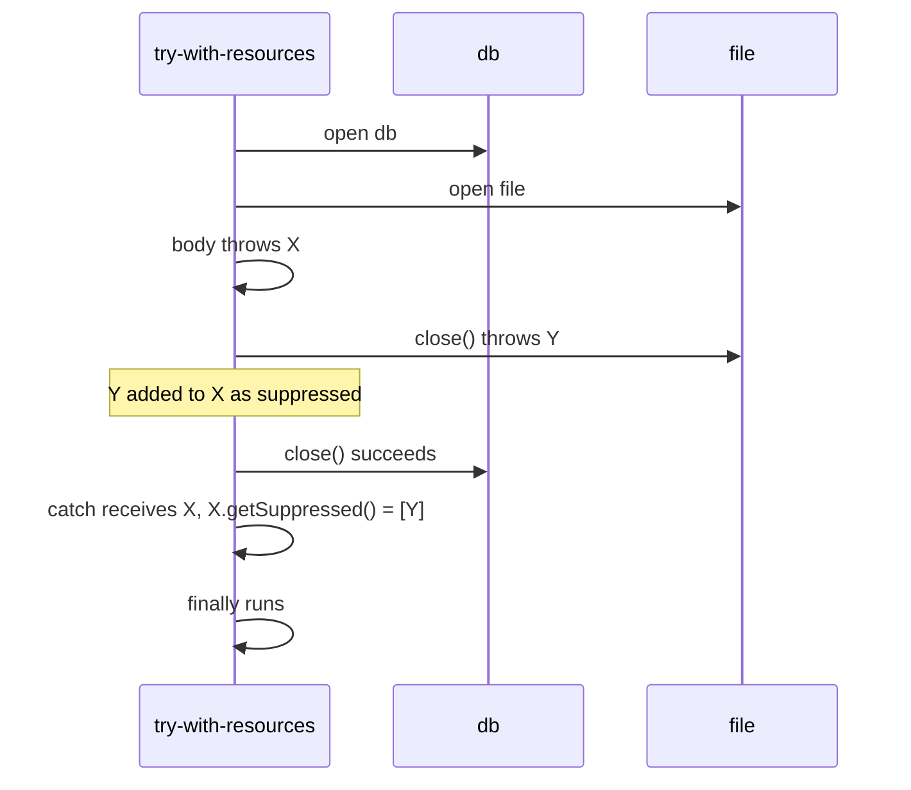
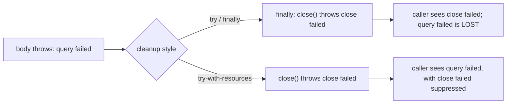
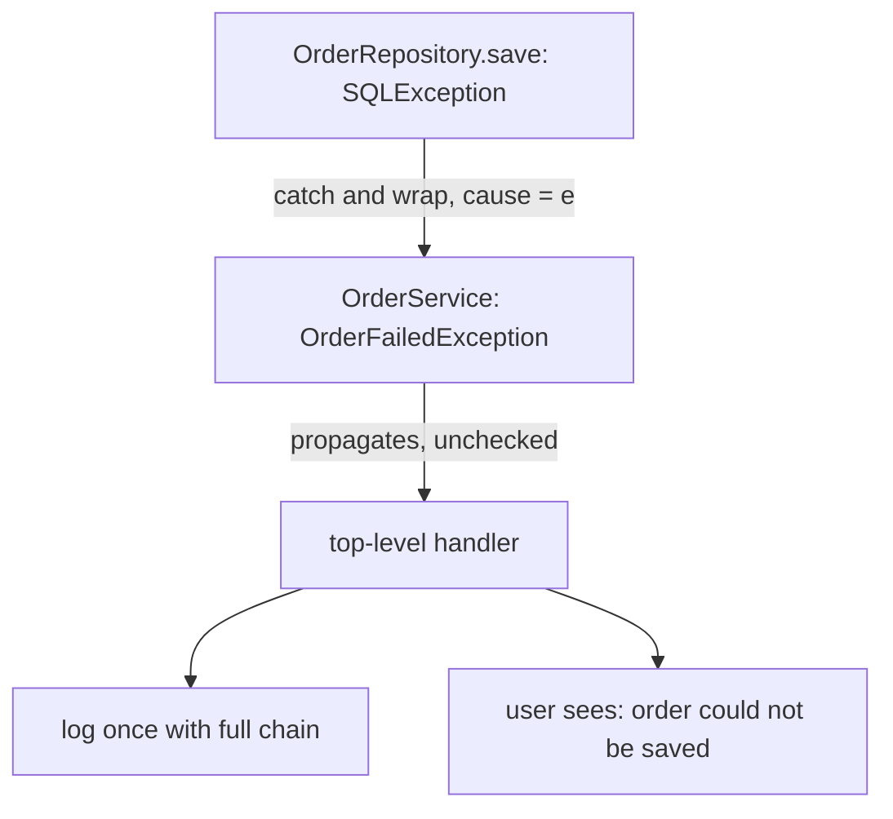

## In One Line
Close resources with **try-with-resources** (it closes in reverse order and keeps a failing `close()` as a **suppressed** exception instead of losing the real error), never `return` or `throw` from `finally`, wrap low-level exceptions in meaningful **custom exceptions with the cause attached**, and follow the rules: throw early, catch late, never swallow, log once.

## Mental Model
Think of **checking out of a hotel** after a business trip that went wrong.

- **try-with-resources** is the hotel's automatic checkout: every key card you took (room, gym, parking) is collected **in the reverse order you got them**, even if you are leaving in a hurry because of an emergency (an exception in the body).
- If returning a key card *also* goes wrong (the parking gate jams — `close()` throws), the receptionist **adds a note to the main incident report** ("also: parking gate jammed") — a **suppressed** exception — instead of throwing away the report about the real emergency. The old `try`/`finally` style was a receptionist who replaced the whole report with "parking gate jammed".
- **Exception chaining** is stapling the original police report to your insurance claim: the insurer's form (`OrderFailedException`) speaks the insurer's language, but the original report (`SQLException`) is attached as the **cause** so anyone can see what really happened.
- A **`return` inside `finally`** is a receptionist who tears up every incident report and just says "all good, goodbye".

## Concept
### 1. try-with-resources (Java 7)
```java
try (BufferedReader in = Files.newBufferedReader(src);
     BufferedWriter out = Files.newBufferedWriter(dst)) {
    in.transferTo(out);
}   // out.close() then in.close() — always, even on exceptions
```
Rules:
- Each resource must implement **`java.lang.AutoCloseable`** (this includes every `java.io.Closeable`: streams, readers, writers, channels, sockets, JDBC `Connection`/`Statement`/`ResultSet`, `Scanner`, `ExecutorService` since Java 19...).
- Resources are closed **in reverse order** of declaration, **automatically**, whether the body completes normally or throws.
- Resources are closed **before** any `catch` or `finally` of the same statement runs. So inside `catch` the resource is already closed.
- Resource variables are implicitly `final` (*auto-closeable resource s may not be assigned*).
- **Java 9+:** you may list an existing **final or effectively final** variable: `try (in; out) { ... }`. Otherwise: *variable r used as a try-with-resources resource neither final nor effectively final*.
- A **`null`** resource is allowed — its `close()` is simply skipped (handy for optional resources).
- If the **second** resource's initialiser throws, the **first** one (already opened) is closed; the second was never assigned, so there is nothing to close.
- A try-with-resources may have **no** `catch` and **no** `finally` at all.

### What the compiler generates
For `try (R r = init) { body }` the JLS (§14.20.3) specifies roughly:
```java
final R r = init;
Throwable primary = null;
try {
    body
} catch (Throwable t) {
    primary = t;
    throw t;
} finally {
    if (r != null) {
        if (primary != null) {
            try { r.close(); } catch (Throwable s) { primary.addSuppressed(s); }
        } else {
            r.close();                       // no body exception: close's exception propagates
        }
    }
}
```
With several resources, the declarations nest (the last one is innermost, so it closes first). A try-with-resources that also has `catch`/`finally` behaves like `try { <the code above> } catch ... finally ...` — which is why resources are closed before your `catch` runs.

### 2. Suppressed exceptions
Since Java 7 every `Throwable` has a list of **suppressed** exceptions: `addSuppressed(Throwable)` and `Throwable[] getSuppressed()`. try-with-resources uses it so that:
- If the **body** throws and `close()` throws too → the body's exception is thrown, the close exception is attached as suppressed.
- If the body succeeds and `close()` throws → the close exception is thrown (nothing to suppress it into).
- Several failing `close()` calls → all are attached, in closing order.

`printStackTrace()` shows them under a `Suppressed:` heading. Before Java 7, the classic hand-written `finally { in.close(); }` had a nasty flaw: an exception from `close()` **replaced** the body's exception, so the real cause of the failure was lost ("exception masking").

### `AutoCloseable` vs `Closeable`
| | `java.lang.AutoCloseable` (Java 7) | `java.io.Closeable` (Java 5) |
|---|---|---|
| Method | `void close() throws Exception` | `void close() throws IOException` |
| Relationship | Parent | `Closeable extends AutoCloseable` (retrofitted in Java 7) |
| Idempotent? | *Encouraged* (calling close twice should be harmless) | **Required**: closing an already closed stream has no effect |
| Use for | Any resource (locks, transactions, DB handles, your own classes) | I/O streams and channels |

An implementation may narrow the `throws` clause — `public void close()` with no checked exception at all is best when close can't fail, because callers then don't need a `catch`.

### 3. `finally` traps
| Code in `finally` | Effect |
|---|---|
| `return x;` | **Overrides** the `try`'s return value **and discards any pending exception** — the exception vanishes without a trace |
| `throw new X();` | **Replaces** the exception from `try`/`catch`; the original is lost (unless you add it as suppressed yourself) |
| Changing a **primitive** local that the `try` returned | No effect: the return value was already evaluated and saved |
| Mutating an **object** that the `try` returned | Visible to the caller: only the *reference* was saved |
| `break` / `continue` | Like `return`: discards the pending exception or return |

`javac` flags `return`/`throw` in `finally` only with `-Xlint:finally` (*finally clause cannot complete normally*); IDEs and static-analysis tools warn by default. Rule: **`finally` is for cleanup only** — and with try-with-resources you rarely need it at all.

### 4. Exception chaining and translation
**Chaining** means storing the lower-level exception as the **cause** of a higher-level one:
```java
catch (SQLException e) {
    throw new OrderFailedException("Could not save order " + id, "ORDER_DB_ERROR", e);  // e = cause
}
```
- Constructors `Exception(String message, Throwable cause)` and `Exception(Throwable cause)` (Java 1.4) set it; `getCause()` reads it; `initCause(Throwable)` sets it later for exception classes without a cause constructor (only once — a second call throws `IllegalStateException`).
- The stack trace prints the chain as `Caused by: ...`, with `... n more` meaning "the last n frames are identical to the enclosing trace".
- **Exception translation** (Effective Java Item 73, "throw exceptions appropriate to the abstraction"): a service layer should not leak `SQLException` to a web controller. Translate it into something that belongs to the service's vocabulary — **but always pass the original as the cause**. `new OrderFailedException("save failed")` without `e` throws away the most valuable debugging information.

### 5. Custom exceptions
When a standard exception (`IllegalArgumentException`, `IllegalStateException`, `UnsupportedOperationException`, `NoSuchElementException`, `UncheckedIOException`...) describes the problem, **use it** (Item 72). Create your own when callers need to catch *this specific* condition, or when you want to carry extra data.
```java
public class InsufficientFundsException extends Exception {      // checked: caller can recover
    private static final long serialVersionUID = 1L;              // Throwable is Serializable
    private final long shortfall;                                 // extra context, immutable

    public InsufficientFundsException(String message, long shortfall) {
        super(message);
        this.shortfall = shortfall;
    }
    public long getShortfall() { return shortfall; }
}
```
Checklist:
- Extend **`Exception`** (checked — caller is expected to recover) or **`RuntimeException`** (unchecked — programming error or unrecoverable). Never extend `Throwable` or `Error` directly.
- Name ends in `Exception`.
- Provide at least `(String message)` and `(String message, Throwable cause)` constructors; forward to `super(...)`.
- Carry **failure-capture data** as final fields with getters (the amount, the id, an error code) — Item 75: the message should include the values that caused the failure.
- Declare `serialVersionUID`.
- For an application, a small hierarchy (`AppException` → `OrderException` → ...) lets callers catch broadly or narrowly.
- For exceptions used as cheap signals, the protected constructor `(message, cause, enableSuppression, writableStackTrace)` can switch off the stack trace — rarely needed.

### 6. Rethrowing
- **Precise rethrow (Java 7).** If a `catch (Exception e)` block rethrows `e` unchanged and `e` is effectively final, the compiler knows `e` can only be one of the checked exceptions the `try` body actually throws. The method can therefore declare `throws IOException, SQLException` instead of `throws Exception`.
- **Log *or* rethrow, not both.** `catch (E e) { log.error(..., e); throw e; }` produces the same stack trace several times as it bubbles up. Log once, where the exception is finally handled.

### 7. Checked exceptions and lambdas
`java.util.function` interfaces (`Function`, `Consumer`, `Supplier`...) declare no checked exceptions, so `list.stream().map(p -> Files.readString(p))` does not compile: *unreported exception IOException; must be caught or declared to be thrown*. Options:
1. Catch inside the lambda (or a helper method) and wrap: `throw new UncheckedIOException(e)` (Java 8, made for exactly this), or your own unchecked exception.
2. Define your own functional interface whose method declares `throws IOException`.
3. Rewrite as a plain loop when the checked exception must reach the caller.

### 8. Sneaky throws — checked exceptions are only a compiler rule
```java
@SuppressWarnings("unchecked")
static <E extends Throwable> void sneakyThrow(Throwable t) throws E { throw (E) t; }
// sneakyThrow<RuntimeException>(new IOException()) — compiles without throws, throws a real IOException
```
Because of type erasure, the cast `(E)` is not checked at runtime, and the compiler inferred `E = RuntimeException`, so it demands no handling. Lombok's `@SneakyThrows` does the same in bytecode. It proves the JVM has no concept of "checked", but it surprises callers (they can't even write `catch (IOException e)` — *never thrown in body of corresponding try statement*), so use it very rarely.

### 9. Exceptions across threads
- A plain `Thread`: an exception leaving `run()` goes to the thread's `UncaughtExceptionHandler`; it never reaches the thread that started it.
- `ExecutorService.submit(...)`: the exception is **captured in the `Future`**. `future.get()` throws **`ExecutionException`** whose `getCause()` is the original. If nobody calls `get()`, the failure is **silently lost**.
- `ExecutorService.execute(...)`: the exception reaches the worker thread's uncaught-exception handler (printed by default).
- `CompletableFuture`: `join()` throws `CompletionException`, `get()` throws `ExecutionException`; handle with `exceptionally`, `handle` or `whenComplete`. See [CompletableFuture](lesson:a05-java8/23-completablefuture).

### 10. Handling `InterruptedException`
Throwing `InterruptedException` **clears** the thread's interrupt flag. If you catch it and cannot rethrow it, restore the flag so code higher up still knows a cancellation was requested:
```java
try {
    Thread.sleep(1000);
} catch (InterruptedException e) {
    Thread.currentThread().interrupt();   // restore the flag
    return;                               // and stop what you were doing
}
```

### 11. Best practices (Effective Java Items 69–77, plus field experience)
1. **Use exceptions only for exceptional conditions**, never for ordinary control flow.
2. **Checked for recoverable conditions, runtime for programming errors**; avoid checked exceptions the caller can't do anything about.
3. **Prefer standard exceptions** over inventing new ones.
4. **Throw exceptions appropriate to the abstraction** — translate, and keep the cause.
5. **Document** every exception with `@throws` (checked and important unchecked ones).
6. **Put failure-capture information in the message**: `"balance 1000 < 5000"`, not `"error"`.
7. **Strive for failure atomicity**: validate before changing state, so a failed call leaves the object as it was.
8. **Don't ignore exceptions**; an intentionally empty catch gets a comment and a variable named `ignored`.
9. **Throw early, catch late**: validate at the entry of a method; handle where you have enough context (often a top-level boundary).
10. **Release resources with try-with-resources**, not `finally`.
11. **Log once**, with the exception object as the last logger argument so the stack trace is kept.
12. **Restore the interrupt flag** when swallowing `InterruptedException`.
13. **Don't catch `Throwable`/`Error`** except at a top-level boundary that logs and shuts down or isolates the failure.

## Diagram

Resources close in reverse order before `catch` runs; the body's exception stays primary and the failure in `close()` is kept, not lost.


Exception masking: hand-written `finally` cleanup replaces the real error; try-with-resources keeps both.


Exception translation: each layer speaks its own vocabulary, but the original exception travels along as the cause.

## Code
**1. try-with-resources: order of events and suppressed exceptions**
```java
public class TryWithResourcesDemo {
    public static void main(String[] args) {
        try (Resource db = new Resource("db", false);
             Resource file = new Resource("file", true)) {      // its close() will fail
            System.out.println("body: using " + db.name + " and " + file.name);
            throw new IllegalStateException("body failed");
        } catch (IllegalStateException e) {
            System.out.println("catch: " + e.getMessage());
            for (Throwable s : e.getSuppressed()) {
                System.out.println("  suppressed: " + s.getMessage());
            }
        } finally {
            System.out.println("finally");
        }
    }
}

class Resource implements AutoCloseable {
    final String name;
    private final boolean failOnClose;

    Resource(String name, boolean failOnClose) {
        this.name = name;
        this.failOnClose = failOnClose;
        System.out.println("open " + name);
    }

    @Override
    public void close() {                          // narrower than AutoCloseable's "throws Exception"
        System.out.println("close " + name);
        if (failOnClose) throw new IllegalStateException("close of " + name + " failed");
    }
}
```
```output
open db
open file
body: using db and file
close file
close db
catch: body failed
  suppressed: close of file failed
finally
```

**2. Exception masking: old `try`/`finally` vs try-with-resources**
```java
public class MaskingDemo {
    public static void main(String[] args) {
        try {
            oldStyle();
        } catch (Exception e) {
            report("try/finally", e);
        }
        try {
            newStyle();
        } catch (Exception e) {
            report("try-with-resources", e);
        }
    }

    // Pre-Java 7 style: an exception from close() REPLACES the real one
    static void oldStyle() throws Exception {
        Connection c = new Connection();
        try {
            c.query();                       // throws "query failed"
        } finally {
            c.close();                       // throws "close failed" -> original is lost
        }
    }

    // Java 7+: the real exception wins, close()'s exception is attached as suppressed
    static void newStyle() throws Exception {
        try (Connection c = new Connection()) {
            c.query();
        }
    }

    static void report(String style, Exception e) {
        System.out.println(style + " -> caller sees: " + e.getMessage());
        for (Throwable s : e.getSuppressed()) {
            System.out.println("    suppressed: " + s.getMessage());
        }
    }
}

class Connection implements AutoCloseable {
    void query() throws Exception { throw new Exception("query failed"); }

    @Override
    public void close() throws Exception { throw new Exception("close failed"); }
}
```
```output
try/finally -> caller sees: close failed
try-with-resources -> caller sees: query failed
    suppressed: close failed
```

**3. Edge cases: null resource, Java 9 syntax, failing constructor, precise rethrow, sneaky throw**
```java
import java.io.IOException;
import java.sql.SQLException;

public class TwrEdgeCases {
    public static void main(String[] args) throws Exception {
        // 1. A null resource is allowed: close() is simply skipped
        try (Res r = null) {
            System.out.println("1. body ran with a null resource");
        }

        // 2. Java 9+: an effectively final variable can be used directly
        Res shared = new Res("shared");
        try (shared) {
            System.out.println("2. body using " + shared.name);
        }

        // 3. If the 2nd resource's constructor throws, the 1st is still closed
        try (Res a = new Res("a"); Res b = Res.failing("b")) {
            System.out.println("never printed");
        } catch (IllegalStateException e) {
            System.out.println("3. caught: " + e.getMessage());
        }

        // 4. Precise rethrow (Java 7): catch Exception, rethrow, but declare only what can really happen
        try {
            process(true);
        } catch (IOException | SQLException e) {
            System.out.println("4. rethrown precisely: " + e);
        }

        // 5. Sneaky throw: a checked exception escapes a method with no throws clause
        try {
            sneaky();
        } catch (Exception e) {                  // the compiler only allows catching Exception here
            System.out.println("5. sneaky: " + e + " (checked: " + !(e instanceof RuntimeException) + ")");
        }
    }

    static void process(boolean io) throws IOException, SQLException {   // not "throws Exception"
        try {
            if (io) throw new IOException("disk");
            else throw new SQLException("db");
        } catch (Exception e) {
            System.out.println("   logging " + e.getClass().getSimpleName());
            throw e;                             // compiler knows e is IOException or SQLException
        }
    }

    static void sneaky() {                       // no throws clause!
        TwrEdgeCases.<RuntimeException>sneakyThrow(new IOException("undeclared"));
    }

    @SuppressWarnings("unchecked")
    static <E extends Throwable> void sneakyThrow(Throwable t) throws E {
        throw (E) t;                             // unchecked cast, erased at runtime
    }
}

class Res implements AutoCloseable {
    final String name;
    Res(String name) { this.name = name; System.out.println("   open " + name); }
    static Res failing(String name) { throw new IllegalStateException("cannot open " + name); }
    @Override public void close() { System.out.println("   close " + name); }
}
```
```output
1. body ran with a null resource
   open shared
2. body using shared
   close shared
   open a
   close a
3. caught: cannot open b
   logging IOException
4. rethrown precisely: java.io.IOException: disk
5. sneaky: java.io.IOException: undeclared (checked: true)
```

**4. `finally` traps**
```java
import java.util.ArrayList;
import java.util.List;

public class FinallyTraps {
    public static void main(String[] args) {
        System.out.println("1. " + returnOverride());
        System.out.println("2. " + swallowed());
        System.out.println("3. " + primitiveChange());
        System.out.println("4. " + objectChange());
        try {
            replaced();
        } catch (RuntimeException e) {
            System.out.println("5. caller caught: " + e.getMessage());
        }
    }

    static String returnOverride() {
        try {
            return "from try";
        } finally {
            return "from finally";            // overrides the try's return value
        }
    }

    static String swallowed() {
        try {
            throw new IllegalStateException("important failure");
        } finally {
            return "exception vanished";      // the exception is silently discarded
        }
    }

    static int primitiveChange() {
        int x = 10;
        try {
            return x;                         // the value 10 is saved here
        } finally {
            x = 20;                           // too late: changes the variable, not the saved value
        }
    }

    static List<String> objectChange() {
        List<String> list = new ArrayList<>(List.of("a"));
        try {
            return list;                      // the REFERENCE is saved
        } finally {
            list.add("added in finally");     // the object it points to can still change
        }
    }

    static void replaced() {
        try {
            throw new IllegalStateException("original failure");
        } finally {
            throw new RuntimeException("failure in finally");   // replaces the original
        }
    }
}
```
```output
1. from finally
2. exception vanished
3. 10
4. [a, added in finally]
5. caller caught: failure in finally
```

**5. Custom exceptions, chaining and translation**
```java
import java.sql.SQLException;

public class CustomExceptionDemo {
    public static void main(String[] args) {
        OrderService service = new OrderService(new OrderRepository());
        for (long amount : new long[] {5_000, 100}) {
            try {
                service.placeOrder("ORD-" + amount, amount);
            } catch (InsufficientFundsException e) {       // checked: caller can recover
                System.out.println("Ask the user to top up: short by " + e.getShortfall());
            } catch (OrderFailedException e) {             // unchecked: usually handled at the top
                System.out.println("toString : " + e);
                System.out.println("code     : " + e.getErrorCode());
                System.out.println("cause    : " + e.getCause());
                System.out.println("--- full stack trace ---");
                e.printStackTrace(System.out);
            }
        }
    }
}

// Checked: a business condition the caller is expected to handle
class InsufficientFundsException extends Exception {
    private static final long serialVersionUID = 1L;
    private final long shortfall;

    InsufficientFundsException(String message, long shortfall) {
        super(message);
        this.shortfall = shortfall;
    }

    long getShortfall() { return shortfall; }
}

// Unchecked: a failure the caller can't fix; wraps the low-level cause
class OrderFailedException extends RuntimeException {
    private static final long serialVersionUID = 1L;
    private final String errorCode;

    OrderFailedException(String message, String errorCode, Throwable cause) {
        super(message, cause);                              // keep the cause!
        this.errorCode = errorCode;
    }

    String getErrorCode() { return errorCode; }
}

class OrderService {
    private final OrderRepository repository;
    private final long balance = 1_000;

    OrderService(OrderRepository repository) { this.repository = repository; }

    void placeOrder(String id, long amount) throws InsufficientFundsException {
        if (amount > balance) {
            throw new InsufficientFundsException("balance " + balance + " < " + amount, amount - balance);
        }
        try {
            repository.save(id);
        } catch (SQLException e) {                          // exception translation
            throw new OrderFailedException("Could not save order " + id, "ORDER_DB_ERROR", e);
        }
    }
}

class OrderRepository {
    void save(String id) throws SQLException {
        throw new SQLException("connection refused", "08001");
    }
}
```
```output
Ask the user to top up: short by 4000
toString : OrderFailedException: Could not save order ORD-100
code     : ORDER_DB_ERROR
cause    : java.sql.SQLException: connection refused
--- full stack trace ---
OrderFailedException: Could not save order ORD-100
	at OrderService.placeOrder(CustomExceptionDemo.java:61)
	at CustomExceptionDemo.main(CustomExceptionDemo.java:8)
	at java.base/jdk.internal.reflect.DirectMethodHandleAccessor.invoke(DirectMethodHandleAccessor.java:103)
	at java.base/java.lang.reflect.Method.invoke(Method.java:580)
	at jdk.compiler/com.sun.tools.javac.launcher.Main.execute(Main.java:484)
	at jdk.compiler/com.sun.tools.javac.launcher.Main.run(Main.java:208)
	at jdk.compiler/com.sun.tools.javac.launcher.Main.main(Main.java:135)
Caused by: java.sql.SQLException: connection refused
	at OrderRepository.save(CustomExceptionDemo.java:68)
	at OrderService.placeOrder(CustomExceptionDemo.java:59)
	... 6 more
```

**6. Checked exceptions in lambdas, and exceptions from another thread**
```java
import java.io.IOException;
import java.io.UncheckedIOException;
import java.nio.file.Files;
import java.nio.file.Path;
import java.util.List;
import java.util.concurrent.ExecutionException;
import java.util.concurrent.ExecutorService;
import java.util.concurrent.Executors;
import java.util.concurrent.Future;

public class LambdaExceptions {
    public static void main(String[] args) throws InterruptedException {
        // 1. Checked exception inside a lambda: wrap it in an unchecked one
        try {
            List<String> texts = List.of("missing-a.txt", "missing-b.txt").stream()
                    .map(LambdaExceptions::read)
                    .toList();
            System.out.println(texts);
        } catch (UncheckedIOException e) {
            System.out.println("stream failed: " + e.getMessage());
            System.out.println("real cause   : " + e.getCause().getClass().getSimpleName());
        }

        // 2. Exceptions in another thread travel inside the Future
        ExecutorService pool = Executors.newSingleThreadExecutor();
        Future<Integer> future = pool.submit(() -> Integer.parseInt("forty-two"));
        try {
            future.get();
        } catch (ExecutionException e) {
            System.out.println("future.get() : " + e.getClass().getSimpleName());
            System.out.println("its cause    : " + e.getCause());
        } finally {
            pool.shutdown();
        }
    }

    static String read(String name) {
        try {
            return Files.readString(Path.of(name));
        } catch (IOException e) {
            throw new UncheckedIOException("cannot read " + name, e);
        }
    }
}
```
```output
stream failed: cannot read missing-a.txt
real cause   : NoSuchFileException
future.get() : ExecutionException
its cause    : java.lang.NumberFormatException: For input string: "forty-two"
```

## Walkthrough
### 1. `TryWithResourcesDemo`
- `Resource implements AutoCloseable` and overrides `close()` **without** a `throws` clause — legal, because an override may throw fewer checked exceptions. Callers therefore don't need to catch `Exception`.
- The constructor prints `open ...`; `close()` prints `close ...` and, for the resource created with `failOnClose = true`, throws.
- Two resources are declared, separated by `;`: `db` opens first, then `file`.
- The body prints and throws `IllegalStateException("body failed")`.
- Now the automatic cleanup runs **in reverse order**: `close file` (which throws `close of file failed` — added to the body's exception as **suppressed**), then `close db` (fine).
- Only then does the `catch` run: it receives the **body's** exception (`body failed`), and `e.getSuppressed()` returns the array containing the close failure.
- `finally` runs last.

### 2. `MaskingDemo`
- `Connection.query()` always throws `query failed`; `close()` always throws `close failed`.
- `oldStyle()` uses the pre-Java 7 pattern. `query()` throws, `finally` runs `c.close()`, which throws too — and an exception thrown from `finally` **replaces** the one in flight. The caller sees `close failed`; the real problem (`query failed`) is gone for good.
- `newStyle()` uses try-with-resources: the caller sees `query failed`, with `close failed` preserved as a suppressed exception. `report(...)` prints the suppressed list, which is empty in the old style.

### 3. `TwrEdgeCases`
- **Case 1** — `try (Res r = null)`: the generated code checks `if (r != null)` before calling `close()`, so there is no `NullPointerException`.
- **Case 2** — `shared` is declared outside and never reassigned (effectively final), so Java 9's `try (shared)` form accepts it. It is still closed at the end — even though it was created outside the statement.
- **Case 3** — `Res a` opens; the initialiser of `b` (`Res.failing("b")`) throws. `a` is closed (`close a`), `b` never existed, and the `catch` gets `cannot open b`.
- **Case 4** — `process(true)` catches `Exception e`, logs it and does `throw e;`. The method declares only `throws IOException, SQLException`, yet it compiles: since `e` is never reassigned, the compiler knows the only checked exceptions the `try` can produce are these two (precise rethrow). The caller uses a multi-catch.
- **Case 5** — `sneaky()` has no `throws` clause but throws a checked `IOException`. `sneakyThrow` is called with the type argument `<RuntimeException>`, so the compiler treats it as throwing an unchecked exception. At runtime the cast `(E) t` has been erased, so the `IOException` is thrown unchanged. The caller has to catch `Exception` — `catch (IOException e)` would not compile.

### 4. `FinallyTraps`
1. `returnOverride()` — both blocks return; the `finally`'s `return` executes last and wins: `from finally`.
2. `swallowed()` — the `try` throws, but the `return` in `finally` ends the method normally, and the `IllegalStateException` is thrown away. The caller prints `exception vanished` and never learns about the failure.
3. `primitiveChange()` — `return x` copies the value 10 into a hidden slot; `x = 20` in `finally` changes the local variable, not that slot. Result: `10`.
4. `objectChange()` — `return list` saves the **reference**; `finally` then adds to the same `ArrayList`, so the caller sees `[a, added in finally]`.
5. `replaced()` — the `finally` throws its own exception, which replaces `original failure`. The caller only sees `failure in finally`.
Compile with `javac -Xlint:finally` to get the warning *finally clause cannot complete normally* for cases 1, 2 and 5.

### 5. `CustomExceptionDemo`
- `InsufficientFundsException extends Exception` — **checked**, because the caller can do something about it (ask the user to top up). It carries the extra field `shortfall`, set in the constructor and exposed by a getter; `super(message)` stores the message. `serialVersionUID` is declared because `Throwable` is `Serializable`.
- `OrderFailedException extends RuntimeException` — **unchecked**: the caller cannot fix a database outage. Its constructor calls `super(message, cause)` to **chain** the cause and stores an `errorCode` that a top-level handler or API response can use.
- `OrderService.placeOrder` declares `throws InsufficientFundsException` (required, it's checked) but **not** `OrderFailedException` (unchecked). The balance check happens **before** anything changes — failure atomicity.
- `OrderRepository.save` simulates a JDBC failure: `new SQLException("connection refused", "08001")` — the second argument is the SQLState (08001 = "unable to connect").
- The `catch (SQLException e)` in the service is **exception translation**: a checked, low-level `SQLException` becomes an unchecked `OrderFailedException` in the service's vocabulary, with `e` as the cause.
- **Loop iteration 1** (5000): 5000 > 1000, so the checked exception is thrown; `main` prints `short by 4000`.
- **Iteration 2** (100): the repository fails; `main` catches the translated exception. `toString` shows the class name (no package — it's in the default package) and message; `getCause()` returns the original `SQLException`.
- **The stack trace:** the first block is the `OrderFailedException`, thrown at line 61 (`throw new OrderFailedException(...)`), called from `main` line 8. The next five frames (`DirectMethodHandleAccessor`, `Method.invoke`, `javac.launcher.Main`) exist only because the program was started with `java CustomExceptionDemo.java` — the source launcher compiles the file in memory and calls `main` via reflection; a normally compiled program would not show them. `Caused by:` starts the cause's trace: thrown in `OrderRepository.save` (line 68), called from `placeOrder` line 59 (`repository.save(id)`). `... 6 more` means its remaining 6 frames (`main` line 8 plus the 5 launcher frames) are identical to the end of the trace above, so they are not repeated.

### 6. `LambdaExceptions`
- `read(name)` is a helper that catches the checked `IOException` from `Files.readString` and rethrows it wrapped in `UncheckedIOException` — an unchecked exception from `java.io` designed for this purpose (its constructor requires an `IOException` cause). Because `read` throws nothing checked, `.map(LambdaExceptions::read)` compiles.
- The first file is missing, so the stream stops at the first element: `stream failed: cannot read missing-a.txt`; `getCause()` is the original `NoSuchFileException`. `missing-b.txt` is never read.
- `pool.submit(() -> Integer.parseInt("forty-two"))` runs the task on a worker thread. The `NumberFormatException` does not crash anything or print anything — it is stored inside the `Future`.
- `future.get()` rethrows it wrapped in `ExecutionException`; `getCause()` gives the original. Had we never called `get()`, the failure would have been silently lost.
- `pool.shutdown()` in `finally` lets the JVM exit (the pool's thread is non-daemon). `main` declares `throws InterruptedException` because `get()` can be interrupted.

## Traps
- **`return` (or `break`/`continue`) in `finally` silently discards exceptions.** It compiles without a warning unless you use `-Xlint:finally` — a real production bug source.
- **Throwing from `finally` or from a hand-written `close()` in `finally` masks the original exception.** Use try-with-resources.
- **Wrapping without the cause** — `throw new ServiceException("failed")` inside `catch (SQLException e)` loses the root cause. Always pass `e`.
- **Log-and-rethrow** fills logs with the same stack trace at every layer. Log once, where handled.
- **Catching `InterruptedException` and doing nothing** clears the interrupt flag and makes the thread uncancellable. Re-interrupt or rethrow.
- **Forgetting `future.get()`** after `submit(...)` — exceptions in the task disappear.
- **Resources created outside try-with-resources and passed around** — e.g. returning a `Stream` from `Files.lines(...)`: whoever consumes it must close it (`Files.lines` keeps a file handle open). Use `try (Stream<String> lines = Files.lines(p)) { ... }`.
- **Wrapping a decorator chain**: `try (var in = new BufferedReader(new FileReader(f)))` — if the `BufferedReader` constructor threw, the inner `FileReader` would not be closed because it isn't a declared resource. It practically never happens for `BufferedReader`, but for constructors that can throw, declare each layer as its own resource.
- **Custom exception anti-patterns:** extending `Exception` for programming errors (forces pointless catches), one generic `AppException` for everything (callers can't distinguish), a message with no data, mutable fields.
- **Sneaky throws** surprise callers: they can't catch the specific checked type without the compiler complaining.
- **`Throwable.addSuppressed(this)`** throws `IllegalArgumentException: Self-suppression not permitted`; `addSuppressed(null)` throws NPE.

> [!WARNING] In try-with-resources, when the body succeeds but `close()` throws, **the close exception is the primary one** that reaches the caller. It is only "suppressed" when the body also threw.

## Tips & Tricks
- **"Last opened, first closed"** — resources close like a stack (LIFO), just like nested `try` blocks.
- **"Close before catch"** — in try-with-resources, by the time your `catch` runs, every resource is already closed.
- **"finally is for cleanup, not for control"** — no `return`, `throw`, `break` or `continue` in `finally`.
- **Always chain: `new XException(msg, e)`** — the `e` at the end is the most important argument.
- **Checked-in-lambda recipe:** helper method + `catch (IOException e) { throw new UncheckedIOException(e); }`; unwrap with `getCause()` at the top if needed.
- **When writing a class that holds a resource, implement `AutoCloseable`** so users can put it in try-with-resources, and make `close()` idempotent and declare no checked exception if it can't fail.
- **Custom exception template:** extends `RuntimeException` (or `Exception` if recoverable) + `serialVersionUID` + `(msg)` and `(msg, cause)` constructors + final context fields.
- **Message recipe:** what failed + the offending values + (optionally) what to do: `"Could not save order ORD-100 (db connection refused)"`.

## Interview Q&A
### [Basic] What is try-with-resources and why is it better than `finally`?
A `try` statement (Java 7) that declares resources in parentheses: `try (var in = Files.newBufferedReader(p)) { ... }`. Every resource must implement `AutoCloseable`, and each is closed automatically in reverse order of declaration when the block ends, normally or by exception. It's better than a hand-written `finally` because: (1) it's shorter and you can't forget to close; (2) it handles `null` resources and partially opened resource lists correctly; (3) most importantly, if the body throws and `close()` also throws, the body's exception is kept and the close exception is attached as **suppressed** — a manual `finally` would let the close exception replace (mask) the real one.

**Follow-up:** *What changed in Java 9?* — You can list an existing final or effectively final variable instead of declaring a new one: `try (in; out) { ... }`.

### [Intermediate] What are suppressed exceptions?
Exceptions that were thrown while another exception was already propagating and were attached to it instead of replacing it. `Throwable.addSuppressed(Throwable)` and `getSuppressed()` were added in Java 7, mainly for try-with-resources: if the body throws `X` and a resource's `close()` throws `Y`, the caller receives `X` with `Y` in `X.getSuppressed()`. Several failing closes are all added. `printStackTrace()` prints them under `Suppressed:`. You can also use `addSuppressed` manually, e.g. when a cleanup step in your own code fails during error handling.

**Follow-up:** *If only `close()` throws, is its exception suppressed?* — No, then it is the primary exception thrown to the caller.

### [Intermediate] In try-with-resources, in what order do things happen?
1. Resources are initialised left to right (top to bottom). 2. The body runs. 3. Resources are closed in reverse order — before any `catch` or `finally` of that statement. 4. If an exception is pending (from the body or from a close), the matching `catch` runs. 5. `finally` runs. If a resource initialiser throws, the resources already opened are closed and the rest are never created.

**Follow-up:** *Can the resource be used inside the catch block?* — No: it's out of scope there, and it's already closed anyway.

### [Intermediate] What happens if a `finally` block contains a `return` statement?
The `finally`'s `return` completes the method, so it **overrides** any value returned by the `try` or `catch`, and it **discards** any exception that was propagating — the caller never sees it. Similarly, an exception thrown in `finally` replaces the original one. That's why `return`/`throw` in `finally` is considered a bug; `javac -Xlint:finally` warns *finally clause cannot complete normally*.
```java
static String f() {
    try { throw new IllegalStateException("important"); }
    finally { return "ok"; }       // returns "ok"; the exception is lost
}
```
**Follow-up:** *If the `try` does `return x;` and `finally` does `x = 20;`, what is returned?* — The original value: the return value was evaluated before `finally` ran. For an object, mutations made in `finally` are visible, since only the reference was saved.

### [Intermediate] How do you create a custom exception, and should it be checked or unchecked?
Extend `Exception` for a checked exception or `RuntimeException` for an unchecked one, name it `...Exception`, provide at least `(String message)` and `(String message, Throwable cause)` constructors that call `super(...)`, add immutable fields for context, and declare a `serialVersionUID`:
```java
public class OrderFailedException extends RuntimeException {
    private static final long serialVersionUID = 1L;
    private final String orderId;
    public OrderFailedException(String orderId, Throwable cause) {
        super("Could not place order " + orderId, cause);
        this.orderId = orderId;
    }
    public String getOrderId() { return orderId; }
}
```
Choose **checked** only if the caller can reasonably recover (e.g. `InsufficientFundsException` → ask for another card). Choose **unchecked** for programming errors and failures the immediate caller can't fix (infrastructure down) — which is the majority in modern code. Before creating one, check whether a standard exception already fits.

**Follow-up:** *Why not extend `Throwable` or `Error`?* — `Error` means JVM-level problems that code shouldn't catch, and extending `Throwable` directly makes a checked exception that doesn't fit `catch (Exception e)` handlers.

### [Intermediate] What is exception chaining and why is it important?
Storing a lower-level exception as the **cause** of a higher-level one: `throw new OrderFailedException("...", e);`. It enables **exception translation** — each layer throws exceptions in its own vocabulary (the service throws `OrderFailedException`, not `SQLException`) — without losing the root cause. `getCause()` returns it, and the stack trace prints it as `Caused by:` (with `... n more` for shared frames). Without chaining, the log only says "order failed", and the actual reason (connection refused, constraint violation) is gone.

**Follow-up:** *How do you set a cause on an exception class that has no cause constructor?* — Call `initCause(cause)` once after creating it; a second call, or calling it when a cause was already given to the constructor, throws `IllegalStateException`.

### [Advanced] What is the difference between `AutoCloseable` and `Closeable`?
`java.io.Closeable` (Java 5) has `void close() throws IOException` and its contract requires `close()` to be **idempotent** — closing twice has no effect. `java.lang.AutoCloseable` (Java 7) was introduced as the more general parent for try-with-resources: `void close() throws Exception`, with idempotency only encouraged. `Closeable` was retrofitted to extend `AutoCloseable`. Implement `Closeable` for I/O-style resources, `AutoCloseable` for anything else (locks, transactions, scopes), and narrow the `throws` clause as far as possible.

**Follow-up:** *Why does `AutoCloseable.close()` throw `Exception`?* — To be general enough for any resource; implementations are encouraged to declare narrower exceptions or none, and to avoid throwing `InterruptedException`.

### [Advanced] How do you deal with checked exceptions inside lambdas and streams?
Standard functional interfaces (`Function`, `Consumer`, `Supplier`...) don't declare checked exceptions, so `map(p -> Files.readString(p))` doesn't compile. Options: catch inside the lambda or a helper and rethrow as unchecked — `UncheckedIOException` for I/O, or a custom runtime exception — then unwrap at the boundary with `getCause()`; define your own functional interface with a `throws` clause (e.g. `ThrowingFunction<T, R, E extends Exception>`) plus an adapter; or use a plain loop when the checked exception must be propagated. Libraries like Vavr offer `Try`. Sneaky throws are possible but hide the exception from the type system.

**Follow-up:** *What happens to the stream when the wrapped exception is thrown?* — The terminal operation aborts and the exception propagates to the caller; later elements are not processed.

### [Advanced] What is "precise rethrow"?
A Java 7 compiler improvement: if a `catch (Exception e)` block rethrows `e` and `e` is final or effectively final, the compiler computes the rethrown types from what the `try` block can actually throw, not from the declared type `Exception`. So a method whose `try` can throw only `IOException` and `SQLException` can catch `Exception`, log it and `throw e;` while declaring just `throws IOException, SQLException`. If you reassign `e` in the catch, the analysis is lost and you'd have to declare `throws Exception`.

**Follow-up:** *How is that different from multi-catch?* — Multi-catch names the types explicitly (`catch (IOException | SQLException e)`); precise rethrow lets a broad `catch` stay precise automatically.

### [Advanced] How are exceptions handled in threads and executors?
An exception can't cross threads by itself. In a raw `Thread`, it goes to that thread's `UncaughtExceptionHandler` (default: print the stack trace) and the thread dies. With `ExecutorService.submit`, the exception is captured in the `Future` and rethrown by `get()` as `ExecutionException` with the original as its cause — if nobody calls `get()`, it's silently lost. With `execute`, it reaches the worker thread's uncaught-exception handler. `CompletableFuture` stores it too: `join()` throws `CompletionException`, `get()` throws `ExecutionException`, and `exceptionally`/`handle` let you recover in the pipeline.

**Follow-up:** *How do you make sure task failures are logged?* — Always consume the `Future` (or use `CompletableFuture.whenComplete`), wrap tasks in a try/catch that logs, or override `ThreadPoolExecutor.afterExecute`.

### [Advanced] Can you throw a checked exception without declaring it?
Yes. Checked exceptions are enforced only by the compiler; the JVM doesn't know about them. The "sneaky throw" trick uses a generic method `static <E extends Throwable> void sneakyThrow(Throwable t) throws E { throw (E) t; }` called as `Util.<RuntimeException>sneakyThrow(new IOException())`: the compiler thinks it throws a `RuntimeException`, and the cast is erased at runtime. Lombok's `@SneakyThrows`, and code compiled from other JVM languages like Kotlin, can also throw undeclared checked exceptions. It's legitimate in rare framework code but confusing elsewhere, because callers can't write `catch (IOException e)` for it.

**Follow-up:** *Where does the JDK itself allow this?* — `Class.newInstance()` (deprecated since Java 9) could propagate any checked exception thrown by the constructor — one reason it was replaced by `getDeclaredConstructor().newInstance()`, which wraps it in `InvocationTargetException`.

### [Intermediate] What are your top exception-handling best practices?
Use exceptions only for exceptional situations; checked for recoverable conditions and unchecked for programming errors; prefer standard exceptions; throw exceptions appropriate to the abstraction and always keep the cause; include the failing values in the message; validate first so failures leave state unchanged (failure atomicity); never swallow exceptions; throw early and catch late, handling at the level that has context; log once, with the exception object; use try-with-resources for cleanup; restore the interrupt flag on `InterruptedException`; don't catch `Throwable`/`Error` except at top-level boundaries; document exceptions with `@throws`.

**Follow-up:** *What's wrong with `catch (Exception e) { throw new RuntimeException(e); }` everywhere?* — It adds no information, turns every failure into a generic type callers can't distinguish, and often hides `InterruptedException`. Translate into meaningful types, or let it propagate.

## Quiz
### What does this return?
```java
static String f() {
    try {
        throw new IllegalStateException("boom");
    } finally {
        return "done";
    }
}
```
- [ ] It throws IllegalStateException: boom
- [x] "done"
- [ ] Compile error: unreachable code
- [ ] "done", and the exception is added as suppressed
> The `return` in `finally` completes the method normally and **discards** the pending exception. Nothing is added as suppressed — suppression is a try-with-resources feature. This compiles (only `-Xlint:finally` warns), which is exactly why it's dangerous.

### What does this print?
```java
record R(String n) implements AutoCloseable {
    R { System.out.print("open " + n + "; "); }
    public void close() { System.out.print("close " + n + "; "); }
}
try (R a = new R("a"); R b = new R("b"); R c = new R("c")) {
    System.out.print("body; ");
}
```
- [ ] open a; open b; open c; body; close a; close b; close c;
- [x] open a; open b; open c; body; close c; close b; close a;
- [ ] open a; body; close a; open b; body; close b; ...
- [ ] body; open a; open b; open c; close c; close b; close a;
> Resources open in declaration order and close in **reverse** order (last opened, first closed), after the body.

### Body throws `X`; both resources' `close()` methods throw. What does the catch receive?
- [ ] The exception from the first resource's close, with X suppressed
- [ ] The exception from the last close
- [x] X, with 2 suppressed exceptions
- [ ] X, with no suppressed exceptions
> The body's exception stays primary; each failing `close()` (in reverse order) is attached with `addSuppressed`, so `getSuppressed().length` is 2. Only when the body succeeds does a close exception become the primary one.

### What does this print?
```java
try (AutoCloseable r = null) {
    System.out.println("body");
}
```
- [x] body
- [ ] NullPointerException
- [ ] Compile error: resource cannot be null
- [ ] Nothing
> A `null` resource is allowed; the generated code checks for null before calling `close()`. (The snippet needs a surrounding method that handles `Exception`, because `AutoCloseable.close()` declares it.)

### Which exception reaches the caller?
```java
try {
    throw new IllegalStateException("A");
} finally {
    throw new RuntimeException("B");
}
```
- [ ] A, with B suppressed
- [x] B — A is lost
- [ ] A — finally cannot throw
- [ ] Both, as a combined exception
> An exception thrown from `finally` replaces the one in flight; there is no automatic suppression in a plain `try`/`finally`. That is the masking problem that try-with-resources solves.

### Spot the bug.
```java
try {
    repository.save(order);
} catch (SQLException e) {
    log.error("DB error", e);
    throw new OrderFailedException("Could not save order");
}
```
- [ ] `SQLException` cannot be caught because it's checked
- [x] The new exception has no cause, and the error is also logged here and again wherever it is finally handled
- [ ] Custom exceptions must extend `Exception`
- [ ] The catch must rethrow the same `SQLException`
> Translating is right, but `new OrderFailedException("...")` drops `e` — pass it as the cause (`new OrderFailedException("...", e)`). Logging and rethrowing also produces duplicate log entries; log once where the exception is handled.

### Spot the bug.
```java
public void run() {
    while (running) {
        try {
            Thread.sleep(1000);
        } catch (InterruptedException e) {
            // ignore
        }
        poll();
    }
}
```
- [ ] `Thread.sleep` doesn't throw `InterruptedException`
- [ ] The catch should be `catch (Exception e)`
- [x] Swallowing `InterruptedException` clears the interrupt flag, so the thread can never be cancelled by interruption
- [ ] `poll()` should be in a `finally`
> When `InterruptedException` is thrown, the interrupt status is cleared. Ignoring it means the cancellation request is lost and the loop keeps going. Restore it with `Thread.currentThread().interrupt()` and exit the loop (or rethrow).

## Takeaways
- try-with-resources closes every `AutoCloseable` automatically, in reverse order, before `catch`/`finally` run; `null` resources are skipped, and Java 9 accepts effectively final variables.
- If the body throws and `close()` also throws, the body's exception is kept and the close exception is attached via `addSuppressed` (`getSuppressed()`); a manual `finally` would mask the original.
- Never `return`, `throw`, `break` or `continue` in `finally`: it overrides return values and discards or replaces exceptions.
- Changing a returned primitive in `finally` has no effect; mutating a returned object does.
- Translate low-level exceptions into ones that fit your layer, and always keep the original as the cause (`new XException(msg, e)`), which prints as `Caused by:`.
- Custom exceptions: extend `Exception` (recoverable) or `RuntimeException` (bugs or unrecoverable), provide message and cause constructors, carry immutable context fields, and declare `serialVersionUID`; prefer standard exceptions when they fit.
- Checked exceptions in lambdas: wrap them (`UncheckedIOException`); in executors, failures come back from `future.get()` as `ExecutionException`.
- Best practices: throw early, catch late, never swallow, log once, restore the interrupt flag, and put the failing values in the message.
