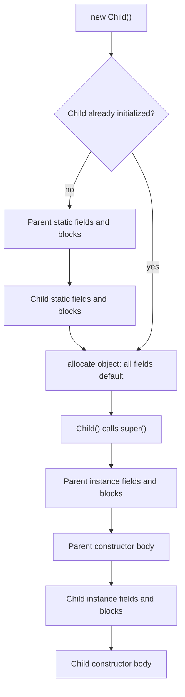
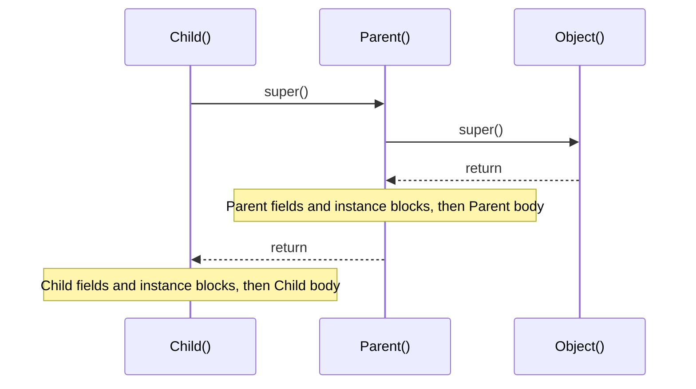
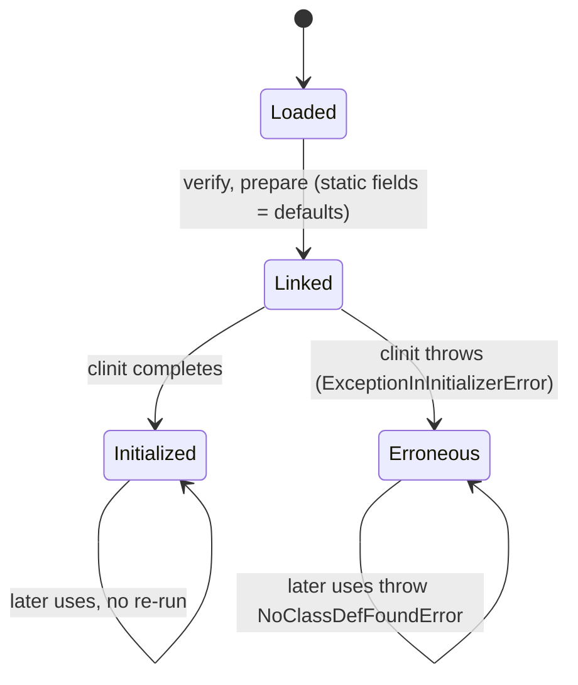

## In One Line
A class is initialised **once**, on first active use — parent before child, static fields and `static { }` blocks top to bottom; then **every** `new` runs the constructor chain: `this(...)`/`super(...)` all the way up to `Object`, and on the way back down each class runs its instance field initialisers and `{ }` blocks in textual order, then the rest of its constructor body.

## Mental Model
Think of opening a **franchise restaurant**.

- **Setting up the building happens once** (class initialisation). The head office's standards must be in place before the franchise's own set-up (parent static init before child static init). Within each, the checklist is followed **top to bottom** (static fields and static blocks in the order they are written).
- **Every customer order** (every `new`) is then prepared the same way:
  1. The kitchen grabs an **empty plate** (memory is allocated and every field starts at its default: `0`, `false`, `null`).
  2. The **head-office base recipe** is prepared first (the `super(...)` chain runs the parent's part completely).
  3. Then the **franchise's standard prep steps**, in the order they are written on the franchise's card (instance field initialisers and instance blocks, in textual order).
  4. Finally the **special requests for this order** (the rest of the constructor body).
- If the base recipe *asks the franchise chef for advice* before the franchise has done its prep (a parent constructor calling an overridden method), the chef answers with an **empty plate** — `null` and `0`.
- If setting up the building fails (a static initialiser throws), the restaurant is **marked as broken forever**: every later customer is turned away (`NoClassDefFoundError`).

## Concept
### Two separate phases
| Phase | When | How often | What runs |
|---|---|---|---|
| **Class initialisation** | First *active use* of the class | **Once** per class (per class loader) | Static variable initialisers and `static { }` blocks, in textual order — compiled into a hidden method `<clinit>` |
| **Object instantiation** | Every `new` | Every time | Constructor chain; instance variable initialisers and `{ }` blocks, in textual order — compiled into each constructor (`<init>`) |

Before class initialisation, the class is **loaded** and **linked**. During the *preparation* step of linking, static fields get their **default values** (0, `false`, `null`). Class loading in depth is in [class loading](lesson:b02-jvm/01-class-loading).

### Full order for `new Child()` the first time
1. **Parent static** fields and static blocks (textual order) — the superclass is always initialised first.
2. **Child static** fields and static blocks.
3. Memory for the object is allocated; **all instance fields** (of Parent and Child) are set to default values.
4. `Child()` starts and immediately calls `super(...)` (explicitly or implicitly) — which recursively runs up to `Object()`.
5. **Parent instance** field initialisers and instance blocks (textual order).
6. **Parent constructor** body (the rest after its `super()`).
7. **Child instance** field initialisers and instance blocks (textual order).
8. **Child constructor** body.

The second `new Child()` repeats only steps 3–8: static initialisation never runs again.

> [!INTERVIEW] "Static once, parent first. Then for every object: super first, then fields and blocks in the order written, then the constructor body."

### How the compiler really does it
The compiler **copies** all instance variable initialisers and instance blocks, in textual order, into **every constructor that calls `super(...)`**, right after that call. Constructors that start with `this(...)` do **not** get a copy — they delegate to another constructor that eventually calls `super(...)`. Consequences:
- Instance initialisers run **exactly once per object**, no matter how many `this(...)` hops there are.
- They run **after** the parent is fully constructed and **before** the rest of the constructor body.
- Field initialisers and instance blocks are **one list** in textual order: a block written above a field runs before that field's initialiser.

Static initialisers are similarly merged, in textual order, into the single `<clinit>` method.

### When is a class initialised? (JLS §12.4.1)
A class `T` is initialised immediately before the first:
- `new T(...)`;
- call of a **static method** declared in `T`;
- **assignment** to a static field declared in `T`;
- **read** of a static field declared in `T` that is **not a constant variable**;
- reflective call like `Class.forName("T")` (the one-argument version initialises), or reflective access to its members;
- initialisation of a **subclass** of `T` (superclass first);
- being the **main class** at JVM start-up.

It is **not** initialised by:
- reading a **compile-time constant** (`static final` primitive or `String` initialised with a constant expression, e.g. `static final int MAX = 10;`) — the compiler copies the value into the using class;
- accessing an inherited static field **through a subclass name** (`Sub.parentValue` initialises only `Base`, where the field is declared);
- creating an **array** of `T` (`new T[3]`);
- the **class literal** `T.class`, `ClassLoader.loadClass`, or `Class.forName(name, false, loader)`.

Interfaces are similar, but a class's initialisation does not initialise the interfaces it implements, unless they declare default methods.

### Constant variables are special
A `static final` field of primitive or `String` type whose initialiser is a **constant expression** is a *constant variable*. It is initialised first (before any other static initialiser), so it can never be observed with its default value — and code in other classes that uses it gets the value **inlined** at compile time (changing the constant then requires recompiling the users). `static final long STARTED = System.nanoTime() > 0 ? 1 : 0;` is `final` but **not** a constant, because its value is computed at runtime.

### Forward references
Reading a static (or instance) field **by its simple name** in an initialiser that appears **before** its declaration is a compile error: *illegal forward reference*. But calling a method that reads it, or writing `ClassName.field`, compiles — and sees the **default value**. Initialisation is purely textual; the compiler protects you only against the most obvious case.

### Order-of-declaration puzzles
The famous one (a variation of a *Java Puzzlers* classic):
```java
class Singleton {
    static final Singleton INSTANCE = new Singleton();   // runs the constructor: counter becomes 1
    static int counter = 0;                              // then this resets counter to 0!
    private Singleton() { counter++; }
}
```
`Singleton.counter` is **0**, because static initialisers run in textual order and the explicit `= 0` runs *after* the constructor incremented it. A field **without** an initialiser (`static int total;`) keeps the constructor's value. Fix: declare the instance **last**, or better, use an `enum` or the holder idiom.

### Calling an overridable method from a constructor
A parent constructor that calls an overridden method runs the **child's** version before the child's field initialisers have run. The override sees `null`/`0`/`false`. Worse, anything the override assigns to a child field that **has** an explicit initialiser is overwritten a moment later when that initialiser runs. Rule (Effective Java Item 19): **constructors must not invoke overridable methods**, directly or indirectly — call only `private`, `final` or `static` methods.

### Constructor chaining rules (Java 17/21)
- The first statement of a constructor is `this(...)` or `super(...)`; if you write neither, the compiler inserts `super()`.
- You cannot have both, and they must be first (*call to this must be first statement in constructor*).
- Arguments to `this(...)`/`super(...)` cannot use instance fields or instance methods (*cannot reference size before supertype constructor has been called*) — only parameters, static members and constants.
- If you declare **no** constructor, the compiler adds a **default constructor** that calls `super()`. If the parent has no accessible no-arg constructor, that fails (*constructor P in class P cannot be applied to given types*).
- **Java 22–25:** JEP 447/482/492 previewed, and JDK 25 finalised (JEP 513, *Flexible Constructor Bodies*), statements **before** `super(...)`/`this(...)` — for validating or computing arguments and even assigning the class's own fields, but still without using `this` otherwise. On Java 17/21 the old rule holds.

### Static blocks and instance blocks
| | `static { ... }` | `{ ... }` (instance initialiser) |
|---|---|---|
| Runs | Once, at class initialisation | For every object, before the constructor body |
| Can access | Static members only | Static and instance members, `this` |
| Typical use | Complex static set-up: filling a lookup map, loading a native library, reading config | Code shared by all constructors; initialising anonymous classes (they can't have constructors) |
| Checked exceptions | **Not allowed** to escape (*unreported exception*); a block that can never complete normally is an error (*initializer must be able to complete normally*) | Allowed only if **every** constructor declares them |
| How many | Any number; run in textual order | Any number; run in textual order |

### When static initialisation fails
If a static initialiser throws, the JVM wraps the exception in **`ExceptionInInitializerError`** (its `getCause()` is the original) and marks the class as **erroneous**. Every later attempt to use the class throws **`NoClassDefFoundError: Could not initialize class X`** — the static initialiser is never retried. On recent JDKs (JDK 18+) that `NoClassDefFoundError` carries the original failure as its cause; on older JDKs you had to find the first `ExceptionInInitializerError` in the log.

### Class initialisation is thread-safe
The JVM runs `<clinit>` under a per-class initialisation lock: if several threads trigger initialisation at once, one runs it and the others wait, and all of them then see the fully initialised static state. This is why the **initialisation-on-demand holder** idiom is a lazy, thread-safe singleton without `synchronized`:
```java
public final class Registry {
    private Registry() { }
    private static class Holder {                 // not initialised until get() touches it
        static final Registry INSTANCE = new Registry();
    }
    public static Registry get() { return Holder.INSTANCE; }
}
```
See [Singleton](lesson:a10-patterns/01-singleton). The flip side: two classes whose static initialisers depend on each other, triggered from two threads, can **deadlock**.

### Enums: constants come first
Enum constants are implicitly the first `static final` fields of the enum, so they are constructed **before** any other static initialiser runs. An enum constructor therefore cannot touch the enum's other static fields — the compiler rejects it: *illegal reference to static field from initializer*. Build lookup maps in a `static { }` block after the constants instead.

### Defaults: fields vs local variables
Fields always start at a default value (`0`, `0.0`, `false`, `'\u0000'`, `null`), which is exactly why the constructor puzzles above print `null`/`0` instead of failing. **Local variables have no default**: reading one before assigning it is a compile error (*variable x might not have been initialized*). A `final` instance field must be assigned exactly once by the end of **every** constructor (a *blank final*), either in its declaration, an instance block, or the constructor.

### `main` and static blocks
The main class's static initialisers run **before** `main`. Since Java 7, the launcher checks that `main` exists *before* initialising the class, so a class with only a static block prints *Error: Main method not found in class NoMain* and the static block never runs (Java 6 and earlier ran it first — an old trick question).

## Diagram

The left branch (static set-up) runs only for the very first use of the class; the object part runs for every `new`.


Constructors are *called* top-down from the child but *finish* bottom-up: `Object` completes first, the child last.


A class is initialised at most once; a failed initialisation is never retried.

## Code
**1. The complete order, with inheritance, for two objects**
```java
public class InitOrderDemo {
    static {
        System.out.println("0. InitOrderDemo static block - runs before main");
    }

    public static void main(String[] args) {
        System.out.println("main starts");
        System.out.println("--- first new Child() ---");
        new Child();
        System.out.println("--- second new Child() ---");
        new Child();
    }

    static String log(String message) {          // helper: prints and returns, so it can initialise fields
        System.out.println(message);
        return message;
    }
}

class Parent {
    static String parentStatic = InitOrderDemo.log("1. Parent static field");
    static {
        InitOrderDemo.log("2. Parent static block");
    }

    String parentField = InitOrderDemo.log("5. Parent instance field");
    {
        InitOrderDemo.log("6. Parent instance block");
    }

    Parent() {
        InitOrderDemo.log("7. Parent constructor body");
    }
}

class Child extends Parent {
    static String childStatic = InitOrderDemo.log("3. Child static field");
    static {
        InitOrderDemo.log("4. Child static block");
    }

    {
        InitOrderDemo.log("8. Child instance block");      // written BEFORE the field
    }
    String childField = InitOrderDemo.log("9. Child instance field");

    Child() {
        super();                                           // implicit anyway
        InitOrderDemo.log("10. Child constructor body");
    }
}
```
```output
0. InitOrderDemo static block - runs before main
main starts
--- first new Child() ---
1. Parent static field
2. Parent static block
3. Child static field
4. Child static block
5. Parent instance field
6. Parent instance block
7. Parent constructor body
8. Child instance block
9. Child instance field
10. Child constructor body
--- second new Child() ---
5. Parent instance field
6. Parent instance block
7. Parent constructor body
8. Child instance block
9. Child instance field
10. Child constructor body
```

**2. Constructor chaining with `this(...)`** — the instance block runs once
```java
public class ChainingDemo {
    public static void main(String[] args) {
        Pizza p = new Pizza();
        System.out.println(p);
    }
}

class Pizza {
    private final String size;
    private final int toppings;
    private int orderNo;

    {
        orderNo = 42;                                         // instance initializer block
        System.out.println("instance block (orderNo = " + orderNo + ")");
    }

    Pizza() {
        this("medium");                                       // must be the first statement
        System.out.println("Pizza() body");
    }

    Pizza(String size) {
        this(size, 2);
        System.out.println("Pizza(String) body");
    }

    Pizza(String size, int toppings) {
        super();                                              // Object(); then the instance block runs
        System.out.println("Pizza(String, int) body");
        this.size = size;
        this.toppings = toppings;
    }

    @Override
    public String toString() {
        return "Pizza[" + size + ", " + toppings + " toppings, order " + orderNo + "]";
    }
}
```
```output
instance block (orderNo = 42)
Pizza(String, int) body
Pizza(String) body
Pizza() body
Pizza[medium, 2 toppings, order 42]
```

**3. A parent constructor calling an overridden method**
```java
public class ConstructorCallsOverride {
    public static void main(String[] args) {
        Car car = new Car();
        System.out.println("after construction: model = " + car.model
                + ", wheels = " + car.wheels + ", speed = " + car.speed);
    }
}

class Vehicle {
    Vehicle() {
        System.out.println("Vehicle() calls describe()");
        describe();                                  // DANGER: overridable method in a constructor
    }

    void describe() { System.out.println("a vehicle"); }
}

class Car extends Vehicle {
    String model = "Tesla";                          // assigned AFTER Vehicle() returns
    int wheels = 4;                                  // assigned AFTER Vehicle() returns
    int speed;                                       // no initializer: keeps whatever was set

    Car() {
        System.out.println("Car() body: model = " + model);
    }

    @Override
    void describe() {
        System.out.println("  Car.describe(): model = " + model + ", wheels = " + wheels);
        speed = 100;                                 // set before the field initializers run
        model = "set in describe";                   // ...and this one gets OVERWRITTEN by "Tesla"
    }
}
```
```output
Vehicle() calls describe()
  Car.describe(): model = null, wheels = 0
Car() body: model = Tesla
after construction: model = Tesla, wheels = 4, speed = 100
```

**4. What does — and does not — trigger class initialisation**
```java
public class WhenInitialized {
    public static void main(String[] args) throws Exception {
        System.out.println("A. constant:        " + Config.MAX);            // compile-time constant: inlined
        System.out.println("B. array type:      " + new Config[3].length);  // creating an array of Config
        System.out.println("C. class literal:   " + Config.class.getSimpleName());
        System.out.println("D. inherited static via subclass: " + Sub.parentValue);  // only Base is initialized
        System.out.println("E. non-constant static final:");
        System.out.println("   " + Config.STARTED);                         // NOT a constant -> initializes Config
        System.out.println("F. Class.forName:");
        Class.forName("Lazy");                                              // initializes by default
        System.out.println("G. static method:   " + Sub.hello());           // now Sub is initialized
    }
}

class Config {
    static final int MAX = 10;                                  // constant variable
    static final long STARTED = System.nanoTime() > 0 ? 1 : 0;  // computed at runtime: not a constant
    static { System.out.println("   [Config initialized]"); }
}

class Base {
    static int parentValue = 7;
    static { System.out.println("   [Base initialized]"); }
}

class Sub extends Base {
    static { System.out.println("   [Sub initialized]"); }
    static String hello() { return "hello"; }
}

class Lazy {
    static { System.out.println("   [Lazy initialized]"); }
}
```
```output
A. constant:        10
B. array type:      3
C. class literal:   Config
   [Base initialized]
D. inherited static via subclass: 7
E. non-constant static final:
   [Config initialized]
   1
F. Class.forName:
   [Lazy initialized]
   [Sub initialized]
G. static method:   hello
```

**5. Static order puzzles**
```java
public class StaticOrderPuzzle {
    public static void main(String[] args) {
        System.out.println("counter      = " + Singleton.counter);
        System.out.println("total        = " + Singleton.total);
        System.out.println("LIMIT        = " + Singleton.LIMIT);
        System.out.println("a (via getB) = " + Forward.a);
        System.out.println("b            = " + Forward.b);
    }
}

class Singleton {
    static final Singleton INSTANCE = new Singleton();   // 1st static initializer: runs the constructor NOW
    static int counter = 0;                              // 2nd: resets counter to 0 afterwards!
    static int total;                                    // no initializer: keeps the constructor's value
    static final int LIMIT = 5;                          // constant: already set before anything runs

    private Singleton() {
        counter++;
        total++;
        System.out.println("constructor: counter=" + counter + ", total=" + total + ", LIMIT=" + LIMIT);
    }
}

class Forward {
    // static int a = b + 1;                            // compile error: illegal forward reference
    static int a = getB() + 1;                           // legal, but reads b before it is assigned
    static int b = 5;

    static int getB() { return b; }
}
```
```output
constructor: counter=1, total=1, LIMIT=5
counter      = 0
total        = 1
LIMIT        = 5
a (via getB) = 1
b            = 5
```

**6. A static initialiser that fails**
```java
public class BrokenStaticInit {
    public static void main(String[] args) {
        for (int attempt = 1; attempt <= 2; attempt++) {
            try {
                System.out.println("attempt " + attempt + ": " + Settings.PORT);
            } catch (Throwable t) {                           // Errors, so catch Throwable (demo only)
                System.out.println("attempt " + attempt + ": " + t);
                if (t.getCause() != null) System.out.println("   cause: " + t.getCause());
            }
        }
    }
}

class Settings {
    static int PORT = Integer.parseInt(System.getProperty("app.port", "eighty"));  // throws!
    static { System.out.println("Settings ready"); }                              // never reached
}
```
```output
attempt 1: java.lang.ExceptionInInitializerError
   cause: java.lang.NumberFormatException: For input string: "eighty"
attempt 2: java.lang.NoClassDefFoundError: Could not initialize class Settings
   cause: java.lang.ExceptionInInitializerError: Exception java.lang.NumberFormatException: For input string: "eighty" [in thread "main"]
```

## Walkthrough
### 1. `InitOrderDemo`
- `InitOrderDemo.log(...)` prints its argument and returns it — a trick that lets a **field initialiser** announce when it runs.
- **Line 0** — `InitOrderDemo` is the main class, so it is initialised before `main` is invoked: its static block prints first.
- **Lines 1–4** — `new Child()` is the first active use of `Child`. Before initialising `Child`, the JVM initialises its superclass `Parent`: its static field (1) and static block (2), in the order written. Then `Child`'s static field (3) and static block (4).
- **Lines 5–7** — the object is allocated with all fields `null`. `Child()` runs `super()`, and `Parent`'s constructor — after its own implicit `super()` to `Object` — runs `Parent`'s instance initialisers in textual order: the field (5), then the block (6), then its body (7).
- **Lines 8–10** — back in `Child()`, after `super()` returns: `Child`'s instance initialisers in textual order. The instance block is written **above** the field in `Child`, so it runs first (8), then the field initialiser (9). Finally the body (10). The explicit `super();` changes nothing; the compiler would have inserted it.
- **Second object** — the class is already initialised, so lines 1–4 do not appear again; only 5–10 repeat.

### 2. `ChainingDemo`
- `new Pizza()` calls `Pizza()`, whose first statement is `this("medium")`; that calls `this(size, 2)`; that calls `super()` (`Object`).
- The compiler placed the instance block only into `Pizza(String, int)` — the one constructor that calls `super()`. So the block runs **once**, right after `Object()` returns, **before** any constructor body.
- Then the bodies complete from the innermost call outwards: `Pizza(String, int) body`, `Pizza(String) body`, `Pizza() body`.
- `size` and `toppings` are `final`: each constructor path assigns them exactly once (via the three-argument constructor). `toString()` confirms `medium`, `2` and the `orderNo` set by the block.

### 3. `ConstructorCallsOverride`
- `new Car()` → `Car()` → `super()` → `Vehicle()` prints its line and calls `describe()`. Dynamic dispatch picks **`Car.describe()`**, even though `Car`'s part of the object has not been initialised yet.
- Inside `Car.describe()`, `model` is `null` and `wheels` is `0` — their initialisers (`"Tesla"`, `4`) haven't run. It then sets `speed = 100` and `model = "set in describe"`.
- `Vehicle()` returns; now `Car`'s field initialisers run: `model = "Tesla"` **overwrites** the value set in `describe()`, `wheels = 4`. `speed` has no initialiser, so it keeps `100`.
- `Car()` body prints `model = Tesla`, and `main` prints the final state. If `speed` had been declared `int speed = 0;`, it would have been reset to 0 — an explicit "default" initialiser is not a no-op.

### 4. `WhenInitialized`
- **A** — `Config.MAX` is a constant variable; `javac` replaced it with the literal `10` in `WhenInitialized`, so `Config` is not initialised (no `[Config initialized]`).
- **B** — `new Config[3]` creates an array object whose class is `Config[]`; `Config` itself is not initialised.
- **C** — `Config.class` obtains the `Class` object without initialising it.
- **D** — `parentValue` is **declared** in `Base`. Accessing it through `Sub` initialises only `Base`. Note that `[Base initialized]` prints *before* the `D.` line: the argument of `println` (the string concatenation, which reads the field) is evaluated before `println` prints anything.
- **E** — `STARTED` is `static final`, but its initialiser calls `System.nanoTime()`, so it's not a constant expression: reading it initialises `Config`.
- **F** — `Class.forName("Lazy")` loads **and initialises** the class (use `Class.forName(name, false, loader)` to load without initialising).
- **G** — calling the static method `Sub.hello()` finally initialises `Sub` (`Base` is already done).

### 5. `StaticOrderPuzzle`
- The first access to `Singleton.counter` initialises `Singleton`. Before `<clinit>` runs, the constant `LIMIT` is already 5 — constant variables are initialised first — so the constructor sees `LIMIT=5`.
- Static initialisers then run in textual order: `INSTANCE = new Singleton()` runs the constructor, making `counter` and `total` 1. Next, `counter = 0` **resets** `counter`. `total` has no initialiser, so it stays 1.
- In `Forward`, `a = b + 1` would be rejected (*illegal forward reference*), but `a = getB() + 1` compiles: `getB()` reads `b` while it still has its default value 0, so `a` is 1. Then `b` becomes 5.

### 6. `BrokenStaticInit`
- `Settings.PORT`'s initialiser parses the system property `app.port`, defaulting to the string `"eighty"` — which throws `NumberFormatException` during class initialisation. The static block after it never runs.
- **Attempt 1** — the JVM wraps the exception in `ExceptionInInitializerError` (an `Error`, which is why the demo catches `Throwable`), whose cause is the `NumberFormatException`.
- **Attempt 2** — the class is now in the *erroneous* state; the JVM doesn't retry and throws `NoClassDefFoundError: Could not initialize class Settings`. On JDK 21 its cause records the original failure (`[in thread "main"]` says which thread hit it).

## Traps
- **"Static blocks run when the class is loaded."** Not exactly — they run when the class is **initialised**, on first active use. Loading (e.g. `ClassLoader.loadClass`, `Foo.class`) doesn't run them.
- **Compile-time constants don't trigger initialisation** and are inlined into other classes; recompile users when you change one.
- **Accessing a static field through a subclass** initialises only the declaring class.
- **Textual order is everything.** A static field declared after the code that uses it (via a method) is seen at its default value; `static int counter = 0;` after a self-instantiating `INSTANCE` resets the count.
- **Overridable methods in constructors** see uninitialised child fields, and child field initialisers then overwrite anything the override assigned.
- **Instance initialisers are not run by constructors that begin with `this(...)`** — they run once, via the constructor that calls `super(...)`.
- **A failing static initialiser poisons the class** for the lifetime of its class loader: the first error is `ExceptionInInitializerError`, all later ones are `NoClassDefFoundError`. Look for the first error in the log.
- **Enum constructors can't use the enum's other static fields** (*illegal reference to static field from initializer*) — the constants are created before them.
- **Double-brace initialisation** — `new ArrayList<>() {{ add("a"); }}` — creates an **anonymous subclass** (class `DB$1` in a quick test) with an instance block. It adds a class per use, captures the enclosing instance (memory leaks, serialisation problems) and changes `getClass()`. Use `List.of(...)` or a normal loop.
- **Circular static dependencies** (`A`'s static initialiser uses `B`, `B`'s uses `A`) can expose default values, and across threads can deadlock during class initialisation.

> [!WARNING] `Class.forName("com.x.Foo")` **initialises** the class (runs its static blocks) — that is how old JDBC drivers registered themselves. `Foo.class` and `loader.loadClass("com.x.Foo")` do not.

## Tips & Tricks
- **Mnemonic "S-P-C, then P-I-C":** **S**tatic (Parent → Child) once; then for every object, the constructor chain goes **P**arent first, and each level does **I**nitialisers (fields + blocks, in written order) then **C**onstructor body.
- **Short chant for interviews:** "static → instance → constructor, parent before child, top to bottom."
- **Read the class like a script:** within one class, initialisers run exactly in the order they are written, like lines in a script.
- **To answer any ordering puzzle:** (1) find which classes get initialised and when; (2) list static initialisers in textual order; (3) remember constants are already set; (4) for each `new`, walk the `super` chain up, then come down doing initialisers + body per level.
- **Keep constructors dumb:** assign fields, validate, and call only private/final/static helpers. Put heavy work in a static factory or an explicit `init()` called after construction.
- **Lazy singleton?** Use the holder idiom or an `enum` — both rely on the JVM's thread-safe class initialisation.
- **Prefer a static factory or a `Map.of(...)`** over a big `static { }` block when possible — it is easier to test and read.

## Interview Q&A
### [Basic] What is the order of execution of static blocks, instance blocks and constructors?
Static blocks (and static field initialisers) run **once**, when the class is first initialised, in textual order. Then, for **each** object created, instance field initialisers and instance blocks run in textual order, followed by the constructor body. More precisely, the instance initialisers run right after the constructor's (implicit or explicit) `super(...)` call returns. For `class A { static {print S} {print I} A() {print C} }`, `new A(); new A();` prints `S I C I C`.

**Follow-up:** *Does the static block of the main class run before `main`?* — Yes, `main` is a static method, so the class must be initialised first.

### [Basic] What is the difference between a static block and an instance initialiser block?
A `static { }` block belongs to the class: it runs once when the class is initialised, can access only static members, and is used for complex static set-up (lookup tables, native libraries, configuration). An instance block `{ }` belongs to objects: it runs for every `new`, before the constructor body, can use `this`, and is used for code shared by all constructors or to initialise anonymous classes (which can't declare constructors). A static block can't let checked exceptions escape; an instance block can only if all constructors declare them.

**Follow-up:** *Can a class have several static blocks?* — Yes; they are merged with the static field initialisers into one `<clinit>` method and run in textual order.

### [Intermediate] What is the initialisation order with inheritance?
On the first `new Child()`: Parent static initialisers → Child static initialisers → (object allocated, fields defaulted) → Parent instance initialisers → Parent constructor body → Child instance initialisers → Child constructor body. On subsequent objects only the instance part repeats. The reason: a class can't be initialised before its superclass, and a constructor must call `super(...)` first, so the parent part of the object is always completely built before the child part.

**Follow-up:** *Where exactly do instance initialisers run relative to the constructor?* — The compiler copies them into each constructor that calls `super(...)`, immediately after that call.

### [Intermediate] When is a class initialised? Does accessing a `static final` field trigger it?
On the first active use: creating an instance, calling a static method, assigning a static field, reading a non-constant static field, `Class.forName(name)`, initialising a subclass, or being the main class. Reading a `static final` field **only** triggers initialisation if it is not a compile-time constant. `static final int MAX = 10;` or a `String` literal is inlined by the compiler and doesn't trigger anything; `static final long T = System.currentTimeMillis();` or `static final List<String> L = List.of()` does. Also not triggers: `Foo.class`, `new Foo[10]`, `loader.loadClass`, and accessing a parent's static field through a subclass name (only the parent is initialised).

**Follow-up:** *What's the risk of inlined constants?* — If the constant's value changes and dependent classes aren't recompiled, they keep using the old value.

### [Intermediate] What happens if an exception is thrown in a static block?
It can't be a checked exception — the compiler rejects that. A runtime exception is wrapped by the JVM in `ExceptionInInitializerError`, and the class is marked as erroneous. Any later attempt to use the class throws `NoClassDefFoundError: Could not initialize class X`; initialisation is never retried (on JDK 18+ that error's cause records the original failure). A static block that can never complete normally, like `static { throw new RuntimeException(); }`, doesn't even compile: *initializer must be able to complete normally*.

**Follow-up:** *How do you debug a `NoClassDefFoundError: Could not initialize class`?* — Find the first occurrence of `ExceptionInInitializerError` for that class in the logs; its cause is the real bug.

### [Intermediate] How many times does an instance block run when constructors call each other with `this(...)`?
Exactly once per object. Only a constructor that calls `super(...)` (explicitly or implicitly) gets the instance initialisers; constructors that start with `this(...)` delegate and don't repeat them. The order is: the chain of `this(...)` calls goes down to the constructor that calls `super()`; after `super()` returns the instance initialisers run; then the constructor bodies complete from the innermost to the outermost.

**Follow-up:** *Why must `this(...)`/`super(...)` be the first statement?* — To guarantee the parent part is initialised before any child code uses the object. JDK 25 (JEP 513) relaxes this: statements that don't use `this` may come before the call.

### [Advanced] What happens if a parent constructor calls a method that the child overrides?
Because of dynamic dispatch the child's override runs — but before the child's field initialisers and constructor body. The override therefore sees `null`/`0`/`false` for the child's fields, and any value it assigns to a child field that has an explicit initialiser is overwritten when that initialiser runs afterwards. Example: `Vehicle()` calls `describe()`; `Car.describe()` prints `model = null` although `Car` declares `String model = "Tesla"`. The rule is: constructors (and `clone`/`readObject`) must not call overridable methods; call only `private`, `final` or `static` ones, or make the class `final`.

**Follow-up:** *What if the child field is `final`?* — Same problem: the override still sees the default value, unless the field is a constant variable (e.g. `final int X = 5;`), which is inlined.

### [Advanced] Why is class initialisation thread-safe, and how does the holder idiom use it?
The JVM (JLS §12.4.2) runs a class's `<clinit>` under an initialisation lock: the first thread initialises, concurrent threads block until it finishes, and the completed initialisation *happens-before* any use by other threads. So static fields assigned in static initialisers are safely published. The holder idiom puts the singleton in a nested `private static class Holder { static final X INSTANCE = new X(); }`; `Holder` is initialised only when `getInstance()` first reads `Holder.INSTANCE`, giving lazy, thread-safe creation with no `synchronized` or `volatile`.

**Follow-up:** *Can class initialisation deadlock?* — Yes: if thread 1 initialises `A`, whose static initialiser needs `B`, while thread 2 initialises `B`, whose static initialiser needs `A`.

### [Advanced] What does this print, and why? `static final Singleton INSTANCE = new Singleton(); static int counter = 0;` with `counter++` in the constructor.
`Singleton.counter` is `0`. Static initialisers run top to bottom: first `INSTANCE = new Singleton()`, whose constructor increments `counter` from its default 0 to 1; then the next initialiser `counter = 0` resets it. If `counter` had no initialiser (`static int counter;`), it would stay 1. A compile-time constant such as `static final int LIMIT = 5;` would already be 5 inside the constructor, because constant variables are initialised before other static initialisers.

**Follow-up:** *How do you fix it?* — Declare `INSTANCE` after the fields it depends on, or use an enum singleton / holder idiom.

### [Intermediate] Can you run code before `main` or without `main`?
Code in the main class's static initialisers runs before `main`, because invoking a static method initialises the class. Running code *without* `main` no longer works: since Java 7 the launcher checks that `main` exists before initialising the class, so a class with only a static block prints *Error: Main method not found in class X* and the block never runs (Java 6 ran the block first). Java 21 previewed, and Java 25 finalised, instance `main` methods and compact source files (JEP 445 → JEP 512), but a `main` is still required.

**Follow-up:** *Does `java File.java` (source launcher) change the order?* — No; it compiles in memory and then initialises and runs the class in the same way.

## Quiz
### What does this print?
```java
class A {
    static { System.out.print("S "); }
    { System.out.print("I "); }
    A() { System.out.print("C "); }
}
// new A(); new A();
```
- [ ] S I C S I C
- [x] S I C I C
- [ ] S C I C I
- [ ] I C S I C
> The static block runs once, at class initialisation. Each object then runs its instance block before the constructor body. A second `new` does not re-run the static block.

### What is `new B1().x + " " + new B2().x`?
```java
class B1 { { x = 5; } int x = 10; }
class B2 { int x = 10; { x = 5; } }
```
- [ ] 5 5
- [x] 10 5
- [ ] 10 10
- [ ] Compile error: illegal forward reference
> Instance blocks and field initialisers run in **textual order**. In `B1` the block assigns 5 first, then the initialiser sets 10; in `B2` it's the reverse. *Assigning* a field before its declaration is legal — only *reading* it by simple name would be an illegal forward reference.

### What does this print?
```java
class V { V() { init(); } void init() { } }
class W extends V {
    int speed = 0;
    @Override void init() { speed = 100; }
}
// System.out.println(new W().speed);
```
- [ ] 100
- [x] 0
- [ ] Compile error
- [ ] NullPointerException
> `V()` runs `W.init()`, setting `speed` to 100 — but then `W`'s field initialiser `speed = 0` runs and overwrites it. Without the explicit `= 0`, the result would be 100. Never call overridable methods from constructors.

### Which statement does NOT cause class `Config` to be initialised?
```java
class Config {
    static final int MAX = 10;
    static int count = 0;
    static void reset() { }
}
```
- [x] `int m = Config.MAX;`
- [ ] `int c = Config.count;`
- [ ] `Config.reset();`
- [ ] `Class.forName("Config");`
> `MAX` is a compile-time constant: its value is inlined into the calling class, so `Config` isn't touched. Reading a non-constant static field, calling a static method, and one-argument `Class.forName` all initialise the class.

### What does `System.out.println(Singleton.counter);` print?
```java
class Singleton {
    static final Singleton INSTANCE = new Singleton();
    static int counter = 0;
    private Singleton() { counter++; }
}
```
- [ ] 1
- [x] 0
- [ ] 2
- [ ] Compile error: illegal forward reference
> Static initialisers run in textual order: the constructor makes `counter` 1, then `static int counter = 0;` runs and resets it to 0. It compiles because the constructor reads `counter` inside a method body, not in an initialiser expression.

### What does this print?
```java
enum Level {
    LOW, HIGH;
    static { System.out.print("static "); }
    Level() { System.out.print(name() + " "); }
}
// System.out.println(Level.HIGH);
```
- [ ] static LOW HIGH HIGH
- [x] LOW HIGH static HIGH
- [ ] HIGH static HIGH
- [ ] static HIGH
> Enum constants are the first static fields of the enum, so both are constructed (printing `LOW HIGH`) before the static block runs (`static`); then `println` prints the constant `HIGH`. That's also why an enum constructor can't use the enum's other static fields.

### A static initialiser throws a `RuntimeException`. What do the first and the second use of the class throw?
- [ ] The `RuntimeException` both times
- [ ] `ExceptionInInitializerError` both times
- [x] First `ExceptionInInitializerError`, then `NoClassDefFoundError`
- [ ] First `NoClassDefFoundError`, then the class initialises successfully on retry
> The JVM wraps the original exception in `ExceptionInInitializerError` and marks the class as erroneous; it never retries, so every later use throws `NoClassDefFoundError: Could not initialize class ...`.

## Takeaways
- Class initialisation runs once, on first active use: parent before child, static field initialisers and static blocks in textual order (compiled into `<clinit>`).
- Every `new` runs: `super(...)` chain up to `Object`, then per class (parent first) instance field initialisers and instance blocks in textual order, then the constructor body.
- Instance initialisers are copied into constructors that call `super(...)`, so they run exactly once per object even with `this(...)` chaining.
- Compile-time constants, `Foo.class`, `new Foo[n]` and access through a subclass name don't initialise `Foo`; `Class.forName(name)` does.
- Textual order decides puzzles: a later `static int counter = 0;` resets values set earlier by a self-instantiating static field; constant variables are set first.
- Never call overridable methods from constructors: the override sees default values and its assignments can be overwritten by field initialisers.
- A failing static initialiser throws `ExceptionInInitializerError` once and `NoClassDefFoundError` forever after; class initialisation is thread-safe, which powers the holder-idiom singleton.
