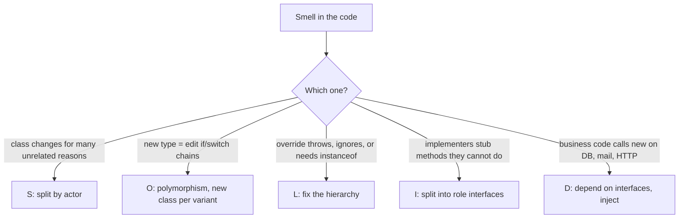
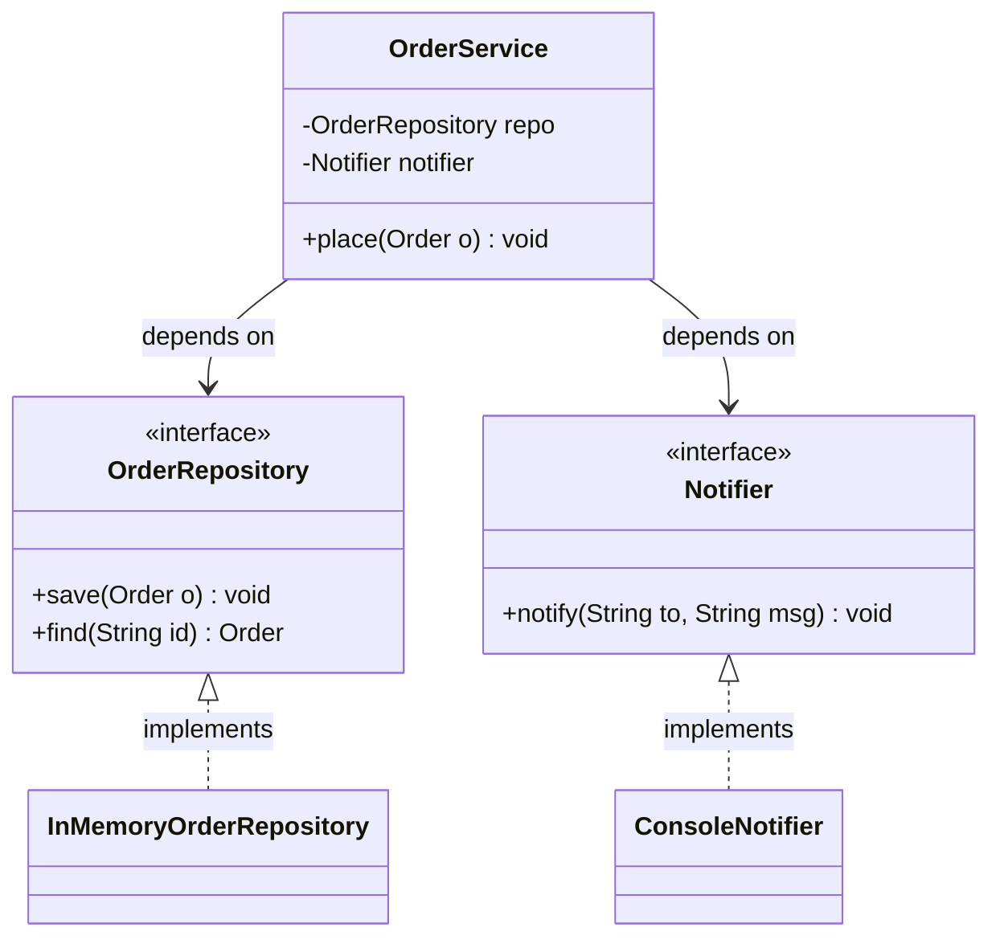
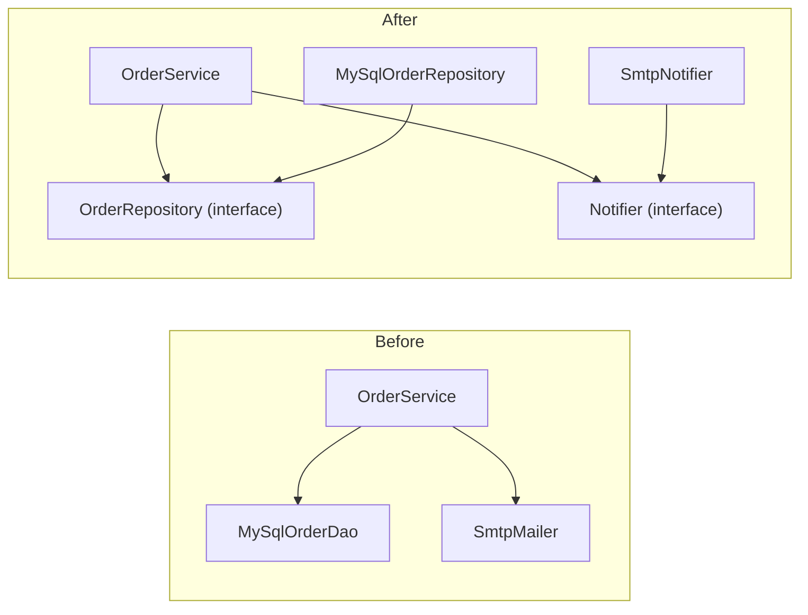

## In One Line
SOLID is five object-oriented design rules — **S**ingle Responsibility, **O**pen/Closed, **L**iskov Substitution, **I**nterface Segregation, **D**ependency Inversion — that keep code easy to change: small classes with one reason to change, new behaviour added as new code, subtypes that never surprise their callers, narrow interfaces, and business logic that depends on abstractions instead of concrete details.

## Mental Model
Think of a **well-run restaurant**.

- **S — Single Responsibility:** the chef cooks, the waiter serves, the cashier bills. A new menu changes the chef's work, a new payment app changes the cashier's — nobody else is retrained. In code: `Invoice` computes, `InvoicePrinter` formats, `InvoiceRepository` stores.
- **O — Open/Closed:** to add a dish you add a **new recipe card**; you do not rebuild the kitchen. In code: a new `FestivalDiscount` class plugs into an unchanged `Checkout`.
- **L — Liskov Substitution:** a **substitute waiter** must follow the same rules as the regular one. If the substitute refuses drink orders, every table that relied on "a waiter takes drink orders" breaks. In code: a `Square` that changes its height when you set its width is a bad substitute for a `Rectangle`.
- **I — Interface Segregation:** the waiter's job description does not include "repair the fridge". Small role descriptions, so nobody has to fake skills they do not have. In code: `Printer`, `DocScanner`, `Fax` instead of one fat `Machine`.
- **D — Dependency Inversion:** the restaurant depends on **"a supplier who delivers vegetables to our spec"**, not on "Raju's farm". The restaurant writes the spec; any farm that meets it can deliver, and switching farms needs no kitchen changes. In code: `OrderService` depends on an `OrderRepository` interface it owns; MySQL or in-memory implementations plug in from outside.

## Concept
### Why SOLID exists
Code that is hard to change shows the same symptoms again and again (Robert C. Martin's "design smells"): **rigidity** (one change forces many others), **fragility** (a change breaks something unrelated), **immobility** (you cannot reuse a part without dragging everything along) and **viscosity** (doing the right thing is harder than hacking). Their root cause is bad **dependencies**: classes that do too much (low cohesion) and know too much about each other (high coupling). The principles were collected by Robert C. Martin ("Uncle Bob") around 2000; Michael Feathers coined the acronym SOLID.

> [!INTERVIEW] "SOLID is about managing dependencies so that change stays cheap: high cohesion inside a class, low coupling between classes."

### S — Single Responsibility Principle (SRP)
**"A class should have one, and only one, reason to change."** Martin later sharpened it: *a module should be responsible to one, and only one, **actor*** — one group of people who request changes (finance, the UI designers, the DBAs).

- A `GodInvoice` that calculates tax (finance's rules), formats itself (design's layout) and writes SQL (the DBA's schema) has **three** reasons to change. A tax change risks breaking printing; two teams edit the same file and collide.
- SRP is about **cohesion**, not size. It does **not** mean "one method per class"; a class with ten methods that all serve the same actor is fine.
- **Smells:** "and" in the class description ("parses *and* validates *and* saves"), names like `Manager`/`Util`/`Helper` that attract everything, groups of methods that use disjoint sets of fields, unrelated imports (`java.sql` next to `java.awt`), frequent merge conflicts.
- **JDK example:** `java.time` separates the value (`LocalDate`) from formatting (`DateTimeFormatter`); NIO separates the path (`Path`) from file operations (`Files`). The old `java.util.Date` mixed value, parsing, formatting and time-zone arithmetic — most of it later deprecated and moved into `Calendar` and `DateFormat`.
- SRP applies at every level: methods, classes, packages, services.

### O — Open/Closed Principle (OCP)
**"Software entities should be open for extension but closed for modification"** (Bertrand Meyer, 1988; Martin's version uses abstractions and polymorphism rather than Meyer's implementation inheritance).

- **Closed for modification:** tested, deployed code that others depend on does not have to be edited to add behaviour.
- **Open for extension:** you add behaviour by adding **new code** — a new class, a new lambda, a new registry entry.
- **The smell it cures:** `if/else` or `switch` on a type code (`"REGULAR"`, `"PREMIUM"`...) repeated in several places. Every new type edits every chain, and forgetting one is a bug.
- **Java mechanisms:** interface + polymorphism ([Strategy](lesson:a10-patterns/21-strategy)), [Template Method](lesson:a10-patterns/22-template-method), [Decorator](lesson:a10-patterns/08-decorator), functional interfaces and lambdas, a `Map<String, Supplier<X>>` registry (see [Factory](lesson:a10-patterns/02-factory)), `java.util.ServiceLoader` plug-ins.
- **JDK example:** `Collections.sort(list, comparator)` / `List.sort` never change, yet you can sort by any order by passing a new `Comparator`. `InputStream` decorators (`BufferedInputStream`, `GZIPInputStream`) add behaviour without editing `FileInputStream`.
- OCP does **not** mean "never edit a class": bug fixes and genuine requirement changes edit code. It means *anticipated kinds of variation* should not require editing. Martin's advice: don't guess every future change; when a kind of change arrives once, protect the design against that kind.

**Modern Java nuance — sealed types.** A `sealed interface Shape permits Circle, Square` with an exhaustive `switch` is the *opposite* trade-off (the "expression problem"): adding an **operation** is easy (write another `switch` function), adding a **type** forces you to edit every `switch` — and the compiler lists them for you (*"the switch expression does not cover all possible input values"*). Use polymorphism when the set of *types* is open (plug-ins, discount policies); use sealed types + pattern matching when the set of types is fixed and the *operations* keep growing (AST nodes, payment states). See [Sealed Classes](lesson:b05-modern-java/04-sealed-classes).

### L — Liskov Substitution Principle (LSP)
**"If S is a subtype of T, objects of type T may be replaced with objects of type S without breaking the program"** (Barbara Liskov, 1987; formalised with Jeannette Wing in 1994). A subclass must honour the **behavioural contract** of its parent, not just its method signatures.

The contract rules (design by contract):
| Rule | Meaning | Violation example |
|---|---|---|
| Preconditions cannot be **strengthened** | The subtype must accept everything the parent accepts | Parent accepts any amount; child throws for amounts > 1000 |
| Postconditions cannot be **weakened** | The subtype must deliver everything the parent promises | `setWidth(w)` promises "width becomes w, height unchanged"; `Square` changes height too |
| Invariants must be **preserved** | Whatever is always true of the parent stays true | A `SortedList` subclass whose `add` appends at the end |
| **History constraint** | The subtype cannot allow state changes the parent forbids | A mutable subclass of an immutable type |
| No **new exceptions** | Callers are not ready for them | `Penguin.fly()` throws `UnsupportedOperationException` |

**What the Java compiler already enforces for overrides** (the *signature* half of LSP): same parameter types, a covariant (same or narrower) return type, same or wider access, no new or broader checked exceptions — see [Polymorphism](lesson:a01-oop/04-polymorphism). The *behavioural* half — what the method actually does — is your responsibility.

- **Classic violations:** `Square extends Rectangle` (mutable), `Penguin extends Bird` with `fly()`, overrides that do nothing or throw, a subclass that needs an extra `init()` call before use, `equals` that breaks symmetry with the parent (see [equals and hashCode](lesson:b01-fundamentals/06-object-class-equals-hashcode)).
- **In the JDK:** `Stack extends Vector` (a `Stack` exposes `insertElementAt`, breaking LIFO), `Properties extends Hashtable` (you can `put` non-`String` values), `java.sql.Timestamp extends java.util.Date` (its own Javadoc warns that the inheritance "denotes implementation inheritance, and not type inheritance", and `equals` is not symmetric with `Date`). The collection interfaces declare `add`/`remove` as **optional operations**, so `List.of(...).add(x)` throwing `UnsupportedOperationException` is allowed by the contract — but it is still a practical substitutability trap.
- **Tell-tale signs:** callers doing `if (x instanceof Square)`, empty or throwing overrides, comments like "not supported in this subclass".
- **Fixes:** don't inherit when behaviour differs — use a common interface with only what is truly shared (`Shape.area()`), composition instead of inheritance, split capabilities (`Flyer`), or make the types **immutable** (an immutable square *is* a perfectly good immutable rectangle — no setters, no broken promise).

> [!INTERVIEW] "IS-A in English is not enough. The subtype must be **behaviourally** substitutable: no stronger preconditions, no weaker postconditions, same invariants, no surprise exceptions."

### I — Interface Segregation Principle (ISP)
**"Clients should not be forced to depend on methods they do not use."** It came from Martin's consulting at Xerox, where one huge `Job` class was used by every part of a printer system, so any change recompiled and redeployed everything.

- Prefer many small **role interfaces** (`Printer`, `DocScanner`, `Fax`) over one **fat interface** (`Machine`). A class can implement several roles; a client depends only on the role it uses.
- **Symptoms of a fat interface:** implementations with empty methods or `throw new UnsupportedOperationException()`, clients that use 2 of 15 methods, test mocks that must stub a dozen irrelevant methods, a change for one client forcing a rebuild of all.
- **Good JDK examples:** `Runnable`, `Callable`, `Comparable`, `Iterable`, `AutoCloseable`, `CharSequence`, everything in `java.util.function`; NIO's `ReadableByteChannel` + `WritableByteChannel` combined as `ByteChannel`.
- **Trade-off examples:** `java.util.Collection` bundles read and write operations and marks the writes "optional"; `Iterator.remove()` has, since Java 8, a `default` that throws `UnsupportedOperationException`. Default methods ([Default Methods](lesson:a05-java8/10-default-methods)) help evolve interfaces, but a default that throws only hides an ISP problem.
- **ISP vs SRP:** SRP looks at a class from the *inside* (how many reasons does it have to change?); ISP looks at an interface from the *client's* side (how much does each caller have to know?).

### D — Dependency Inversion Principle (DIP)
1. **High-level modules should not depend on low-level modules. Both should depend on abstractions.**
2. **Abstractions should not depend on details. Details should depend on abstractions.**

- High-level = business policy (`OrderService`: validate, save, notify). Low-level = mechanisms (MySQL, SMTP, HTTP clients, files).
- **Before:** `OrderService` does `new MySqlOrderDao()` and `new SmtpMailer()`. The source-code dependency follows the flow of control downward; you cannot test without a database, and switching to PostgreSQL edits the business class.
- **After:** `OrderService` depends on `OrderRepository` and `Notifier` interfaces; `MySqlOrderRepository` and `SmtpNotifier` implement them. The dependency arrow from the low-level module now points **up** to the abstraction — that is the **inversion**.
- **Who owns the interface?** The **high-level** module. `OrderRepository` is shaped by what `OrderService` needs (`save`, `find`), not by what MySQL offers (`executeSql`). If the interface leaks details (`ResultSet findRaw(String sql)`), rule 2 is broken. This is the core of *hexagonal / ports-and-adapters / clean architecture*: domain-owned ports, infrastructure adapters.
- **Stable concretions are fine.** Depending directly on `String`, `List`, `LocalDate` or `BigDecimal` is not a DIP violation — they are stable. Invert dependencies on *volatile* things: I/O, frameworks, vendors, the clock, randomness.
- **JDK examples:** JDBC — your code uses `java.sql.Connection`/`javax.sql.DataSource` and drivers plug in (found via `ServiceLoader`); `System.Logger`/SLF4J facades; code that takes an `ExecutorService` instead of creating threads; `java.time.Clock` injected for testable time.

#### DIP vs DI vs IoC — the favourite follow-up
| Term | What it is | Example |
|---|---|---|
| **Dependency Inversion Principle** | A *design principle* about the **direction** of source-code dependencies | `OrderService` → `OrderRepository` ← `MySqlOrderRepository` |
| **Dependency Injection** | A *technique*: an object receives its dependencies from outside instead of creating them (constructor, setter or method injection) | `new OrderService(repo, notifier)` |
| **Inversion of Control** | A broader *idea*: the framework, not your code, controls object creation and the flow ("don't call us, we'll call you") | Spring/Guice containers, servlet lifecycles, JUnit calling your test methods |

DI is the most common way to *achieve* DIP; a DI container is one form of IoC. You can do DI by hand (as below) — the place that wires everything together is called the **composition root** (usually `main` or the framework's configuration). Prefer **constructor injection**: dependencies are explicit, fields can be `final`, the object is complete after construction, and tests just pass fakes. Hidden dependencies — `new` of services inside business methods, `Singleton.getInstance()`, static calls to infrastructure — defeat DIP (see [Singleton](lesson:a10-patterns/01-singleton)).

### How the five fit together
- **OCP is the goal:** add features without editing stable code.
- **DIP and ISP shape the abstractions** that make that possible: small, client-owned interfaces.
- **LSP makes the polymorphism safe:** any implementation plugged in behind the abstraction must behave as promised.
- **SRP keeps each piece small** enough that it has one reason to change and one place to change.

### SOLID and design patterns
| Principle | Patterns that embody it |
|---|---|
| SRP | Facade (hides a subsystem behind one focused API), Command, DAO/Repository (persistence in its own class) |
| OCP | Strategy, Decorator, Template Method, Observer, Visitor (for operations), Factory registries |
| LSP | Every pattern relying on polymorphism assumes it (Strategy, State, Composite) |
| ISP | Adapter (exposes only the interface the client expects), role interfaces, functional interfaces |
| DIP | Dependency Injection, Abstract Factory, Service Locator (weaker), ports and adapters |

More in [Design Patterns Overview](lesson:a10-patterns/00-design-patterns-overview).

### Other principles interviewers mix in
| Principle | One-liner |
|---|---|
| **DRY** — Don't Repeat Yourself | Every piece of *knowledge* has one authoritative place (duplicate *code* that means different things is fine) |
| **KISS** — Keep It Simple | The simplest design that works wins |
| **YAGNI** — You Aren't Gonna Need It | Don't build abstractions for imagined futures |
| **Composition over inheritance** | Has-a is more flexible than is-a (Effective Java Item 18) — see [Inheritance](lesson:a01-oop/03-inheritance) |
| **Program to an interface** | `List<String> l = new ArrayList<>()`, not `ArrayList<String> l` |
| **Law of Demeter** | Talk to friends, not strangers: avoid `order.getCustomer().getAddress().getCity()` |
| **Tell, don't ask** | Ask objects to do work instead of pulling their data out and deciding for them |
| **High cohesion, low coupling** | What SOLID is ultimately optimising |

### When SOLID goes too far
SOLID principles are heuristics, not laws. Over-applied they produce an interface for every class with exactly one implementation, ten-line classes nobody can navigate, and factories for objects that never vary ("speculative generality"). Balance them with YAGNI and KISS: introduce an abstraction when there is a **second implementation, a test seam you need, or a real axis of change** — not before.

## Diagram

A quick way to name the principle in an interview: start from the smell you see, then say the fix.


After applying DIP: the high-level `OrderService` knows only the two interfaces it owns; concrete classes depend on (implement) those interfaces, so they can be swapped without touching the service.


The inversion: before, the business class points at the details; after, the details point at abstractions owned by the business side.

## Code
**1. S — split a god class by actor:**
```java
import java.util.ArrayList;
import java.util.List;

public class SrpDemo {
    record Line(String item, int qty, long unitPaise) {
        long total() { return qty * unitPaise; }
    }

    // BEFORE: one class, three reasons to change (pricing rules, layout, storage)
    static class GodInvoice {
        final List<Line> lines = new ArrayList<>();
        long total() {                                       // finance team's rules
            long sum = lines.stream().mapToLong(Line::total).sum();
            return sum + sum * 18 / 100;                     // GST hard-coded here
        }
        String print() {                                     // design team's layout
            return "INVOICE total=" + total();
        }
        void save() {                                        // DBA's storage format
            System.out.println("INSERT INTO invoice VALUES (" + total() + ")");
        }
    }

    // AFTER: each class has one reason to change
    static final class Invoice {                             // data + business rule
        private final List<Line> lines;
        private final TaxPolicy tax;
        Invoice(List<Line> lines, TaxPolicy tax) { this.lines = List.copyOf(lines); this.tax = tax; }
        List<Line> lines() { return lines; }
        long subtotal() { return lines.stream().mapToLong(Line::total).sum(); }
        long total() { return subtotal() + tax.taxOn(subtotal()); }
    }
    interface TaxPolicy { long taxOn(long amount); }
    static final class Gst implements TaxPolicy {
        private final int percent;
        Gst(int percent) { this.percent = percent; }
        public long taxOn(long amount) { return amount * percent / 100; }
    }
    static final class InvoicePrinter {                      // presentation only
        String print(Invoice inv) {
            StringBuilder sb = new StringBuilder();
            for (Line l : inv.lines())
                sb.append(String.format("%-8s x%d %8s%n", l.item(), l.qty(), rupees(l.total())));
            sb.append(String.format("%-11s %8s%n", "TOTAL", rupees(inv.total())));
            return sb.toString();
        }
        private static String rupees(long paise) { return String.format("%d.%02d", paise / 100, paise % 100); }
    }
    interface InvoiceRepository { void save(Invoice inv); }  // persistence only
    static final class InMemoryInvoiceRepository implements InvoiceRepository {
        final List<Invoice> saved = new ArrayList<>();
        public void save(Invoice inv) { saved.add(inv); }
    }

    public static void main(String[] args) {
        GodInvoice god = new GodInvoice();
        god.lines.add(new Line("Pen", 2, 5_000));
        System.out.println(god.print());
        god.save();

        Invoice inv = new Invoice(List.of(new Line("Pen", 2, 5_000), new Line("Notebook", 1, 12_050)), new Gst(18));
        System.out.print(new InvoicePrinter().print(inv));
        InMemoryInvoiceRepository repo = new InMemoryInvoiceRepository();
        repo.save(inv);
        System.out.println("saved invoices: " + repo.saved.size());
    }
}
```
```output
INVOICE total=11800
INSERT INTO invoice VALUES (11800)
Pen      x2   100.00
Notebook x1   120.50
TOTAL         260.19
saved invoices: 1
```

**2. O — add a discount without editing `Checkout`:**
```java
public class OcpDemo {
    // BEFORE: every new customer type means editing this method
    static long discountBefore(String customerType, long amount) {
        if (customerType.equals("REGULAR")) return 0;
        else if (customerType.equals("PREMIUM")) return amount * 10 / 100;
        else if (customerType.equals("EMPLOYEE")) return amount * 30 / 100;
        throw new IllegalArgumentException("unknown type " + customerType);
    }

    // AFTER: closed for modification, open for extension
    interface DiscountPolicy {
        long discount(long amount);
    }
    static final class NoDiscount implements DiscountPolicy {
        public long discount(long amount) { return 0; }
    }
    static final class PercentDiscount implements DiscountPolicy {
        private final int percent;
        PercentDiscount(int percent) { this.percent = percent; }
        public long discount(long amount) { return amount * percent / 100; }
    }
    static final class Checkout {                                  // never edited again
        private final DiscountPolicy policy;
        Checkout(DiscountPolicy policy) { this.policy = policy; }
        long pay(long amount) { return amount - policy.discount(amount); }
    }

    // Added LATER, in a new file, without touching Checkout or the other policies
    static final class FestivalDiscount implements DiscountPolicy {
        public long discount(long amount) { return Math.min(amount * 20 / 100, 50_000); } // capped
    }

    public static void main(String[] args) {
        System.out.println("before, PREMIUM: " + (1_000 - discountBefore("PREMIUM", 1_000)));

        DiscountPolicy flat500 = amount -> amount >= 5_000 ? 500 : 0;   // a lambda is a policy too
        System.out.println("regular  pays " + new Checkout(new NoDiscount()).pay(10_000));
        System.out.println("premium  pays " + new Checkout(new PercentDiscount(10)).pay(10_000));
        System.out.println("festival pays " + new Checkout(new FestivalDiscount()).pay(10_000));
        System.out.println("flat500  pays " + new Checkout(flat500).pay(10_000));
    }
}
```
```output
before, PREMIUM: 900
regular  pays 10000
premium  pays 9000
festival pays 8000
flat500  pays 9500
```

The sealed-type alternative flips the trade-off. Adding `Triangle` to the `permits` list without updating the `switch` is caught by the compiler:
```java
public class SealedShapes {
    sealed interface Shape permits Circle, Square, Triangle { }
    record Circle(double r) implements Shape { }
    record Square(double side) implements Shape { }
    record Triangle(double base, double height) implements Shape { }   // newly added

    static double area(Shape s) {
        return switch (s) {                       // no default: the compiler checks exhaustiveness
            case Circle c -> Math.PI * c.r() * c.r();
            case Square q -> q.side() * q.side();
        };
    }
    public static void main(String[] args) { System.out.println(area(new Square(2))); }
}
```
```text
SealedShapes.java:8: error: the switch expression does not cover all possible input values
        return switch (s) {                       // no default: the compiler checks exhaustiveness
               ^
1 error
```

**3. L — a subtype that breaks its parent's promise, and the fix:**
```java
import java.util.ArrayList;
import java.util.List;

public class LspDemo {
    // BEFORE: "a square IS-A rectangle" in maths, but not in behaviour
    static class Rectangle {
        protected int width, height;
        void setWidth(int w)  { width = w; }
        void setHeight(int h) { height = h; }
        int area() { return width * height; }
    }
    static class Square extends Rectangle {
        @Override void setWidth(int w)  { width = w; height = w; }   // keeps sides equal...
        @Override void setHeight(int h) { width = h; height = h; }   // ...but breaks the parent's promise
    }

    // Client code written against Rectangle and its documented behaviour
    static void checkResize(Rectangle r) {
        r.setWidth(5);
        r.setHeight(4);
        int area = r.area();
        System.out.println(r.getClass().getSimpleName() + ": expected 20, got " + area
                + (area == 20 ? "" : "  <-- LSP violation"));
    }

    // AFTER: no false inheritance; immutable shapes share only what is truly common
    interface Shape { int area(); }
    record Rect(int width, int height) implements Shape {
        public int area() { return width * height; }
        Rect withWidth(int w) { return new Rect(w, height); }
    }
    record Sq(int side) implements Shape {
        public int area() { return side * side; }
    }

    static void addGuest(List<String> names) { names.add("guest"); }   // assumes a modifiable List

    public static void main(String[] args) {
        checkResize(new Rectangle());
        checkResize(new Square());

        List<Shape> shapes = List.of(new Rect(5, 4), new Sq(4), new Rect(2, 3).withWidth(5));
        for (Shape s : shapes) System.out.println(s + " area " + s.area());

        addGuest(new ArrayList<>(List.of("asha")));
        try {
            addGuest(List.of("asha"));                                 // also "a List"...
        } catch (UnsupportedOperationException e) {
            System.out.println("List.of -> UnsupportedOperationException (optional operation)");
        }
    }
}
```
```output
Rectangle: expected 20, got 20
Square: expected 20, got 16  <-- LSP violation
Rect[width=5, height=4] area 20
Sq[side=4] area 16
Rect[width=5, height=3] area 15
List.of -> UnsupportedOperationException (optional operation)
```

**4. I — split a fat interface into roles:**
```java
public class IspDemo {
    // BEFORE: one fat interface forces every device to implement everything
    interface Machine {
        void print(String doc);
        void scan(String doc);
        void fax(String doc);
    }
    static class BasicPrinter implements Machine {
        public void print(String doc) { System.out.println("printing " + doc); }
        public void scan(String doc)  { throw new UnsupportedOperationException("cannot scan"); }
        public void fax(String doc)   { throw new UnsupportedOperationException("cannot fax"); }
    }

    // AFTER: small, role-based interfaces; classes pick only what they can do
    interface Printer { void print(String doc); }
    interface DocScanner { String scan(String doc); }
    interface Fax     { void fax(String doc, String number); }

    static class SimplePrinter implements Printer {
        public void print(String doc) { System.out.println("printing " + doc); }
    }
    static class OfficeMfp implements Printer, DocScanner, Fax {
        public void print(String doc) { System.out.println("MFP printing " + doc); }
        public String scan(String doc) { return "scan-of-" + doc; }
        public void fax(String doc, String number) { System.out.println("MFP faxing " + doc + " to " + number); }
    }

    // Clients depend only on the role they need
    static void printAll(Printer p, String... docs) { for (String d : docs) p.print(d); }
    static void archive(DocScanner s, String doc) { System.out.println("archived " + s.scan(doc)); }

    public static void main(String[] args) {
        Machine old = new BasicPrinter();
        old.print("report.pdf");
        try {
            old.scan("report.pdf");                     // compiles fine, fails at runtime
        } catch (UnsupportedOperationException e) {
            System.out.println("fat interface -> " + e.getMessage());
        }

        printAll(new SimplePrinter(), "a.pdf", "b.pdf");
        OfficeMfp mfp = new OfficeMfp();
        printAll(mfp, "c.pdf");
        archive(mfp, "contract.pdf");
        // archive(new SimplePrinter(), "x.pdf");      // does not compile: SimplePrinter is not a DocScanner
    }
}
```
```output
printing report.pdf
fat interface -> cannot scan
printing a.pdf
printing b.pdf
MFP printing c.pdf
archived scan-of-contract.pdf
```

**5. D — invert the dependencies and inject them:**
```java
import java.util.ArrayList;
import java.util.HashMap;
import java.util.List;
import java.util.Map;

public class DipDemo {
    record Order(String id, String customerEmail, long amountPaise) { }

    // ---------- BEFORE: high-level policy creates and depends on low-level details ----------
    static class MySqlOrderDao {                            // pretend JDBC code
        void insert(Order o) { System.out.println("[MySQL] INSERT order " + o.id()); }
    }
    static class SmtpMailer {                               // pretend SMTP code
        void send(String to, String text) { System.out.println("[SMTP] to " + to + ": " + text); }
    }
    static class OrderServiceBefore {
        private final MySqlOrderDao dao = new MySqlOrderDao();  // hard-wired: cannot swap or test
        private final SmtpMailer mailer = new SmtpMailer();
        void place(Order o) {
            dao.insert(o);
            mailer.send(o.customerEmail(), "Order " + o.id() + " placed");
        }
    }

    // ---------- AFTER: both sides depend on abstractions owned by the high-level module ----------
    interface OrderRepository { void save(Order o); Order find(String id); }
    interface Notifier { void notify(String to, String message); }

    static final class OrderService {                      // high-level business policy
        private final OrderRepository repo;
        private final Notifier notifier;
        OrderService(OrderRepository repo, Notifier notifier) {    // dependencies are injected
            this.repo = repo;
            this.notifier = notifier;
        }
        void place(Order o) {
            if (o.amountPaise() <= 0) throw new IllegalArgumentException("empty order");
            repo.save(o);
            notifier.notify(o.customerEmail(), "Order " + o.id() + " placed");
        }
    }

    // Low-level details implement the abstractions (production versions would use JDBC/SMTP)
    static final class InMemoryOrderRepository implements OrderRepository {
        private final Map<String, Order> store = new HashMap<>();
        public void save(Order o) { store.put(o.id(), o); }
        public Order find(String id) { return store.get(id); }
    }
    static final class ConsoleNotifier implements Notifier {
        public void notify(String to, String message) { System.out.println("[console] to " + to + ": " + message); }
    }
    static final class RecordingNotifier implements Notifier {        // a test double
        final List<String> sent = new ArrayList<>();
        public void notify(String to, String message) { sent.add(to + "|" + message); }
    }

    public static void main(String[] args) {
        new OrderServiceBefore().place(new Order("A1", "asha@example.com", 50_000));

        // "Composition root": the one place that decides which implementations to use
        InMemoryOrderRepository repo = new InMemoryOrderRepository();
        OrderService service = new OrderService(repo, new ConsoleNotifier());
        service.place(new Order("B7", "ravi@example.com", 25_000));
        System.out.println("found: " + repo.find("B7"));

        // Unit-test style: swap in a fake with zero changes to OrderService
        RecordingNotifier spy = new RecordingNotifier();
        new OrderService(new InMemoryOrderRepository(), spy).place(new Order("C3", "meena@example.com", 1_000));
        System.out.println("notifications recorded: " + spy.sent);

        // Lambdas work too, because Notifier has a single abstract method
        new OrderService(new InMemoryOrderRepository(), (to, msg) -> System.out.println("[sms] " + msg))
                .place(new Order("D9", "dev@example.com", 9_900));
    }
}
```
```output
[MySQL] INSERT order A1
[SMTP] to asha@example.com: Order A1 placed
[console] to ravi@example.com: Order B7 placed
found: Order[id=B7, customerEmail=ravi@example.com, amountPaise=25000]
notifications recorded: [meena@example.com|Order C3 placed]
[sms] Order D9 placed
```

## Walkthrough
### 1. `SrpDemo`
- `Line` is a small record; `total()` multiplies quantity by unit price. Money is kept in **paise** (`long`) to avoid floating-point rounding errors.
- `GodInvoice` mixes three actors: `total()` holds finance's rule (18% GST, hard-coded), `print()` holds the designers' layout, `save()` holds the DBA's SQL. Output: `INVOICE total=11800` (2 × 5,000 = 10,000 paise, plus 1,800 tax) and the fake `INSERT` line. A change in any of the three areas edits this one class.
- The **after** version splits by reason to change:
  - `Invoice` holds the lines (defensively copied with `List.copyOf`) and the business rule `total() = subtotal + tax`. The tax rate is no longer hard-coded; it comes from a `TaxPolicy`, so a GST change does not touch `Invoice` (this also shows OCP and DIP at small scale).
  - `InvoicePrinter` only formats: `%-8s` pads the item name to 8 characters, `%8s` right-aligns the amount, and `rupees()` turns paise into `rupees.paise`. Subtotal 10,000 + 12,050 = 22,050 paise; 18% GST is 3,969 (integer division); total 26,019 → `260.19`.
  - `InvoiceRepository` only stores; the in-memory version counts `saved invoices: 1`. A real one would use JDBC — and that change would touch only this class.

### 2. `OcpDemo` and `SealedShapes`
- `discountBefore` is the classic OCP violation: a string type code and an `if/else` chain. Adding a "STUDENT" type means editing (and retesting) this method and every similar chain. `PREMIUM` on 1,000 → pays 900.
- `DiscountPolicy` is the abstraction; `Checkout` depends only on it and never needs editing again. `NoDiscount` and `PercentDiscount(10)` produce `10000` and `9000`.
- `FestivalDiscount` was "added later": 20% capped at 50,000 → 2,000 off → `8000`. Nothing else changed — that is "open for extension, closed for modification".
- Because `DiscountPolicy` has a single abstract method, a **lambda** is a valid policy: `flat500` takes 500 off orders of at least 5,000 → `9500`. Functional interfaces make OCP extensions one-liners.
- `SealedShapes` shows the other design choice: the set of `Shape` types is closed by `sealed ... permits`, and `area` is a `switch` without `default`. After `Triangle` was added to `permits`, `javac` refuses to compile until every such `switch` handles it: *"the switch expression does not cover all possible input values"*. Adding types is now a guided edit; adding operations (a `perimeter` switch) needs no change to the types.

### 3. `LspDemo`
- `Rectangle` promises (implicitly, through its setters): setting the width does not change the height, and vice versa.
- `Square` overrides both setters to keep the sides equal. Every signature rule is satisfied — it compiles — but the **postcondition** of `setWidth`/`setHeight` is weakened.
- `checkResize` is ordinary client code written against `Rectangle`: set width 5, height 4, expect 20. With a real `Rectangle` it gets 20. With a `Square`, `setHeight(4)` also sets the width to 4, so the area is **16** — substituting the subtype broke a correct program.
- The fix: `Rect` and `Sq` are unrelated immutable records that share only the truly common capability, `Shape.area()`. "Changing" the width returns a new `Rect` (`withWidth(5)` on 2×3 gives 5×3, area 15). No setters, so no promise to break.
- `addGuest(List<String>)` assumes a modifiable list. An `ArrayList` works; a `List.of` list throws `UnsupportedOperationException`. The `List` contract marks `add` as an *optional operation*, so the JDK is technically within its contract, but for the caller it behaves exactly like an LSP violation — document and check such assumptions.

### 4. `IspDemo`
- `Machine` bundles printing, scanning and faxing. `BasicPrinter` can only print, yet must implement `scan` and `fax` — it throws `UnsupportedOperationException`. The call `old.scan(...)` **compiles** and fails only at runtime (`fat interface -> cannot scan`). ISP violations usually cause LSP violations like this one.
- The role interfaces `Printer`, `DocScanner` and `Fax` each describe one capability. `SimplePrinter` implements one role, `OfficeMfp` all three (a Java class can implement many interfaces).
- Clients declare the narrowest role they need: `printAll(Printer ...)`, `archive(DocScanner ...)`. The mistake that failed at runtime before is now a **compile error**: uncommenting `archive(new SimplePrinter(), "x.pdf")` gives *"incompatible types: SimplePrinter cannot be converted to DocScanner"*.
- Output: the two simple prints, the MFP print, and `archived scan-of-contract.pdf`. (`DocScanner` is named that way to avoid confusion with `java.util.Scanner`.)

### 5. `DipDemo`
- `OrderServiceBefore` creates `MySqlOrderDao` and `SmtpMailer` itself with `new`. The business class depends on two low-level details: it cannot be unit-tested without a database and a mail server, and switching to PostgreSQL or SMS means editing it. Output: the `[MySQL]` and `[SMTP]` lines.
- `OrderRepository` and `Notifier` are abstractions **shaped by what `OrderService` needs** (`save`, `find`, `notify`) — they belong to the high-level module.
- `OrderService` receives both through its **constructor** (constructor injection) and stores them in `final` fields. Its business rule (reject empty orders, save, notify) contains no infrastructure code.
- `main` acts as the **composition root**: it chooses `InMemoryOrderRepository` + `ConsoleNotifier`, then places order B7 (`[console] ...`) and reads it back (`found: Order[...]`, the record's generated `toString`).
- `RecordingNotifier` is a test double: it records messages instead of sending them, so a "test" can assert on `[meena@example.com|Order C3 placed]` — no mocking library, no changes to `OrderService`.
- `Notifier` has one abstract method, so a lambda can implement it: the SMS-style notifier prints `[sms] Order D9 placed`.

## Traps
- **"SRP means one method per class."** No — one *reason to change* (one actor). Over-splitting scatters one concept over many tiny classes and hurts cohesion.
- **"OCP means never modify existing code."** Bug fixes and changed requirements do modify code. OCP is about not having to edit stable code for *anticipated kinds of extension*.
- **Believing the compiler checks LSP.** It checks only signatures (return type, access, checked exceptions). A `Square` that breaks `Rectangle`'s behaviour compiles perfectly.
- **"It IS-A, so inherit."** English IS-A (a square is a rectangle, a penguin is a bird) does not guarantee behavioural substitutability. Test with the parent's clients, not with a dictionary.
- **Throwing `UnsupportedOperationException` in an override** is a red flag for both LSP and ISP.
- **Default methods that throw** make a fat interface *compile* but do not fix it.
- **Confusing DIP with DI.** DIP is the principle (dependency direction, abstractions owned by the policy); DI is one technique to satisfy it. Injecting a concrete `MySqlOrderDao` through the constructor is DI without DIP.
- **Leaky abstractions.** An `OrderRepository` with `executeSql(String)` or methods returning `ResultSet` makes the abstraction depend on details — rule 2 of DIP.
- **Hidden dependencies**: `new` of services inside methods, `Singleton.getInstance()`, static calls to I/O or `LocalDateTime.now()` (inject a `Clock` instead).
- **Interface for everything.** One-implementation interfaces "just in case" add indirection without benefit; YAGNI applies.

> [!WARNING] In interviews, never recite the five names alone. For each principle give: the definition, a violation, the fix, and a trade-off. Reciting "SOLID" without an example is the most common weak answer.

## Tips & Tricks
- **One sentence each:** S — *one actor, one reason to change*; O — *add code, don't edit code*; L — *subtypes keep their parent's promises*; I — *small role interfaces*; D — *depend on abstractions you own; inject the details*.
- **Smell → principle:** god class → S; `switch` on type codes → O; `instanceof` checks, throwing overrides → L; stub methods → I; `new` of infrastructure in business logic → D.
- **LSP contract mnemonic — "Pre-Weak, Post-Strong":** a subtype may *weaken* preconditions (accept more) and *strengthen* postconditions (promise more), never the reverse. Plus: keep invariants, throw nothing new.
- **"Who owns the interface?"** — the client/high-level module. If the interface is shaped like the database, not like the use case, DIP is not really applied.
- **Constructor injection by default:** final fields, obvious dependencies, easy tests. Wire everything in one composition root (or let Spring/Guice/Dagger do it).
- **Prefer composition over inheritance** — it avoids most LSP problems before they start.
- **Use sealed types + exhaustive `switch`** when the set of types is fixed; use polymorphism when it is open.
- **Balance with YAGNI/KISS:** introduce an abstraction when there is a second implementation, a needed test seam, or a real axis of change.

## Interview Q&A
### [Basic] What does SOLID stand for?
Five object-oriented design principles collected by Robert C. Martin (acronym by Michael Feathers):
- **S — Single Responsibility:** a class should have one reason to change — be responsible to one actor.
- **O — Open/Closed:** open for extension, closed for modification — add behaviour with new code, not by editing stable code.
- **L — Liskov Substitution:** subtypes must be usable wherever their base type is expected without breaking correctness.
- **I — Interface Segregation:** clients should not be forced to depend on methods they do not use — prefer small role interfaces.
- **D — Dependency Inversion:** high-level policy and low-level details should both depend on abstractions; abstractions should not depend on details.
Together they aim at high cohesion and low coupling, so code stays easy to change, test and reuse.

**Follow-up:** *Which one is the most important?* — Many say OCP is the goal and the others are the means: DIP and ISP create the right abstractions, LSP makes plugging implementations in safe, SRP keeps each piece small.

### [Basic] Explain the Single Responsibility Principle with an example. How do you spot a violation?
A class should have one reason to change, meaning it serves one actor. An `Invoice` class that calculates totals (finance), renders itself as a PDF (design) and saves itself with SQL (DBAs) has three reasons to change; a tax change could break printing, and teams collide in one file. Split it into `Invoice` (data and business rules), `InvoicePrinter` and `InvoiceRepository`. Spot violations by: "and" in the class description, `Manager`/`Util` names, methods using disjoint sets of fields, imports from unrelated layers, frequent merge conflicts, and tests that need a database to check arithmetic.

**Follow-up:** *Does SRP mean a class should have only one method?* — No. It is about cohesion: many methods serving the same actor are fine.

### [Intermediate] Explain the Open/Closed Principle. How do you implement it in Java?
Stable code should not need editing to support new variants; you extend it by adding code. The usual smell is a `switch`/`if` chain on a type code repeated in several places. In Java you introduce an abstraction and use polymorphism: a `DiscountPolicy` interface, one class (or lambda) per variant, and a `Checkout` that only calls `policy.discount(amount)`. New discount → new class; `Checkout` is untouched. Other mechanisms: Strategy, Decorator, Template Method, registries (`Map<String, Supplier<T>>`), `ServiceLoader` plug-ins. JDK example: `list.sort(comparator)` supports any ordering without changing `List`.

**Follow-up:** *Does OCP forbid ever modifying a class?* — No. Bug fixes and changed requirements modify code. OCP targets anticipated extensions; design for the kinds of change you have actually seen.

### [Intermediate] What is the Liskov Substitution Principle? Why does `Square extends Rectangle` violate it?
LSP says that if `S` is a subtype of `T`, any code that works with a `T` must keep working when given an `S`. A mutable `Rectangle` promises that `setWidth` changes only the width. A `Square` must keep its sides equal, so its `setWidth` also changes the height. Client code `r.setWidth(5); r.setHeight(4);` expects area 20 but gets 16 for a `Square`. It compiles, because the signatures match, but the behaviour breaks the parent's postcondition. Fixes: don't make `Square` a subclass of `Rectangle` — give both a common `Shape` interface with only `area()` — or make both immutable, so there are no setters whose promises can be broken.

**Follow-up:** *How do you recognise LSP violations in a codebase?* — `instanceof` checks before calling methods, overrides that throw `UnsupportedOperationException` or do nothing, and subclasses that need special setup.

### [Intermediate] What are the formal LSP rules, and which does the Java compiler enforce?
Behavioural rules: the subtype must not **strengthen preconditions** (it must accept at least what the parent accepts), must not **weaken postconditions** (it must deliver at least what the parent promises), must **preserve invariants**, must respect the **history constraint** (no state changes the parent forbids — e.g. no mutable subclass of an immutable type), and must not throw **new exceptions** callers are not prepared for. The compiler enforces only the signature part of overriding: same parameters, covariant return type, same or wider access, no new or broader checked exceptions. Everything behavioural is up to the developer (and the tests).

**Follow-up:** *Can an override accept a wider parameter type (contravariance)?* — Not in Java: a different parameter type creates an overload, not an override.

### [Intermediate] What is the Interface Segregation Principle? Give JDK examples.
Clients should not depend on methods they do not use. A fat `Machine` interface with `print`, `scan` and `fax` forces a basic printer to stub or throw for two methods, and forces every client to know about all three. Split it into role interfaces — `Printer`, `DocScanner`, `Fax` — and let classes implement the roles they support; a client asks for exactly the role it needs, so misuse becomes a compile error. Good JDK examples: `Runnable`, `Comparable`, `AutoCloseable`, `Iterable`, `CharSequence`, the `java.util.function` interfaces, `ReadableByteChannel`/`WritableByteChannel`. Weaker examples: `Collection` with optional mutators and `Iterator.remove()`'s throwing default.

**Follow-up:** *How is ISP different from SRP?* — SRP is about why a *class* changes; ISP is about how much an *interface* forces its clients to know.

### [Intermediate] What is the difference between Dependency Inversion, Dependency Injection and Inversion of Control?
**Dependency Inversion** is a design principle about the direction of dependencies: business policy and technical details both depend on abstractions, and the abstractions are owned by the policy side. **Dependency Injection** is a technique: an object receives its collaborators from outside (constructor, setter or method parameters) instead of creating them. **Inversion of Control** is the broader idea that a framework controls object creation and flow ("don't call us, we'll call you"); a DI container like Spring is one IoC implementation. DI is the usual way to achieve DIP, but injecting a concrete class is DI without DIP.
```java
OrderService service = new OrderService(new JdbcOrderRepository(ds), new SmtpNotifier());  // DI + DIP
```
**Follow-up:** *Why prefer constructor injection?* — Required dependencies are explicit, fields can be `final`, the object is fully initialised after construction, and tests simply pass fakes.

### [Advanced] Why is it called "inversion"? Who should own the interface?
In a naive layered design the source-code dependencies follow the flow of control: the business layer imports the persistence layer, which imports the driver. DIP inverts the dependency between the business and persistence layers: the business module declares the interface it needs (`OrderRepository` with `save`/`find`), and the persistence module implements it, so the low-level module now depends on the high-level one — while at runtime the calls still flow downward. The interface must be owned by, and shaped for, the client; an interface that mirrors a vendor API (`executeSql`, `ResultSet`) is a leaky abstraction and still couples the business code to the details. This is the foundation of hexagonal/clean architecture (ports owned by the domain, adapters in infrastructure).

**Follow-up:** *Should everything be behind an interface?* — No. Depend directly on stable things (`String`, `List`, `LocalDate`); abstract away volatile things (databases, frameworks, remote services, the clock).

### [Advanced] Does the JDK itself violate SOLID anywhere?
Yes, a few famous cases. `Stack extends Vector` and `Properties extends Hashtable` inherit methods that break their abstractions (`insertElementAt` breaks LIFO; `put` accepts non-`String` properties) — LSP problems caused by implementation inheritance; `Deque`/`ArrayDeque` is the recommended stack today. `java.sql.Timestamp extends java.util.Date`, and its Javadoc admits the relationship is "implementation inheritance, and not type inheritance" — `equals` is not symmetric with `Date`. `java.util.Date` mixed value, formatting and calendar arithmetic (SRP), which is why most of it is deprecated and `java.time` separates `LocalDate` from `DateTimeFormatter`. The collection interfaces' optional operations (`List.of(...).add` throws) are a documented ISP/LSP compromise made to keep the framework small.

**Follow-up:** *What does Effective Java recommend instead?* — Favour composition over inheritance (Item 18) and design and document for inheritance or else prohibit it (Item 19).

### [Advanced] How do sealed classes and pattern matching relate to the Open/Closed Principle?
They represent the other side of the **expression problem**. With polymorphism, adding a *type* is easy (a new class) but adding an *operation* means editing every class. With a sealed hierarchy and exhaustive `switch`, adding an *operation* is easy (a new function with a `switch`), but adding a *type* means editing every `switch` — though the compiler finds them all ("the switch expression does not cover all possible input values"), which makes the edit safe. So it is a deliberate choice: use open polymorphism where new types arrive often (plug-ins, policies), and sealed types plus pattern matching where the set of types is fixed by the domain and operations grow (AST nodes, protocol messages, result types). Visitor was the pre-Java-17 way to get the second style.

**Follow-up:** *Why not add a `default` branch to the switch?* — A `default` silences the exhaustiveness check, so a new subtype would silently fall into it instead of producing a compile error.

### [Advanced] Can SOLID be over-applied? How do you balance it?
Yes. Over-application produces an interface for every class with a single implementation, factories for objects that never vary, and dozens of tiny classes that make a simple flow hard to follow — "speculative generality". SOLID principles are heuristics for managing change, so apply them where change actually happens: introduce an abstraction when there is a second implementation, a test seam you need (database, clock, network), or a variation you have already seen. Balance with KISS and YAGNI, and refactor toward SOLID when the pain appears (e.g. the second `switch` on the same type code).

**Follow-up:** *How would you refactor a large `switch` on a type code?* — Replace conditional with polymorphism: an interface with one implementation per case (Strategy/State), or a sealed hierarchy with pattern matching if the set of cases is fixed.

## Quiz
### Which principle does this design violate?
```java
class Bird { String fly() { return "flying"; } }
class Penguin extends Bird {
    @Override String fly() { throw new UnsupportedOperationException("penguins can't fly"); }
}
```
- [ ] Single Responsibility
- [ ] Open/Closed
- [x] Liskov Substitution
- [ ] Dependency Inversion
> Code that works with any `Bird` and calls `fly()` breaks when given a `Penguin`: the subtype throws an exception the parent never did. The fix is to move `fly()` into a separate `Flyer` role that only flying birds implement (which is also an ISP-style split). It is not SRP: `Penguin` has no extra responsibilities.

### What does this print?
```java
class Rectangle {
    protected int width, height;
    void setWidth(int w)  { width = w; }
    void setHeight(int h) { height = h; }
    int area() { return width * height; }
}
class Square extends Rectangle {
    @Override void setWidth(int w)  { width = w; height = w; }
    @Override void setHeight(int h) { width = h; height = h; }
}

Rectangle r = new Square();
r.setHeight(3);
r.setWidth(7);
System.out.println(r.area());
```
- [ ] 21
- [x] 49
- [ ] 9
- [ ] Compile error
> Dynamic dispatch runs `Square`'s setters: `setHeight(3)` makes it 3×3, then `setWidth(7)` makes it 7×7, so the area is 49. A client that treats it as a `Rectangle` expects 21 — the textbook LSP violation. It compiles because the overrides have valid signatures.

### A `ReportService` loads data from the database, computes statistics, renders a PDF and emails it. Which principle is most directly violated?
- [x] Single Responsibility
- [ ] Liskov Substitution
- [ ] Interface Segregation
- [ ] Open/Closed
> Four actors (DBAs, analysts, designers, operations) can each force changes to this one class. Split it into a repository, a calculator, a renderer and a sender, coordinated by a thin service. LSP is about subtypes, and ISP about interface width, neither of which is described here.

### Spot the problem: which principle does adding a `"STUDENT"` type expose?
```java
long discount(String type, long amount) {
    if (type.equals("REGULAR")) return 0;
    else if (type.equals("PREMIUM")) return amount / 10;
    else if (type.equals("EMPLOYEE")) return amount * 3 / 10;
    throw new IllegalArgumentException(type);
}
```
- [ ] Interface Segregation — the method has too many parameters
- [x] Open/Closed — every new type forces editing this tested method
- [ ] Liskov Substitution — strings are not substitutable
- [ ] Dependency Inversion — `String` is a concrete class
> A new customer type means modifying existing code (and every similar chain). Replace the type code with a `DiscountPolicy` interface and one implementation per type. Depending on `String` is fine for DIP: it is a stable class, not a volatile detail.

### Which change applies the Dependency Inversion Principle to `OrderService`?
- [ ] Make `OrderService` a singleton so there is only one instance
- [ ] Replace `new MySqlOrderDao()` with `MySqlOrderDao.getInstance()`
- [x] Have `OrderService` take an `OrderRepository` interface in its constructor, implemented by `MySqlOrderRepository`
- [ ] Move `MySqlOrderDao` into the same package as `OrderService`
> DIP needs the business class to depend on an abstraction it owns, with the detail implementing it; constructor injection supplies the implementation from outside. A singleton or `getInstance()` call still hard-wires the concrete class (a hidden dependency). Moving packages changes nothing about the dependency direction.

### What does this print?
```java
List<Integer> nums = Arrays.asList(1, 2, 3);
nums.set(0, 9);
System.out.println(nums);
try { nums.add(4); } catch (UnsupportedOperationException e) { System.out.println("UOE"); }
```
- [ ] [9, 2, 3, 4]
- [x] [9, 2, 3] then UOE
- [ ] UOE only
- [ ] [1, 2, 3] then UOE
> `Arrays.asList` returns a fixed-size list backed by the array: `set` works (so it prints `[9, 2, 3]`), but `add` is an unsupported *optional operation* and throws. Code written for "any `List`" that calls `add` breaks — the JDK's documented LSP/ISP compromise.

### Which statement about DIP and DI is correct?
- [ ] They are two names for the same thing
- [x] DIP is a principle about dependency direction; DI is a technique for supplying dependencies from outside
- [ ] DI requires a framework such as Spring
- [ ] DIP means every class must have an interface
> DI (constructor/setter injection) is the usual way to achieve DIP, but you can inject a concrete class (DI without DIP) and you can do DI by hand in a composition root without any framework. DIP only asks that volatile details sit behind abstractions owned by the policy code — stable classes like `String` need no interface.

### A `Machine` interface has `print`, `scan` and `fax`; `BasicPrinter` implements `scan` and `fax` by throwing. What is the best fix?
- [ ] Add `default` methods to `Machine` that throw `UnsupportedOperationException`
- [ ] Catch `UnsupportedOperationException` in every client
- [x] Split `Machine` into `Printer`, `DocScanner` and `Fax`, and let each class implement only the roles it supports
- [ ] Make `BasicPrinter` abstract
> That is Interface Segregation: role interfaces let the compiler reject `archive(new SimplePrinter(), ...)`. Throwing defaults only hide the problem (it still fails at runtime), catching everywhere spreads it, and an abstract class cannot be instantiated at all.

## Takeaways
- SOLID = Single Responsibility, Open/Closed, Liskov Substitution, Interface Segregation, Dependency Inversion — heuristics for high cohesion and low coupling so that change stays cheap.
- SRP: a class has one reason to change (one actor); split god classes like "calculate + print + save" into focused classes.
- OCP: add behaviour with new code (interfaces, Strategy, lambdas, registries) instead of editing `if/switch` chains on type codes; sealed types + exhaustive `switch` are the deliberate opposite trade-off for fixed type sets.
- LSP: subtypes must keep their parent's behavioural promises — no stronger preconditions, weaker postconditions, broken invariants or surprise exceptions; `Square extends Rectangle` and throwing overrides are the classic violations; the compiler checks only signatures.
- ISP: prefer small role interfaces (`Runnable`, `Comparable`) over fat ones; implementations that stub or throw signal a violation.
- DIP: business policy depends on abstractions it owns, and details implement them; DI (preferably constructor injection) is the technique, IoC containers are one way to automate it.
- In interviews, give definition + violation + fix + JDK example + trade-off for each principle, and balance SOLID with YAGNI and KISS.
