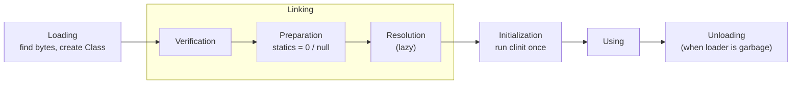
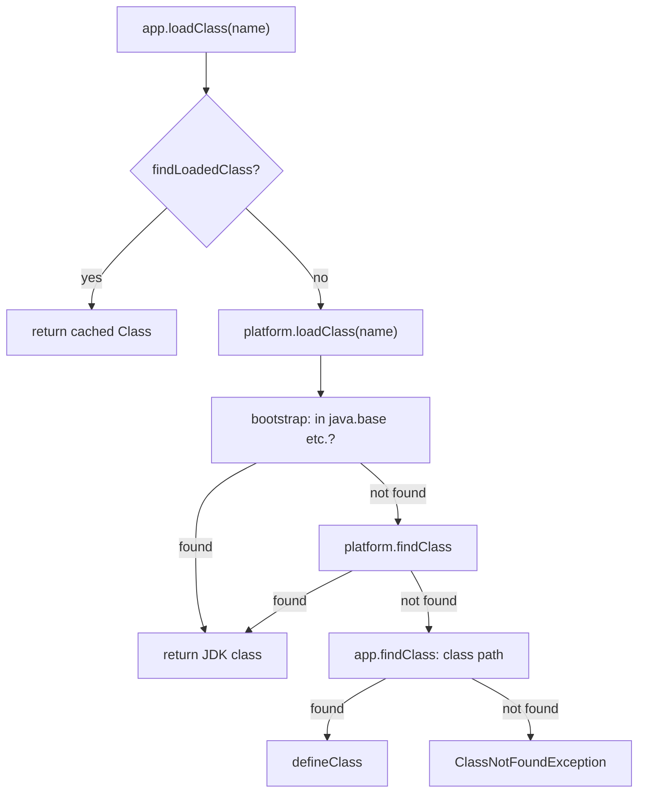
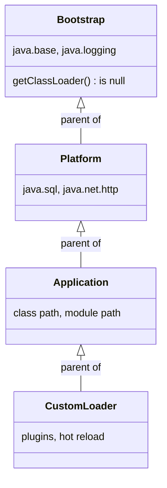

## In One Line
Before any code of a class runs, the JVM **loads** its bytes (through a chain of parent-first class loaders), **links** it (verify, prepare, resolve) and **initializes** it (runs its static initializers exactly once) — and it does all of this **lazily**, the first time the class is actively used.

## Mental Model
Think of a **library network with a strict "ask upstairs first" rule**.

- You ask your **local branch librarian** (the *application* class loader) for a book (a class).
- She never searches her own shelves first. She phones the **regional library** (*platform* loader), which phones the **national library** (*bootstrap* loader). Only if nobody upstairs owns that title does the local branch fetch it from its own shelves (the class path). That is **parent delegation**.
- Every book is catalogued as *title + which library catalogued it*. Two branches can each own a copy of "Plugin", but the catalogue treats them as **different books**. In Java, a class's identity is **(fully qualified name, defining loader)**.
- Before a book goes on the shelf, staff **check it** for missing pages (*verification*), **reserve an empty slot** with a blank index card (*preparation*: static fields get default values) and later **fill in cross-references** to other books as readers follow them (*resolution*).
- The first time someone actually **opens** the book, the librarian holds a one-time **opening ceremony** (*initialization*: `static` blocks run). Only one ceremony ever happens, even if several readers arrive at the same moment.

## Concept
### The class lifecycle
| Phase | What happens | Errors you may see |
|---|---|---|
| **Loading** | A class loader finds the binary form (a `.class` file in a directory or JAR, a module image, bytes from the network or generated at run time), and the JVM parses it into internal metadata (in Metaspace) plus a `java.lang.Class` object (on the heap) | `ClassNotFoundException` (asked by name), `NoClassDefFoundError` (needed by other code), `ClassFormatError`, `UnsupportedClassVersionError` |
| **Linking – Verification** | The bytecode verifier proves the code is type-safe: stack never under/overflows, types match the instructions, jumps land on instruction boundaries, `final` classes are not subclassed | `VerifyError` |
| **Linking – Preparation** | Memory for static fields is created and every static field gets its **default value** (`0`, `false`, `null`). No Java code runs | — |
| **Linking – Resolution** | Symbolic references in the constant pool (`"Helper.greet:()Ljava/lang/String;"`) are turned into direct references. HotSpot does this **lazily**, the first time each instruction runs | `NoSuchMethodError`, `NoSuchFieldError`, `IllegalAccessError`, `NoClassDefFoundError`, `IncompatibleClassChangeError` |
| **Initialization** | The JVM runs the class's `<clinit>` method: all static field initializers and `static {}` blocks **in source order**, after initializing the superclass | `ExceptionInInitializerError`, later `NoClassDefFoundError: Could not initialize class X` |
| **Using** | Objects are created, methods run | |
| **Unloading** | Only when the class's **defining loader** becomes unreachable (together with all its classes and their instances). Classes of the bootstrap, platform and app loaders are never unloaded | |

Verification has a cost, so HotSpot skips it for trusted bootstrap classes (`BytecodeVerificationLocal=false`) and always does it for classes from other loaders. Class files of version 50+ carry a `StackMapTable` so the verifier only *checks* types instead of inferring them (mandatory since Java 7). The flags that switched verification off (`-Xverify:none`, `-noverify`) are deprecated since Java 13.

### When is a class initialized? (JLS 12.4.1)
A class or interface `T` is initialized immediately before the **first active use**:

1. An instance of `T` is created (`new T()`, or via reflection/`clone`/deserialization of a class needing init).
2. A **static method** declared by `T` is invoked.
3. A **static field** declared by `T` is **assigned**.
4. A **static field** declared by `T` is **read**, and it is **not a constant variable**.
5. `T` is a class and one of its **subclasses** is initialized (superclasses first).
6. Reflection that asks for it: `Class.forName("T")` (initialize = true by default), `Method.invoke` of a static method, and so on.
7. `T` is the **main class** the JVM starts with.

Things that **do not** initialize `T` (passive uses):

| Code | Why no init |
|---|---|
| `T.CONSTANT` where `static final int CONSTANT = 21;` | A *constant variable* (final, primitive or `String`, initialized with a compile-time constant) is **copied into the caller** by `javac`; the class is not even loaded at run time |
| `Child.parentField` | Only the class that **declares** the field is initialized (`Parent`), not `Child` |
| `new T[10]` | Creates an array class `[LT;`, not an instance of `T` |
| `T.class` | A class literal only loads the class |
| `loader.loadClass("T")` | Loads, but does not link or initialize |
| `Class.forName("T", false, loader)` | Explicitly asks for no initialization |
| A class implementing interface `I` is initialized | Interfaces are initialized only on their own active use — **except** superinterfaces that declare `default` methods, which are initialized with the class |

`static final Integer Y = 20;` or `static final String S = String.valueOf(7);` are **not** constant variables (boxed type, or a method call), so reading them *does* trigger initialization.

### Inside initialization: `<clinit>`
`javac` gathers every static field initializer and every `static {}` block, in textual order, into one hidden method named `<clinit>`. The JVM guarantees:

- It runs **at most once** per class per loader.
- It is **thread-safe**: each class has an initialization lock. If thread 1 is running `<clinit>`, thread 2 blocks until it finishes, then sees the fully initialized class (a happens-before edge). This is why the **holder idiom** singleton is lazy *and* thread-safe with no `synchronized` or `volatile`:
  ```java
  class Singleton {
      private Singleton() {}
      private static class Holder { static final Singleton INSTANCE = new Singleton(); }
      static Singleton get() { return Holder.INSTANCE; }   // Holder is initialized on the first get()
  }
  ```
- If `<clinit>` throws, the first user gets `ExceptionInInitializerError` wrapping the cause. The class is marked **erroneous** forever (for that loader): every later use gets `NoClassDefFoundError: Could not initialize class X`. Since Java 17 the second error's cause shows the original exception (see Code).
- Two classes whose `<clinit>` methods need each other, started from two threads at once, can **deadlock** (each thread holds one init lock and waits for the other). In a single thread, a cycle does not deadlock but can observe default values.

### The built-in class loaders (Java 9+)
| Loader | Loads | `getClassLoader()` returns | Java 8 equivalent |
|---|---|---|---|
| **Bootstrap** | Core modules: `java.base` (`String`, `Object`, `java.util`...), `java.logging`, `java.xml`... Implemented in C++ inside the JVM | `null` | Bootstrap (loaded `rt.jar`) |
| **Platform** | Other Java SE and JDK modules: `java.sql`, `java.net.http`, `jdk.httpserver`... | loader named `"platform"` | *Extension* loader (read `jre/lib/ext`, removed in 9) |
| **Application** (system) | Your code and libraries on the **class path** (`-cp`) and **module path** | loader named `"app"`; also `ClassLoader.getSystemClassLoader()` | Application loader |

The chain is **app → platform → bootstrap**. Since Java 9 the app and platform loaders are internal classes (`jdk.internal.loader.ClassLoaders$AppClassLoader`), **no longer `URLClassLoader`s** — old code that did `(URLClassLoader) ClassLoader.getSystemClassLoader()` to add JARs at run time fails with `ClassCastException`.

### Parent delegation: how `loadClass` works
`ClassLoader.loadClass(name)` is a template method:

1. **`findLoadedClass(name)`** — already loaded by *this* loader? Return it (every loader has a cache).
2. **`parent.loadClass(name)`** — ask the parent (the bootstrap loader when the parent is `null`).
3. **`findClass(name)`** — only if the parent failed: look in this loader's own place and call **`defineClass(bytes)`** to turn bytes into a `Class`.

Why parent-first?
- **Security:** your `java/lang/String.class` on the class path can never replace the real one, because the bootstrap loader is always asked first. On top of that, `defineClass` refuses any name in `java.*` unless the caller is the platform loader: `SecurityException: Prohibited package name`.
- **Consistency:** everybody shares one `String`, one `Object`, one `List` — otherwise objects could not be passed between libraries.
- **No duplicates:** a class is loaded once per loader hierarchy.

With modules (Java 9+) the built-in loaders are a little smarter: they know which module owns each package and delegate straight to that module's loader. The observable rule is unchanged: a JDK class always comes from the JDK loader.

### Visibility and identity
- **Visibility is one-way:** a class loaded by a child can see classes of its parents; a parent can never see classes of its children. `String` cannot refer to your `Customer`.
- **Identity = name + defining loader.** The same `Plugin.class` bytes defined by two loaders produce two unrelated classes. `instanceof` is false across them and a cast fails with the famous `ClassCastException: Cannot cast Plugin to Plugin`. Each copy also has **its own static fields**.
- **Runtime package = package name + loader.** Package-private access only works inside the same runtime package, so a package-private class defined by another loader is inaccessible even though its package name matches (see Traps).
- The cure used by plugin systems and application servers: put the **shared API** (interfaces) in a parent loader, implementations in child loaders, and talk to plugins only through the interfaces.

### Custom class loaders
Extend `ClassLoader` and override **`findClass`**, not `loadClass` — that keeps parent delegation intact:
```java
class DirLoader extends ClassLoader {
    private final Path dir;
    DirLoader(Path dir, ClassLoader parent) { super("dir", parent); this.dir = dir; }

    @Override
    protected Class<?> findClass(String name) throws ClassNotFoundException {
        try {
            byte[] bytes = Files.readAllBytes(dir.resolve(name.replace('.', '/') + ".class"));
            return defineClass(name, bytes, 0, bytes.length);
        } catch (IOException e) {
            throw new ClassNotFoundException(name, e);
        }
    }
}
```
Real uses: plugin systems, application servers (one loader per web app), hot reload (Spring Boot DevTools uses a *restart* loader it throws away on every change), loading encrypted or generated bytecode, and test isolation. For many simple cases `new URLClassLoader(new URL[]{jarUrl}, parent)` is enough. Loaders that can load classes concurrently call `ClassLoader.registerAsParallelCapable()` (Java 7+) and lock per class name via `getClassLoadingLock(name)`.

### Breaking the delegation model (on purpose)
| Who | What | Why |
|---|---|---|
| **Thread context class loader** (`Thread.currentThread().getContextClassLoader()`) | Core code loaded by the bootstrap loader (JDBC `DriverManager`, JNDI, `ServiceLoader`) uses it to load *implementations* supplied by the application | A parent cannot see child classes, so it borrows the application's loader |
| **Servlet containers** (Tomcat's web-app loader) | **Child-first** for the app's own `WEB-INF/classes` and `WEB-INF/lib`, but still parent-first for `java.*` | Each web app can use its own library versions |
| **OSGi, JBoss Modules** | A graph of loaders, one per bundle/module, delegating by imported package | Fine-grained isolation and versioning |

### `ClassNotFoundException` vs `NoClassDefFoundError`
| | `ClassNotFoundException` | `NoClassDefFoundError` |
|---|---|---|
| Type | Checked **exception** | **Error** (`LinkageError`) |
| Thrown by | Your explicit request by name: `Class.forName`, `loader.loadClass`, `findSystemClass` | The **JVM**, when code compiled against a class cannot get it at run time |
| Typical cause | Typo in a name, driver JAR missing | JAR missing from the runtime class path, class failed its static initialization earlier, loader visibility problems |
| Handling | Catch it and report a configuration problem | Fix the deployment/class path |

A missing class is detected **when the code that needs it runs** (lazy resolution), not at start-up — the program in Code prints `start` before failing.

### `Class.forName` vs `ClassLoader.loadClass`
| | `Class.forName(name)` | `loader.loadClass(name)` |
|---|---|---|
| Initializes the class? | **Yes** (static blocks run) | No (not even linked) |
| Which loader | The **caller's** loader, or the one you pass to `forName(name, init, loader)` | That loader |
| Classic use | Pre-JDBC 4: `Class.forName("com.mysql.jdbc.Driver")` ran the driver's static block, which registered it with `DriverManager` | Tools that inspect classes without running them |

Since JDBC 4 (Java 6) drivers are discovered automatically through `ServiceLoader` (`META-INF/services/java.sql.Driver`), so the `forName` line is no longer needed.

### Watching class loading
- `java -Xlog:class+load=info App` (Java 9+; `-verbose:class` still works) — one line per loaded class with its source. A "Hello, World" loads about 450 classes, nearly all from the **CDS archive** ("shared objects file").
- `java -Xlog:class+init=info App` — shows initialization order.
- `jcmd <pid> VM.classloaders` and `jcmd <pid> VM.classloader_stats` — the live loader tree and how much Metaspace each loader uses.
- `jcmd <pid> VM.class_hierarchy` — the loaded class hierarchy.

**CDS (Class Data Sharing)** stores pre-parsed JDK classes in an archive that is memory-mapped at start-up (the "sharing" in `java -version` output). AppCDS (Java 10+) and the default CDS archive (Java 12+) extend it; Java 13 added dynamic archiving with `-XX:ArchiveClassesAtExit`. It cuts start-up time and memory.

### Version notes
| Version | Change |
|---|---|
| 1.2 | Parent-delegation model introduced |
| 7 | Parallel-capable class loaders |
| 8 | PermGen replaced by **Metaspace** for class metadata |
| 9 | Module system: *Platform* loader replaces *Extension* loader; `rt.jar` gone; app loader no longer a `URLClassLoader`; loaders can have names |
| 11 | Source launcher (`java Hello.java`) compiles in memory and uses its own in-memory loader |
| 15 | **Hidden classes** (JEP 371): classes that are not discoverable by name, used by lambdas and dynamic languages, unloadable independently |
| 17 | `NoClassDefFoundError` for a failed initializer now carries the original exception as cause |

## Diagram

Loading and linking can happen long before initialization; initialization waits for the first active use.


Every request travels **up** first; a loader only searches its own location after all its ancestors have failed.


The arrows show the **parent** relationship (delegation), not inheritance between the loader classes.

## Code
**1. When does initialization happen?** `InitDemo.java` — run with `java InitDemo.java` (or compile with `javac` first; the output is the same).
```java
public class InitDemo {
    public static void main(String[] args) throws Exception {
        System.out.println("1. main starts (InitDemo is already initialized)");

        System.out.println("2. Config.VERSION = " + Config.VERSION);          // compile-time constant
        System.out.println("3. Config.class   = " + Config.class.getName());  // class literal
        Config[] slots = new Config[3];                                       // array of Config
        System.out.println("4. new Config[3]  -> length " + slots.length);

        System.out.println("5. Child.parentValue = " + Child.parentValue);    // inherited static field

        ClassLoader loader = InitDemo.class.getClassLoader();
        Class<?> lazy = loader.loadClass("Lazy");                             // load only
        System.out.println("6. loadClass(\"Lazy\") returned " + lazy.getName());
        Class.forName("Lazy");                                                // load + initialize
        System.out.println("7. Class.forName(\"Lazy\") done");
        Class.forName("Lazy");                                                // already initialized
        System.out.println("8. Class.forName(\"Lazy\") again: no second init");

        System.out.println("9. Config.STARTED = " + Config.STARTED);          // static final, but NOT a constant
        new Child();                                                          // new -> initialize Child
        System.out.println("10. done");
    }
}

class Config {
    static final int VERSION = 21;                   // constant variable: inlined by javac
    static final String STARTED = String.valueOf(7); // computed at run time: needs <clinit>
    static { System.out.println("   [static init] Config"); }
}

class Parent {
    static int parentValue = 7;
    static { System.out.println("   [static init] Parent"); }
}

class Child extends Parent {
    static { System.out.println("   [static init] Child"); }
}

class Lazy {
    static { System.out.println("   [static init] Lazy"); }
}
```
```output
1. main starts (InitDemo is already initialized)
2. Config.VERSION = 21
3. Config.class   = Config
4. new Config[3]  -> length 3
   [static init] Parent
5. Child.parentValue = 7
6. loadClass("Lazy") returned Lazy
   [static init] Lazy
7. Class.forName("Lazy") done
8. Class.forName("Lazy") again: no second init
   [static init] Config
9. Config.STARTED = 7
   [static init] Child
10. done
```

**2. Loaders, delegation and class identity.** `ClassLoaderDemo.java` — compile and run from a folder: `javac -d out ClassLoaderDemo.java` then `java -cp out ClassLoaderDemo`.
```java
import java.io.IOException;
import java.io.InputStream;

public class ClassLoaderDemo {
    public static void main(String[] args) throws Exception {
        // 1. The built-in hierarchy (Java 9+)
        ClassLoader app = ClassLoaderDemo.class.getClassLoader();
        System.out.println("ClassLoaderDemo loaded by " + app.getName()
                + " -> parent " + app.getParent().getName()
                + " -> parent " + app.getParent().getParent());
        System.out.println("java.lang.String loaded by " + String.class.getClassLoader());

        // 2. Two sibling loaders load the SAME class file
        ClassLoader platform = ClassLoader.getPlatformClassLoader();
        BytesLoader a = new BytesLoader("loaderA", platform);
        BytesLoader b = new BytesLoader("loaderB", platform);
        Class<?> pa = a.loadClass("Plugin");
        Class<?> pb = b.loadClass("Plugin");
        System.out.println("same name?         " + pa.getName().equals(pb.getName()));
        System.out.println("same Class object? " + (pa == pb));

        // 3. Loaded is not initialized: the static block runs on first instance creation
        Object pluginA = create(pa);
        System.out.println("pb.isInstance(pluginA)? " + pb.isInstance(pluginA));
        try {
            pb.cast(pluginA);
        } catch (ClassCastException e) {
            System.out.println("ClassCastException: " + e.getMessage());
        }

        // 4. Types that come from a shared parent work across loaders
        Runnable r1 = (Runnable) pluginA;       // Runnable: bootstrap loader, shared by both
        r1.run();
        r1.run();
        Runnable r2 = (Runnable) create(pb);
        r2.run();                               // loaderB's Plugin has its own static counter

        // 5. Delegation and caching
        System.out.println("a.loadClass(\"java.lang.String\") -> loader "
                + a.loadClass("java.lang.String").getClassLoader());
        System.out.println("a.loadClass(\"Plugin\") again is cached? " + (a.loadClass("Plugin") == pa));

        // 6. Nobody but the JDK may define classes in java.*
        try {
            a.defineInJavaLang();
        } catch (SecurityException e) {
            System.out.println("SecurityException: " + e.getMessage());
        }
    }

    // Plugin is package-private, and a copy defined by another loader sits in a different
    // *runtime package* (same package name, different loader), so we must open the constructor.
    static Object create(Class<?> c) throws Exception {
        var ctor = c.getDeclaredConstructor();
        ctor.setAccessible(true);
        return ctor.newInstance();
    }
}

/** A minimal custom loader: parent-first delegation, own lookup in findClass. */
class BytesLoader extends ClassLoader {
    BytesLoader(String name, ClassLoader parent) {
        super(name, parent);                       // named loaders: Java 9+
    }

    @Override
    protected Class<?> findClass(String name) throws ClassNotFoundException {
        // Called only after the parent (platform -> bootstrap) could not find the class.
        String file = "/" + name.replace('.', '/') + ".class";
        try (InputStream in = BytesLoader.class.getResourceAsStream(file)) {
            if (in == null) throw new ClassNotFoundException(name);
            byte[] bytes = in.readAllBytes();
            System.out.println("  [" + getName() + "] findClass(" + name + ") -> defineClass");
            return defineClass(name, bytes, 0, bytes.length);
        } catch (IOException e) {
            throw new ClassNotFoundException(name, e);
        }
    }

    void defineInJavaLang() {
        defineClass("java.lang.Hacked", new byte[0], 0, 0);
    }
}

class Plugin implements Runnable {
    static int runs = 0;                           // one copy per (class, loader) pair
    static {
        System.out.println("  [static init] Plugin in " + Plugin.class.getClassLoader().getName());
    }

    @Override
    public void run() {
        System.out.println("  Plugin.run #" + (++runs) + " in " + getClass().getClassLoader().getName());
    }
}
```
```output
ClassLoaderDemo loaded by app -> parent platform -> parent null
java.lang.String loaded by null
  [loaderA] findClass(Plugin) -> defineClass
  [loaderB] findClass(Plugin) -> defineClass
same name?         true
same Class object? false
  [static init] Plugin in loaderA
pb.isInstance(pluginA)? false
ClassCastException: Cannot cast Plugin to Plugin
  Plugin.run #1 in loaderA
  Plugin.run #2 in loaderA
  [static init] Plugin in loaderB
  Plugin.run #1 in loaderB
a.loadClass("java.lang.String") -> loader null
a.loadClass("Plugin") again is cached? true
SecurityException: Prohibited package name: java.lang
```

**3. When initialization or loading fails.** `BrokenInit.java`:
```java
public class BrokenInit {
    public static void main(String[] args) {
        for (int attempt = 1; attempt <= 2; attempt++) {
            try {
                System.out.println(Settings.PORT);
            } catch (Throwable t) {
                System.out.println("attempt " + attempt + ": " + t);
                if (t.getCause() != null) System.out.println("   cause: " + t.getCause());
            }
        }
        try {
            Class.forName("com.example.DoesNotExist");
        } catch (ClassNotFoundException e) {
            System.out.println("forName: " + e);
        }
    }
}

class Settings {
    static int PORT = Integer.parseInt("80a80");   // throws NumberFormatException during <clinit>
}
```
```output
attempt 1: java.lang.ExceptionInInitializerError
   cause: java.lang.NumberFormatException: For input string: "80a80"
attempt 2: java.lang.NoClassDefFoundError: Could not initialize class Settings
   cause: java.lang.ExceptionInInitializerError: Exception java.lang.NumberFormatException: For input string: "80a80" [in thread "main"]
forName: java.lang.ClassNotFoundException: com.example.DoesNotExist
```

And a class that existed at compile time but is missing at run time: compile `Main` (which calls `Helper.greet()`), delete `Helper.class`, run again.
```java
public class Main {
    public static void main(String[] args) {
        System.out.println("start");
        System.out.println(Helper.greet());
    }
}
class Helper {
    static String greet() { return "hello"; }
}
```
```output
start
Exception in thread "main" java.lang.NoClassDefFoundError: Helper
	at Main.main(Main.java:4)
Caused by: java.lang.ClassNotFoundException: Helper
	at java.base/jdk.internal.loader.BuiltinClassLoader.loadClass(BuiltinClassLoader.java:641)
	at java.base/jdk.internal.loader.ClassLoaders$AppClassLoader.loadClass(ClassLoaders.java:188)
	at java.base/java.lang.ClassLoader.loadClass(ClassLoader.java:526)
	... 1 more
```

**4. Watch it happen.** `java -Xlog:class+load=info -cp . Hello` on a Hello-World program prints about 455 lines; the first ones and the line for `Hello` itself (timestamps differ per run):
```text
[0.027s][info][class,load] java.lang.Object source: shared objects file
[0.027s][info][class,load] java.io.Serializable source: shared objects file
[0.027s][info][class,load] java.lang.Comparable source: shared objects file
...
[0.114s][info][class,load] Hello source: file:/.../ncd/
```
452 of those classes came from the CDS archive ("shared objects file"); with `-Xshare:off` all 490 classes are parsed from `jrt:/java.base` instead.

## Walkthrough
**InitDemo**
- **Line 1** — the main class is initialized before `main` runs (rule 7), so `InitDemo` has no visible init of its own.
- **Line 2** — `Config.VERSION` is a *constant variable* (`static final int` with a literal). `javac` replaced `Config.VERSION` with `21` in `InitDemo`'s bytecode (`bipush 21`), so `Config` is not touched at run time — no `[static init] Config`.
- **Line 3** — `Config.class` loads `Config` (you get a real `Class` object) but a class literal is not an active use.
- **Line 4** — `new Config[3]` creates an instance of the *array class* `Config[]`; no `Config` object exists, so no initialization. The array holds three `null`s.
- **Line 5** — `Child.parentValue` compiles to `getstatic Child.parentValue`, but the field is *declared* in `Parent`. The JVM initializes only the declaring class: we see `[static init] Parent` and **no** `[static init] Child`.
- **Lines 6–8** — `loadClass("Lazy")` loads the class and returns its `Class` object silently. `Class.forName("Lazy")` initializes it (`[static init] Lazy`). The second `forName` finds it already initialized — `<clinit>` never runs twice.
- **Line 9** — `STARTED` is `static final`, but its initializer is a method call, so it is not a compile-time constant. Reading it requires `<clinit>` → `[static init] Config` appears *just before* line 9.
- **Line 10** — `new Child()` initializes `Child`. `Parent` was already initialized at line 5, so only `[static init] Child` prints now. (Had `Parent` not been initialized yet, it would have printed first: superclass before subclass.)

**ClassLoaderDemo**
- The first line walks `getParent()`: **app → platform → `null`** (the bootstrap loader has no Java object). `String` also reports `null` — it is a bootstrap class.
- `BytesLoader` passes the **platform** loader as its parent, *not* the app loader. That matters: if the parent were the app loader, delegation would find `Plugin` on the class path and `findClass` would never run. With the platform loader as parent, the request goes platform → bootstrap, both fail, and `findClass` reads `Plugin.class` itself and calls `defineClass`. That is why each loader prints its own `findClass(Plugin)` line.
- `getResourceAsStream(file)` on `BytesLoader.class` reads the bytes through the app loader — we only *borrow* the file; the class is *defined* by `loaderA`/`loaderB`.
- `same name? true`, `same Class object? false` — the same bytes, two distinct runtime classes: identity is (name, defining loader).
- `loadClass` did not print `[static init]`: loading is not initializing. The static block runs inside `create(pa)` — the first instance creation.
- `pb.isInstance(pluginA)` is `false` and `pb.cast(pluginA)` throws **`ClassCastException: Cannot cast Plugin to Plugin`** — the message looks absurd until you remember the loaders differ.
- `create(...)` needs `setAccessible(true)`: `Plugin` and its default constructor are package-private, and `loaderA`'s `Plugin` lives in a **different runtime package** from `ClassLoaderDemo` (same unnamed package name, different loader). Without it the call fails with `IllegalAccessException: class ClassLoaderDemo cannot access a member of class Plugin with package access`.
- `(Runnable) pluginA` **works**: `Runnable` is a bootstrap class, so both `Plugin` copies implement the *same* `Runnable`. This is the plugin pattern — share interfaces through a common parent.
- `Plugin.run #1, #2` in loaderA, then `#1` again in loaderB: each copy of the class has **its own static `runs` field** and its own static initialization.
- `a.loadClass("java.lang.String")` returns the bootstrap `String` (loader `null`): delegation always reaches the JDK first.
- The second `a.loadClass("Plugin")` hits `findLoadedClass` — the loader's cache — so no new `findClass` line is printed and the same `Class` comes back.
- `defineClass("java.lang.Hacked", ...)` is rejected **before** the bytes are even parsed: `Prohibited package name: java.lang`.

**BrokenInit**
- Attempt 1: reading `Settings.PORT` triggers `<clinit>`, which throws `NumberFormatException`. The JVM wraps it in **`ExceptionInInitializerError`**.
- Attempt 2: the class is now in the *erroneous* state. The JVM does not retry; it throws **`NoClassDefFoundError: Could not initialize class Settings`**. On Java 17+ the cause records the original failure (`... [in thread "main"]`); on older versions there was no cause, which made these errors painful to debug in logs where the first error had scrolled away.
- `Class.forName("com.example.DoesNotExist")` throws the checked **`ClassNotFoundException`** — an explicit lookup by name failed.

**Main / Helper**
- `start` is printed first: `Helper` is only resolved when the `invokestatic Helper.greet` instruction first executes (lazy resolution).
- The JVM reports **`NoClassDefFoundError: Helper`** (the class was known at compile time), with the loader's `ClassNotFoundException` as the cause. Classic real-world cause: a JAR present at compile time but missing from the runtime class path.

**Class-load log**
- "source: shared objects file" means the class came pre-parsed from the CDS archive; your own class shows the directory it was read from.

## Traps
- **"Static fields are initialized when the class is loaded."** Not quite. *Loading* only creates the class; static fields get **default values in preparation** and their **real values at initialization**, which waits for the first active use. `loadClass` or `Foo.class` never runs static blocks.
- **Constants are copied into callers.** If library `Config.VERSION = 21` changes to `22` and you recompile only the library, callers still print `21` until they are recompiled too — the value was inlined into their class files. Use a non-constant (`static final int VERSION = Integer.valueOf(22);` or a getter) for values that must stay in sync across separately compiled JARs.
- **Static field order matters.** `static Counter INSTANCE = new Counter(); static int count = 0;` with `Counter() { count++; }` leaves `count == 0`: the constructor increments it to 1, then the next initializer in textual order resets it to 0 (see Quiz).
- **Reading a static field too early gives its default value.** A static method called from an earlier initializer sees `0`/`null` for fields declared further down — unless they are constant variables, which never show a default.
- **An exception in a static initializer is not retried.** The first caller gets `ExceptionInInitializerError`, everyone after gets `NoClassDefFoundError: Could not initialize class X`. When you see the second error in a log, search for the *first* one.
- **`NoClassDefFoundError` is not always "JAR missing".** It is also thrown after a failed static initializer, or when a class is invisible to the loader that needs it (for example code in a parent loader trying to use a class only a child loader has).
- **`ClassCastException: X cannot be cast to X`** means two loaders defined `X`. Typical in application servers (the same library in `WEB-INF/lib` and in the server's `lib`), OSGi and hot-reload setups.
- **Package-private access does not cross loaders.** Same package name + different loader = different runtime package → `IllegalAccessError`/`IllegalAccessException`.
- **Casting the system loader to `URLClassLoader`** worked in Java 8 and throws `ClassCastException` on Java 9+. Use `--class-path`, a new `URLClassLoader`, or an agent's `Instrumentation.appendToSystemClassLoaderSearch` instead.
- **Overriding `loadClass` instead of `findClass`** easily breaks delegation (you may try to define `java.lang.Object` yourself). Override `findClass` unless you deliberately want child-first behaviour, and then still delegate `java.*`.
- **Class-loader leaks:** a single live reference from a long-lived object (a JDK `ThreadLocal`, a JDBC driver registered in `DriverManager`, a thread started by the app) to any class or object of a web app pins the whole web-app loader and all its classes in Metaspace, so every redeploy leaks. See [Memory Leaks & OOM](lesson:b02-jvm/05-memory-leaks-and-oom).
- **The source launcher changes the picture.** Run `ClassLoaderDemo` as `java ClassLoaderDemo.java` and the first line becomes `loaded by null -> parent app -> ...`: the class is compiled in memory and defined by an unnamed in-memory loader whose parent is the app loader. Compile with `javac` when you study loaders.

> [!WARNING] Interfaces are initialized lazily and independently: initializing a class does **not** initialize the interfaces it implements, unless they declare `default` methods. An interface's static fields (always `public static final`) that are not compile-time constants are only initialized when first read.

## Tips & Tricks
- **Lifecycle mnemonic — "LVPRI": *Load, Verify, Prepare, Resolve, Initialize*** ("Lovely VPs Rarely Idle"). Verify-Prepare-Resolve together form *Linking*.
- **Delegation mnemonic — "Ask your parents first, look in your own room last."** `findLoadedClass` → `parent.loadClass` → `findClass`.
- **Loader hierarchy — "B-P-A": Bootstrap, Platform, Application** (Java 8: Bootstrap, Extension, Application). Bootstrap shows as `null`.
- **Active-use checklist — "NISSR+M":** **N**ew, **I**nvoke static, **S**et static, read **S**tatic (non-constant), **R**eflection/subclass init, **M**ain class.
- **CNFE vs NCDFE in one line:** *you* asked by name and it failed → exception; the *JVM* needed it for compiled code and it failed → error.
- **Debugging "wrong version of a class" problems:** print `Foo.class.getProtectionDomain().getCodeSource().getLocation()` to see which JAR it came from, and `Foo.class.getClassLoader()` to see who loaded it. `-Xlog:class+load` shows the same for every class.
- **Lazy, thread-safe singleton without locks:** the holder idiom (or an `enum` singleton). Both rely on the JVM's once-only, locked class initialization.
- **In plugin systems** put the API in a parent loader and never let the host reference plugin classes directly — only through interfaces.

## Interview Q&A
### [Basic] What is a class loader, and which class loaders does Java have?
A class loader is the part of the JVM (and a Java object, `java.lang.ClassLoader`) that finds the bytes of a class and turns them into a `Class` object. Since Java 9 there are three built-in loaders:
- **Bootstrap** — native code inside the JVM; loads the core modules such as `java.base`. `String.class.getClassLoader()` returns `null`.
- **Platform** — loads the rest of the Java SE/JDK modules, such as `java.sql`. It replaced the Java 8 **Extension** loader.
- **Application (system)** — loads your classes from the class path and module path.

They form a chain app → platform → bootstrap, and you can add your own loaders below them.

**Follow-up:** *Why does `String.class.getClassLoader()` return null?* — The bootstrap loader is implemented in C++ and has no Java object representing it; `null` is the convention for "bootstrap".

### [Basic] Explain the parent delegation model. Why does Java use it?
When a loader is asked for a class, it first checks its own cache (`findLoadedClass`), then **delegates to its parent**, and only if the parent (recursively up to bootstrap) cannot find it does it look itself (`findClass`). Benefits: **security** — nobody can replace `java.lang.String` with a fake from the class path, because the bootstrap loader always answers first (and `defineClass` rejects `java.*` names from other loaders); **consistency** — all code shares one copy of core classes, so objects can be passed between libraries; and **no duplicate loading**.

**Follow-up:** *Can a class loaded by the parent see a class loaded by the child?* — No. Visibility only goes downward-to-upward: children see parent classes, never the reverse. That is why JDBC and `ServiceLoader` use the thread context class loader.

### [Basic] What are the phases of class loading?
**Loading** (find the bytes, create the `Class` object and metadata), **Linking** — made of **Verification** (bytecode is type-safe and well formed), **Preparation** (static fields allocated and set to default values) and **Resolution** (symbolic constant-pool references replaced by direct ones, lazily in HotSpot) — and **Initialization** (running static initializers and static blocks via `<clinit>`, superclass first). After that the class is used, and it can be unloaded only when its class loader is garbage collected.

**Follow-up:** *In which phase do static variables get their assigned values?* — Initialization. In preparation they only get defaults (`0`/`null`/`false`); constant variables are the exception — their values come from the class file's `ConstantValue` attribute and are also inlined into callers.

### [Intermediate] When exactly is a class initialized? Give examples of references that do not initialize it.
On its first **active use**: creating an instance, calling a static method, assigning a static field, reading a static field that is not a compile-time constant, initializing a subclass, reflection such as `Class.forName(name)`, or being the main class. Passive uses that do *not* initialize: reading a `static final` compile-time constant (it is inlined by `javac`), reading a parent's static field through a subclass name (only the parent is initialized), creating an array `new Foo[10]`, using `Foo.class`, `ClassLoader.loadClass`, and `Class.forName(name, false, loader)`.
```java
class Parent { static int x = 1; static { System.out.print("P "); } }
class Child extends Parent { static { System.out.print("C "); } }
System.out.println(Child.x);   // prints "P 1" — Child is never initialized
```
**Follow-up:** *Is `static final Integer MAX = 10;` a constant?* — No. Only primitives and `String` initialized with a constant expression are constant variables; reading `MAX` triggers initialization.

### [Intermediate] What is the difference between `ClassNotFoundException` and `NoClassDefFoundError`?
`ClassNotFoundException` is a **checked exception** thrown when *your code* asks for a class by name — `Class.forName`, `ClassLoader.loadClass` — and no loader can find it; you are expected to handle it. `NoClassDefFoundError` is an **Error** thrown by the **JVM** when a class that existed at compile time cannot be obtained at run time, typically because a JAR is missing from the runtime class path, the class is not visible from the loader that needs it, or its static initializer failed earlier ("Could not initialize class X"). The first is a lookup failure you asked for; the second is a broken deployment.

**Follow-up:** *Why might `NoClassDefFoundError` appear only after the application has run for hours?* — Resolution is lazy: the missing class is only needed when the code path that uses it first executes.

### [Intermediate] What is the difference between `Class.forName()` and `ClassLoader.loadClass()`?
`Class.forName(name)` loads, links **and initializes** the class (its static blocks run), using the caller's class loader; the three-argument version lets you choose the loader and whether to initialize. `loader.loadClass(name)` only **loads** the class through that loader (with delegation) — it does not link or initialize it. That is why old JDBC code used `Class.forName("com.mysql.jdbc.Driver")`: the driver's static block registered it with `DriverManager`. JDBC 4 made that unnecessary thanks to `ServiceLoader` discovery.

**Follow-up:** *Which one would you use in a framework that scans classes for annotations?* — `loadClass` or `forName(name, false, loader)`, so that scanning does not run arbitrary static initializers.

### [Intermediate] Why is the holder-class singleton thread-safe without synchronization?
Because it relies on the JVM's class-initialization guarantees. `Holder` is not initialized until `get()` first reads `Holder.INSTANCE`. Class initialization runs `<clinit>` at most once under a per-class initialization lock: concurrent threads block until it completes, and completion establishes a happens-before edge, so every thread sees the fully constructed instance. We get lazy creation, thread safety and no locking cost on later calls.

**Follow-up:** *What if the constructor throws?* — The first caller gets `ExceptionInInitializerError`, all later callers `NoClassDefFoundError`; the class can never be initialized again in that loader. An `enum` singleton behaves the same way.

### [Advanced] How is a class uniquely identified in the JVM? What problems does that cause?
By its **fully qualified name plus its defining class loader**. The same bytes defined by two loaders give two different types: `instanceof` is false between them, casts fail with `ClassCastException: com.x.Foo cannot be cast to com.x.Foo`, each has separate static fields, and package-private access between them fails because they are in different runtime packages. This happens in application servers, OSGi and hot-reload tools when the same library is visible from two loaders. The fix is to load shared types from one common parent loader and have plugins communicate only through those shared interfaces.

**Follow-up:** *How do you find out which loader and JAR a class came from?* — `Foo.class.getClassLoader()` and `Foo.class.getProtectionDomain().getCodeSource().getLocation()`, or run with `-Xlog:class+load`.

### [Advanced] How do you write a custom class loader, and when would you need one?
Extend `ClassLoader`, pass the parent to `super(...)`, and override **`findClass(String name)`**: locate the bytes (file, network, database, decryption, generated code) and return `defineClass(name, bytes, 0, bytes.length)`. Do not override `loadClass` unless you really want to change delegation. Use cases: plugin architectures with isolation, application servers (one loader per deployment so apps can be undeployed and use different library versions), hot reloading (throw the loader away and create a new one), loading encrypted or dynamically generated bytecode, and test frameworks that isolate tests.

**Follow-up:** *How can classes be unloaded?* — Only by making their defining loader unreachable: no live instances, no `Class` references and no reference to the loader itself. Then a GC can unload all its classes and free their Metaspace.

### [Advanced] Which mechanisms break the parent-delegation model, and why?
1. **The thread context class loader**: core classes loaded by the bootstrap loader (JDBC's `DriverManager`, `ServiceLoader`, JNDI, JAXP) must instantiate implementations that live on the application class path, which the bootstrap loader cannot see. They use `Thread.currentThread().getContextClassLoader()` instead.
2. **Servlet containers** load a web app's own classes **child-first** so each app can bundle its own library versions (they still delegate `java.*` first).
3. **OSGi / JBoss Modules** use a graph of loaders that delegate by imported package rather than a simple parent chain.
4. **Java 9 modules**: the built-in loaders delegate directly to the loader of the module that owns a package.

**Follow-up:** *What is the risk of child-first loading?* — Duplicate classes: if an app bundles a copy of an API that the container also exposes (for example the Servlet API), you get `ClassCastException`s or `LinkageError: loader constraint violation`.

### [Advanced] What changed about class loading in Java 9?
The module system arrived: the Extension loader and `jre/lib/ext` were replaced by the **Platform** loader; `rt.jar`/`tools.jar` disappeared (classes now live in the `lib/modules` image, addressed with `jrt:` URLs); the app and platform loaders became internal classes that are **not `URLClassLoader`s** (breaking code that cast the system loader to add JARs); loaders gained names (`getName()`); and the built-in loaders delegate by module ownership. Strong encapsulation of JDK internals also began (enforced by default since Java 16/17), so reflective access into `java.*` internals needs `--add-opens`.

**Follow-up:** *What are hidden classes (Java 15)?* — Classes defined with `Lookup.defineHiddenClass` that cannot be found by name, cannot be referenced by other classes' bytecode, and can be unloaded independently of their loader; lambdas and frameworks that generate proxies use them.

## Quiz
### What does this print?
```java
class A {
    static final int X = 10;
    static final Integer Y = 20;
    static { System.out.print("[A] "); }
}
// in main:
System.out.println(A.X);
System.out.println(A.Y);
```
- [ ] `[A] 10` then `20`
- [x] `10` then `[A] 20`
- [ ] `10` then `20`
- [ ] `[A] 10` then `[A] 20`
> `X` is a constant variable, inlined by `javac`, so reading it does not touch `A`. `Y` is `static final` but of type `Integer` (boxing is a method call), so it is not a compile-time constant: reading it initializes `A`, which prints `[A] ` first. Static blocks never run twice, so the last option is impossible.

### What does this print?
```java
class P { static int Z = 5; static { System.out.print("[P] "); } }
class B extends P { static { System.out.print("[B] "); } }
// in main:
System.out.println(B.Z);
```
- [ ] `[P] [B] 5`
- [x] `[P] 5`
- [ ] `[B] 5`
- [ ] `5`
> `Z` is declared in `P`. Accessing a static field through a subclass name initializes only the **declaring** class. `B` is loaded but never initialized. The tempting `[P] [B] 5` would be right for `new B()`.

### What does this print?
```java
class Counter {
    static Counter INSTANCE = new Counter();
    static int count = 0;
    static int total;
    Counter() { count++; total++; }
}
// in main:
System.out.println(Counter.count + " " + Counter.total);
```
- [ ] `1 1`
- [x] `0 1`
- [ ] `1 0`
- [ ] `0 0`
> Initializers run in textual order. `INSTANCE = new Counter()` runs first and bumps both fields from their prepared defaults to 1. Then `count = 0` runs and resets `count`. `total` has no initializer, so it keeps 1.

### Which statement about `ClassLoader.loadClass("Foo")` is true?
- [ ] It runs `Foo`'s static blocks
- [x] It loads `Foo` (delegating to the parent first) but does not initialize it
- [ ] It always loads a fresh copy of `Foo`, even if already loaded
- [ ] It throws `NoClassDefFoundError` if `Foo` is missing
> `loadClass` checks the loader's cache, delegates to the parent, then calls `findClass`; it does not initialize. `Class.forName("Foo")` is the one that runs static blocks. A missing class gives the checked `ClassNotFoundException`, not the error.

### Two custom loaders with the same parent each define `Plugin` from the same `.class` file. What is true?
- [ ] The second `defineClass` fails with `LinkageError: duplicate class definition`
- [ ] Both return the same `Class` object because the bytes are identical
- [x] They are two distinct classes; casting an instance of one to the other throws `ClassCastException`
- [ ] They share static fields but not instances
> Class identity is (name, defining loader). Two loaders give two unrelated runtime classes with separate static fields. The duplicate-definition `LinkageError` only happens when the **same** loader defines the same name twice.

### A web app log shows `NoClassDefFoundError: Could not initialize class com.acme.Config`. What most likely happened?
- [ ] `Config.class` is missing from the WAR
- [x] `Config`'s static initializer threw an exception earlier; look for an `ExceptionInInitializerError`
- [ ] Two class loaders loaded `Config`
- [ ] The class was compiled for a newer Java version
> "Could not initialize class" is the JVM refusing to retry a class whose `<clinit>` already failed. The first failure produced `ExceptionInInitializerError` with the real cause. A missing class file says `NoClassDefFoundError: com/acme/Config` without "Could not initialize", and a newer class file gives `UnsupportedClassVersionError`.

### Which class loader loads `java.sql.Connection` on Java 17?
- [ ] Bootstrap
- [x] Platform
- [ ] Application
- [ ] Extension
> `java.sql` is a Java SE module that is not part of the bootstrap set, so the platform loader defines it (`Connection.class.getClassLoader().getName()` is `"platform"`). The Extension loader no longer exists since Java 9.

## Takeaways
- A class goes through loading → linking (verify, prepare, resolve) → initialization → use → unloading; initialization runs static initializers exactly once, superclass first, lazily on first active use.
- Constant variables, class literals, arrays, `loadClass` and access to an inherited static field through a subclass do not initialize a class; `new`, static calls, non-constant static reads/writes and `Class.forName` do.
- Built-in loaders (Java 9+): bootstrap (`null`, `java.base`) → platform (`java.sql`...) → application (class path); Java 8 had the Extension loader instead of Platform.
- Parent delegation: cache, then parent, then `findClass` — it protects core classes and keeps one copy of each shared type; custom loaders override `findClass`.
- Class identity = fully qualified name + defining loader, so the same class from two loaders gives `ClassCastException: X cannot be cast to X` and separate statics.
- `ClassNotFoundException` = your lookup by name failed (checked); `NoClassDefFoundError` = the JVM could not get a class compiled code needs, or its static initializer failed earlier.
- Class initialization is thread-safe and once-only, which makes the holder idiom a lazy, lock-free singleton; a failed initializer poisons the class for good.
