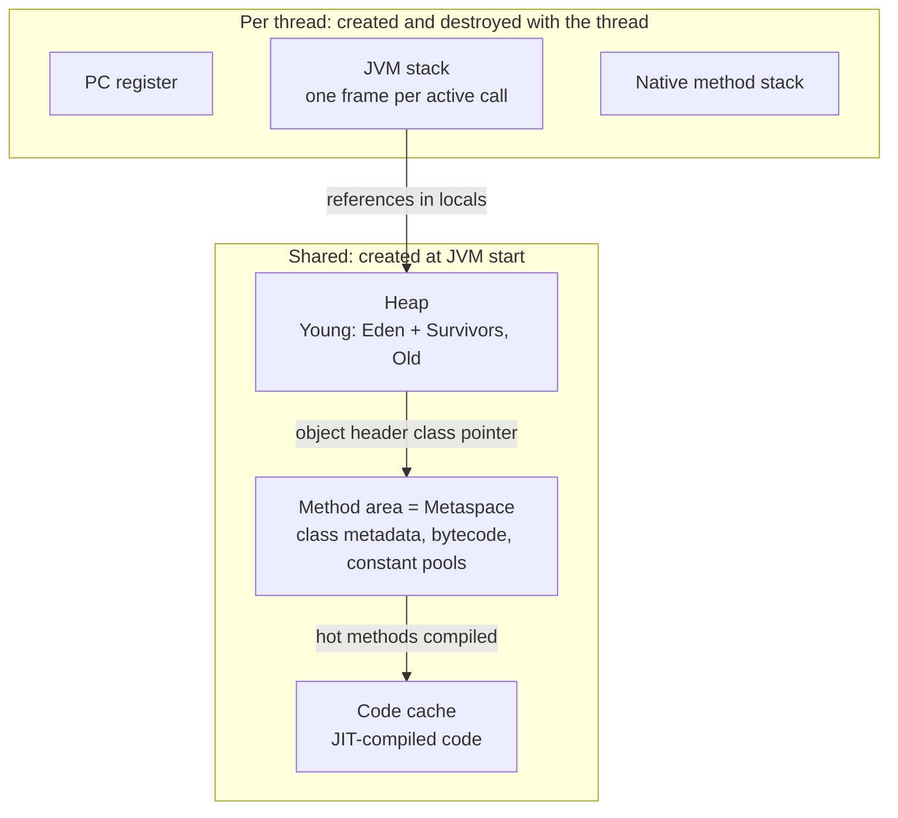
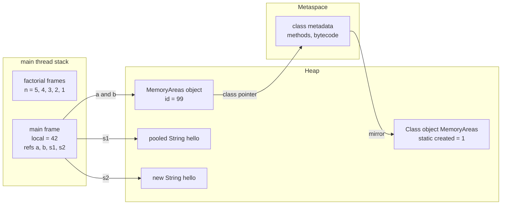
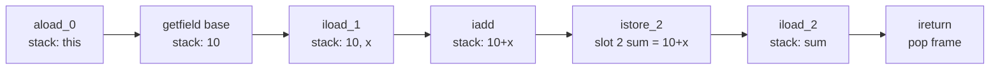

## In One Line
The JVM splits its memory into areas owned by **each thread** (PC register, JVM stack, native stack) and areas **shared by all threads** (heap for objects, method area — *Metaspace* in HotSpot — for class metadata, plus the code cache); knowing what lives where explains `StackOverflowError`, `OutOfMemoryError`, thread safety and why a Java process uses more RAM than `-Xmx`.

## Mental Model
Picture a **big office building**.

- The **warehouse** in the basement is the **heap**. Every *thing* the company owns (every object and array) is stored there, and any employee can fetch it if they hold its **address slip** (a reference). A cleaning crew (the garbage collector) regularly throws out things nobody holds a slip for.
- Every employee (a **thread**) has a private **notepad** on their desk — the **JVM stack**. Each task they start (a method call) gets a fresh sheet on top (a **frame**) with the task's scratch values (local variables). When the task ends, the sheet is torn off. Nobody else writes on your notepad, which is why local variables are thread-safe.
- A **bookmark** on the notepad says which step of the current task you are on — the **PC register**.
- A few employees also do jobs in a foreign language (native C code); they use a separate pad — the **native method stack**.
- The **company library** in another building holds the **blueprints** of every product type (class definitions, method code, constant pools). In HotSpot this is **Metaspace**, and it sits in native memory, *outside* the warehouse.
- For tasks done thousands of times, someone prints **laminated quick-reference cards** (machine code) and keeps them in a drawer — the **code cache** filled by the JIT compiler.
- Some departments rent **off-site storage** that the cleaning crew never visits — **direct (native) memory** used by NIO buffers.

If your notepad runs out of sheets you get `StackOverflowError`; if the warehouse is full of things someone still holds a slip for, you get `OutOfMemoryError: Java heap space`.

## Concept
### The specification view: six run-time data areas (JVMS 2.5)
| Area | Per thread or shared | What it holds | Error when it runs out |
|---|---|---|---|
| **PC register** | Per thread | Address of the bytecode instruction being executed (undefined while running a native method) | never |
| **JVM stack** | Per thread | One **frame** per method call in progress | `StackOverflowError` (too deep); `OutOfMemoryError` if a new thread's stack cannot be created |
| **Native method stack** | Per thread | Frames of native (C/C++) code called through JNI | same as above |
| **Heap** | Shared | **All objects and arrays** — the only area the garbage collector manages | `OutOfMemoryError: Java heap space` |
| **Method area** | Shared | Per-class data: field and method info, bytecode, the **run-time constant pool** | `OutOfMemoryError: Metaspace` |
| **Run-time constant pool** | Per class (part of the method area) | Literals and symbolic references from the class file's constant pool | (reported as Metaspace) |

The JVMS describes *what* must exist, not *how* to build it. HotSpot (the JVM in OpenJDK, Oracle JDK, Temurin, Corretto...) makes these choices:

- It uses **one native thread stack** for both Java frames and native frames, so "JVM stack" and "native method stack" are physically the same memory.
- The **method area** is implemented by **Metaspace** (Java 8+), in native memory; before Java 8 it was the **Permanent Generation (PermGen)**, a fixed-size part of the heap.
- **Static fields** are stored inside the `java.lang.Class` object of their class, **in the heap** (since Java 7/8), not in Metaspace.
- The **string pool** (interned strings, including every string literal) is a hash table whose `String` objects live **in the heap** (since Java 7; in PermGen before).

### What a HotSpot process really contains
| Region | Holds | Sized by | Default |
|---|---|---|---|
| **Java heap** | Objects and arrays, including `Class` objects with their static fields and pooled strings | `-Xms` (initial), `-Xmx` (max) | initial 1/64, max **1/4 of physical or container RAM** |
| **Metaspace** | Class metadata (`Klass` structures, methods, bytecode, constant pools, annotations) | `-XX:MaxMetaspaceSize` | **unlimited** (bounded only by native memory) |
| **Compressed class space** | The `Klass` structures when compressed class pointers are on (part of Metaspace) | `-XX:CompressedClassSpaceSize` | 1 GB reserved |
| **Code cache** | Machine code produced by the JIT (C1, C2), plus interpreter and stubs; 3 segments since Java 9 | `-XX:ReservedCodeCacheSize` | 240 MB with tiered compilation |
| **Thread stacks** | One per platform thread | `-Xss` = `-XX:ThreadStackSize` | 1 MB on 64-bit Linux/macOS |
| **Direct buffers** | `ByteBuffer.allocateDirect`, mapped files | `-XX:MaxDirectMemorySize` | equal to max heap |
| **GC data structures** | Card tables, remembered sets, mark bitmaps | collector-specific | often several % of the heap |
| **Other native** | Symbol table, JIT compiler arenas, JNI allocations, NIO, the C library | — | — |

This is why the **resident memory (RSS) of a Java process is always larger than `-Xmx`**. Native Memory Tracking (see Code) shows each part.

### Stack frames in detail
Every method call pushes a **frame** on the calling thread's stack; `return` (or an exception that escapes the method) pops it. A frame has:

1. **Local variable array** — numbered slots. Slot 0 holds `this` in instance methods; then the parameters; then the locals. `long` and `double` take two slots. A slot holds a primitive value or a **reference** — never an object.
2. **Operand stack** — the scratch stack the bytecode works on: `iload` pushes, `iadd` pops two and pushes the sum, `ireturn` pops the result.
3. **Frame data** — a link to the class's run-time constant pool (for resolving method and field references), the return address into the caller, and what is needed to unwind on exceptions.

`javac` computes the maximum operand-stack depth and the number of local slots for every method and writes them to the class file (`stack=2, locals=3` in `javap -v`). So the size of an interpreted frame is known before the method runs; the JIT later builds its own, often smaller, frames and keeps values in CPU registers.

The stack has a fixed maximum size per thread. When a call needs a frame that does not fit, HotSpot hits a **guard page** at the end of the stack and throws `StackOverflowError`. Typical causes: recursion without a (reachable) base case, very deep recursion on large inputs, and accidental mutual recursion (`toString()` of two objects that print each other, `equals` calling itself, a setter calling itself).

### The heap
- Holds **every object and every array** — including `int[]` arrays, boxed `Integer`s, lambdas' captured state, strings made by concatenation, and the `Class` objects.
- **Shared by all threads**, so objects reachable from more than one thread need synchronization.
- Created at JVM start with the initial size (`-Xms`), grows up to `-Xmx`, and is managed by the garbage collector. Most collectors split it into a **young generation** (Eden + two survivor spaces) and an **old generation** — see [Garbage Collection](lesson:b02-jvm/03-garbage-collection).
- **Allocation is cheap**: each thread gets a private chunk of Eden called a **TLAB** (thread-local allocation buffer). `new` just moves a pointer forward inside the TLAB ("bump the pointer") — no lock, a few machine instructions.
- **Default sizing** (server-class machine): max heap `MaxRAMPercentage` = **25%** of RAM, initial `InitialRAMPercentage` = 1/64. Since Java 10 (and 8u191) the JVM reads **container (cgroup) limits**, so in a 2 GB container the default max heap is 512 MB. In containers, set `-XX:MaxRAMPercentage=75` (or `-Xmx`) rather than relying on 25%.
- `Runtime.getRuntime()`: `maxMemory()` = the max heap, `totalMemory()` = currently committed heap, `freeMemory()` = unused part of the committed heap; used = total − free.

### Where does each thing live?
| Declaration | Where the *value* lives |
|---|---|
| `int x = 5;` in a method | the frame's local variable slot (stack) |
| `Foo f = new Foo();` in a method | reference in the frame; the `Foo` object in the heap |
| `int[] a = new int[10];` in a method | reference in the frame; the **array (with its 10 ints) in the heap** |
| `int count;` instance field | inside every object, in the heap |
| `static int total;` | inside the `Class` object, in the heap (HotSpot 8+) |
| `"hello"` literal | one pooled `String` object in the heap, shared by all classes |
| the code of `main`, field names, method signatures | Metaspace (class metadata) |
| JIT-compiled `main` | code cache |
| method parameters | the callee's local variable slots (copies of the caller's values — Java is pass-by-value) |

> [!INTERVIEW] "Primitives live on the stack" is only true for **local** variables. A primitive field lives inside its object on the heap, and a primitive array is itself a heap object.

### Object layout (64-bit HotSpot)
Every object starts with a **header**:

- **Mark word** (8 bytes): identity hash code, GC age (4 bits, so ages 0–15), lock state, GC marking bits.
- **Class pointer** (4 bytes with compressed class pointers — the default — else 8): points to the class's `Klass` in Metaspace.
- Arrays add a 4-byte **length**.

Fields follow (the JVM reorders them to pack tightly), and the total is rounded up to a multiple of **8 bytes**. So `new Object()` is 16 bytes, an object with one `int` is 16 (12 + 4), two `int`s 24 (12 + 8 = 20, padded). References are 4 bytes thanks to **compressed oops** (ordinary object pointers stored as 32-bit offsets, shifted by 3), which works while the heap is under about **32 GB**. Above that references grow to 8 bytes, so a 34 GB heap can hold *less* data than a 31 GB one. Java 24 added experimental **compact object headers** (8-byte headers, JEP 450), a product option since Java 25 (JEP 519).

### Method area: from PermGen to Metaspace
| | PermGen (≤ Java 7) | Metaspace (Java 8+) |
|---|---|---|
| Location | Part of the Java heap | **Native memory** |
| Size limit | Fixed: `-XX:MaxPermSize` (default only 64–85 MB, depending on platform) | Unlimited by default; cap with `-XX:MaxMetaspaceSize` |
| Typical error | `OutOfMemoryError: PermGen space` (redeploys, many JSPs, `String.intern`) | `OutOfMemoryError: Metaspace` or `Compressed class space` |
| Interned strings, static fields | PermGen until Java 6; moved to the heap in 7 | heap |
| Freed when | Full GC unloads classes | class loader becomes unreachable and a GC unloads its classes |

Metaspace is allocated **per class loader** in chunks; when a loader dies, its whole chunk area is released (Java 16's *elastic Metaspace*, JEP 387, returns it to the OS much faster). `-XX:MetaspaceSize` (about 21 MB) is not the initial size but the **first high-water mark**: crossing it triggers a GC that tries to unload classes, after which the mark is raised.

### Code cache
The interpreter runs bytecode first; methods that get hot are compiled by **C1** (fast, with profiling) and later **C2** (highly optimized) and stored in the code cache. Since Java 9 it is split into three segments — `non-nmethods` (interpreter, stubs), `profiled nmethods` (C1 code) and `non-profiled nmethods` (C2 code) — the exact pool names you see in the Code section. If it fills up the JVM prints `CodeCache is full. Compiler has been disabled.` and the application keeps running, but slowly (interpreted).

### Direct and other native memory
`ByteBuffer.allocateDirect(n)` allocates `n` bytes **outside the heap** so the OS can do I/O on it without copying. The `ByteBuffer` object itself is tiny and lives in the heap; the native memory is released only when that object is garbage collected (through a `Cleaner`). The limit is `-XX:MaxDirectMemorySize` (default = max heap); exceeding it gives `OutOfMemoryError: Cannot reserve ... bytes of direct buffer memory`. Memory-mapped files (`FileChannel.map`) and JNI libraries also live here.

### Escape analysis: not every `new` reaches the heap
The C2 JIT analyses whether an object can **escape** the method (stored in a field, returned, passed to unknown code, seen by another thread). If it cannot, C2 may apply **scalar replacement**: the object is never allocated; its fields become plain local values in registers. Lock elision (removing `synchronized` on objects no other thread can see) comes from the same analysis. It is on by default (`-XX:+DoEscapeAnalysis`), only kicks in after JIT compilation, and is an optimization you cannot rely on — the language still says "objects are on the heap". The Code section shows 200 million allocations causing **0** GCs with it and **121** without it.

### Threads and the stack in Java 21
A **platform thread** reserves its full stack (`-Xss`) of virtual memory when it starts (pages are committed as they are touched). Ten thousand threads × 1 MB is 10 GB of address space, which is one reason platform threads are expensive. A **virtual thread** (Java 21) has no fixed stack: while it is parked its frames are copied into ordinary **heap objects** (stack chunks), and they are copied back onto a carrier thread's stack when it resumes — so millions of virtual threads can exist.

### Version notes
| Version | Change |
|---|---|
| 7 | String pool and static fields moved from PermGen to the heap |
| 8 | PermGen removed, Metaspace introduced (JEP 122); `-XX:PermSize`/`MaxPermSize` ignored with a warning (rejected since 17) |
| 9 | Segmented code cache (JEP 197); G1 becomes the default collector |
| 10 | Container awareness; `-XX:MaxRAMPercentage`/`InitialRAMPercentage` (backported to 8u191) |
| 15 | Compressed class pointers no longer require compressed oops |
| 16 | Elastic Metaspace (JEP 387) |
| 21 | Virtual threads: parked stacks live in the heap |
| 24–25 | Compact object headers: experimental (JEP 450), then product (JEP 519) |

## Diagram

Three areas are private to each thread; three are shared. Only the heap is garbage collected object by object.


Where every variable of `MemoryAreas.java` ends up: values and references in frames, objects and statics in the heap, class code in Metaspace.


Executing `addTo(x)`: values move between the local slots and the operand stack of one frame.

## Code
**1. Where does everything live?** `MemoryAreas.java` — run with `java -Xmx256m MemoryAreas.java`.
```java
import java.lang.management.ManagementFactory;
import java.lang.management.MemoryPoolMXBean;
import java.lang.management.MemoryType;

public class MemoryAreas {
    static int created = 0;                   // static field: one copy, stored with the Class object
    static final String GREETING = "hello";   // string literal: one interned String in the heap

    int id;                                   // instance field: one copy inside every object

    MemoryAreas(int id) {
        this.id = id;
        created++;
    }

    static int factorial(int n) {             // every call pushes a new frame with its own n
        if (n <= 1) return 1;
        return n * factorial(n - 1);
    }

    public static void main(String[] args) {
        int local = 42;                                   // primitive local: the value sits in main's frame
        MemoryAreas a = new MemoryAreas(1);               // reference in the frame, object in the heap
        MemoryAreas b = a;                                // copies the reference, not the object
        b.id = 99;
        System.out.println("local = " + local + ", a.id = " + a.id + ", created = " + created);

        String s1 = "hello";                              // same pooled object as GREETING
        String s2 = new String("hello");                  // a new heap object with the same chars
        System.out.println("s1 == GREETING     : " + (s1 == GREETING));
        System.out.println("s1 == s2           : " + (s1 == s2));
        System.out.println("s1 == s2.intern()  : " + (s1 == s2.intern()));

        System.out.println("factorial(5)       = " + factorial(5));

        Runtime rt = Runtime.getRuntime();
        System.out.println("max heap (MB)      = " + rt.maxMemory() / (1024 * 1024));

        for (MemoryPoolMXBean pool : ManagementFactory.getMemoryPoolMXBeans()) {
            String type = pool.getType() == MemoryType.HEAP ? "HEAP    " : "NON_HEAP";
            System.out.println(type + " " + pool.getName());
        }
    }
}
```
```output
local = 42, a.id = 99, created = 1
s1 == GREETING     : true
s1 == s2           : false
s1 == s2.intern()  : true
factorial(5)       = 120
max heap (MB)      = 256
NON_HEAP CodeHeap 'non-nmethods'
NON_HEAP Metaspace
NON_HEAP CodeHeap 'profiled nmethods'
NON_HEAP Compressed Class Space
HEAP     G1 Eden Space
HEAP     G1 Old Gen
HEAP     G1 Survivor Space
NON_HEAP CodeHeap 'non-profiled nmethods'
```
The same program with `-XX:+UseSerialGC` lists different heap pools and a smaller `maxMemory`:
```output
max heap (MB)      = 247
NON_HEAP CodeHeap 'non-nmethods'
NON_HEAP Metaspace
HEAP     Tenured Gen
NON_HEAP CodeHeap 'profiled nmethods'
HEAP     Eden Space
HEAP     Survivor Space
NON_HEAP Compressed Class Space
NON_HEAP CodeHeap 'non-profiled nmethods'
```

**2. What a frame looks like.** `Frames.java`, compiled with `javac -g` and disassembled with `javap -c -l -p Frames` (the `stack=`/`locals=` lines come from `javap -v`).
```java
public class Frames {
    int base = 10;

    int addTo(int x) {
        int sum = base + x;
        return sum;
    }

    static int twice(int n) {
        return n * 2;
    }
}
```
```text
  int addTo(int);
      stack=2, locals=3, args_size=2
    Code:
       0: aload_0
       1: getfield      #7                  // Field base:I
       4: iload_1
       5: iadd
       6: istore_2
       7: iload_2
       8: ireturn
    LocalVariableTable:
      Start  Length  Slot  Name   Signature
          0       9     0  this   LFrames;
          0       9     1     x   I
          7       2     2   sum   I

  static int twice(int);
      stack=2, locals=1, args_size=1
    Code:
       0: iload_0
       1: iconst_2
       2: imul
       3: ireturn
    LocalVariableTable:
      Start  Length  Slot  Name   Signature
          0       4     0     n   I
```

**3. How deep can a stack go?** `StackDepth.java` — compile with `javac -d out StackDepth.java`.
```java
public class StackDepth {
    static int depth = 0;

    static void dive() {
        depth++;
        dive();                       // no base case: frames pile up until the stack is full
    }

    static void diveWithLocals() {
        long a = 1, b = 2, c = 3, d = 4, e = 5, f = 6, g = 7, h = 8;  // a bigger frame
        depth++;
        diveWithLocals();
        if (a + b + c + d + e + f + g + h == 0) System.out.println();   // keep the locals alive
    }

    public static void main(String[] args) throws InterruptedException {
        try {
            dive();
        } catch (StackOverflowError e) {
            System.out.println("main thread, small frames : " + depth + " calls -> " + e.getClass().getSimpleName());
        }

        depth = 0;
        try {
            diveWithLocals();
        } catch (StackOverflowError e) {
            System.out.println("main thread, bigger frames: " + depth + " calls");
        }

        // A thread can ask for its own stack size (a hint the JVM may round or ignore)
        Thread big = new Thread(null, () -> {
            depth = 0;
            try {
                dive();
            } catch (StackOverflowError e) {
                System.out.println("thread with 16 MB stack   : " + depth + " calls");
            }
        }, "big-stack", 16L * 1024 * 1024);
        big.start();
        big.join();
    }
}
```
`java -Xint -cp out StackDepth` (interpreter only, default 1 MB stack):
```output
main thread, small frames : 10732 calls -> StackOverflowError
main thread, bigger frames: 4372 calls
thread with 16 MB stack   : 189465 calls
```
`java -Xint -Xss256k -cp out StackDepth`:
```output
main thread, small frames : 1795 calls -> StackOverflowError
main thread, bigger frames: 731 calls
thread with 16 MB stack   : 189465 calls
```
`java -Xint -Xss4m -cp out StackDepth`:
```output
main thread, small frames : 46479 calls -> StackOverflowError
main thread, bigger frames: 18936 calls
thread with 16 MB stack   : 189465 calls
```
`java -cp out StackDepth` (normal mode, JIT on) — two runs on the same machine:
```output
main thread, small frames : 23306 calls -> StackOverflowError
main thread, bigger frames: 40470 calls
thread with 16 MB stack   : 416824 calls
```
```output
main thread, small frames : 23306 calls -> StackOverflowError
main thread, bigger frames: 13668 calls
thread with 16 MB stack   : 416824 calls
```

**4. How big is an object?** `ObjectSizes.java` counts instances and bytes with the same class histogram that `jcmd <pid> GC.class_histogram` prints.
```java
import java.lang.management.ManagementFactory;
import java.util.List;
import javax.management.ObjectName;

public class ObjectSizes {
    static class Empty {}
    static class OneInt { int a; }
    static class TwoInts { int a, b; }
    static class IntAndLong { int a; long b; }
    static class OneRef { Object r; }

    public static void main(String[] args) throws Exception {
        int n = 100_000;
        Object[] keep = new Object[5 * n];                // keep them reachable while we count
        for (int i = 0; i < n; i++) {
            keep[i] = new Empty();
            keep[n + i] = new OneInt();
            keep[2 * n + i] = new TwoInts();
            keep[3 * n + i] = new IntAndLong();
            keep[4 * n + i] = new OneRef();
        }
        // The same data as `jcmd <pid> GC.class_histogram`, requested from inside the JVM
        String histogram = (String) ManagementFactory.getPlatformMBeanServer().invoke(
                new ObjectName("com.sun.management:type=DiagnosticCommand"),
                "gcClassHistogram", new Object[] { null }, new String[] { String[].class.getName() });

        for (String name : List.of("Empty", "OneInt", "TwoInts", "IntAndLong", "OneRef")) {
            for (String line : histogram.split("\n")) {
                String[] col = line.trim().split("\\s+");  // "num:  #instances  #bytes  class name"
                if (col.length >= 4 && col[3].equals("ObjectSizes$" + name)) {
                    long each = Long.parseLong(col[2]) / Long.parseLong(col[1]);
                    System.out.printf("%-10s %2d bytes%n", name, each);
                }
            }
        }
        System.out.println("objects kept: " + keep.length);
    }
}
```
Default (compressed oops and class pointers on):
```output
Empty      16 bytes
OneInt     16 bytes
TwoInts    24 bytes
IntAndLong 24 bytes
OneRef     16 bytes
objects kept: 500000
```
With `-Xmx40g` (heap too big for compressed oops, so references take 8 bytes):
```output
Empty      16 bytes
OneInt     16 bytes
TwoInts    24 bytes
IntAndLong 24 bytes
OneRef     24 bytes
objects kept: 500000
```
With `-XX:-UseCompressedOops -XX:-UseCompressedClassPointers` (16-byte headers):
```output
Empty      16 bytes
OneInt     24 bytes
TwoInts    24 bytes
IntAndLong 32 bytes
OneRef     24 bytes
objects kept: 500000
```

**5. Escape analysis removes allocations.** `EscapeDemo.java` — run with `java -Xmx64m -cp out EscapeDemo`, then add `-XX:-DoEscapeAnalysis`.
```java
import java.lang.management.GarbageCollectorMXBean;
import java.lang.management.ManagementFactory;

public class EscapeDemo {
    record Point(int x, int y) {}

    static long sum(int n) {
        long total = 0;
        for (int i = 0; i < n; i++) {
            Point p = new Point(i, i + 1);   // never leaves this method: it does not "escape"
            total += p.x() + p.y();
        }
        return total;
    }

    static long gcCount() {
        long count = 0;
        for (GarbageCollectorMXBean gc : ManagementFactory.getGarbageCollectorMXBeans()) {
            count += Math.max(0, gc.getCollectionCount());
        }
        return count;
    }

    public static void main(String[] args) {
        long before = gcCount();
        long result = 0;
        for (int round = 0; round < 20; round++) {
            result += sum(10_000_000);        // 200 million Points in total, 16 bytes each on the heap
        }
        System.out.println("result = " + result);
        System.out.println("GCs during the loop = " + (gcCount() - before));
    }
}
```
Default (escape analysis on):
```output
result = 2000000000000000
GCs during the loop = 0
```
With `-XX:-DoEscapeAnalysis`:
```output
result = 2000000000000000
GCs during the loop = 121
```

**6. See all the native memory.** Start any program with `-XX:NativeMemoryTracking=summary`, then run `jcmd <pid> VM.native_memory summary scale=MB` (a sleeping "hello" program with `-Xmx256m`; sub-lines trimmed):
```text
Total: reserved=1669MB, committed=285MB
-                 Java Heap (reserved=256MB, committed=216MB)
-                     Class (reserved=1024MB, committed=0MB)
                            (classes #546)
-                    Thread (reserved=18MB, committed=1MB)
                            (threads #18)
                            (stack: reserved=18MB, committed=1MB, peak=1MB)
-                      Code (reserved=242MB, committed=7MB)
-                        GC (reserved=46MB, committed=45MB)
-                  Internal (reserved=1MB, committed=1MB)
-                    Symbol (reserved=1MB, committed=1MB)
-        Shared class space (reserved=16MB, committed=13MB, readonly=0MB)
-                 Metaspace (reserved=64MB, committed=0MB)
```

## Walkthrough
**MemoryAreas**
- `static int created` — one copy for the whole class. HotSpot stores it in the `MemoryAreas` `Class` object on the heap; the class's *metadata* (field names, the bytecode of `factorial` and `main`) lives in Metaspace.
- `static final String GREETING = "hello"` — the literal is resolved to **one pooled `String`** in the heap's string table. Every `"hello"` literal in every class is that same object.
- `int id` — an instance field, stored inside each `MemoryAreas` object.
- `factorial(5)` — five nested calls, five frames on the `main` thread's stack, each with its own `n` slot (5, 4, 3, 2, 1). They are popped as each call returns, and the result `120` is passed back through the operand stacks.
- `int local = 42` — the value 42 sits in a slot of `main`'s frame; nothing is allocated in the heap.
- `new MemoryAreas(1)` — allocates the object in the heap (inside the thread's TLAB) and runs the constructor, which also bumps the static `created` to 1. `a` holds only a **reference**.
- `MemoryAreas b = a; b.id = 99;` — copies the reference, so `a` and `b` point to the **same** object: `a.id` prints `99`.
- `s1 == GREETING` is `true` (same pooled object); `s1 == s2` is `false` because `new String("hello")` always creates a **new** heap object; `s2.intern()` returns the pooled instance, so the last comparison is `true`.
- `rt.maxMemory()` reports exactly `256` MB with G1 and `-Xmx256m`.
- The pool loop shows the real HotSpot areas: three **code cache** segments, **Metaspace**, **Compressed Class Space** (non-heap) and three **heap** pools named after the collector — `G1 Eden Space`, `G1 Survivor Space`, `G1 Old Gen`. With Serial GC they become `Eden Space`, `Survivor Space`, `Tenured Gen`, and `maxMemory()` drops to `247`: Serial and Parallel report the heap minus **one survivor space**, because one survivor is always empty and cannot hold objects.

**Frames**
- `addTo` has `locals=3`: slot 0 = `this`, slot 1 = `x`, slot 2 = `sum`. `stack=2` because at most two values (`base` and `x`) are on the operand stack at once.
- `aload_0` pushes `this`; `getfield base` replaces it with `10`; `iload_1` pushes `x`; `iadd` pops both and pushes the sum; `istore_2` stores it in `sum`; `iload_2` pushes it back; `ireturn` pops it, **removes the frame** and pushes the value onto the caller's operand stack.
- `twice` is `static`, so there is no `this`: `n` is in slot 0 (`locals=1`).
- `LocalVariableTable` appears only with `javac -g`; debuggers use it to show variable names.

**StackDepth**
- `dive()` has no base case, so it recurses until the stack is full and the JVM throws `StackOverflowError`. It is an `Error`, but it can be caught: by the time `catch` runs, all the `dive` frames have been popped and there is room again.
- With `-Xint` (interpreter only) frame sizes are predictable: `diveWithLocals` needs 8 `long` locals (16 slots) per frame, so only 4372 calls fit versus 10732 for `dive`.
- `-Xss256k` → 1795 calls, `-Xss4m` → 46479. Depth grows with stack size but not exactly proportionally, because guard pages and the frames already on the stack take a fixed amount.
- `new Thread(group, task, name, stackSize)` asks for a 16 MB stack for that thread only; `-Xss` does not affect it (189465 calls in every run).
- With the JIT on, numbers change and **vary between runs** (40470 in one run, 13668 in another for the same code): once the JIT compiles a method, its frames are laid out differently and dead or constant locals disappear. When compilation happens relative to the recursion depends on timing. The `-Xint` numbers were identical across runs on this machine; they will differ on other machines and JDK builds.

**ObjectSizes**
- `gcClassHistogram` is the in-process equivalent of `jcmd <pid> GC.class_histogram`: instances and total bytes per class. Bytes ÷ instances = size of one object.
- Default: header = 12 bytes (8 mark word + 4 compressed class pointer). `Empty` 12 → padded to **16**; `OneInt` 12+4 = **16**; `TwoInts` 20 → **24**; `IntAndLong` 12+4+8 = **24**; `OneRef` 12+4 (compressed reference) = **16**.
- `-Xmx40g`: compressed oops need a heap under ~32 GB, so references become 8 bytes: `OneRef` grows to 12+8 = 20 → **24**. Compressed class pointers stay on (independent since Java 15), so the header is still 12.
- Both compressions off: 16-byte header, so `OneInt` = 20 → **24**, `IntAndLong` = 28 → **32**.

**EscapeDemo**
- `Point p` is created 200 million times but never stored anywhere, returned or passed on — it does not escape `sum`. Once C2 compiles `sum` (on-stack replacement kicks in during the first long loop), it replaces `p` by two local ints. **0** GCs (1 in some runs, from the allocations made before compilation).
- With `-XX:-DoEscapeAnalysis` every `Point` is really allocated: about 3.2 GB of garbage in a 64 MB heap forces **121** collections. Both counts can differ slightly from run to run (the first run printed 0, another 1), because they depend on when the JIT finishes compiling `sum`. The printed `result` is identical — escape analysis never changes behaviour, only cost.
- `getCollectionCount()` can return −1 for unsupported collectors, hence `Math.max(0, ...)`.

**NMT**
- The "Java Heap" line is what `-Xmx` controls; everything else — **Class** (Metaspace), **Thread** stacks (18 threads even for hello-world: GC workers, JIT compilers, reference handler, signal dispatcher...), **Code** cache, **GC** structures, **Shared class space** (the CDS archive) — is native memory on top of it. "Reserved" is address space; "committed" is memory actually backed by RAM or swap.

## Traps
- **"Primitives go on the stack, objects on the heap."** Only half true. Local primitives are in frames; primitive *fields* and primitive *arrays* are in the heap. And the JIT may keep a non-escaping object out of the heap entirely.
- **"Static variables live in PermGen / the stack / the method area."** In HotSpot 8+ they live in the heap, inside the `Class` object. The *specification* puts them in the method area, so say both: "logically the method area, physically the heap in HotSpot".
- **"The string pool is in PermGen."** Only until Java 6. Since Java 7 pooled strings are ordinary heap objects and can be garbage collected.
- **RSS bigger than `-Xmx`** is normal: Metaspace, thread stacks, code cache, GC structures and direct buffers are all outside the heap. In a container, setting `-Xmx` equal to the container limit gets the process **OOM-killed** (exit code 137) by the kernel; leave 25–50% headroom or use `-XX:MaxRAMPercentage=75`.
- **`Runtime.maxMemory()` is not always `-Xmx`.** With Serial or Parallel GC it excludes one survivor space (247 instead of 256 above).
- **Metaspace is unbounded by default.** A class-loader leak grows native memory until the OS kills the process. Set `-XX:MaxMetaspaceSize` in production to get a clear `OutOfMemoryError: Metaspace` instead.
- **Catching `StackOverflowError` is risky.** It can hit inside any method — halfway through updating a data structure, inside a static initializer (poisoning the class) or in a `finally` block. Fix the recursion (add a base case, turn it into a loop, use an explicit `Deque`), do not catch the error.
- **A bigger `-Xss` applies to every thread.** `-Xss16m` with 2,000 platform threads reserves 32 GB of address space. Give the deep-recursion thread its own size through the `Thread` constructor instead.
- **Accidental infinite recursion** often hides in `toString()`/`hashCode()` of two objects that reference each other (bidirectional JPA relations, Lombok `@Data` on both sides).
- **`-Xss` below the minimum** stops the JVM before it starts: `The Java thread stack size specified is too small. Specify at least 136k` (Linux x64, JDK 21).
- **Heaps just above 32 GB** lose compressed oops, so every reference doubles in size. A 31 GB heap may hold more than a 36 GB one.

> [!WARNING] `-XX:PermSize` and `-XX:MaxPermSize` were ignored with a warning in Java 8–16 and are **rejected** since Java 17: on JDK 21, `java -XX:MaxPermSize=128m ...` stops with `Unrecognized VM option 'MaxPermSize=128m'` and the JVM does not start. Old start scripts must be cleaned up; the Metaspace equivalents are `-XX:MetaspaceSize` and `-XX:MaxMetaspaceSize`.

## Tips & Tricks
- **Mnemonic — "3 private, 3 shared": PC, Stack, Native stack (per thread) | Heap, Metaspace, Code cache (shared).** Hook: "*Please Stop Nagging — Heap Makes Code*".
- **One-line map:** `new` → heap; method call → stack frame; class loaded → Metaspace; method hot → code cache; `allocateDirect` → native.
- **Which error, which area?** Deep recursion → `StackOverflowError` (stack). Too many live objects → `Java heap space`. Too many classes → `Metaspace`. Too many threads → `unable to create native thread`. Too many direct buffers → `direct buffer memory`.
- **Flag cheat sheet:** `-Xms`/`-Xmx` heap, `-Xmn` young gen, `-Xss` stack per thread, `-XX:MaxMetaspaceSize`, `-XX:ReservedCodeCacheSize`, `-XX:MaxDirectMemorySize`, `-XX:MaxRAMPercentage`. See the real values with `java -XX:+PrintFlagsFinal -version | grep HeapSize`.
- **Look inside a live JVM:** `jcmd <pid> GC.heap_info` (heap regions), `jcmd <pid> VM.native_memory summary` (needs `-XX:NativeMemoryTracking=summary` at start), `jcmd <pid> GC.class_histogram` (objects per class), `jstat -gc <pid> 1s` (pool usage every second).
- **Frame sizes are visible:** `javap -v MyClass` prints `stack=`, `locals=` for each method.
- **Estimate object sizes quickly:** 12-byte header + fields, round up to 8. Arrays: 16-byte header (12 + 4 length) + elements, round up to 8. `new int[0]` = 16 bytes, `new long[1]` = 24.
- **Keep the heap below 32 GB** unless you really need more, so compressed oops stay on.

## Interview Q&A
### [Basic] What are the memory areas of the JVM?
The JVM specification defines run-time data areas of two kinds. **Per thread**: the **PC register** (address of the current bytecode instruction), the **JVM stack** (one frame per method call with local variables and an operand stack) and the **native method stack** (for JNI code). **Shared**: the **heap**, where all objects and arrays live and which the garbage collector manages, and the **method area**, which holds per-class data such as bytecode, field and method info and the run-time constant pool. In HotSpot the method area is implemented by **Metaspace** in native memory (since Java 8), and there is also a **code cache** for JIT-compiled code. Static fields and the string pool are physically in the heap.

**Follow-up:** *Which areas can throw `OutOfMemoryError`?* — The heap (`Java heap space`), Metaspace (`Metaspace`, `Compressed class space`), stacks (`unable to create native thread` when a new thread's stack cannot be created) and direct memory. The PC register never runs out, and a full code cache only disables the JIT compiler.

### [Basic] What is the difference between stack and heap memory?
| Stack | Heap |
|---|---|
| One per thread | One per JVM, shared by all threads |
| Frames with local variables, parameters, partial results | All objects and arrays |
| Freed automatically when a method returns (LIFO) | Freed by the garbage collector when objects become unreachable |
| Fixed size per thread (`-Xss`, 1 MB default) | Size between `-Xms` and `-Xmx` |
| Very fast, no synchronization needed | Allocation is fast (TLAB), but sharing needs synchronization |
| Overflow: `StackOverflowError` | Exhaustion: `OutOfMemoryError: Java heap space` |

A local reference variable lives in the stack while the object it points to lives in the heap.

**Follow-up:** *Are local variables thread-safe?* — Yes, the variables themselves are, because each thread has its own frame. But the object a local reference points to may be shared with other threads, and then it is not automatically safe.

### [Basic] Where are static variables and string literals stored?
Logically, static variables belong to the **method area** (per-class data). In HotSpot since Java 7/8 they are physically stored **in the heap**, inside the `java.lang.Class` object of the class. String literals are interned: the JVM keeps one `String` object per distinct literal in the **string pool**, a table whose objects have lived **in the heap** since Java 7 (in PermGen before). That is why `"hello" == "hello"` is true across classes, while `new String("hello")` creates a separate heap object.

**Follow-up:** *Can pooled strings be garbage collected?* — Yes, since they are heap objects, an interned string that is no longer referenced (for example one created with `intern()` at run time) can be collected. Literals stay alive as long as the class that uses them is loaded.

### [Intermediate] What does a stack frame contain?
A frame is created for every method invocation and destroyed when it completes (normally or by an exception). It contains the **local variable array** (slot 0 = `this` for instance methods, then parameters, then locals; `long`/`double` take two slots), the **operand stack** on which bytecode instructions push and pop values, and **frame data**: a reference to the run-time constant pool of the method's class (used to resolve method and field references — dynamic linking), the return address and the information needed to unwind on exceptions. The number of slots and the maximum stack depth are computed by `javac` and stored in the class file — `javap -v` shows `stack=2, locals=3`.

**Follow-up:** *What happens to a frame when an exception is not caught in the method?* — The frame is popped and the exception propagates to the caller's frame, repeating until a matching handler is found or the thread's stack is empty (then the thread dies and the uncaught-exception handler prints the stack trace).

### [Intermediate] What is Metaspace, and why did it replace PermGen?
Metaspace is HotSpot's implementation of the method area since Java 8: class metadata (`Klass` structures, methods, bytecode, constant pools, annotations) stored in **native memory**, allocated per class loader and freed when the loader is unloaded. PermGen was a fixed-size part of the heap (`-XX:MaxPermSize`), hard to size correctly: redeploying applications, many generated classes or heavy `String.intern` usage produced `OutOfMemoryError: PermGen space`. Moving interned strings and statics to the heap (Java 7) and the metadata to native memory (Java 8) made the size auto-grow, simplified GC (no permanent generation to collect) and aligned HotSpot with JRockit, which had no PermGen.

**Follow-up:** *Can Metaspace still run out?* — Yes. It is unlimited by default, so a class-loader leak eats native memory until the OS intervenes; with `-XX:MaxMetaspaceSize` you get `OutOfMemoryError: Metaspace`. The compressed class space (1 GB default) can also fill up: `OutOfMemoryError: Compressed class space`.

### [Intermediate] What causes `StackOverflowError` and how do you fix it?
It is thrown when a thread needs a new frame but its stack is full — almost always because of unbounded recursion (missing or unreachable base case, accidental mutual recursion such as two `toString()` methods calling each other) or legitimately deep recursion on large input (walking a deep tree, a recursive parser). Fixes: correct the base case; convert the recursion into iteration with an explicit `Deque` as the stack; limit input depth; or, if the depth is legitimate, give that specific thread a bigger stack with `new Thread(group, task, name, stackSize)` or raise `-Xss` for all threads. Java has no guaranteed tail-call optimization, so tail recursion does not help.

**Follow-up:** *Is `StackOverflowError` checked?* — No, it extends `VirtualMachineError` → `Error`. It can be caught, but you should not rely on that because it may interrupt code at any point and leave state inconsistent.

### [Intermediate] Are all Java objects allocated on the heap?
By the language model, yes: every object and array is a heap object that the GC manages. In practice HotSpot's C2 JIT performs **escape analysis**: if it proves an object never escapes the compiled method (not stored in a field, not returned, not passed to non-inlined code, not published to another thread), it can apply **scalar replacement** — the object is never allocated and its fields become local values in registers or stack slots — and **lock elision** for its monitors. In the lesson's demo, 200 million non-escaping `Point`s caused 0 GCs with escape analysis and 121 GCs without it. It is an invisible optimization; code must never depend on it.

**Follow-up:** *Does Java have stack allocation like C#'s structs?* — Not yet at language level. Project Valhalla's value classes aim to let the JVM flatten objects that have no identity.

### [Intermediate] Why does my Java process use more memory than `-Xmx`?
`-Xmx` limits only the **Java heap**. The process also uses Metaspace and compressed class space, the code cache (up to 240 MB reserved), one stack per platform thread (1 MB each by default), GC bookkeeping (card tables, remembered sets, mark bitmaps — often several percent of the heap), direct and mapped byte buffers, the CDS archive, JIT compiler arenas and native libraries' `malloc`s. Native Memory Tracking (`-XX:NativeMemoryTracking=summary` + `jcmd <pid> VM.native_memory summary`) breaks it all down. In containers this is why `-Xmx` must be well below the memory limit.

**Follow-up:** *What does the kernel do if the container exceeds its limit?* — The OOM killer sends `SIGKILL`; the JVM gets no chance to throw `OutOfMemoryError` or write a heap dump, and the container exits with code 137.

### [Advanced] How much memory does an object take? What are compressed oops?
On 64-bit HotSpot an object has a header of a **mark word** (8 bytes: hash code, GC age, lock bits) and a **class pointer** (4 bytes when compressed, the default), then its fields, and the total is padded to a multiple of 8. `new Object()` = 16 bytes; an object with an `int` and a `long` = 12 + 4 + 8 = 24; arrays add a 4-byte length. **Compressed oops** store references as 32-bit values that are shifted left by 3 (the 8-byte alignment) and added to the heap base, so 4-byte references can address about 32 GB. With a bigger heap, references become 8 bytes and objects with reference fields grow (in the lesson, `OneRef` went from 16 to 24 bytes at `-Xmx40g`).

**Follow-up:** *How would you measure object size precisely?* — The JOL library (`ClassLayout.parseClass(Foo.class).toPrintable()`), a class histogram (`jcmd <pid> GC.class_histogram`: bytes ÷ instances), or `Instrumentation.getObjectSize` from a Java agent.

### [Advanced] What is a TLAB and why is allocation in Java so fast?
A **thread-local allocation buffer** is a chunk of Eden handed to one thread. Allocation inside it is a **pointer bump**: check that `top + size <= end`, return the old `top`, advance it — no locks and no free-list search, because the young generation is compacted or copied by the GC and therefore always has contiguous free space. When the TLAB is full the thread takes a new one (a quick atomic operation); objects too big for a TLAB are allocated directly in the shared Eden (or, in G1, as humongous regions in the old generation). This is why short-lived objects are cheap in Java: allocation is a few instructions and dead young objects cost nothing to collect.

**Follow-up:** *Can a TLAB cause false sharing or waste?* — A little: the unused tail of a retired TLAB is filled with a dummy object, and HotSpot sizes TLABs adaptively per thread to keep that waste small.

### [Advanced] How do virtual threads (Java 21) change the stack picture?
A platform thread is an OS thread with a fixed native stack reserved up front (`-Xss`). A virtual thread runs on a **carrier** platform thread; when it blocks (parks), its frames are copied off the carrier's stack into **heap objects** (stack chunks) sized to what is actually used, and copied back when it resumes, possibly onto a different carrier. So a virtual thread's stack costs only as much heap as its real depth, and it is garbage collected like any object — which is why you can run millions of them.

**Follow-up:** *Can a virtual thread throw `StackOverflowError`?* — Yes; while mounted it runs on the carrier's stack and has a maximum depth like any thread.

## Quiz
### In `void f() { int[] data = new int[100]; }`, where do `data` and the 100 ints live?
- [ ] Both on the stack, because `int` is a primitive
- [x] The reference `data` is in `f`'s stack frame; the array with its 100 ints is in the heap
- [ ] Both in the heap
- [ ] The reference in Metaspace, the array in the heap
> Every array is an object, so it lives in the heap even when its elements are primitives. Only the local variable `data` — a reference — sits in the frame. "Primitives are on the stack" applies to primitive *local variables*, not to the elements of an array.

### What does this print?
```java
String a = "java";
String b = "ja" + "va";
String c = "ja";
String d = c + "va";
System.out.println((a == b) + " " + (a == d) + " " + (a == d.intern()));
```
- [ ] true true true
- [x] true false true
- [ ] false false true
- [ ] true false false
> `"ja" + "va"` is a compile-time constant, so `b` is the pooled literal — same object as `a`. `c + "va"` involves a variable, so it is computed at run time into a **new** heap `String`: `a == d` is false. `intern()` returns the pooled instance, so the last one is true.

### What does this print?
```java
static int n = 0;
static void f() { n++; f(); }

public static void main(String[] args) {
    try {
        f();
    } catch (StackOverflowError e) {
        System.out.println("caught, n > 1000: " + (n > 1000));
    }
    System.out.println("still running");
}
```
- [ ] Nothing: the JVM crashes with StackOverflowError
- [ ] `caught, n > 1000: false` then `still running`
- [x] `caught, n > 1000: true` then `still running`
- [ ] Compile error: `f()` never returns
> `StackOverflowError` is a normal `Throwable`. When it propagates, every `f` frame is popped, so `main` has room again and continues. Thousands of calls fit into a 1 MB stack, so `n > 1000` is true. The compiler accepts infinite recursion. (Catching it is legal, but in real code you fix the recursion instead.)

### Where does HotSpot (Java 8+) store the value of `static int counter`?
- [ ] In PermGen
- [ ] In Metaspace, next to the bytecode
- [x] In the heap, inside the class's `java.lang.Class` object
- [ ] On the stack of the thread that loaded the class
> Since Java 7/8 static fields are stored in the class's mirror (`Class` object), which is a heap object. Metaspace holds the metadata *describing* the field (its name and type), not its value. PermGen no longer exists.

### With default settings on a 64-bit JVM (compressed oops on, heap < 32 GB), how many bytes does an instance of `class P { int a; long b; }` take?
- [ ] 12
- [ ] 16
- [x] 24
- [ ] 32
> Header 12 bytes (8-byte mark word + 4-byte compressed class pointer) + 4 (`int`) + 8 (`long`) = 24, already a multiple of 8. The lesson's class histogram measured exactly 24. 32 is the answer only with both compressions switched off (16-byte header + 12 = 28, padded to 32).

### A containerized service with a 2 GB memory limit runs with `-Xmx2g` and keeps getting killed with exit code 137 but never logs an `OutOfMemoryError`. Why?
- [ ] The heap is too small; raise `-Xmx` to 3g
- [x] Heap plus non-heap memory (Metaspace, thread stacks, code cache, GC structures, direct buffers) exceeds 2 GB, so the kernel OOM killer kills the process
- [ ] `-Xmx` is ignored inside containers
- [ ] Exit code 137 means `StackOverflowError`
> `-Xmx` limits only the heap. The whole process must fit in the container, so the heap alone cannot take 100% of it. The kernel's SIGKILL (128 + 9 = 137) gives the JVM no chance to throw anything. Use about `-XX:MaxRAMPercentage=75` or an explicit `-Xmx` well below the limit.

### Which statement about escape analysis is true?
- [ ] It moves every short-lived object to the stack as soon as the class is loaded
- [x] The JIT may eliminate the allocation of an object that never leaves a compiled method, turning its fields into local values
- [ ] It changes program output, so it is disabled by default
- [ ] It only applies to objects bigger than one TLAB
> Escape analysis is done by C2 on compiled (hot) code, not at class loading. When an object provably does not escape, scalar replacement removes the allocation. It never changes behaviour — the lesson's demo printed the same `result` with and without it, only the GC count changed (0 vs 121).

## Takeaways
- Per thread: PC register, JVM stack (frames of local variables + operand stack), native stack. Shared: heap (all objects and arrays), method area (Metaspace in HotSpot) and the code cache.
- Local primitives and references live in stack frames; every object and array — including primitive arrays and primitive fields — lives in the heap; class metadata lives in Metaspace.
- HotSpot 8+ keeps static fields inside the `Class` object and the string pool's strings in the heap; PermGen was replaced by native-memory Metaspace in Java 8.
- Too-deep recursion → `StackOverflowError` (fix the recursion, or give one thread a bigger stack); too many live objects → `OutOfMemoryError: Java heap space`; unbounded class loading → `OutOfMemoryError: Metaspace`.
- A Java process uses more than `-Xmx`: Metaspace, thread stacks (1 MB each), code cache, GC structures and direct buffers are native memory — keep headroom in containers and use NMT to see it all.
- Object size = 12-byte header + fields, rounded up to 8 bytes (with compressed oops, below a ~32 GB heap); `new Object()` is 16 bytes.
- Allocation is a pointer bump in a thread-local buffer (TLAB), and the JIT's escape analysis can remove allocations of objects that never leave a method.
