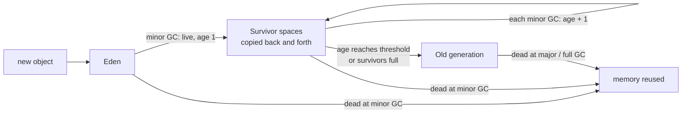
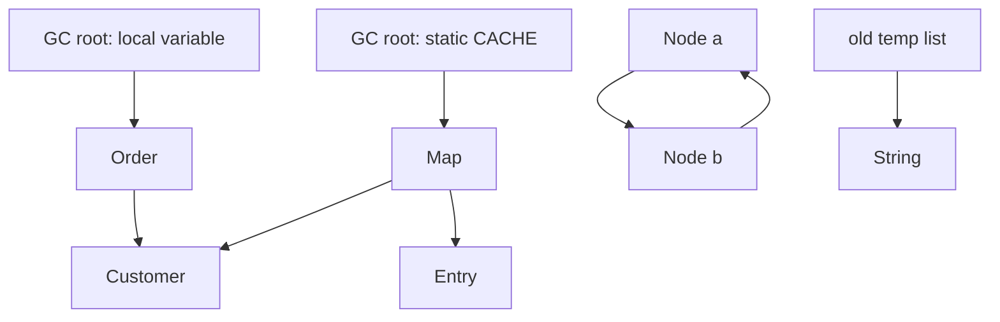
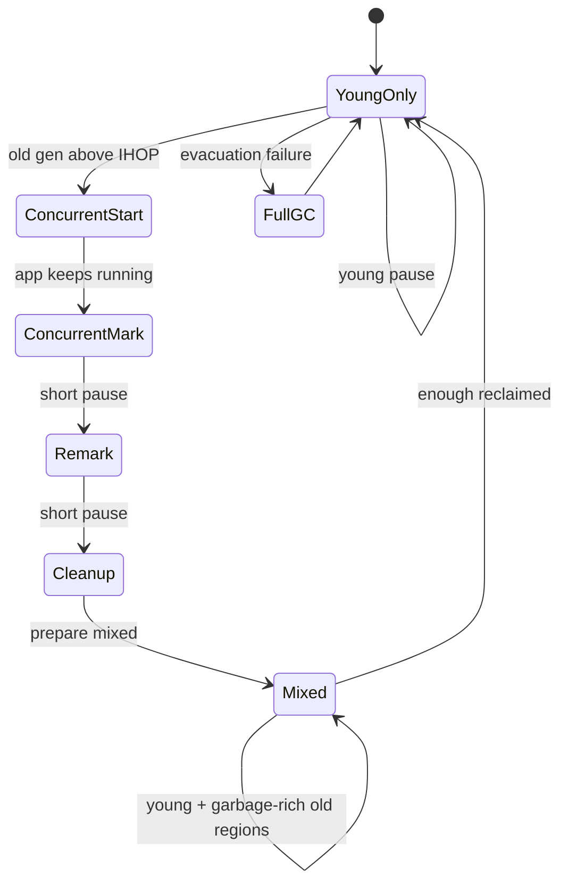

## In One Line
The garbage collector frees heap memory held by objects that can no longer be **reached from any GC root**; HotSpot does it **generationally** (most objects die young) with a choice of collectors — Serial, Parallel, **G1** (the default) and **ZGC** — that trade throughput, pause time and memory footprint against each other.

## Mental Model
Think of a **city's rubbish collection with a strict "is anyone still using it?" rule**.

- The **heap** is the city. Every object is a house; references are **roads** between houses.
- A few places are always "in use": the town hall, the train station, the people currently at work. These are the **GC roots** — local variables of running methods, static fields, live threads.
- The inspector starts at every root and **drives along every road** (marks). Every house he can reach is in use. Every house he cannot reach — even a cluster of houses connected to each other but to nothing else — is **demolished**. That is **reachability**, and it is why cycles are no problem in Java.
- New houses are built in a **new district** (young generation, *Eden*). Most of them are demolished within days, so the inspector checks the new district often and quickly (**minor GC**). Houses that survive several checks are moved to the **old town** (*promotion*), which is checked rarely but takes longer (**major / full GC**).
- Some inspections require the whole city to **freeze** — nobody may build or move while he counts (**stop-the-world pause**). Modern crews (G1, ZGC) do most of the work **while traffic keeps flowing** (concurrent phases) and freeze the city only for moments.
- The crews differ: one worker doing everything (Serial), a big team freezing the city but finishing fast (Parallel), a team working district by district to meet a pause target (G1), a team that almost never freezes the city (ZGC).

## Concept
### What counts as garbage: reachability, not reference counting
An object is **live** if there is a chain of references from a **GC root** to it; otherwise it is garbage and its memory can be reused. Java never uses reference counting, so:

- **Cycles are collected**: `a.next = b; b.next = a;` with no outside reference — both die ("island of isolation").
- Setting a variable to `null` does not free anything by itself; it only removes one path. The object dies when the *last* path is gone.
- You cannot delete an object explicitly. `System.gc()` is only a request.

### GC roots
| Root | Example |
|---|---|
| Local variables and operand-stack values in **active frames** of every thread | `Node local = new Node()` inside a running method |
| **Static fields** of loaded classes | `static Map<K,V> CACHE` — lives as long as its class loader |
| **Live threads** (the `Thread` objects) | a running worker keeps its `Runnable` alive |
| **JNI references** | objects pinned by native code (global/local JNI refs) |
| **Monitors in use** | an object currently locked by `synchronized` |
| JVM internals | system class loader, pre-allocated exception objects, class mirrors of core classes |

Anything referenced (directly or indirectly) only from garbage is garbage too: an object inside an unreachable collection dies with it.

> [!NOTE] The JIT computes liveness precisely: once compiled code no longer *uses* a local variable, the object may be collected even though the variable is still in scope. Normally invisible, it matters for cleanup code — see `Reference.reachabilityFence` in [Reference Types](lesson:b02-jvm/04-reference-types).

### The three basic algorithms
| Algorithm | How | Pros | Cons | Used for |
|---|---|---|---|---|
| **Mark-sweep** | Mark live objects, then sweep dead ones into free lists | No copying | **Fragmentation**; allocation needs free-list search | old CMS (removed) |
| **Mark-compact** | Mark, then slide live objects together | No fragmentation, bump-pointer allocation | Moving everything is slow on big heaps | Serial/Parallel old gen, G1 full GC |
| **Copying (evacuation)** | Copy live objects to an empty space; the old space is freed wholesale | Cost ∝ **live** objects, not heap size; compacts for free | Needs spare space to copy into | Young generation of all generational collectors, G1 regions, ZGC relocation |

Marking is usually explained with **tri-colour marking**: white = not yet seen, grey = seen but its references not yet scanned, black = seen and scanned. When no grey objects remain, white ones are garbage. Concurrent collectors need **barriers** (small pieces of code the JIT inserts around reference reads/writes) so that the application cannot hide a white object behind a black one while marking runs.

### The generational hypothesis and the heap layout
The **weak generational hypothesis**: *most objects die young* (temporary strings, iterators, request DTOs, lambdas' captured values). So the heap is split:

- **Young generation** = **Eden** + two **survivor** spaces (S0/"from" and S1/"to"). New objects are allocated in Eden (in TLABs).
- **Minor (young) GC** — when Eden is full: live objects from Eden and the "from" survivor are **copied** into the "to" survivor, their **age** (stored in 4 bits of the mark word) goes up by one, then Eden and "from" are empty and the survivors swap roles. Cost depends only on the (small) number of survivors.
- **Promotion (tenuring)** — an object whose age reaches the **tenuring threshold** (`-XX:MaxTenuringThreshold`, default 15; the JVM lowers the actual threshold dynamically when survivors fill up) is copied to the **old generation**. The flag accepts 0–16: 0 promotes at the first GC, and 16 — one more than the largest age the 4 header bits can hold — means "never promote because of age". Survivors that do not fit are promoted early (*premature promotion*).
- **Major / full GC** — collects the old generation (Full GC = whole heap, usually with compaction). Much more expensive because old objects are mostly alive.
- **Old-to-young references**: a minor GC must not scan the whole old generation to find references into the young one. A **write barrier** marks the 512-byte **card** of the old object as dirty whenever a reference field is written; the minor GC scans only dirty cards (G1 keeps per-region **remembered sets** built the same way).

Defaults for Serial/Parallel: `NewRatio=2` (young = 1/3 of the heap), `SurvivorRatio=8` (Eden : one survivor = 8 : 1). G1 sizes the young generation dynamically (5–60% of the heap) to meet its pause goal.

### Stop-the-world, safepoints and concurrency
A **stop-the-world (STW)** pause stops all application threads. Threads can only stop at **safepoints** — points in the code (method returns, loop back-edges) where the JVM knows exactly which slots hold references. A long loop without safepoint polls can delay everyone (*time-to-safepoint*). Collectors differ in *how much* of their work happens inside pauses:

| Work | Serial | Parallel | G1 | ZGC |
|---|---|---|---|---|
| Young collection | STW, 1 thread | STW, many threads | STW, many threads | concurrent (generational ZGC) |
| Old-gen marking | STW | STW | **concurrent** (SATB) | **concurrent** |
| Compaction / relocation | STW | STW | STW, incremental (mixed GCs) | **concurrent** |
| Typical pause | tens of ms to seconds | tens to hundreds of ms | ~10–200 ms (goal 200 ms) | **< 1 ms**, independent of heap size |

### The HotSpot collectors (JDK 21)
| Collector | Flag | Design | Best for |
|---|---|---|---|
| **Serial** | `-XX:+UseSerialGC` | One thread; copying young, mark-compact old; all STW | Small heaps (< ~100 MB), 1 CPU, small containers, CLI tools. Chosen automatically when the machine is not "server class" (< 2 CPUs or < ~1.8 GB RAM) |
| **Parallel** (throughput) | `-XX:+UseParallelGC` | Same algorithms as Serial but multi-threaded; all STW | Batch jobs, maximum throughput when pauses do not matter. Default in Java 5–8 |
| **G1** (Garbage-First) | `-XX:+UseG1GC` | Heap of equal-sized **regions**; young GCs + concurrent marking + incremental **mixed** GCs; pause-time goal | General purpose; **default since Java 9** |
| **ZGC** | `-XX:+UseZGC` (+ `-XX:+ZGenerational` in 21) | Concurrent marking **and relocation** with coloured pointers and load barriers | Large heaps (GBs to 16 TB), latency-sensitive services. Production since 15, generational in 21 (default generational from 23) |
| **Shenandoah** | `-XX:+UseShenandoahGC` | Concurrent compaction with load-reference barriers | Low latency; in OpenJDK builds (Red Hat, Temurin, Ubuntu), **not in Oracle JDK** |
| **Epsilon** | `-XX:+UnlockExperimentalVMOptions -XX:+UseEpsilonGC` | Allocates, **never collects** | Performance tests, very short-lived jobs; heap exhaustion ends the JVM |
| ~~CMS~~ | — | Concurrent mark-sweep, fragmentation problems | Deprecated in 9, **removed in 14** |

### G1 in a nutshell
- The heap is divided into ~2048 **regions** of 1–32 MB (a power of two, heap size / 2048; `-XX:G1HeapRegionSize`). Each region is Eden, survivor, old or **humongous** at any given time — generations are logical, not contiguous.
- **Humongous objects** — any object of at least **half a region** (for example a 1 MB `byte[]` with 2 MB regions) goes straight into contiguous old regions. Many of them cause fragmentation and early full GCs; a larger region size helps.
- **Young-only phase**: STW *evacuation pauses* copy live objects out of Eden/survivor regions, sized so the pause stays under `-XX:MaxGCPauseMillis` (default **200 ms**, a *goal*, not a guarantee).
- When old-gen occupancy crosses the **IHOP** (initiating heap occupancy, starts at 45% and adapts), the next young pause becomes a **Concurrent Start**, and **concurrent marking** (snapshot-at-the-beginning) runs alongside the application, ending with short **Remark** and **Cleanup** pauses. Completely empty regions are freed immediately.
- **Space-reclamation phase**: **mixed** GCs evacuate young regions **plus the old regions with the most garbage** — hence "Garbage-First".
- If evacuation runs out of space (*evacuation failure*, *to-space exhausted*) or marking cannot keep up, G1 falls back to a **Full GC** (parallel mark-compact since Java 10) — the event to avoid.

### ZGC in a nutshell
- Pauses do only root scanning (a few thread stacks at a time), so they stay **well below 1 ms** whatever the heap size; the Code section shows pauses of 0.01–0.07 ms.
- **Coloured pointers**: metadata bits in each 64-bit reference record its marking/relocation state. **Load barriers** check them whenever the application reads a reference and fix it up if the object has moved — so objects can be relocated *while the application runs*.
- Costs: some CPU for concurrent threads and barriers, no compressed oops (ZGC references are always 64-bit), and it needs **headroom**. If the application allocates faster than ZGC can reclaim, threads block in an **Allocation Stall** — ZGC's version of a pause (visible in the 64 MB run in Code).
- Java 21 adds **generational ZGC** (`-XX:+ZGenerational`), which collects young objects more often and cheaply; it became the default ZGC mode in 23 and the only one in 24.

### `System.gc()`, `finalize()` and friends
- `System.gc()` / `Runtime.getRuntime().gc()` *suggest* a collection. HotSpot honours it by default with a **full, stop-the-world** GC (G1, Serial, Parallel), which is why calling it in a server is a bad idea. `-XX:+DisableExplicitGC` turns it into a no-op; `-XX:+ExplicitGCInvokesConcurrent` makes G1 start a concurrent cycle instead. Libraries (RMI's distributed GC, older NIO code) sometimes call it.
- `finalize()` ran on a special finalizer thread before an object's memory was reclaimed. It is unpredictable (may never run), slow (objects survive at least one extra GC), can resurrect objects and swallows exceptions. **Deprecated in 9, deprecated for removal in 18** (JEP 421); `java --finalization=disabled` switches it off. Use `try-with-resources` for deterministic cleanup and `java.lang.ref.Cleaner` as a safety net.
- There is no destructor in Java and no way to free a single object.

### Measuring and tuning basics
**Three goals, pick two:** *throughput* (share of CPU time not spent in GC), *latency* (pause length) and *footprint* (memory). A bigger heap improves throughput and reduces GC frequency; shorter pauses cost CPU (concurrent work, barriers) or memory.

A sane process:
1. **Turn on GC logging** in production — it is cheap: `-Xlog:gc*:file=gc.log:time,uptime,level,tags:filecount=5,filesize=20m`.
2. **Size the heap** from the *live set* (heap used right after a full GC): a common start is 3–4× the live set. Set `-Xms` = `-Xmx` on servers for predictable behaviour (optionally `-XX:+AlwaysPreTouch`).
3. **Pick the collector by goal**: G1 by default; ZGC when pauses must stay under ~10 ms or the heap is very large; Parallel for batch throughput; Serial for tiny heaps.
4. **Change one thing at a time** and compare logs: pause percentiles, GC CPU share, allocation and promotion rates.
5. **Fix the application first**: allocation hot spots, huge caches, memory leaks. No flag cures a leak.

| Flag | Meaning |
|---|---|
| `-Xms` / `-Xmx` | initial / maximum heap |
| `-Xmn`, `-XX:NewRatio`, `-XX:SurvivorRatio` | young-generation size (avoid `-Xmn` with G1: it disables G1's adaptive sizing) |
| `-XX:MaxTenuringThreshold=n` | age at which survivors are promoted (default 15; allowed 0–16, 16 = never by age) |
| `-XX:MaxGCPauseMillis=n` | G1 pause-time goal (default 200) |
| `-XX:ParallelGCThreads`, `-XX:ConcGCThreads` | STW and concurrent GC worker threads |
| `-XX:InitiatingHeapOccupancyPercent` | G1 start of concurrent marking (45%, adaptive) |
| `-XX:G1HeapRegionSize` | G1 region size |
| `-XX:MaxRAMPercentage` | heap as % of container/host RAM |
| `-XX:+HeapDumpOnOutOfMemoryError` | write a heap dump when OOM happens |
| `-Xlog:gc`, `-Xlog:gc*` | unified GC logging (Java 9+; replaces `-XX:+PrintGCDetails`, `-Xloggc:`) |

Live tools: `jstat -gcutil <pid> 1s` (pool occupancy and GC counts every second), `jcmd <pid> GC.heap_info`, `jcmd <pid> GC.run` (request a GC), Java Flight Recorder (`jcmd <pid> JFR.start`) with JDK Mission Control, and GC-log analysers.

### Version notes
| Version | Change |
|---|---|
| 5–8 | Parallel GC is the default on server-class machines |
| 7u4 | G1 fully supported |
| 9 | **G1 default** (JEP 248); CMS deprecated; unified logging `-Xlog:gc`; `finalize()` deprecated |
| 10 | G1 full GC becomes parallel (JEP 307); container-aware ergonomics |
| 11 | ZGC (experimental), Epsilon |
| 12 | Shenandoah (experimental); G1 returns unused memory to the OS promptly (JEP 346) |
| 14 | **CMS removed** (JEP 363) |
| 15 | ZGC and Shenandoah production-ready |
| 18 | `finalize()` deprecated for removal (JEP 421) |
| 21 | **Generational ZGC** (JEP 439, `-XX:+ZGenerational`) |
| 23–24 | Generational ZGC becomes the default ZGC mode (23) and the only one (24) |

## Diagram

Most objects die in Eden and cost nothing; only survivors are copied, and only long-lived ones reach the old generation.


Marking follows references from the roots: `Order`, `Customer`, `Map` and `Entry` are live. The `a`–`b` cycle and the old list with its `String` are unreachable, so all four are garbage — cycles do not keep objects alive.


G1's cycle: young pauses, a concurrent marking cycle triggered by old-gen occupancy, then mixed pauses that clean the old regions with the most garbage. A Full GC is the fallback when this falls behind.

## Code
**1. Reachability decides, not `null` or cycles.** `Reachability.java` — run with `java Reachability.java`. A `WeakReference` is used only as a probe: it does not keep its object alive, and `get()` returns `null` once the object is collected (details in [Reference Types](lesson:b02-jvm/04-reference-types)).
```java
import java.lang.ref.WeakReference;

public class Reachability {
    static Object cache;                              // a static field is a GC root

    static class Node {
        final String name;
        Node next;                                    // lets us build a cycle
        Node(String name) { this.name = name; }
    }

    // A WeakReference does not keep its object alive, so it is a harmless "probe":
    // get() returns null once the GC has collected the object.
    static String status(WeakReference<?> probe) {
        return probe.get() == null ? "collected" : "alive";
    }

    public static void main(String[] args) {
        Node local = new Node("local");                    // reachable from main's frame
        WeakReference<Node> pLocal = new WeakReference<>(local);

        Node nulled = new Node("nulled");
        WeakReference<Node> pNulled = new WeakReference<>(nulled);
        nulled = null;                                     // last reference gone

        Node a = new Node("a"), b = new Node("b");
        a.next = b;
        b.next = a;                                        // a <-> b cycle
        WeakReference<Node> pA = new WeakReference<>(a), pB = new WeakReference<>(b);
        a = null;
        b = null;                                          // "island of isolation"

        cache = new Node("static");
        WeakReference<Object> pStatic = new WeakReference<>(cache);

        Node holder = new Node("holder");
        holder.next = new Node("child");                   // reachable only through holder
        WeakReference<Node> pChild = new WeakReference<>(holder.next);

        System.gc();                                       // a request; honoured by default in HotSpot

        System.out.println("local  (still in a variable) : " + status(pLocal));
        System.out.println("nulled (no references left)  : " + status(pNulled));
        System.out.println("cycle a <-> b                : " + status(pA) + ", " + status(pB));
        System.out.println("static field                 : " + status(pStatic));
        System.out.println("child of a live holder       : " + status(pChild));
        System.out.println(local.name + " " + holder.name); // keep local and holder in use
    }
}
```
```output
local  (still in a variable) : alive
nulled (no references left)  : collected
cycle a <-> b                : collected, collected
static field                 : alive
child of a live holder       : alive
local holder
```
With `java -XX:+DisableExplicitGC Reachability.java` the `System.gc()` call is ignored and nothing has been collected yet:
```output
local  (still in a variable) : alive
nulled (no references left)  : alive
cycle a <-> b                : alive, alive
static field                 : alive
child of a live holder       : alive
local holder
```

**2. Which collector am I running?** `WhichGc.java` allocates 200 MB, keeps 2 MB, and lists the collector beans. Run with `java -Xmx64m <flag> WhichGc` once per collector (the `==` lines below were printed by the shell loop, not by the program).
```java
import java.lang.management.GarbageCollectorMXBean;
import java.lang.management.ManagementFactory;
import java.util.ArrayList;
import java.util.List;

public class WhichGc {
    public static void main(String[] args) {
        List<byte[]> survivors = new ArrayList<>();
        for (int i = 0; i < 200_000; i++) {
            byte[] chunk = new byte[1024];            // 200 MB allocated in total...
            if (i % 100 == 0) survivors.add(chunk);   // ...but only 1% (2 MB) stays reachable
        }
        System.out.println("kept " + survivors.size() + " chunks");
        for (GarbageCollectorMXBean gc : ManagementFactory.getGarbageCollectorMXBeans()) {
            System.out.printf("  %-24s collections=%d%n", gc.getName(), gc.getCollectionCount());
        }
    }
}
```
```output
== -XX:+UseSerialGC
kept 2000 chunks
  Copy                     collections=11
  MarkSweepCompact         collections=0
== -XX:+UseParallelGC
kept 2000 chunks
  PS MarkSweep             collections=0
  PS Scavenge              collections=12
== -XX:+UseG1GC
kept 2000 chunks
  G1 Young Generation      collections=6
  G1 Concurrent GC         collections=0
  G1 Old Generation        collections=0
== -XX:+UseZGC
kept 2000 chunks
  ZGC Cycles               collections=4
  ZGC Pauses               collections=12
== -XX:+UseZGC -XX:+ZGenerational
kept 2000 chunks
  ZGC Minor Cycles         collections=6
  ZGC Minor Pauses         collections=20
  ZGC Major Cycles         collections=3
  ZGC Major Pauses         collections=13
== -XX:+UseShenandoahGC
kept 2000 chunks
  Shenandoah Pauses        collections=28
  Shenandoah Cycles        collections=7
== -XX:+UnlockExperimentalVMOptions -XX:+UseEpsilonGC
Terminating due to java.lang.OutOfMemoryError: Java heap space
```

**3. Reading GC logs.** `GcLog.java` allocates 300 MB and keeps 5% of it (~15 MB), then calls `System.gc()`.
```java
import java.util.ArrayList;
import java.util.List;

public class GcLog {
    public static void main(String[] args) {
        List<byte[]> longLived = new ArrayList<>();
        for (int i = 0; i < 300_000; i++) {
            byte[] shortLived = new byte[1024];          // garbage almost immediately
            if (i % 20 == 0) longLived.add(shortLived);  // 5% survives: ~15 MB by the end
        }
        System.gc();                                     // explicit request -> a full collection
        System.out.println("long-lived chunks: " + longLived.size());
    }
}
```
`java -Xms64m -Xmx64m -XX:+UseSerialGC -Xlog:gc GcLog` (middle lines removed):
```text
[0.005s][info][gc] Using Serial
[0.046s][info][gc] GC(0) Pause Young (Allocation Failure) 18M->1M(61M) 0.955ms
[0.050s][info][gc] GC(1) Pause Young (Allocation Failure) 18M->2M(61M) 1.117ms
[0.053s][info][gc] GC(2) Pause Young (Allocation Failure) 19M->3M(61M) 1.258ms
...
[0.098s][info][gc] GC(16) Pause Young (Allocation Failure) 31M->15M(61M) 1.052ms
[0.104s][info][gc] GC(17) Pause Full (System.gc()) 25M->16M(61M) 5.076ms
long-lived chunks: 15000
```
The same with `-XX:+UseG1GC`:
```text
[0.005s][info][gc] Using G1
[0.048s][info][gc] GC(0) Pause Young (Normal) (G1 Evacuation Pause) 14M->1M(64M) 2.122ms
[0.070s][info][gc] GC(1) Pause Young (Normal) (G1 Evacuation Pause) 38M->3M(64M) 2.285ms
...
[0.121s][info][gc] GC(8) Pause Young (Normal) (G1 Evacuation Pause) 48M->16M(64M) 2.435ms
[0.130s][info][gc] GC(9) Pause Full (System.gc()) 26M->16M(64M) 8.088ms
long-lived chunks: 15000
```
Generational ZGC with a roomy 512 MB heap and phase logging (`-XX:+UseZGC -XX:+ZGenerational -Xlog:gc,gc+phases`), pause lines only:
```text
[0.305s][info][gc,phases] GC(0) Y: Pause Mark Start (Major) 0.073ms
[0.320s][info][gc,phases] GC(0) Y: Pause Mark End 0.012ms
[0.328s][info][gc,phases] GC(0) Y: Pause Relocate Start 0.013ms
[0.374s][info][gc,phases] GC(0) O: Pause Mark End 0.012ms
[0.420s][info][gc,phases] GC(0) O: Pause Relocate Start 0.018ms
```
Generational ZGC squeezed into a 64 MB heap (`-Xms64m -Xmx64m`):
```text
[0.060s][info][gc] GC(0) Major Collection (Warmup)
[0.103s][info][gc] GC(0) Major Collection (Warmup) 8M(12%)->64M(100%) 0.043s
[0.103s][info][gc] GC(1) Minor Collection (High Usage)
[0.107s][info][gc] Allocation Stall (main) 16.808ms
[0.108s][info][gc] GC(1) Minor Collection (High Usage) 64M(100%)->16M(25%) 0.005s
```

**4. Watching objects age and get promoted.** `Aging.java` keeps ~200 KB alive while producing garbage. Run with `java -Xmx64m -Xmn16m -XX:+UseSerialGC -XX:MaxTenuringThreshold=3 -Xlog:gc,gc+age=trace Aging` (timestamps and "Desired survivor size" lines removed).
```java
import java.lang.management.ManagementFactory;
import java.lang.management.MemoryPoolMXBean;

public class Aging {
    static MemoryPoolMXBean oldGen() {
        for (MemoryPoolMXBean p : ManagementFactory.getMemoryPoolMXBeans()) {
            if (p.getName().equals("Tenured Gen")) return p;       // Serial GC's old generation
        }
        throw new IllegalStateException("run with -XX:+UseSerialGC");
    }

    public static void main(String[] args) {
        MemoryPoolMXBean old = oldGen();
        long base = old.getUsage().getUsed();

        byte[][] keeper = new byte[200][];
        for (int i = 0; i < keeper.length; i++) keeper[i] = new byte[1024];   // ~200 KB that stays alive

        for (int round = 1; round <= 5; round++) {
            for (int j = 0; j < 12_000; j++) {
                byte[] garbage = new byte[1024];                              // dies immediately
            }
            long grownKb = (old.getUsage().getUsed() - base) / 1024;
            System.out.println("after round " + round + ": old gen grew by " + grownKb + " KB");
        }
        System.out.println("keeper still has " + keeper.length + " arrays");
    }
}
```
```text
[info][gc] Using Serial
[trace][gc,age] GC(0) - age   1:     444624 bytes,     444624 total
[info ][gc    ] GC(0) Pause Young (Allocation Failure) 13M->1M(62M) 1.085ms
after round 1: old gen grew by 0 KB
[trace][gc,age] GC(1) - age   1:      43192 bytes,      43192 total
[trace][gc,age] GC(1) - age   2:     441424 bytes,     484616 total
[info ][gc    ] GC(1) Pause Young (Allocation Failure) 14M->1M(62M) 1.427ms
after round 2: old gen grew by 0 KB
after round 3: old gen grew by 0 KB
[trace][gc,age] GC(2) - age   2:      43192 bytes,      43192 total
[trace][gc,age] GC(2) - age   3:     441424 bytes,     484616 total
[info ][gc    ] GC(2) Pause Young (Allocation Failure) 14M->1M(62M) 0.614ms
after round 4: old gen grew by 0 KB
[trace][gc,age] GC(3) - age   3:      43192 bytes,      43192 total
[info ][gc    ] GC(3) Pause Young (Allocation Failure) 14M->1M(62M) 1.177ms
after round 5: old gen grew by 431 KB
keeper still has 200 arrays
```

**5. A full G1 cycle.** `G1Cycle.java` keeps a sliding window of 60,000 × 1 KB arrays: every object lives for a while and then dies *old* — the worst case for a generational collector.
```java
public class G1Cycle {
    public static void main(String[] args) {
        byte[][] window = new byte[60_000][];            // ~60 MB of medium-lived data
        for (int i = 0; i < 1_500_000; i++) {
            window[i % window.length] = new byte[1024];  // each slot is overwritten later: objects live a while, then die old
        }
        System.out.println("done");
    }
}
```
An excerpt of `java -Xms256m -Xmx256m -Xlog:gc G1Cycle` (one run):
```text
[0.564s][info][gc] GC(6) Pause Young (Normal) (G1 Evacuation Pause) 134M->133M(256M) 195.311ms
[0.842s][info][gc] GC(7) Pause Young (Concurrent Start) (G1 Evacuation Pause) 165M->164M(256M) 273.758ms
[0.846s][info][gc] GC(8) Concurrent Mark Cycle
[0.912s][info][gc] GC(9) Pause Young (Normal) (G1 Evacuation Pause) 188M->188M(256M) 63.465ms
[0.946s][info][gc] GC(8) Pause Remark 222M->127M(256M) 0.618ms
[0.966s][info][gc] GC(8) Pause Cleanup 167M->167M(256M) 0.089ms
[0.969s][info][gc] GC(8) Concurrent Mark Cycle 123.598ms
[0.984s][info][gc] GC(13) Pause Young (Prepare Mixed) (G1 Evacuation Pause) 171M->171M(256M) 14.441ms
[0.998s][info][gc] GC(14) Pause Young (Mixed) (G1 Evacuation Pause) 196M->194M(256M) 10.570ms
[1.006s][info][gc] GC(15) Pause Young (Concurrent Start) (G1 Evacuation Pause) 212M->212M(256M) 6.803ms
[1.030s][info][gc] GC(19) Pause Young (Normal) (G1 Evacuation Pause) (Evacuation Failure) 244M->246M(256M) 4.592ms
[1.048s][info][gc] GC(21) Pause Full (G1 Compaction Pause) 255M->60M(256M) 14.967ms
```

**6. `finalize()` is on its way out.** Overriding it compiles with a warning on JDK 21:
```java
public class Fin {
    @Override
    protected void finalize() throws Throwable {
        System.out.println("finalize");
    }
    public static void main(String[] a) { new Fin(); System.gc(); }
}
```
```text
Fin.java:3: warning: [removal] finalize() in Object has been deprecated and marked for removal
    protected void finalize() throws Throwable {
                   ^
1 warning
```
`java Fin` printed `finalize` on this machine (not guaranteed — the JVM may exit before the finalizer thread runs); `java --finalization=disabled Fin` prints nothing.

## Walkthrough
**Reachability**
- `static Object cache` is a **GC root** for as long as the class is loaded, so the `"static"` node stays alive.
- `local` is still used at the end of `main` (`local.name`), so it is reachable from `main`'s frame: **alive**.
- `nulled = null` removes the only reference: **collected**.
- `a` and `b` point at each other, but after `a = null; b = null;` no root reaches either: both **collected**. Reference counting would have leaked them; tracing collects them.
- `child` has no variable of its own, but `holder.next` points to it and `holder` is live: **alive**. Reachability is transitive.
- `System.gc()` triggered a full STW collection (G1's default response). With `-XX:+DisableExplicitGC` the call does nothing, no GC happened in this tiny program, and every object is still there — collection happens *when the JVM decides*, not when an object becomes unreachable.
- The last `println` keeps `local` and `holder` in use after the GC; without it, the JIT (not the interpreter used here) could consider them dead earlier.
- Collected/alive results were identical with Serial, Parallel and ZGC.

**WhichGc**
- The bean names reveal the collector: Serial = `Copy` (young, copying) + `MarkSweepCompact` (old); Parallel = `PS Scavenge` + `PS MarkSweep`; G1 = `G1 Young Generation` (young and mixed pauses), `G1 Concurrent GC` (the Remark and Cleanup pauses of concurrent cycles; added in JDK 20) and `G1 Old Generation` (full GCs); ZGC and Shenandoah count **cycles** (mostly concurrent) and **pauses** separately.
- All the collectors needed only young collections: 99% of the 200 MB died young — the generational hypothesis at work.
- The **collection counts vary** between runs and machines (they depend on heap sizing ergonomics and timing); the names do not.
- **Epsilon** never frees anything, so allocating 200 MB in a 64 MB heap ends the JVM: `Terminating due to java.lang.OutOfMemoryError: Java heap space`.

**GcLog**
- Line format: `GC(n)` = collection number, then the **type** and **cause**, then *heap used before → after (committed heap)*, then the **pause time**.
- `Pause Young (Allocation Failure)` — Eden was full. Each pause frees ~17 MB and leaves 1 MB more than the last: the long-lived list is growing and being promoted.
- `Pause Full (System.gc())` — our explicit call: a full STW collection of the whole heap. 16 MB remain: the 15 MB list plus JVM data.
- G1 names its young pauses `(Normal) (G1 Evacuation Pause)` and grows Eden more aggressively (14M → 38M before the second pause) because it sizes the young generation for its pause goal.
- ZGC's pauses are tiny (0.01–0.07 ms): marking and relocation run concurrently (`Y:` = young generation, `O:` = old). In a 64 MB heap, however, ZGC could not keep up: `Allocation Stall (main) 16.808ms` means the application thread had to **wait** for free memory. Concurrent collectors need headroom.
- All times and sizes **vary per run**; the structure of the lines does not.

**Aging**
- `-Xmn16m` fixes the young generation at 16 MB (Eden ≈ 12.8 MB, survivors 1.6 MB each), `-XX:MaxTenuringThreshold=3` lowers the promotion age from 15 to 3 to keep the demo short.
- GC(0): the keeper arrays (with other start-up objects, ~440 KB) survive and get **age 1** in a survivor space.
- GC(1), GC(2): they are copied between the survivor spaces, **age 2**, then **age 3**. The old generation has not grown yet.
- GC(3): they reached the threshold, so they are **promoted**: the age table no longer lists them and the old generation grew by ~431 KB. From now on only a major/full GC could reclaim them.
- The small `43192 bytes` group was created a little later (by the monitoring calls) and is one age behind.

**G1Cycle**
- The young pauses copy almost everything they find (`134M->133M`): the objects are still in the window, so they survive, get promoted, and fill the old generation.
- Old-gen occupancy crosses the IHOP → `Pause Young (Concurrent Start)` → `Concurrent Mark Cycle` runs while the application continues.
- `Pause Remark 222M->127M` — at the end of marking, regions that turned out to be **completely empty** are freed immediately (0.6 ms).
- `Prepare Mixed` then `Mixed` pauses evacuate old regions with the most garbage.
- The application allocated faster than mixed GCs could reclaim: `(Evacuation Failure)` — no free region to copy survivors into — and then `Pause Full (G1 Compaction Pause) 255M->60M`, the expensive fallback. 60 MB is the real live set (the window). This heap is too small for this workload; the cure is more heap (or less retained data), not more flags.
- Pause times such as `273.758ms` above the 200 ms goal show that `MaxGCPauseMillis` is a goal G1 tries to meet, not a promise. Numbers vary per run.

**Fin**
- The `[removal]` warning is shown by default because `finalize()` is deprecated *for removal*.
- Even when it runs, a finalizer needs an extra GC cycle before the memory is freed, and its timing is up to the finalizer thread.

## Traps
- **"Setting a reference to `null` frees the memory."** It only removes one path. Memory is reclaimed when the GC runs *and* no path remains. Nulling locals is almost never needed; nulling fields of long-lived objects (array slots in your own stack/queue implementation, caches) is what prevents leaks.
- **"`System.gc()` forces a GC."** It is a hint. It may be disabled (`-XX:+DisableExplicitGC`), and when it works it usually triggers a **full STW** collection — a latency spike you do not want in a server.
- **"Java cannot leak memory because of the GC."** The GC frees *unreachable* objects. Objects you keep reachable by mistake (static maps, listeners, caches) are leaks — see [Memory Leaks & OOM](lesson:b02-jvm/05-memory-leaks-and-oom).
- **"Cycles leak in Java."** They do not; that is reference counting (older Python/Objective-C). Java traces from roots.
- **Premature promotion**: medium-lived objects (sessions, caches refreshed every minute, large batches) survive a few young GCs and fill the old generation, causing frequent concurrent cycles or full GCs — as in `G1Cycle`. Fix by reducing retention or giving the young generation/heap more room.
- **Humongous allocations in G1**: many large arrays (≥ half a region) fragment the heap and can cause full GCs; raise `-XX:G1HeapRegionSize` or avoid huge short-lived buffers.
- **Setting `-Xmn`/`NewRatio` with G1** fixes the young size and defeats G1's pause-time-driven sizing. Use `MaxGCPauseMillis` instead.
- **Too-small heap with a concurrent collector** (ZGC, Shenandoah, G1) → allocation stalls or full GCs. Low-pause collectors trade memory for latency.
- **`finalize()` for cleanup**: may never run, runs on one thread (a slow finalizer backs up the queue and leaks memory), and can resurrect the object. Use try-with-resources and `Cleaner`.
- **Relying on GC timing in tests** (`System.gc(); assertNull(weak.get())`) is flaky across collectors and flags; loop with a timeout if you must.
- **Old flags on new JVMs**: `-XX:+UseConcMarkSweepGC` (CMS) was only ignored with a warning in JDK 14–16; on JDK 21 it is fatal — `Unrecognized VM option 'UseConcMarkSweepGC'` and the JVM does not start. `-XX:+PrintGCDetails` still works but prints `-XX:+PrintGCDetails is deprecated. Will use -Xlog:gc* instead.`

> [!WARNING] `MaxGCPauseMillis` and "sub-millisecond" pauses are about GC **pauses** only. Allocation stalls (ZGC), time-to-safepoint delays and a Full GC fallback can still produce long hiccups — always check the logs, not the flags.

## Tips & Tricks
- **"Reachable = alive."** If you cannot draw a path from a root (local, static, thread, JNI, monitor) to the object, it is garbage — cycles included.
- **Roots mnemonic — "LSTJM"**: *Locals, Statics, Threads, JNI, Monitors* ("Let's Sweep The JVM Memory").
- **Collector picker — "Small Serial, Batch Parallel, Default G1, Big-and-fast ZGC."**
- **Generations mnemonic — "Eden → S0 ↔ S1 → Old"**: born in Eden, bounce between survivors (age + 1 per GC, max 15 — 4 bits), retire to Old.
- **Algorithm rule of thumb**: copying costs ∝ live objects (great for young gen where almost all is dead); mark-compact costs ∝ heap (fine for old gen collected rarely).
- **Read a GC log line** as *what* (`Pause Young`), *why* (`Allocation Failure`, `System.gc()`), *before → after (total)*, *how long*. The "after" value of full GCs over time = your **live set**; if it keeps rising, suspect a leak.
- **Always ship with** `-Xlog:gc*:file=...` and `-XX:+HeapDumpOnOutOfMemoryError`. They are cheap and save the post-mortem.
- **Know which collector you have:** `java -Xlog:gc -version` prints `Using G1` (or another) on the first line; in code, list `GarbageCollectorMXBean` names.
- **Interview phrasing**: "G1 is region-based, generational, mostly concurrent, pause-time-goal driven; ZGC is concurrent including compaction, with coloured pointers and load barriers."

## Interview Q&A
### [Basic] What is garbage collection and how does the JVM decide an object is garbage?
Garbage collection is the JVM's automatic reclamation of heap memory used by objects the program can no longer use. HotSpot uses **tracing**: starting from a set of **GC roots** (local variables in active frames, static fields, live threads, JNI references, locked monitors), it marks every object reachable through references; everything not marked is garbage and its memory is reclaimed (swept, compacted or evacuated). Because it is based on reachability and not reference counting, cycles of objects that reference each other but are unreachable from roots are collected too.

**Follow-up:** *When exactly is an unreachable object collected?* — At some later GC chosen by the JVM, usually when the generation it lives in fills up. There is no guarantee of timing, and the program cannot observe it except through `Reference` objects.

### [Basic] What are GC roots? Give examples.
GC roots are references the collector treats as live by definition, the starting points of marking: local variables and operand-stack values in the frames of all active threads; static fields of loaded classes; the `Thread` objects of running threads; JNI global and local references; objects used as monitors in `synchronized`; and JVM-internal references such as the system class loader and pre-allocated exceptions. A typical leak is a long-lived root — usually a static collection — that keeps growing.

**Follow-up:** *Is an object referenced only by a `ThreadLocal` of a pooled thread reachable?* — Yes: the pool thread is a root, its `ThreadLocalMap` holds the value strongly, so it lives as long as the thread unless `remove()` is called.

### [Basic] Can you force garbage collection in Java?
No. `System.gc()` and `Runtime.getRuntime().gc()` only **request** a collection. HotSpot honours the request by default with a full, stop-the-world collection, but it can be disabled with `-XX:+DisableExplicitGC`, and other JVMs may ignore it. There is no way to free a specific object. Calling `System.gc()` in production code is a smell because of the full-GC pause it causes; legitimate uses are rare (benchmarks, tests, tools).

**Follow-up:** *What is the difference between `System.gc()` and `Runtime.gc()`?* — None in behaviour; `System.gc()` just calls `Runtime.getRuntime().gc()`.

### [Intermediate] Explain generational garbage collection. What are minor, major and full GC?
Generational GC exploits the observation that most objects die young. The heap is split into a **young generation** (Eden and two survivor spaces) and an **old generation**. New objects go to Eden. A **minor (young) GC** runs when Eden fills: it copies the few live objects to a survivor space and increments their age; everything left in Eden is reclaimed in one go, so the cost depends only on the survivors. Objects that survive enough minor GCs (the tenuring threshold, at most 15) are **promoted** to the old generation. A **major GC** collects the old generation, and a **full GC** collects the whole heap (usually with compaction), which is the most expensive and typically fully stop-the-world. Write barriers and a card table (remembered sets in G1) let a minor GC find old-to-young references without scanning the old generation.

**Follow-up:** *Why two survivor spaces?* — Copying needs an empty destination: each minor GC copies live objects from Eden plus the "from" survivor into the empty "to" survivor, then the roles swap. One survivor is therefore always empty.

### [Intermediate] Compare mark-sweep, mark-compact and copying collection.
**Mark-sweep** marks live objects and puts dead space on free lists — no copying, but it fragments the heap and allocation becomes a free-list search (CMS's weakness). **Mark-compact** marks and then slides live objects together, eliminating fragmentation and allowing bump-pointer allocation, at the cost of moving everything (Serial/Parallel old gen, G1 full GC). **Copying** (evacuation) copies live objects into an empty area and frees the old area wholesale — its cost is proportional to live data only and it compacts automatically, but it needs free space to copy into; that is why it is used for the young generation, G1 regions and ZGC relocation.

**Follow-up:** *What is tri-colour marking?* — An abstraction of marking: white = not reached, grey = reached but not yet scanned, black = reached and scanned. Concurrent collectors use barriers to keep the invariant that a black object never points to a white one the collector has not seen.

### [Intermediate] What is a stop-the-world pause and what is a safepoint?
A stop-the-world pause is a period when all application threads are halted so the collector can work on a consistent heap (or at least a consistent set of roots). Threads can only be stopped at **safepoints** — places in the code (method exits, loop back-edges, allocation) where the JVM knows exactly which stack slots and registers hold references. The JVM requests a safepoint, waits until every thread reaches one (time-to-safepoint), does the work, then resumes them. Serial and Parallel do all their work in pauses; G1 does marking concurrently but still copies in pauses; ZGC and Shenandoah also relocate concurrently, leaving only very short pauses.

**Follow-up:** *Are safepoints used only by the GC?* — No: deoptimization, class redefinition, biased-lock revocation (removed in 18) and some diagnostic commands (thread dumps) also need them.

### [Intermediate] Which garbage collectors does HotSpot offer, and which is the default?
**Serial** (single-threaded, all STW; small heaps and single-CPU machines), **Parallel** (multi-threaded STW, maximises throughput; the default up to Java 8), **G1** (region-based, generational, concurrent marking with incremental mixed collections and a pause-time goal; the **default since Java 9**), **ZGC** (concurrent marking *and* relocation, sub-millisecond pauses on heaps up to terabytes; production since 15, generational since 21), **Shenandoah** (concurrent compaction, in OpenJDK builds), and **Epsilon** (a no-op collector for testing). CMS was removed in Java 14. The JVM picks Serial automatically on machines with fewer than two CPUs or under ~1.8 GB of memory.

**Follow-up:** *How do you check which one is in use?* — `java -Xlog:gc -version` prints "Using G1"; at run time, `jcmd <pid> VM.flags` or the `GarbageCollectorMXBean` names (`G1 Young Generation`, `PS Scavenge`, `ZGC Cycles`...).

### [Advanced] How does G1 work?
G1 divides the heap into ~2048 equal regions (1–32 MB) that are dynamically assigned as Eden, survivor, old or humongous. Young collections are STW **evacuation pauses** that copy live objects out of young regions; G1 sizes the young generation so pauses meet `MaxGCPauseMillis` (200 ms by default). When old-gen occupancy passes the adaptive IHOP (45% initially), a young pause starts a **concurrent marking** cycle (snapshot-at-the-beginning, with write barriers); it ends with short Remark and Cleanup pauses that also free fully empty regions. Then G1 performs **mixed collections** — young regions plus the old regions with the most reclaimable garbage (hence "Garbage-First") — until the remaining garbage is not worth collecting. Objects of at least half a region are **humongous** and are allocated directly in contiguous old regions. Remembered sets per region track incoming references so regions can be evacuated independently. If G1 cannot keep up (evacuation failure, no free regions), it falls back to a parallel full GC.

**Follow-up:** *What would you tune first if G1 does frequent full GCs?* — Check the log for the cause: humongous allocations (increase region size), a heap too small for the live set (increase `-Xmx`), or marking starting too late (lower `InitiatingHeapOccupancyPercent` or add `ConcGCThreads`) — and look for a leak.

### [Advanced] How does ZGC achieve sub-millisecond pauses?
ZGC does almost all its work concurrently: marking, reference processing, and — the hard part — **relocation (compaction)**. It uses **coloured pointers**: metadata bits in each 64-bit reference encode whether the reference has been marked/remapped in the current cycle. Every reference load from the heap passes a **load barrier**: if the colour is stale, the barrier fixes the reference (relocating the object or looking up its forwarding address) before the application sees it. Pauses only handle thread roots and phase transitions, so their length does not grow with heap or live-set size. The costs are extra CPU for concurrent threads and barriers, no compressed oops, and the need for headroom — if allocation outruns collection, threads suffer allocation stalls. Java 21 added generational ZGC, which collects young objects more frequently and cheaply.

**Follow-up:** *G1 or ZGC for a 4 GB heap web service with a 50 ms p99 target?* — G1 with a tuned pause goal usually suffices and uses less CPU; choose (generational) ZGC when the p99 target is a few ms, the heap is large, or G1 logs show pauses you cannot tune away.

### [Advanced] How would you approach GC tuning for a service?
First define the goal (throughput, p99 latency, memory) and **measure**: enable GC logging, gather pause times, GC CPU share, allocation and promotion rates, and the live set after full GCs. Then: (1) fix the application — excessive allocation, oversized caches, leaks; (2) size the heap from the live set (often 3–4×) and set `-Xms` = `-Xmx` in servers, or `MaxRAMPercentage` in containers; (3) choose the collector by goal — G1 by default, ZGC for low latency/large heaps, Parallel for batch, Serial for tiny heaps; (4) adjust a few high-level knobs (`MaxGCPauseMillis`, region size, IHOP, GC threads) one at a time, verifying with logs. Avoid cargo-cult flag lists and fixing the young size under G1.

**Follow-up:** *What does a steadily rising "after full GC" line in the logs tell you?* — The live set is growing: either the load is growing or — more often — there is a memory leak; take heap dumps and compare.

### [Intermediate] Why was `finalize()` deprecated, and what replaces it?
`finalize()` has no timing guarantee (it may never run), makes allocation and collection slower (finalizable objects need an extra GC cycle and a queue), runs on a single finalizer thread that can fall behind and cause memory exhaustion, can **resurrect** the object by storing `this` somewhere, and swallows exceptions. It was deprecated in Java 9 and deprecated for removal in Java 18 (JEP 421); `--finalization=disabled` turns it off to test readiness. Replacements: **try-with-resources** with `AutoCloseable` for deterministic cleanup, and **`java.lang.ref.Cleaner`** (or `PhantomReference` + `ReferenceQueue`) as a safety net for forgotten `close()` calls.

**Follow-up:** *How many times can `finalize()` be called for one object?* — At most once by the JVM, even if the object was resurrected and becomes unreachable again.

### [Advanced] How does a young collection avoid scanning the whole old generation?
With a **card table** and **write barriers**. The old generation is divided into cards of 512 bytes; whenever the application stores a reference into a field of an object, the JIT-inserted post-write barrier marks that object's card as dirty. During a minor GC, the collector treats references in dirty old-gen cards as additional roots, so it only scans a small part of the old generation. G1 refines dirty cards into per-region **remembered sets** ("who points into this region"), which also let it evacuate any subset of regions. Without this, a minor GC would cost as much as a full scan.

**Follow-up:** *What is the price?* — Every reference store runs a few extra instructions (the barrier), and G1's remembered sets take memory — part of why a Java process uses more than its heap.

## Quiz
### How many of the three `Box` objects are eligible for GC at the comment?
```java
class Box { Box other; }

Box b1 = new Box();   // A
Box b2 = new Box();   // B
Box b3 = new Box();   // C
b1.other = b2;
b2.other = b3;
b3.other = b1;
b1 = null;
b3 = null;
// here
```
- [x] 0
- [ ] 1
- [ ] 2
- [ ] 3
> `b2` still references B, B references C, and C references A — all three are reachable from the root `b2`. The tempting "2" counts variables set to `null`, but eligibility depends on reachability, not on variables. (Verified with weak-reference probes: all three stayed alive after `System.gc()`.)

### How many objects are eligible for GC at the comment?
```java
Box x = new Box();   // X1
Box y = new Box();   // Y
x.other = y;
y = null;
x = new Box();       // X2
// here
```
- [ ] 0
- [ ] 1
- [x] 2
- [ ] 3
> After `y = null`, Y is still reachable through X1. Reassigning `x` makes X1 unreachable, and Y was reachable *only* through X1, so both X1 and Y are eligible. X2 is referenced by `x`. Answering 1 forgets that everything reachable only from garbage is garbage too.

### What does `WhichGc` print as collector names when run with `-XX:+UseSerialGC`?
- [ ] `G1 Young Generation` and `G1 Old Generation`
- [ ] `PS Scavenge` and `PS MarkSweep`
- [x] `Copy` and `MarkSweepCompact`
- [ ] `Serial Young` and `Serial Old`
> Serial's young collector is a copying collector (`Copy`) and its old collector is mark-sweep-compact (`MarkSweepCompact`). `PS ...` are the Parallel collector's names and `G1 ...` are G1's.

### Which of these is NOT a GC root?
- [ ] A local variable in a method that is currently executing
- [ ] A `static` field of a loaded class
- [x] A field of an object that is itself unreachable
- [ ] The `Thread` object of a running thread
> Fields of unreachable objects do not keep anything alive — that is why cycles are collected. Locals of active frames, static fields and live threads are classic roots.

### What is true about `System.gc()` in HotSpot with default settings?
- [ ] It guarantees that all unreachable objects are freed before it returns, on every JVM
- [x] It is a request; HotSpot performs a full stop-the-world collection by default, but `-XX:+DisableExplicitGC` turns it into a no-op
- [ ] It only collects the young generation
- [ ] It runs finalizers synchronously and returns their count
> The specification only promises a "best effort". With default flags G1 performs a full STW GC (the lesson's log shows `Pause Full (System.gc())`). The lesson also shows that with `-XX:+DisableExplicitGC` nothing is collected.

### With G1 and a 2 MB region size, which allocation becomes a humongous object?
- [ ] Any object that survives 15 young GCs
- [ ] A `byte[512 * 1024]` (512 KB)
- [x] A `byte[1024 * 1024]` (1 MB)
- [ ] Any array, regardless of size
> An object is humongous when it is at least **half a region** — 1 MB with 2 MB regions. It is allocated directly in contiguous old-generation regions. 512 KB is below the threshold; age has nothing to do with it.

### Why can the GC age stored in an object's header never exceed 15?
- [ ] Because survivors are cleared every 15 GCs
- [x] Because the age is kept in 4 bits of the mark word
- [ ] Because G1 has only 15 survivor regions
- [ ] It can: the default threshold is 31
> Four bits hold 0–15, so the default `MaxTenuringThreshold` is 15. On JDK 21 the flag accepts 0–16 (`-XX:MaxTenuringThreshold=17` fails with `outside the allowed range [ 0 ... 16 ]`); 16 can never be reached by an age, so it means "never promote because of age". Survivors are not cleared on a schedule, and 31 would need 5 bits.

## Takeaways
- An object is garbage when no chain of references leads to it from a GC root (locals of active frames, statics, live threads, JNI refs, monitors); cycles are collected because Java traces instead of counting references.
- Generational GC: new objects go to Eden, survivors are copied between two survivor spaces and age (max 15), long-lived ones are promoted to the old generation; minor GCs are cheap, full GCs are expensive.
- Copying costs ∝ live objects (young gen), mark-compact avoids fragmentation (old gen), mark-sweep fragments (the removed CMS).
- Collectors: Serial (small, single-threaded), Parallel (throughput, default ≤ 8), G1 (default since 9, regions + pause goal + mixed GCs), ZGC (sub-ms pauses, concurrent relocation, generational in 21), Shenandoah (OpenJDK), Epsilon (no-op); CMS was removed in 14.
- Stop-the-world pauses happen at safepoints; G1 pauses to copy, ZGC only for tiny root-scanning pauses but needs heap headroom to avoid allocation stalls.
- `System.gc()` is only a hint (a full STW GC in HotSpot by default); `finalize()` is deprecated for removal — use try-with-resources and `Cleaner`.
- Tune by measuring: GC logs (`-Xlog:gc*`), live set after full GC, pause percentiles; size the heap first, pick the collector by goal, and fix leaks before touching flags.
