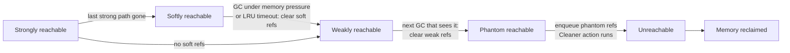
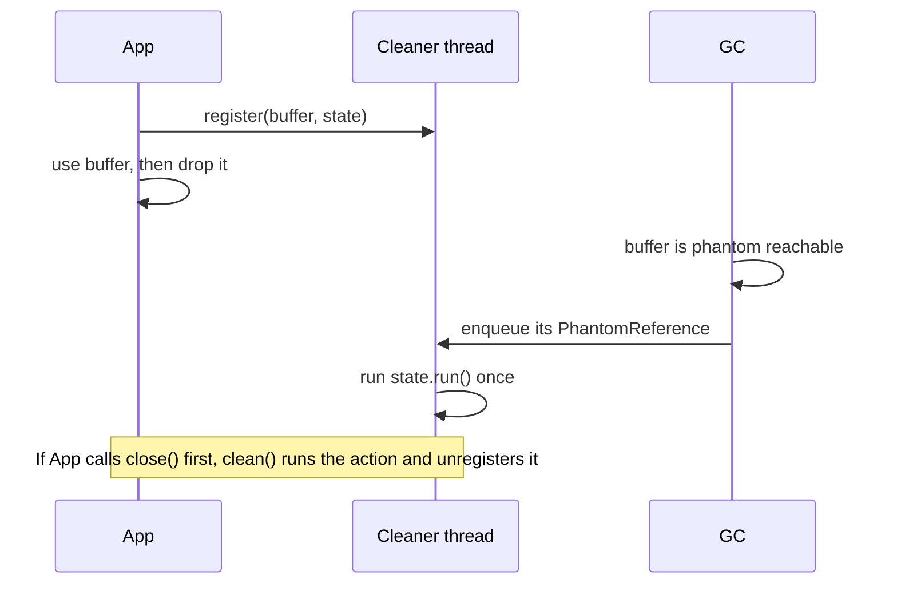
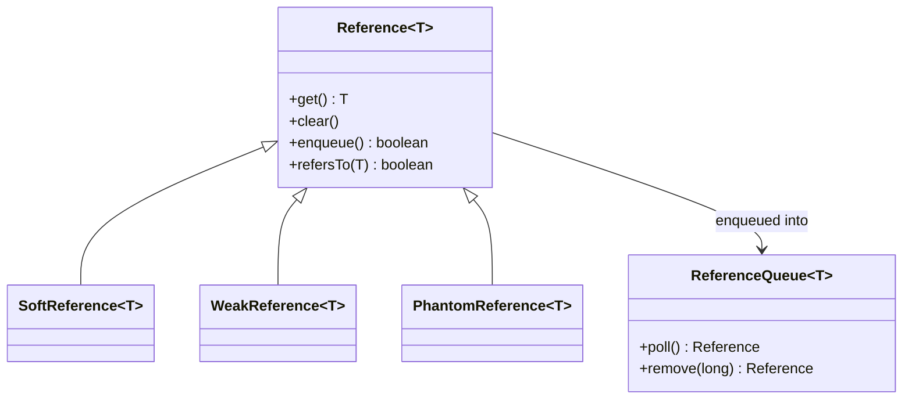

## In One Line
Besides normal (**strong**) references, `java.lang.ref` gives you **soft**, **weak** and **phantom** references that let you point at an object *without keeping it alive*: soft ones are cleared when memory runs short, weak ones at the next GC that finds the object, and phantom ones only tell you (through a `ReferenceQueue`, or a `Cleaner`) that the object is gone so you can clean up after it.

## Mental Model
Think of **how tightly you hold a helium balloon** at a windy fair (the GC is the wind).

- **Strong reference** — you hold the string in your fist. The wind can never take the balloon while you hold it.
- **Soft reference** — the string is looped loosely around your finger. A breeze will not take it, but when a **storm** comes (the heap is nearly full) it slips away. The balloon you touched most recently is the last to go.
- **Weak reference** — the string just rests on your palm. The **first gust** (the next GC that looks at it) takes it if nobody else is holding it.
- **Phantom reference** — you do not hold the balloon at all; you hold a **receipt** that says "tell me when it has flown away". You can never use the receipt to get the balloon back (`get()` is always `null`), but when it is gone, the receipt is posted to your mailbox (the `ReferenceQueue`) so you can return the rented pump that came with it (clean up native resources).
- The **mailbox** is the `ReferenceQueue`: the GC drops in the reference objects whose balloons flew away, so you do not have to keep checking every string.

As long as *someone* holds the string in a fist (a strong path from a GC root), none of the looser grips matter.

## Concept
### Why reference types exist
Normally any reference keeps its object alive. Sometimes you want to *know about* or *remember* an object without deciding its lifetime:

- a **cache** that may give memory back under pressure (soft);
- **metadata attached to objects you do not own**, which should disappear when they do (weak, `WeakHashMap`);
- a **canonicalizing map** ("one instance per value") that must not pin every value forever (weak);
- **cleanup of native resources** after an object dies, without `finalize()` (phantom, `Cleaner`).

### Reachability levels
From strongest to weakest, an object is:

| Level | Meaning |
|---|---|
| **Strongly reachable** | Reachable from a GC root through a chain of ordinary references |
| **Softly reachable** | Not strongly reachable, but reachable through a `SoftReference` |
| **Weakly reachable** | Not strongly or softly reachable, but reachable through a `WeakReference` |
| **Phantom reachable** | None of the above, it has been finalized (if it had a finalizer), and a `PhantomReference` refers to it |
| **Unreachable** | Can be reclaimed |

The *strongest* path wins: an object with one strong path and ten weak ones is strongly reachable, and none of the weak references will be cleared.

### The four kinds side by side
| | Strong | `SoftReference` | `WeakReference` | `PhantomReference` |
|---|---|---|---|---|
| Created by | `Foo f = new Foo()` | `new SoftReference<>(obj[, queue])` | `new WeakReference<>(obj[, queue])` | `new PhantomReference<>(obj, queue)` |
| `get()` returns | — | the object, until cleared | the object, until cleared | **always `null`** |
| Cleared when | never while reachable | GC decides, based on memory and recent use; **all cleared before `OutOfMemoryError`** | at the first GC that finds the object weakly reachable | when the object becomes phantom reachable (automatically cleared since Java 9) |
| Enqueued | — | after clearing, if registered with a queue | after clearing, if registered | when phantom reachable — the queue is its whole purpose |
| Typical use | everything | memory-sensitive caches (with caution) | `WeakHashMap`, canonicalizing maps, listener registries, `ThreadLocal` keys | `Cleaner`, post-mortem native cleanup |

### The `Reference` API
- `T get()` — the referent, or `null` once cleared (phantom: always `null`). Always copy it into a local and null-check: `Foo f = ref.get(); if (f != null) use(f);`. Calling `get()` twice can give an object and then `null`.
- `void clear()` — clears it yourself (does not enqueue).
- `boolean enqueue()` — clears and enqueues it yourself.
- `boolean refersTo(T obj)` (Java 16) — checks the referent **without** creating a strong reference (the only way to inspect a phantom reference); `ref.refersTo(null)` means "cleared".
- `isEnqueued()` — deprecated in Java 16.
- `static void reachabilityFence(Object o)` (Java 9) — see below.

**The `Reference` object itself is an ordinary, strongly held object.** If you drop the `WeakReference` itself, it is collected too and will never be enqueued — keep reference objects in a field or collection until they are processed.

### `ReferenceQueue`: getting notified
Pass a queue to the constructor. After the GC clears the reference (or, for phantoms, detects phantom reachability), the JVM's **Reference Handler** thread appends the *reference object* to the queue. You then:

- `queue.poll()` — non-blocking; returns a reference or `null`;
- `queue.remove()` / `queue.remove(timeoutMillis)` — blocking.

Queues are how `WeakHashMap` removes stale entries and how `Cleaner` knows when to run cleanup actions. Typically you subclass the reference to carry the data you need for cleanup (for example the map key or a native handle), because the referent itself is already gone.

### Soft references in detail
- The spec only guarantees that soft references are **cleared before `OutOfMemoryError`** is thrown, and encourages VMs not to clear recently used ones.
- HotSpot uses an **LRU policy**: a softly reachable object is kept while *time since its last `get()`* < *free heap in MB* × `-XX:SoftRefLRUPolicyMSPerMB` (default **1000 ms per free MB**). With 100 MB free, an object untouched for 100 seconds may go. `get()` refreshes the timestamp.
- They are a poor cache in practice: eviction is global, unpredictable and happens exactly when the GC is already under pressure — often causing more, longer GCs. Prefer a size- or time-bounded cache (a `LinkedHashMap` LRU, Caffeine). The JDK still uses soft references internally (for example `Class`'s cached reflection data).

### Weak references in detail
- Cleared **atomically** at the GC that finds the object weakly reachable — all weak references to it at once — and then enqueued.
- A young GC only discovers weak references to *young* objects; a weakly reachable object that was already promoted is cleared when the old generation is collected. "Cleared at the next GC" really means "at the next GC that looks at that object".
- **`WeakHashMap<K,V>`** holds its **keys weakly** and **values strongly**. When a key is collected, its entry is removed the next time the map is used (`size()`, `get()`, `put()`... call `expungeStaleEntries()` which polls an internal `ReferenceQueue`). Traps:
  - a **value that references its key** keeps the key strongly reachable through the map itself: the entry never goes away;
  - keys that never die — **string literals** (pooled), small boxed `Integer`s (the -128..127 cache), enum constants — are never removed;
  - it uses `equals`/`hashCode` (not identity), and it is **not thread-safe** (`Collections.synchronizedMap` if needed).
- `ThreadLocal`'s internal map uses `WeakReference<ThreadLocal<?>>` keys with **strong values**, which is why a forgotten `remove()` on a pooled thread still leaks the value.

### Phantom references and `Cleaner`
A phantom reference is a pure **death notification**: its `get()` always returns `null` so the object can never be resurrected (the flaw of `finalize()`). Since Java 9 phantom references are **cleared automatically** when enqueued, like the others (before that the referent stayed in memory until you called `clear()`).

**`java.lang.ref.Cleaner`** (Java 9) packages the phantom-reference pattern:
```java
private static final Cleaner CLEANER = Cleaner.create();   // one daemon thread; share it
Cleaner.Cleanable c = CLEANER.register(object, action);    // action: a Runnable
c.clean();                                                 // run it now, at most once
```
- The action runs **at most once**: either when you call `clean()` (typically from `close()`), or on the cleaner's thread after `object` becomes phantom reachable.
- The action **must not refer to `object`** — not directly, not through a captured `this`, not through a non-static inner class or an instance-field lambda. Otherwise the cleaner holds the object strongly (through the action) and it can never become phantom reachable. Use a `static` nested class or a lambda that captures only the state it needs.
- Recommended pattern: **`AutoCloseable` + try-with-resources for deterministic cleanup, `Cleaner` only as a safety net** for forgotten `close()` calls. The JDK does exactly that for direct `ByteBuffer`s and file streams.
- Exceptions thrown by an action are ignored; keep actions short, since one thread serves the whole cleaner.

| | `finalize()` | `Cleaner` / phantom | try-with-resources |
|---|---|---|---|
| Deterministic | no | no | **yes** |
| Can resurrect the object | yes | **no** (`get()` is null) | n/a |
| Runs on | the single JVM finalizer thread | the cleaner's thread (yours) | the calling thread |
| Status | deprecated for removal (Java 18) | recommended safety net | the primary mechanism |

### `Reference.reachabilityFence`
The JIT may decide an object is unreachable as soon as the code no longer *uses* it — even in the middle of one of its own methods. If a `Cleaner` action frees a native handle stored in a field, that can happen while the method is still using the handle:
```java
void write(byte[] data) {
    try {
        nativeWrite(handle, data);            // 'this' may already be unreachable here
    } finally {
        Reference.reachabilityFence(this);    // keeps 'this' strongly reachable until this point
    }
}
```
It is needed only in classes that use cleaners/finalizers on native state; ordinary code never needs it.

## Diagram

An object only moves right as its stronger paths disappear; at each step the GC clears the matching references and puts them on their queues.


A `Cleaner` is a phantom reference plus a queue plus a thread. The action runs exactly once — from `close()` or after the object dies.


All three kinds share `Reference`'s API; a queue is optional for soft and weak references and essential for phantom ones.

## Code
**1. The four strengths.** `RefTypes.java` — run with `java -Xmx64m RefTypes.java`.
```java
import java.lang.ref.PhantomReference;
import java.lang.ref.Reference;
import java.lang.ref.ReferenceQueue;
import java.lang.ref.SoftReference;
import java.lang.ref.WeakReference;
import java.util.ArrayList;
import java.util.List;

public class RefTypes {
    public static void main(String[] args) throws InterruptedException {
        ReferenceQueue<byte[]> queue = new ReferenceQueue<>();

        byte[] strong = new byte[1024];                                   // strong: a normal variable
        SoftReference<byte[]> soft = new SoftReference<>(new byte[10 * 1024 * 1024], queue);
        WeakReference<byte[]> weak = new WeakReference<>(new byte[1024], queue);
        PhantomReference<byte[]> phantom = new PhantomReference<>(new byte[1024], queue);

        System.out.println("before GC: soft=" + (soft.get() != null) + " weak=" + (weak.get() != null)
                + " phantom.get()=" + phantom.get());

        System.gc();
        Thread.sleep(100);                                                // let the reference handler enqueue

        System.out.println("after GC : soft=" + (soft.get() != null) + " weak=" + (weak.get() != null)
                + " strong.length=" + strong.length);
        Reference<? extends byte[]> r;
        while ((r = queue.poll()) != null) {
            System.out.println("  enqueued: " + r.getClass().getSimpleName());
        }

        // Memory pressure: soft references are cleared before OutOfMemoryError is thrown
        List<byte[]> hog = new ArrayList<>();
        try {
            while (true) hog.add(new byte[128 * 1024]);                   // 128 KB at a time
        } catch (OutOfMemoryError e) {
            int mb = hog.size() / 8;                                      // 8 chunks = 1 MB
            hog = null;                                                   // release the hog so we can print
            System.out.println("OOM after " + mb + " MB; soft cleared? " + (soft.get() == null));
        }
        System.out.println("  enqueued: " + queue.remove(1000).getClass().getSimpleName());
    }
}
```
```output
before GC: soft=true weak=true phantom.get()=null
after GC : soft=true weak=false strong.length=1024
  enqueued: WeakReference
  enqueued: PhantomReference
OOM after 53 MB; soft cleared? true
  enqueued: SoftReference
```

**2. `WeakHashMap` and its traps.** `WeakMapDemo.java`:
```java
import java.util.Map;
import java.util.WeakHashMap;

public class WeakMapDemo {
    record Meta(String info) {}
    static class Session {
        final String id;
        Session(String id) { this.id = id; }
    }
    record Holder(Session session) {}            // a value that points back at its own key

    public static void main(String[] args) throws InterruptedException {
        Map<Object, Object> map = new WeakHashMap<>();

        Session kept = new Session("kept");
        map.put(kept, new Meta("kept alive by a local variable"));
        map.put(new Session("temp"), new Meta("nobody else refers to this key"));
        map.put("literal", new Meta("key is an interned String literal"));
        Session looped = new Session("looped");
        map.put(looped, new Holder(looped));      // the value strongly references its key
        looped = null;

        System.out.println("before GC: " + map.size() + " entries");
        System.gc();
        Thread.sleep(100);
        System.out.println("after GC : " + map.size() + " entries");
        map.keySet().stream()                     // sorted, because the map's order depends on hash codes
                .map(key -> key instanceof Session s ? "Session " + s.id : "String " + key)
                .sorted()
                .forEach(name -> System.out.println("  " + name));
        System.out.println(kept.id);              // keep 'kept' strongly reachable until here
    }
}
```
```output
before GC: 4 entries
after GC : 3 entries
  Session kept
  Session looped
  String literal
kept
```

**3. `Cleaner` done right.** `CleanerDemo.java`:
```java
import java.lang.ref.Cleaner;

public class CleanerDemo {
    private static final Cleaner CLEANER = Cleaner.create();      // one cleaner thread, share it

    // The cleanup state must NOT refer to the NativeBuffer, or the buffer can never become unreachable.
    private static final class State implements Runnable {
        private final String name;
        State(String name) { this.name = name; }

        @Override
        public void run() {                                        // runs at most once
            System.out.println("  released native memory of " + name);
        }
    }

    static final class NativeBuffer implements AutoCloseable {
        private final Cleaner.Cleanable cleanable;

        NativeBuffer(String name) {
            System.out.println("  allocated " + name);
            this.cleanable = CLEANER.register(this, new State(name));
        }

        @Override
        public void close() {
            cleanable.clean();                                     // run the action now, and unregister it
        }
    }

    public static void main(String[] args) throws InterruptedException {
        System.out.println("1. try-with-resources:");
        try (NativeBuffer b = new NativeBuffer("A")) {
            System.out.println("  using A");
        }

        System.out.println("2. close() twice:");
        NativeBuffer b2 = new NativeBuffer("B");
        b2.close();
        b2.close();                                                // clean() is idempotent: nothing printed

        System.out.println("3. forgot to close:");
        new NativeBuffer("C");                                     // unreachable immediately
        System.gc();
        Thread.sleep(200);                                         // the cleaner thread runs the action
        System.out.println("done");
    }
}
```
```output
1. try-with-resources:
  allocated A
  using A
  released native memory of A
2. close() twice:
  allocated B
  released native memory of B
3. forgot to close:
  allocated C
  released native memory of C
done
```
The broken version — the action is a lambda that uses `this.name`, so it captures `this`:
```java
import java.lang.ref.Cleaner;
import java.lang.ref.WeakReference;

public class LeakyCleaner {
    static final Cleaner CLEANER = Cleaner.create();

    static class Resource {
        private final String name;
        Resource(String name) {
            this.name = name;
            CLEANER.register(this, () -> System.out.println("cleaned " + this.name));   // captures 'this'
        }
    }

    public static void main(String[] args) throws InterruptedException {
        WeakReference<Resource> probe = new WeakReference<>(new Resource("D"));
        for (int i = 0; i < 3; i++) {
            System.gc();
            Thread.sleep(100);
        }
        System.out.println("collected? " + (probe.get() == null));
    }
}
```
```output
collected? false
```

**4. Soft references follow an LRU clock.** `SoftPolicy.java`:
```java
import java.lang.ref.SoftReference;

public class SoftPolicy {
    public static void main(String[] args) throws Exception {
        SoftReference<byte[]> soft = new SoftReference<>(new byte[1024]);
        for (int i = 0; i < 3; i++) { Thread.sleep(50); System.gc(); }
        System.out.println("after 3 GCs soft cleared? " + (soft.get() == null));
    }
}
```
`java SoftPolicy.java` (default: 1000 ms per free MB):
```output
after 3 GCs soft cleared? false
```
`java -XX:SoftRefLRUPolicyMSPerMB=0 SoftPolicy.java`:
```output
after 3 GCs soft cleared? true
```

**5. `refersTo` (Java 16).**
```java
Object o = new Object();
WeakReference<Object> w = new WeakReference<>(o);
System.out.println(w.refersTo(o) + " " + w.refersTo(null));
o = null;
System.gc();
System.out.println(w.refersTo(null));
```
```output
true false
true
```

## Walkthrough
**RefTypes**
- `ReferenceQueue<byte[]> queue` — one mailbox shared by the three reference objects.
- `strong` — an ordinary local; it keeps its 1 KB array alive, as the later `strong.length` proves.
- The soft, weak and phantom references each get a **new array that nothing else refers to**, so each referent is only as reachable as its reference allows.
- `phantom.get()` prints `null` even *before* the GC: phantom references never hand out their referent.
- After `System.gc()`: the **weak** referent is gone (`weak=false`); the **soft** one survives (`soft=true`) because there is plenty of free heap and it was just created; the phantom referent is also collected.
- `Thread.sleep(100)` gives the JVM's Reference Handler thread time to move the cleared references onto the queue. The `poll()` loop then finds the `WeakReference` and the `PhantomReference` objects (this order was stable in every run, but the specification does not promise any order). The soft reference is not there because it was not cleared.
- The `hog` loop allocates 128 KB arrays until the 64 MB heap is exhausted. Before throwing `OutOfMemoryError`, the JVM **clears all soft references** — the 10 MB array was released to make room (`soft cleared? true`), then the loop still ran out. How many MB fit (53 here, 58 with Serial GC) depends on the collector.
- `hog = null` in the `catch` frees the memory so `println` can allocate its strings again.
- `queue.remove(1000)` blocks up to one second and returns the `SoftReference` that was enqueued when it was cleared.

**WeakMapDemo**
- `kept` — the key is still held by the local variable `kept`: strongly reachable, entry stays. The last `println(kept.id)` makes sure the JIT cannot treat it as dead earlier.
- `new Session("temp")` — only the map's weak reference points to it, so the GC clears it and the next `map.size()` expunges the entry: 4 → **3**.
- `"literal"` — string literals are interned and referenced by the class's constant pool, so they are strongly reachable while the class is loaded: the entry never leaves.
- `looped` — the local is set to `null`, but the **value** `Holder(looped)` is stored strongly in the map and refers to the key, so the key stays strongly reachable *through the map itself*. The classic `WeakHashMap` leak.
- The keys are sorted before printing because iteration order depends on (identity) hash codes, which change from run to run.

**CleanerDemo**
- `Cleaner.create()` starts one daemon thread; making it `static final` shares it across all buffers.
- `State` is a `static` nested class holding only the `name` — it has no reference to the `NativeBuffer`. That is what lets the buffer become phantom reachable.
- `CLEANER.register(this, new State(name))` returns a `Cleanable`; the buffer keeps it so that `close()` can call `clean()`.
- Case 1: try-with-resources calls `close()` → `clean()` runs the action immediately, on the main thread.
- Case 2: the second `close()` prints nothing: a `Cleanable` runs **at most once** and unregisters itself.
- Case 3: nobody calls `close()`. After `System.gc()` the buffer is phantom reachable; the cleaner thread receives its reference from the queue and runs the action — the safety net. Without the `sleep`, `main` might print `done` first.

**LeakyCleaner**
- `() -> System.out.println("cleaned " + this.name)` reads an instance field, so the lambda captures `this`. The cleaner (a GC root through its thread) holds the action, the action holds the resource: the resource stays **strongly reachable forever** — `collected? false`, and "cleaned D" never prints. Fix: capture a local copy (`String n = name; () -> ... n`) or use a static class like `State`.

**SoftPolicy**
- With the default policy (1000 ms per free MB and hundreds of MB free) a 150 ms old soft reference is far too "fresh" to clear.
- With `-XX:SoftRefLRUPolicyMSPerMB=0` any soft reference not accessed since the previous GC is cleared — soft references then behave almost like weak ones. Calling `get()` between GCs would have refreshed its timestamp.

**refersTo**
- `w.refersTo(o)` is `true`, `w.refersTo(null)` is `false` while the object is alive; after the GC `refersTo(null)` is `true` — cleared. Unlike `get()`, `refersTo` never creates a strong reference, so it cannot accidentally resurrect or prolong the life of the referent.

## Traps
- **Checking `get()` twice.** `if (ref.get() != null) ref.get().use();` can throw `NullPointerException` — the GC may clear the reference between the two calls. Read once into a local.
- **Losing the reference object.** `new WeakReference<>(obj, queue);` without storing the reference: the `WeakReference` itself becomes garbage and is never enqueued.
- **`WeakHashMap` values that point to their keys** — directly or indirectly (a listener that captures the key) — make the key strongly reachable; the map leaks. Wrap the value in a `WeakReference` too, or rethink the design.
- **`WeakHashMap` with keys that never die** — string literals, `Integer.valueOf(42)` (cached), enum constants, `Class` objects of the app loader — entries are never removed.
- **Soft-reference caches** make memory usage look like a leak (the heap stays full), cause long GCs near the limit and give unpredictable hit rates. Use a bounded cache.
- **Using weak references for things you need later.** A weak-valued cache of objects nobody else holds is emptied at every GC — it caches nothing.
- **Cleaner action capturing `this`** (lambda using a field, anonymous or inner class): the object can never be cleaned. The `LeakyCleaner` run proves it.
- **Relying on a `Cleaner` instead of `close()`**: it runs only after a GC notices the object, which may be much later — or never before the JVM exits. Files and sockets must be closed explicitly.
- **Using `PhantomReference.get()` to reach the object** — it is always `null` by design. Store what the cleanup needs in a subclass of `PhantomReference` or in the `Cleaner` action.
- **Assuming weak references are cleared at the "next GC"**: a young GC does not look at old objects, so a promoted, weakly reachable object may survive many young GCs.

> [!WARNING] `ThreadLocal` uses weak **keys** but strong **values**. On a thread pool, a `ThreadLocal` that is never `remove()`d leaves its value in the worker thread's map — and if the value's class came from a web-app class loader, it pins that whole loader. Always `remove()` in a `finally` block.

## Tips & Tricks
- **Strength order — "Strong, Soft, Weak, Phantom" = "SSWP": "Some Smart Workers Persist."** The GC clears them in exactly that direction as an object loses its stronger paths.
- **One-liner per kind**: Soft = "keep until **memory** is short"; Weak = "keep until the **next GC**"; Phantom = "tell me **after** it is gone".
- **When asked "which reference for a cache?"** say: "Soft references look designed for it, but in practice a bounded LRU/Caffeine cache is better; weak references suit canonicalizing maps and metadata keyed by objects I don't own."
- **Always the `get()`-once idiom:** `var v = ref.get(); if (v != null) { ... }`.
- **Test code with references:** call `System.gc()` in a loop with a short sleep until `ref.refersTo(null)`, with a time limit — never assume one call is enough on every collector.
- **Cleaner checklist**: one shared `static final Cleaner`; action in a `static` nested class (or a lambda capturing only locals); keep the `Cleanable`; call `clean()` from `close()`; still use try-with-resources.
- **See the queue in action**: `-Xlog:gc+ref=debug` logs how many soft, weak, final and phantom references each GC discovered and cleared.

## Interview Q&A
### [Basic] What are the four types of references in Java?
**Strong** references are ordinary variables and fields; an object reachable through them is never collected. **Soft** references (`SoftReference`) are cleared at the GC's discretion when memory is needed — all of them are guaranteed to be cleared before an `OutOfMemoryError` — so they were designed for memory-sensitive caches. **Weak** references (`WeakReference`) are cleared as soon as a GC finds the object weakly reachable; they back `WeakHashMap` and canonicalizing maps. **Phantom** references (`PhantomReference`) never return their object (`get()` is always `null`) and are enqueued after the object becomes phantom reachable; they are used for post-mortem cleanup, most conveniently through `Cleaner`.

**Follow-up:** *Which package are they in?* — `java.lang.ref`, together with `ReferenceQueue` and `Cleaner`.

### [Basic] What is the difference between a soft and a weak reference?
Both let the GC collect the referent once no strong path exists, but at different times. A weak reference is cleared at the first GC that finds its referent weakly reachable, regardless of free memory. A soft reference is kept as long as memory allows: HotSpot keeps it while the time since its last access is less than 1 second per free MB of heap (`SoftRefLRUPolicyMSPerMB`), and clears all of them before throwing `OutOfMemoryError`. In the lesson's demo, after `System.gc()` the weak referent was gone while the soft one survived until the heap was exhausted.

**Follow-up:** *So should I build caches with soft references?* — Usually not: eviction is unpredictable and global, and it happens under GC pressure. A bounded LRU or Caffeine cache gives predictable behaviour.

### [Intermediate] What is a `ReferenceQueue` and how do you use it?
A `ReferenceQueue` is where the JVM puts reference objects after their referent has been cleared (soft/weak) or has become phantom reachable. You pass it to the reference's constructor and later `poll()` (non-blocking) or `remove()` (blocking) it to learn which referents died, so you can clean up associated data — remove a map entry, release a native handle. Since the referent is gone, you typically subclass the reference to carry the needed data (a key, a handle). `WeakHashMap` uses exactly this to expunge stale entries, and `Cleaner` uses it with phantom references.
```java
class KeyRef extends WeakReference<Object> {
    final String key;
    KeyRef(Object referent, String key, ReferenceQueue<Object> q) { super(referent, q); this.key = key; }
}
// later: for (Reference<?> r; (r = queue.poll()) != null; ) index.remove(((KeyRef) r).key);
```
**Follow-up:** *What happens if the reference object itself is garbage collected?* — Then it is never enqueued. Reference objects must be kept strongly reachable (in a field or collection) until processed.

### [Intermediate] How does `WeakHashMap` work, and what are its pitfalls?
Each entry is a `WeakReference` to the key, registered with the map's internal `ReferenceQueue`; values are held strongly. When a key is no longer strongly reachable, the GC clears the entry's reference and enqueues it; the next map operation (`get`, `put`, `size`...) polls the queue and removes those entries. Uses: attaching metadata to objects whose lifecycle you do not control, and caches keyed by such objects. Pitfalls: a value that references its key keeps it alive forever; keys that are always reachable (string literals, cached `Integer`s, enum constants) are never removed; it compares keys with `equals`, not identity; it is not thread-safe; and entries disappear only after a GC *and* a subsequent map access.

**Follow-up:** *Is there a weak-values map in the JDK?* — No. You wrap values in `WeakReference`s yourself or use a library (Caffeine's `weakValues()`, Guava's `MapMaker`).

### [Intermediate] What is a phantom reference for? Why does `get()` return null?
A phantom reference is a notification that an object has been collected (more precisely, that it has become phantom reachable), used to release resources associated with it — native memory, file handles — after it dies. `get()` always returns `null` so the cleanup code can never resurrect the object, which was one of the flaws of `finalize()`. It must be registered with a `ReferenceQueue` to be useful. Since Java 9 the reference is cleared automatically when enqueued. In practice you use `java.lang.ref.Cleaner`, which wraps phantom references, a queue and a thread.

**Follow-up:** *How can you check whether a phantom reference still refers to something?* — `refersTo(obj)` (Java 16) compares without creating a strong reference.

### [Intermediate] How does `Cleaner` replace `finalize()`?
`Cleaner.create()` gives you a cleaner with its own daemon thread. `cleaner.register(obj, action)` returns a `Cleanable`; the action (a `Runnable`) runs exactly once — either when you call `cleanable.clean()`, typically from `close()`, or on the cleaner thread after `obj` becomes phantom reachable. Unlike `finalize()`, the action cannot see or resurrect the object, you control the thread, it is opt-in per object instead of affecting every instance of a class, and it does not slow down allocation of other objects. The rules: the action must not reference `obj` (no captured `this`, use a static nested class), and it is a safety net — try-with-resources remains the primary cleanup mechanism.

**Follow-up:** *What if the action captures `this`?* — The cleaner holds the action strongly, the action holds the object, so the object never becomes phantom reachable: it leaks and the action never runs (the lesson's `LeakyCleaner` prints `collected? false`).

### [Advanced] Are soft references a good way to implement a cache?
They look like it, but usually not. The JVM clears soft references globally, based on an LRU clock and free heap, and in bulk right before an `OutOfMemoryError` — exactly when the GC is already struggling, so it causes long and frequent collections. The cache keeps the heap looking full, which hides real leaks and confuses monitoring, and its hit rate depends on unrelated allocation in the rest of the application. A cache with explicit bounds (entry count or weight, time-to-live) and an eviction policy — `LinkedHashMap` with `removeEldestEntry`, or Caffeine — is predictable and testable. Soft references remain acceptable for rarely used, easily recomputed data like the JDK's reflection caches.

**Follow-up:** *Which flag controls how aggressively soft references are cleared?* — `-XX:SoftRefLRUPolicyMSPerMB` (default 1000); 0 makes them behave almost like weak references.

### [Advanced] What does `Reference.reachabilityFence` do and when is it needed?
It guarantees that the given object is considered strongly reachable at least until the fence is executed. The JIT may treat an object as unreachable as soon as it is no longer used — even while one of its own methods is running — so a `Cleaner` or finalizer could free native state that the method is still using through a copied handle. Placing `Reference.reachabilityFence(this)` in a `finally` block at the end of such methods prevents that. It is only needed in classes that manage native resources with cleaners or finalizers.

**Follow-up:** *Why doesn't `this.handle` in the method keep `this` alive?* — Because after the field has been read into a register, `this` is no longer needed by the compiled code; liveness is based on future use, not on scope.

### [Advanced] How does `ThreadLocal` use weak references, and why can it still leak?
Each `Thread` has a `ThreadLocalMap` whose entries extend `WeakReference<ThreadLocal<?>>` — the **key** (the `ThreadLocal` object) is weak, the **value** is strong. If the `ThreadLocal` itself becomes unreachable, its key is cleared, but the value stays in the thread's map until a later map operation happens to expunge that stale slot or the thread dies. In thread pools threads live forever, so values — and, in application servers, the class loaders of their classes — leak. The fix is calling `threadLocal.remove()` in a `finally` block after each task, and keeping `ThreadLocal`s `static final` rather than creating them per object.

**Follow-up:** *Why is the key weak but not the value?* — A weak value could vanish while the thread still needs it; a weak key only lets the map detect that nobody can access the entry any more.

### [Basic] Can reference types help prevent memory leaks?
They help when the leak comes from *bookkeeping* references: registries of listeners or observers, metadata maps and canonicalizing maps can use weak references so that registering an object does not keep it alive. They do not fix leaks where you really keep strong references by mistake (a growing static list), and they are no substitute for explicit lifecycle management — unregistering listeners, closing resources, calling `ThreadLocal.remove()`. Overusing them causes the opposite bug: objects disappearing while still needed.

**Follow-up:** *What is a lapsed listener?* — A listener that was registered with a long-lived subject and never removed; the subject's list keeps it (and everything it references) alive. Weak listener lists or explicit `removeListener` calls fix it.

## Quiz
### In `RefTypes`, what does the "after GC" line show right after `System.gc()` with plenty of free heap?
- [ ] soft=false weak=false
- [x] soft=true weak=false
- [ ] soft=false weak=true
- [ ] soft=true weak=true
> The weak referent is cleared at the first GC that finds it weakly reachable. The soft referent survives because there is plenty of free memory and it was used recently; soft references are only guaranteed to be cleared before an `OutOfMemoryError`. The real run printed `after GC : soft=true weak=false strong.length=1024`.

### What does `phantomRef.get()` return while the referent is still strongly reachable?
- [ ] The referent
- [x] `null`
- [ ] A copy of the referent
- [ ] It throws `IllegalStateException`
> `PhantomReference.get()` always returns `null`, from construction onwards, so the object can never be reached (or resurrected) through it. Use `refersTo(obj)` to test what it refers to.

### What does this print?
```java
Map<Object, String> map = new WeakHashMap<>();
map.put("config", "a");               // String literal key
map.put(new Object(), "b");
System.gc();
Thread.sleep(100);
System.out.println(map.size());
```
- [ ] 0
- [x] 1
- [ ] 2
- [ ] It depends on the key order
> The `new Object()` key has no strong references, so its entry is removed after the GC. The literal `"config"` is interned and stays strongly reachable through the class's constant pool, so its entry never goes away. The lesson's `WeakMapDemo` shows the same: 4 → 3 entries, with `String literal` still present.

### Spot the bug: why is "cleaned" never printed?
```java
class Resource {
    private final String name;
    Resource(String name) {
        this.name = name;
        CLEANER.register(this, () -> System.out.println("cleaned " + this.name));
    }
}
new Resource("D");
System.gc();
```
- [ ] `Cleaner` actions only run at JVM exit
- [ ] `System.gc()` does not process phantom references
- [x] The lambda reads `this.name`, capturing `this`; the cleaner holds the action strongly, so the resource never becomes phantom reachable
- [ ] `register` must be called after the constructor finishes
> The action is referenced from the cleaner, and the action references the resource: a strong path that keeps it alive forever (the lesson's run printed `collected? false`). Capture only what cleanup needs (`String n = name;`) or use a `static` nested class. Cleaner actions do run during normal execution — `CleanerDemo` case 3 shows it.

### Which reference is guaranteed to be cleared before the JVM throws `OutOfMemoryError`?
- [ ] `WeakReference` only
- [x] `SoftReference` (weak references are cleared even earlier, at the GC that finds them)
- [ ] `PhantomReference` only
- [ ] None; the JVM gives no guarantee
> The `SoftReference` specification promises that all soft references to softly reachable objects are cleared before an `OutOfMemoryError`. Weak references do not wait for memory pressure at all, and phantom references never keep objects reachable in the first place.

### A `WeakHashMap<User, Profile>` keeps growing although users log out. `Profile` has a field `User owner`. Why?
- [ ] `WeakHashMap` only removes entries on `remove()`
- [x] Each value strongly references its key, so every key stays strongly reachable through the map
- [ ] `User` must override `finalize()`
- [ ] The map needs a `ReferenceQueue` passed to its constructor
> Values in a `WeakHashMap` are strong. `map → Profile → User` is a strong path from the map itself, so the weak key reference never gets cleared — the `looped` entry in `WeakMapDemo` shows exactly this. The map already has its own internal queue.

### You need to attach extra data to objects created by a third-party library, and the data must disappear when those objects do. What fits best?
- [ ] A `HashMap<LibObject, Data>` in a static field
- [x] A `WeakHashMap<LibObject, Data>` (with `Data` not referring back to the key)
- [ ] A `SoftReference<Data>` stored in a static field
- [ ] A `PhantomReference` per object whose `get()` returns the data
> Weak keys let the entry vanish when the library drops the object. A plain `HashMap` in a static field would keep every object alive (a leak); a soft reference ties lifetime to memory pressure, not to the key; `PhantomReference.get()` always returns `null`.

## Takeaways
- Four strengths: strong (never collected while reachable), soft (cleared under memory pressure, all before `OutOfMemoryError`), weak (cleared at the next GC that finds the object), phantom (`get()` is always null; only signals death).
- A `ReferenceQueue` receives reference objects after their referents are cleared (or become phantom reachable); poll it to clean up associated data — and keep the reference objects themselves strongly reachable.
- Always read a reference once into a local (`var v = ref.get(); if (v != null) ...`); `refersTo` (Java 16) checks without resurrecting.
- `WeakHashMap` = weak keys, strong values: values that reference their keys, interned strings and cached boxes as keys never leave the map.
- Soft-reference caches are unpredictable; prefer bounded LRU/Caffeine caches. HotSpot keeps soft refs for about 1 s per free MB since last access (`SoftRefLRUPolicyMSPerMB`).
- `Cleaner` (Java 9) = phantom reference + queue + thread; its action runs once, from `close()` or after the object dies, and must never capture the object. Use it only as a safety net behind try-with-resources.
- `ThreadLocal` keys are weak but values are strong — call `remove()` on pooled threads.
