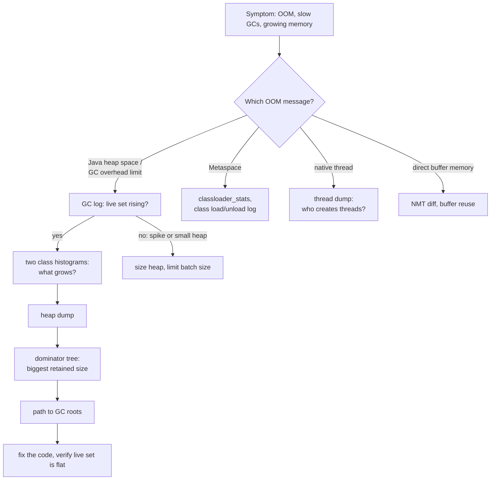
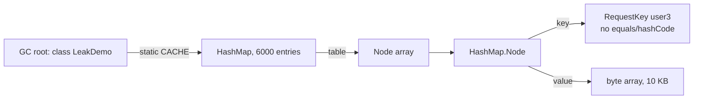
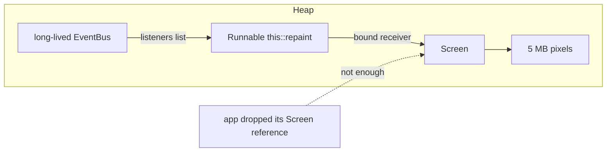

## In One Line
A Java memory leak is an object that is **still reachable but no longer needed** — the GC may not free it — so it piles up until an `OutOfMemoryError`, whose **message names the memory area that ran out**; you find the culprit with GC logs, class histograms and a **heap dump**, following the **path to the GC root** that keeps it alive.

## Mental Model
Think of an **office with a strict cleaner**.

- The cleaner (the GC) throws away every paper that is **not filed anywhere**. She never touches a paper that sits in a **filing cabinet**, even if nobody will ever read it again — it is officially filed (reachable).
- A **leak** is a clerk who files a copy of every request "just in case" in a cabinet nobody ever clears (a `static` map, a listener list, a `ThreadLocal` on a thread that never leaves). The cleaner is doing her job perfectly; the room still fills up.
- One day nobody can put anything down: **`OutOfMemoryError`**. The note on the door says *which* room is full — the main office (**heap**), the archive of blueprints (**Metaspace**), the car park for workers (**native threads**), the rented storage outside (**direct buffers**).
- To investigate, you take a **photo of the whole office** (a heap dump), find the **biggest pile** (the dominator tree, by retained size), follow the label on that pile to **the cabinet it is filed in** (path to GC root), and then find **the clerk who files it** (the allocation stack trace).
- Throwing out a few papers by hand when the room is full (catching the error) does not help for long: the clerk is still filing.

## Concept
### What a leak means in a garbage-collected language
The GC reclaims only **unreachable** objects. A leak is **unintended reachability**: some long-lived root (a static field, a live thread, a singleton, a cache) still references objects the program will never use again. Typical symptoms, in order of appearance:

1. The **live set** — heap occupancy right after a full or mixed collection — grows over hours or days: a sawtooth whose floor keeps rising.
2. GCs become more frequent and longer; CPU time spent in GC rises; latency rises.
3. Eventually `OutOfMemoryError` (or, with Parallel GC, `GC overhead limit exceeded`), or the container is killed.

Not every `OutOfMemoryError` is a leak. The heap may simply be **too small** for the real working set, or a **spike** (one query loading a million rows, a huge upload read into memory, too many requests in flight) may need more memory than exists. The difference: after the spike the live set drops back; with a leak it never does.

### The `OutOfMemoryError` family
`OutOfMemoryError` extends `VirtualMachineError` → `Error`, so it is unchecked. It is thrown **in whichever thread happened to allocate** when memory ran out — often not the thread that caused the leak. Read the message: it tells you which area is exhausted.

| Message (JDK 21) | Area | Typical cause | First move |
|---|---|---|---|
| `Java heap space` | Heap | Leak, heap too small, huge allocation | Heap dump; check live set in GC logs |
| `GC overhead limit exceeded` | Heap | Parallel GC spent > 98% of time in GC recovering < 2% of the heap — the heap is effectively full | Same as above (only Parallel implements it in JDK 21; G1 reports `Java heap space`) |
| `Requested array size exceeds VM limit` | Heap | `new int[Integer.MAX_VALUE]` — above the JVM's maximum array length (a bug, or a collection growing past ~2^31) | Fix the size calculation |
| `Metaspace` | Metaspace | Too many classes: class-loader leak on redeploy, runaway proxy/bytecode generation | `jcmd VM.classloader_stats`, heap dump for loaders |
| `Compressed class space` | Class space in Metaspace | Same, when the 1 GB default (or configured) class space fills | Same; raise `CompressedClassSpaceSize` only if the class count is legitimate |
| `unable to create native thread: possibly out of memory or process/resource limits reached` | Native (OS) | Too many threads (unbounded thread creation, thread per request), `ulimit -u`, container pid limits, no address space for stacks | Thread dump, count threads, use pools or virtual threads |
| `Cannot reserve N bytes of direct buffer memory (allocated: A, limit: L)` | Direct memory | Direct `ByteBuffer`s not released (freed only when their owner is GC'd), Netty/NIO pools | Reuse buffers, `-XX:MaxDirectMemorySize`, NMT |

Situations that are **not** an `OutOfMemoryError` but look like one:

- **The kernel's OOM killer** (Linux, containers): the process is killed with `SIGKILL`, exit code **137**, no Java stack trace, no heap dump. Cause: heap + native memory exceeded the container limit.
- **Native allocation failure inside the JVM**: the JVM crashes and writes an `hs_err_pid<pid>.log` saying *"There is insufficient memory for the Java Runtime Environment to continue."*
- `StackOverflowError` — a different `VirtualMachineError`, about one thread's stack (see [JVM Memory Areas](lesson:b02-jvm/02-memory-areas)).

### Common leak sources
| Cause | Why it leaks | Fix |
|---|---|---|
| **Static collections and caches without eviction** | A static field is a GC root; everything added stays forever | Bound the cache (size, TTL): `LinkedHashMap` LRU, Caffeine; or scope it to a request |
| **Keys with broken `equals`/`hashCode`** | Equal keys never match, so every lookup adds a new entry (Code, `LeakDemo`) | Implement both, or use a `record` |
| **Mutable keys** | A key whose hash changes after insertion sits in the wrong bucket; it can be neither found nor removed | Use immutable keys |
| **Listeners, callbacks, observers never unregistered** | The long-lived subject's list references the listener and everything it captures | Unregister in `close()`/`dispose()`; weak listener lists; try-with-resources for subscriptions |
| **Inner classes, anonymous classes, lambdas and bound method references that capture `this`** | The small object you keep drags its whole outer object along | `static` nested classes; capture only the values you need |
| **`ThreadLocal` on pooled threads** | Pool threads never die, the value is strongly held in the thread's map | `remove()` in `finally` |
| **Unbounded queues and executors** | `Executors.newFixedThreadPool` uses an unbounded `LinkedBlockingQueue`; a producer faster than consumers queues tasks forever | Bounded `ThreadPoolExecutor` queue with a rejection policy, back-pressure |
| **Unclosed resources** | Streams, sockets, JDBC `Connection`/`ResultSet` hold native memory, file descriptors and pooled connections | try-with-resources |
| **Class-loader leaks** (app servers, hot reload, plugins) | One reference from a JDK/server object (a thread started by the app, a `ThreadLocal`, a JDBC driver in `DriverManager`, a shutdown hook, a JMX bean) to any object of the old app pins its **class loader, all its classes and statics** → Metaspace grows on every redeploy | Stop threads and deregister drivers/hooks on undeploy; container leak detectors (Tomcat warns about them) |
| **Custom collections that do not null out slots** | `elements[--size]` returned without `elements[size] = null` keeps "removed" objects reachable (*obsolete references*) | Clear the slot |
| **Sessions and per-user state** | Large objects in HTTP sessions with long timeouts | Keep sessions small, shorten timeouts |
| **Direct buffers and memory-mapped files** | The native memory is freed only when the tiny heap object is collected; if the heap is idle, no GC comes | Pool and reuse buffers; cap with `MaxDirectMemorySize` |
| **`String.intern()` of unbounded values**, finalizer backlogs | Growing string table; objects waiting for a slow finalizer thread | Avoid; replace finalizers with `Cleaner` |

### Diagnosing: the workflow
1. **Confirm it is a leak.** GC logs (`-Xlog:gc*`): is the heap after full/mixed GCs rising? Or live: `jstat -gcutil <pid> 5s` — the `O` (old gen %) column keeps climbing and `FGC` (full GC count) increases.
2. **Find what grows.** Take two **class histograms** a few minutes apart and compare: `jcmd <pid> GC.class_histogram` (or `jmap -histo:live <pid>`). The classes whose instance counts keep growing are your suspects. Low overhead, but it forces a full GC.
3. **Capture a heap dump.**
   - automatically: `-XX:+HeapDumpOnOutOfMemoryError -XX:HeapDumpPath=/dumps` — always set this in production;
   - on demand: `jcmd <pid> GC.heap_dump /dumps/heap.hprof` (live objects only by default, `-all` for everything) or `jmap -dump:live,format=b,file=heap.hprof <pid>`.

   A dump pauses the JVM, is about as big as the used heap, and **contains all data in memory (passwords, tokens, personal data)** — handle it as a secret.
4. **Analyze it** with Eclipse MAT, VisualVM, IntelliJ IDEA's profiler or JDK Mission Control:
   - **Histogram** — objects per class, *shallow* size.
   - **Dominator tree** — objects sorted by **retained size** (the memory that would be freed if that object died). A leak shows up as one object (a map, a list, a class loader) retaining most of the heap.
   - **Path to GC roots** (excluding weak/soft references) — the chain of fields that keeps the suspect alive. It points straight at the static field or thread to blame.
   - **Leak Suspects** report (MAT) — an automatic first guess.
5. **Find who adds the objects**: allocation stack traces from Java Flight Recorder (`jdk.OldObjectSample` with `path-to-gc-roots=true` even gives the root path, cheaply enough for production), async-profiler in allocation mode, or a debugger on the `put`.
6. **Fix and verify**: the live set must stay flat under the same load.

> [!INTERVIEW] **Shallow size** = the object's own bytes (header + fields). **Retained size** = everything that would be freed if it were collected — the object plus all objects reachable *only* through it. A 48-byte `HashMap` can retain 2 GB.

### Non-heap leaks
- **Metaspace**: `jcmd <pid> VM.classloader_stats`, `jcmd <pid> VM.metaspace`, `-Xlog:class+load,class+unload` (classes loaded but never unloaded). In the heap dump, look for many instances of your web-app class loader and their path to GC roots.
- **Threads**: `jcmd <pid> Thread.print` (or `jstack`) — thousands of threads with the same name pattern reveal who creates them.
- **Native memory** (RSS grows, heap is flat): start with `-XX:NativeMemoryTracking=summary`, take `jcmd <pid> VM.native_memory baseline`, later `jcmd <pid> VM.native_memory summary.diff`; categories that grow (Thread, Class, Internal, Other — direct buffers) tell you where to look. Memory allocated by native libraries outside the JVM needs OS tools (`pmap`, jemalloc profiling).

### Should you catch `OutOfMemoryError`?
Almost never. The error can hit **any** allocation in **any** thread — halfway through updating a data structure, inside a lock, in a library's internal state — so after catching it the application may be subtly corrupted, and other threads are probably failing too. Even printing can fail (the Code section shows *"Exception: java.lang.OutOfMemoryError thrown from the UncaughtExceptionHandler"*). The robust production setup is:

- `-XX:+HeapDumpOnOutOfMemoryError -XX:HeapDumpPath=...` to keep the evidence;
- `-XX:+ExitOnOutOfMemoryError` (exit code 3) or `-XX:+CrashOnOutOfMemoryError` (hs_err file + core dump) so a supervisor (Kubernetes, systemd) restarts a clean process;
- alerting on GC logs and heap-after-GC metrics *before* the error happens.

A narrow, legitimate exception: trying an optional large allocation (an image buffer, a cache warm-up) inside `try`/`catch (OutOfMemoryError e)` and falling back to a smaller strategy — the allocation that failed was the only thing in flight.

### Prevention checklist
- Every cache has a **bound** and an eviction policy; every static collection has an owner who removes entries.
- Keys are **immutable** and implement `equals`/`hashCode` (records).
- Every `register`/`subscribe`/`addListener` has a matching `unregister` in a `close()`; every `ThreadLocal.set` has a `remove()` in `finally`.
- Resources use **try-with-resources**; buffers and connections come from bounded pools.
- Executors have **bounded queues**; nothing creates threads per request (or use virtual threads, which are cheap).
- Load tests run long enough to see the live-set trend, with GC logging on.
- Production JVMs run with `-Xlog:gc*` to a file, `-XX:+HeapDumpOnOutOfMemoryError`, an explicit `-XX:MaxMetaspaceSize`, and memory headroom in containers.

## Diagram

Start from the message, confirm a rising live set, then let the dominator tree and the path to GC roots point at the code.


The retention chain of `LeakDemo`, exactly as JFR's old-object sampler reported it: every 10 KB response is reachable from a static field through the map.


A lapsed listener: the application no longer uses the `Screen`, but the bus still reaches it through the bound method reference, so its 5 MB stay.

## Code
**1. A leaking cache.** `LeakDemo.java` — compiled with `javac -d out LeakDemo.java`, run with `java -cp out LeakDemo`.
```java
import java.util.HashMap;
import java.util.Map;

public class LeakDemo {
    // A "response cache" in a static field: it lives as long as the class (a GC root)
    static final Map<RequestKey, byte[]> CACHE = new HashMap<>();

    // BUG: no equals()/hashCode(), so two keys for the same user are never "the same key"
    static final class RequestKey {
        final String user;
        RequestKey(String user) { this.user = user; }
    }

    static byte[] handle(String user) {
        return CACHE.computeIfAbsent(new RequestKey(user), k -> new byte[10_000]);   // ~10 KB response
    }

    public static void main(String[] args) throws Exception {
        Runtime rt = Runtime.getRuntime();
        int rounds = args.length > 0 ? Integer.parseInt(args[0]) : 5;
        for (int round = 1; round <= rounds; round++) {
            for (int i = 0; i < 1_000; i++) {
                handle("user" + (i % 10));                  // only 10 different users
            }
            System.gc();
            long usedMb = (rt.totalMemory() - rt.freeMemory()) / (1024 * 1024);
            System.out.println("round " + round + ": cache entries = " + CACHE.size() + ", heap used after GC = " + usedMb + " MB");
        }
        if (args.length > 1) Thread.sleep(Long.parseLong(args[1]));   // time to attach jcmd
    }
}
```
```output
round 1: cache entries = 1000, heap used after GC = 10 MB
round 2: cache entries = 2000, heap used after GC = 20 MB
round 3: cache entries = 3000, heap used after GC = 30 MB
round 4: cache entries = 4000, heap used after GC = 40 MB
round 5: cache entries = 5000, heap used after GC = 49 MB
```
The fix is one line — `record RequestKey(String user) {}` instead of the class — and the same run prints:
```output
round 1: cache entries = 10, heap used after GC = 1 MB
round 2: cache entries = 10, heap used after GC = 1 MB
round 3: cache entries = 10, heap used after GC = 1 MB
round 4: cache entries = 10, heap used after GC = 1 MB
round 5: cache entries = 10, heap used after GC = 1 MB
```
**Class histogram** of the leaking version, taken while it sleeps (`java -cp out LeakDemo 5 8000 &` then `jcmd <pid> GC.class_histogram`; first rows, the `RequestKey` row and the total):
```text
 num     #instances         #bytes  class name (module)
-------------------------------------------------------
   1:         18143       50556784  [B (java.base@21.0.10)
   2:           128         516944  [Ljdk.internal.vm.FillerElement; (java.base@21.0.10)
   3:         13063         313512  java.lang.String (java.base@21.0.10)
   4:          6016         192512  java.util.HashMap$Node (java.base@21.0.10)
   5:          1532         189392  java.lang.Class (java.base@21.0.10)
   7:          5000          80000  LeakDemo$RequestKey
Total         54522       52407896
```
**Running out of heap with a dump**: `java -Xmx64m -XX:+HeapDumpOnOutOfMemoryError -XX:HeapDumpPath=dumps/leak.hprof -cp out LeakDemo 20`:
```output
round 1: cache entries = 1000, heap used after GC = 10 MB
round 2: cache entries = 2000, heap used after GC = 20 MB
round 3: cache entries = 3000, heap used after GC = 30 MB
round 4: cache entries = 4000, heap used after GC = 40 MB
round 5: cache entries = 5000, heap used after GC = 49 MB
round 6: cache entries = 6000, heap used after GC = 59 MB
java.lang.OutOfMemoryError: Java heap space
Dumping heap to dumps/leak.hprof ...
Heap dump file created [68916210 bytes in 0.043 secs]

Exception: java.lang.OutOfMemoryError thrown from the UncaughtExceptionHandler in thread "main"
```
**Java Flight Recorder finds the root for you**: `java -XX:StartFlightRecording:filename=rec.jfr,settings=profile,path-to-gc-roots=true -cp out LeakDemo 5`, then `jfr print --events jdk.OldObjectSample rec.jfr` (one sample, trimmed):
```text
jdk.OldObjectSample {
  objectSize = 9.8 kB
  object =  [
    byte[10000]
    value : java.util.HashMap$Node
    [4524] : java.util.HashMap$Node[8192]
    table : java.util.HashMap Size: 5000
    CACHE : java.lang.Class Class Name: LeakDemo
    appClass : java.lang.Class Class Name: sun.launcher.LauncherHelper
  ]
  root = {
    description = N/A
    system = "Class Loader Data"
    type = "<unknown>"
  }
  stackTrace = [
    LeakDemo.lambda$handle$0(LeakDemo$RequestKey) line: 15
    java.util.HashMap.computeIfAbsent(Object, Function) line: 1228
    LeakDemo.handle(String) line: 15
    LeakDemo.main(String[]) line: 23
    ...
  ]
}
```

**2. Every flavour of `OutOfMemoryError`.** `OomKinds.java` — compiled with `javac -d out OomKinds.java`; each run uses the flags shown.
```java
import java.lang.reflect.Proxy;
import java.net.URL;
import java.net.URLClassLoader;
import java.nio.ByteBuffer;
import java.util.ArrayList;
import java.util.HashMap;
import java.util.List;
import java.util.Map;

public class OomKinds {
    public static void main(String[] args) {
        List<Object> hold = new ArrayList<>();          // keeps everything reachable until the error
        try {
            switch (args[0]) {
                case "heap" -> {
                    while (true) hold.add(new long[1_000_000]);                  // 8 MB each
                }
                case "array" -> {
                    int[] huge = new int[Integer.MAX_VALUE];                     // larger than any JVM allows
                    System.out.println(huge.length);
                }
                case "overhead" -> {
                    Map<Integer, String> map = new HashMap<>();
                    hold.add(map);
                    for (int i = 0; ; i++) map.put(i, String.valueOf(i));      // many small live objects
                }
                case "metaspace" -> {
                    while (true) {                                               // one new class per loader
                        ClassLoader loader = new URLClassLoader(new URL[0], OomKinds.class.getClassLoader());
                        hold.add(Proxy.newProxyInstance(loader, new Class<?>[] { Runnable.class }, (p, m, a) -> null));
                    }
                }
                case "direct" -> {
                    while (true) hold.add(ByteBuffer.allocateDirect(1024 * 1024)); // native memory
                }
                default -> throw new IllegalArgumentException(args[0]);
            }
        } catch (OutOfMemoryError e) {
            hold = null;                                                         // free memory before printing
            System.out.println(args[0] + " -> " + e);
        }
    }
}
```
| Command | Output |
|---|---|
| `java -Xmx64m -cp out OomKinds heap` | `heap -> java.lang.OutOfMemoryError: Java heap space` |
| `java -Xmx64m -cp out OomKinds array` | `array -> java.lang.OutOfMemoryError: Requested array size exceeds VM limit` |
| `java -Xmx32m -XX:+UseParallelGC -cp out OomKinds overhead` | `overhead -> java.lang.OutOfMemoryError: GC overhead limit exceeded` |
| `java -Xmx32m -cp out OomKinds overhead` (G1) | `overhead -> java.lang.OutOfMemoryError: Java heap space` |
| `java -Xmx64m -XX:MaxMetaspaceSize=24m -cp out OomKinds metaspace` | `metaspace -> java.lang.OutOfMemoryError: Metaspace` |
| `java -Xmx64m -XX:CompressedClassSpaceSize=2m -cp out OomKinds metaspace` | `metaspace -> java.lang.OutOfMemoryError: Compressed class space` |
| `java -Xmx64m -XX:MaxDirectMemorySize=10m -cp out OomKinds direct` | `direct -> java.lang.OutOfMemoryError: Cannot reserve 1048576 bytes of direct buffer memory (allocated: 10485760, limit: 10485760)` |

**3. Running out of threads.** `Threads.java` starts sleeping daemon threads until it fails; run in a shell whose virtual memory is limited (`ulimit -v 3000000`) so the demo does not exhaust the machine.
```java
public class Threads {
    public static void main(String[] args) {
        int started = 0;
        try {
            while (true) {
                Thread t = new Thread(() -> {
                    try { Thread.sleep(Long.MAX_VALUE); } catch (InterruptedException e) { }
                });
                t.setDaemon(true);                     // daemon: they do not keep the JVM alive at exit
                t.start();
                started++;
            }
        } catch (OutOfMemoryError e) {
            System.out.println("started " + (started > 100 ? "more than 100" : "only " + started) + " threads");
            System.out.println(e);
        }
    }
}
```
```output
[0.238s][warning][os,thread] Failed to start thread "Unknown thread" - pthread_create failed (EAGAIN) for attributes: stacksize: 1024k, guardsize: 0k, detached.
[0.239s][warning][os,thread] Failed to start the native thread for java.lang.Thread "Thread-482"
started more than 100 threads
java.lang.OutOfMemoryError: unable to create native thread: possibly out of memory or process/resource limits reached
```

**4. Fail fast instead of limping on.** `java -Xmx64m -XX:+ExitOnOutOfMemoryError -cp out OomKinds heap; echo "exit=$?"`:
```output
Terminating due to java.lang.OutOfMemoryError: Java heap space
exit=3
```

**5. Three classic leak patterns, proven with weak-reference probes.** `LeakPatterns.java` — run with `java LeakPatterns.java`.
```java
import java.lang.ref.WeakReference;
import java.util.ArrayList;
import java.util.List;
import java.util.concurrent.ExecutorService;
import java.util.concurrent.Executors;
import java.util.function.Supplier;

public class LeakPatterns {
    // ---------- 1. Lambdas and inner classes that use "this" keep the outer object alive ----------
    static class Report {
        final byte[] data = new byte[5_000_000];                    // 5 MB we only needed briefly
        int rows = 42;

        Supplier<Integer> innerCounter() {                          // lambda uses a field -> captures 'this'
            return () -> rows;
        }
        static Supplier<Integer> staticCounter(int rows) {          // captures only the int it needs
            return () -> rows;
        }
    }

    // ---------- 2. Listeners registered on a long-lived object ----------
    static class EventBus {                                         // lives for the whole application
        final List<Runnable> listeners = new ArrayList<>();
        void register(Runnable l) { listeners.add(l); }
        void unregister(Runnable l) { listeners.remove(l); }
    }
    static final EventBus BUS = new EventBus();

    static class Screen {
        final byte[] pixels = new byte[5_000_000];
        final Runnable onEvent = this::repaint;                     // a bound method reference holds 'this'
        Screen() { BUS.register(onEvent); }
        void repaint() { }
        void close() { BUS.unregister(onEvent); }
    }

    // ---------- 3. ThreadLocal values on pooled threads ----------
    static final ThreadLocal<byte[]> BUFFER = new ThreadLocal<>();

    static String state(WeakReference<?> probe) {
        for (int i = 0; i < 3 && probe.get() != null; i++) {
            System.gc();
            try { Thread.sleep(50); } catch (InterruptedException e) { }
        }
        return probe.get() == null ? "collected" : "LEAKED (still reachable)";
    }

    public static void main(String[] args) throws Exception {
        Report r1 = new Report();
        WeakReference<Report> p1 = new WeakReference<>(r1);
        Supplier<Integer> keptInner = r1.innerCounter();
        r1 = null;
        Report r2 = new Report();
        WeakReference<Report> p2 = new WeakReference<>(r2);
        Supplier<Integer> keptStatic = Report.staticCounter(r2.rows);
        r2 = null;
        System.out.println("1a. report behind a capturing lambda : " + state(p1));
        System.out.println("1b. report behind a static factory   : " + state(p2));

        Screen s1 = new Screen();
        WeakReference<Screen> p3 = new WeakReference<>(s1);
        s1 = null;                                                  // forgot close()
        Screen s2 = new Screen();
        WeakReference<Screen> p4 = new WeakReference<>(s2);
        s2.close();
        s2 = null;
        System.out.println("2a. screen never unregistered        : " + state(p3));
        System.out.println("2b. screen closed properly           : " + state(p4));

        ExecutorService pool = Executors.newFixedThreadPool(1);
        List<WeakReference<byte[]>> probes = new ArrayList<>();
        pool.submit(() -> {
            byte[] b = new byte[5_000_000];
            BUFFER.set(b);                                          // no remove(): stays on the pool thread
            probes.add(new WeakReference<>(b));
        }).get();
        System.out.println("3a. ThreadLocal value without remove : " + state(probes.get(0)));
        pool.submit(() -> {
            byte[] b = new byte[5_000_000];
            try {
                BUFFER.set(b);
                probes.add(new WeakReference<>(b));
            } finally {
                BUFFER.remove();                                    // clean up before the thread is reused
            }
        }).get();
        System.out.println("3b. ThreadLocal value with remove()  : " + state(probes.get(1)));
        pool.shutdown();

        System.out.println(keptInner.get() + keptStatic.get() + BUS.listeners.size());
    }
}
```
```output
1a. report behind a capturing lambda : LEAKED (still reachable)
1b. report behind a static factory   : collected
2a. screen never unregistered        : LEAKED (still reachable)
2b. screen closed properly           : collected
3a. ThreadLocal value without remove : LEAKED (still reachable)
3b. ThreadLocal value with remove()  : collected
85
```

## Walkthrough
**LeakDemo**
- `static final Map<RequestKey, byte[]> CACHE` — a static field is a GC root for as long as `LeakDemo`'s class loader lives, so everything in the map is reachable.
- `RequestKey` has no `equals`/`hashCode`, so it inherits identity semantics from `Object`: `new RequestKey("user3")` is never equal to an earlier `new RequestKey("user3")`.
- `computeIfAbsent(new RequestKey(user), ...)` therefore **never finds** an existing entry and stores a new 10 KB array every call — the "cache" caches nothing and grows by 1,000 entries per round although there are only 10 users.
- `System.gc()` followed by `totalMemory() - freeMemory()` approximates the **live set**: 10, 20, 30, 40, 49 MB — the rising floor that defines a leak. The GC works perfectly; the objects are simply reachable.
- With `record RequestKey(String user) {}` the record's generated `equals`/`hashCode` compare `user`, the map holds 10 entries, and the live set stays at 1 MB.
- **Histogram**: `[B` (byte arrays) dominate with ~50 MB; there are exactly **5000** `LeakDemo$RequestKey` instances and ~6016 `HashMap$Node`s — counts that match "one per request" instead of "one per user" are the clue. `[Ljdk.internal.vm.FillerElement;` are G1's filler objects for unused space, not your data. `jcmd GC.class_histogram` runs a full GC first, so it counts live objects only.
- **OOM run**: with a 64 MB heap the sixth round is the last; `-XX:+HeapDumpOnOutOfMemoryError` writes a 69 MB `.hprof` file *before* the error propagates. Then the uncaught error reaches the default handler, which needs memory to print the stack trace and fails too: `Exception: java.lang.OutOfMemoryError thrown from the UncaughtExceptionHandler in thread "main"`. The same message appeared in every run, with or without the dump — a live illustration of why code after an OOM cannot be trusted.
- **JFR** sampled a surviving `byte[10000]` and printed its **path to the GC root**, read bottom-up: class `LeakDemo` → static field `CACHE` → `HashMap` (Size 5000) → `table` → a `Node` → its `value`. The stack trace shows who allocated it: the lambda on line 15 inside `handle`, called from `main` line 23. In Eclipse MAT, the dominator tree would show the same `HashMap` retaining ~50 MB, and "Path to GC Roots" would give the same chain.
- Heap numbers vary slightly between runs and with JFR enabled (it printed 52 MB for round 5).

**OomKinds**
- `hold` keeps every allocation reachable, so the loops must eventually fail; setting `hold = null` in the `catch` releases the memory so that `println` can run.
- `heap`: 8 MB arrays fill a 64 MB heap → `Java heap space`.
- `array`: HotSpot's maximum array length is a little below `Integer.MAX_VALUE` (the header needs room), so the request is rejected **before** looking at free memory: `Requested array size exceeds VM limit`. `new long[Integer.MAX_VALUE - 8]` on a normal heap gives `Java heap space` instead (see Quiz).
- `overhead`: millions of small `Integer`/`String`/`Node` objects. Parallel GC notices it spends almost all its time collecting and recovers almost nothing → `GC overhead limit exceeded`. G1 on JDK 21 does not implement that check and reports `Java heap space` for the same program.
- `metaspace`: every new `URLClassLoader` gets its own dynamically generated proxy class (`$Proxy…`) — a stand-in for redeploys or runaway code generation. Keeping the loaders reachable prevents class unloading, so Metaspace fills: `Metaspace`, or `Compressed class space` when that smaller cap is hit first.
- `direct`: `allocateDirect` takes native memory, counted against `-XX:MaxDirectMemorySize` (default = max heap). The message tells you exactly how much was requested, allocated and allowed.

**Threads**
- Each platform thread needs a native stack (`stacksize: 1024k`). Under the 3 GB virtual-memory limit `pthread_create` failed after ~480 threads; the JVM logged warnings and threw `unable to create native thread: possibly out of memory or process/resource limits reached`. In real systems the limit is usually `ulimit -u`, the container's pid limit or RAM. The cure is to stop creating threads per task (pools, or virtual threads in Java 21), not to raise limits.

**ExitOnOutOfMemoryError**
- The JVM prints `Terminating due to java.lang.OutOfMemoryError: Java heap space` and exits with status **3** at the first OOM, without running the program's `catch` block — the supervisor can restart a clean instance.

**LeakPatterns**
- `state(probe)` runs up to three GCs and reports whether the probed object survived. The probes themselves never keep anything alive.
- **1a**: `() -> rows` reads an instance field, so the lambda captures `this` — the whole `Report` with its 5 MB array. We only kept the tiny `Supplier`, yet the report is **leaked**. An anonymous or (non-static) inner class would behave the same way: it has a hidden `this$0` field pointing to the outer instance.
- **1b**: `staticCounter(int rows)` captures only an `int`; the `Report` is collected.
- **2a**: `this::repaint` is a method reference **bound** to the `Screen`; the long-lived `BUS` keeps the listener and therefore the `Screen` and its 5 MB. Dropping `s1` in `main` is not enough — the lapsed-listener leak.
- **2b**: `close()` unregisters the same `Runnable` instance (that is why it is stored in a field: two evaluations of `this::repaint` produce two different objects, so `unregister(this::repaint)` would not remove anything).
- **3a**: the pool's single worker thread lives on; its `ThreadLocalMap` holds the 5 MB value strongly after the task ended. Each later task on that thread could even see the stale value.
- **3b**: `remove()` in `finally` clears the slot (and the first task's value was also replaced by this task's `set`) — collected.
- The last line prints `85` = 42 + 42 + **1**: one listener (from `s1`) is still registered on the bus.

## Traps
- **"Java has a GC, so it cannot leak."** The GC frees only unreachable objects; reachable-but-useless objects are exactly what leaks are made of.
- **Assuming the thread that threw the OOM is the culprit.** The error hits whoever allocates next. The dump and the path to GC roots find the real owner.
- **Catching `OutOfMemoryError` (or `Throwable`) and carrying on.** Data structures may be half-updated, locks may be in odd states, and other threads are failing as well — even the uncaught-exception handler failed in `LeakDemo`. Log if you can, then exit and restart.
- **Raising `-Xmx` to "fix" a leak** only delays the crash (and makes the heap dump bigger). Raise it only when the live set is legitimately bigger than the heap.
- **Keys without `equals`/`hashCode`, or keys mutated after insertion.** Both make lookups miss; the map grows or entries become unremovable (see Quiz).
- **Listener registration via a fresh lambda/method reference** — `bus.unregister(this::onEvent)` removes nothing because it is a *new* object; keep the registered instance.
- **Unbounded `Executors.newFixedThreadPool` / `newSingleThreadExecutor` queues**: if tasks arrive faster than they finish, the queue is the leak. Use a bounded queue and a rejection policy.
- **Heap dumps in production**: they pause the JVM for seconds on big heaps, need disk space as large as the heap, and contain secrets. Plan where they go (`HeapDumpPath` on a large volume) and who may read them.
- **Container kills are silent.** Exit code 137 with no stack trace means the kernel killed the process for exceeding the memory limit — heap plus native memory. `HeapDumpOnOutOfMemoryError` never fires in that case.
- **"Metaspace is unlimited, so it cannot run out."** Unlimited means it grows until the machine or container runs out — a worse failure. Set `-XX:MaxMetaspaceSize`.
- **Direct-buffer leaks hide behind a quiet heap**: the native memory is freed only when the small `ByteBuffer` objects are collected, which may not happen if the heap is barely used. Reuse buffers.

> [!WARNING] Old advice to call `System.gc()` periodically "to prevent memory leaks" is wrong: a leak is reachable memory, which no GC can free, and every explicit call adds a full stop-the-world pause.

## Tips & Tricks
- **Leak definition in five words: "reachable, but no longer needed."**
- **Read the OOM message first** — it names the area: *heap space / GC overhead* → heap; *Metaspace / Compressed class space* → classes; *native thread* → threads; *direct buffer* → NIO; *array size* → a size bug.
- **Workflow mnemonic — "LHD-DPF": Logs, Histograms, Dump, Dominator, Path, Fix** ("Leaks Hide Deep; Dig, Probe, Fix").
- **Always-on production flags:** `-Xlog:gc*:file=gc.log:time,uptime:filecount=5,filesize=20m -XX:+HeapDumpOnOutOfMemoryError -XX:HeapDumpPath=/dumps -XX:+ExitOnOutOfMemoryError -XX:MaxMetaspaceSize=...`.
- **Cheapest first look at a live process:** `jcmd <pid> GC.class_histogram | head -20`, twice, a few minutes apart. Growing instance counts of your own classes (or of `HashMap$Node`, `byte[]`, `String` together with them) point at the leak.
- **In MAT, sort the dominator tree by retained heap** and open "Path to GC Roots → exclude weak/soft references" on the top entry. Nine leaks out of ten end in a `static` field, a `Thread`, or a class loader.
- **Suspect statics**: search the code for `static` `Map`/`List`/`Set` fields that have an `add`/`put` but no `remove`.
- **Pair every acquire with a release**: `register`/`unregister`, `set`/`remove` (ThreadLocal), `open`/`close` (try-with-resources), `start`/`shutdown` (executors).
- **Use records as map keys** — correct `equals`/`hashCode` and immutability for free.
- **JFR is production-safe**: `jcmd <pid> JFR.start settings=profile path-to-gc-roots=true` then `JFR.dump` gives old-object samples with their root paths and allocation stacks.

## Interview Q&A
### [Basic] Can a Java program have memory leaks if the JVM has a garbage collector?
Yes. The GC only reclaims objects that are **unreachable** from GC roots. A Java memory leak is an object that the program no longer needs but that is still reachable — typically from a static collection, a cache without eviction, a listener list, a `ThreadLocal` on a pooled thread or a long-lived session. Because it is reachable, the GC must keep it, and the live set grows until the application slows down with constant GCs and finally throws `OutOfMemoryError`. The classic example is a static `HashMap` whose keys lack `equals`/`hashCode`: every request adds a new entry.

**Follow-up:** *How is that different from a C/C++ leak?* — In C the leaked memory is unreachable and never freed; in Java unreachable memory is always freed, so leaks are the opposite: reachable memory nobody will use.

### [Basic] What is `OutOfMemoryError`, and what kinds are there?
It is an `Error` (a `VirtualMachineError`) thrown when the JVM cannot satisfy an allocation even after garbage collection. The message tells you which area ran out: **`Java heap space`** (the heap), **`GC overhead limit exceeded`** (Parallel GC spending over 98% of its time recovering under 2% of the heap), **`Requested array size exceeds VM limit`** (an array longer than the JVM allows), **`Metaspace`** and **`Compressed class space`** (class metadata), **`unable to create native thread`** (OS threads/limits) and **`Cannot reserve ... bytes of direct buffer memory`** (NIO direct buffers). Related but different: the Linux OOM killer ending the process with exit code 137, and a JVM crash with an `hs_err` file when native allocation fails.

**Follow-up:** *Is `OutOfMemoryError` checked?* — No; it extends `Error`, so it is unchecked and should generally not be caught.

### [Intermediate] What are the most common causes of memory leaks in Java?
Static collections and caches without bounds or eviction; map keys without proper `equals`/`hashCode`, or mutable keys changed after insertion; listeners and callbacks registered on long-lived objects and never removed; non-static inner classes, anonymous classes, lambdas and bound method references that capture `this` and outlive it; `ThreadLocal` values on thread-pool threads without `remove()`; unbounded executor queues; unclosed resources (streams, connections, result sets); large objects in HTTP sessions; class-loader leaks in application servers (app threads, JDBC drivers, shutdown hooks keeping the old web-app loader alive, so Metaspace grows on every redeploy); and custom data structures that do not null out removed slots.

**Follow-up:** *How does an inner class leak its outer instance?* — Every inner-class instance has a hidden reference (`this$0`) to the outer object; if the inner object is kept (registered as a listener, cached, returned), the outer object and everything it references stay alive. Make it `static` and pass only what it needs.

### [Intermediate] How would you find a memory leak in a production application?
First confirm it: GC logs or monitoring show the heap after full/mixed GCs rising over time (or `jstat -gcutil` shows old-gen occupancy climbing). Then find what grows: two `jcmd <pid> GC.class_histogram` snapshots a few minutes apart, comparing instance counts. Then take a heap dump — ideally the automatic one from `-XX:+HeapDumpOnOutOfMemoryError`, or `jcmd <pid> GC.heap_dump` on a replica taken out of the load balancer, since it pauses the JVM. Analyze it in Eclipse MAT: the dominator tree sorted by retained size, then "path to GC roots" for the biggest retainer, which usually ends in a static field, a thread or a class loader. Find who adds the objects (allocation stacks from JFR's `OldObjectSample` or a profiler), fix, and verify that the live set stays flat under the same load.

**Follow-up:** *What if the heap looks fine but the process RSS keeps growing?* — It is a native leak: enable Native Memory Tracking, take a baseline and a `summary.diff` later, and check threads, Metaspace, direct buffers and native libraries.

### [Intermediate] Should you catch `OutOfMemoryError`?
As a rule, no. It can be thrown by any allocation in any thread, including inside library code halfway through modifying shared state, so after catching it the application may be inconsistent — and other threads are likely failing too; even printing may fail, as the lesson's `LeakDemo` shows (`OutOfMemoryError thrown from the UncaughtExceptionHandler`). The better strategy is to make the failure visible and recoverable: `-XX:+HeapDumpOnOutOfMemoryError` for evidence, `-XX:+ExitOnOutOfMemoryError` (or `CrashOnOutOfMemoryError`) so the process dies, and a supervisor that restarts it. The narrow exception is a single optional large allocation with a smaller fallback.

**Follow-up:** *What does `-XX:+ExitOnOutOfMemoryError` print and return?* — `Terminating due to java.lang.OutOfMemoryError: Java heap space`, exit status 3.

### [Intermediate] What is the difference between shallow size and retained size? What is a dominator tree?
**Shallow size** is the memory of the object itself: header plus fields (references count as 4 or 8 bytes, not what they point to). **Retained size** is the memory that would be freed if the object were garbage collected — the object plus everything reachable only through it. An object X **dominates** Y if every path from the GC roots to Y goes through X; the **dominator tree** arranges the heap by that relation, so the top entries sorted by retained size are the objects "responsible" for most memory. In `LeakDemo`, the `HashMap` behind `CACHE` has a tiny shallow size but retains ~50 MB of byte arrays — the dominator tree puts it on top.

**Follow-up:** *Why exclude weak and soft references when computing paths to GC roots?* — They do not keep objects alive, so a path through them cannot be the cause of the leak.

### [Advanced] What does "GC overhead limit exceeded" mean, and how is it different from "Java heap space"?
It is thrown by the Parallel collector when the JVM is spending more than 98% of its time in GC while recovering less than 2% of the heap, over several consecutive collections — the heap is effectively full of live data, and the application is only thrashing in GC. It is an early failure instead of a very slow death; `-XX:-UseGCOverheadLimit` disables it (you then usually get `Java heap space` later). The root cause is the same as for `Java heap space`: a leak or a heap too small for the live set. On JDK 21, G1 does not implement this check, so the same program with G1 fails with `Java heap space`, as the lesson's `OomKinds` run shows.

**Follow-up:** *What would you do first?* — Look at the live set in the GC log and take a heap dump; disabling the limit only hides the symptom.

### [Advanced] An application server throws `OutOfMemoryError: Metaspace` after several redeployments. What is happening?
A **class-loader leak**. Each deployment gets a new class loader; on undeploy the old loader, with all its classes, can only be unloaded if nothing references it or any of its classes or instances. Common culprits: a thread started by the application that is still running (its context class loader and `Runnable` point into the app), a `ThreadLocal` value on a server thread whose class belongs to the app, a JDBC driver registered in `DriverManager` (a JDK class) by the web app, shutdown hooks, JMX MBeans, loggers, or caches in a parent loader holding app objects. Each redeploy then leaves a whole copy of the app's classes in Metaspace. Diagnose with a heap dump (count instances of the web-app class loader and inspect their paths to GC roots), `jcmd VM.classloader_stats` and class-unload logging; fix by stopping threads, removing `ThreadLocal`s and deregistering drivers and hooks on shutdown, and keep a `MaxMetaspaceSize` so it fails clearly.

**Follow-up:** *Why did the same bug give `PermGen space` before Java 8?* — Class metadata lived in the fixed-size PermGen then; the leak is identical, only the area's name changed.

### [Advanced] Your container is killed with exit code 137 but there is no `OutOfMemoryError` or heap dump. What do you check?
Exit 137 = `SIGKILL`, typically the kernel OOM killer: the *process* exceeded the container's memory limit, which covers heap plus all native memory — Metaspace, thread stacks, code cache, GC structures, direct buffers, native libraries. The JVM gets no chance to throw anything. Check the heap setting relative to the limit (`-Xmx` or `MaxRAMPercentage` should leave roughly 25% or more headroom), the thread count, direct-buffer usage and Metaspace, using Native Memory Tracking (`-XX:NativeMemoryTracking=summary` + `jcmd VM.native_memory summary.diff`) to see which category grows. If a category grows without bound, it is a native leak; if everything is stable but high, raise the limit or lower the heap.

**Follow-up:** *Why not just set `-Xmx` equal to the container limit?* — Because the heap is only part of the process; the non-heap part would push it over the limit and get it killed.

### [Intermediate] How can a mutable key cause a leak in a `HashMap` or `HashSet`?
A hash-based collection places an entry in a bucket chosen by the key's `hashCode()` at insertion time. If a field used by `hashCode()`/`equals()` changes afterwards, lookups compute a different bucket, so `get`, `contains` and `remove` no longer find the entry — but the entry still sits in its old bucket, strongly referenced by the map. It can never be removed through the normal API, and if the code keeps inserting "updated" keys, the map grows forever. Use immutable keys (records, `String`, boxed values) or never mutate an object while it is a key.

**Follow-up:** *What does `set.size() + " " + set.contains(p)` print after adding `p`, mutating it and calling `remove(p)`?* — `1 false`: the remove missed, the element is still there, and `contains` cannot find it.

### [Basic] Which JVM options would you always set in production to deal with memory problems?
GC logging to a rotated file (`-Xlog:gc*:file=gc.log:time,uptime:filecount=5,filesize=20m`) so the live-set trend and pauses are visible; `-XX:+HeapDumpOnOutOfMemoryError` with `-XX:HeapDumpPath` pointing to a volume big enough for a dump; `-XX:+ExitOnOutOfMemoryError` so a broken JVM is restarted instead of limping on; an explicit heap size or `MaxRAMPercentage` with container headroom; and a `MaxMetaspaceSize` so class-loader leaks fail with a clear error. For native-memory investigations, `-XX:NativeMemoryTracking=summary` (small overhead) and JFR recordings.

**Follow-up:** *Why is `-XX:+ExitOnOutOfMemoryError` preferred over letting the JVM continue?* — After an OOM the application state is unreliable and the heap is still full; restarting gives a clean process, and the dump preserves the evidence.

## Quiz
### In `LeakDemo` (without the fix), what does round 2 print for `cache entries`?
- [ ] 10
- [ ] 20
- [x] 2000
- [ ] 1000
> `RequestKey` has no `equals`/`hashCode`, so every `new RequestKey(user)` is a different key and `computeIfAbsent` inserts a new entry on each of the 1,000 calls per round: 1,000 after round 1, 2,000 after round 2. With a `record` key the answer would be 10 in every round.

### What does this print?
```java
class Point {
    int x;
    Point(int x) { this.x = x; }
    @Override public boolean equals(Object o) { return o instanceof Point p && p.x == x; }
    @Override public int hashCode() { return Objects.hash(x); }
}

Set<Point> set = new HashSet<>();
Point p = new Point(1);
set.add(p);
p.x = 2;
set.remove(p);
System.out.println(set.size() + " " + set.contains(p));
```
- [ ] 0 false
- [x] 1 false
- [ ] 1 true
- [ ] 0 true
> The element was stored in the bucket for `hash(1)`. After `p.x = 2`, `remove` and `contains` look in the bucket for `hash(2)` and find nothing, so `remove` fails and `contains` is false — but the element is still in the set (`size` 1). Such entries can never be removed: a leak.

### What does this print on a JVM with the default (multi-GB) heap?
```java
try {
    long[] a = new long[Integer.MAX_VALUE];
} catch (OutOfMemoryError e) {
    System.out.println(e.getMessage());
}
try {
    long[] b = new long[Integer.MAX_VALUE - 8];
} catch (OutOfMemoryError e) {
    System.out.println(e.getMessage());
}
```
- [ ] `Java heap space` twice
- [x] `Requested array size exceeds VM limit`, then `Java heap space`
- [ ] `Requested array size exceeds VM limit` twice
- [ ] It compiles but runs normally
> `Integer.MAX_VALUE` elements exceed HotSpot's maximum array length, so the first request is rejected regardless of memory. `MAX_VALUE - 8` is a legal length, but 16 GB of `long`s do not fit into the heap: `Java heap space`. The same output came from runs with the default heap and with `-Xmx64m`.

### A service runs with `-XX:MaxDirectMemorySize=512m` and fails with `OutOfMemoryError: Cannot reserve 1048576 bytes of direct buffer memory (allocated: 536870912, limit: 536870912)`. Which area is exhausted?
- [ ] The Java heap
- [ ] Metaspace
- [x] Native memory reserved for direct `ByteBuffer`s
- [ ] The thread stacks
> The message names direct buffer memory: `ByteBuffer.allocateDirect` allocations have reached the 512 MB cap. The heap may be nearly empty — which is exactly why the buffers were not freed: they are released only when their small heap objects are garbage collected. Reuse or pool the buffers.

### After ten redeployments of a web application without restarting the server, it fails with `OutOfMemoryError: Metaspace`. What is the most likely cause?
- [ ] The heap is too small
- [x] A class-loader leak: something still references the old deployments, so their classes are never unloaded
- [ ] Too many threads
- [ ] String literals are stored in Metaspace
> Each deployment loads its classes through a new loader. If any live object (an app thread, a `ThreadLocal`, a registered JDBC driver) points into an old deployment, its loader and all its classes stay in Metaspace. String literals live in the heap's string pool, not in Metaspace.

### Spot the bug: why is the `Screen` never garbage collected after the user closes the window?
```java
class Screen {
    final byte[] pixels = new byte[5_000_000];
    Screen(EventBus bus) { bus.register(this::repaint); }   // bus lives for the whole app
    void repaint() { }
    void close(EventBus bus) { bus.unregister(this::repaint); }
}
```
- [ ] `byte[]` fields are never collected
- [ ] `EventBus` must be declared `static`
- [x] `this::repaint` creates a new object each time, so `unregister` removes nothing, and the registered reference (bound to `this`) keeps the `Screen` alive
- [ ] Method references cannot be stored in lists
> A bound method reference captures its receiver, so the bus → listener → `Screen` chain keeps 5 MB alive. And each evaluation of `this::repaint` yields a distinct object, so `unregister(this::repaint)` does not match the registered one. Store the listener in a field and unregister that instance — as `LeakPatterns` does, where the fixed version is `collected`.

### Which JVM behaviour does `-XX:+ExitOnOutOfMemoryError` give you?
- [ ] It prevents `OutOfMemoryError` by growing the heap automatically
- [ ] It writes a heap dump and continues
- [x] At the first `OutOfMemoryError` the JVM prints `Terminating due to ...` and exits (status 3), so a supervisor can restart it
- [ ] It converts the error into a checked exception
> The lesson's run printed `Terminating due to java.lang.OutOfMemoryError: Java heap space` and `exit=3`; the program's own `catch` block never ran. Combine it with `-XX:+HeapDumpOnOutOfMemoryError` to keep the evidence.

### In a heap dump, a `HashMap` has a shallow size of 48 bytes and a retained size of 1.2 GB. What does that mean?
- [ ] The dump is corrupt; sizes must match
- [x] The map object itself is small, but 1.2 GB would be freed if it became unreachable — it is the prime leak suspect
- [ ] The map uses 1.2 GB of Metaspace
- [ ] The map's keys are weak references
> Shallow size counts only the object's own header and fields. Retained size includes everything reachable only through it — its table, nodes, keys and values. A small object with a huge retained size at the top of the dominator tree is where you follow the path to GC roots.

## Takeaways
- A Java memory leak is an object that is still reachable but no longer needed; the GC cannot free it, so the live set (heap after full GC) rises until `OutOfMemoryError`.
- The OOM message names the exhausted area: `Java heap space` / `GC overhead limit exceeded` (heap), `Requested array size exceeds VM limit` (a size bug), `Metaspace` / `Compressed class space` (classes), `unable to create native thread` (threads), `direct buffer memory` (NIO); container kills (exit 137) produce no Java error at all.
- Usual suspects: unbounded static caches, keys without `equals`/`hashCode` or mutated keys, unremoved listeners, lambdas/inner classes capturing `this`, `ThreadLocal` without `remove()`, unbounded queues, unclosed resources, class-loader leaks on redeploy.
- Diagnose with GC logs (rising live set), two class histograms (`jcmd GC.class_histogram`), a heap dump (`-XX:+HeapDumpOnOutOfMemoryError` or `jcmd GC.heap_dump`), the dominator tree by retained size, and the path to GC roots; JFR `OldObjectSample` gives root paths cheaply in production.
- Shallow size = the object itself; retained size = what would be freed if it died.
- Do not catch `OutOfMemoryError` to carry on; dump, exit (`-XX:+ExitOnOutOfMemoryError`, exit code 3) and let a supervisor restart the JVM.
- Prevent leaks by pairing every acquire with a release (register/unregister, set/remove, open/close), bounding caches and queues, and using immutable record keys.
