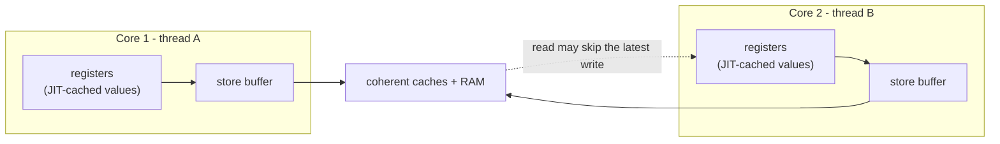
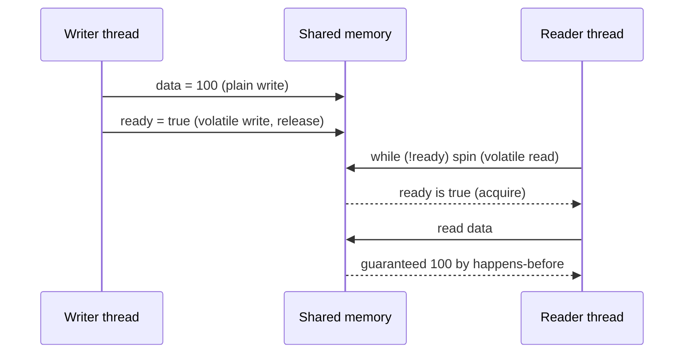
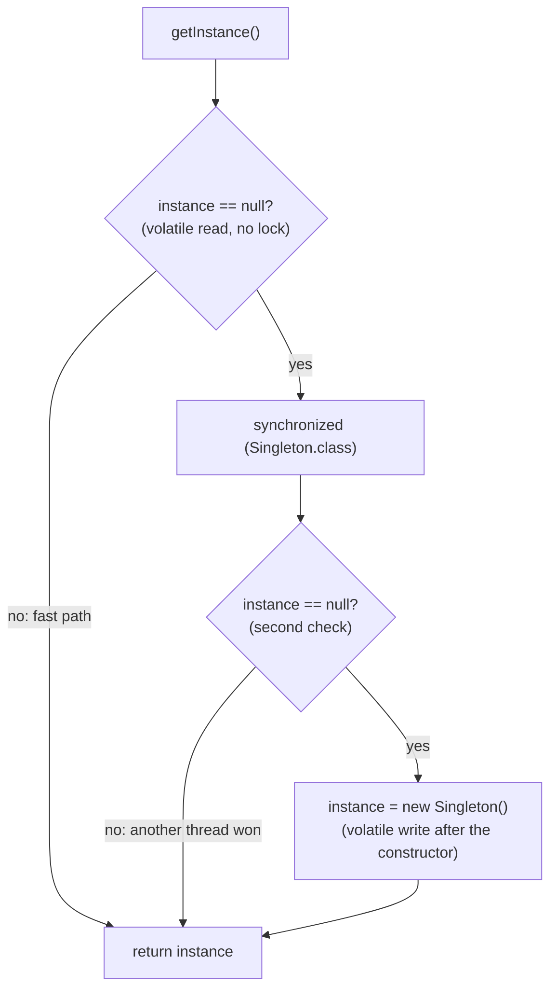

## In One Line
The **Java Memory Model (JMM)** is the contract that says when a write made by one thread is *guaranteed* to be seen by another: only when the two actions are linked by a **happens-before** edge (a lock, a `volatile` variable, `Thread.start()`/`join()`, a concurrent collection...) — without one, the JIT and the CPU are free to hide, delay and reorder your writes, and `volatile` is the lightest tool that creates such an edge (visibility + ordering, but **not** atomicity).

## Mental Model
Picture an office where every employee (thread) works at their own desk with a **personal notepad** (CPU registers, store buffer, compiler-cached values). There is also a **shared whiteboard** in the hallway (memory that all threads can see).

- When you update a number, you usually write it on your **notepad first**. Nobody else can see your notepad. You copy it to the whiteboard "at some point" — maybe much later, maybe in a different order from the one you wrote things down.
- When you need a number, you glance at your notepad copy if you have one, instead of walking to the whiteboard. If you are in a tight loop, you might **never** walk to the whiteboard again.
- A **`volatile` variable** is a number that must always be written straight to the whiteboard and always read from it. Better still, when you write it, you must first copy **everything else on your notepad** to the whiteboard too; and when a colleague reads it, they must throw away their stale notepad copies. That "copy everything first / refresh everything after" rule is **happens-before**.
- A **`synchronized` block** is a meeting room with one key: while you hold the key nobody else can work on the shared numbers (atomicity), and handing the key over also forces the notepad-to-whiteboard sync (visibility).

The notepad is not a single real device — it is shorthand for all the hardware and compiler tricks that make programs fast. The JMM does not care which trick is used; it only tells you which program structures make the tricks invisible.

## Concept
### Why a memory model is needed at all
Modern hardware and compilers make single-threaded code fast by breaking the "one statement after another, straight to memory" picture:

| Source of surprise | What it does | Effect on another thread |
|---|---|---|
| **JIT compiler** (C2, Graal) | Keeps a field in a register, hoists a read out of a loop, removes "redundant" reads and writes, reorders independent statements | A loop never sees a flag change; writes appear in a different order |
| **CPU store buffer** | A core queues its writes and keeps executing; later loads can complete before earlier stores are visible (x86 allows this *store-load* reordering) | Two threads can both read the "old" value (the classic `(0,0)` result below) |
| **Weakly ordered CPUs** (ARM, POWER) | Loads and stores to different addresses may become visible in almost any order | One thread sees "ready = true" but still the old "data" |
| **Caches** | Hardware keeps caches coherent (MESI), so caches themselves are rarely the problem — the buffers and the compiler are | "volatile flushes the cache" is a simplification, not the mechanism |

Each optimisation is invisible to the **same** thread (the JLS promises *as-if-serial* semantics: a single thread always sees its own actions in program order). They only become visible when **another thread** looks at the same memory without synchronization. The JMM (JLS chapter 17, rewritten by **JSR-133 for Java 5**) defines exactly which cross-thread results are allowed, so the same program behaves correctly on x86, ARM, any JIT and any future hardware.

### Three separate problems
1. **Atomicity** — can another thread see a half-done operation? `count++` is three steps (read, add, write); two threads can interleave them and lose updates.
2. **Visibility** — will another thread *ever* see my write? Without a happens-before edge, not necessarily (the loop in the first code example spins forever).
3. **Ordering** — will another thread see my writes *in the order I made them*? Without an edge, no (`ready = true` can become visible before `data = 42`).

`synchronized` solves all three for code that uses the **same lock**. `volatile` solves **visibility and ordering** for one variable, plus everything written before it. `Atomic*` classes add **atomic read-modify-write** on top of volatile semantics (next lesson).

### Happens-before: the one rule to learn
*If action A happens-before action B, then A's effects (and everything before A in its thread) are visible to B, and A appears ordered before B.* If two conflicting accesses (same variable, at least one write, different threads) are **not** ordered by happens-before, the program has a **data race**, and the read may see the new value, the old value, or — for plain `long`/`double` — a mix.

The JLS happens-before rules (17.4.5), plus the `java.util.concurrent` ones:

| Rule | Edge |
|---|---|
| **Program order** | Each action in a thread hb every later action in **that same thread** |
| **Monitor lock** | Unlocking a monitor hb every **later lock of the same monitor** (`synchronized`, also `Lock.unlock()` → `lock()`) |
| **Volatile variable** | A write to a volatile field hb every **later read of that same field** (that sees it) |
| **Thread start** | `t.start()` hb every action inside `t` |
| **Thread termination** | Every action in `t` hb another thread returning from `t.join()` (or seeing `t.isAlive() == false`) |
| **Interruption** | `t.interrupt()` hb `t` detecting the interrupt (`InterruptedException`, `isInterrupted()`) |
| **Finalizer** | End of a constructor hb the start of that object's finalizer |
| **Default values** | Writing the default value (`0`, `null`, `false`) of every field hb the first action of every thread |
| **Transitivity** | If A hb B and B hb C, then A hb C |
| **`java.util.concurrent`** | Putting into a concurrent collection hb taking it out; `executor.submit()` hb the task running; the task hb `future.get()` returning; `countDown()` hb `await()` returning; `release()` hb `acquire()`; actions before `barrier.await()` hb actions after it in other threads |

**Transitivity is the magic.** Writes to *plain* fields made before a volatile write (or unlock) become visible to a thread that reads that volatile (or takes that lock) afterwards. This is called **piggybacking**, and it is how every concurrent collection, `Future` and `CountDownLatch` publishes your plain objects safely.

> [!INTERVIEW] "Happens-before is not about time. It is a guarantee about visibility and ordering: if A happens-before B, B must see A's effects. Without a happens-before edge there is a data race and no guarantee at all."

### The DRF guarantee
The JMM's headline promise: **a program without data races behaves as if it were sequentially consistent** — as if all threads' actions were interleaved one at a time in program order. So you never need to reason about store buffers and reordering *if* every shared mutable variable is accessed only under proper synchronization. Reordering only bites programs that have data races.

- **Data race** (JMM term): two conflicting accesses not ordered by happens-before.
- **Race condition** (general bug): the result depends on timing. `if (map.get(k) == null) map.put(k, v)` on a `ConcurrentHashMap` has no data race (every call is thread-safe) but is still a race condition (check-then-act). You need both kinds gone.

### `volatile` in detail
Declaring a field `volatile` gives four guarantees:

1. **Visibility** — every read sees the most recent write to that variable in the synchronization order. The JIT may not keep it in a register or hoist it out of a loop.
2. **Ordering / publication** — a volatile write acts as a *release*: nothing written before it in program order can move after it. A volatile read acts as an *acquire*: nothing read after it can move before it. Together with the volatile rule above, everything the writer did before the write is visible to a reader after the read.
3. **Atomic 64-bit access** — reads and writes of `volatile long` and `volatile double` are atomic. For plain `long`/`double`, JLS 17.7 allows a write to be split into two 32-bit halves ("word tearing"). References and all other primitives are always atomic. (On 64-bit HotSpot plain `long` writes are atomic in practice, but the spec does not promise it.)
4. **A total order of volatile accesses** — all threads agree on one order of all volatile reads and writes (they are sequentially consistent among themselves), which is why the `(0,0)` result below disappears with `volatile`.

What `volatile` does **not** give:
- **No atomicity for compound actions**: `v++`, `v += 2`, `if (v == 0) v = 1` are still read-then-write and can lose updates. Use `AtomicInteger`, `LongAdder` or a lock.
- **No mutual exclusion**: two threads can be "inside" the same code at the same time.
- **No deep effect**: `volatile int[] arr` or `volatile List<X> list` makes only the **reference** volatile. `arr[0]++` or `list.add(x)` is not protected. Use `AtomicIntegerArray`/`AtomicReferenceArray`, a `VarHandle` for array elements, or a concurrent collection.
- **No invariants across variables**: `volatile int lower, upper;` cannot keep `lower <= upper` true — updating two variables needs a lock (or one immutable object behind a single `AtomicReference`).

Syntax rules: only on **fields** (instance or static), never on local variables (they are never shared) and never together with `final` (*"illegal combination of modifiers: final and volatile"* — a `final` field is already safely published by the final-field rule and can never change).

### When `volatile` is enough
Use it when **all** of these hold (Goetz, *Java Concurrency in Practice*):
- writes do not depend on the current value, **or** only one thread ever writes;
- the variable does not take part in an invariant with other variables;
- nothing else needs a lock while the variable is being accessed.

Classic good uses:
| Pattern | Example |
|---|---|
| **Status flag / shutdown request** | `volatile boolean running` checked in a worker loop |
| **One-time safe publication** | `volatile Config config` replaced with a new immutable object on reload |
| **Independent observations** | `volatile long lastHeartbeat` written by one thread, read by many |
| **Double-checked locking** | `private static volatile Singleton instance` |
| **Cheap read-write lock** | Reads through a `volatile` field (no lock), writes inside `synchronized` |

### `volatile` vs `synchronized`
| | `volatile` | `synchronized` |
|---|---|---|
| Applies to | One field | A block or method (any number of variables) |
| Visibility | Yes | Yes (for threads using the same lock) |
| Ordering | Yes (release/acquire) | Yes |
| Atomicity of compound actions | **No** | **Yes** |
| Mutual exclusion | No | Yes |
| Blocking / deadlock possible | Never blocks | Threads block; deadlock possible |
| Cost | A read is almost as cheap as a plain read; a write needs a store-load fence | Lock acquire/release; cheap when uncontended, expensive when contended |
| Use for | Flags, publishing immutable objects, one writer | Check-then-act, read-modify-write, multi-variable invariants |

### How the JVM implements `volatile` (memory barriers)
The JMM is specified abstractly, but the JSR-133 Cookbook describes how JVMs implement it with four barrier kinds — **LoadLoad, LoadStore, StoreStore, StoreLoad**:
- **volatile write**: StoreStore before it (earlier writes cannot sink below), **StoreLoad** after it (the expensive one: drains the store buffer before any later read).
- **volatile read**: LoadLoad and LoadStore after it (later reads/writes cannot float above).
- On **x86** (a strong, TSO machine) only StoreLoad needs a real instruction, so HotSpot emits a `lock`-prefixed instruction (for example `lock addl $0, (rsp)`) after a volatile store; a volatile load is an ordinary `mov`. On **AArch64** HotSpot uses the acquire/release instructions `ldar` and `stlr`.
- The barriers also stop the **JIT** from reordering or caching the accesses — on x86 that is most of the cost of a volatile read.

### Java 9+: `VarHandle` access modes
`java.lang.invoke.VarHandle` (Java 9) exposes finer-grained modes for any field or array element, weakest to strongest:

| Mode | Methods | Guarantee |
|---|---|---|
| Plain | `get` / `set` | Like a normal field; no ordering |
| Opaque | `getOpaque` / `setOpaque` | Always actually read/written (not cached or eliminated), no ordering with other variables |
| Acquire/Release | `getAcquire` / `setRelease` | Publication pattern without the StoreLoad fence (cheaper writes) |
| Volatile | `getVolatile` / `setVolatile` | Full `volatile` semantics |

`AtomicInteger.lazySet(v)` (Java 6) is the same as `setRelease`. These are tools for library authors; application code should use `volatile`, atomics and locks.

### Reordering and `final` fields
JLS 17.5 gives **final fields** a special guarantee: once a constructor finishes, any thread that obtains a reference to the object (even through a data race) sees the correctly initialised values of its `final` fields — and of objects reachable through them, as they were at the end of the constructor. That is why properly built **immutable objects are thread-safe even when published without synchronization**. The guarantee is void if `this` **escapes** the constructor (registering a listener, starting a thread, storing `this` in a static field), because another thread could then see the object before the constructor ends.

HotSpot implements this with a StoreStore barrier at the end of such constructors ("freeze"), so the field writes cannot be reordered after the reference is published.

### Safe publication
"Publishing" an object means making its reference available to other threads. An object is **safely published** — all its state visible to the reader — if the reference is:
1. set in a **static initializer** (class initialization is done under a JVM lock);
2. stored in a **`volatile` field** or an `AtomicReference`;
3. stored in a **`final` field** of a properly constructed object;
4. stored in a field **guarded by a lock** that the reader also takes;
5. put into a **thread-safe collection** (`ConcurrentHashMap`, `BlockingQueue`, `CopyOnWriteArrayList`, `Collections.synchronizedList`...) or handed over via `Future`/executor.

Anything else (a plain field, a plain `HashMap`) can expose a **partially constructed object**.

### Double-checked locking (DCL)
The goal: lazy initialization that only pays for a lock on the very first call.

```java
class Singleton {
    private static Singleton instance;           // BROKEN without volatile
    static Singleton getInstance() {
        if (instance == null) {                  // 1st check, no lock
            synchronized (Singleton.class) {
                if (instance == null) {          // 2nd check, under the lock
                    instance = new Singleton();
                }
            }
        }
        return instance;                         // may return a half-built object!
    }
}
```
Why it is broken: `instance = new Singleton()` is really (1) allocate memory, (2) run the constructor, (3) store the reference. Nothing stops the JIT or CPU from making step 3 **visible before step 2's writes**. A second thread doing the **unlocked first check** sees a non-null `instance`, skips the lock, and uses an object whose fields are still `0`/`null`. The reading thread never takes the lock, so there is no happens-before edge between the constructor and its reads.

**The fix (Java 5+): make the field `volatile`.** The volatile write in step 3 now happens-before the unlocked volatile read, and by program order the constructor's writes come before that volatile write, so the reader sees a fully built object. (Before Java 5 even `volatile` did not fix it, because the old memory model allowed plain writes to move past volatile ones — which is why older books call DCL "broken".)

Better alternatives, most preferred first:
| Idiom | Lazy? | Why it is thread-safe |
|---|---|---|
| **`enum` singleton** (`enum Registry { INSTANCE; }`) | Loaded on first use of the enum | Class initialization; also safe against reflection and serialization attacks |
| **Initialization-on-demand holder** (nested `static class Holder { static final X INSTANCE = new X(); }`) | Yes — `Holder` is initialised on the first `getInstance()` call | JLS 12.4.2: class initialization runs once, under a lock, with a happens-before to every user of the class |
| **Eager** `private static final X INSTANCE = new X();` | No (created when the class is initialised) | Class initialization |
| **DCL with `volatile`** | Yes | Volatile write/read; the right choice for lazily initialising an **instance** field, where no holder class is possible |

## Diagram

Each thread's writes wait in places other threads cannot see (registers, store buffers); `volatile` and locks force them out and force readers to fetch fresh values.


Program order + volatile rule + transitivity: the plain write to `data` "piggybacks" on the volatile write to `ready`.


Double-checked locking: the lock is taken only while the instance is still `null`; `volatile` is what makes the unlocked fast path safe.

## Code
**1. Visibility: a plain flag vs a `volatile` flag**
```java
public class VisibilityDemo {
    static boolean plainStop = false;          // no happens-before between writer and reader
    static volatile boolean volatileStop = false;

    public static void main(String[] args) throws InterruptedException {
        Thread plain = new Thread(() -> {
            long spins = 0;
            while (!plainStop) { spins++; }     // JIT may hoist the read out of the loop
            System.out.println("plain worker saw the flag after " + spins + " spins");
        });
        plain.setDaemon(true);                  // so the JVM can exit even if it never stops
        plain.start();

        Thread.sleep(500);                      // let the loop get hot and JIT-compiled
        plainStop = true;
        plain.join(2000);                       // wait at most 2 s
        System.out.println("plain flag:    worker alive after 2 s? " + plain.isAlive());

        Thread vol = new Thread(() -> {
            long spins = 0;
            while (!volatileStop) { spins++; }  // a fresh volatile read on every iteration
            System.out.println("volatile worker stopped");
        });
        vol.start();
        Thread.sleep(500);
        volatileStop = true;
        vol.join(2000);
        System.out.println("volatile flag: worker alive after 2 s? " + vol.isAlive());
    }
}
```
```output
plain flag:    worker alive after 2 s? true
volatile flag: worker alive after 2 s? false
volatile worker stopped
```
The same output appeared in every run on JDK 21 (HotSpot, x86-64), except that the last two lines can swap places — the worker's print and `main`'s print race each other. The JMM does not *promise* the plain worker hangs; it merely allows it. Run the same class with `java -Xint` (interpreter only, no JIT) and the plain worker usually does stop:
```output
plain worker saw the flag after 58453812 spins
plain flag:    worker alive after 2 s? false
volatile worker stopped
volatile flag: worker alive after 2 s? false
```

**2. `volatile` does not make `++` atomic**
```java
public class VolatileNotAtomic {
    static volatile int volatileCount = 0;      // visible, but ++ is still read-modify-write
    static int lockedCount = 0;                 // guarded by the class lock

    static synchronized void lockedIncrement() { lockedCount++; }

    static void runFourThreads(Runnable work) throws InterruptedException {
        Thread[] threads = new Thread[4];
        for (int i = 0; i < threads.length; i++) (threads[i] = new Thread(work)).start();
        for (Thread t : threads) t.join();      // join(): everything the thread did is now visible
    }

    public static void main(String[] args) throws InterruptedException {
        runFourThreads(() -> {
            for (int i = 0; i < 1_000_000; i++) volatileCount++;    // read, add 1, write back
        });
        runFourThreads(() -> {
            for (int i = 0; i < 1_000_000; i++) lockedIncrement();  // one lock around all three steps
        });
        System.out.println("expected:     4000000");
        System.out.println("volatile int: " + volatileCount);
        System.out.println("synchronized: " + lockedCount);
    }
}
```
```output
expected:     4000000
volatile int: 1990602
synchronized: 4000000
```
The `volatile` number changes on every run (other runs gave `3162505`, and once even `4000000` when the threads happened not to overlap). A race that *sometimes* gives the right answer is the most dangerous kind.

**3. Reordering you can measure: the store-load litmus test**
```java
import java.util.Map;
import java.util.TreeMap;

public class ReorderingDemo {
    static int x, y, r1, r2;                    // plain fields: data race
    static volatile int vx, vy;                 // volatile fields: no reordering allowed
    static int vr1, vr2;

    static volatile int round = 0;              // used only to line the threads up
    static volatile int done = 0;

    public static void main(String[] args) throws Exception {
        final int trials = 500_000;
        Map<String, Integer> plain = run(trials, false);
        Map<String, Integer> vol = run(trials, true);
        System.out.println("plain    (r1,r2) counts: " + plain);
        System.out.println("volatile (r1,r2) counts: " + vol);
    }

    static Map<String, Integer> run(int trials, boolean useVolatile) throws Exception {
        round = 0; done = 0;
        Thread t1 = new Thread(() -> {
            for (int i = 1; i <= trials; i++) {
                while (round != i) Thread.onSpinWait();
                if (useVolatile) { vx = 1; vr1 = vy; } else { x = 1; r1 = y; }
                synchronized (ReorderingDemo.class) { done++; }
            }
        });
        Thread t2 = new Thread(() -> {
            for (int i = 1; i <= trials; i++) {
                while (round != i) Thread.onSpinWait();
                if (useVolatile) { vy = 1; vr2 = vx; } else { y = 1; r2 = x; }
                synchronized (ReorderingDemo.class) { done++; }
            }
        });
        t1.start(); t2.start();
        Map<String, Integer> counts = new TreeMap<>();
        for (int i = 1; i <= trials; i++) {
            x = y = 0; vx = vy = 0;
            done = 0;
            round = i;                            // release both threads
            while (done != 2) Thread.onSpinWait();
            String key = useVolatile ? "(" + vr1 + "," + vr2 + ")" : "(" + r1 + "," + r2 + ")";
            counts.merge(key, 1, Integer::sum);
        }
        t1.join(); t2.join();
        return counts;
    }
}
```
```output
plain    (r1,r2) counts: {(0,0)=227589, (0,1)=133337, (1,0)=138961, (1,1)=113}
volatile (r1,r2) counts: {(0,1)=178196, (1,0)=141289, (1,1)=180515}
```
The counts differ on every run (a 1,000,000-trial run gave `(0,0)=809677` once and `(0,0)=298715` another time), but the pattern never changed: `(0,0)` shows up often with plain fields and **never** with `volatile`. The run took about 20 seconds on a 4-core machine.

**4. The happens-before rules in action**
```java
public class HappensBeforeDemo {
    static int data;                     // plain field, never volatile
    static volatile boolean ready;       // the guard that publishes it
    static final Object lock = new Object();
    static int guarded;                  // only touched while holding lock

    public static void main(String[] args) throws InterruptedException {
        // 1. Thread start rule: everything before t.start() is visible inside t
        data = 42;
        Thread t = new Thread(() -> System.out.println("start rule:    child sees data = " + data));
        t.start();
        t.join();

        // 2. Thread join rule: everything the thread did is visible after join() returns
        int[] result = new int[1];
        Thread worker = new Thread(() -> result[0] = 6 * 7);
        worker.start();
        worker.join();
        System.out.println("join rule:     main sees result = " + result[0]);

        // 3. Volatile rule: a write to ready happens-before every later read that sees it
        Thread reader = new Thread(() -> {
            while (!ready) Thread.onSpinWait();          // volatile read
            System.out.println("volatile rule: reader sees data = " + data);
        });
        reader.start();
        data = 100;                                       // plain write...
        ready = true;                                     // ...published by the volatile write
        reader.join();

        // 4. Monitor rule: unlock of a monitor happens-before every later lock of it
        Thread writer = new Thread(() -> { synchronized (lock) { guarded = 7; } });
        writer.start();
        writer.join();                                    // (join alone would also be enough)
        synchronized (lock) { System.out.println("monitor rule:  guarded = " + guarded); }
    }
}
```
```output
start rule:    child sees data = 42
join rule:     main sees result = 42
volatile rule: reader sees data = 100
monitor rule:  guarded = 7
```
This output is guaranteed on every JVM and every run.

**5. Lazy singletons under a race: unsafe vs DCL vs holder**
```java
import java.util.concurrent.CountDownLatch;
import java.util.concurrent.atomic.AtomicInteger;
import java.util.function.Supplier;

public class SingletonDemo {
    static final AtomicInteger constructed = new AtomicInteger();

    // 1. Lazy, NOT thread-safe: check-then-act race
    static class Unsafe {
        private static Unsafe instance;
        private Unsafe() { constructed.incrementAndGet(); pause(); }
        static Unsafe get() {
            if (instance == null) instance = new Unsafe();
            return instance;
        }
    }

    // 2. Double-checked locking: correct only because the field is volatile
    static class Dcl {
        private static volatile Dcl instance;
        private Dcl() { constructed.incrementAndGet(); pause(); }
        static Dcl get() {
            Dcl local = instance;                    // one volatile read on the fast path
            if (local == null) {                     // 1st check, no lock
                synchronized (Dcl.class) {
                    local = instance;
                    if (local == null) {             // 2nd check, under the lock
                        instance = local = new Dcl();
                    }
                }
            }
            return local;
        }
    }

    // 3. Initialization-on-demand holder: the JVM's class-init lock does the work
    static class Holder {
        private Holder() { constructed.incrementAndGet(); pause(); }
        private static class Lazy { static final Holder INSTANCE = new Holder(); }
        static Holder get() { return Lazy.INSTANCE; }
    }

    static void pause() { try { Thread.sleep(20); } catch (InterruptedException e) { } }

    static void race(String name, Supplier<Object> getter) throws InterruptedException {
        constructed.set(0);
        CountDownLatch go = new CountDownLatch(1);
        Thread[] ts = new Thread[8];
        for (int i = 0; i < ts.length; i++) {
            ts[i] = new Thread(() -> {
                try { go.await(); } catch (InterruptedException e) { }
                getter.get();
            });
            ts[i].start();
        }
        go.countDown();                              // release all 8 threads at once
        for (Thread t : ts) t.join();
        System.out.printf("%-16s constructor ran %d time(s)%n", name, constructed.get());
    }

    public static void main(String[] args) throws InterruptedException {
        race("unsafe lazy:", Unsafe::get);
        race("DCL + volatile:", Dcl::get);
        race("holder idiom:", Holder::get);
    }
}
```
```output
unsafe lazy:     constructor ran 8 time(s)
DCL + volatile:  constructor ran 1 time(s)
holder idiom:    constructor ran 1 time(s)
```
The unsafe count was 8 in every run here because of the 20 ms pause in the constructor, but it can be any number from 1 to 8. The other two lines are always 1.

## Walkthrough
**VisibilityDemo**
- `static boolean plainStop` — an ordinary field shared by two threads with no synchronization: a data race.
- `while (!plainStop) { spins++; }` — after a few thousand iterations the C2 JIT compiles the loop. Since nothing in the loop body synchronizes, the JIT may legally read `plainStop` **once** and turn the loop into `if (!plainStop) while (true) spins++;`. That is exactly what happens: the worker never prints.
- `plain.setDaemon(true)` — without it the stuck thread would keep the JVM alive forever. The demo reports `isAlive() == true` and exits anyway.
- `plain.join(2000)` — `join` with a timeout returns after 2 s even if the thread is still running.
- `static volatile boolean volatileStop` — the JIT must emit a real load on every iteration, so the write by `main` is seen and the loop ends. `vol` does not need to be a daemon.
- `-Xint` — with the interpreter only, the field happens to be re-read every time, so the bug hides. This is why data races "work on my machine" and in a debugger, then fail in production after JIT warm-up.

**VolatileNotAtomic**
- `volatileCount++` compiles to *getstatic, iconst_1, iadd, putstatic*. Two threads can both read 10, both write 11: one increment is lost. `volatile` makes each read and write visible, but nothing stops the interleaving between them.
- `static synchronized void lockedIncrement()` locks the `VolatileNotAtomic.class` monitor around all three steps, so exactly 4,000,000 is guaranteed.
- `runFourThreads` starts four threads and `join`s each. The **join rule** is what makes the final `println` see the threads' writes to the non-volatile `lockedCount`.

**ReorderingDemo**
- Thread 1 does `x = 1; r1 = y;`, thread 2 does `y = 1; r2 = x;`. If the statements ran in program order in *any* interleaving, at least one thread would see the other's write, so `(0,0)` would be impossible.
- `(0,0)` still happens because each core puts its store into its **store buffer** and executes the following load before that store is visible to the other core (and the JIT is also allowed to reorder the two independent statements). This is the store-load reordering that x86 permits.
- With `volatile int vx, vy`, the StoreLoad barrier after each volatile write forbids that reordering and the JMM's total order over volatile accesses rules out `(0,0)`.
- `round` (volatile) lines both threads up for each trial; `done++` inside `synchronized` plus the volatile `done` hand the results back to `main` with a happens-before edge; `Thread.onSpinWait()` (Java 9) is a CPU hint (`PAUSE` on x86) for busy-wait loops — it is **not** a memory barrier.
- `counts.merge(key, 1, Integer::sum)` — counts each outcome; `TreeMap` keeps the keys sorted.
- `(1,1)` is rare with plain fields: both stores must become visible before either load runs.

**HappensBeforeDemo**
- *Start rule*: `data = 42` is written before `t.start()`, so the child sees 42 without any `volatile`.
- *Join rule*: the worker writes `result[0]`; after `worker.join()` returns, `main` is guaranteed to see 42. (`int[] result` is also a handy way to get a value out of a lambda, since captured locals must be effectively final.)
- *Volatile rule*: `data = 100` (plain) comes before `ready = true` (volatile) in program order; the reader's volatile read of `true` comes before its read of `data`. Chaining the edges by transitivity gives "`data = 100` happens-before the reader's read of `data`", so it prints 100 — never 0 or 42.
- *Monitor rule*: the writer releases `lock` after `guarded = 7`; `main` acquires the same lock later and must see 7. The comment notes that `join()` alone already provides an edge here, so this part shows the rule rather than being needed.

**SingletonDemo**
- `CountDownLatch go` is a start gate: all eight threads block in `go.await()` and are released together by `go.countDown()`, maximising the chance of a race.
- `Unsafe.get()` — `if (instance == null) instance = new Unsafe();` is **check-then-act**. All eight threads see `null` during the constructor's 20 ms pause and each creates its own instance.
- `Dcl.get()` — the first check is a single volatile read into `local` (reading the volatile field once on the fast path is a small optimisation from *Effective Java*). Only threads that see `null` take the lock; the second check inside the lock stops the losers from creating another instance. `instance = local = new Dcl()` is a volatile write that publishes the fully constructed object.
- `Holder.get()` — `Lazy.INSTANCE` triggers initialization of the nested class `Lazy` on first use. The JVM runs a class's static initializer exactly once, under an internal lock, and every thread that uses the class afterwards is guaranteed to see the result. No `volatile`, no `synchronized` in our code.
- `constructed` is an `AtomicInteger`, so the count itself cannot lose updates; `System.out.printf("%-16s ...")` left-aligns the labels.

## Traps
- **"It works on my machine."** Data races depend on JIT warm-up, CPU model and timing. A missing `volatile` can pass every test in the interpreter or on x86, and fail on ARM (Apple Silicon, AWS Graviton, Android) or after hours in production.
- **`volatile` counters.** `volatile int hits; hits++;` loses updates. Use `AtomicInteger`/`LongAdder`.
- **Volatile reference, mutable object.** `volatile Map<String, String> map = new HashMap<>();` publishes the *reference*; later `map.put(...)` calls from several threads are still a data race on the `HashMap` internals. Either publish an immutable map and replace it (`map = Map.copyOf(newMap)`), or use a `ConcurrentHashMap`.
- **`volatile` array.** `volatile int[] a; a[0] = 1;` — the element write is plain. Use `AtomicIntegerArray` or re-assign the whole array (`a = newArray`).
- **Check-then-act on a volatile.** `if (!initialized) { init(); initialized = true; }` with a `volatile boolean` can run `init()` twice. Visibility is not atomicity.
- **Locking on different monitors.** Writer synchronizes on `lockA`, reader on `lockB`: no happens-before edge at all. Both sides must use the **same** lock (or the same volatile variable).
- **Reading a shared field twice.** `if (config != null) config.use();` on a field that another thread may set to `null` can throw `NullPointerException` between the check and the use. Read it once into a local.
- **DCL without `volatile`.** Compiles, passes tests, and can hand out a half-built object. Always `private static volatile`, or better, use the holder or enum idiom.
- **Letting `this` escape from a constructor** (starting a thread, registering a listener) cancels the final-field guarantee.
- **`Thread.sleep()` and `Thread.yield()` have no memory effects.** Code that "fixes" a visibility bug with a sleep is still broken.
- **Believing `System.out.println` in the loop fixes it.** It often does (it takes a lock inside `PrintStream`), but that is an accident of implementation, not a guarantee from the JMM.

> [!WARNING] Plain `long` and `double` fields may tear: JLS 17.7 allows another thread to see the high 32 bits of one write and the low 32 bits of another. Declare shared 64-bit fields `volatile` (or use `AtomicLong`).

## Tips & Tricks
- **"V for Visibility, not for Vandal-proofing."** `volatile` = visibility + ordering. It never protects a read-modify-write.
- **The happens-before checklist** for any shared variable: *which lock or volatile or concurrent handoff connects the write to the read?* If you cannot name one, you have a data race.
- **Mnemonic for the JLS rules — "PM-VS-TIF-T"**: **P**rogram order, **M**onitor, **V**olatile, **S**tart, **T**ermination (join), **I**nterrupt, **F**inalizer, **T**ransitivity.
- **Release/acquire pairing**: a volatile *write* is like posting a letter (release everything written before it); a volatile *read* is opening it (acquire). Only the reader who opens *that* letter gets the guarantee.
- **Prefer immutability.** `final` fields + no `this` escape = thread-safe without any locking. Share immutable snapshots through one `volatile` field or `AtomicReference`.
- **Singleton ranking**: enum > holder idiom > eager `static final` > DCL with `volatile` > synchronized `getInstance()`. Use DCL only for lazy *instance* fields.
- **Do not reach for `volatile` first.** Reach for higher-level tools (`ConcurrentHashMap`, `AtomicInteger`, executors, `CompletableFuture`) that already contain the right happens-before edges.
- **Testing races**: use the OpenJDK **jcstress** harness, not unit tests — it runs litmus tests like the one above billions of times across JIT modes.

## Interview Q&A
### [Basic] What is the Java Memory Model and why does Java need one?
The JMM (JLS chapter 17, redefined by JSR-133 in Java 5) is the specification of how threads interact through memory: which values a read of a shared variable is allowed to return. It exists because compilers and CPUs reorder and cache memory operations to make single-threaded code fast — keeping values in registers, buffering stores, executing loads early. Those optimisations are invisible within one thread but visible across threads. The JMM defines **happens-before** relationships (locks, volatile, thread start/join, and so on); if a write happens-before a read, the read is guaranteed to see it. It gives Java one portable set of rules across all hardware, and it promises that data-race-free programs behave as if sequentially consistent.

**Follow-up:** *What is the "as-if-serial" rule?* — Within a single thread, the JVM may reorder anything as long as the thread itself cannot tell the difference; the JMM only restricts what *other* threads can observe.

### [Basic] What does the `volatile` keyword do?
It marks a field as shared between threads and guarantees: (1) **visibility** — every read sees the latest write to it, the JIT cannot cache it in a register or hoist it out of a loop; (2) **ordering** — a volatile write cannot be reordered with earlier memory operations and a volatile read cannot be reordered with later ones, so everything written before a volatile write is visible to a thread that reads that value (happens-before); (3) atomic reads and writes of `long` and `double`. It does **not** make compound operations like `count++` atomic and gives no mutual exclusion.
```java
private volatile boolean running = true;
public void stop() { running = false; }            // called by another thread
public void run() { while (running) { doWork(); } } // guaranteed to see the change
```
**Follow-up:** *Can you declare a local variable volatile?* — No. Local variables live on a thread's own stack and are never shared, so `volatile` is only allowed on fields; `final volatile` is also illegal.

### [Basic] What is the difference between `volatile` and `synchronized`?
`volatile` applies to a single field and provides visibility and ordering but not atomicity; it never blocks. `synchronized` applies to a block or method and provides **mutual exclusion** (only one thread holds the monitor) **plus** visibility and ordering for everything done inside it, because unlocking a monitor happens-before the next lock of the same monitor. Use `volatile` for flags and for publishing immutable objects with one writer; use `synchronized` (or `Lock`, or atomics) whenever an operation reads and then writes shared state, or several variables must change together.

**Follow-up:** *Is `volatile` faster?* — Usually: a volatile read costs about the same as a plain read on x86 (it only prevents compiler optimisations), and a volatile write needs one StoreLoad fence; an uncontended lock is also cheap today, but a contended one parks threads.

### [Intermediate] What is happens-before? Name the main rules.
Happens-before is the JMM's partial order on actions: if A happens-before B, then A's effects are visible to B and A is ordered before B. Rules: **program order** within a thread; **monitor unlock → subsequent lock** of the same monitor; **volatile write → subsequent read** of the same variable; **`Thread.start()` → actions in the started thread**; **actions in a thread → another thread's successful `join()`**; **`interrupt()` → detecting the interrupt**; **constructor end → finalizer**; and **transitivity**. The `java.util.concurrent` package adds more: putting into a concurrent collection → removing it; `submit()` → task execution → `Future.get()`; `countDown()` → `await()`; `release()` → `acquire()`.

**Follow-up:** *Does happens-before mean "happened earlier in time"?* — No. It is a visibility guarantee. Two actions can be ordered in wall-clock time without a happens-before edge (then there is no guarantee the later one sees the earlier), and a JVM may even execute actions out of order as long as no thread can observe a violation.

### [Intermediate] Why isn't `volatile int count; count++` thread-safe? How do you fix it?
`count++` is three operations: read `count`, add one, write `count`. `volatile` makes each read and each write visible, but another thread can run its own read between my read and my write, so both write the same value and one increment is lost. Fixes: `AtomicInteger.incrementAndGet()` (a single CAS-based atomic read-modify-write), `LongAdder` for heavily contended counters, or `synchronized`/`Lock` around the increment. My test with 4 threads × 1,000,000 increments printed values like 1,990,602 instead of 4,000,000 — and occasionally the right answer, which is why such bugs slip through testing.

**Follow-up:** *What if only one thread ever writes?* — Then `volatile` is enough: a single writer cannot race with itself, and readers see each new value.

### [Intermediate] What is instruction reordering? Give an example where it breaks a program.
Both the JIT and the CPU may execute memory operations in a different order from the source code if the current thread cannot tell the difference. Classic example: thread 1 runs `x = 1; r1 = y;` and thread 2 runs `y = 1; r2 = x;` with plain fields starting at 0. Sequential intuition says at least one of `r1`, `r2` must be 1, but `(0,0)` is legal and happens often on x86: each store sits in its core's store buffer while the following load reads the old value from memory. In real code the same effect breaks "write data, then set flag" publication: a reader can see `ready == true` and stale `data`. Making the flag `volatile` (or using a lock) forbids the reordering.

**Follow-up:** *Which reordering does x86 allow?* — Only store-load (a later load passing an earlier store to a different address). ARM and POWER allow almost all reorderings, so bugs hidden on x86 often appear on ARM.

### [Intermediate] Explain double-checked locking. Why must the field be volatile?
DCL lazily creates a singleton while taking the lock only on the first calls: check `instance == null` without a lock, then lock, check again, and create. Without `volatile` it is broken: `instance = new Singleton()` is allocate → construct → assign, and the assignment can become visible to other threads **before** the constructor's field writes. A thread doing the unlocked first check sees non-null, skips the lock, and uses a half-initialised object. Declaring the field `volatile` (Java 5+) adds a happens-before edge from the volatile write to the unlocked volatile read, so the constructor's writes are visible.
```java
private static volatile Singleton instance;
static Singleton getInstance() {
    Singleton local = instance;
    if (local == null) {
        synchronized (Singleton.class) {
            local = instance;
            if (local == null) instance = local = new Singleton();
        }
    }
    return local;
}
```
**Follow-up:** *What would you use instead?* — The initialization-on-demand holder idiom or an `enum` singleton: both are lazy enough, thread-safe through class initialization, and need no `volatile`.

### [Advanced] How is `volatile` implemented under the hood?
The JVM inserts memory barriers around volatile accesses (JSR-133 Cookbook): a StoreStore barrier before and a StoreLoad barrier after a volatile write; LoadLoad and LoadStore barriers after a volatile read. The barriers also stop the JIT from moving other memory accesses across them or caching the field in a register. On x86, which only reorders stores with later loads, HotSpot emits a real instruction only for the StoreLoad — a `lock`-prefixed instruction such as `lock addl $0,(rsp)` after the volatile store — while volatile loads are plain `mov`s. On AArch64 it uses `ldar` (load-acquire) and `stlr` (store-release).

**Follow-up:** *Does `volatile` "flush the CPU cache to main memory"?* — That is a common simplification. Caches are kept coherent by hardware (MESI); what the barriers actually drain is the store buffer and what they prevent is compiler caching and reordering.

### [Advanced] What is safe publication, and what are the ways to achieve it?
Publishing an object means making its reference visible to other threads; it is *safe* if the other threads are guaranteed to see the object's fully constructed state. Without a happens-before edge, a reader can see the reference but default values in the fields. Safe ways: initialise from a **static initializer**; store the reference in a **`volatile` field** or `AtomicReference`; store it in a **`final` field** of a properly constructed object; store it in a field **guarded by a lock** that readers also take; or hand it over through a **thread-safe collection**, `BlockingQueue`, `Future` or executor. Immutable objects (all fields `final`, no `this` escape) are safe even when published through a data race.

**Follow-up:** *Is an object with only `final` fields always safe to share?* — Yes for its final fields (and what they reference, as of constructor end), provided `this` did not escape during construction; mutable objects reachable through those fields still need their own synchronization if they change later.

### [Advanced] What is the difference between a data race and a race condition?
A **data race** is a JMM concept: two accesses to the same variable from different threads, at least one a write, not ordered by happens-before. Its consequences are stale reads, reordering and (for `long`/`double`) torn values. A **race condition** is a logic bug where correctness depends on timing, such as check-then-act (`if (!map.containsKey(k)) map.put(k, v)`) or read-modify-write. You can have a race condition with no data race — every call on a `ConcurrentHashMap` is properly synchronized, but the two-step sequence is not atomic — and a data race that happens to produce correct results (benign races like `String.hashCode()` caching).

**Follow-up:** *What is the DRF guarantee?* — If a program has no data races, every execution behaves as if sequentially consistent, so you never need to think about reordering in correctly synchronized code.

### [Advanced] Are reads and writes of `long` and `double` atomic?
Not necessarily for plain fields. JLS 17.7 allows the JVM to treat a non-volatile 64-bit write as two 32-bit writes, so a racing reader could see half of one value and half of another. Reads and writes of `volatile long`/`volatile double` are always atomic, and reads and writes of references and of all other primitive types are always atomic. On 64-bit HotSpot plain `long` accesses are atomic in practice, but portable code should not rely on it. Note that atomic *read and write* still does not make `x++` atomic.

**Follow-up:** *How do you get an atomic 64-bit increment?* — `AtomicLong.incrementAndGet()` or, under contention, `LongAdder.increment()`.

### [Advanced] What guarantees do `final` fields give in a multithreaded program?
JLS 17.5: when a constructor completes, the object's `final` fields are "frozen". Any thread that later gets a reference to the object — even through a data race — sees the values set in the constructor, and also sees the state of objects reachable through those final fields as of the freeze. That is what makes `String`, `Integer` and properly written immutable classes thread-safe without locks. The guarantee does not cover non-final fields and is lost if `this` escapes during construction. HotSpot implements it with a StoreStore barrier at the end of the constructor.

**Follow-up:** *Why is `String` safe to share even though `hash` is a non-final cached field?* — `hash` is a benign race: every thread computes the same value from the immutable `final` char/byte array, so seeing 0 just means computing it again.

## Quiz
### What is printed?
```java
public class Q2 {
    static int value;                       // not volatile

    public static void main(String[] args) throws InterruptedException {
        Thread t = new Thread(() -> value = 5);
        t.start();
        t.join();
        System.out.println(value);
    }
}
```
- [ ] 0
- [x] 5
- [ ] Either 0 or 5, because `value` is not volatile
- [ ] It may hang forever
> The **thread termination rule**: everything a thread does happens-before another thread returns from `join()` on it. So `main` is guaranteed to see 5. `volatile` is not needed when there is already another happens-before edge; the tempting "0 or 5" answer would only be right without the `join()`.

### What does `volatile` guarantee?
- [ ] Visibility, ordering and atomicity of `count++`
- [x] Visibility and ordering, plus atomic reads/writes of `long` and `double`
- [ ] Mutual exclusion for the field
- [ ] Only that the field is never cached in the L1 cache
> `volatile` makes each read see the latest write and orders accesses around it (release/acquire). It does not make compound actions such as `count++` atomic and never blocks threads, so it gives no mutual exclusion. The "never in L1 cache" idea is a myth — caches are coherent; the barriers drain store buffers and stop JIT caching.

### With plain `int` fields `x = y = 0`, thread 1 runs `x = 1; r1 = y;` and thread 2 runs `y = 1; r2 = x;`. Which result is allowed by the JMM?
- [ ] Only (0,1), (1,0) or (1,1)
- [x] (0,0) as well — the stores can be delayed past the loads
- [ ] Only (1,1), because both writes happen first
- [ ] The program does not compile without `volatile`
> With a data race, each thread's store can wait in a store buffer (or be reordered by the JIT) while its load reads the old value, so `(0,0)` is legal — the demo saw it hundreds of thousands of times. Making `x` and `y` `volatile` rules it out, because volatile accesses form a single total order.

### What does this print?
```java
public class Q1 {
    static class Config {
        static { System.out.println("Config loaded"); }
        static void hello() { System.out.println("hello"); }
        private static class Holder {
            static { System.out.println("Holder loaded"); }
            static final Config INSTANCE = new Config();
        }
        static Config get() { return Holder.INSTANCE; }
    }

    public static void main(String[] args) {
        Config.hello();
        Config.get();
        Config.get();
    }
}
```
- [ ] Config loaded, Holder loaded, hello
- [x] Config loaded, hello, Holder loaded
- [ ] Config loaded, hello, Holder loaded, Holder loaded
- [ ] hello, Config loaded, Holder loaded
> Calling `Config.hello()` initialises `Config` first (`Config loaded`), then prints `hello`. The nested `Holder` class is initialised only when `get()` first touches `Holder.INSTANCE`, and a class is initialised exactly once, so `Holder loaded` appears once. This laziness is the whole point of the holder idiom; nested classes are *not* initialised together with their outer class.

### Spot the bug.
```java
class ConnectionPool {
    private static ConnectionPool instance;
    private final List<Connection> connections;
    private ConnectionPool() { connections = openConnections(); }

    static ConnectionPool get() {
        if (instance == null) {
            synchronized (ConnectionPool.class) {
                if (instance == null) instance = new ConnectionPool();
            }
        }
        return instance;
    }
}
```
- [ ] The second `null` check is redundant
- [ ] `synchronized` must be on the method, not a block
- [x] `instance` is not `volatile`, so a thread may see the reference before the constructor's effects
- [ ] Nothing — `final` on `connections` makes every field safe, so this code is fully correct
> Without `volatile` there is no happens-before edge between the constructing thread and a thread that takes the unlocked fast path. The `final` field does help here — JLS 17.5 would make `connections` itself visible — but that is fragile: any non-final field added later breaks it. The second check is essential (it stops two waiting threads from both constructing).

### Four threads each call `arr[0]++` one million times on `static volatile int[] arr = new int[1];`. What is printed after joining them?
- [ ] Always 4000000, because the array is volatile
- [x] Usually less than 4000000
- [ ] Always 1000000
- [ ] It throws `ConcurrentModificationException`
> `volatile` applies to the array **reference**, not to its elements, and `++` is a read-modify-write anyway. Real runs printed `3920552` and `3928769`, while an `AtomicIntegerArray` doing the same work printed `4000000` both times.

### Which of these gives a happens-before edge between a writer and a reader?
- [ ] The writer calls `Thread.sleep(1000)` after writing
- [ ] Writer and reader each synchronize on a different lock object
- [x] The writer puts an object into a `ConcurrentLinkedQueue` and the reader polls it out
- [ ] The writer calls `Thread.yield()`
> The `java.util.concurrent` memory-consistency rule: actions before placing an object into a concurrent collection happen-before actions after accessing or removing it. Sleep and yield have no memory semantics at all, and different locks create no edge — both sides must use the **same** monitor.

## Takeaways
- The JMM defines when one thread's writes are visible to another: only through a **happens-before** edge (program order, same-lock unlock → lock, volatile write → read, `start()`, `join()`, interrupt, transitivity, and `java.util.concurrent` handoffs).
- Without happens-before you have a **data race**: the JIT and CPU may cache values forever, reorder writes, or (for plain `long`/`double`) tear them; correctly synchronized programs are guaranteed sequentially consistent.
- `volatile` = **visibility + ordering** (release on write, acquire on read) + atomic 64-bit access; it is **not** atomic for `count++`, check-then-act or multi-variable invariants.
- Writes made before a volatile write "piggyback" on it: a reader that sees the volatile value also sees them — the basis of safe publication and of every concurrent collection.
- `synchronized` adds mutual exclusion on top of visibility and ordering; use it (or atomics) for read-modify-write.
- Double-checked locking works only with a `volatile` field (Java 5+); prefer the holder idiom or an `enum` singleton for static singletons.
- `final` fields are safely visible to all threads after construction (unless `this` escapes), which is why immutable objects need no synchronization.
- Implementation: memory barriers (StoreStore/StoreLoad/LoadLoad/LoadStore); on x86 only the StoreLoad after a volatile write costs a real `lock` instruction.
