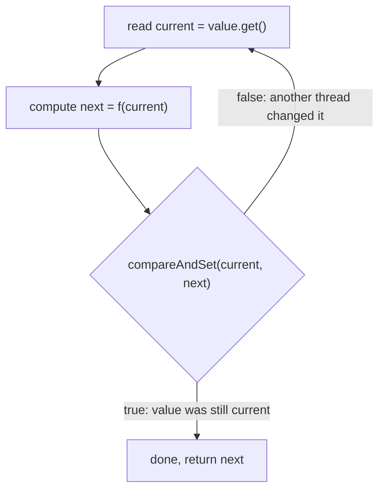
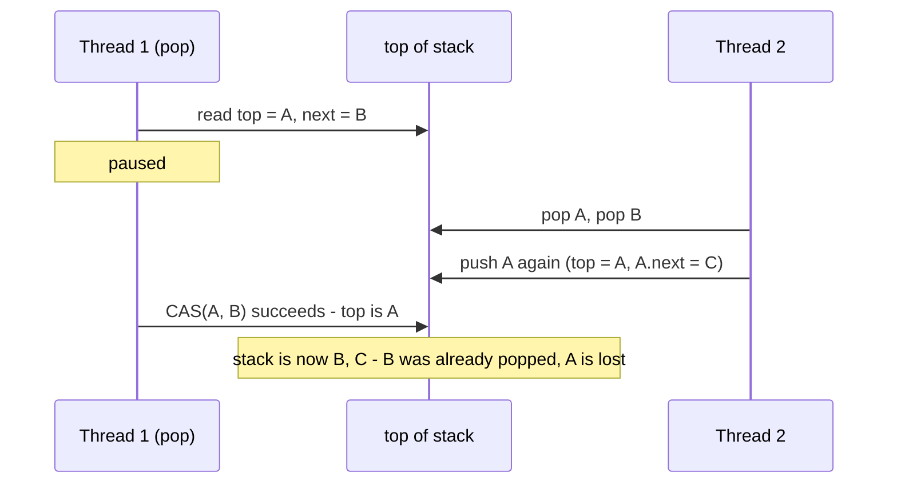
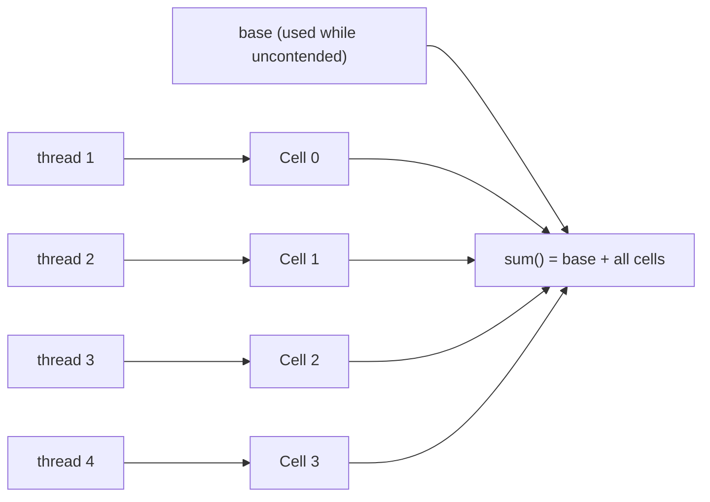

## In One Line
The `java.util.concurrent.atomic` classes (`AtomicInteger`, `AtomicLong`, `AtomicBoolean`, `AtomicReference`, `LongAdder`...) give you **lock-free, thread-safe updates of a single variable** by combining `volatile` visibility with the CPU's **compare-and-swap (CAS)** instruction: "set it to *new* only if it is still *expected*, otherwise tell me and I will retry".

## Mental Model
Think of a **shared online document with version checking**, like editing a wiki page.

- You **read** the page (version 41) and prepare your edit offline.
- When you press *Save*, the server checks: "is the page still exactly what you read?" If yes, your edit is stored atomically. If someone else saved in the meantime, the server **rejects** your save — it never blocks you, it never merges half of your edit.
- On rejection you **re-read** the new version and redo your edit. That is the **CAS loop**.
- **ABA**: someone changes the text from "A" to "B" and back to "A" while you were editing. A server that compares only the *text* happily accepts your save, although the page's history changed under you. A server that compares a **version number** (41 vs 43) rejects it — that is `AtomicStampedReference`.
- **`LongAdder`** is a page so popular that everyone keeps colliding. The fix: give each group of editors its **own tally sheet** and add the sheets up only when someone asks for the total.

Nobody ever waits for a lock; the worst that happens is that you redo your work.

## Concept
### Why atomics exist
`count++` on a shared field is three steps (read, add, write), so two threads can lose updates. You can fix it with `synchronized`, but a lock is *pessimistic*: it assumes a conflict, blocks other threads, and can suspend them in the OS. For a **single variable**, hardware offers something better: an instruction that performs *compare + write* **atomically**. Java exposes it through the atomic classes (Java 5, JSR-166).

| | `synchronized` / `Lock` | Atomic (CAS) |
|---|---|---|
| Strategy | Pessimistic: lock, then update | Optimistic: update, retry on conflict |
| Blocks threads? | Yes (can park them) | Never — failed threads just retry |
| Deadlock possible? | Yes | No |
| Scope | Any number of variables and statements | One variable (or one reference to an immutable object) |
| Under heavy contention | Threads queue up | Threads spin and waste work — `LongAdder` fixes counters |
| Visibility | Unlock → lock happens-before | Every atomic get/set/CAS has `volatile` semantics |

### Compare-and-swap (CAS)
`compareAndSet(expected, newValue)` does, as one indivisible hardware step:
```text
if (value == expected) { value = newValue; return true; }
else                   { return false; }
```
- On **x86** it compiles to `lock cmpxchg`; on **ARMv8.1+** to the `CAS` family (older ARM uses a load-linked/store-conditional `ldaxr`/`stlxr` loop).
- Memory effects: a successful CAS is both a volatile read and a volatile write, so it publishes everything written before it.
- `compareAndExchange(expected, newValue)` (Java 9) returns the **witness value** (what was actually there) instead of a boolean, which saves an extra read in a retry loop.
- `weakCompareAndSetPlain` / `weakCompareAndSetVolatile` (Java 9) **may fail spuriously** (even when the value matched) — cheaper on LL/SC CPUs; only use them inside a retry loop. The old name `weakCompareAndSet` is deprecated since Java 9.

### The CAS loop (optimistic update)
Every lock-free update follows the same shape:
```java
int current, next;
do {
    current = counter.get();          // 1. read a snapshot
    next = compute(current);          // 2. compute the new value from the snapshot
} while (!counter.compareAndSet(current, next));   // 3. publish only if unchanged; else retry
```
Java 8 packaged the loop into `updateAndGet(fn)`, `getAndUpdate(fn)`, `accumulateAndGet(x, fn)` and `getAndAccumulate(x, fn)`. Because the function can run **more than once** (once per failed attempt), it must be **pure**: no side effects, no I/O, no changing other state. The demo below counted up to 4,140,433 calls of the function for 4,000,000 successful updates.

### The API at a glance
| Method (on `AtomicInteger`/`AtomicLong`) | Returns | Notes |
|---|---|---|
| `get()` / `set(v)` | value / void | Volatile read / volatile write |
| `lazySet(v)` = `setRelease(v)` | void | Release write without the StoreLoad fence; the value becomes visible "soon" |
| `getAndSet(v)` | old value | Atomic swap |
| `incrementAndGet()` / `getAndIncrement()` | new / old | Like `++i` / `i++` |
| `decrementAndGet()` / `getAndDecrement()` | new / old | |
| `addAndGet(d)` / `getAndAdd(d)` | new / old | |
| `compareAndSet(e, v)` | boolean | The CAS primitive |
| `compareAndExchange(e, v)` (9) | witness value | |
| `updateAndGet(fn)` / `getAndUpdate(fn)` (8) | new / old | CAS loop around a pure function |
| `accumulateAndGet(x, fn)` / `getAndAccumulate(x, fn)` (8) | new / old | `fn(current, x)`, e.g. `Math::max` |
| `getPlain`, `getOpaque`, `getAcquire`, `setPlain`, `setOpaque`, `setRelease` (9) | | `VarHandle` access modes (see the memory-model lesson) |
| `intValue()`, `longValue()`, `doubleValue()` | | `AtomicInteger`/`AtomicLong` extend `Number` |

Overflow wraps silently, exactly like `int`/`long` arithmetic (`Long.MAX_VALUE + 1` becomes `Long.MIN_VALUE`).

### The family
| Class | Use for |
|---|---|
| `AtomicInteger`, `AtomicLong` | Counters, sequence numbers, IDs |
| `AtomicBoolean` | Run-once flags: `if (started.compareAndSet(false, true)) init();` |
| `AtomicReference<V>` | Swap an object reference atomically — typically an **immutable** state object |
| `AtomicIntegerArray`, `AtomicLongArray`, `AtomicReferenceArray<E>` | Per-element atomic updates (a `volatile int[]` is **not** enough) |
| `AtomicStampedReference<V>` | Reference + `int` stamp (version) — solves ABA |
| `AtomicMarkableReference<V>` | Reference + `boolean` mark — e.g. "logically deleted" nodes in lock-free lists |
| `AtomicIntegerFieldUpdater`, `AtomicLongFieldUpdater`, `AtomicReferenceFieldUpdater` | CAS on an existing `volatile` field without allocating an atomic object per instance |
| `LongAdder`, `DoubleAdder` (8) | High-contention sums and counters |
| `LongAccumulator`, `DoubleAccumulator` (8) | High-contention reductions with any associative function (max, min...) |

### How `AtomicInteger` works inside
```java
public class AtomicInteger extends Number {
    private volatile int value;                                   // volatile = visibility
    private static final Unsafe U = Unsafe.getUnsafe();           // jdk.internal.misc.Unsafe
    private static final long VALUE = U.objectFieldOffset(AtomicInteger.class, "value");

    public final boolean compareAndSet(int expected, int newValue) {
        return U.compareAndSetInt(this, VALUE, expected, newValue);   // -> lock cmpxchg
    }
    public final int incrementAndGet() {
        return U.getAndAddInt(this, VALUE, 1) + 1;                    // JIT intrinsic -> lock xadd
    }
}
```
(Simplified from the JDK 21 source.) The field is `volatile`, updates go through `Unsafe` (or a `VarHandle` in `AtomicReference` and `AtomicBoolean`), and hot methods are **JIT intrinsics**: on x86 `getAndAdd`/`incrementAndGet` become a single `lock xadd`, which cannot fail and needs no retry loop at all.

### Progress guarantees
| Term | Meaning | Example |
|---|---|---|
| **Blocking** | A stalled thread (holding a lock) can stop everyone else | `synchronized`, `ReentrantLock` |
| **Lock-free** | Some thread always makes progress; an individual thread may retry forever (starvation) | CAS loops, `ConcurrentLinkedQueue` |
| **Wait-free** | Every thread finishes in a bounded number of steps | `lock xadd` increments on x86, `LongAdder.increment()` is close |

"Lock-free" does not mean "faster". Under heavy contention a CAS loop keeps failing and every failure bounces the cache line between cores.

### The ABA problem
CAS checks **value equality** (for references: `==`), not "has nothing happened". If a value goes A → B → A between your read and your CAS, the CAS succeeds even though the world changed. That is harmless for a counter, but it breaks structures whose meaning depends on *history*, such as a lock-free stack that **reuses nodes**: a paused `pop()` remembered `next = B`, another thread popped A and B and pushed A back, and the paused CAS "succeeds", putting the already-removed B back on top (see the demo).

Fixes:
- **`AtomicStampedReference`** — CAS on the pair *(reference, stamp)*; bump the stamp on every change, so A(stamp 0) ≠ A(stamp 3).
- **`AtomicMarkableReference`** — a one-bit version of the same idea.
- **Do not reuse nodes** — always allocate new ones. Java's garbage collector will not recycle an object while any thread still references it, so the classic C/C++ "freed and reallocated at the same address" ABA cannot happen; only *logical* ABA (deliberate reuse, or equal values meaning different things) remains.

### `LongAdder`: striping for contended counters
With `AtomicLong`, every thread CASes the **same memory word**; the cache line holding it ping-pongs between cores and CASes fail. `LongAdder` (and its base class `Striped64`) spreads the updates:
1. Uncontended: CAS on a single `base` field — as cheap as `AtomicLong`.
2. When a CAS on `base` fails, a `Cell[] cells` array is created. Each thread picks a cell by a per-thread hash (the *probe* in `ThreadLocalRandom`) and CASes **its own cell**.
3. If cells keep colliding, the thread re-hashes, and the array doubles — up to the smallest power of two ≥ the number of CPUs.
4. Each `Cell` is annotated `@Contended` (padded) so two cells never share a cache line (**false sharing**).
5. `sum()` returns `base + Σ cells`.

Trade-offs:
- `sum()` is **not an atomic snapshot**: updates happening during the sum may or may not be included. Fine for statistics, wrong for "reserve exactly N items".
- No `incrementAndGet()` or `compareAndSet()` — you cannot read-and-act on the value atomically.
- More memory (one padded cell per contending thread, up to #CPUs).
- `sumThenReset()` and `reset()` are only exact when no updates run at the same time.

`LongAccumulator(fn, identity)` generalises it to any **associative, commutative, side-effect-free** function (`Long::max`, `Long::sum`...). `ConcurrentHashMap` uses the same striping trick for its `size()`.

### Field updaters and `VarHandle`
If you have millions of objects that each need one CAS-able field (nodes, connections), an `AtomicInteger` per object costs an extra object header and pointer each. A static `AtomicIntegerFieldUpdater` CASes a **plain `volatile int` field** instead. Rules: the field must be `volatile`, an instance field, of the exact type (`int` for the int updater), and accessible from the caller. Since Java 9 the preferred low-level tool is a **`VarHandle`**:
```java
private volatile int state;
private static final VarHandle STATE;
static {
    try { STATE = MethodHandles.lookup().findVarHandle(Conn.class, "state", int.class); }
    catch (ReflectiveOperationException e) { throw new ExceptionInInitializerError(e); }
}
boolean open() { return STATE.compareAndSet(this, 0, 1); }
```

### Updating several values atomically
Two atomics are not one transaction: `if (a.get() > 0) b.incrementAndGet();` can interleave with other threads. Either use a lock, or put all related values into **one immutable object** behind a single `AtomicReference` and replace it with a CAS loop (the `RangeDemo` below). Readers always get a consistent snapshot, because each object is never modified after construction.

### Choosing a tool
| Need | Use |
|---|---|
| Flag written by one thread, read by others | `volatile boolean` |
| Run something once | `AtomicBoolean.compareAndSet(false, true)` |
| Counter/ID you must read back exactly (`incrementAndGet`) | `AtomicInteger` / `AtomicLong` |
| High-throughput statistics counter, read rarely | `LongAdder` |
| Running max/min under contention | `LongAccumulator` |
| Several fields that must change together | Immutable object in `AtomicReference`, or a lock |
| Complex logic, I/O, or long computations | A lock |

## Diagram

The optimistic CAS loop: nobody blocks, a loser simply re-reads and recomputes — which is why the function must be side-effect free.


ABA: the CAS only compares references, so it cannot tell that A went away and came back.


`LongAdder` spreads contended increments over padded cells chosen by a per-thread hash, then adds them up only when `sum()` is called.

## Code
**1. A tour of the API**
```java
import java.util.concurrent.atomic.AtomicBoolean;
import java.util.concurrent.atomic.AtomicInteger;
import java.util.concurrent.atomic.AtomicIntegerArray;
import java.util.concurrent.atomic.AtomicLong;
import java.util.concurrent.atomic.AtomicReference;

public class AtomicTour {
    public static void main(String[] args) {
        AtomicInteger n = new AtomicInteger(10);
        System.out.println("getAndIncrement: " + n.getAndIncrement() + " -> now " + n.get());
        System.out.println("incrementAndGet: " + n.incrementAndGet());
        System.out.println("addAndGet(5):    " + n.addAndGet(5));
        System.out.println("getAndSet(100):  " + n.getAndSet(100) + " -> now " + n.get());

        System.out.println("CAS(100 -> 200): " + n.compareAndSet(100, 200) + ", value " + n.get());
        System.out.println("CAS(100 -> 300): " + n.compareAndSet(100, 300) + ", value " + n.get());
        System.out.println("compareAndExchange(999, 1): witness " + n.compareAndExchange(999, 1));

        System.out.println("updateAndGet(x*2):        " + n.updateAndGet(x -> x * 2));
        System.out.println("accumulateAndGet(7, max): " + n.accumulateAndGet(7, Math::max));
        System.out.println("getAndUpdate(x-1):        " + n.getAndUpdate(x -> x - 1) + " -> now " + n);

        AtomicLong big = new AtomicLong(Long.MAX_VALUE);
        System.out.println("AtomicLong overflow: " + big.incrementAndGet());

        AtomicBoolean started = new AtomicBoolean(false);
        for (int i = 1; i <= 3; i++) {
            if (started.compareAndSet(false, true)) System.out.println("call " + i + ": initialising once");
            else System.out.println("call " + i + ": already started");
        }

        AtomicReference<String> ref = new AtomicReference<>("v1");
        ref.updateAndGet(s -> s + "-patched");
        System.out.println("AtomicReference: " + ref.get());

        AtomicIntegerArray hits = new AtomicIntegerArray(3);
        hits.incrementAndGet(1);
        hits.addAndGet(2, 10);
        System.out.println("AtomicIntegerArray: " + hits);
    }
}
```
```output
getAndIncrement: 10 -> now 11
incrementAndGet: 12
addAndGet(5):    17
getAndSet(100):  17 -> now 100
CAS(100 -> 200): true, value 200
CAS(100 -> 300): false, value 200
compareAndExchange(999, 1): witness 200
updateAndGet(x*2):        400
accumulateAndGet(7, max): 400
getAndUpdate(x-1):        400 -> now 399
AtomicLong overflow: -9223372036854775808
call 1: initialising once
call 2: already started
call 3: already started
AtomicReference: v1-patched
AtomicIntegerArray: [0, 1, 10]
```

**2. The CAS loop written by hand, counting retries**
```java
import java.util.concurrent.atomic.AtomicInteger;
import java.util.concurrent.atomic.AtomicLong;

public class CasLoopDemo {
    static final AtomicInteger counter = new AtomicInteger();
    static final AtomicLong totalRetries = new AtomicLong();

    // What incrementAndGet() means, written as an explicit CAS loop.
    // Returns how many times this call had to retry.
    static int increment() {
        int retries = 0;
        while (true) {
            int current = counter.get();              // 1. read (a volatile read)
            int next = current + 1;                   // 2. compute from what was read
            if (counter.compareAndSet(current, next)) // 3. write only if nobody changed it
                return retries;
            retries++;                                // another thread won the race: try again
        }
    }

    public static void main(String[] args) throws InterruptedException {
        Thread[] threads = new Thread[4];
        for (int i = 0; i < threads.length; i++) {
            threads[i] = new Thread(() -> {
                long myRetries = 0;
                for (int j = 0; j < 1_000_000; j++) myRetries += increment();
                totalRetries.addAndGet(myRetries);    // publish once, not on every retry
            });
            threads[i].start();
        }
        for (Thread t : threads) t.join();
        System.out.println("counter = " + counter.get());
        System.out.println("retries = " + totalRetries.get());
    }
}
```
```output
counter = 4000000
retries = 18483
```
`counter` is always 4000000. The retry count varies from run to run (other runs: 10541 and 33555) because it depends on how often two threads read the same value at the same moment.

**3. A pure function matters: `updateAndGet` may call it more than once**
```java
import java.util.concurrent.atomic.AtomicInteger;
import java.util.concurrent.atomic.LongAdder;

public class UpdateRetries {
    public static void main(String[] args) throws InterruptedException {
        AtomicInteger value = new AtomicInteger();
        LongAdder calls = new LongAdder();                 // counts how often the lambda runs
        Thread[] ts = new Thread[4];
        for (int i = 0; i < ts.length; i++) {
            ts[i] = new Thread(() -> {
                for (int j = 0; j < 1_000_000; j++) {
                    value.updateAndGet(x -> { calls.increment(); return x + 1; });
                }
            });
            ts[i].start();
        }
        for (Thread t : ts) t.join();
        System.out.println("value        = " + value.get());
        System.out.println("lambda calls = " + calls.sum());
    }
}
```
```output
value        = 4000000
lambda calls = 4140433
```
The number of calls varies between runs (4026142 and 4000010 in two other runs) but is never below 4000000.

**4. ABA, step by step, and the stamped fix**
```java
import java.util.concurrent.atomic.AtomicReference;
import java.util.concurrent.atomic.AtomicStampedReference;

public class AbaDemo {
    static class Node {                      // mutable node, reused like in a node pool
        final String value;
        Node next;
        Node(String value) { this.value = value; }
    }

    // ---------- Treiber stack on a plain AtomicReference ----------
    static final AtomicReference<Node> top = new AtomicReference<>();

    static void push(Node n) {
        Node old;
        do { old = top.get(); n.next = old; } while (!top.compareAndSet(old, n));
    }
    static Node pop() {
        Node old, next;
        do { old = top.get(); next = old.next; } while (!top.compareAndSet(old, next));
        return old;
    }
    static String dump(Node n) {
        StringBuilder sb = new StringBuilder();
        for (; n != null; n = n.next) sb.append(n.value).append(n.next != null ? " -> " : "");
        return sb.toString();
    }

    public static void main(String[] args) {
        Node a = new Node("A"), b = new Node("B"), c = new Node("C");
        push(c); push(b); push(a);
        System.out.println("start:            " + dump(top.get()));

        // Thread 1 begins pop(): reads top and top.next, then gets paused
        Node t1Old = top.get();          // A
        Node t1Next = t1Old.next;        // B

        // Thread 2 runs in the meantime: pop A, pop B, push A back (node reused)
        pop(); pop(); push(a);
        System.out.println("after thread 2:   " + dump(top.get()) + "   (B is popped and owned by thread 2)");

        // Thread 1 resumes: top is A again, so the CAS succeeds - ABA!
        boolean ok = top.compareAndSet(t1Old, t1Next);
        System.out.println("thread 1 CAS(A->B) succeeded? " + ok);
        System.out.println("after thread 1:   " + dump(top.get()) + "   (B is back, the pushed A is lost)");

        // ---------- Same interleaving with a stamp (version number) ----------
        Node a2 = new Node("A"), b2 = new Node("B"), c2 = new Node("C");
        a2.next = b2; b2.next = c2;
        AtomicStampedReference<Node> stampedTop = new AtomicStampedReference<>(a2, 0);

        int[] stampHolder = new int[1];
        Node s1Old = stampedTop.get(stampHolder);            // thread 1 reads A and stamp 0
        int s1Stamp = stampHolder[0];
        Node s1Next = s1Old.next;

        // thread 2: pop A, pop B, push A - every change bumps the stamp
        stampedTop.set(b2, 1);
        stampedTop.set(c2, 2);
        a2.next = c2;
        stampedTop.set(a2, 3);

        boolean ok2 = stampedTop.compareAndSet(s1Old, s1Next, s1Stamp, s1Stamp + 1);
        System.out.println("stamped CAS(A->B, stamp 0) succeeded? " + ok2
                + ", current stamp = " + stampedTop.getStamp());
        System.out.println("stamped stack:    " + dump(stampedTop.getReference()));
    }
}
```
```output
start:            A -> B -> C
after thread 2:   A -> C   (B is popped and owned by thread 2)
thread 1 CAS(A->B) succeeded? true
after thread 1:   B -> C   (B is back, the pushed A is lost)
stamped CAS(A->B, stamp 0) succeeded? false, current stamp = 3
stamped stack:    A -> C
```
The interleaving is simulated in one thread so that the output is the same on every run; with real threads it happens only when the scheduler pauses thread 1 at exactly that point.

**5. `LongAdder` and `LongAccumulator`, with a peek at the cells**
```java
import java.lang.reflect.Field;
import java.util.concurrent.atomic.LongAccumulator;
import java.util.concurrent.atomic.LongAdder;

public class AdderDemo {
    public static void main(String[] args) throws Exception {
        LongAdder requests = new LongAdder();
        LongAccumulator maxSeen = new LongAccumulator(Long::max, 0);   // (function, identity)

        Thread[] ts = new Thread[4];
        for (int i = 0; i < ts.length; i++) {
            final int id = i;
            ts[i] = new Thread(() -> {
                for (int j = 0; j < 5_000_000; j++) {
                    requests.increment();                              // usually hits this thread's own cell
                    if (j % 1_000_000 == 0) maxSeen.accumulate(id * 100 + j / 1_000_000);
                }
            });
            ts[i].start();
        }
        for (Thread t : ts) t.join();

        System.out.println("sum()           = " + requests.sum());
        System.out.println("max accumulated = " + maxSeen.get());
        System.out.println("cells allocated = " + cellCount(requests) + " (CPUs: "
                + Runtime.getRuntime().availableProcessors() + ")");
        System.out.println("sumThenReset()  = " + requests.sumThenReset() + ", then sum() = " + requests.sum());
    }

    // Peeks at Striped64.cells - needs --add-opens java.base/java.util.concurrent.atomic=ALL-UNNAMED
    static int cellCount(LongAdder adder) throws Exception {
        Field f = adder.getClass().getSuperclass().getDeclaredField("cells");
        f.setAccessible(true);
        Object[] cells = (Object[]) f.get(adder);
        return cells == null ? 0 : cells.length;
    }
}
```
Run with `java --add-opens java.base/java.util.concurrent.atomic=ALL-UNNAMED AdderDemo.java`:
```output
sum()           = 20000000
max accumulated = 304
cells allocated = 4 (CPUs: 4)
sumThenReset()  = 20000000, then sum() = 0
```
The cell count varies: one run allocated only `2` cells because the threads collided less. Without the `--add-opens` flag, `setAccessible(true)` throws `InaccessibleObjectException` (module encapsulation since Java 16/17).

**6. Traps: identity comparison and field updaters**
```java
import java.util.concurrent.atomic.AtomicInteger;
import java.util.concurrent.atomic.AtomicIntegerFieldUpdater;
import java.util.concurrent.atomic.AtomicReference;

public class AtomicTraps {
    // Field updater: CAS on a plain volatile int field, without an AtomicInteger object per instance
    static class Connection {
        volatile int state;                                  // must be volatile, non-static, int
        static final AtomicIntegerFieldUpdater<Connection> STATE =
                AtomicIntegerFieldUpdater.newUpdater(Connection.class, "state");
        boolean open() { return STATE.compareAndSet(this, 0, 1); }
    }

    public static void main(String[] args) {
        // Trap 1: AtomicReference compares with ==, and big Integers are not cached
        AtomicReference<Integer> small = new AtomicReference<>(100);
        AtomicReference<Integer> large = new AtomicReference<>(1000);
        System.out.println("CAS(100 -> 101):   " + small.compareAndSet(100, 101));
        System.out.println("CAS(1000 -> 1001): " + large.compareAndSet(1000, 1001));
        Integer witness = large.get();
        System.out.println("CAS with the same object: " + large.compareAndSet(witness, 1001));

        // Trap 2: atomics use identity equals, so they are useless as value keys
        System.out.println("equals: " + new AtomicInteger(5).equals(new AtomicInteger(5)));

        Connection c = new Connection();
        System.out.println("first open():  " + c.open());
        System.out.println("second open(): " + c.open());
    }
}
```
```output
CAS(100 -> 101):   true
CAS(1000 -> 1001): false
CAS with the same object: true
equals: false
first open():  true
second open(): false
```

**7. Several fields, one atomic step: an immutable object in `AtomicReference`**
```java
import java.util.concurrent.atomic.AtomicReference;

public class RangeDemo {
    // Immutable snapshot: the invariant lower <= upper is checked once, in the constructor
    record Range(int lower, int upper) {
        Range {
            if (lower > upper) throw new IllegalArgumentException(lower + " > " + upper);
        }
    }

    static final AtomicReference<Range> range = new AtomicReference<>(new Range(0, 100));

    // Both fields change together, or not at all
    static boolean setLower(int newLower) {
        while (true) {
            Range cur = range.get();
            if (newLower > cur.upper()) return false;          // would break the invariant
            if (range.compareAndSet(cur, new Range(newLower, cur.upper()))) return true;
        }
    }

    static boolean setUpper(int newUpper) {
        while (true) {
            Range cur = range.get();
            if (newUpper < cur.lower()) return false;
            if (range.compareAndSet(cur, new Range(cur.lower(), newUpper))) return true;
        }
    }

    public static void main(String[] args) throws InterruptedException {
        Thread lowerSetter = new Thread(() -> {
            for (int i = 0; i < 1_000_000; i++) setLower(i % 200);
        });
        Thread upperSetter = new Thread(() -> {
            for (int i = 0; i < 1_000_000; i++) setUpper(200 - i % 200);
        });
        long[] violations = new long[1];
        Thread checker = new Thread(() -> {
            for (int i = 0; i < 1_000_000; i++) {
                Range r = range.get();                          // one consistent snapshot
                if (r.lower() > r.upper()) violations[0]++;
            }
        });
        lowerSetter.start(); upperSetter.start(); checker.start();
        lowerSetter.join(); upperSetter.join(); checker.join();
        System.out.println("invariant violations seen: " + violations[0]);
        System.out.println("final range valid: " + (range.get().lower() <= range.get().upper()));
    }
}
```
```output
invariant violations seen: 0
final range valid: true
```

## Walkthrough
**AtomicTour**
- `getAndIncrement()` returns the **old** value (10) and leaves 11 — like `i++`; `incrementAndGet()` returns the **new** value (12) — like `++i`. `addAndGet(5)` → 17. `getAndSet(100)` swaps and returns the old 17.
- `compareAndSet(100, 200)` succeeds because the value really is 100; `compareAndSet(100, 300)` then fails because it is now 200, and nothing changes.
- `compareAndExchange(999, 1)` fails too, but instead of `false` it returns the **witness** value `200`, the value it found.
- `updateAndGet(x -> x * 2)` → 400; `accumulateAndGet(7, Math::max)` computes `max(400, 7)` = 400; `getAndUpdate(x -> x - 1)` returns the old 400 and leaves 399 (`n` prints via `toString()`, which shows the value).
- `AtomicLong(Long.MAX_VALUE).incrementAndGet()` wraps to `Long.MIN_VALUE` without any exception.
- The `AtomicBoolean` loop shows the **run-once** idiom: only the first `compareAndSet(false, true)` wins; with many threads, exactly one would initialise.
- `AtomicReference.updateAndGet` swaps in a new `String` (strings are immutable, so the old one is untouched).
- `AtomicIntegerArray` updates elements 1 and 2 atomically; `toString()` prints `[0, 1, 10]`.

**CasLoopDemo**
- `increment()` is the textbook CAS loop: volatile read, compute, `compareAndSet`. If another thread incremented in between, the CAS returns `false` and the loop repeats with a fresh read.
- Each thread sums its retries in a local `myRetries` and publishes once with `addAndGet`, so counting does not add extra contention.
- The final counter is exact (4,000,000) — no update is lost. Only the retry count is timing-dependent.

**UpdateRetries**
- The lambda passed to `updateAndGet` increments a `LongAdder` each time it runs. When a CAS fails, JDK code calls the function again with the fresh value, so the call count exceeds the number of updates. Any side effect in the lambda (logging, adding to a list, sending a message) would be duplicated.

**AbaDemo**
- `Node` has a mutable `next`, so nodes can be re-pushed — the precondition for ABA.
- `push`/`pop` are a correct **Treiber stack** (lock-free stack) as long as nodes are not reused.
- Thread 1's `pop` is frozen after reading `t1Old = A`, `t1Next = B`. Thread 2 then pops A and B and pushes A again, so the stack is `A -> C`.
- Thread 1's `compareAndSet(A, B)` compares **references** only: top is A again, so it succeeds and installs B — a node thread 2 already owns — as the new top. The stack is `B -> C`: A was lost and B was duplicated.
- With `AtomicStampedReference`, `get(stampHolder)` returns the reference and writes the stamp into `stampHolder[0]` (a Java idiom for returning two values). Every change by thread 2 increments the stamp (1, 2, 3), so thread 1's `compareAndSet(A, B, 0, 1)` fails; it would now re-read and retry with correct data.

**AdderDemo**
- `requests.increment()` from four threads: after the first collision on `base`, each thread lands on its own `Cell`. `sum()` adds them up: exactly 20,000,000 because all threads were joined first.
- `LongAccumulator(Long::max, 0)` keeps the maximum; values accumulated are `id * 100 + j / 1_000_000`, so the largest is thread 3's `300 + 4 = 304`.
- `cellCount` uses reflection on the private `Striped64.cells` array, which the module system hides unless you pass `--add-opens`. It shows the table grew to 4 cells, the power of two ≥ 4 CPUs.
- `sumThenReset()` returns the total and zeroes every cell.

**AtomicTraps**
- `AtomicReference<Integer>.compareAndSet(100, 101)` works only because autoboxing `100` uses the **Integer cache** (-128..127), so both `100`s are the same object. `1000` is boxed into two different objects, `==` fails, and the CAS returns `false` even though the "values" match. Passing the exact object you read (`witness`) works. For numbers use `AtomicInteger`, never `AtomicReference<Integer>`.
- `new AtomicInteger(5).equals(new AtomicInteger(5))` is `false`: atomics do not override `equals`/`hashCode` (they are mutable, so value-based equality would break hash-based collections).
- `AtomicIntegerFieldUpdater.newUpdater(Connection.class, "state")` finds the `volatile int state` by reflection once; `STATE.compareAndSet(this, 0, 1)` then CASes that field on any `Connection`. The second `open()` fails because the state is already 1.

**RangeDemo**
- `Range` is an immutable record whose compact constructor enforces `lower <= upper`, so an invalid `Range` object can never exist.
- `setLower`/`setUpper` read the current snapshot, check the invariant against it, and CAS in a **new** `Range`. If the other setter changed the range in the meantime, the CAS fails and the check is redone against fresh data — this is what two separate `AtomicInteger`s cannot do.
- The checker reads one reference (`range.get()`) and sees both fields from the same snapshot, so it never observes `lower > upper`.

## Traps
- **Check-then-act across two atomic calls.** `if (stock.get() > 0) stock.decrementAndGet();` can oversell: two threads both see 1 and both decrement. Do it in one step: `stock.updateAndGet(s -> s > 0 ? s - 1 : s)` or a CAS loop.
- **Side effects in `updateAndGet`/`accumulateAndGet` lambdas.** The function can run several times per update.
- **`AtomicReference<Integer>` / `AtomicReference<String>` CAS** compares identity (`==`), not `equals`. Boxed values outside -128..127 and non-interned strings will make CAS fail forever in a loop that re-boxes the expected value.
- **Using atomics as `HashMap` keys or in `equals` comparisons.** Identity-based, and the value can change anyway.
- **`volatile int[]` instead of `AtomicIntegerArray`.** Element updates are not atomic, and element reads/writes are not even volatile.
- **Reading `LongAdder.sum()` as if it were exact** while updates continue. It is a moving estimate.
- **`LongAdder` for IDs or sequence numbers.** It has no `incrementAndGet`; use `AtomicLong`.
- **Assuming lock-free means starvation-free.** A CAS loop can theoretically fail forever for one unlucky thread; under very high contention CAS loops burn CPU.
- **Wrapping a mutable object in `AtomicReference`.** The reference swap is atomic, but mutating the object behind it is not. Keep the referenced objects immutable.

> [!WARNING] Field updaters fail at runtime, not compile time: a wrong field name throws `RuntimeException` wrapping `NoSuchFieldException`, and a non-`volatile` field throws `IllegalArgumentException("Must be volatile type")` when the updater is created.

## Tips & Tricks
- **"Read, compute, CAS, repeat."** Every lock-free algorithm is this loop.
- **`getAndX` vs `xAndGet`**: the word that comes first is what you get back — `getAndIncrement` gets *then* increments (old value), `incrementAndGet` increments *then* gets (new value).
- **Counter decision rule**: need the value back right now → `AtomicLong`; just counting for metrics → `LongAdder`; need max/min → `LongAccumulator`.
- **Multi-field state → one immutable object → one `AtomicReference`.** It turns any invariant into a single CAS.
- **ABA checklist**: are nodes or values reused? Does the meaning depend on history? If yes → stamp it (`AtomicStampedReference`) or allocate fresh objects.
- **Run-once in one line**: `if (initialized.compareAndSet(false, true)) { ... }`.
- **Measure with JMH, not `System.nanoTime` loops.** Quick timing loops of `AtomicLong` vs `LongAdder` on a shared 4-vCPU VM gave results that flipped between runs; JIT warm-up, lock coarsening of `synchronized` loops, and noisy neighbours make hand-made benchmarks misleading.

## Interview Q&A
### [Basic] What is CAS (compare-and-swap)?
CAS is an atomic CPU instruction that updates a memory location only if it still holds an expected value: `compareAndSet(expected, new)` returns `true` and writes `new` if the current value equals `expected`, otherwise it changes nothing and returns `false`. On x86 it is `lock cmpxchg`. It is the building block of lock-free algorithms: read the value, compute a new one, and CAS it in; if the CAS fails because another thread changed the value, re-read and retry. A successful CAS in Java also has volatile read + write memory semantics.

**Follow-up:** *What does `compareAndExchange` add?* — It returns the actual (witness) value instead of a boolean, so a retry loop can use it directly without another `get()`.

### [Basic] Why is `AtomicInteger.incrementAndGet()` thread-safe when `count++` is not?
`count++` is a separate read, add and write, so threads can interleave and lose updates. `incrementAndGet()` performs the read-modify-write as one atomic hardware operation — on x86 the JIT turns it into a single `lock xadd`; conceptually it is a CAS loop that retries until its write is based on the latest value. Because the underlying field is `volatile`, the new value is also immediately visible to other threads.

**Follow-up:** *Difference between `getAndIncrement()` and `incrementAndGet()`?* — Both increment atomically; the first returns the old value (like `i++`), the second the new value (like `++i`).

### [Basic] When would you use atomic classes instead of `synchronized`?
When the shared state is a **single variable** (a counter, a flag, one reference) and the update is short. Atomics never block, cannot deadlock, and are cheap when contention is low to moderate. Use `synchronized` or a `Lock` when several variables must change together (unless you wrap them into one immutable object in an `AtomicReference`), when the critical section is long or does I/O, or when you need waiting/conditions. Under very high write contention on a counter, prefer `LongAdder`.

**Follow-up:** *Is `AtomicInteger` always faster than `synchronized`?* — No. Under heavy contention CAS retries waste CPU, and an uncontended lock is also cheap. Measure with JMH.

### [Intermediate] What is the ABA problem and how do you solve it in Java?
CAS checks only whether the current value equals the expected one. If another thread changes it from A to B and back to A between my read and my CAS, my CAS succeeds even though the state changed underneath me. It is harmless for counters but breaks pointer-based lock-free structures that reuse nodes — e.g. a stack `pop()` that read `top = A, next = B` can reinstall B after B was already popped and A was pushed back. Solutions: `AtomicStampedReference` (CAS on reference + integer version, incremented on every change), `AtomicMarkableReference` (reference + boolean), or never reusing nodes. Java's GC already prevents the memory-reuse flavour of ABA seen in C/C++, because an object cannot be recycled while a thread still references it.

**Follow-up:** *How does `AtomicStampedReference` work internally?* — It holds a `volatile` reference to an immutable `Pair(reference, stamp)` and CASes that pair, so every successful update allocates a new `Pair`.

### [Intermediate] How does `LongAdder` differ from `AtomicLong`? When should you use it?
`AtomicLong` keeps one value that all threads CAS, so under contention the cache line bounces between cores and CASes keep failing. `LongAdder` (Java 8) starts with a single `base` field, and when contention is detected it creates an array of padded `Cell`s; each thread updates its own cell chosen by a per-thread hash, and the table grows up to the number of CPUs. `sum()` adds `base` and all cells. Writes scale almost linearly, but `sum()` is not an atomic snapshot, there is no `incrementAndGet`/`compareAndSet`, and it uses more memory. Use it for hot statistics counters (requests, hits, metrics) that are written far more often than read; use `AtomicLong` when you need the exact value back from each update, such as ID generation.

**Follow-up:** *What is `LongAccumulator`?* — The generalisation: `new LongAccumulator(Long::max, Long.MIN_VALUE)` keeps a running max with the same striping; the function must be associative, commutative and side-effect free.

### [Intermediate] What is false sharing and how does `LongAdder` avoid it?
CPU caches work on 64-byte (typically) cache lines. If two independent variables written by different threads sit on the same line, every write invalidates the other core's copy, so the threads slow each other down even though they never touch the same variable. `LongAdder`'s `Cell` class is annotated with `@jdk.internal.vm.annotation.Contended`, which pads each cell so it occupies its own cache line. Application code can use `@Contended` only with `-XX:-RestrictContended`, or pad manually.

**Follow-up:** *Where else does the JDK use `@Contended`?* — In `Thread` (the `ThreadLocalRandom` fields), `ConcurrentHashMap`'s `CounterCell`, and `Exchanger`.

### [Intermediate] How would you update two related values atomically without a lock?
Put them in one **immutable** object and keep a single `AtomicReference` to it. To update, read the current object, build a new object with the changed values (checking invariants against the snapshot), and `compareAndSet` the reference; retry on failure. Readers call `get()` once and see a consistent pair. Two separate atomics cannot do this, because another thread can run between the two updates.
```java
record Range(int lower, int upper) {}
AtomicReference<Range> range = new AtomicReference<>(new Range(0, 10));
range.updateAndGet(r -> new Range(r.lower(), 20));
```
**Follow-up:** *What is the cost?* — One allocation per update and retries under contention; if updates are frequent and heavy, a lock may be simpler and faster.

### [Advanced] What is the difference between lock-free and wait-free?
Both are non-blocking progress guarantees. **Lock-free** means the system as a whole always makes progress: if several threads contend, at least one CAS succeeds, but a particular thread may fail repeatedly (it can starve). **Wait-free** is stronger: every thread completes its operation in a bounded number of its own steps regardless of others. A CAS retry loop is lock-free; a hardware fetch-and-add (`lock xadd`, which the JIT uses for `AtomicInteger.getAndAdd`) is wait-free. Blocking algorithms (locks) give neither guarantee: a thread descheduled while holding a lock stops everyone.

**Follow-up:** *Is `ConcurrentLinkedQueue` lock-free?* — Yes; it is the Michael–Scott queue, built on CAS of `head`/`tail` and node `next` pointers.

### [Advanced] How does `AtomicInteger` work internally?
It wraps a `private volatile int value`. Reads and writes are volatile accesses. Updates go through `jdk.internal.misc.Unsafe` using the field's memory offset: `compareAndSet` calls `Unsafe.compareAndSetInt` (compiled to `lock cmpxchg` on x86), and `getAndAdd`/`incrementAndGet` call `Unsafe.getAndAddInt`, which the JIT replaces with an intrinsic (`lock xadd` on x86; on other CPUs a CAS/LL-SC loop). Java 8's `updateAndGet` is a loop around `weakCompareAndSetVolatile`. Since Java 9 some classes (`AtomicReference`, `AtomicBoolean`) use `VarHandle`s instead of `Unsafe`, and all atomics expose `VarHandle` access modes (`getAcquire`, `setRelease`, `getPlain`, `compareAndExchange`...).

**Follow-up:** *What is `lazySet`?* — A release-store (same as `setRelease`): it orders earlier writes before it but skips the expensive StoreLoad fence, so other threads see the value slightly later. Used for clearing slots or publishing in single-writer queues.

### [Advanced] What are atomic field updaters and `VarHandle`s, and why use them?
`AtomicIntegerFieldUpdater`, `AtomicLongFieldUpdater` and `AtomicReferenceFieldUpdater` perform CAS and other atomic operations on an ordinary `volatile` field of any object, through one shared static updater. They save memory when there are many objects, because each object needs only a primitive/reference field instead of a separate `AtomicInteger` object (header + pointer). The field must be `volatile`, non-static and accessible, and misuse is detected at runtime. Since Java 9, `VarHandle` (from `MethodHandles.lookup().findVarHandle(...)`) is the modern, faster replacement: it offers CAS, get-and-add and all memory-ordering modes on fields and array elements.

**Follow-up:** *Why not use `sun.misc.Unsafe` directly?* — It is an unsupported internal API; its memory-access methods are being deprecated for removal (JEP 471, Java 23). `VarHandle` is the supported replacement.

## Quiz
### What does this print?
```java
AtomicInteger n = new AtomicInteger(5);
System.out.println(n.getAndIncrement() + n.incrementAndGet());
```
- [ ] 11
- [x] 12
- [ ] 13
- [ ] 10
> `getAndIncrement()` returns the old value **5** (n becomes 6), then `incrementAndGet()` makes it 7 and returns **7**. 5 + 7 = 12. Answering 11 or 13 comes from mixing up which method returns the old value.

### What does this print?
```java
AtomicInteger m = new AtomicInteger(10);
boolean a = m.compareAndSet(5, 20);
boolean b = m.compareAndSet(10, 30);
System.out.println(a + " " + b + " " + m);
```
- [ ] true true 30
- [ ] false false 10
- [x] false true 30
- [ ] false true 20
> The first CAS expects 5 but finds 10, so it fails and changes nothing. The second expects 10, finds 10, and sets 30. A failed CAS never writes, so "20" can never appear.

### What does this print?
```java
AtomicReference<Integer> ref = new AtomicReference<>(1000);
System.out.println(ref.compareAndSet(1000, 2000) + " " + ref.get());
```
- [ ] true 2000
- [x] false 1000
- [ ] true 1000
- [ ] Compile error
> `AtomicReference` compares with `==`. Each `1000` literal is autoboxed separately, and `Integer.valueOf` caches only -128..127, so the expected object is a different object from the stored one. The CAS fails and the value stays 1000. With `100` it would succeed — which is exactly why this bug hides in tests. Use `AtomicInteger` for numbers.

### Which is the best tool for a request counter incremented by 64 threads and read once per minute by a metrics reporter?
- [ ] `volatile long`
- [ ] `AtomicLong`
- [x] `LongAdder`
- [ ] `synchronized` method
> Writes vastly outnumber reads and an approximate snapshot is fine, which is exactly `LongAdder`'s design: per-thread cells avoid CAS contention and false sharing. `AtomicLong` is correct but every increment fights over one cache line; `volatile long` loses updates on `++`.

### Spot the bug.
```java
private final AtomicInteger activeUsers = new AtomicInteger();
private static final int LIMIT = 100;

boolean tryLogin() {
    if (activeUsers.get() < LIMIT) {
        activeUsers.incrementAndGet();
        return true;
    }
    return false;
}
```
- [ ] `incrementAndGet` should be `getAndIncrement`
- [x] Check-then-act: two threads can both see 99 and both increment, exceeding the limit
- [ ] `AtomicInteger` must be declared `volatile`
- [ ] Nothing, each call is atomic
> Each call is atomic, but the pair is not. Fix with one atomic step: `int prev = activeUsers.getAndUpdate(n -> n < LIMIT ? n + 1 : n); return prev < LIMIT;` or a CAS loop. The field does not need `volatile`: it is `final`, and the `AtomicInteger`'s own field is already volatile.

### In the ABA problem, why does the CAS succeed even though the data structure changed?
- [ ] Because CAS is not atomic on multi-core CPUs
- [x] Because CAS only compares the current value with the expected one, and the value is back to A
- [ ] Because the garbage collector moved the node
- [ ] Because `AtomicReference` uses `equals()` instead of `==`
> CAS has no notion of history: A → B → A looks identical to "nothing happened". `AtomicStampedReference` adds a version number so the second A is distinguishable. `AtomicReference` actually uses `==`, and GC moving objects does not affect reference identity.

### What is true about `updateAndGet(fn)` when many threads call it at once?
- [ ] `fn` runs exactly once per call
- [x] `fn` may run several times per call, so it must be side-effect free
- [ ] It blocks other threads while `fn` runs
- [ ] It locks the `AtomicInteger` object's monitor
> It is a CAS loop: if another thread updated the value between the read and the CAS, it calls `fn` again with the fresh value. The demo counted 4,140,433 calls for 4,000,000 updates. No lock is ever taken.

## Takeaways
- Atomic classes = a `volatile` field + hardware **CAS**: lock-free, non-blocking, deadlock-free updates of **one** variable.
- The universal pattern is the **CAS loop**: read, compute, `compareAndSet`, retry on failure; `updateAndGet`/`accumulateAndGet` package it, so their functions must be pure.
- `getAndX` returns the old value, `xAndGet` the new one; `compareAndExchange` (Java 9) returns the witness value; overflow wraps silently.
- **ABA**: CAS compares values/references, not history; fix with `AtomicStampedReference` (version) or by never reusing nodes.
- **`LongAdder`** stripes contended updates over padded cells (up to #CPUs) — far better for write-heavy counters, but `sum()` is not an atomic snapshot and there is no `incrementAndGet`.
- Two atomic operations are not one: for multi-variable invariants use an immutable object in an `AtomicReference` or a lock.
- `AtomicReference` compares with `==` (boxed numbers outside -128..127 break CAS); atomics do not override `equals`/`hashCode`.
- Field updaters and `VarHandle` (Java 9) give CAS on plain `volatile` fields without allocating atomic objects.
