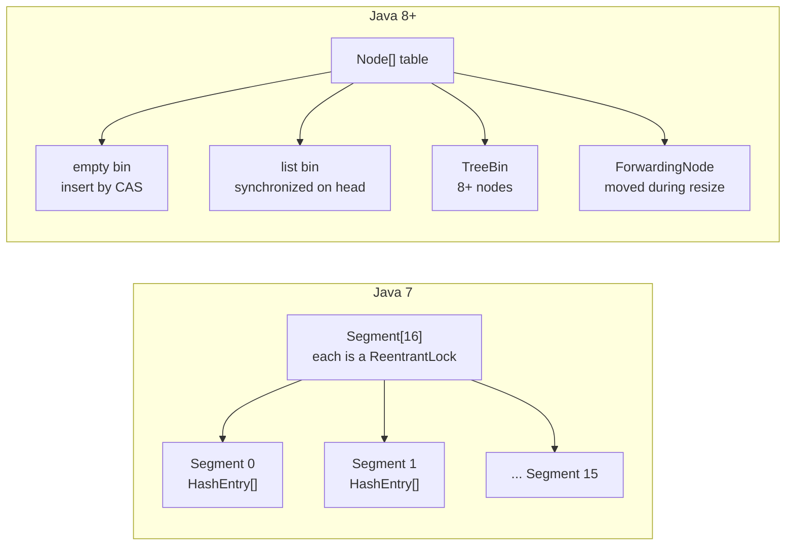
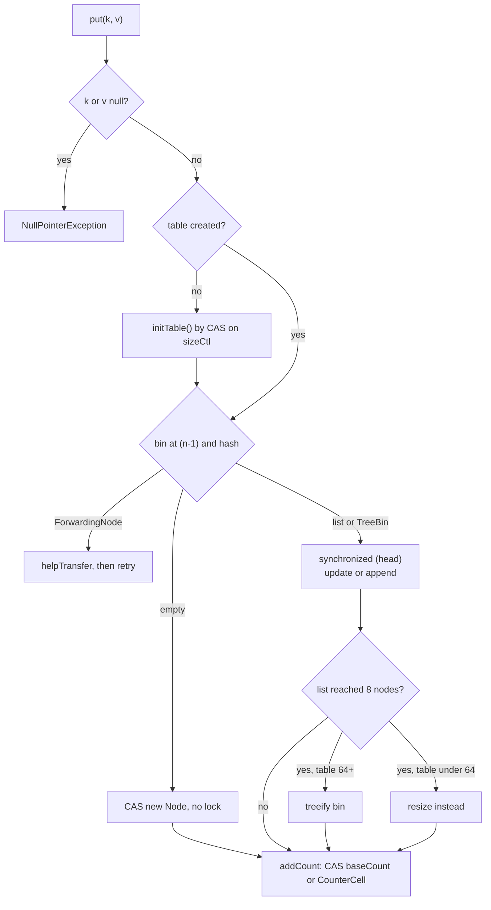
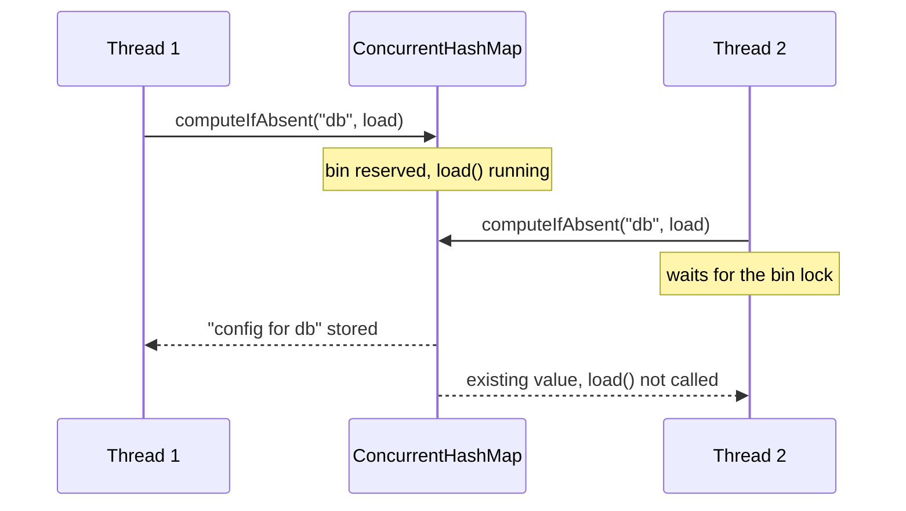

## In One Line
`ConcurrentHashMap` is the thread-safe `HashMap` built for many threads at once: **reads never lock**, and writes lock only a tiny part of the table — in Java 7 one of 16 **segments**, since Java 8 a single **bin** (CAS for an empty bin, `synchronized` on the bin's first node otherwise) — and its `compute`/`merge`/`putIfAbsent` methods make read-modify-write updates **atomic per key**; it forbids `null` keys and values.

## Mental Model
Think of a **supermarket with many checkout lanes** instead of one cashier.

- `Hashtable` / `Collections.synchronizedMap` = **one cashier** for the whole store. Everyone queues, even customers who only want to *look at* a price.
- **Java 7 `ConcurrentHashMap`** = the store split into **16 departments**, each with its own cashier (a `Segment` lock). Two customers in different departments pay at the same time; two in the same department still queue.
- **Java 8+ `ConcurrentHashMap`** = **every shelf** (bin) has its own tiny lock. Putting something on an *empty* shelf needs no lock at all — you just try to place it, and if someone beat you (CAS failed), you look again. Looking at prices (`get`) never needs a cashier.
- **Resize** = the store moving to a bigger building. Instead of closing, every customer who arrives **helps carry a few shelves** to the new building, and a sign on each moved shelf (`ForwardingNode`) says "look in the new building".
- **No nulls**: an empty spot on a shelf means "not stocked". If "stocked with nothing" (`null`) were allowed, a customer could not tell "sold out" from "never sold here" — and by the time they asked the cashier, the answer might have changed.

## Concept
### Why not just `HashMap`, `Hashtable` or `synchronizedMap`?
| | `HashMap` | `Hashtable` | `Collections.synchronizedMap(m)` | `ConcurrentHashMap` |
|---|---|---|---|---|
| Thread-safe | **No** | Yes | Yes | Yes |
| Locking | None | Every method `synchronized` on the table | Every method `synchronized` on one mutex | Reads lock-free; writes lock one bin |
| Concurrent readers | — | Serialised | Serialised | Fully parallel |
| Concurrent writers | Corrupts | Serialised | Serialised | Parallel on different bins |
| `null` keys / values | 1 null key, null values | Neither | Whatever the wrapped map allows | **Neither** |
| Iterator | Fail-fast | Fail-fast (`Enumeration` is not) | Fail-fast, and **you must `synchronized (map)` around iteration** | **Weakly consistent**, never throws `ConcurrentModificationException` |
| Atomic compound ops | No | Only via external locking | Only via external locking | `putIfAbsent`, `compute*`, `merge`, `replace(k, old, new)`, `remove(k, v)` |
| Status | — | Legacy (Java 1.0) | OK for low contention | The default concurrent map (Java 5, redesigned in Java 8) |

A plain `HashMap` shared between writers loses entries and updates, can corrupt its internal structure, and in Java 7 and earlier a concurrent resize could even create a **cycle in a bucket's linked list**, sending later `get()` calls into an infinite loop (100% CPU). Java 8 changed resizing to preserve order, which removed that particular failure, but `HashMap` is still not thread-safe.

### Java 7: segments (lock striping)
- The map is an array of **`Segment`s** (default `concurrencyLevel = 16`). Each `Segment` **extends `ReentrantLock`** and is a small hash table of its own (`HashEntry[]`).
- The segment is chosen from the **high bits** of the spread hash, the bucket inside it from the low bits.
- **Writes** (`put`, `remove`) lock only their segment → up to 16 writers in parallel. A writer spins with `tryLock()` a limited number of times before blocking.
- **Reads** take no lock: `HashEntry.value` and `next` are `volatile` and array slots are read with volatile semantics.
- **Resize** happens per segment: only one segment's table is rehashed, under its lock. The number of segments is fixed at construction.
- **`size()`** sums the segments' counts **twice without locking**; if the segments' modification counts changed in between, it **locks all segments** and counts again.
- Limits: concurrency capped by the segment count chosen up front, extra memory for 16 small tables and locks, and a slow `size()` under writes.

### Java 8+: one table, CAS + per-bin locks
Java 8 (JSR-166e, Doug Lea) rewrote the class. `Segment` survives only as a private class for **serialization compatibility**; `concurrencyLevel` in the constructor is now only a sizing hint.

Structure:
- `volatile Node<K,V>[] table`, created **lazily** on the first insert. Each `Node` has `final int hash`, `final K key`, `volatile V val`, `volatile Node next`.
- A bin can hold: nothing (`null`), a **linked list** of `Node`s, a **`TreeBin`** (red-black tree, when a bin gets crowded), a **`ForwardingNode`** (bin already moved during a resize), or a **`ReservationNode`** (placeholder while `computeIfAbsent`/`compute` runs on an empty bin).
- Negative hashes mark special nodes: `MOVED = -1`, `TREEBIN = -2`, `RESERVED = -3`. That is why `spread(h) = (h ^ (h >>> 16)) & 0x7fffffff` clears the sign bit of normal hashes.

`put(k, v)` step by step (`putVal`):
1. `key == null || value == null` → `NullPointerException`.
2. Spread the hash, find bin index `i = (n - 1) & hash`.
3. Table not created yet → `initTable()` (one thread wins a CAS on `sizeCtl`, others yield).
4. **Bin empty → CAS a new `Node` into the slot. No lock at all.** If the CAS fails, loop and retry.
5. Bin head is a `ForwardingNode` → a resize is running → **`helpTransfer()`** (this thread helps move bins), then retry.
6. (Java 9+) `putIfAbsent` and `computeIfAbsent` first check the bin's **head node**; if it already holds the key, return without locking.
7. Otherwise **`synchronized (head node)`**: re-check the head is unchanged, then walk the list (replace the value or append a node) or insert into the `TreeBin`.
8. If the list had reached **8 nodes** (`TREEIFY_THRESHOLD`), convert it to a `TreeBin` — but only if the table has at least **64 bins** (`MIN_TREEIFY_CAPACITY`); a smaller table is **resized** instead. A tree shrinks back to a list at 6 nodes (`UNTREEIFY_THRESHOLD`).
9. `addCount(1)` updates the size counter and starts or joins a resize when the count passes `sizeCtl` (0.75 × table length).

`get(k)` **never locks**: volatile read of the bin head (`tabAt`), compare the first node, walk the list via `volatile next`, or call `find()` on a special node (a `ForwardingNode` looks in the new table; a `TreeBin` searches the tree, or walks its linked list if a writer is restructuring the tree, so a reader never waits).

### Cooperative resizing
When the element count passes `sizeCtl`, the table doubles:
- `nextTable` of size 2n is allocated. Threads **claim strides** of bins (at least 16 bins each) from the end of the old table through a CAS on `transferIndex`.
- Each old bin is locked, split into a **low** list (stays at index `i`) and a **high** list (moves to `i + n`) — the same "one extra hash bit" trick as `HashMap` — and replaced by a `ForwardingNode`.
- Any writer that meets a `ForwardingNode` **joins the transfer** instead of waiting; readers follow the forwarding node to the new table. So a resize is spread across the threads that are using the map, and `get` is never blocked.
- `sizeCtl` encodes the state: negative while initialising or resizing (with the number of resizing threads), otherwise the next resize threshold.

### Size counting: `baseCount` + `CounterCell[]`
Updating one shared `size` field on every `put` would make it the hottest spot in the map. Java 8 uses the **`LongAdder` technique**: CAS on `baseCount`, and on contention each thread adds to its own `@Contended` `CounterCell`. `size()` and `mappingCount()` return `baseCount + Σ cells`:
- `size()` returns an `int` (capped at `Integer.MAX_VALUE`); **`mappingCount()`** returns a `long` and is the recommended method.
- Under concurrent updates both are **estimates** — the true size may already differ when the value is returned. Same for `isEmpty()` and `containsValue()`.

### Atomic per-key operations
Every single method is thread-safe, but **a sequence of calls is not atomic**. `if (!map.containsKey(k)) map.put(k, v)` and `map.put(k, map.get(k) + 1)` are race conditions. Use the atomic methods:

| Method | Atomic effect | Returns |
|---|---|---|
| `putIfAbsent(k, v)` | Insert only if absent | Previous value, or `null` if it inserted |
| `computeIfAbsent(k, fn)` | If absent, compute and insert; **fn runs at most once per key**, other threads for that key wait | Current or new value (`null` → nothing inserted) |
| `computeIfPresent(k, fn)` | If present, replace with `fn(k, old)`; `null` result **removes** | New value or `null` |
| `compute(k, fn)` | `fn(k, oldOrNull)`; `null` result removes | New value or `null` |
| `merge(k, v, fn)` | Absent → put `v`; present → `fn(old, v)`; `null` result removes | New value or `null` |
| `replace(k, old, new)` | Replace only if currently mapped to `old` (CAS on a map entry) | `boolean` |
| `remove(k, v)` | Remove only if mapped to `v` | `boolean` |

**Rules for the functions** (they run **while holding the bin lock**):
- Keep them **short and simple**. Other threads updating the same bin wait (readers do not).
- **Never modify the same map** inside the function. Recursive `computeIfAbsent` (e.g. a memoised Fibonacci) throws `IllegalStateException: Recursive update` in Java 9+ when it hits the same bin, and it hung in an infinite loop in Java 8. `HashMap` throws `ConcurrentModificationException` for the same code.
- `putIfAbsent(k, expensive())` computes the value **eagerly** on every call, even when unused; `computeIfAbsent(k, key -> expensive())` computes it **lazily and once**.
- Java 8's `computeIfAbsent` locked the bin even when the key was already present (a hot-key bottleneck); Java 9 added the lock-free head-node check.

### Why no `null` keys or values?
1. **Ambiguity** — `get(k)` returns `null` for "absent". In a `HashMap` you can disambiguate with `containsKey(k)`, but in a concurrent map another thread can change the map between `get` and `containsKey`, so the answer is meaningless. Banning `null` makes `null` always mean "no mapping" — for `get`, `putIfAbsent`, `compute` and friends.
2. **Internal sentinel** — the implementation (and the `compute`/`merge` contracts) use `null` to mean "absent/remove", so a stored `null` could not be represented.
Doug Lea's own summary: the ambiguities that are "just barely tolerable" in non-concurrent maps "can't be accommodated" in concurrent ones. If you need "known to be empty", store an `Optional.empty()` or a sentinel object.

### Weakly consistent iteration
Iterators, `keySet()`, `values()`, `entrySet()`, `forEach` and `toString()` traverse the live table without locking. They **never throw `ConcurrentModificationException`**, reflect the map as of some point at or after the iterator's creation, may or may not show later changes, and never return an element twice. `iterator.remove()` is supported. See [Fail-safe iterators](lesson:a03-collections/23-fail-safe-iterators).

### Java 8 extras
- **Bulk operations** with a `parallelismThreshold` (1 = maximum parallelism on the common `ForkJoinPool`, `Long.MAX_VALUE` = sequential): `forEach`, `search` (returns the first non-null result), `reduce`, `reduceValuesToLong`, `reduceKeysToLong`... They run on a live, possibly changing map, so results are a snapshot "during" the call.
- **`ConcurrentHashMap.newKeySet()`** — a concurrent `Set<K>` backed by the map (there is no `ConcurrentHashSet` class). `keySet(defaultValue)` returns a view whose `add(k)` inserts `k → defaultValue`.
- **`ConcurrentHashMap<String, LongAdder>`** with `computeIfAbsent(k, x -> new LongAdder()).increment()` is the classic high-throughput frequency counter.

### Constructors and sizing
- `new ConcurrentHashMap<>()` → 16 bins, created on the first insert.
- `new ConcurrentHashMap<>(n)` treats `n` as the **expected number of elements**: the table becomes the next power of two ≥ `1 + n / 0.75`. So `new ConcurrentHashMap<>(16)` allocates **32** bins, while `new HashMap<>(16)` allocates 16.
- The `loadFactor` and `concurrencyLevel` constructor arguments only affect the initial size; the resize threshold is always 0.75.

### When to use something else
| Need | Use |
|---|---|
| Sorted keys, range queries, concurrent | `ConcurrentSkipListMap` (next lesson) |
| Read-mostly, tiny, rarely changed | An immutable `Map.copyOf` snapshot behind a `volatile` field |
| Multi-key transactions (move a value from key A to key B atomically) | A lock around both operations — CHM is atomic per key only |
| Cache with eviction/expiry | A cache library (Caffeine is built on `ConcurrentHashMap`) |

## Diagram

Java 7 locks one of a fixed number of segments; Java 8 locks at most one bin, and empty bins need no lock at all.


The write path: most inserts into a sparse table are a single CAS; locks are per bin; resizes are shared work.


`computeIfAbsent` runs the loader at most once per key: the second caller waits on the bin and then sees the stored value.

## Code
**1. Lost updates: `HashMap`, a two-step `ConcurrentHashMap` update, and `merge`**
```java
import java.util.HashMap;
import java.util.Map;
import java.util.concurrent.ConcurrentHashMap;
import java.util.function.Consumer;

public class LostUpdates {
    static final String[] WORDS = {"java", "map", "lock", "cas"};

    // 4 threads, each counts every word 100_000 times -> every count should be 400000
    static String run(Map<String, Integer> map, Consumer<String> increment) throws InterruptedException {
        Thread[] ts = new Thread[4];
        for (int i = 0; i < ts.length; i++) {
            ts[i] = new Thread(() -> {
                for (int j = 0; j < 100_000; j++)
                    for (String w : WORDS) increment.accept(w);
            });
            ts[i].start();
        }
        for (Thread t : ts) t.join();
        return map.toString();
    }

    public static void main(String[] args) throws InterruptedException {
        Map<String, Integer> hashMap = new HashMap<>();
        try {
            System.out.println("HashMap + merge:          "
                    + run(hashMap, w -> hashMap.merge(w, 1, Integer::sum)));
        } catch (Exception e) {
            System.out.println("HashMap + merge threw:    " + e);
        }

        Map<String, Integer> chm1 = new ConcurrentHashMap<>();
        System.out.println("CHM + get/put (2 steps):  "
                + run(chm1, w -> chm1.put(w, chm1.getOrDefault(w, 0) + 1)));

        Map<String, Integer> chm2 = new ConcurrentHashMap<>();
        System.out.println("CHM + merge (1 step):     "
                + run(chm2, w -> chm2.merge(w, 1, Integer::sum)));
    }
}
```
```output
HashMap + merge:          {java=260780, cas=265884, lock=255659, map=254830}
CHM + get/put (2 steps):  {java=292695, cas=276383, lock=283938, map=339850}
CHM + merge (1 step):     {java=400000, cas=400000, lock=400000, map=400000}
```
The first two lines change on every run (another run printed `java=217420` for `HashMap` and `cas=241009` for the two-step version). The `merge` line is always exactly 400000 per word.

**2. The atomic per-key API**
```java
import java.util.concurrent.ConcurrentHashMap;

public class ChmAtomicOps {
    public static void main(String[] args) {
        ConcurrentHashMap<String, Integer> stock = new ConcurrentHashMap<>();

        System.out.println("putIfAbsent(apple, 10): " + stock.putIfAbsent("apple", 10));  // null = inserted
        System.out.println("putIfAbsent(apple, 99): " + stock.putIfAbsent("apple", 99));  // existing value

        System.out.println("computeIfAbsent(pear):  " + stock.computeIfAbsent("pear", k -> k.length()));
        System.out.println("computeIfAbsent(pear):  " + stock.computeIfAbsent("pear", k -> {
            throw new AssertionError("never called: key already present");
        }));

        System.out.println("computeIfPresent(apple, +5): " + stock.computeIfPresent("apple", (k, v) -> v + 5));
        System.out.println("computeIfPresent(kiwi, +5):  " + stock.computeIfPresent("kiwi", (k, v) -> v + 5));

        System.out.println("compute(kiwi, null->1): " + stock.compute("kiwi", (k, v) -> v == null ? 1 : v + 1));
        System.out.println("merge(kiwi, 10, sum):   " + stock.merge("kiwi", 10, Integer::sum));
        System.out.println("merge(fig, 3, sum):     " + stock.merge("fig", 3, Integer::sum));

        System.out.println("replace(apple, 15, 20): " + stock.replace("apple", 15, 20));
        System.out.println("replace(apple, 15, 30): " + stock.replace("apple", 15, 30));
        System.out.println("remove(pear, 999):      " + stock.remove("pear", 999));

        System.out.println("before removals: " + stock);
        stock.computeIfPresent("fig", (k, v) -> null);        // returning null REMOVES the entry
        stock.merge("kiwi", -11, (a, b) -> a + b == 0 ? null : a + b);
        System.out.println("after removals:  " + stock);
        System.out.println("getOrDefault(fig, 0): " + stock.getOrDefault("fig", 0));
    }
}
```
```output
putIfAbsent(apple, 10): null
putIfAbsent(apple, 99): 10
computeIfAbsent(pear):  4
computeIfAbsent(pear):  4
computeIfPresent(apple, +5): 15
computeIfPresent(kiwi, +5):  null
compute(kiwi, null->1): 1
merge(kiwi, 10, sum):   11
merge(fig, 3, sum):     3
replace(apple, 15, 20): true
replace(apple, 15, 30): false
remove(pear, 999):      false
before removals: {apple=20, pear=4, kiwi=11, fig=3}
after removals:  {apple=20, pear=4}
getOrDefault(fig, 0): 0
```

**3. Load once: check-then-act vs `putIfAbsent` vs `computeIfAbsent`**
```java
import java.util.concurrent.ConcurrentHashMap;
import java.util.concurrent.CountDownLatch;
import java.util.concurrent.atomic.AtomicInteger;
import java.util.function.Consumer;

public class LoadOnce {
    static final AtomicInteger loads = new AtomicInteger();

    static String expensiveLoad(String key) {
        loads.incrementAndGet();
        try { Thread.sleep(50); } catch (InterruptedException e) { }   // simulate a slow DB call
        return "config for " + key;
    }

    static void race(String label, Consumer<ConcurrentHashMap<String, String>> lookup) throws InterruptedException {
        ConcurrentHashMap<String, String> cache = new ConcurrentHashMap<>();
        loads.set(0);
        CountDownLatch go = new CountDownLatch(1);
        Thread[] ts = new Thread[8];
        for (int i = 0; i < ts.length; i++) {
            ts[i] = new Thread(() -> {
                try { go.await(); } catch (InterruptedException e) { }
                lookup.accept(cache);
            });
            ts[i].start();
        }
        go.countDown();
        for (Thread t : ts) t.join();
        System.out.printf("%-22s loads = %d, cache = %s%n", label, loads.get(), cache);
    }

    public static void main(String[] args) throws InterruptedException {
        race("get, then put:", cache -> {
            if (cache.get("db") == null) cache.put("db", expensiveLoad("db"));   // check-then-act
        });
        race("putIfAbsent:", cache -> cache.putIfAbsent("db", expensiveLoad("db")));  // value built eagerly
        race("computeIfAbsent:", cache -> cache.computeIfAbsent("db", LoadOnce::expensiveLoad));
    }
}
```
```output
get, then put:         loads = 8, cache = {db=config for db}
putIfAbsent:           loads = 8, cache = {db=config for db}
computeIfAbsent:       loads = 1, cache = {db=config for db}
```
All three runs printed exactly this. The first two counts could in theory be lower than 8 (a thread that starts late may find the value already there), but `computeIfAbsent` is guaranteed to load once.

**4. No nulls, and why**
```java
import java.util.HashMap;
import java.util.Map;
import java.util.concurrent.ConcurrentHashMap;

public class NoNulls {
    static void attempt(String label, Runnable r) {
        try { r.run(); System.out.printf("%-30s -> ok%n", label); }
        catch (NullPointerException e) { System.out.printf("%-30s -> NullPointerException%n", label); }
    }

    public static void main(String[] args) {
        Map<String, String> hm = new HashMap<>();
        hm.put(null, "null key is fine");
        hm.put("k", null);
        System.out.println("HashMap: " + hm);
        System.out.println("HashMap get(k) = " + hm.get("k") + ", get(missing) = " + hm.get("missing")
                + "  <- same answer, different meaning");

        Map<String, String> chm = new ConcurrentHashMap<>();
        attempt("CHM put(null, v)", () -> chm.put(null, "v"));
        attempt("CHM put(k, null)", () -> chm.put("k", null));
        attempt("CHM get(null)", () -> chm.get(null));
        attempt("CHM containsKey(null)", () -> chm.containsKey(null));
        attempt("CHM getOrDefault(k, null)", () -> chm.getOrDefault("k", null));
        attempt("CHM computeIfAbsent -> null", () -> chm.computeIfAbsent("k", key -> null));
        System.out.println("CHM after computeIfAbsent returned null: " + chm);
    }
}
```
```output
HashMap: {null=null key is fine, k=null}
HashMap get(k) = null, get(missing) = null  <- same answer, different meaning
CHM put(null, v)               -> NullPointerException
CHM put(k, null)               -> NullPointerException
CHM get(null)                  -> NullPointerException
CHM containsKey(null)          -> NullPointerException
CHM getOrDefault(k, null)      -> ok
CHM computeIfAbsent -> null    -> ok
CHM after computeIfAbsent returned null: {}
```

**5. Weakly consistent iteration and the recursive-update trap**
```java
import java.util.HashMap;
import java.util.Map;
import java.util.concurrent.ConcurrentHashMap;

public class WeakIteration {
    static void addWhileIterating(Map<Integer, String> map) {
        for (int i = 1; i <= 3; i++) map.put(i, "v" + i);
        try {
            for (Integer k : map.keySet()) {
                if (k == 1) { map.put(10, "v10"); map.remove(3); }   // modify during iteration
                System.out.print(k + " ");
            }
            System.out.println("| finished, map = " + map);
        } catch (Exception e) {
            System.out.println("| " + e.getClass().getSimpleName());
        }
    }

    public static void main(String[] args) {
        System.out.print("HashMap:           ");
        addWhileIterating(new HashMap<>());
        System.out.print("ConcurrentHashMap: ");
        addWhileIterating(new ConcurrentHashMap<>());
    }
}
```
```output
HashMap:           1 | ConcurrentModificationException
ConcurrentHashMap: 1 2 10 | finished, map = {1=v1, 2=v2, 10=v10}
```
```java
import java.util.HashMap;
import java.util.Map;
import java.util.concurrent.ConcurrentHashMap;

public class Recursive {
    static Map<Integer, Long> memo;

    static long fib(int n) {
        if (n < 2) return n;
        return memo.computeIfAbsent(n, k -> fib(k - 1) + fib(k - 2));   // modifies the map inside compute!
    }

    static void tryWith(Map<Integer, Long> map) {
        memo = map;
        try { System.out.println(map.getClass().getSimpleName() + ": fib(20) = " + fib(20)); }
        catch (RuntimeException e) { System.out.println(map.getClass().getSimpleName() + ": " + e); }
    }

    public static void main(String[] args) {
        tryWith(new HashMap<>());
        tryWith(new ConcurrentHashMap<>());

        Map<Integer, Long> safe = new ConcurrentHashMap<>();       // fix: compute outside, then store
        long a = 0, b = 1;
        for (int i = 2; i <= 20; i++) { long c = a + b; safe.put(i, c); a = b; b = c; }
        System.out.println("iterative: fib(20) = " + safe.get(20));
    }
}
```
```output
HashMap: java.util.ConcurrentModificationException
ConcurrentHashMap: java.lang.IllegalStateException: Recursive update
iterative: fib(20) = 6765
```

**6. A look inside: table sizing and treeification**
```java
import java.lang.reflect.Field;
import java.util.HashMap;
import java.util.concurrent.ConcurrentHashMap;

public class Internals {
    // A key whose hashCode always collides, to force one crowded bin
    record BadKey(int id) {
        @Override public int hashCode() { return 42; }
    }

    static Object[] table(Object map, Class<?> cls) throws Exception {
        Field f = cls.getDeclaredField("table");          // needs --add-opens (see below)
        f.setAccessible(true);
        return (Object[]) f.get(map);
    }

    static String bin42(ConcurrentHashMap<BadKey, Integer> map) throws Exception {
        Object[] t = table(map, ConcurrentHashMap.class);
        return t[42 & (t.length - 1)].getClass().getSimpleName() + " (table length " + t.length + ")";
    }

    public static void main(String[] args) throws Exception {
        HashMap<String, Integer> hm = new HashMap<>(16);
        ConcurrentHashMap<String, Integer> chm = new ConcurrentHashMap<>(16);
        hm.put("a", 1);
        chm.put("a", 1);                                    // the table is created lazily, on first put
        System.out.println("new HashMap<>(16)           -> table length " + table(hm, HashMap.class).length);
        System.out.println("new ConcurrentHashMap<>(16) -> table length " + table(chm, ConcurrentHashMap.class).length);

        ConcurrentHashMap<BadKey, Integer> big = new ConcurrentHashMap<>(64);
        for (int i = 0; i < 8; i++) big.put(new BadKey(i), i);
        System.out.println("big table, 8 colliding keys:   " + bin42(big));
        big.put(new BadKey(8), 8);
        System.out.println("big table, 9 colliding keys:   " + bin42(big));

        ConcurrentHashMap<BadKey, Integer> small = new ConcurrentHashMap<>(16);
        for (int i = 0; i < 8; i++) small.put(new BadKey(i), i);
        System.out.println("small table, 8 colliding keys: " + bin42(small));
        small.put(new BadKey(8), 8);
        System.out.println("small table, 9 colliding keys: " + bin42(small));
        System.out.println("size() = " + small.size() + ", mappingCount() = " + small.mappingCount());
    }
}
```
Run with `java --add-opens java.base/java.util=ALL-UNNAMED --add-opens java.base/java.util.concurrent=ALL-UNNAMED Internals.java`:
```output
new HashMap<>(16)           -> table length 16
new ConcurrentHashMap<>(16) -> table length 32
big table, 8 colliding keys:   Node (table length 128)
big table, 9 colliding keys:   TreeBin (table length 128)
small table, 8 colliding keys: Node (table length 32)
small table, 9 colliding keys: Node (table length 256)
size() = 9, mappingCount() = 9
```

**7. Frequency counting, bulk operations and a concurrent set**
```java
import java.util.Set;
import java.util.TreeMap;
import java.util.concurrent.ConcurrentHashMap;
import java.util.concurrent.atomic.LongAdder;

public class BulkOps {
    public static void main(String[] args) throws InterruptedException {
        String text = "to be or not to be that is the question to be";
        ConcurrentHashMap<String, LongAdder> freq = new ConcurrentHashMap<>();

        Thread[] ts = new Thread[4];                 // 4 threads count the same text
        for (int i = 0; i < ts.length; i++) {
            ts[i] = new Thread(() -> {
                for (String w : text.split(" "))
                    freq.computeIfAbsent(w, k -> new LongAdder()).increment();
            });
            ts[i].start();
        }
        for (Thread t : ts) t.join();

        TreeMap<String, Long> sorted = new TreeMap<>();
        freq.forEach((w, n) -> sorted.put(w, n.sum()));
        System.out.println("counts:  " + sorted);

        // Java 8 bulk operations; the first argument is the parallelism threshold:
        // 1 = split the work over the common ForkJoinPool, Long.MAX_VALUE = run sequentially
        long total = freq.reduceValuesToLong(1, LongAdder::sum, 0L, Long::sum);
        String frequent = freq.search(Long.MAX_VALUE, (w, n) -> n.sum() >= 12 ? w : null);
        long longWords = freq.reduceKeysToLong(Long.MAX_VALUE, w -> w.length() > 3 ? 1 : 0, 0L, Long::sum);
        System.out.println("total words:        " + total);
        System.out.println("a word seen >= 12x: " + frequent);
        System.out.println("distinct words longer than 3 chars: " + longWords);

        Set<String> seen = ConcurrentHashMap.newKeySet();      // a concurrent HashSet
        System.out.println("add(x): " + seen.add("x") + ", add(x) again: " + seen.add("x"));
        System.out.println("seen = " + seen + ", size = " + seen.size());
    }
}
```
```output
counts:  {be=12, is=4, not=4, or=4, question=4, that=4, the=4, to=12}
total words:        48
a word seen >= 12x: be
distinct words longer than 3 chars: 2
add(x): true, add(x) again: false
seen = [x], size = 1
```

## Walkthrough
**LostUpdates**
- `run` starts 4 threads that each apply `increment` to every word 100,000 times, joins them, and prints the map — so every count should be 400,000.
- **`HashMap` + `merge`**: `merge` itself is not synchronized, so threads overwrite each other's results and a quarter to a half of the updates vanish. It can also corrupt the table; the `try/catch` is there because `HashMap.merge` throws `ConcurrentModificationException` if it notices a structural change made during its remapping function (it did not happen in these runs).
- **CHM + `put(w, getOrDefault(w, 0) + 1)`**: each call is thread-safe, but the *pair* is not — two threads read 41, both write 42. A thread-safe map does not make your *sequence* of calls atomic.
- **CHM + `merge(w, 1, Integer::sum)`**: the read, the sum and the write happen under the bin lock as one step, so no update is lost.

**ChmAtomicOps**
- `putIfAbsent("apple", 10)` returns `null` (meaning "I inserted"); the second call returns the existing `10` and does not overwrite.
- `computeIfAbsent("pear", k -> k.length())` computes 4 from the key. The second call never runs its function (it would throw `AssertionError`) because the key is present.
- `computeIfPresent("apple", ...)` turns 10 into 15; on the absent `"kiwi"` it does nothing and returns `null`.
- `compute("kiwi", ...)` receives `v == null` for an absent key and stores 1; `merge("kiwi", 10, Integer::sum)` combines old 1 with 10 → 11; `merge("fig", 3, ...)` on an absent key simply stores 3 (the function is not called).
- `replace("apple", 15, 20)` is a conditional replace (compare-and-set on the entry): true, now 20. The next `replace(apple, 15, 30)` fails because the value is no longer 15. `remove("pear", 999)` fails because pear maps to 4.
- The printed order (`apple, pear, kiwi, fig`) is hash order, not insertion order — it is deterministic for these `String` keys but meaningless.
- Returning `null` from `computeIfPresent` or from `merge`'s function **removes** the entry (kiwi: 11 + (-11) = 0 → `null`). `getOrDefault("fig", 0)` then returns the default.

**LoadOnce**
- `CountDownLatch go` releases 8 threads at the same instant.
- `get` then `put`: all 8 threads see `null` during the 50 ms load and all 8 load. The map ends up correct, but the expensive work (and any side effects) ran 8 times.
- `putIfAbsent("db", expensiveLoad("db"))`: Java evaluates arguments **before** the call, so every thread loads; only the first value is kept.
- `computeIfAbsent("db", LoadOnce::expensiveLoad)`: the first thread reserves the bin and runs the loader; the other 7 block on that bin and then return the stored value. `loads = 1`.

**NoNulls**
- `HashMap` accepts a `null` key and a `null` value, which is why `get("k")` and `get("missing")` both return `null` with different meanings.
- `ConcurrentHashMap` throws `NullPointerException` for a null key or value in `put`, and also for `get(null)` and `containsKey(null)` (it calls `key.hashCode()`).
- `getOrDefault("k", null)` is allowed: the *default* may be null, since nothing is stored.
- `computeIfAbsent` returning `null` is allowed and means "do not insert" — the map stays `{}`.

**WeakIteration / Recursive**
- Adding key 10 and removing key 3 while iterating a `HashMap` makes the next `next()` throw `ConcurrentModificationException` (fail-fast via `modCount`).
- The `ConcurrentHashMap` iterator keeps going: it did not return the removed 3, and it did return the new 10 because bin 10 lies ahead of the iterator's position. Whether a concurrent change is seen depends on where it lands — that is "weakly consistent".
- `fib` calls `computeIfAbsent` from inside another `computeIfAbsent`'s function on the same map. `HashMap` detects the modification and throws `ConcurrentModificationException`; `ConcurrentHashMap` finds its own `ReservationNode` in bin 4 (keys 20 and 4 share a bin in a 16-bin table) and throws `IllegalStateException: Recursive update`. The fix computes values outside the map operation.

**Internals**
- Reflection reads the private `table` array; Java's module system blocks this unless you pass `--add-opens` (only for learning — never in production code).
- `new ConcurrentHashMap<>(16)` → 32 bins, because CHM sizes for 16 **elements** at load factor 0.75 (`1 + 16 / 0.75` → next power of two, 32). `HashMap(16)` → 16 bins.
- `BadKey` returns the same `hashCode` for all keys, so they pile into one bin. With 128 bins, the 9th key turns the list into a `TreeBin`. With only 32 bins (under 64), the 9th key triggers a **resize** instead of treeifying (the table grew to 256 here) — the bin stays a list, because in a small table collisions are more likely a sign of too few bins.
- `size()` and `mappingCount()` both report 9 when no thread is writing.

**BulkOps**
- `computeIfAbsent(w, k -> new LongAdder()).increment()` — one `LongAdder` per word is created atomically; the increments are then lock-free, so counting scales with many threads.
- `forEach` copies the counts into a `TreeMap` so they print sorted: "to" and "be" appear 3 times per text × 4 threads = 12.
- `reduceValuesToLong(1, LongAdder::sum, 0L, Long::sum)` — transformer, identity (`0L`) and reducer, run in parallel: 48 words.
- `search(Long.MAX_VALUE, ...)` runs sequentially and returns the first non-null result ("be" in this table's order); `reduceKeysToLong` counts keys longer than 3 characters ("that", "question").
- `ConcurrentHashMap.newKeySet()` returns a thread-safe `Set`; `add` returns `false` for a duplicate.

## Traps
- **"Thread-safe map" ≠ "thread-safe code".** `containsKey` + `put`, `get` + `put`, `get` + `remove` are races. Use `putIfAbsent`, `computeIfAbsent`, `merge`, `compute`, `replace(k, old, new)`, `remove(k, v)`.
- **Long or blocking work inside `compute*`/`merge`.** It holds the bin lock; other writers to that bin (possibly other keys that share it) wait. Never do I/O or remote calls there if avoidable; never touch the same map.
- **Recursive `computeIfAbsent`** (memoisation) → `IllegalStateException: Recursive update` (Java 9+), a hang in Java 8.
- **`putIfAbsent(k, new ExpensiveObject())`** builds the object every time. Use `computeIfAbsent`.
- **Putting `null`.** `NullPointerException` — also when migrating code from `HashMap` that stored `null` values. Use `Optional` or a sentinel.
- **Trusting `size()` or `isEmpty()` for decisions** while others write. `if (map.size() < MAX) map.put(...)` can exceed `MAX`.
- **Mutable values.** CHM makes the *mapping* thread-safe, not the value objects. `map.get(k).add(x)` on an `ArrayList` value is a data race; use `compute` to replace it, or store thread-safe values (`LongAdder`, `ConcurrentLinkedQueue`, `CopyOnWriteArrayList`).
- **Expecting ordering.** Iteration order is hash order and can change after a resize. Use `ConcurrentSkipListMap` for sorted order.
- **Iterating a `synchronizedMap` without `synchronized (map) { ... }`.** It is fail-fast and not protected by the wrapper's lock. CHM needs no such block.
- **`new ConcurrentHashMap<>(n)` means "room for n elements"**, unlike `HashMap(n)` which is a bin count — easy to over-allocate if you "helpfully" pass `n / 0.75`.
- **Relying on `concurrencyLevel`** to tune Java 8+ — it is ignored beyond initial sizing.

> [!WARNING] The `keySet(defaultValue)` view stores the **same** default object for every added key. `map.keySet(new LongAdder()).add("a")` and `.add("b")` share one `LongAdder`. Use it only with immutable defaults such as `Boolean.TRUE`.

## Tips & Tricks
- **"Reads free, writes per bin, empty bins by CAS."** The one-line summary of Java 8+.
- **Java 7 vs 8 in one breath**: *"Java 7 striped 16 `ReentrantLock` segments; Java 8 dropped segments for CAS on empty bins plus `synchronized` on the bin head, treeifies bins at 8 nodes, resizes cooperatively with `ForwardingNode`s, and counts size with `LongAdder`-style cells."*
- **Counting pattern**: `map.merge(key, 1, Integer::sum)` for moderate traffic; `map.computeIfAbsent(key, k -> new LongAdder()).increment()` for hot keys.
- **Multimap pattern**: `map.computeIfAbsent(key, k -> new CopyOnWriteArrayList<>()).add(v)` (or `ConcurrentLinkedQueue`) — the value collection must itself be thread-safe.
- **Cache pattern**: `computeIfAbsent(key, this::load)` gives "load once per key" for free — just keep `load` short or accept that other callers for that bin wait.
- **Null rule mnemonic**: "*Concurrent maps can't say 'maybe'*" — `null` would mean both "absent" and "present with nothing".
- **Prefer `mappingCount()`** over `size()` for large maps; treat both as estimates.
- **Declare as `ConcurrentMap<K, V>`** (or `ConcurrentHashMap`) rather than `Map` when callers need the atomic-method guarantees; a plain `Map` default `computeIfAbsent` is **not** atomic on other implementations.

## Interview Q&A
### [Basic] Why use `ConcurrentHashMap` instead of `Hashtable` or `Collections.synchronizedMap`?
`Hashtable` and `synchronizedMap` serialise **every** operation on one lock, so readers block writers and each other, and throughput collapses as threads increase. Their iterators are fail-fast, and iterating a `synchronizedMap` requires you to hold its lock manually. `ConcurrentHashMap` never locks for reads, locks only a single bin for writes (Java 8+), resizes cooperatively, offers atomic per-key operations (`putIfAbsent`, `compute`, `merge`...), and has weakly consistent iterators that never throw `ConcurrentModificationException`. `Hashtable` is a legacy class; `synchronizedMap` is acceptable only for low contention or when you need to wrap a specific map type.

**Follow-up:** *Is `ConcurrentHashMap` always faster?* — Single-threaded it is similar to `HashMap`, slightly slower; its advantage appears with concurrent access.

### [Basic] Why doesn't `ConcurrentHashMap` allow `null` keys or values?
Because `null` must unambiguously mean "no mapping". In a `HashMap`, `get(k) == null` can mean "absent" or "mapped to null", and you can check `containsKey` afterwards. In a concurrent map another thread can change the map between those two calls, so the check is useless. Methods like `putIfAbsent`, `computeIfAbsent`, `compute` and `merge` also use `null` to signal "absent" or "remove". Banning nulls keeps every one of those contracts clear. `put(null, v)`, `put(k, null)`, `get(null)` and `containsKey(null)` all throw `NullPointerException`.

**Follow-up:** *How do you represent "known missing" then?* — Store a sentinel (a constant `NONE` object) or an `Optional.empty()`.

### [Intermediate] How did `ConcurrentHashMap` work in Java 7, and what changed in Java 8?
Java 7 used **lock striping**: an array of `Segment`s (default 16), each a `ReentrantLock` guarding its own small `HashEntry[]` table. A write locked one segment, so up to 16 writers ran in parallel; reads were lock-free via volatile fields; each segment resized independently; `size()` summed segments twice without locks and locked all of them if counts changed. Java 8 removed segments: there is one `Node[]` table, an insert into an **empty bin is a CAS** with no lock, an insert into a non-empty bin **synchronizes on the bin's first node**, crowded bins (8+ nodes, table ≥ 64) become red-black `TreeBin`s, resizing is done **cooperatively** by all writing threads using `ForwardingNode`s, and the size is kept in a `LongAdder`-style `baseCount` + `CounterCell[]`. Java 8 also added `compute`, `merge`, bulk operations and `newKeySet()`.

**Follow-up:** *Why did Java 8 switch from `ReentrantLock` to `synchronized`?* — Per-bin locks are almost never contended, and `synchronized` needs no extra lock object per bin (it uses the head node's monitor), saving memory; HotSpot's uncontended `synchronized` is cheap.

### [Intermediate] Is `get()` locked? How is it thread-safe without a lock?
No, `get` never locks, in Java 7 or 8. It is safe because of the memory model: the table reference is `volatile`, bins are read with volatile semantics (`tabAt`, an acquire read), and each `Node`'s `val` and `next` fields are `volatile`, while `hash` and `key` are `final`. Writers publish new nodes with a CAS or inside a `synchronized` block, both of which create happens-before edges. If the reader meets a special node — a `ForwardingNode` during a resize or a `TreeBin` — it calls that node's `find()`, which looks in the new table or searches the tree (falling back to a linear scan if a writer is restructuring the tree), so a reader never waits.

**Follow-up:** *Can `get` return a stale value?* — It returns the result of the most recently **completed** update for that key; an update still in progress may not be visible yet. That is "retrieval reflects the most recently completed update".

### [Intermediate] Are `compute`, `computeIfAbsent` and `merge` atomic? What are the rules for their functions?
Yes, in `ConcurrentHashMap` each call is atomic for its key: the function runs while the bin is locked (or a `ReservationNode` holds an empty bin), so no other writer can change that key in between, and `computeIfAbsent` runs its function at most once per absent key. Rules: the function must be **short**, must **not modify the map** (recursive updates throw `IllegalStateException: Recursive update` in Java 9+), and should have no blocking I/O. Returning `null` means "remove" (`compute`, `computeIfPresent`, `merge`) or "do not insert" (`computeIfAbsent`).

**Follow-up:** *Is `ConcurrentSkipListMap.computeIfAbsent` also once-only?* — No. Its docs say the function is **not** guaranteed to be applied once atomically; like the `ConcurrentMap` default methods, it uses a retry loop.

### [Intermediate] How does `size()` work in Java 8, and is it accurate?
Each insert/remove calls `addCount`, which tries a CAS on `baseCount`; if that fails because of contention, the thread adds to its own `CounterCell` (padded with `@Contended` against false sharing) — the same design as `LongAdder`. `size()` returns `baseCount` plus all cells, capped at `Integer.MAX_VALUE`; `mappingCount()` returns the same sum as a `long` and is recommended. Neither locks, so while other threads are writing the result is an **estimate**; when the map is quiescent it is exact.

**Follow-up:** *And Java 7?* — It summed segment counts without locking up to two times, and if modifications happened in between, it locked all segments to get an exact count — accurate but expensive under writes.

### [Advanced] Walk through a `put` in Java 8 `ConcurrentHashMap`.
Reject null key/value; compute `spread(key.hashCode())` (high bits folded into low bits, sign bit cleared). Loop: if the table does not exist, initialise it by CAS-ing `sizeCtl` to -1. Find the bin with `(n - 1) & hash`. If the bin is empty, **CAS** a new `Node` into it — done, no lock. If the head's hash is `MOVED`, a resize is in progress: **help transfer**, then retry. (Java 9+: for `putIfAbsent`, if the head node already has the key, return its value without locking.) Otherwise `synchronized (head)`, re-check the head is still the same, then walk the list to replace the value or append, or insert into the `TreeBin`. After unlocking, if the list reached 8 nodes, treeify (or resize if the table is under 64). Finally `addCount(1)` updates the counter and starts or joins a resize if the size exceeds `sizeCtl` (0.75n).

**Follow-up:** *What does `sizeCtl` hold?* — `-1` while the table is being initialised; a negative value encoding a resize stamp plus the number of resizing threads during a resize; otherwise the next resize threshold (or initial capacity before creation).

### [Advanced] How does resizing work without blocking readers?
A resize allocates `nextTable` twice as large. Threads claim ranges of old bins (at least 16 at a time) by CAS on `transferIndex`, working from the end. For each bin, the thread locks its head, splits the nodes into a low list (stays at index `i`) and a high list (goes to `i + n`) based on the extra hash bit, writes both into `nextTable`, and puts a `ForwardingNode` in the old slot. Readers hitting a `ForwardingNode` follow it to `nextTable`, so `get` never waits; writers hitting one call `helpTransfer` and move bins themselves. When the last thread finishes, `table` is switched to `nextTable` and `sizeCtl` is set to the new threshold.

**Follow-up:** *Why split into low and high lists?* — With power-of-two sizes, doubling adds one bit to the index mask, so each node either stays at `i` or moves to exactly `i + n`; no rehashing of the key is needed.

### [Advanced] When does a bin become a tree, and why?
When a bin's linked list reaches 8 nodes (`TREEIFY_THRESHOLD`) and the table has at least 64 bins (`MIN_TREEIFY_CAPACITY`), the bin becomes a `TreeBin` of red-black `TreeNode`s, making lookups in that bin O(log n) instead of O(n). If the table is smaller than 64, the map resizes instead, because many collisions in a small table usually just mean too few bins. The tree converts back to a list when it shrinks to 6 nodes. Treeification protects against poor `hashCode`s and hash-flooding attacks. A `TreeBin` also contains a small read-write lock so that readers can use the tree while no writer is restructuring it, and otherwise traverse the nodes' linked list without blocking.

**Follow-up:** *What happens if keys are not `Comparable`?* — The tree orders by hash, then by class name and `System.identityHashCode` as tie-breakers, so it still works but lookups among equal hashes may need to search both subtrees.

### [Advanced] How would you implement a thread-safe cache that loads each key only once?
Use `computeIfAbsent`:
```java
private final ConcurrentHashMap<String, Config> cache = new ConcurrentHashMap<>();
Config get(String key) { return cache.computeIfAbsent(key, this::load); }
```
The first caller for a key runs `load`; concurrent callers for the same key (and for other keys in the same bin) wait, then get the stored value. It must not call back into `cache`, and a slow `load` blocks that bin's writers. For slow loads, store a `CompletableFuture<Config>` instead: `cache.computeIfAbsent(key, k -> CompletableFuture.supplyAsync(() -> load(k))).join()` — the lock is held only for creating the future. For eviction, expiry and size limits, use a library like Caffeine.

**Follow-up:** *Why not `putIfAbsent(key, load(key))`?* — `load(key)` runs on every call before `putIfAbsent` is even invoked; the extra results are thrown away. The demo showed 8 loads versus 1.

## Quiz
### What does this print?
```java
ConcurrentHashMap<String, Integer> m = new ConcurrentHashMap<>();
m.merge("a", 5, Integer::sum);
m.merge("a", 5, Integer::sum);
m.compute("b", (k, v) -> v == null ? 1 : v * 10);
m.computeIfPresent("a", (k, v) -> v > 5 ? null : v);
System.out.println(m);
```
- [ ] {a=10, b=1}
- [x] {b=1}
- [ ] {a=null, b=1}
- [ ] NullPointerException
> The two merges make `a = 10`. `compute` on absent `b` receives `null` and stores 1. `computeIfPresent` returns `null` for `a` (10 > 5), and a `null` result **removes** the entry — it does not store `null` (which CHM forbids), so there is no exception and no `a=null`.

### What does this print?
```java
ConcurrentHashMap<String, Integer> m2 = new ConcurrentHashMap<>();
System.out.println(m2.putIfAbsent("x", 1) + " " + m2.putIfAbsent("x", 2) + " " + m2.get("x"));
```
- [ ] 1 2 2
- [ ] true false 1
- [x] null 1 1
- [ ] null 2 2
> `putIfAbsent` returns the **previous** value: `null` the first time (it inserted 1), then `1` (the existing value, which it keeps). It does not return a boolean.

### How does Java 8+ `ConcurrentHashMap` handle a `put` into an empty bin?
- [ ] Locks the segment that contains the bin
- [ ] Locks the whole table briefly
- [x] Installs the new node with a CAS, without any lock
- [ ] Synchronizes on the map object
> Empty bins are filled with `casTabAt`; only non-empty bins use `synchronized` on their first node. Segments were the Java 7 design and survive only for serialization compatibility.

### Spot the bug.
```java
ConcurrentHashMap<String, Integer> hits = new ConcurrentHashMap<>();

void record(String page) {
    Integer old = hits.get(page);
    hits.put(page, old == null ? 1 : old + 1);
}
```
- [ ] `ConcurrentHashMap` does not allow `Integer` values
- [x] `get` + `put` is not atomic, so concurrent calls lose increments
- [ ] `get` blocks until `put` finishes, causing a deadlock
- [ ] Nothing, every CHM method is thread-safe
> Each method is thread-safe, but two threads can both read the same `old` and both write `old + 1`. The real run of this pattern lost around a quarter of 400,000 increments per word. Use `hits.merge(page, 1, Integer::sum)`.

### Eight threads call `cache.computeIfAbsent("db", k -> load(k))` at the same moment on an empty `ConcurrentHashMap`. How often does `load` run?
- [x] Exactly once
- [ ] Up to 8 times, but only one result is kept
- [ ] 8 times
- [ ] It deadlocks
> `computeIfAbsent` is atomic per key in `ConcurrentHashMap`: the first thread reserves the bin and runs the function; the others wait on that bin and then return the stored value. "Up to 8 times" describes `putIfAbsent(k, load(k))` or `get`-then-`put`.

### What happens when you add a key to a `ConcurrentHashMap` while iterating over its `keySet()`?
- [ ] `ConcurrentModificationException`
- [ ] The iteration restarts from the beginning
- [x] No exception; the new key may or may not be returned by the iterator
- [ ] The add blocks until the iteration finishes
> CHM iterators are weakly consistent: they never throw `ConcurrentModificationException` and may or may not reflect changes made after they were created. In the demo, key 10 was returned because its bin lay ahead of the iterator.

### What does `new ConcurrentHashMap<>(16)` allocate on its first insert (JDK 21)?
- [ ] 16 bins, like `HashMap`
- [x] 32 bins, because 16 is treated as the expected number of elements
- [ ] 16 segments
- [ ] 64 bins, the treeify minimum
> CHM sizes for `1 + 16 / 0.75 ≈ 22` elements and rounds up to the next power of two, 32 — verified by reading the table with reflection. `HashMap(16)` allocates exactly 16 bins. Java 8+ has no segments.

## Takeaways
- `ConcurrentHashMap` is the default thread-safe map: lock-free reads, per-bin locking for writes, weakly consistent iterators, no `null` keys or values.
- Java 7 used 16 `Segment`s (each a `ReentrantLock` with its own table); Java 8+ uses one table with **CAS for empty bins** and **`synchronized` on the bin head** otherwise.
- Java 8+ bins become red-black `TreeBin`s at 8 nodes (only if the table has 64+ bins, else it resizes); resizing is shared by writer threads via `ForwardingNode`s, and readers never block.
- Individual calls are thread-safe but sequences are not: use `putIfAbsent`, `computeIfAbsent`, `compute`, `merge`, `replace(k, old, new)`, `remove(k, v)` for atomic per-key updates.
- `compute*`/`merge` functions run under the bin lock: keep them short, side-effect free, and never modify the same map (Java 9+ throws `IllegalStateException: Recursive update`).
- `computeIfAbsent` loads a missing value once per key; `putIfAbsent(k, expensive())` computes it on every call.
- `size()`/`mappingCount()` use `LongAdder`-style counter cells and are estimates while others write; prefer `mappingCount()`.
- Nulls are banned because `null` must always mean "absent" — a concurrent map cannot answer "absent or null?" with a second call.
