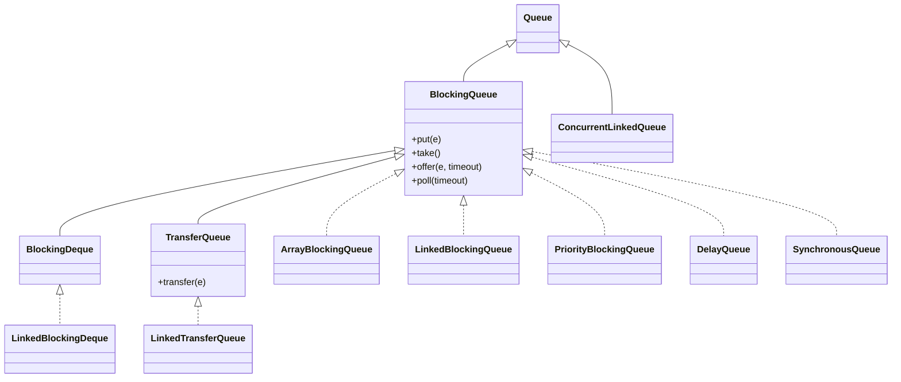
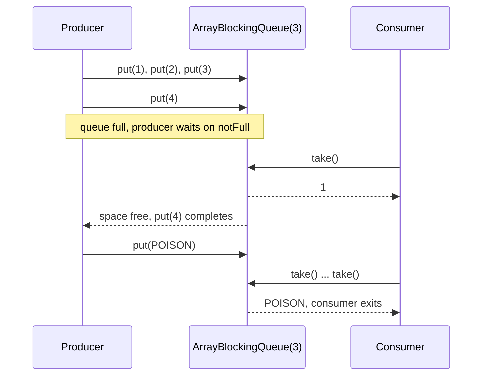
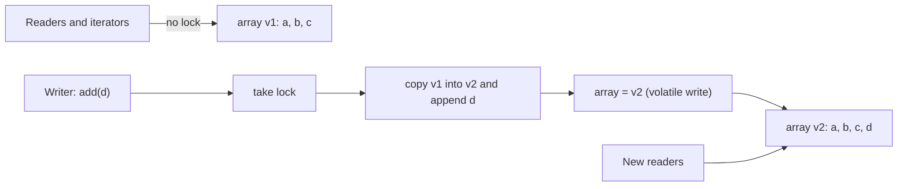

## In One Line
A **`BlockingQueue`** is a thread-safe queue whose `put()` **waits while it is full** and whose `take()` **waits while it is empty**, which makes the producer-consumer pattern a few lines of code with no `wait`/`notify`; around it, `java.util.concurrent` offers purpose-built collections — **`CopyOnWriteArrayList`** for read-mostly lists, **`ConcurrentLinkedQueue`** for lock-free non-blocking queues, and **`ConcurrentSkipListMap`/`Set`** for sorted concurrent maps and sets.

## Mental Model
Picture a **restaurant kitchen pass** — the counter between cooks and waiters.

- Cooks (**producers**) put finished plates on the pass; waiters (**consumers**) take them to tables.
- The pass holds only **3 plates** (a **bounded** queue). If it is full, a cook **waits** (`put` blocks) instead of stacking plates on the floor — the kitchen automatically slows down to the waiters' speed. That is **backpressure**.
- If the pass is empty, waiters **wait** (`take` blocks) instead of checking every second.
- A **`SynchronousQueue`** is a pass with **zero space**: the cook must hand the plate directly into a waiter's hands.
- A **`DelayQueue`** is a pass where each plate has a "ready at" time — waiters cannot pick it up until then.
- A **`PriorityBlockingQueue`** is a pass where VIP orders always go first.
- The poison pill is the chef shouting **"kitchen closed!"** — one shout per waiter, so every waiter hears it and goes home.

Other collections in the same building:
- **`CopyOnWriteArrayList`** is the **printed menu**: hundreds of customers read it at once without any locking; changing a dish means printing a whole new menu, while people holding the old one keep reading it undisturbed.
- **`ConcurrentSkipListMap`** is the **reservation book kept in time order**, which several hosts can write in at the same time.

## Concept
### The `BlockingQueue` interface: four ways to handle "full" and "empty"
| | Throws exception | Returns special value | **Blocks** | Times out |
|---|---|---|---|---|
| **Insert** | `add(e)` → `IllegalStateException("Queue full")` | `offer(e)` → `false` | **`put(e)`** | `offer(e, time, unit)` → `false` |
| **Remove** | `remove()` → `NoSuchElementException` | `poll()` → `null` | **`take()`** | `poll(time, unit)` → `null` |
| **Examine** | `element()` → `NoSuchElementException` | `peek()` → `null` | — | — |

Other rules:
- **No `null` elements** (`NullPointerException`), because `null` is the "nothing there" value of `poll`/`peek`.
- `remainingCapacity()` — free slots (`Integer.MAX_VALUE` for unbounded queues).
- `drainTo(collection[, max])` — moves available elements out in one efficient call (one lock acquisition).
- Blocking methods throw **`InterruptedException`**, which is how you cancel a blocked producer or consumer.
- **Memory consistency**: actions before `put`/`offer` **happen-before** actions after the matching `take`/`poll`. Objects handed through a queue are safely published — no `volatile` needed on their fields (see [Java Memory Model](lesson:b03-concurrency/01-java-memory-model-and-volatile)).
- A `BlockingQueue` is a `Queue`, so it also has `size()`, `contains()`, iteration (weakly consistent) and `remove(Object)` — but these are rarely what you want in concurrent code, because the answer is stale immediately.

### The implementations
| Class | Bounded? | Ordering | Internals | Typical use |
|---|---|---|---|---|
| **`ArrayBlockingQueue`** | Yes, fixed capacity (required) | FIFO | Circular array, **one `ReentrantLock`** + two `Condition`s (`notEmpty`, `notFull`); optional **fairness** | Bounded producer-consumer buffer with predictable memory |
| **`LinkedBlockingQueue`** | Optional; default **`Integer.MAX_VALUE`** | FIFO | Linked nodes, **two locks** (`putLock`, `takeLock`) + `AtomicInteger count`, so a producer and a consumer never contend with each other | Higher throughput buffers; the queue behind `newFixedThreadPool` |
| **`PriorityBlockingQueue`** | No (grows) | By `Comparable`/`Comparator`, smallest first | Array binary heap, one lock; `put` never blocks | Task scheduling by priority |
| **`DelayQueue<E extends Delayed>`** | No | By remaining delay; only **expired** elements can be taken | `PriorityQueue` + lock + leader-follower waiting | Retry schedules, cache expiry, timeouts |
| **`SynchronousQueue`** | **Capacity 0** | Hand-off | Each `put` waits for a `take` and vice versa; optional fair (FIFO) mode. In JDK 21 it shares its internals with `LinkedTransferQueue` | Direct hand-off; the queue behind `newCachedThreadPool` |
| **`LinkedTransferQueue`** (Java 7) | No | FIFO | **Lock-free** "dual queue" (nodes are either data or waiting requests) | `transfer(e)` waits until a consumer has received `e`; fast unbounded queue |
| **`LinkedBlockingDeque`** | Optional | Both ends | Linked nodes, one lock | Blocking deque (`putFirst`, `takeLast`...), work stealing |

`BlockingDeque` adds `putFirst`/`putLast`/`takeFirst`/`takeLast`; `TransferQueue` adds `transfer`, `tryTransfer` and `hasWaitingConsumer()`.

### `ArrayBlockingQueue` vs `LinkedBlockingQueue`
| | `ArrayBlockingQueue` | `LinkedBlockingQueue` |
|---|---|---|
| Capacity | Must be given; fixed | Optional (default `Integer.MAX_VALUE` = effectively unbounded) |
| Storage | Pre-allocated array | One node allocated per element (more GC) |
| Locks | One lock for both ends | Separate `putLock` and `takeLock` |
| Throughput with many producers and consumers | Lower (single lock) | Usually higher (the ends do not contend) |
| Fairness option | Yes (`new ArrayBlockingQueue<>(n, true)`) | No |

> [!INTERVIEW] "An unbounded queue just moves the problem: if producers are faster than consumers, a `LinkedBlockingQueue` without a capacity grows until `OutOfMemoryError`. Bounded queues give backpressure."

### Producer-consumer with a `BlockingQueue`
The queue does all the synchronization: producers `put`, consumers `take`, and the bounded capacity throttles the producers. Compare with the hand-written `wait`/`notify` version in [wait & notify](lesson:a06-threads/06-wait-notify): no monitors, no `while (condition) wait()` loop, no forgotten `notifyAll`.

Shutting consumers down cleanly:
- **Poison pill**: the producer puts a special sentinel value (`-1`, a static `Task POISON`) **once per consumer**; each consumer stops when it takes one. It cannot be `null`, since queues reject `null`.
- **Interrupt**: call `consumerThread.interrupt()` (or `executor.shutdownNow()`); a consumer blocked in `take()` gets `InterruptedException` and exits. Remaining elements are left in the queue.
- **Timed poll + flag**: `poll(100, MILLISECONDS)` in a loop that also checks a `volatile boolean running`.

In real applications the consumer side is usually an `ExecutorService`, which is itself a `BlockingQueue` + worker threads (see [Thread pools](lesson:a07-executors/01-thread-pools)): `newFixedThreadPool` uses an unbounded `LinkedBlockingQueue`, and `newCachedThreadPool` uses a `SynchronousQueue` (hand each task straight to a thread, or create a new thread).

### Non-blocking queues: `ConcurrentLinkedQueue` and `ConcurrentLinkedDeque`
- **Lock-free** (the Michael–Scott algorithm): `offer`/`poll` use CAS on `head`, `tail` and node `next` pointers — see [Atomics & CAS](lesson:b03-concurrency/02-atomics-and-cas).
- **Unbounded**, never block: `offer` always succeeds, `poll` returns `null` when empty.
- **`size()` is O(n)** — it walks the whole list — and its result is only an estimate while others modify the queue. Use `isEmpty()`.
- Good when consumers have other work to do and never need to *wait* for an element; bad when a consumer would spin on `poll()` (use a `BlockingQueue` instead of busy-waiting).
- `ConcurrentLinkedDeque` (Java 7) is the double-ended version.

### `CopyOnWriteArrayList` and `CopyOnWriteArraySet`
How it works:
- The data lives in a `volatile Object[] array`.
- **Reads** (`get`, `contains`, iteration) read the current array reference with **no lock**.
- **Every write** (`add`, `set`, `remove`, `addIfAbsent`) takes a lock (a `ReentrantLock` in Java 8, a `synchronized` monitor since Java 9), **copies the entire array**, changes the copy, and publishes it with a volatile write.
- **Iterators are snapshots** of the array at creation time: they never throw `ConcurrentModificationException`, never see later changes, and do **not** support `remove`, `set` or `add` (`UnsupportedOperationException`) — use the list's own `remove`/`removeIf`.

| Good fit | Bad fit |
|---|---|
| Listener/observer lists, subscriber lists | Large lists with frequent writes (every write is O(n) and allocates) |
| Configuration or routing tables replaced rarely, read constantly | Write-heavy queues or buffers |
| Anything iterated far more often than modified | Code that needs iterators to see the latest writes |

`CopyOnWriteArraySet` is a `Set` backed by a `CopyOnWriteArrayList` using `addIfAbsent`: insertion-ordered, thread-safe, but `add`/`contains` are **O(n)** — only for small sets. For large concurrent sets use `ConcurrentHashMap.newKeySet()` or `ConcurrentSkipListSet`. More on snapshot iterators in [Fail-safe iterators](lesson:a03-collections/23-fail-safe-iterators).

### `ConcurrentSkipListMap` and `ConcurrentSkipListSet`
- The concurrent replacement for **`TreeMap`/`TreeSet`**: keys stay **sorted**, and the full `NavigableMap`/`NavigableSet` API is available (`floorKey`, `ceilingKey`, `higherKey`, `headMap`, `tailMap`, `subMap`, `descendingMap`, `pollFirstEntry`...). The sub-map views are live and thread-safe.
- A **skip list** is a sorted linked list with extra "express lane" index levels on top; each node gets a random number of levels, so search, insert and delete are **O(log n) expected**. Unlike a red-black tree, inserting never needs a global rebalance, so the updates can be **lock-free CAS** operations on a few `next` pointers.
- **No `null` keys or values.** Iterators are weakly consistent and ascending.
- `size()`: Java 8 walked the list (O(n)); recent JDKs (including JDK 21) keep a `LongAdder` count, so it is cheap — but still only an estimate during concurrent updates.
- Its `compute`/`merge`/`computeIfAbsent` are atomic, but the function **may be called more than once** (unlike `ConcurrentHashMap.computeIfAbsent`).
- Pay for sorting only when you need it: `ConcurrentHashMap` is faster for plain lookups.

### Synchronized wrappers vs concurrent collections
| | `Collections.synchronizedList/Map/Set`, `Vector`, `Hashtable` | `java.util.concurrent` collections |
|---|---|---|
| Locking | One lock for everything | Fine-grained locks, lock-free CAS, or copy-on-write |
| Iteration | Fail-fast; you must hold the lock (`synchronized (list) { for ... }`) | Weakly consistent or snapshot; no external lock, no `ConcurrentModificationException` |
| Compound operations | Only by locking the whole collection yourself | Built in (`putIfAbsent`, `addIfAbsent`, `merge`, `drainTo`...) |
| Scalability | Poor under contention | Designed for it |

### Choosing a concurrent collection
| Need | Choose |
|---|---|
| Key-value map | `ConcurrentHashMap` ([lesson](lesson:b03-concurrency/03-concurrenthashmap)) |
| Sorted map / range queries | `ConcurrentSkipListMap` |
| Set | `ConcurrentHashMap.newKeySet()`; sorted: `ConcurrentSkipListSet`; tiny + read-mostly: `CopyOnWriteArraySet` |
| List, read-mostly | `CopyOnWriteArrayList` |
| List, write-heavy | `Collections.synchronizedList(new ArrayList<>())` with care, or redesign around a queue |
| Producer-consumer with backpressure | `ArrayBlockingQueue` or bounded `LinkedBlockingQueue` |
| Non-blocking FIFO | `ConcurrentLinkedQueue` |
| Priority / delayed work | `PriorityBlockingQueue` / `DelayQueue` (or `ScheduledExecutorService`) |
| Direct hand-off between threads | `SynchronousQueue`, `LinkedTransferQueue.transfer`, or `Exchanger` for swaps |

## Diagram

The `BlockingQueue` family: one interface, many buffering policies. `ConcurrentLinkedQueue` is a plain (non-blocking) `Queue`.


Backpressure and shutdown: a full queue parks the producer until a consumer frees a slot; the poison pill tells the consumer to stop.


Copy-on-write: a write builds a new array and swaps the reference; iterators that started earlier keep reading the old array.

## Code
**1. The four method families on a full and an empty queue**
```java
import java.util.concurrent.ArrayBlockingQueue;
import java.util.concurrent.BlockingQueue;
import java.util.concurrent.TimeUnit;

public class MethodFamilies {
    static void attempt(String label, Action c) {
        try { System.out.printf("%-28s -> %s%n", label, c.call()); }
        catch (Exception e) { System.out.printf("%-28s -> %s%n", label, e); }
    }
    interface Action { Object call() throws Exception; }

    public static void main(String[] args) throws Exception {
        BlockingQueue<String> q = new ArrayBlockingQueue<>(2);     // bounded: capacity 2

        // --- inserting into a queue that becomes full ---
        attempt("offer(a)", () -> q.offer("a"));
        attempt("add(b)", () -> q.add("b"));
        attempt("remainingCapacity()", q::remainingCapacity);
        attempt("offer(c)  [full]", () -> q.offer("c"));                  // special value: false
        attempt("add(c)    [full]", () -> q.add("c"));                    // throws
        long start = System.nanoTime();
        attempt("offer(c, 200 ms) [full]", () -> q.offer("c", 200, TimeUnit.MILLISECONDS));
        System.out.println("  ...waited at least 200 ms: " + (System.nanoTime() - start >= 200_000_000));
        // q.put("c") would block here forever, because no other thread ever takes

        // --- removing until empty ---
        attempt("peek()", q::peek);
        attempt("take()", q::take);
        attempt("poll()", q::poll);
        attempt("poll()    [empty]", q::poll);                             // special value: null
        attempt("peek()    [empty]", q::peek);
        attempt("element() [empty]", q::element);                          // throws
        attempt("remove()  [empty]", q::remove);                           // throws
        attempt("poll(100 ms) [empty]", () -> q.poll(100, TimeUnit.MILLISECONDS));
        attempt("offer(null)", () -> q.offer(null));                       // nulls are banned
    }
}
```
```output
offer(a)                     -> true
add(b)                       -> true
remainingCapacity()          -> 0
offer(c)  [full]             -> false
add(c)    [full]             -> java.lang.IllegalStateException: Queue full
offer(c, 200 ms) [full]      -> false
  ...waited at least 200 ms: true
peek()                       -> a
take()                       -> a
poll()                       -> b
poll()    [empty]            -> null
peek()    [empty]            -> null
element() [empty]            -> java.util.NoSuchElementException
remove()  [empty]            -> java.util.NoSuchElementException
poll(100 ms) [empty]         -> null
offer(null)                  -> java.lang.NullPointerException
```

**2. Producer-consumer with backpressure and poison pills**
```java
import java.util.concurrent.ArrayBlockingQueue;
import java.util.concurrent.BlockingQueue;
import java.util.concurrent.atomic.AtomicInteger;

public class ProducerConsumer {
    static final int POISON = -1;                              // sentinel: "no more work"
    static final int CONSUMERS = 2;

    public static void main(String[] args) throws InterruptedException {
        BlockingQueue<Integer> queue = new ArrayBlockingQueue<>(3);   // small bound = backpressure
        AtomicInteger total = new AtomicInteger();

        Thread producer = new Thread(() -> {
            try {
                for (int i = 1; i <= 10; i++) {
                    queue.put(i);                              // blocks while the queue is full
                    System.out.println("produced " + i + "  (queue size " + queue.size() + ")");
                }
                for (int i = 0; i < CONSUMERS; i++) queue.put(POISON);   // one pill per consumer
            } catch (InterruptedException e) {
                Thread.currentThread().interrupt();
            }
        }, "producer");

        Runnable consumerTask = () -> {
            String name = Thread.currentThread().getName();
            try {
                while (true) {
                    int item = queue.take();                   // blocks while the queue is empty
                    if (item == POISON) break;
                    Thread.sleep(50);                          // consumers are slower than the producer
                    total.addAndGet(item);
                    System.out.println("    " + name + " consumed " + item);
                }
                System.out.println("    " + name + " got the poison pill, stopping");
            } catch (InterruptedException e) {
                Thread.currentThread().interrupt();
            }
        };
        Thread c1 = new Thread(consumerTask, "consumer-1");
        Thread c2 = new Thread(consumerTask, "consumer-2");

        producer.start(); c1.start(); c2.start();
        producer.join(); c1.join(); c2.join();
        System.out.println("sum of consumed items = " + total.get() + " (expected 55)");
    }
}
```
```output
produced 1  (queue size 1)
produced 2  (queue size 1)
produced 3  (queue size 2)
produced 4  (queue size 3)
produced 5  (queue size 3)
    consumer-1 consumed 1
produced 6  (queue size 3)
    consumer-2 consumed 2
produced 7  (queue size 3)
    consumer-1 consumed 3
produced 8  (queue size 3)
    consumer-2 consumed 4
produced 9  (queue size 3)
    consumer-1 consumed 5
produced 10  (queue size 3)
    consumer-2 consumed 6
    consumer-1 consumed 7
    consumer-2 consumed 8
    consumer-1 consumed 9
    consumer-1 got the poison pill, stopping
    consumer-2 consumed 10
    consumer-2 got the poison pill, stopping
sum of consumed items = 55 (expected 55)
```
The interleaving varies between runs (in another run `produced 4` saw queue size 2, and consumer-2 consumed item 10 and stopped first). Only the last line is guaranteed.

**3. The specialised blocking queues**
```java
import java.util.ArrayList;
import java.util.List;
import java.util.concurrent.DelayQueue;
import java.util.concurrent.Delayed;
import java.util.concurrent.LinkedBlockingQueue;
import java.util.concurrent.LinkedTransferQueue;
import java.util.concurrent.PriorityBlockingQueue;
import java.util.concurrent.SynchronousQueue;
import java.util.concurrent.TimeUnit;

public class SpecialQueues {
    // An element of a DelayQueue: becomes available only after its delay expires
    record Task(String name, long readyAtNanos) implements Delayed {
        static Task in(String name, long millis) {
            return new Task(name, System.nanoTime() + TimeUnit.MILLISECONDS.toNanos(millis));
        }
        public long getDelay(TimeUnit unit) {
            return unit.convert(readyAtNanos - System.nanoTime(), TimeUnit.NANOSECONDS);
        }
        public int compareTo(Delayed other) {
            return Long.compare(getDelay(TimeUnit.NANOSECONDS), other.getDelay(TimeUnit.NANOSECONDS));
        }
    }

    public static void main(String[] args) throws InterruptedException {
        // 1. LinkedBlockingQueue: "unbounded" really means Integer.MAX_VALUE
        System.out.println("LinkedBlockingQueue capacity: " + new LinkedBlockingQueue<>().remainingCapacity());

        // 2. PriorityBlockingQueue: take() returns the smallest element first
        PriorityBlockingQueue<Integer> pq = new PriorityBlockingQueue<>();
        for (int n : new int[] {42, 7, 19, 3}) pq.put(n);         // put never blocks (unbounded)
        List<Integer> drained = new ArrayList<>();
        pq.drainTo(drained);
        System.out.println("PriorityBlockingQueue drained: " + drained);

        // 3. DelayQueue: elements come out when their delay has expired, soonest first
        DelayQueue<Task> dq = new DelayQueue<>();
        dq.put(Task.in("email", 300));
        dq.put(Task.in("sms", 100));
        dq.put(Task.in("push", 200));
        System.out.println("DelayQueue poll() right away: " + dq.poll());   // nothing is ready yet
        for (int i = 0; i < 3; i++) System.out.println("DelayQueue take(): " + dq.take().name());

        // 4. SynchronousQueue: no capacity at all - a direct hand-off
        SynchronousQueue<String> sq = new SynchronousQueue<>();
        System.out.println("SynchronousQueue offer() with no taker: " + sq.offer("hello")
                + ", size() = " + sq.size());
        Thread taker = new Thread(() -> {
            try { System.out.println("taker received: " + sq.take()); }
            catch (InterruptedException e) { Thread.currentThread().interrupt(); }
        });
        taker.start();
        sq.put("hand-off");                        // blocks until the taker has taken it
        taker.join();

        // 5. LinkedTransferQueue: transfer() waits for a consumer, put() does not
        LinkedTransferQueue<String> tq = new LinkedTransferQueue<>();
        tq.put("queued without waiting");
        System.out.println("tryTransfer with no waiting consumer: " + tq.tryTransfer("x") + ", size = " + tq.size());
        Thread consumer = new Thread(() -> {
            try {
                System.out.println("consumer got: " + tq.take());
                System.out.println("consumer got: " + tq.take());
            } catch (InterruptedException e) { Thread.currentThread().interrupt(); }
        });
        consumer.start();
        tq.transfer("transferred");                // returns only once a consumer has received it
        consumer.join();
        System.out.println("after transfer, size = " + tq.size());
    }
}
```
```output
LinkedBlockingQueue capacity: 2147483647
PriorityBlockingQueue drained: [3, 7, 19, 42]
DelayQueue poll() right away: null
DelayQueue take(): sms
DelayQueue take(): push
DelayQueue take(): email
SynchronousQueue offer() with no taker: false, size() = 0
taker received: hand-off
tryTransfer with no waiting consumer: false, size = 1
consumer got: queued without waiting
consumer got: transferred
after transfer, size = 0
```

**4. `CopyOnWriteArrayList`: snapshot iterators and a listener list**
```java
import java.util.ArrayList;
import java.util.Iterator;
import java.util.List;
import java.util.concurrent.CopyOnWriteArrayList;
import java.util.concurrent.CopyOnWriteArraySet;
import java.util.function.Consumer;

public class CopyOnWriteDemo {
    public static void main(String[] args) {
        // 1. Snapshot iteration: the loop sees the array as it was when the iterator was created
        List<String> cow = new CopyOnWriteArrayList<>(List.of("a", "b", "c"));
        for (String s : cow) {
            if (s.equals("a")) cow.add("d");          // write = copy the array; the iterator keeps the old one
            System.out.print(s + " ");
        }
        System.out.println("| list now " + cow);

        List<String> plain = new ArrayList<>(List.of("a", "b", "c"));
        try {
            for (String s : plain) if (s.equals("a")) plain.add("d");
        } catch (Exception e) {
            System.out.println("ArrayList: " + e.getClass().getSimpleName());
        }

        // 2. The snapshot iterator is read-only
        Iterator<String> it = cow.iterator();
        it.next();
        try { it.remove(); } catch (UnsupportedOperationException e) {
            System.out.println("iterator.remove(): UnsupportedOperationException");
        }
        cow.removeIf(s -> s.equals("b"));                 // use the list's own methods instead
        System.out.println("after removeIf: " + cow);

        // 3. addIfAbsent and CopyOnWriteArraySet
        CopyOnWriteArrayList<String> tags = new CopyOnWriteArrayList<>();
        System.out.println("addIfAbsent(x): " + tags.addIfAbsent("x") + ", again: " + tags.addIfAbsent("x"));
        CopyOnWriteArraySet<Integer> set = new CopyOnWriteArraySet<>(List.of(3, 1, 3, 2));
        System.out.println("CopyOnWriteArraySet keeps insertion order: " + set);

        // 4. The classic use: a listener list that is read on every event, changed rarely
        List<Consumer<String>> listeners = new CopyOnWriteArrayList<>();
        listeners.add(e -> System.out.println("  logger got " + e));
        listeners.add(new Consumer<>() {
            public void accept(String e) {
                System.out.println("  one-shot got " + e + " and unsubscribes");
                listeners.remove(this);                   // safe even while we are iterating
            }
        });
        for (String event : List.of("event-1", "event-2")) {
            System.out.println(event + ":");
            for (Consumer<String> l : listeners) l.accept(event);
        }
    }
}
```
```output
a b c | list now [a, b, c, d]
ArrayList: ConcurrentModificationException
iterator.remove(): UnsupportedOperationException
after removeIf: [a, c, d]
addIfAbsent(x): true, again: false
CopyOnWriteArraySet keeps insertion order: [3, 1, 2]
event-1:
  logger got event-1
  one-shot got event-1 and unsubscribes
event-2:
  logger got event-2
```

**5. `ConcurrentSkipListMap`: a sorted map shared by writers**
```java
import java.util.List;
import java.util.concurrent.ConcurrentNavigableMap;
import java.util.concurrent.ConcurrentSkipListMap;
import java.util.concurrent.ConcurrentSkipListSet;

public class SkipListDemo {
    public static void main(String[] args) throws InterruptedException {
        // Order book: price -> quantity, written by 4 threads at once
        ConcurrentSkipListMap<Integer, Integer> book = new ConcurrentSkipListMap<>();
        Thread[] ts = new Thread[4];
        for (int t = 0; t < ts.length; t++) {
            final int offset = t;
            ts[t] = new Thread(() -> {
                for (int price = 100 + offset; price < 140; price += 8)   // each thread: its own prices
                    book.merge(price, 10, Integer::sum);
                book.merge(120, 1, Integer::sum);                        // all threads: the same price
            });
            ts[t].start();
        }
        for (Thread t : ts) t.join();

        System.out.println("size:           " + book.size());
        System.out.println("first / last:   " + book.firstKey() + " / " + book.lastKey());
        System.out.println("qty at 120:     " + book.get(120));
        System.out.println("floorKey(106):  " + book.floorKey(106) + ", ceilingKey(106): " + book.ceilingKey(106));
        System.out.println("higherKey(135): " + book.higherKey(135));

        ConcurrentNavigableMap<Integer, Integer> cheap = book.headMap(102);       // live view, keys < 102
        System.out.println("headMap(102):   " + cheap);
        book.put(99, 5);                                                         // visible in the view
        System.out.println("after put(99):  " + cheap);
        System.out.println("tailMap(133):   " + book.tailMap(133));
        System.out.println("descending top 3: " + book.descendingMap().keySet().stream().limit(3).toList());
        System.out.println("pollFirstEntry: " + book.pollFirstEntry() + ", new first: " + book.firstKey());

        ConcurrentSkipListSet<String> names = new ConcurrentSkipListSet<>(List.of("mia", "al", "zoe", "bo"));
        System.out.println("skip-list set:  " + names + ", ceiling(c) = " + names.ceiling("c"));
        try { book.put(null, 1); } catch (NullPointerException e) { System.out.println("put(null, 1): NullPointerException"); }
    }
}
```
```output
size:           21
first / last:   100 / 135
qty at 120:     4
floorKey(106):  103, ceilingKey(106): 108
higherKey(135): null
headMap(102):   {100=10, 101=10}
after put(99):  {99=5, 100=10, 101=10}
tailMap(133):   {133=10, 134=10, 135=10}
descending top 3: [135, 134, 133]
pollFirstEntry: 99=5, new first: 100
skip-list set:  [al, bo, mia, zoe], ceiling(c) = mia
put(null, 1): NullPointerException
```

**6. `ConcurrentLinkedQueue`: lock-free, but consumers must not busy-wait**
```java
import java.util.Queue;
import java.util.concurrent.ConcurrentLinkedQueue;
import java.util.concurrent.atomic.AtomicLong;

public class LockFreeQueueDemo {
    public static void main(String[] args) throws InterruptedException {
        Queue<Integer> queue = new ConcurrentLinkedQueue<>();
        AtomicLong consumedSum = new AtomicLong();
        AtomicLong emptyPolls = new AtomicLong();

        Thread[] producers = new Thread[2];
        for (int p = 0; p < producers.length; p++) {
            producers[p] = new Thread(() -> {
                for (int i = 1; i <= 100_000; i++) queue.offer(i);     // never blocks, never full
            });
        }
        Thread[] consumers = new Thread[2];
        for (int c = 0; c < consumers.length; c++) {
            consumers[c] = new Thread(() -> {
                int taken = 0;
                while (taken < 100_000) {
                    Integer x = queue.poll();                         // null when empty: no blocking
                    if (x == null) { emptyPolls.incrementAndGet(); Thread.onSpinWait(); continue; }
                    consumedSum.addAndGet(x);
                    taken++;
                }
            });
        }
        for (Thread t : producers) t.start();
        for (Thread t : consumers) t.start();
        for (Thread t : producers) t.join();
        for (Thread t : consumers) t.join();

        System.out.println("consumed sum = " + consumedSum.get() + " (expected " + 2L * 100_000 * 100_001 / 2 + ")");
        System.out.println("queue empty  = " + queue.isEmpty());
        System.out.println("empty polls  = " + emptyPolls.get() + " (busy-waiting wasted this many calls)");
    }
}
```
```output
consumed sum = 10000100000 (expected 10000100000)
queue empty  = true
empty polls  = 4977229 (busy-waiting wasted this many calls)
```
The first two lines are always the same. The number of empty polls depends entirely on scheduling: another run printed `0` because the producers stayed ahead the whole time.

## Walkthrough
**MethodFamilies**
- `new ArrayBlockingQueue<>(2)` — a bounded queue; the capacity is mandatory and fixed.
- `offer("a")` and `add("b")` both succeed while there is space; `remainingCapacity()` is then 0.
- On the full queue, the three styles differ: `offer("c")` returns **false** immediately, `add("c")` throws **`IllegalStateException: Queue full`**, and `offer("c", 200, MILLISECONDS)` **waits** up to 200 ms for space, then gives up with `false`. The commented-out `put("c")` would wait forever, because this program has no consumer thread.
- `peek()` looks without removing (`a`); `take()` removes `a` (it does not block because an element exists); `poll()` removes `b`.
- On the empty queue: `poll()` and `peek()` return **null**, `element()` and `remove()` throw **`NoSuchElementException`**, and `poll(100 ms)` waits then returns null.
- `offer(null)` throws `NullPointerException`: a `null` element would be indistinguishable from "empty" in `poll`.
- The helper `attempt` takes a small functional interface `Action` whose `call()` may throw checked exceptions (so `q::take` fits), and prints either the result or the exception.

**ProducerConsumer**
- `ArrayBlockingQueue<>(3)` — the producer can be at most 3 items ahead of the consumers.
- The producer calls `put(i)` for 1..10. At first the consumers take items as fast as they arrive (`produced 2 (queue size 1)`: item 1 was already taken). Once the slow consumers (50 ms per item) fall behind, the queue fills up to 3 and every further `put` **blocks** until a consumer's `take` frees a slot — visible as the strict "produced n / consumed m" alternation.
- After item 10, the producer puts **`POISON` twice** — one per consumer. Each consumer `take`s one pill, prints that it is stopping and leaves its loop. With only one pill, the other consumer would block in `take()` forever and `join()` would hang.
- `total` is an `AtomicInteger` because both consumers add to it. The `join()` calls make the final sum visible to `main`: 1 + ... + 10 = 55.
- `catch (InterruptedException e) { Thread.currentThread().interrupt(); }` — the standard way to preserve the interrupt status when you cannot rethrow.
- Thread names (`"producer"`, `"consumer-1"`) are passed to the `Thread` constructor and read with `Thread.currentThread().getName()`.

**SpecialQueues**
- `new LinkedBlockingQueue<>().remainingCapacity()` is `2147483647` — "unbounded" means `Integer.MAX_VALUE`, so memory runs out long before it is full.
- `PriorityBlockingQueue` orders by natural order; `drainTo` removes everything in priority order: `[3, 7, 19, 42]`. (Its *iterator* and `toString` are **not** in priority order — only removal is.)
- `Task` is a `record` implementing `Delayed`: `getDelay` returns the time left (negative once expired) converted to the requested unit, and `compareTo` orders by remaining delay. `poll()` right after inserting returns `null` because nothing has expired yet; the three `take()` calls block until each task is ready and return them by readiness: `sms` (100 ms), `push` (200 ms), `email` (300 ms) — not insertion order.
- `SynchronousQueue.offer("hello")` returns `false`: with no thread waiting in `take`, there is nowhere to put the element; `size()` is always 0. `put("hand-off")` blocks until the `taker` thread arrives, then both continue.
- `LinkedTransferQueue.put` enqueues without waiting (it is unbounded). `tryTransfer("x")` returns `false` because no consumer is waiting — and does **not** enqueue `x`, so the size stays 1. `transfer("transferred")` enqueues and **blocks until a consumer has received it**; the consumer first takes the older element, then the transferred one.

**CopyOnWriteDemo**
- The for-each loop's iterator holds the array `[a, b, c]`. `cow.add("d")` copies it into a new array `[a, b, c, d]` and publishes that, but the running loop still prints only `a b c`. The same code on an `ArrayList` throws `ConcurrentModificationException`.
- The snapshot iterator's `remove()` throws `UnsupportedOperationException`; `removeIf` on the list works (and makes one copy for the whole operation).
- `addIfAbsent` is an atomic "add unless already present". `CopyOnWriteArraySet` removes the duplicate `3` and keeps insertion order `[3, 1, 2]`.
- The listener list: firing an event iterates a snapshot, so the one-shot listener can `remove(this)` in the middle of the loop with no exception; it is gone for `event-2`. The anonymous class (not a lambda) is needed so that `this` refers to the listener itself.

**SkipListDemo**
- Four threads insert disjoint prices (thread *t* writes 100+t, 108+t, 116+t, 124+t, 132+t) with `merge`, and all four add 1 to price 120. The map ends with 20 distinct prices plus 120 = **21** keys, and 120 has quantity **4** — no update lost.
- The map is sorted regardless of insertion order: `firstKey` 100, `lastKey` 135. `floorKey(106)` = greatest key ≤ 106 = 103, `ceilingKey(106)` = least key ≥ 106 = 108 (104–107 are gaps). `higherKey(135)` is `null`.
- `headMap(102)` is a **live view**: after `put(99, 5)` on the main map, the view shows 99 too. `tailMap(133)` includes 133 (inclusive by default). `descendingMap()` iterates from the largest key.
- `pollFirstEntry()` atomically removes and returns the smallest entry (`99=5`).
- `ConcurrentSkipListSet` sorts the names; `ceiling("c")` = least element ≥ "c" = `mia`. `put(null, 1)` throws `NullPointerException`.

**LockFreeQueueDemo**
- Two producers `offer` 100,000 numbers each; `offer` never blocks and never fails on an unbounded lock-free queue.
- Two consumers `poll`; `poll` returns `null` immediately when empty, so the consumer must decide what to do. This one spins (`Thread.onSpinWait()`) and counts the wasted calls — up to about 5 million in one run. That CPU burn is exactly what `BlockingQueue.take()` avoids by parking the thread.
- The sum `2 × (1 + ... + 100,000) = 10,000,100,000` proves no element was lost or duplicated. `isEmpty()` is the cheap check; `size()` would walk the whole list.

## Traps
- **Unbounded queues hide overload.** `new LinkedBlockingQueue<>()` and `Executors.newFixedThreadPool` (which uses one) accept work until `OutOfMemoryError`. Give queues a capacity and decide what happens when full (block, reject, drop).
- **Wrong method for the job.** Using `add` where `put` was meant throws on a full queue; using `offer` without checking the result silently **drops** the element.
- **One poison pill for N consumers.** Only one consumer stops; the rest block in `take()` forever.
- **Swallowing `InterruptedException`** in a consumer loop (`catch (InterruptedException e) {}` inside `while (true)`) makes the thread impossible to stop.
- **`null` in any concurrent queue or skip-list map** → `NullPointerException`.
- **Busy-polling a non-blocking queue** (`while (q.poll() == null) {}`) burns a CPU core. Use a `BlockingQueue` when consumers must wait.
- **`size()` on `ConcurrentLinkedQueue`** is O(n) and already stale when it returns. `isEmpty()` is O(1).
- **Check-then-act on queues.** `if (!q.isEmpty()) q.remove();` can throw if another consumer took the last element in between. Use `poll()` and check for `null`.
- **Iterating a `PriorityBlockingQueue` or printing it** does not show priority order; only `poll`/`take`/`drainTo` do.
- **`CopyOnWriteArrayList` for write-heavy data.** Each `add` copies the whole array: n adds cost O(n²) and create lots of garbage.
- **Expecting a COW iterator to see new elements** or to support `remove()`.
- **Mutating elements** stored in a concurrent collection: the collection is thread-safe, the objects inside are not.

> [!WARNING] `SynchronousQueue.offer(e)` returns `false` unless a consumer is **already waiting** in `take()`/`poll(timeout)`. In a `ThreadPoolExecutor` this is exactly what makes a cached pool create a new thread for every task that finds no idle worker — with an unbounded maximum pool size, a burst of tasks can create thousands of threads.

## Tips & Tricks
- **Method-family mnemonic — "Add/Remove/Element throw, Offer/Poll/Peek return, Put/Take wait."**
- **"Bound it or regret it."** Every production queue needs a capacity and a rejection policy.
- **Poison pill rule: one pill per consumer.** Or use `ExecutorService.shutdown()` and let the executor do it.
- **`drainTo` for batching**: `queue.drainTo(batch, 100)` grabs up to 100 items with one lock acquisition — ideal for batching database writes.
- **Pick the queue by the question "what should a producer do when consumers are slow?"** Wait → bounded `ArrayBlockingQueue`/`LinkedBlockingQueue`; hand off or fail → `SynchronousQueue`; never wait → `ConcurrentLinkedQueue`.
- **Copy-on-write = "many readers, rare writers, small data".** Listener lists are the textbook case.
- **Need `TreeMap` + threads? → `ConcurrentSkipListMap`.** Need `HashSet` + threads? → `ConcurrentHashMap.newKeySet()`.
- **Queues are also safe-publication channels**: whatever a producer wrote into an object before `put` is visible to the consumer after `take`.

## Interview Q&A
### [Basic] What is a `BlockingQueue` and why is it useful?
A `BlockingQueue` (Java 5, `java.util.concurrent`) is a thread-safe `Queue` with operations that **wait**: `put(e)` blocks while the queue is full, and `take()` blocks while it is empty; `offer(e, timeout)` and `poll(timeout)` wait up to a limit. It is the standard building block for the producer-consumer pattern, because it handles the locking, the waiting and the signalling internally — no `synchronized`, `wait()` or `notifyAll()` in user code — and a bounded queue automatically throttles fast producers (backpressure). It also guarantees safe publication: everything done before `put` is visible after the matching `take`.

**Follow-up:** *Can you store `null` in it?* — No, `null` is the "empty" return value of `poll` and `peek`, so all `BlockingQueue` implementations throw `NullPointerException` for it.

### [Basic] Explain the four method groups of `BlockingQueue`.
For insertion: `add` throws `IllegalStateException` when full, `offer` returns `false`, `put` blocks until space is free, and `offer(e, time, unit)` blocks up to the timeout and then returns `false`. For removal: `remove` throws `NoSuchElementException` when empty, `poll` returns `null`, `take` blocks, and `poll(time, unit)` waits up to the timeout and returns `null`. For examining: `element` throws and `peek` returns `null`; there is no blocking examine. Choose by what the caller should do on full/empty: fail loudly, try later, wait, or wait with a limit.

**Follow-up:** *Which ones throw `InterruptedException`?* — The blocking and timed ones: `put`, `take`, `offer(e, t, u)`, `poll(t, u)`.

### [Basic] What is the difference between `ArrayBlockingQueue` and `LinkedBlockingQueue`?
`ArrayBlockingQueue` is always bounded (capacity is required), stores elements in a pre-allocated circular array, and uses one `ReentrantLock` with two conditions for both ends; it supports an optional fairness policy. `LinkedBlockingQueue` is optionally bounded (default `Integer.MAX_VALUE`), allocates a node per element, and uses **two locks** — one for `put`, one for `take` — plus an atomic count, so producers and consumers do not block each other; it usually gives higher throughput under concurrency, at the cost of more garbage. Both are FIFO.

**Follow-up:** *Which one does `Executors.newFixedThreadPool` use, and why is that risky?* — An unbounded `LinkedBlockingQueue`: if tasks arrive faster than they are processed, the queue grows until `OutOfMemoryError`. Build a `ThreadPoolExecutor` with a bounded queue and a rejection policy instead.

### [Intermediate] Implement producer-consumer with a `BlockingQueue`. How do you stop the consumers?
The producer calls `queue.put(item)`; each consumer loops `item = queue.take(); process(item);`. The bounded queue makes producers wait when consumers are slow. To stop: after the last item, the producer puts a **poison pill** (a sentinel object that cannot be real data) **once per consumer**; a consumer that takes the pill exits its loop. Alternatives: interrupt the consumer threads (a blocked `take()` throws `InterruptedException`), or loop on `poll(timeout)` while checking a `volatile` running flag.
```java
BlockingQueue<Order> q = new ArrayBlockingQueue<>(100);
// producer
for (Order o : orders) q.put(o);
for (int i = 0; i < consumers; i++) q.put(Order.POISON);
// consumer
while (true) { Order o = q.take(); if (o == Order.POISON) break; handle(o); }
```
**Follow-up:** *Why not implement it with `wait`/`notify`?* — You can (and interviews sometimes ask you to), but it is easy to get wrong: you must wait in a `while` loop to handle spurious wakeups, use `notifyAll` or separate conditions, and hold the right monitor. The `BlockingQueue` encapsulates all of that correctly.

### [Intermediate] What is a `SynchronousQueue`? Where is it used?
A blocking queue with **zero capacity**: every `put` waits until another thread calls `take`, and vice versa — the element is handed directly from producer to consumer. `offer(e)` succeeds only if a consumer is already waiting; `size()` is always 0 and `peek()` always `null`. It supports an optional fairness mode (FIFO ordering of waiting threads). `Executors.newCachedThreadPool()` uses it: a submitted task is handed to an idle worker if one is waiting; otherwise `offer` fails and the pool creates a new thread.

**Follow-up:** *How is `LinkedTransferQueue.transfer` different?* — `transfer` also waits for a consumer, but the queue has unbounded capacity: `put`/`offer` on it never wait, so you can mix hand-off and ordinary queueing in one queue.

### [Intermediate] What are `PriorityBlockingQueue` and `DelayQueue`?
`PriorityBlockingQueue` is an unbounded, thread-safe binary heap: `take()` returns the smallest element by natural order or a `Comparator`, and blocks only when empty (`put` never blocks). Its iterator does not follow priority order. `DelayQueue` holds elements that implement `Delayed` (`getDelay(unit)` + `compareTo`); an element can be taken only after its delay has expired, and the one expiring first comes out first. It is used for retries with backoff, expiring cache entries, and timeouts. `ScheduledThreadPoolExecutor` uses a similar internal delayed work queue.

**Follow-up:** *What happens if `getDelay` and `compareTo` disagree?* — The queue orders by `compareTo`; if that order does not match the delays, an element that is already expired can be stuck behind one that is not.

### [Intermediate] How does `CopyOnWriteArrayList` work, and when should you use it?
It keeps its elements in a `volatile` array. Reads and iteration take no lock and read whatever array is current. Every mutation takes a lock, **copies the whole array**, modifies the copy, and publishes it with a volatile write. Iterators work on the array that existed when they were created: they never throw `ConcurrentModificationException`, never see later changes, and do not support `remove`. That makes it ideal for small, read-mostly lists iterated very often — listener lists, subscriber lists, rarely changed configuration — and a bad choice for large or frequently modified lists, because each write is O(n) in time and memory.

**Follow-up:** *Why use it for listeners instead of `synchronizedList`?* — Event firing iterates the list; with `synchronizedList` you must hold the lock during the whole iteration (and callbacks), which risks deadlock and blocks registration, and a listener that unsubscribes during the callback causes a `ConcurrentModificationException`.

### [Intermediate] What is the difference between `ConcurrentLinkedQueue` and `LinkedBlockingQueue`?
`ConcurrentLinkedQueue` is **non-blocking and lock-free** (Michael–Scott algorithm with CAS): `offer` always succeeds (unbounded), `poll` returns `null` when empty, and it never parks a thread; `size()` is O(n). `LinkedBlockingQueue` is **blocking and lock-based** (two `ReentrantLock`s): it can be bounded, and `take()` parks the consumer until an element arrives. Use the lock-free queue when threads have other work and just check for items opportunistically; use the blocking queue when consumers should sleep while there is nothing to do and producers should be throttled.

**Follow-up:** *Is lock-free always faster?* — Under low to moderate contention it usually is, but without blocking the consumer must busy-wait or sleep-poll, which wastes CPU or adds latency.

### [Advanced] What is `ConcurrentSkipListMap` and how does a skip list allow lock-free updates?
It is a concurrent, sorted `NavigableMap` — the thread-safe alternative to `TreeMap` — with O(log n) expected `get`, `put` and `remove`, no `null`s, weakly consistent ascending iterators, and live navigable views (`headMap`, `tailMap`, `subMap`, `descendingMap`). A skip list is a sorted linked list plus several levels of sparser "index" lists above it; each node is promoted to higher levels at random, so searches skip ahead quickly. Updating it only requires CAS-ing a few `next` pointers (deletion first marks a node, then unlinks it), with no global rebalancing like a red-black tree's rotations, which is why Doug Lea's implementation is lock-free.

**Follow-up:** *When would you choose it over `ConcurrentHashMap`?* — When you need ordering: range queries, "next higher price", time-ordered events, leaderboards. Otherwise `ConcurrentHashMap` is faster (O(1) average).

### [Advanced] How do concurrent collections differ from `Collections.synchronizedXxx` wrappers?
Synchronized wrappers put one lock (the wrapper object) around every method of an ordinary collection. That makes each call atomic but serialises all threads, gives no atomic compound operations, and leaves iteration fail-fast: you must hold `synchronized (list)` around every iteration, or risk `ConcurrentModificationException`. Concurrent collections are designed for sharing: lock striping or per-bin locks (`ConcurrentHashMap`), lock-free CAS (`ConcurrentLinkedQueue`, `ConcurrentSkipListMap`), or copy-on-write; built-in atomic compound operations (`putIfAbsent`, `merge`, `addIfAbsent`, `drainTo`); and weakly consistent or snapshot iterators that never throw `ConcurrentModificationException`. The trade-off: their `size()` and iteration may not reflect a single instant.

**Follow-up:** *Do they allow `null`?* — Most do not (`ConcurrentHashMap`, `ConcurrentSkipListMap`, all concurrent queues); `CopyOnWriteArrayList` does, because a list's `get` has no "absent" ambiguity.

## Quiz
### What does this print?
```java
BlockingQueue<String> q = new ArrayBlockingQueue<>(1);
System.out.println(q.offer("a") + " " + q.offer("b") + " " + q.poll() + " " + q.poll());
```
- [ ] true true a b
- [x] true false a null
- [ ] true, then an IllegalStateException
- [ ] It blocks forever on the second offer
> Capacity 1: the first `offer` succeeds, the second returns `false` (it neither throws nor blocks — that would be `add` and `put`). The first `poll` returns `a`, the second returns `null` because the queue is empty.

### What does this print?
```java
List<Integer> list = new CopyOnWriteArrayList<>(List.of(1, 2, 3));
int count = 0;
for (Integer x : list) { list.add(x * 10); count++; }
System.out.println(count + " " + list.size());
```
- [x] 3 6
- [ ] 6 6
- [ ] It loops forever
- [ ] ConcurrentModificationException
> The iterator works on a snapshot of `[1, 2, 3]`, so the body runs 3 times even though each iteration adds an element; the list ends with 6 elements. With an `ArrayList` the first `add` would cause a `ConcurrentModificationException`.

### Spot the bug.
```java
BlockingQueue<Task> q = new LinkedBlockingQueue<>();
// 3 consumer threads run:  while (true) { Task t = q.take(); if (t == POISON) break; t.run(); }
producer.produceAll(q);
q.put(POISON);
executor.awaitTermination(1, TimeUnit.HOURS);
```
- [ ] `LinkedBlockingQueue` cannot be used with several consumers
- [x] Only one poison pill for three consumers: two consumers block in `take()` forever
- [ ] `take()` returns `null` when the queue is empty, causing a `NullPointerException`
- [ ] `put` on an unbounded queue throws `IllegalStateException`
> Each pill stops exactly one consumer. Put one pill per consumer (or interrupt the threads / shut down the executor). `take()` never returns `null`; it blocks. (The unbounded queue is a second, smaller problem: nothing throttles the producer.)

### Which queue does `Executors.newCachedThreadPool()` use?
- [ ] `LinkedBlockingQueue` with capacity `Integer.MAX_VALUE`
- [ ] `ArrayBlockingQueue`
- [x] `SynchronousQueue`
- [ ] `PriorityBlockingQueue`
> The cached pool hands each task directly to an idle thread through a zero-capacity `SynchronousQueue`; when no thread is waiting, `offer` fails and the pool creates a new thread. Verified with `((ThreadPoolExecutor) pool).getQueue()`. `newFixedThreadPool` is the one with the unbounded `LinkedBlockingQueue`.

### You need a thread-safe map whose keys must stay sorted, with fast `floorKey`/`ceilingKey` lookups. What do you use?
- [ ] `Collections.synchronizedMap(new TreeMap<>())`
- [ ] `ConcurrentHashMap`
- [x] `ConcurrentSkipListMap`
- [ ] `Hashtable`
> `ConcurrentSkipListMap` is the concurrent `NavigableMap`: sorted, lock-free, O(log n). A synchronized `TreeMap` works but serialises every access and needs manual locking during iteration; `ConcurrentHashMap` and `Hashtable` are unordered.

### A listener list is read on every event (thousands per second) and changed a few times a day. Which list fits best?
- [ ] `ArrayList`
- [ ] `Collections.synchronizedList(new ArrayList<>())`
- [x] `CopyOnWriteArrayList`
- [ ] `LinkedList`
> Reads and iterations of a `CopyOnWriteArrayList` take no lock and cannot throw `ConcurrentModificationException`, even if a listener unsubscribes during the callback; the rare writes pay for a full array copy. A synchronized list would need a lock held during every iteration; `ArrayList`/`LinkedList` are not thread-safe.

### What does `new SynchronousQueue<String>().offer("x")` return when no thread is waiting to take?
- [ ] `true` — the element is stored until someone takes it
- [x] `false` — there is no capacity and no waiting consumer
- [ ] It blocks until a consumer arrives
- [ ] It throws `IllegalStateException`
> A `SynchronousQueue` has no storage; `offer` succeeds only by handing the element to an already-waiting consumer. The demo printed `false` with `size() = 0`. Blocking until a consumer arrives is what `put` does.

## Takeaways
- `BlockingQueue` = thread-safe queue whose `put` waits while full and `take` waits while empty; method families: throw (`add`/`remove`/`element`), special value (`offer`/`poll`/`peek`), block (`put`/`take`), timeout (`offer`/`poll` with time).
- Producer-consumer: bounded queue for backpressure, one poison pill per consumer (or interrupts) for shutdown; handing objects through a queue also publishes them safely.
- `ArrayBlockingQueue`: bounded array, one lock; `LinkedBlockingQueue`: optionally bounded (default `Integer.MAX_VALUE`), separate put/take locks; unbounded queues can end in `OutOfMemoryError`.
- Special queues: `PriorityBlockingQueue` (heap order), `DelayQueue` (only expired `Delayed` elements), `SynchronousQueue` (zero-capacity hand-off, used by cached pools), `LinkedTransferQueue` (`transfer` waits for a consumer).
- `ConcurrentLinkedQueue`/`Deque`: lock-free, unbounded, never block (`poll` returns `null`), `size()` is O(n) — do not busy-wait on them.
- `CopyOnWriteArrayList`/`Set`: lock-free reads, every write copies the array, snapshot iterators (no CME, no `remove`) — for small, read-mostly data such as listener lists.
- `ConcurrentSkipListMap`/`Set`: the concurrent sorted `TreeMap`/`TreeSet`, lock-free skip list with O(log n) expected operations and live navigable views.
- Concurrent collections beat synchronized wrappers: finer-grained or lock-free concurrency, built-in atomic compound operations, and iterators that never throw `ConcurrentModificationException`; almost all of them reject `null`.
