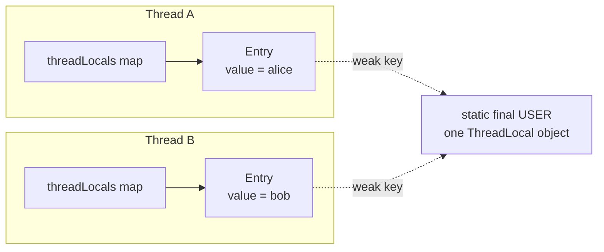
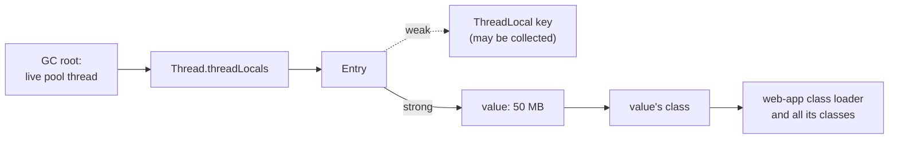
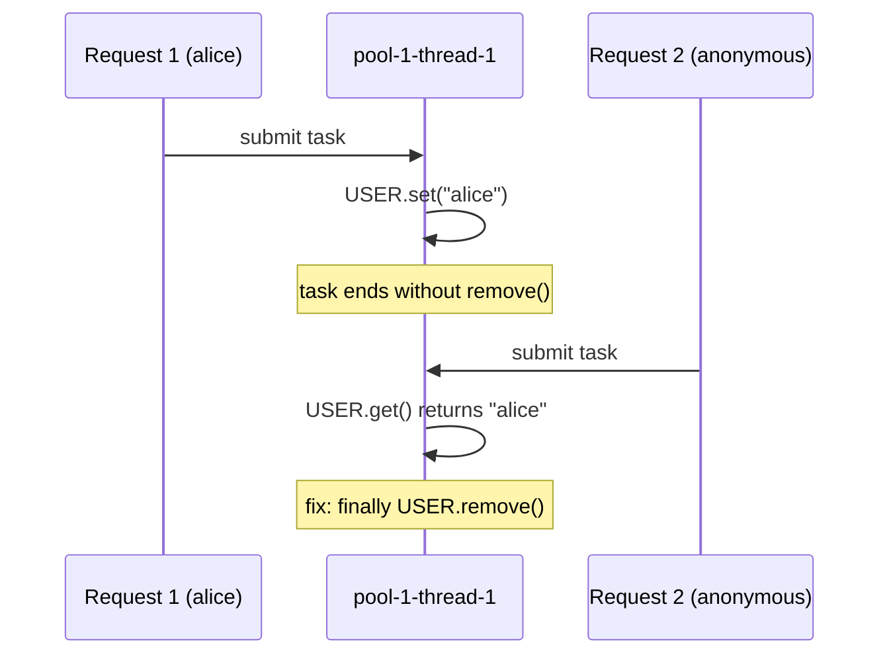

## In One Line
A `ThreadLocal<T>` is one variable with **one value per thread**: every thread that calls `get()` sees only the value it set itself, so you get thread safety without locks and can carry context (current user, transaction, trace id) through a call chain without passing parameters. The price: the value lives as long as the **thread**, so in thread pools you must `remove()` it.

## Mental Model
Every thread carries its own **backpack** (the thread's `ThreadLocalMap`). A `ThreadLocal` object is only a **pocket label**, such as "USER".

- `USER.get()` = "open the USER pocket **in my own backpack**". Two threads using the same label open pockets in two different backpacks, so they never see each other's values and never need a lock.
- `USER.set("alice")` = put something in *my* USER pocket.
- `USER.remove()` = empty *my* USER pocket.
- `withInitial(...)` = if my pocket has never been filled, fill it with a fresh default the first time I look.

The leak and the stale-data bug follow directly from the picture:
- A **thread-pool worker never goes home**, so it never empties its backpack. Whatever a task leaves in a pocket stays there, and the **next customer** served by that worker finds it (stale data).
- The label is tied on with a **weak string** (weak reference). If nobody holds the label any more, the GC may cut the string off, but the **contents stay in the pocket** until the backpack is cleaned or the worker dies (memory leak).

`InheritableThreadLocal` = when a thread creates a child thread, the child gets a **photocopy** of the parent's inheritable pockets at the moment it is created. `ScopedValue` (Java 21 preview) = a **name badge that only works inside one room**: it cannot be changed, and it disappears automatically when you leave the room.

## Concept
### Why ThreadLocal exists
There are three ways to make state safe to use from many threads:

| Strategy | Example |
|---|---|
| **Don't share it** (thread confinement) | Local variables; **`ThreadLocal`** |
| Share only immutable objects | `String`, records, `DateTimeFormatter` |
| Share and synchronize | `synchronized`, locks, atomics, concurrent collections |

`ThreadLocal` is thread confinement made convenient. It has two classic uses:

1. **A private copy of an object that is not thread-safe or is expensive to create**, one per thread instead of one per call: `SimpleDateFormat`, `MessageDigest`, `Cipher`, a reusable `StringBuilder` or `byte[]` buffer.
2. **Implicit context**: information that belongs to "the request this thread is currently handling", made available to deep code without adding a parameter to every method: current user / security context, transaction and JDBC connection, request or trace id for logging, tenant id, locale.

Frameworks you already use rely on it:

| Framework class | What it stores per thread |
|---|---|
| Spring `SecurityContextHolder` | The authenticated user (default strategy `MODE_THREADLOCAL`; `MODE_INHERITABLETHREADLOCAL` also exists) |
| Spring `TransactionSynchronizationManager` | The transaction's resources, e.g. the JDBC connection, so all repositories in one `@Transactional` method share it |
| Spring `RequestContextHolder`, `LocaleContextHolder` | The current HTTP request, the current locale |
| SLF4J / Logback / Log4j2 `MDC` | Key-value pairs (e.g. `requestId`) printed in every log line |
| Hibernate `ThreadLocalSessionContext` | The "current session" |

### The API
| Member | Since | What it does |
|---|---|---|
| `new ThreadLocal<>()` | 1.2 | A new variable. Initial value in every thread: `null` |
| `ThreadLocal.withInitial(Supplier)` | 8 | A variable whose initial value comes from the supplier, called **once per thread**, lazily |
| `protected T initialValue()` | 1.2 | The pre-Java 8 way: override it in an anonymous subclass |
| `T get()` | 1.2 | This thread's value. If this thread has no entry yet, calls `initialValue()`, stores the result and returns it |
| `void set(T)` | 1.2 | Sets this thread's value. Does **not** call `initialValue()` |
| `void remove()` | 5 | Deletes this thread's entry. The next `get()` calls `initialValue()` again |

Rules worth memorising:
- The initial value is computed **lazily, per thread, on the first `get()`**, not when the `ThreadLocal` is created.
- `set(null)` stores `null`; it is **not** the same as `remove()`. After `set(null)`, `get()` returns `null` and the initializer does not run; after `remove()`, the initializer runs again.
- Every method only ever touches the **calling thread's** value. There is no way to read or clear another thread's value through the public API.
- Declare it **`private static final`**. You want one `ThreadLocal` object per *purpose*, not per instance of your class.

### How it works inside
The surprising part: the values are **not stored in the `ThreadLocal`**. They are stored in the **thread**.

```java
// java.lang.Thread (JDK 21)
ThreadLocal.ThreadLocalMap threadLocals;             // this thread's ThreadLocal values
ThreadLocal.ThreadLocalMap inheritableThreadLocals;  // values of InheritableThreadLocals
```

`get()` does roughly this:
```java
Thread t = Thread.currentThread();
ThreadLocalMap map = t.threadLocals;           // the calling thread's own map
Entry e = (map == null) ? null : map.getEntry(this);   // "this" = the ThreadLocal is the key
return (e != null) ? (T) e.value : setInitialValue(t);
```

`ThreadLocalMap` is a small hash table written just for this purpose (not a `HashMap`):

| Detail | Value |
|---|---|
| Structure | Array of `Entry`, **open addressing with linear probing** (no linked buckets) |
| `Entry` | `class Entry extends WeakReference<ThreadLocal<?>> { Object value; }` — **weak key, strong value** |
| Capacity | Starts at 16, always a power of two, resized (doubled) when about 2/3 full |
| Hash of a key | Each `ThreadLocal` gets `threadLocalHashCode` from a global counter that grows by `0x61c88647` (the golden ratio as a 32-bit fraction). This "Fibonacci hashing" spreads consecutive `ThreadLocal`s evenly over power-of-two tables |
| Locking | **None.** Only the owning thread reads or writes its map, so `get()`/`set()` are just a hash lookup |
| Cleanup | An entry whose key has been garbage collected is **stale** (`e.get() == null`). `get`, `set` and `remove` expunge stale entries they happen to meet, and a full sweep runs before a resize. Cleanup is **opportunistic**, never guaranteed |
| Thread death | When a thread terminates, the JVM drops its maps, and all its values become garbage |

Why this design instead of a global `Map<Thread, T>` inside the `ThreadLocal`? A shared map would need synchronization on every access, and it would keep values of dead threads alive. A map *inside* the thread needs no lock and disappears with the thread.

### Memory leaks: two different problems
**1. Retention (a real memory leak).** The value is reachable through a strong chain: live thread → `threadLocals` → table → `Entry` → **value**. Threads in a pool live as long as the application, so a value that is never removed is never collected. The weak key does **not** save you:
- If the `ThreadLocal` is `static final` (the normal case), the key is always strongly reachable, so the entry never even becomes stale.
- If the `ThreadLocal` object itself becomes unreachable, the GC clears the key, but the **value stays** until some later `get`/`set`/`remove` on that thread happens to expunge the stale slot, or the thread dies. Snippet 4 in Code proves this.

In application servers this becomes a **class loader leak**: the value's class was loaded by the web app's class loader, so the value pins the class, which pins the loader, which pins every class and static field of the app. After a few redeploys: `OutOfMemoryError: Metaspace`. Tomcat detects this at undeploy and logs a warning that the web application "created a ThreadLocal ... but failed to remove it when the web application was stopped", then renews its worker threads.

**2. Stale data (a correctness and security bug).** A pool thread handles request 1 for `alice` and leaves `USER = alice`. It then handles request 2, which is anonymous and never sets `USER`. Request 2 now runs **as alice**. Snippet 3 in Code shows it.

**Why weak keys at all?** If keys were strong, a `ThreadLocal` that your code has forgotten would stay reachable from every thread's map forever, together with its values. Weak keys at least let the `ThreadLocal` object be collected and mark the entry as stale, so the map can clean it up later. Why not weak **values**? Then the GC could delete a value that is still in use, because often the map is the *only* reference to it.

### The remove() discipline
The fix for both problems is the same, and it is the single most important rule of this lesson:

```java
USER.set(user);
try {
    chain.doFilter(request, response);   // everything that needs USER
} finally {
    USER.remove();                       // always, even on exceptions
}
```

Put the `set`/`remove` pair at the **boundary** of the unit of work: a servlet `Filter`, a Spring `HandlerInterceptor.afterCompletion`, a task wrapper (Spring's `TaskDecorator`), a message-listener adapter. Not deep inside business code.

### InheritableThreadLocal
`InheritableThreadLocal<T> extends ThreadLocal<T>` and adds one feature: a **new thread starts with a copy** of the inheritable values of the thread that **created** it.

- The copy is made in the **`Thread` constructor**, which runs in the parent thread. It is a snapshot. Values the parent sets after `new Thread(...)` are not seen, and after that parent and child are independent.
- For each value the child gets `childValue(parentValue)`. The default returns the **same reference**, so a mutable object (a `List`, a `Map`) is **shared** between parent and child. Override `childValue` to copy it.
- **Thread pools break it.** A pool worker is created once (usually during the first `submit`) and then reused. It inherits whatever the submitting thread had **at that moment**, and keeps it for every later task. Snippet 5 shows task 2 still seeing `request-1`.
- Opting out: `new Thread(group, task, name, stackSize, false)` (Java 9+), or `Thread.ofVirtual().inheritInheritableThreadLocals(false)` / `Thread.ofPlatform()...` (Java 21).
- Virtual threads inherit by default. With `Executors.newVirtualThreadPerTaskExecutor()` each task gets a brand-new thread created during `submit`, so each task inherits the submitter's value **at submit time**, which is usually what you want.

> [!WARNING] `InheritableThreadLocal.withInitial(...)` compiles, but `withInitial` is a static method of `ThreadLocal`, so it returns a plain, **non-inheritable** `ThreadLocal`. Override `initialValue()` in an `InheritableThreadLocal` subclass instead.

### Passing context to other threads correctly
For pools and `CompletableFuture`, the reliable pattern is **capture and restore**: read the value in the submitting thread, set it in the worker for the duration of the task, and clean up afterwards (snippet 6). This is exactly what Spring's `TaskDecorator`, the "copy the MDC map" idiom (`MDC.getCopyOfContextMap()` / `MDC.setContextMap(...)`) and libraries such as Alibaba's `TransmittableThreadLocal` do.

### ThreadLocal and virtual threads
Virtual threads (Java 21) fully support `ThreadLocal` and `InheritableThreadLocal`. (The previews in Java 19–20 allowed creating virtual threads *without* thread locals; the final version dropped that option.) But:

- **Caching per thread stops working.** Virtual threads are never pooled: every task gets a new thread, so a `ThreadLocal<SimpleDateFormat>` creates a new formatter for every task and throws it away.
- **Memory multiplies.** A million virtual threads with a 1 KB buffer each is 1 GB.
- The JDK can show you where virtual threads set thread locals: run with `-Djdk.traceVirtualThreadLocals` and every such `set()` prints a stack trace (demo in [Virtual Threads](lesson:b03-concurrency/07-virtual-threads)).

### ScopedValue: the modern replacement for context
`ScopedValue<T>` (`java.lang`) is a **preview API in Java 21** (JEP 446; incubator in 20) and became **final in Java 25** (JEP 506). It is designed for the "implicit context" use case:

```java
static final ScopedValue<String> USER = ScopedValue.newInstance();

ScopedValue.where(USER, "alice").run(() -> handleRequest());   // bound only inside run()
// inside handleRequest(), at any depth:  USER.get()  -> "alice"
```

| | `ThreadLocal` | `InheritableThreadLocal` | `ScopedValue` |
|---|---|---|---|
| Mutable? | Yes, `set()` any time | Yes | **No.** A binding is fixed; nested code can only *rebind* for a narrower scope |
| Lifetime | Until `remove()` or thread death | Same | **The `run`/`call` block.** Ends automatically, nothing to remove, cannot leak |
| Child threads | Not visible | Copied at thread creation | Visible to subtasks forked in a `StructuredTaskScope`, shared **without copying** |
| Cost with millions of virtual threads | One map entry per thread | Plus a copy per thread | Very cheap, designed for it |
| Outside a binding | `get()` returns `null` or the initial value | Same | `get()` throws `NoSuchElementException`; use `isBound()` / `orElse(...)` |
| Status | Stable since 1.2 | Stable since 1.2 | Preview in 21–24, final in 25 |

Keep `ThreadLocal` for per-thread **caches of mutable objects** on platform threads; prefer `ScopedValue` for **read-only context** once you are on Java 25 (or accept preview features).

### ThreadLocalRandom is not a ThreadLocal
`ThreadLocalRandom.current()` (Java 7) gives a random generator that behaves as if each thread had its own, with no contention. Internally it does **not** use `ThreadLocal`: the seed lives directly in fields of `Thread` (`threadLocalRandomSeed`, `threadLocalRandomProbe`). Always call `ThreadLocalRandom.current().nextInt(...)` at the point of use; never store the result of `current()` in a field shared by several threads.

### When not to use ThreadLocal
- To avoid passing ordinary parameters. It is **hidden global state**: harder to test, easy to forget to set, easy to leak.
- In **asynchronous or reactive code** where one request hops between threads (`CompletableFuture` chains, parallel streams, Project Reactor / WebFlux). The value does not follow the work; Reactor has its own `Context` for this.
- For **immutable, thread-safe** objects: just share one instance (`DateTimeFormatter` instead of `ThreadLocal<SimpleDateFormat>`).

## Diagram

The values live in each **thread's** own map. The `ThreadLocal` object is only the key, held weakly.


Only the key is weak. While the thread lives, the value and everything it references stay reachable: that is the leak.


A reused pool thread carries one task's value into the next task.

## Code
**1. One ThreadLocal, one value per thread.** `ThreadLocalBasics.java` — run with `java ThreadLocalBasics.java`.
```java
import java.util.Map;
import java.util.TreeMap;
import java.util.concurrent.ConcurrentHashMap;
import java.util.concurrent.CyclicBarrier;

public class ThreadLocalBasics {
    // ONE ThreadLocal object shared by every thread; each thread gets its OWN value.
    private static final ThreadLocal<StringBuilder> BUFFER = ThreadLocal.withInitial(() -> {
        System.out.println("  initialValue() runs in " + Thread.currentThread().getName());
        return new StringBuilder();
    });

    public static void main(String[] args) throws Exception {
        Map<String, String> results = new ConcurrentHashMap<>();
        CyclicBarrier together = new CyclicBarrier(3);     // force A, B and C to overlap

        Runnable task = () -> {
            String me = Thread.currentThread().getName();
            try {
                together.await();
                for (int i = 1; i <= 3; i++) {
                    BUFFER.get().append(me).append(i).append(' ');   // no locking needed
                    Thread.sleep(10);
                }
                results.put(me, BUFFER.get().toString().trim());
            } catch (Exception e) {
                throw new RuntimeException(e);
            } finally {
                BUFFER.remove();                            // clean up before the thread ends
            }
        };
        Thread a = new Thread(task, "A"), b = new Thread(task, "B"), c = new Thread(task, "C");
        a.start(); b.start(); c.start();
        a.join();  b.join();  c.join();
        System.out.println("per-thread results: " + new TreeMap<>(results));

        System.out.println("main sees \"" + BUFFER.get() + "\"");   // main has its own, empty value
        BUFFER.get().append("main-data");
        BUFFER.set(new StringBuilder("replaced"));
        System.out.println("after set():    " + BUFFER.get());
        BUFFER.remove();
        System.out.println("after remove(): \"" + BUFFER.get() + "\"");  // initial value again
    }
}
```
```output
  initialValue() runs in C
  initialValue() runs in A
  initialValue() runs in B
per-thread results: {A=A1 A2 A3, B=B1 B2 B3, C=C1 C2 C3}
  initialValue() runs in main
main sees ""
after set():    replaced
  initialValue() runs in main
after remove(): ""
```
The order of the first three lines **varies between runs** (another run printed B, A, C); everything else is always the same.

**2. Per-thread copies of a non-thread-safe object.** `DateFormatDemo.java`
```java
import java.text.SimpleDateFormat;
import java.util.Date;
import java.util.concurrent.ExecutorService;
import java.util.concurrent.Executors;
import java.util.concurrent.atomic.AtomicInteger;
import java.util.function.Supplier;

public class DateFormatDemo {
    static final SimpleDateFormat SHARED = new SimpleDateFormat("yyyy-MM-dd");      // NOT thread-safe
    static final ThreadLocal<SimpleDateFormat> PER_THREAD =
            ThreadLocal.withInitial(() -> new SimpleDateFormat("yyyy-MM-dd"));      // one per thread

    public static void main(String[] args) throws Exception {
        System.out.println("shared instance: " + run(() -> SHARED) + " bad results");
        System.out.println("ThreadLocal:     " + run(PER_THREAD::get) + " bad results");
    }

    static int run(Supplier<SimpleDateFormat> format) throws Exception {
        AtomicInteger bad = new AtomicInteger();
        ExecutorService pool = Executors.newFixedThreadPool(4);
        for (int i = 0; i < 10_000; i++) {
            String expected = "2024-01-" + String.format("%02d", i % 28 + 1);
            pool.execute(() -> {
                try {
                    Date d = format.get().parse(expected);
                    if (!format.get().format(d).equals(expected)) bad.incrementAndGet();
                } catch (Exception e) {
                    bad.incrementAndGet();                 // NumberFormatException etc.
                }
            });
        }
        pool.close();                                     // Java 19+: shutdown + wait
        return bad.get();
    }
}
```
```output
shared instance: 134 bad results
ThreadLocal:     0 bad results
```
The first number **varies between runs** (35, 236 and 555 in other runs) because it depends on how the four threads interleave inside the shared formatter. The `ThreadLocal` line is always 0.

**3. Stale context in a thread pool.** `StaleContextDemo.java`
```java
import java.util.concurrent.ExecutorService;
import java.util.concurrent.Executors;

public class StaleContextDemo {
    // Typical "request context": who is the current user?
    static final ThreadLocal<String> CURRENT_USER = new ThreadLocal<>();

    // BUGGY handler: sets the context but never clears it
    static void handle(String user) {
        if (user != null) CURRENT_USER.set(user);           // anonymous requests set nothing
        System.out.println(Thread.currentThread().getName() + " | request from " + user
                + " -> CURRENT_USER = " + CURRENT_USER.get());
    }

    // FIXED handler: set ... try ... finally remove
    static void handleSafely(String user) {
        if (user != null) CURRENT_USER.set(user);
        try {
            System.out.println(Thread.currentThread().getName() + " | request from " + user
                    + " -> CURRENT_USER = " + CURRENT_USER.get());
        } finally {
            CURRENT_USER.remove();
        }
    }

    public static void main(String[] args) throws Exception {
        ExecutorService pool = Executors.newFixedThreadPool(1);   // one reused worker thread

        System.out.println("-- without remove()");
        pool.submit(() -> handle("alice")).get();
        pool.submit(() -> handle(null)).get();                   // leaks alice's identity!

        pool.submit(CURRENT_USER::remove).get();                  // reset the worker for part 2

        System.out.println("-- with try/finally remove()");
        pool.submit(() -> handleSafely("bob")).get();
        pool.submit(() -> handleSafely(null)).get();
        pool.shutdown();
    }
}
```
```output
-- without remove()
pool-1-thread-1 | request from alice -> CURRENT_USER = alice
pool-1-thread-1 | request from null -> CURRENT_USER = alice
-- with try/finally remove()
pool-1-thread-1 | request from bob -> CURRENT_USER = bob
pool-1-thread-1 | request from null -> CURRENT_USER = null
```

**4. Weak key, strong value: proving the leak.** `ThreadLocalLeakDemo.java`
```java
import java.lang.ref.WeakReference;
import java.util.concurrent.ExecutorService;
import java.util.concurrent.Executors;

public class ThreadLocalLeakDemo {
    static WeakReference<ThreadLocal<byte[]>> keyRef;   // weak refs let us watch the GC
    static WeakReference<byte[]> valueRef;              // without keeping the objects alive
    static Thread worker;

    public static void main(String[] args) throws Exception {
        ExecutorService pool = Executors.newFixedThreadPool(1);

        pool.submit(() -> {
            worker = Thread.currentThread();
            ThreadLocal<byte[]> cache = new ThreadLocal<>();   // local: unreachable after the task
            byte[] big = new byte[50 * 1024 * 1024];            // 50 MB value
            cache.set(big);
            keyRef = new WeakReference<>(cache);
            valueRef = new WeakReference<>(big);
            // BUG: no cache.remove()
        }).get();

        System.gc();
        Thread.sleep(200);
        System.out.println("task finished, worker thread still alive");
        System.out.println("  ThreadLocal (key) collected?  " + (keyRef.get() == null));
        System.out.println("  50 MB value collected?        " + (valueRef.get() == null));

        pool.shutdown();
        worker.join();                                          // wait until the thread has really died
        System.gc();
        Thread.sleep(200);
        System.out.println("worker thread terminated");
        System.out.println("  50 MB value collected?        " + (valueRef.get() == null));
    }
}
```
```output
task finished, worker thread still alive
  ThreadLocal (key) collected?  true
  50 MB value collected?        false
worker thread terminated
  50 MB value collected?        true
```
Same result in six runs on JDK 21 with the default G1 collector (`System.gc()` is only a request, but G1 honours it with a full collection).

**5. InheritableThreadLocal: snapshot at creation, and why pools break it.** `InheritableDemo.java`
```java
import java.util.ArrayList;
import java.util.List;
import java.util.concurrent.ExecutorService;
import java.util.concurrent.Executors;

public class InheritableDemo {
    static final ThreadLocal<String> PLAIN = new ThreadLocal<>();
    static final InheritableThreadLocal<String> TRACE_ID = new InheritableThreadLocal<>();
    static final InheritableThreadLocal<List<String>> TAGS = new InheritableThreadLocal<>() {
        @Override
        protected List<String> childValue(List<String> parentValue) {
            return new ArrayList<>(parentValue);          // give the child its own copy
        }
    };

    public static void main(String[] args) throws Exception {
        PLAIN.set("main-only");
        TRACE_ID.set("trace-42");
        TAGS.set(new ArrayList<>(List.of("main")));

        // 1. A child thread gets a snapshot of the inheritable values
        Thread child = new Thread(() -> {
            System.out.println("child: PLAIN=" + PLAIN.get() + ", TRACE_ID=" + TRACE_ID.get()
                    + ", TAGS=" + TAGS.get());
            TRACE_ID.set("changed-in-child");                 // affects only the child
            TAGS.get().add("child");                          // mutates the child's copy
        });
        child.start();
        child.join();
        System.out.println("main after child: TRACE_ID=" + TRACE_ID.get() + ", TAGS=" + TAGS.get());

        // 2. The snapshot is taken in the Thread CONSTRUCTOR, not in start()
        Thread late = new Thread(() -> System.out.println("late child sees " + TRACE_ID.get()));
        TRACE_ID.set("set-after-new-Thread");
        late.start();
        late.join();

        // 3. Thread pools: the value is copied once, when the worker thread is created
        ExecutorService pool = Executors.newFixedThreadPool(1);
        TRACE_ID.set("request-1");
        pool.submit(() -> System.out.println("pool task 1 sees " + TRACE_ID.get())).get();
        TRACE_ID.set("request-2");
        pool.submit(() -> System.out.println("pool task 2 sees " + TRACE_ID.get())).get();
        pool.shutdown();

        // 4. Opting out of inheritance
        Thread noCopy = new Thread(null, () -> System.out.println("no-inherit thread sees "
                + TRACE_ID.get()), "no-inherit", 0, false);   // Java 9+ constructor
        noCopy.start();
        noCopy.join();
        Thread v1 = Thread.ofVirtual().start(() -> System.out.println("virtual thread sees " + TRACE_ID.get()));
        v1.join();
        Thread v2 = Thread.ofVirtual().inheritInheritableThreadLocals(false)
                .start(() -> System.out.println("virtual (opted out) sees " + TRACE_ID.get()));
        v2.join();
    }
}
```
```output
child: PLAIN=null, TRACE_ID=trace-42, TAGS=[main]
main after child: TRACE_ID=trace-42, TAGS=[main]
late child sees trace-42
pool task 1 sees request-1
pool task 2 sees request-1
no-inherit thread sees null
virtual thread sees request-2
virtual (opted out) sees null
```

**6. Carrying context into a pool correctly: capture and restore.** `ContextPropagation.java`
```java
import java.util.concurrent.CompletableFuture;
import java.util.concurrent.ExecutorService;
import java.util.concurrent.Executors;

public class ContextPropagation {
    static final ThreadLocal<String> USER = new ThreadLocal<>();

    // Capture in the submitting thread, restore in the worker, clean up afterwards
    static Runnable withContext(Runnable task) {
        String captured = USER.get();                 // runs NOW, in the caller's thread
        return () -> {
            String previous = USER.get();             // runs LATER, in the worker thread
            USER.set(captured);
            try {
                task.run();
            } finally {
                if (previous == null) USER.remove(); else USER.set(previous);
            }
        };
    }

    public static void main(String[] args) {
        ExecutorService pool = Executors.newFixedThreadPool(2);
        USER.set("alice");
        CompletableFuture.runAsync(() -> System.out.println("plain task sees   " + USER.get()), pool).join();
        CompletableFuture.runAsync(withContext(() -> System.out.println("wrapped task sees " + USER.get())), pool).join();
        CompletableFuture.runAsync(() -> System.out.println("next plain task   " + USER.get()), pool).join();
        pool.shutdown();
    }
}
```
```output
plain task sees   null
wrapped task sees alice
next plain task   null
```

**7. ScopedValue (Java 21 preview).** `ScopedValueDemo.java` — run with `java --enable-preview --source 21 ScopedValueDemo.java`. The launcher first prints two `Note: ... uses preview features of Java SE 21` lines to standard error.
```java
import java.util.NoSuchElementException;
import java.util.concurrent.StructuredTaskScope;

public class ScopedValueDemo {
    // Like a static final ThreadLocal, but immutable and bound only for a scope
    static final ScopedValue<String> USER = ScopedValue.newInstance();

    public static void main(String[] args) throws Exception {
        System.out.println("bound before? " + USER.isBound());

        ScopedValue.where(USER, "alice").run(() -> {
            service();                                            // no parameter passing needed
            ScopedValue.where(USER, "admin").run(() -> service()); // nested rebinding
            service();                                            // back to alice automatically
        });

        System.out.println("bound after?  " + USER.isBound());   // nothing to remove()
        System.out.println("orElse:       " + USER.orElse("anonymous"));
        try {
            USER.get();
        } catch (NoSuchElementException e) {
            System.out.println("get() outside a scope -> NoSuchElementException");
        }

        // Child threads forked in a StructuredTaskScope see the binding (no copying)
        String result = ScopedValue.where(USER, "bob").call(() -> {
            try (var scope = new StructuredTaskScope.ShutdownOnFailure()) {
                var sub = scope.fork(() -> "forked task sees " + USER.get());
                scope.join().throwIfFailed();
                return sub.get();
            }
        });
        System.out.println(result);
    }

    static void service() {
        System.out.println("service() runs for " + USER.get());
    }
}
```
```output
bound before? false
service() runs for alice
service() runs for admin
service() runs for alice
bound after?  false
orElse:       anonymous
get() outside a scope -> NoSuchElementException
forked task sees bob
```

## Walkthrough
**Snippet 1 — basics.**
- `private static final ThreadLocal<StringBuilder> BUFFER = ThreadLocal.withInitial(...)` — one `ThreadLocal` object for the whole program. The supplier prints a line so you can see *when* it runs.
- The `CyclicBarrier(3)` makes threads A, B and C wait for each other, so they really append **at the same time**. Even so, each `StringBuilder` only contains its own thread's text (`A1 A2 A3` and so on), and `StringBuilder` is not thread-safe — no lock was needed because nothing is shared.
- `initialValue() runs in ...` appears **once per thread**, at the thread's first `get()`. The order of those three lines depends on scheduling, which is why it varies.
- `finally { BUFFER.remove(); }` — good hygiene. Here the threads die right after, so it only matters in principle; in a pool it would be essential.
- `new TreeMap<>(results)` sorts the results so the line is stable.
- Back in `main`: `main` never used `BUFFER`, so its first `get()` runs the initializer (`initialValue() runs in main`) and returns an empty builder. `set(...)` replaces the value without calling the initializer. `remove()` deletes the entry, so the next `get()` runs the initializer **again** — the second `initialValue() runs in main` line.

**Snippet 2 — SimpleDateFormat.** `SimpleDateFormat` keeps intermediate parse/format state in instance fields (a `Calendar`), so two threads using one instance corrupt each other: wrong dates or exceptions such as `NumberFormatException`. `run(...)` parses and re-formats 10,000 dates on 4 threads and counts wrong results. With `SHARED` some fail (the count varies); with `PER_THREAD::get` each pool thread has its own formatter and nothing fails. `pool.close()` (Java 19+) shuts the pool down and waits for the tasks. The modern answer is the immutable `DateTimeFormatter`, which needs no `ThreadLocal` at all.

**Snippet 3 — stale context.** `newFixedThreadPool(1)` guarantees that every task runs on the same thread, `pool-1-thread-1`. `handle("alice")` sets the value and never removes it. `handle(null)` models an anonymous request that does not set anything — and it prints `CURRENT_USER = alice`. `pool.submit(CURRENT_USER::remove).get()` resets the worker between the two parts; note that you can only clear a pool thread's value **from a task running on that thread**. `handleSafely` uses `set / try / finally remove`, so the anonymous request correctly sees `null`.

**Snippet 4 — the leak.**
- The task creates a `ThreadLocal` in a **local variable** and stores a 50 MB array in it, then ends without `remove()`. Two `WeakReference`s let `main` observe the GC without keeping the objects alive; `worker` remembers the pool thread.
- After `System.gc()`: the `ThreadLocal` object **was** collected (only the map's weak key pointed to it), but the 50 MB value was **not** — the live pool thread still holds it through `threadLocals → Entry.value`.
- `pool.shutdown()` lets the worker finish; `worker.join()` waits until it has fully terminated (just waiting for the pool is not enough: the pool reports "terminated" slightly before the worker thread has finished exiting). A dead thread's maps are discarded, so the next GC frees the 50 MB.

**Snippet 5 — inheritance.**
- `PLAIN` (a normal `ThreadLocal`) is `null` in the child: normal values are never inherited. `TRACE_ID` and `TAGS` are copied.
- The child's `TRACE_ID.set(...)` and `TAGS.get().add(...)` do not affect `main`: `set` only changes the child's own entry, and `childValue` gave the child a **new** `ArrayList`. Without the override the child would have added `"child"` to the list `main` sees.
- `late` is constructed **before** `main` sets `set-after-new-Thread`, so it prints `trace-42`: the snapshot is taken by the constructor, not by `start()`.
- The pool worker is created during the first `submit`, while `TRACE_ID` is `request-1`. Task 2 still sees `request-1` although `main` has moved on to `request-2`.
- `new Thread(null, task, "no-inherit", 0, false)` — the last argument `inheritInheritableThreadLocals = false` switches inheritance off. `Thread.ofVirtual()` inherits by default (`request-2`), and `.inheritInheritableThreadLocals(false)` turns it off.

**Snippet 6 — capture and restore.** `withContext(task)` runs in the submitting thread and reads `USER` **there** (`captured = "alice"`). The returned lambda runs later in the pool thread: it saves whatever the worker had, sets the captured value, runs the task, and in `finally` restores the worker's previous state (here `remove()`). The plain task sees `null` (the pool thread never had a value); the wrapped task sees `alice`; the next plain task sees `null` again, which proves the wrapper cleaned up.

**Snippet 7 — ScopedValue.**
- `ScopedValue.newInstance()` creates the key, usually `static final`, just like a `ThreadLocal`.
- `ScopedValue.where(USER, "alice").run(...)` binds `USER` only while the lambda runs. `service()` reads it with `USER.get()` without any parameter.
- The nested `where(USER, "admin").run(...)` **rebinds** for the inner scope only; when it returns, `alice` is visible again. There is no `set()` method at all.
- After `run` returns the binding is gone: `isBound()` is `false`, `orElse` returns the fallback, and `get()` throws `NoSuchElementException`.
- `call(...)` is the value-returning variant. Inside it, `StructuredTaskScope.ShutdownOnFailure` (also preview in 21) forks a subtask on a **new virtual thread**, and that thread sees `bob` because scoped-value bindings are inherited by subtasks of a structured task scope.

## Traps
- **No `remove()` in a pool.** Causes both stale data (the next task sees the previous task's user) and retention (the value lives as long as the worker). Always `set / try / finally remove`.
- **Clearing from outside is impossible.** `USER.remove()` affects only the calling thread. You cannot clean the values of pool threads from `main`; only code running on each thread can.
- **`set(null)` is not `remove()`.** The entry stays; `withInitial`'s supplier will not run again. In a pool, an entry per `ThreadLocal` per thread remains.
- **Non-static `ThreadLocal` fields.** `private final ThreadLocal<X> cache = new ThreadLocal<>();` inside a class that is instantiated many times creates one entry per *object* in every thread's map. Those entries only go away when the objects are collected **and** the map happens to expunge them. Make it `static`.
- **Default `childValue` shares mutable objects.** An `InheritableThreadLocal<List<...>>` hands the child the *same* list unless you override `childValue` to copy it.
- **`InheritableThreadLocal` with pools** gives the value from when the worker was created, not from when the task was submitted.
- **`InheritableThreadLocal.withInitial(...)` returns a non-inheritable `ThreadLocal`** (the static factory belongs to `ThreadLocal`).
- **Async hops lose context.** `CompletableFuture.supplyAsync(...)` without an executor runs in `ForkJoinPool.commonPool()`, parallel streams run in the same pool, reactive pipelines hop threads: a `ThreadLocal` set by the caller is not there. Capture and restore, or pass the value explicitly.
- **Expensive initializer per thread.** With a 200-thread pool, `withInitial(() -> loadBigDictionary())` loads it 200 times.
- **Caching in `ThreadLocal` with virtual threads** gives you one cache per *task*, never reused.
- **Storing `ThreadLocalRandom.current()`** in a shared field makes other threads use your thread's generator; call `current()` each time.

> [!WARNING] `ThreadLocal` is not a security boundary. Any code on the same thread can read or overwrite the value. A leftover security context in a pool thread is a genuine privilege-escalation bug.

## Tips & Tricks
- **"The map lives in the Thread, not in the ThreadLocal."** The `ThreadLocal` is only the key. That one sentence explains lock-free access, per-thread isolation, and why values die with the thread.
- **"Weak key, strong value."** Only the `ThreadLocal` object can be collected on its own; the value waits for `remove()` or thread death.
- **"Set it, try it, remove it."** Every `set()` at a request/task boundary has a matching `remove()` in `finally`.
- **Declare as `private static final`**, and expose small static helpers (`UserContext.current()`, `UserContext.runAs(user, task)`) so the `set/remove` pair lives in one place.
- **Prefer immutability over `ThreadLocal`**: `DateTimeFormatter`, not `ThreadLocal<SimpleDateFormat>`.
- **Pools?** Use capture-and-restore wrappers (Spring `TaskDecorator`, MDC copy) instead of `InheritableThreadLocal`.
- **Java 21+ with virtual threads:** use thread locals for context only; for read-only context consider `ScopedValue` (final in Java 25).
- **Debugging a leak:** a heap dump shows `java.lang.ThreadLocal$ThreadLocalMap$Entry` objects retaining large values; follow the path to GC roots and you reach a worker thread.

## Interview Q&A
### [Basic] What is ThreadLocal and when would you use it?
`ThreadLocal<T>` provides a variable where **each thread has its own independent value**. `get()` and `set()` only see the calling thread's value, so no synchronization is needed. I use it for two things: (1) giving each thread its own instance of a non-thread-safe or expensive object — historically `SimpleDateFormat`, also `MessageDigest` or reusable buffers; and (2) carrying request-scoped context — current user, transaction, trace id for logging — through deep call chains without adding parameters. Spring's `SecurityContextHolder`, `TransactionSynchronizationManager` and logging `MDC` all work this way.
```java
private static final ThreadLocal<String> USER = new ThreadLocal<>();
```
**Follow-up:** *Is a ThreadLocal value visible to other threads?* — No. Not even through the same `ThreadLocal` object; each thread has its own entry. Only `InheritableThreadLocal` copies values, and only into threads created afterwards.

### [Basic] How is a ThreadLocal different from a local variable or a synchronized shared field?
A **local variable** is also private to a thread, but only lives for one method call; to use it in deeper methods you pass it as a parameter. A **ThreadLocal** value lives for the whole life of the thread (or until `remove()`) and is reachable from any code running on that thread. A **synchronized shared field** is one value that all threads share and take turns to access; a ThreadLocal has one value **per thread** and no contention. ThreadLocal is a form of *thread confinement*: safety by not sharing.

**Follow-up:** *So is ThreadLocal a replacement for synchronization?* — Only when threads do not need to see each other's data. If they must share a result, you still need synchronization or a concurrent structure.

### [Intermediate] How does ThreadLocal work internally?
Each `Thread` object has a field `threadLocals` of type `ThreadLocal.ThreadLocalMap`. `get()` takes `Thread.currentThread()`, looks in **that thread's** map with the `ThreadLocal` itself as the key, and if there is no entry, calls `initialValue()` and stores the result. `ThreadLocalMap` is a custom open-addressing hash table with linear probing. Its `Entry` extends `WeakReference<ThreadLocal<?>>` and holds the value in a strong field. Each `ThreadLocal` gets a hash from a counter that grows by `0x61c88647` (Fibonacci hashing), which spreads keys evenly in the power-of-two table. No locks are needed because only the owner thread touches its map.

**Follow-up:** *Why not a `ConcurrentHashMap<Thread, T>` inside ThreadLocal?* — It would need synchronization or CAS on every access, and it would keep values of dead threads alive unless someone removed them. Storing the map in the thread makes access lock-free and lets everything die with the thread.

### [Intermediate] Why can ThreadLocal cause memory leaks? Aren't the keys weak?
The key (the `ThreadLocal`) is weak, but the **value is strong**, and the map belongs to the thread. The chain *live thread → threadLocals → Entry → value* keeps the value alive as long as the thread lives. Pool threads live as long as the application, so values that are never removed stay forever. Weak keys only help when the `ThreadLocal` object itself becomes unreachable: then the entry becomes stale and is expunged opportunistically during later `get`/`set`/`remove` calls — which may never happen. With a `static final ThreadLocal` the key never becomes weakly reachable at all. In application servers the leaked value can pin the web app's class loader, causing `OutOfMemoryError: Metaspace` after redeploys. The fix is `remove()` in a `finally` block.

**Follow-up:** *Why not make the values weak too?* — Then the GC could delete a value that is still in use, because the map is often the only reference to it; `get()` would randomly return `null`.

### [Intermediate] Why must you call remove() when using thread pools?
Two reasons. **Correctness:** pool threads are reused, so the next task on the same thread sees the previous task's value — a request can run with another user's identity or another tenant's data. **Memory:** the value is retained for the life of the worker. The pattern is `set` at the start of the unit of work, then `try { ... } finally { remove(); }`, placed at a boundary such as a servlet filter, interceptor or task wrapper.

**Follow-up:** *Is `set(null)` good enough?* — No. It stores `null` but keeps the entry (and the `ThreadLocal` key reference), and `withInitial` will not run again. `remove()` deletes the entry.

### [Intermediate] What is InheritableThreadLocal? What are its limitations?
It is a `ThreadLocal` subclass whose values are **copied into child threads**. The copy is made in the `Thread` constructor, in the parent thread, by calling `childValue(parentValue)` — which by default returns the same reference, so mutable objects end up shared unless you override it to copy. Limitations: it is a one-time snapshot; later changes in either thread are invisible to the other; and it is wrong with **thread pools**, because a worker is created once and inherits whatever the creating thread had at that time, for every later task. You can disable inheritance with the 5-argument `Thread` constructor (Java 9) or `Thread.Builder.inheritInheritableThreadLocals(false)` (Java 21).

**Follow-up:** *How do you pass context to pool tasks then?* — Wrap the task: capture the value when submitting, set it at the start of the task, remove/restore it in `finally` (Spring `TaskDecorator`, MDC copy, or a library such as `TransmittableThreadLocal`).

### [Intermediate] Why should a ThreadLocal field be static?
The `ThreadLocal` object is only a key. One key per *purpose* is all you need, because the per-thread separation comes from the thread's map, not from the key. A non-static field creates a new key for every instance of the enclosing class, so every thread's map collects one entry per object; those entries only become stale after the object is collected and are cleaned lazily. A `private static final` field avoids that and makes the lifetime obvious.

**Follow-up:** *Does `static` cause a leak by itself?* — No. It keeps the key alive, which is fine; what leaks is the *value* when you forget `remove()`.

### [Advanced] How does ThreadLocal behave with CompletableFuture, parallel streams and reactive code?
It does not follow the work. `CompletableFuture.supplyAsync(task)` runs in `ForkJoinPool.commonPool()` (or your executor), parallel streams split work across common-pool threads, and reactive pipelines switch threads at each operator that needs to. A value set in the caller thread is not visible in those threads, or worse, a stale value from an earlier task is. Solutions: pass the data explicitly; wrap tasks with capture-and-restore; for MDC, copy the context map into the task; in Reactor use its `Context` (and its context-propagation support for thread locals).

**Follow-up:** *Why not use InheritableThreadLocal for the common pool?* — Pool threads are created once and reused, so they would carry the context from whoever caused their creation, not the current caller.

### [Advanced] What changes with virtual threads?
Virtual threads fully support `ThreadLocal` in Java 21 (the preview versions could create threads without them; the final JEP 444 always allows them). But the classic "cache an expensive object per thread" use case breaks: virtual threads are not pooled, each task gets a new thread, so the cached object is created and discarded per task. And with millions of virtual threads, every per-thread value is multiplied by millions, which wastes memory. Use thread locals for small context values only, use `-Djdk.traceVirtualThreadLocals` to find code that sets them in virtual threads, and prefer `ScopedValue` for read-only context.

**Follow-up:** *Does a virtual thread see its carrier thread's ThreadLocals?* — No. `Thread.currentThread()` returns the virtual thread, and it has its own maps; the carrier's values are invisible to it.

### [Advanced] What is ScopedValue and how does it compare to ThreadLocal?
`ScopedValue` (preview in Java 21 via JEP 446, final in Java 25 via JEP 506) shares an **immutable** value with all code called within a bounded scope: `ScopedValue.where(USER, "alice").run(() -> handle())`. Inside, `USER.get()` returns `"alice"` at any depth; after `run` returns the binding is gone, so there is nothing to remove and nothing to leak. There is no `set()`: nested code can only rebind for a narrower scope. Subtasks forked in a `StructuredTaskScope` inherit the binding without copying, which is cheap even for thousands of virtual threads. Compared with `ThreadLocal`: immutable instead of mutable, lifetime = scope instead of thread, cheap structured inheritance instead of copying, and `get()` throws `NoSuchElementException` when unbound instead of returning `null`.

**Follow-up:** *Can ScopedValue replace every ThreadLocal?* — No. For per-thread caches of mutable objects (a reusable buffer on a platform thread) ThreadLocal is still the tool; ScopedValue targets one-way, read-only context.

### [Advanced] Is ThreadLocalRandom implemented with ThreadLocal?
No. `ThreadLocalRandom.current()` returns a shared singleton, and the per-thread state (seed, probe) is stored in fields of `java.lang.Thread` itself (`threadLocalRandomSeed`, `threadLocalRandomProbe`). That is faster than a `ThreadLocal<Random>` lookup and avoids the contention of one shared `java.util.Random`, whose seed is an `AtomicLong` updated with CAS. Always call `ThreadLocalRandom.current().nextInt(n)` at the point of use.

**Follow-up:** *What about `SplittableRandom`?* — It is not thread-safe; you `split()` it to give each task its own generator, which fits fork/join and streams.

## Quiz
### What does this print?
```java
ThreadLocal<Integer> tl = ThreadLocal.withInitial(() -> 7);
tl.set(null);
System.out.println(tl.get());
tl.remove();
System.out.println(tl.get());
```
- [ ] `7` then `7`
- [x] `null` then `7`
- [ ] `null` then `null`
- [ ] `NullPointerException`
> `set(null)` stores `null` as this thread's value, so `get()` returns it without calling the initializer. `remove()` deletes the entry, so the next `get()` runs the supplier and returns `7`. The tempting `7 7` assumes `set(null)` is the same as `remove()` — it is not.

### A single-thread pool runs task 1, which calls `USER.set("alice")` without `remove()`. Task 2 never sets `USER` and prints `USER.get()`. What is printed?
- [ ] `null`, because each task gets a fresh ThreadLocal
- [x] `alice`
- [ ] It varies between runs
- [ ] `IllegalStateException`
> Both tasks run on the same reused worker thread, and the value belongs to the thread, not to the task. Task 2 sees `alice` every time. This is the stale-context bug; `finally { USER.remove(); }` in task 1 fixes it.

### Where are ThreadLocal values actually stored?
- [ ] In a synchronized `HashMap` inside the ThreadLocal object
- [ ] In a `ConcurrentHashMap<Thread, T>` inside the ThreadLocal object
- [x] In a `ThreadLocalMap` inside each `Thread`, keyed by the ThreadLocal
- [ ] On the thread's stack
> Each `Thread` has a `threadLocals` field holding a `ThreadLocalMap`; the `ThreadLocal` is only the (weakly referenced) key. That is why access needs no lock. "On the stack" is tempting because it sounds thread-private, but the values are ordinary heap objects referenced from the thread object.

### What does this print?
```java
static final InheritableThreadLocal<String> ID = new InheritableThreadLocal<>();

// in main:
ID.set("A");
Thread t = new Thread(() -> System.out.println(ID.get()));
ID.set("B");
t.start();
t.join();
```
- [x] `A`
- [ ] `B`
- [ ] `null`
- [ ] It varies between runs
> The inheritable values are copied in the `Thread` **constructor**, when `ID` is still `"A"`. Setting `"B"` afterwards only changes `main`'s entry. `B` is the tempting answer if you think the copy happens in `start()`.

### What does this print?
```java
static final ThreadLocal<String> ID = InheritableThreadLocal.withInitial(() -> "none");

// in main:
ID.set("main-value");
Thread child = new Thread(() -> System.out.println("child sees " + ID.get()));
child.start();
child.join();
```
- [ ] `child sees main-value`
- [x] `child sees none`
- [ ] `child sees null`
- [ ] Compile error
> `withInitial` is a **static** method of `ThreadLocal`; calling it through the subclass name still returns a plain, non-inheritable `ThreadLocal`. The child has no entry, so its initializer runs and returns `"none"`. It compiles because static methods can be called through a subclass name.

### Spot the bug.
```java
public class AuditFilter implements Filter {
    private static final ThreadLocal<String> USER = new ThreadLocal<>();

    public void doFilter(ServletRequest req, ServletResponse res, FilterChain chain)
            throws IOException, ServletException {
        USER.set(((HttpServletRequest) req).getRemoteUser());
        chain.doFilter(req, res);
        USER.remove();
    }
}
```
- [ ] `USER` must not be `static`
- [ ] `ThreadLocal` cannot be used in servlets
- [x] `remove()` is skipped when `doFilter` throws, so the value leaks to the next request on that thread
- [ ] `set()` must be called after `chain.doFilter`
> If anything in the chain throws, `USER.remove()` never runs and the container's worker thread keeps the user for the next request. Put `remove()` in a `finally` block. `static final` is correct here, not a bug.

### After a 50 MB value was stored in a `ThreadLocal` that is now unreachable, the pool thread is still alive and a full GC runs. Which is true?
- [ ] Both the ThreadLocal and the 50 MB value are collected, because keys are weak
- [x] The ThreadLocal is collected, the 50 MB value is not
- [ ] Neither is collected
- [ ] The value is collected, the ThreadLocal is not
> The map's entry references the key weakly and the value strongly, and the live thread references the map. The key can be collected; the value stays until a later map operation expunges the stale entry or the thread dies. Snippet 4 in Code shows exactly this.

## Takeaways
- `ThreadLocal` gives each thread its own value for the same variable; values live in the thread's `ThreadLocalMap`, with the `ThreadLocal` as a weakly referenced key and a strongly referenced value.
- Use it for per-thread copies of non-thread-safe objects and for request context (security, transactions, MDC); declare it `private static final`.
- In thread pools always `set` → `try` → `finally remove()`: otherwise the next task sees stale data and the value is retained as long as the worker lives.
- Weak keys do not prevent leaks: the value stays reachable from a live thread; in app servers this can pin a whole class loader (`OutOfMemoryError: Metaspace`).
- `set(null)` is not `remove()`; the initializer (`withInitial`/`initialValue`) runs lazily once per thread and again only after `remove()`.
- `InheritableThreadLocal` copies values in the `Thread` constructor (a snapshot, same reference unless `childValue` copies), so it gives wrong results with pools; use capture-and-restore wrappers instead.
- With virtual threads, per-thread caches are useless and multiply memory; `ScopedValue` (preview in 21, final in 25) is the immutable, leak-free, scope-bound alternative for context.
