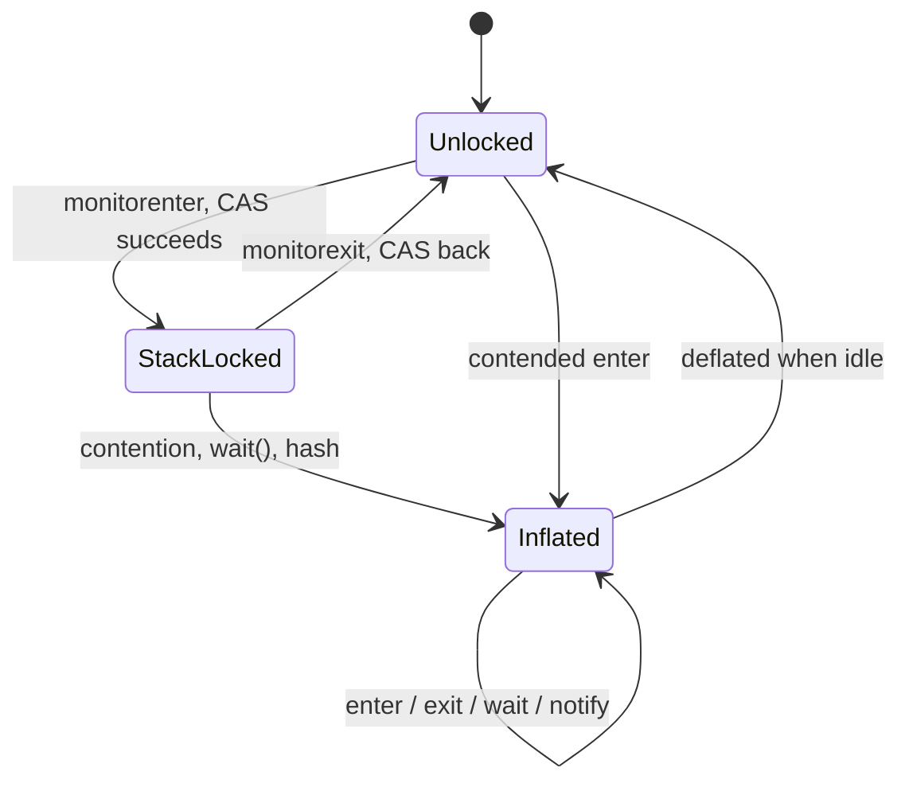
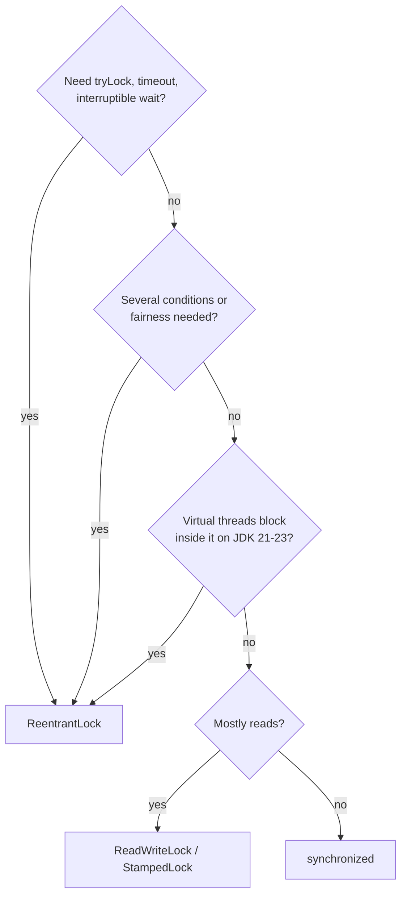
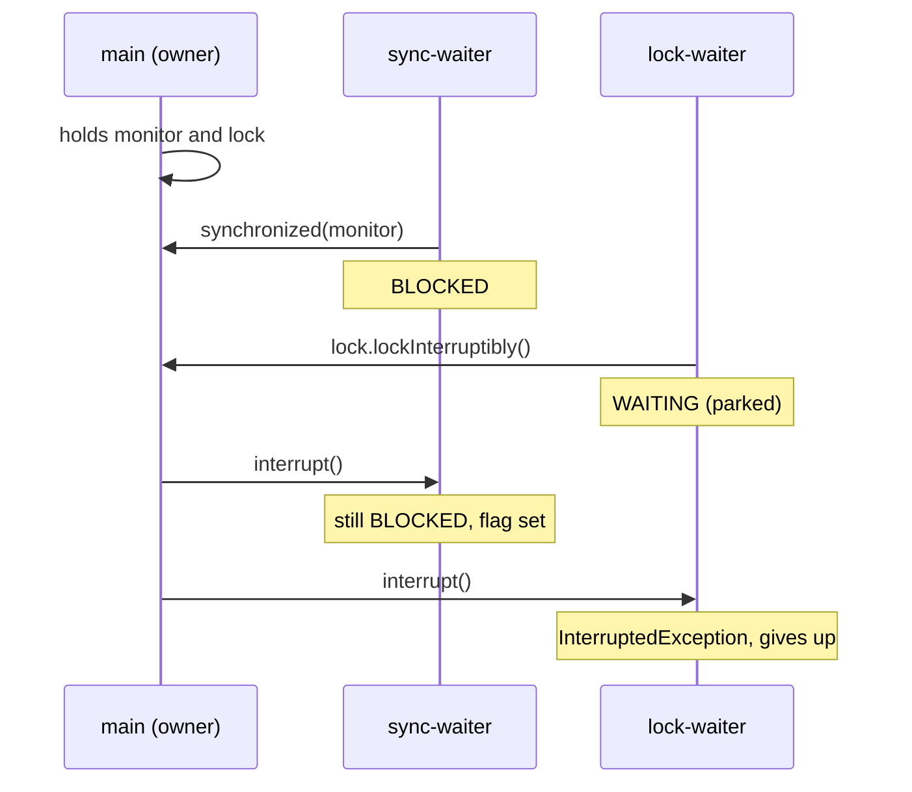

## In One Line
`synchronized` (a JVM **monitor** built into every object) and `ReentrantLock` (a library lock built on **AQS**) give the same guarantees — mutual exclusion, happens-before visibility, reentrancy — and similar speed; choose `synchronized` for simple critical sections because it can never be left locked, and `ReentrantLock` when you need what `synchronized` cannot do: `tryLock`, timeouts, interruptible waiting, fairness, several `Condition`s, or (on JDK 21–23) blocking inside the lock from virtual threads without pinning.

## Mental Model
Two ways to guard a **meeting room**.

**`synchronized` = a room with an automatic door.** Every room (every object) has one built in. You walk in, the door locks behind you, and it unlocks **automatically** the moment you leave — even if you leave because you fainted (an exception). While you are inside, others stand in a crowd at the door (**BLOCKED**). There is no queue ticket, no "I'll wait five minutes and then leave", and if your manager phones someone in the crowd (an interrupt), they keep standing there. Inside the room there is **one** bench where people can sit and wait for something (`wait`/`notify`).

**`ReentrantLock` = a room with a key on a hook and a receptionist.** You take the key (`lock()`) and you **must hand it back** yourself (`unlock()` in `finally`) — forget it, and the room stays locked forever. In exchange the receptionist offers services: "is it free right now?" (`tryLock()`), "I'll wait at most 2 seconds" (`tryLock(2, SECONDS)`), "call me away if my boss phones" (`lockInterruptibly()`), a strict **first-come-first-served queue** if you ask for it (fair mode), and **several named benches** inside (`Condition`s: "waiting for space", "waiting for items"). People waiting for the key sit in the lobby (**WAITING**), not in a crowd at the door.

Both rooms are **reentrant**: if you are already inside and your plan says "enter the room", you just walk through — nobody makes you queue behind yourself.

## Concept
### What they have in common
| Guarantee | `synchronized` | `ReentrantLock` |
|---|---|---|
| Mutual exclusion | One thread at a time holds the monitor | One thread at a time holds the lock |
| Visibility (JMM) | Exit of a monitor **happens-before** every later entry of the same monitor | `unlock()` happens-before every later successful `lock()`/`tryLock()` of the same lock |
| Reentrancy | Yes (recursion count kept in the lock record / monitor) | Yes (`getHoldCount()`) |
| Waiting for a condition | `wait` / `notify` / `notifyAll` | `Condition.await` / `signal` / `signalAll` |
| Deadlock detection | `ThreadMXBean.findDeadlockedThreads()` and thread dumps show both kinds |

So "which is safer?" is not about correctness of the critical section: both are correct when used correctly. The differences are **features, failure modes and implementation**. The basics of `ReentrantLock` are in [ReentrantLock](lesson:a06-threads/10-reentrantlock) and of `synchronized` in [Synchronization](lesson:a06-threads/05-synchronization); this lesson compares them in depth.

### Feature comparison
| | `synchronized` | `ReentrantLock` |
|---|---|---|
| What it is | Language keyword; every object has a monitor | Class in `java.util.concurrent.locks` (Java 5, JSR 166) |
| Release | **Automatic** on block exit, normal or by exception | **Manual** `unlock()`, must be in `finally` |
| Scope | **Block-structured**: acquire and release in the same block | Any order: lock in one method, unlock in another (hand-over-hand locking) |
| Try without waiting | No | `tryLock()` |
| Timeout | No | `tryLock(time, unit)` |
| Interruptible while waiting | **No** — a blocked thread ignores `interrupt()` | `lockInterruptibly()`, `tryLock(time, unit)` |
| Fairness | No (unfair) | Optional: `new ReentrantLock(true)` |
| Wait sets | One per object | Any number of `Condition`s per lock |
| Thread state while waiting to acquire | **`BLOCKED`** | **`WAITING`** / `TIMED_WAITING` (parked) |
| Introspection | `Thread.holdsLock(obj)` only | `isLocked`, `isHeldByCurrentThread`, `getHoldCount`, `getQueueLength`, `hasQueuedThreads`, `getWaitQueueLength(cond)`... |
| Memory cost | Nothing extra until contention (lives in the object header) | A lock object + `Sync` object; queue nodes only for waiters |
| JIT optimisations | Lock elision (escape analysis), lock coarsening | Few (it is ordinary Java code, though it inlines well) |
| Virtual threads, JDK 21–23 | Blocking inside **pins** the carrier thread | Parks normally, no pinning |
| Risk | Cannot forget to release | Forgetting `unlock()` = locked forever, even after the owner dies |

### How `synchronized` is compiled
- **Synchronized method**: no special bytecode. The method gets the `ACC_SYNCHRONIZED` flag, and the JVM acquires the monitor of `this` (instance method) or of the `Class` object (static method) around the call.
- **Synchronized block**: `javac` emits `monitorenter` and `monitorexit`, **plus a hidden exception handler** that runs `monitorexit` and rethrows if the block throws. That hidden handler is why `synchronized` can never be left locked. Snippet 1 in Code shows the real bytecode.

`ReentrantLock` has no bytecode support at all: `lock()` and `unlock()` are normal method calls, and the `finally` block is your job.

### Monitor internals (HotSpot, JDK 21)
Every object starts with a **header**: a 64-bit **mark word** plus a (compressed) class pointer. The low bits of the mark word say what kind of lock the object currently has.

| Mark word state | Low bits | Rest of the mark word | When |
|---|---|---|---|
| **Unlocked** | `01` | Identity hash code (once computed) and GC age | Default |
| **Stack-locked** ("thin" / lightweight) | `00` | Pointer to a **lock record** in the owner's stack frame; the original mark word is saved ("displaced") there | Locked with no contention |
| **Inflated** ("fat" / heavyweight) | `10` | Pointer to an **`ObjectMonitor`** (a C++ object outside the heap) | Contention, `wait()`/`notify()`, or other cases the thin form cannot represent |
| Marked | `11` | Used by the GC | During GC |

- **Thin locking**: `monitorenter` copies the mark word into a lock record in the current frame and **CASes** the header to point at it. Re-entry by the owner just pushes another lock record (with a null displaced header). `monitorexit` CASes the original header back. No OS call, no extra memory: that is why uncontended `synchronized` is cheap.
- **Inflation**: when a second thread finds the object stack-locked by someone else, or `wait()` is called, HotSpot allocates an `ObjectMonitor` and points the header at it. The monitor has an owner, a recursion count, a queue of contending threads (`cxq` and `EntryList`) and a **wait set** (`WaitSet`) for `wait()`. A contending thread first **spins adaptively** for a short time (the owner may release soon), then parks in the OS. On release, the owner wakes a *successor*; a thread that arrives right then may barge in, so monitors are **not fair**.
- **Deflation**: since JDK 15 a background thread turns idle monitors back into plain headers, so an object that was contended once does not stay "fat" forever.
- **Biased locking** (Java 6) let the first thread "own" an object with no CAS at all. It is gone: disabled by default and deprecated in **JDK 15** (JEP 374), removed in **JDK 18**. On JDK 21, `-XX:+UseBiasedLocking` fails with "Unrecognized VM option".
- **JDK 21** added an alternative "lightweight locking" mode (a small per-thread lock stack instead of lock records; experimental flag `-XX:LockingMode=2`, default `1` = legacy stack locking). It became the default in **JDK 23**. **JDK 24** (JEP 491) reworked monitors so that virtual threads can block inside `synchronized` without pinning.

You can watch inflation happen with `-Xlog:monitorinflation=trace` (snippet 2).

### How `ReentrantLock` works (short version)
An inner `Sync extends AbstractQueuedSynchronizer`: a `volatile int state` (0 = free, n = hold count), an `exclusiveOwnerThread`, and a FIFO queue of parked threads. `lock()` = one **CAS 0→1** when free; the owner re-entering just increments `state`; otherwise the thread joins the queue and **parks** (`LockSupport.park`). `unlock()` decrements `state`; at 0 it clears the owner and **unparks** the first queued thread. The non-fair version lets an arriving thread try the CAS first (**barging**); the fair version first checks `hasQueuedPredecessors()`. Details: [ReentrantLock](lesson:a06-threads/10-reentrantlock).

So both implementations are "CAS when uncontended, park when contended". The difference is where the state lives (object header vs a separate object) and who writes the code (C++ in the JVM vs Java in the JDK).

### Interruptibility and deadlock escape
- A thread **blocked on a monitor cannot be interrupted out of the wait**. `interrupt()` just sets its flag; it stays `BLOCKED` until it gets the monitor (snippet 4). A deadlock between `synchronized` blocks is permanent: only a JVM restart ends it.
- `lockInterruptibly()` and `tryLock(time, unit)` throw `InterruptedException` when interrupted while waiting, so a stuck operation can be **cancelled**.
- `tryLock` with a timeout lets you **back off** instead of deadlocking when you must take two locks in an order you cannot control (snippet 5). The usual first choice is still a **global lock order** (e.g. always lock the account with the smaller id first), which works with both.

### Fairness
- `synchronized` is never fair. `ReentrantLock` is non-fair by default; `new ReentrantLock(true)` grants the lock to the **longest-waiting queued thread**.
- Non-fair is the default because **barging** is fast: the thread that just released the lock is running and hot in cache, and can take it again immediately, while waking a parked thread costs microseconds. Snippet 7 shows non-fair doing tens of millions of acquisitions in half a second with well under 1% hand-offs between threads, while the fair lock manages far fewer.
- Fairness only orders the lock queue; it does not make the OS scheduler fair. Untimed `tryLock()` ignores fairness (it barges even on a fair lock).
- Use a fair lock only when you have measured starvation.

### Conditions vs wait/notify
With `synchronized` there is **one** wait set per object. A bounded buffer must put producers ("not full") and consumers ("not empty") in the same wait set, so it needs `notifyAll()` and wakes threads that cannot proceed. With a lock you create one `Condition` per reason and `signal()` exactly the right group (snippet 6). The rules are identical: hold the lock, wait in a `while` loop (spurious wakeups), and waiting releases and re-acquires the lock.

### Performance: what is true today
- **Java 5**: `ReentrantLock` scaled much better than `synchronized` under contention — the source of the old advice "use ReentrantLock for speed".
- **Java 6** added adaptive spinning, lock coarsening, lock elision and biased locking to `synchronized`, and the gap closed.
- **Today** both cost about one CAS when uncontended, and both spin briefly then park when contended. Differences depend on workload and JDK version; measure with **JMH**, not with a `for` loop and `System.nanoTime()`.
- `synchronized` gets **JIT help**: C2 removes locks on objects that never escape the thread (lock elision via escape analysis, `-XX:+EliminateLocks`, on by default) and merges adjacent blocks on the same lock (lock coarsening — e.g. repeated `StringBuffer.append` calls).
- **Fair** locks are dramatically slower under contention. **Long critical sections** hurt more than the choice of lock ever will: keep I/O and slow calls outside the lock.
- If the critical section is one variable, a lock may be the wrong tool: `AtomicInteger`/`LongAdder` ([Atomics & CAS](lesson:b03-concurrency/02-atomics-and-cas)).

### Virtual threads (JDK 21)
A virtual thread that **blocks while holding a monitor** (sleep, I/O, `BlockingQueue.take`, waiting for another lock) inside `synchronized` is **pinned**: it cannot unmount, so it blocks its carrier OS thread too. With only a few carriers (one per core) that can stall the whole application. `ReentrantLock` is built on `LockSupport.park`, which virtual threads handle by unmounting, so it does not pin. That is why JDK 21 guidance was "replace `synchronized` with `ReentrantLock` around blocking operations that run often". JDK 24 (JEP 491) removed most pinning for `synchronized`, so on JDK 24+ this is no longer a reason to switch. Details and a demo: [Virtual Threads](lesson:b03-concurrency/07-virtual-threads).

### Choosing
| Need | Use |
|---|---|
| Simple mutual exclusion, short critical section | `synchronized` (on a `private final Object lock`) |
| Give up if busy, timeouts, cancellation | `ReentrantLock.tryLock` / `lockInterruptibly` |
| Several wait conditions on one lock | `ReentrantLock` + `Condition`s |
| Proven starvation | `new ReentrantLock(true)` |
| Lock acquired in one method, released in another | `ReentrantLock` |
| Many readers, few writers | `ReentrantReadWriteLock` ([ReadWriteLock](lesson:a06-threads/11-readwritelock)) or `StampedLock` (Java 8; optimistic reads, **not reentrant**) |
| Blocking I/O inside the lock on virtual threads, JDK 21–23 | `ReentrantLock` |
| Counter or single reference | Atomics, not a lock |

### Rules for choosing the lock object
- Lock on a **`private final`** field. `synchronized(this)` and `synchronized` methods expose your lock: any outside code can `synchronized (yourObject)` and interfere.
- Never lock on **`String` literals** (interned and shared JVM-wide), **boxed values** (`Integer.valueOf(42)` is cached and shared), or other **value-based classes** (`Optional`, `LocalDate`...). Since Java 16, `javac` warns: *"attempt to synchronize on an instance of a value-based class"*; `-XX:+UnlockDiagnosticVMOptions -XX:DiagnoseSyncOnValueBasedClasses=2` logs it at run time (`=1` makes it a fatal error).
- Never lock on a field that can be **reassigned**; two threads may then lock two different objects.
- Never mix both on one piece of state: a `ReentrantLock` object also has a monitor, but `synchronized (lock)` and `lock.lock()` are **unrelated** locks.

## Diagram

An object's monitor costs nothing until needed: a CAS in the header when uncontended, a full `ObjectMonitor` only on contention or `wait()`.


Default to `synchronized`; switch only for a feature it lacks.


Only the `ReentrantLock` waiter can be interrupted out of its wait (snippets 3 and 4).

## Code
**1. What `javac` generates.** `SyncBytecode.java` — compile with `javac SyncBytecode.java`, then `javap -c -p SyncBytecode.class`.
```java
public class SyncBytecode {
    private final Object lock = new Object();
    private int count;

    synchronized void viaMethod() {      // lock = this
        count++;
    }

    void viaBlock() {                    // lock = the lock object
        synchronized (lock) {
            count++;
        }
    }
}
```
```output
  synchronized void viaMethod();
    Code:
       0: aload_0
       1: dup
       2: getfield      #13                 // Field count:I
       5: iconst_1
       6: iadd
       7: putfield      #13                 // Field count:I
      10: return

  void viaBlock();
    Code:
       0: aload_0
       1: getfield      #7                  // Field lock:Ljava/lang/Object;
       4: dup
       5: astore_1
       6: monitorenter
       7: aload_0
       8: dup
       9: getfield      #13                 // Field count:I
      12: iconst_1
      13: iadd
      14: putfield      #13                 // Field count:I
      17: aload_1
      18: monitorexit
      19: goto          27
      22: astore_2
      23: aload_1
      24: monitorexit
      25: aload_2
      26: athrow
      27: return
    Exception table:
       from    to  target type
           7    19    22   any
          22    25    22   any
```
This is an excerpt (the constructor is left out). `javap -v` additionally shows `flags: (0x0020) ACC_SYNCHRONIZED` for `viaMethod` and `flags: (0x0000)` for `viaBlock`.

**2. Watching a monitor inflate.** `Inflation.java` — `javac -d out Inflation.java`, then `java -Xlog:monitorinflation=trace -cp out Inflation 2>&1 | grep -E "inflate|^[0-9]\."`
```java
public class Inflation {
    static class Account { }                 // our own class, easy to spot in the log

    public static void main(String[] args) throws Exception {
        Account quiet = new Account();
        synchronized (quiet) {               // no contention: stays a thin lock
            System.out.println("1. locked quiet (uncontended)");
        }

        Account busy = new Account();
        Thread other = new Thread(() -> { synchronized (busy) { } });
        synchronized (busy) {
            other.start();
            Thread.sleep(100);               // other thread now contends -> inflation
            System.out.println("2. another thread is blocked on busy");
        }
        other.join();

        Account waiter = new Account();
        synchronized (waiter) {
            waiter.wait(10);                 // wait() always needs a full monitor
            System.out.println("3. waited on waiter");
        }
    }
}
```
```output
[0.024s][trace][monitorinflation] inflate(has_locker): object=0x00000007376025f0, mark=0x00007f7f2c001312, type='java.lang.ref.NativeReferenceQueue$Lock'
1. locked quiet (uncontended)
[0.041s][trace][monitorinflation] inflate(has_locker): object=0x000000073761a098, mark=0x00007f7f0c000fe2, type='Inflation$Account'
2. another thread is blocked on busy
[0.142s][trace][monitorinflation] inflate(has_locker): object=0x000000073761a148, mark=0x00007f7fb416e992, type='java.lang.Thread'
[0.142s][trace][monitorinflation] inflate(has_locker): object=0x0000000737629110, mark=0x00007f7fb416d932, type='Inflation$Account'
3. waited on waiter
```
Timestamps, addresses and mark words **vary between runs**; which objects inflate, and in which order, does not.

**3. BLOCKED vs WAITING, as a monitoring tool sees it.** `WaitingStates.java`
```java
import java.lang.management.ManagementFactory;
import java.lang.management.ThreadInfo;
import java.lang.management.ThreadMXBean;
import java.util.concurrent.TimeUnit;
import java.util.concurrent.locks.ReentrantLock;

public class WaitingStates {
    static final Object monitor = new Object();
    static final ReentrantLock lock = new ReentrantLock();

    public static void main(String[] args) throws Exception {
        synchronized (monitor) {                       // main owns the monitor...
            lock.lock();                               // ...and the ReentrantLock
            try {
                Thread t1 = start("sync-waiter", () -> { synchronized (monitor) { } });
                Thread t2 = start("lock-waiter", () -> { lock.lock(); lock.unlock(); });
                Thread t3 = start("trylock-waiter", () -> {
                    try {
                        if (lock.tryLock(5, TimeUnit.SECONDS)) lock.unlock();
                    } catch (InterruptedException e) { }
                });
                Thread.sleep(300);                     // let all three block

                ThreadMXBean mx = ManagementFactory.getThreadMXBean();
                for (Thread t : new Thread[] { t1, t2, t3 }) {
                    ThreadInfo info = mx.getThreadInfo(t.threadId());
                    String lockClass = info.getLockName().replaceAll("@.*", "");   // drop the hash
                    System.out.printf("%-15s %-14s on %s (owner: %s)%n",
                            t.getName(), t.getState(), lockClass, info.getLockOwnerName());
                }
                ThreadInfo me = mx.getThreadInfo(new long[] { Thread.currentThread().threadId() }, true, true)[0];
                System.out.println("main holds monitors:     " + me.getLockedMonitors().length
                        + " (" + me.getLockedMonitors()[0].getClassName() + ")");
                System.out.println("main holds synchronizers: " + me.getLockedSynchronizers().length
                        + " (" + me.getLockedSynchronizers()[0].getClassName() + ")");
            } finally {
                lock.unlock();
            }
        }
    }

    static Thread start(String name, Runnable r) {
        Thread t = new Thread(r, name);
        t.start();
        return t;
    }
}
```
```output
sync-waiter     BLOCKED        on java.lang.Object (owner: main)
lock-waiter     WAITING        on java.util.concurrent.locks.ReentrantLock$NonfairSync (owner: main)
trylock-waiter  TIMED_WAITING  on java.util.concurrent.locks.ReentrantLock$NonfairSync (owner: main)
main holds monitors:     1 (java.lang.Object)
main holds synchronizers: 1 (java.util.concurrent.locks.ReentrantLock$NonfairSync)
```

**4. Interrupting a waiting thread.** `InterruptDemo.java`
```java
import java.util.concurrent.locks.ReentrantLock;

public class InterruptDemo {
    static final Object monitor = new Object();
    static final ReentrantLock lock = new ReentrantLock();

    public static void main(String[] args) throws Exception {
        // 1. synchronized: a blocked thread cannot be interrupted out of the wait
        Thread syncWaiter;
        synchronized (monitor) {
            syncWaiter = new Thread(() -> {
                synchronized (monitor) {
                    System.out.println("sync-waiter got the monitor, interrupted flag = "
                            + Thread.currentThread().isInterrupted());
                }
            });
            syncWaiter.start();
            Thread.sleep(200);
            syncWaiter.interrupt();
            Thread.sleep(200);
            System.out.println("after interrupt(): sync-waiter is " + syncWaiter.getState());
        }                                               // main releases; only now can it proceed
        syncWaiter.join();

        // 2. lockInterruptibly(): the waiting thread gives up with InterruptedException
        Thread lockWaiter;
        lock.lock();
        try {
            lockWaiter = new Thread(() -> {
                try {
                    lock.lockInterruptibly();
                    try {
                        System.out.println("lock-waiter got the lock");
                    } finally {
                        lock.unlock();
                    }
                } catch (InterruptedException e) {
                    System.out.println("lock-waiter: InterruptedException, gave up waiting");
                }
            });
            lockWaiter.start();
            Thread.sleep(200);
            lockWaiter.interrupt();
            lockWaiter.join();
            System.out.println("after interrupt(): lock-waiter is " + lockWaiter.getState()
                    + ", main still holds the lock: " + lock.isHeldByCurrentThread());
        } finally {
            lock.unlock();
        }
    }
}
```
```output
after interrupt(): sync-waiter is BLOCKED
sync-waiter got the monitor, interrupted flag = true
lock-waiter: InterruptedException, gave up waiting
after interrupt(): lock-waiter is TERMINATED, main still holds the lock: true
```

**5. A lock-ordering deadlock, and escaping it with `tryLock`.** `TransferDemo.java`
```java
import java.lang.management.ManagementFactory;
import java.util.concurrent.ThreadLocalRandom;
import java.util.concurrent.TimeUnit;
import java.util.concurrent.locks.ReentrantLock;

public class TransferDemo {
    static class Account {
        final String name;
        final ReentrantLock lock = new ReentrantLock();
        int balance = 1_000;
        Account(String name) { this.name = name; }
    }

    // Version 1: nested synchronized in "from, to" order -> can deadlock
    static void transferSync(Account from, Account to, int amount) throws InterruptedException {
        synchronized (from) {
            Thread.sleep(50);                         // widen the window so the deadlock always happens
            synchronized (to) {
                from.balance -= amount;
                to.balance += amount;
            }
        }
    }

    // Version 2: tryLock with timeout; back off and retry instead of waiting forever
    static int transferTryLock(Account from, Account to, int amount) throws InterruptedException {
        int attempts = 0;
        while (true) {
            attempts++;
            if (from.lock.tryLock(10, TimeUnit.MILLISECONDS)) {
                try {
                    Thread.sleep(50);
                    if (to.lock.tryLock(10, TimeUnit.MILLISECONDS)) {
                        try {
                            from.balance -= amount;
                            to.balance += amount;
                            return attempts;
                        } finally {
                            to.lock.unlock();
                        }
                    }
                } finally {
                    from.lock.unlock();
                }
            }
            Thread.sleep(ThreadLocalRandom.current().nextInt(1, 20));   // random back-off breaks symmetry
        }
    }

    public static void main(String[] args) throws Exception {
        Account a = new Account("A"), b = new Account("B");

        Thread t1 = daemon(() -> { try { transferSync(a, b, 100); } catch (InterruptedException e) { } });
        Thread t2 = daemon(() -> { try { transferSync(b, a, 200); } catch (InterruptedException e) { } });
        t1.join(1000);
        t2.join(1000);
        long[] stuck = ManagementFactory.getThreadMXBean().findDeadlockedThreads();
        System.out.println("synchronized: deadlocked threads = " + (stuck == null ? 0 : stuck.length)
                + ", t1 " + t1.getState() + ", t2 " + t2.getState());

        Account c = new Account("C"), d = new Account("D");
        int[] tries = new int[2];
        Thread t3 = daemon(() -> { try { tries[0] = transferTryLock(c, d, 100); } catch (InterruptedException e) { } });
        Thread t4 = daemon(() -> { try { tries[1] = transferTryLock(d, c, 200); } catch (InterruptedException e) { } });
        t3.join();
        t4.join();
        System.out.println("tryLock: both finished, C=" + c.balance + ", D=" + d.balance
                + ", attempts " + tries[0] + " and " + tries[1]);
    }

    static Thread daemon(Runnable r) {
        Thread t = new Thread(r);
        t.setDaemon(true);                             // lets the JVM exit despite the deadlock
        t.start();
        return t;
    }
}
```
```output
synchronized: deadlocked threads = 2, t1 BLOCKED, t2 BLOCKED
tryLock: both finished, C=1100, D=900, attempts 2 and 1
```
The attempt counts **vary between runs** (`1 and 2`, `2 and 1`, sometimes `2 and 2`) because of the random back-off; the deadlock line and the balances are always the same.

**6. Reentrancy on both, and who may release.** `ReentrancyDemo.java`
```java
import java.util.concurrent.locks.ReentrantLock;

public class ReentrancyDemo {
    static final Object monitor = new Object();
    static final ReentrantLock lock = new ReentrantLock();

    // synchronized: recursion re-enters the monitor the thread already owns
    static int depthSync(int n) {
        synchronized (monitor) {
            return n == 0 ? 0 : 1 + depthSync(n - 1);
        }
    }

    // ReentrantLock: same idea, but the hold count is visible
    static void depthLock(int n) {
        lock.lock();
        try {
            System.out.println("  depth " + n + " -> hold count " + lock.getHoldCount());
            if (n < 3) depthLock(n + 1);
        } finally {
            lock.unlock();
        }
    }

    public static void main(String[] args) {
        System.out.println("synchronized recursion depth: " + depthSync(5));
        System.out.println("holds monitor outside? " + Thread.holdsLock(monitor));
        synchronized (monitor) {
            System.out.println("holds monitor inside?  " + Thread.holdsLock(monitor));
        }

        depthLock(1);
        System.out.println("after all unlocks: hold count " + lock.getHoldCount()
                + ", locked = " + lock.isLocked());

        try {
            lock.unlock();                          // not the owner
        } catch (IllegalMonitorStateException e) {
            System.out.println("unlock() without lock(): " + e.getClass().getSimpleName());
        }
        try {
            monitor.notify();                       // not inside synchronized(monitor)
        } catch (IllegalMonitorStateException e) {
            System.out.println("notify() without the monitor: " + e.getMessage());
        }
    }
}
```
```output
synchronized recursion depth: 5
holds monitor outside? false
holds monitor inside?  true
  depth 1 -> hold count 1
  depth 2 -> hold count 2
  depth 3 -> hold count 3
after all unlocks: hold count 0, locked = false
unlock() without lock(): IllegalMonitorStateException
notify() without the monitor: current thread is not owner
```

**7. One wait set vs one Condition per reason.** `ConditionBuffer.java`
```java
import java.util.ArrayDeque;
import java.util.ArrayList;
import java.util.List;
import java.util.concurrent.locks.Condition;
import java.util.concurrent.locks.ReentrantLock;

public class ConditionBuffer {
    // synchronized version: ONE wait set for both "not full" and "not empty"
    static class MonitorBuffer<T> {
        private final ArrayDeque<T> items = new ArrayDeque<>();
        private final int capacity;
        MonitorBuffer(int capacity) { this.capacity = capacity; }

        synchronized void put(T item) throws InterruptedException {
            while (items.size() == capacity) wait();
            items.addLast(item);
            notifyAll();                       // wakes producers AND consumers
        }
        synchronized T take() throws InterruptedException {
            while (items.isEmpty()) wait();
            T item = items.removeFirst();
            notifyAll();
            return item;
        }
    }

    // ReentrantLock version: one Condition per reason to wait
    static class LockBuffer<T> {
        private final ArrayDeque<T> items = new ArrayDeque<>();
        private final int capacity;
        private final ReentrantLock lock = new ReentrantLock();
        private final Condition notFull = lock.newCondition();
        private final Condition notEmpty = lock.newCondition();
        LockBuffer(int capacity) { this.capacity = capacity; }

        void put(T item) throws InterruptedException {
            lock.lock();
            try {
                while (items.size() == capacity) notFull.await();
                items.addLast(item);
                notEmpty.signal();             // wake ONE consumer, never a producer
            } finally {
                lock.unlock();
            }
        }
        T take() throws InterruptedException {
            lock.lock();
            try {
                while (items.isEmpty()) notEmpty.await();
                T item = items.removeFirst();
                notFull.signal();              // wake ONE producer
                return item;
            } finally {
                lock.unlock();
            }
        }
    }

    public static void main(String[] args) throws Exception {
        MonitorBuffer<Integer> mb = new MonitorBuffer<>(2);
        LockBuffer<Integer> lb = new LockBuffer<>(2);
        List<Integer> fromMonitor = new ArrayList<>(), fromLock = new ArrayList<>();

        Thread producer = new Thread(() -> {
            try {
                for (int i = 1; i <= 6; i++) { mb.put(i); lb.put(i * 10); }
            } catch (InterruptedException e) { }
        });
        Thread consumer = new Thread(() -> {
            try {
                for (int i = 1; i <= 6; i++) { fromMonitor.add(mb.take()); fromLock.add(lb.take()); }
            } catch (InterruptedException e) { }
        });
        producer.start(); consumer.start();
        producer.join();  consumer.join();
        System.out.println("monitor buffer delivered: " + fromMonitor);
        System.out.println("lock buffer delivered:    " + fromLock);
    }
}
```
```output
monitor buffer delivered: [1, 2, 3, 4, 5, 6]
lock buffer delivered:    [10, 20, 30, 40, 50, 60]
```

**8. The price of fairness.** `FairnessDemo.java` — three threads hammer one lock for half a second.
```java
import java.util.Arrays;
import java.util.concurrent.locks.ReentrantLock;

public class FairnessDemo {
    static final int THREADS = 3;
    static volatile boolean running;
    static long switches;                  // guarded by the lock under test
    static Thread lastOwner;

    public static void main(String[] args) throws Exception {
        for (int round = 0; round < 2; round++) {          // round 0 only warms up the JIT
            run(new ReentrantLock(false), round == 1);
            run(new ReentrantLock(true), round == 1);
        }
    }

    static void run(ReentrantLock lock, boolean print) throws Exception {
        long[] acquisitions = new long[THREADS];
        switches = 0; lastOwner = null;
        running = true;
        Thread[] ts = new Thread[THREADS];
        for (int i = 0; i < THREADS; i++) {
            int id = i;
            ts[i] = new Thread(() -> {
                while (running) {
                    lock.lock();                           // grab, do a tiny bit of work, release, repeat
                    try {
                        acquisitions[id]++;
                        if (lastOwner != Thread.currentThread()) { switches++; lastOwner = Thread.currentThread(); }
                    } finally {
                        lock.unlock();
                    }
                }
            });
            ts[i].start();
        }
        Thread.sleep(500);                                 // let the threads fight for 0.5 s
        running = false;
        for (Thread t : ts) t.join();
        long total = Arrays.stream(acquisitions).sum();
        if (print) System.out.printf("%-8s total=%,12d  per thread=%s  hand-offs=%,d (%.1f%%)%n",
                lock.isFair() ? "fair" : "non-fair", total, Arrays.toString(acquisitions),
                switches, 100.0 * switches / total);
    }
}
```
```output
non-fair total=  18,044,862  per thread=[5245349, 6165478, 6634035]  hand-offs=53,545 (0.3%)
fair     total=     209,898  per thread=[161981, 32612, 15305]  hand-offs=32,228 (15.4%)
```
Every number here **varies between runs** (it is a timing experiment on a shared 4-core machine). Over four runs the non-fair lock did 16–22 million acquisitions with 0.3–0.4% hand-offs; the fair lock did between 88 thousand and 2.9 million, with roughly 30,000 hand-offs each time. The stable conclusion: non-fair locks let the running thread barge back in, and fairness costs a large factor in throughput.

## Walkthrough
**Snippet 1 — bytecode.** `viaMethod` contains no locking instructions at all: the `synchronized` modifier becomes the `ACC_SYNCHRONIZED` flag and the JVM locks `this` around the call. `viaBlock` loads `lock`, keeps a copy in local slot 1 (`astore_1`) so the same object is unlocked even if the field changed, and runs `monitorenter`. The normal path does `monitorexit` at 18 and jumps to `return`. The **exception table** routes any throwable from instructions 7–19 to 22, which stores the exception, runs `monitorexit` (24) and rethrows it (`athrow`). The second table row covers the handler itself. This compiler-generated "finally" is exactly what you must write by hand with `ReentrantLock`.

**Snippet 2 — inflation.** `-Xlog:monitorinflation=trace` prints one line whenever HotSpot turns a thin lock into an `ObjectMonitor`.
- The first line is a JDK-internal object (`NativeReferenceQueue$Lock`) used during start-up; ignore it.
- `quiet` never appears: an uncontended `synchronized` stays a thin (stack) lock — just a CAS in the header.
- `busy` inflates while `main` holds it and `other` tries to enter: `has_locker` means it was stack-locked when inflation started. The mark word now ends in binary `10`, the "inflated" tag.
- `other.join()` inflates the **`Thread`** object: in JDK 21, `join()` waits with `wait()` on the thread object, and `wait()` needs a real monitor.
- `waiter` inflates because of `waiter.wait(10)`, even though no other thread is involved.

**Snippet 3 — thread states.** `main` holds both the monitor and the lock, then starts three threads that want them. `ThreadMXBean.getThreadInfo(id)` returns what a thread dump shows. The `synchronized` waiter is **`BLOCKED`** on `java.lang.Object`. The `lock()` waiter is **`WAITING`** — it is parked inside AQS — and the thing it waits on is the lock's internal `ReentrantLock$NonfairSync`. The timed `tryLock` waiter is **`TIMED_WAITING`**. `getLockOwnerName()` names `main` for all three. `getThreadInfo(ids, true, true)` also lists what `main` owns: one monitor (`getLockedMonitors`) and one "ownable synchronizer" (`getLockedSynchronizers`) — the same distinction `jstack -l` prints. `replaceAll("@.*", "")` removes the identity hash so the output is stable.

**Snippet 4 — interrupts.** `syncWaiter` blocks on `monitor`; `main` interrupts it and 200 ms later it is **still `BLOCKED`**. It only proceeds when `main` leaves the `synchronized` block, and then it sees its interrupt flag is `true` (the interrupt was remembered, not acted on). `lockWaiter` waits in `lockInterruptibly()`; the interrupt makes it throw `InterruptedException`, so it gives up and terminates while `main` still holds the lock. Note the idiom: `lockInterruptibly()` is **before** the inner `try`, so `unlock()` only runs if the lock was actually acquired.

**Snippet 5 — deadlock.** `t1` locks `A` then wants `B`; `t2` locks `B` then wants `A`. The 50 ms sleep guarantees both hold their first lock before asking for the second. `join(1000)` returns after a second without the threads finishing, and `findDeadlockedThreads()` reports both (it detects cycles in both monitors and ownable synchronizers). They are **daemon** threads so the JVM can still exit. In the `tryLock` version each thread waits at most 10 ms for the second lock; if it fails it releases the first one (`finally`), sleeps a random 1–19 ms and retries, so one of them soon gets both. Balances end at `C = 1000 − 100 + 200 = 1100` and `D = 1000 + 100 − 200 = 900`.

**Snippet 6 — reentrancy.** `depthSync(5)` re-enters `monitor` five times without blocking itself. `Thread.holdsLock(monitor)` is the only introspection `synchronized` offers. `depthLock` shows the hold count rising to 3; each `finally { unlock(); }` decreases it, and only at 0 is the lock free. Calling `unlock()` without owning the lock, or `notify()` without owning the monitor, both throw `IllegalMonitorStateException` ("current thread is not owner").

**Snippet 7 — conditions.** Both buffers have capacity 2 and deliver items in FIFO order, so the output is deterministic. The difference is who gets woken: `MonitorBuffer` must use `notifyAll()` because producers and consumers share one wait set (with `notify()` a producer could wake another producer and the program could stall). `LockBuffer` signals `notEmpty` after a put and `notFull` after a take, so exactly one thread of the right kind wakes. Both wait in `while` loops. The lists are read by `main` after `join()`, which gives the needed happens-before.

**Snippet 8 — fairness.** Three threads loop `lock → count → unlock` for 0.5 s. `switches` counts how often the lock went to a *different* thread than the previous acquisition. With the **non-fair** lock, the thread that just unlocked usually grabs the lock again before a parked thread can wake up, so hand-offs are rare and throughput is huge. With the **fair** lock, a thread that finds others queued must queue behind them and park, and each hand-off to a parked thread costs a wake-up (tens of microseconds here), so total throughput collapses. The per-thread split of the fair lock is uneven in this run because the threads also compete for CPU time with the OS and each other; fairness orders the lock queue, not the CPU.

## Traps
- **`unlock()` not in `finally`.** One exception in the critical section and the `ReentrantLock` stays locked forever — even after the owning thread dies. `synchronized` cannot have this bug.
- **`lock()` inside the `try`.** If `lockInterruptibly()` throws, the `finally` calls `unlock()` on a lock you do not hold → `IllegalMonitorStateException` hides the real exception. Acquire **before** `try`.
- **Expecting `interrupt()` to free a thread blocked on `synchronized`.** It only sets the flag; the thread stays `BLOCKED`.
- **Mixing the two:** `synchronized (lock) {...}` where `lock` is a `ReentrantLock` uses the lock object's *monitor*, which has nothing to do with `lock.lock()`. And calling `lock.wait()` instead of `condition.await()` throws `IllegalMonitorStateException` because you don't own its monitor.
- **Locking on shared or reassigned objects:** string literals, boxed integers (`javac` warns for value-based classes since Java 16), `this` of a publicly reachable object, or a non-final field.
- **Believing a fair lock is "more correct".** It is only more ordered — and much slower. Untimed `tryLock()` ignores fairness anyway.
- **Old performance folklore.** "ReentrantLock is faster" was true on Java 5. Measure with JMH on your JDK.
- **Blocking inside `synchronized` on virtual threads (JDK 21–23)** pins the carrier. Not a correctness bug, but it can freeze a server with few carriers.
- **`Condition.await()` / `wait()` with `if` instead of `while`.** Spurious wakeups and competing consumers make the condition false again by the time you run.
- **Forgetting that `StampedLock` is not reentrant.** Re-acquiring a write stamp in the same thread deadlocks.

## Tips & Tricks
- **"synchronized by default, ReentrantLock by need."** Name the feature you need (try, timeout, interrupt, fairness, conditions, non-block structure, virtual-thread pinning on 21–23); if you cannot, use `synchronized`.
- **Mnemonic for the `ReentrantLock` extras — "TIFCo":** **T**ryLock, **I**nterruptible, **F**airness, **Co**nditions.
- **Thread states:** "**B**locked = **B**uilt-in monitor; **W**aiting = **W**aiting in a queue (park)." In a thread dump, `BLOCKED (on object monitor)` means `synchronized`; `WAITING (parking)` with `ReentrantLock$...Sync` means a `Lock`.
- **The idiom as muscle memory:** `lock.lock(); try { ... } finally { lock.unlock(); }` — lock *outside*, unlock *in finally*.
- **Header bits:** "01 free, 00 thin, 10 fat, 11 GC" — the mark word's low two bits.
- Keep critical sections **short**; do I/O and slow calls outside. That matters more than the lock type.
- Use `private final Object lock = new Object();` (or a `private final ReentrantLock`) rather than `this`.
- To avoid deadlock, **order** your locks globally; use `tryLock` with timeout + random back-off when you cannot.

## Interview Q&A
### [Basic] What is the difference between synchronized and ReentrantLock?
Both provide mutual exclusion, the same happens-before visibility, and reentrancy. `synchronized` is a keyword backed by the object's built-in monitor; the JVM releases it automatically when the block exits, even on an exception, and it is block-structured. `ReentrantLock` is a class built on AQS; you must call `unlock()` in `finally`, but it adds `tryLock()`, `tryLock(timeout)`, `lockInterruptibly()`, an optional fair mode, multiple `Condition`s, lock/unlock in different methods, and introspection such as `getHoldCount()` and `getQueueLength()`. Performance is similar on modern JVMs. I use `synchronized` by default and `ReentrantLock` when I need one of those features.

**Follow-up:** *Which one can be left locked by mistake?* — Only `ReentrantLock`: if `unlock()` is not in `finally`, an exception leaves it locked forever, even after the owner thread dies.

### [Basic] What does "reentrant" mean? Is synchronized reentrant?
A reentrant lock can be acquired again by the thread that already holds it without blocking; the lock counts the acquisitions and is released only when the count returns to zero. Both `synchronized` and `ReentrantLock` are reentrant. Without it, a `synchronized` method calling another `synchronized` method on the same object, or a recursive method, would deadlock on itself. `ReentrantLock.getHoldCount()` shows the count; each `lock()` needs a matching `unlock()`.

**Follow-up:** *Name a lock that is not reentrant.* — `StampedLock`, and a `Semaphore(1)` used as a mutex: the same thread acquiring twice blocks itself.

### [Intermediate] What are the thread states of a thread waiting for synchronized vs ReentrantLock?
A thread waiting to enter a `synchronized` block is **`BLOCKED`** ("waiting for monitor entry" in a thread dump). A thread waiting in `ReentrantLock.lock()` is **`WAITING`** because AQS parks it with `LockSupport.park`, and with `tryLock(timeout)` it is **`TIMED_WAITING`**; the dump shows "parking to wait for ... ReentrantLock$NonfairSync". `BLOCKED` is used only for monitor entry (and re-entry after `wait()`). Knowing this helps you read thread dumps: many `BLOCKED` threads on the same object means a hot monitor.

**Follow-up:** *What state is a thread in `Object.wait()`?* — `WAITING` (or `TIMED_WAITING` with a timeout); when notified it must re-acquire the monitor and is `BLOCKED` until it does.

### [Intermediate] Can a thread waiting for a lock be interrupted?
Not with `synchronized`: `interrupt()` only sets the flag; the thread keeps waiting until it gets the monitor, so a monitor deadlock is permanent. With `ReentrantLock`, `lockInterruptibly()` and `tryLock(time, unit)` throw `InterruptedException` if the thread is interrupted while waiting, so you can cancel stuck work (for example when a request times out or an executor shuts down with `shutdownNow()`). Plain `lock()` behaves like `synchronized` here: it keeps waiting and just preserves the interrupt flag.

**Follow-up:** *How does `tryLock` help against deadlock?* — A thread that cannot get its second lock within a timeout releases the first and retries after a random back-off, so no permanent cycle forms. The usual first fix is still a global lock ordering.

### [Intermediate] Fair vs non-fair lock — why is non-fair the default, and does synchronized have fairness?
A fair lock gives the lock to the longest-waiting queued thread; a non-fair lock lets a newly arriving thread grab a free lock even if others are queued (barging). Non-fair is the default because barging avoids a context switch: the running thread uses the lock while the queued thread would still be waking up, so throughput is much higher. Fairness prevents starvation but under contention can cost a large factor in throughput. `synchronized` has no fairness option and is not fair.

**Follow-up:** *Does `tryLock()` respect fairness?* — The untimed `tryLock()` does not; it barges even on a fair lock. `tryLock(0, TimeUnit.SECONDS)` does respect it.

### [Intermediate] Which one is faster?
On modern JVMs they are comparable. Uncontended, both are roughly one CAS: `synchronized` CASes the object's mark word (thin lock), `ReentrantLock` CASes AQS's `state`. Under contention both spin briefly and then park threads. `synchronized` benefits from JIT optimisations such as lock elision for non-escaping objects and lock coarsening; `ReentrantLock` offers features that can improve a design (conditions, tryLock). The "ReentrantLock is faster" claim dates from Java 5; Java 6 closed the gap. A fair `ReentrantLock` is much slower than either under contention. For real answers, benchmark with JMH on the target JDK.

**Follow-up:** *What is lock elision?* — If escape analysis proves an object never leaves the current thread, C2 removes locking on it entirely, for example a local `StringBuffer`.

### [Advanced] How is synchronized implemented inside HotSpot?
`javac` compiles a synchronized block to `monitorenter`/`monitorexit` plus an exception handler that runs `monitorexit` on any throwable; a synchronized method just gets the `ACC_SYNCHRONIZED` flag. At run time HotSpot uses the object header's mark word. Uncontended: **thin/stack locking** — the original mark word is saved in a lock record on the owner's stack and the header is CASed to point to it (low bits `00`). On contention or `wait()`, the lock is **inflated**: an `ObjectMonitor` is allocated with an owner, recursion count, entry queues (`cxq`, `EntryList`) and a `WaitSet`, and the header points to it (low bits `10`). Contending threads spin adaptively, then park. Idle monitors are later deflated by a background thread. Biased locking was removed in JDK 18; JDK 21 added an alternative lightweight-locking mode that became the default in JDK 23.

**Follow-up:** *Why does `wait()` inflate the lock?* — A thin lock has nowhere to keep a wait set; the `ObjectMonitor` has one.

### [Advanced] What was biased locking and why was it removed?
Biased locking (Java 6) let an object be "biased" toward the first thread that locked it, so that thread could re-lock it later with no atomic instruction at all. It paid off for old code that synchronized heavily without contention (`Vector`, `Hashtable`, `StringBuffer`). Revoking a bias when another thread appeared required a safepoint and was expensive, the code was complex, and modern code uses unsynchronized collections and `java.util.concurrent`, so the benefit had mostly disappeared. JEP 374 disabled and deprecated it in JDK 15, and it was removed in JDK 18.

**Follow-up:** *What happens if you pass `-XX:+UseBiasedLocking` to JDK 21?* — The JVM refuses to start: "Unrecognized VM option 'UseBiasedLocking'".

### [Advanced] Why do virtual threads care whether you use synchronized or ReentrantLock?
In JDK 21 a virtual thread that blocks while inside a `synchronized` block or method is **pinned** to its carrier platform thread: it cannot unmount, so the carrier is blocked too. The scheduler has only about one carrier per core, so a few pinned threads can stall thousands of others. `ReentrantLock` parks through `LockSupport.park`, which unmounts the virtual thread, so it does not pin. The JDK 21 advice was to replace `synchronized` with `ReentrantLock` where blocking happens frequently inside the lock, and to detect pinning with `-Djdk.tracePinnedThreads` or the JFR event `jdk.VirtualThreadPinned`. JDK 24 (JEP 491) made `synchronized` unmount properly, removing most pinning.

**Follow-up:** *Is pinning a correctness problem?* — No, only a scalability problem; the program still produces correct results, just with fewer usable carrier threads.

### [Advanced] When would you use a Condition instead of wait/notify?
When one lock guards state that threads wait on for **different reasons**. A bounded buffer has producers waiting for "not full" and consumers waiting for "not empty". With a monitor there is one wait set, so you must `notifyAll()` and wake everyone, many of whom immediately wait again. With `lock.newCondition()` you create `notFull` and `notEmpty` and `signal()` only the group that can proceed. Conditions also offer `awaitNanos`, `awaitUntil(deadline)` and `awaitUninterruptibly()`. The usage rules are the same as for `wait`: hold the lock, loop on the predicate.

**Follow-up:** *Why is `notify()` dangerous in the one-wait-set buffer?* — It may wake a thread of the wrong kind (a producer waking a producer), which then waits again, and the thread that could proceed is never woken — a lost wake-up that can stall the program.

## Quiz
### A thread is stuck trying to enter a `synchronized` block. Another thread calls `interrupt()` on it. What happens?
- [ ] It throws `InterruptedException` immediately
- [x] It keeps waiting (`BLOCKED`); only its interrupt flag is set
- [ ] It gives up and continues after the block
- [ ] The monitor is released by the owner
> Monitor entry is not interruptible. The thread stays `BLOCKED` until it acquires the monitor, and then finds its interrupt flag set (snippet 4). `InterruptedException` is what `lockInterruptibly()` would give you.

### What state does a thread report while it waits in `ReentrantLock.lock()` for a lock held by another thread?
- [ ] `BLOCKED`
- [x] `WAITING`
- [ ] `RUNNABLE`
- [ ] `TIMED_WAITING`
> `ReentrantLock` parks waiting threads with `LockSupport.park`, which is `WAITING`. `BLOCKED` is only used for monitor entry (`synchronized`); `TIMED_WAITING` would be `tryLock(time, unit)`.

### What does this print?
```java
ReentrantLock lock = new ReentrantLock();
lock.lock();
lock.lock();
lock.unlock();
System.out.println(lock.isLocked() + " " + lock.getHoldCount());
```
- [ ] `false 0`
- [x] `true 1`
- [ ] `true 2`
- [ ] `IllegalMonitorStateException`
> The lock is reentrant: two `lock()` calls give a hold count of 2, one `unlock()` brings it to 1, and the lock stays held until the count reaches 0. `false 0` is what you get if you forget the counting.

### Spot the bug.
```java
private final ReentrantLock lock = new ReentrantLock();

void transfer(Account a, Account b, int amount) throws InterruptedException {
    try {
        lock.lockInterruptibly();
        a.withdraw(amount);
        b.deposit(amount);
    } finally {
        lock.unlock();
    }
}
```
- [ ] `lockInterruptibly()` cannot be used with `ReentrantLock`
- [x] If `lockInterruptibly()` is interrupted, `finally` calls `unlock()` on a lock this thread does not hold
- [ ] `unlock()` must be called before `deposit`
- [ ] The lock should be `static`
> Acquisition must happen **before** `try`. Here an `InterruptedException` from `lockInterruptibly()` jumps to `finally`, and `unlock()` throws `IllegalMonitorStateException`, which replaces the original exception. The `finally`-unlock itself is correct; its position relative to `lock` is the bug.

### Which statement about synchronized on JDK 21 is true?
- [ ] Biased locking makes uncontended `synchronized` free
- [ ] Every object allocates an `ObjectMonitor` when created
- [x] An uncontended lock is a CAS on the object header; a full monitor is created on contention or `wait()`
- [ ] `synchronized` is fair, `ReentrantLock` is not
> Thin (stack) locking CASes the mark word; inflation to an `ObjectMonitor` happens only when needed (snippet 2). Biased locking was removed in JDK 18, monitors are not allocated per object, and `synchronized` has no fairness at all.

### What does this print?
```java
static final Object monitor = new Object();

public static void main(String[] args) {
    synchronized (monitor) {
        synchronized (monitor) {
            System.out.print(Thread.holdsLock(monitor) + " ");
        }
        System.out.print(Thread.holdsLock(monitor) + " ");
    }
    System.out.println(Thread.holdsLock(monitor));
}
```
- [ ] Deadlock: the second `synchronized` waits for the first
- [ ] `true false false`
- [x] `true true false`
- [ ] `true true true`
> Monitors are reentrant, so the nested block enters immediately. Leaving the inner block only decrements the recursion count: the thread still holds the monitor until the outer block ends. `true false false` assumes the inner exit fully releases it.

### Which feature is available with `ReentrantLock` but NOT with `synchronized`?
- [ ] Reentrancy
- [ ] Happens-before visibility between unlock and lock
- [x] Waiting for the lock with a timeout
- [ ] Automatic release when an exception is thrown
> `tryLock(time, unit)` has no `synchronized` equivalent. Reentrancy and visibility are shared by both, and automatic release on exceptions is actually a `synchronized`-only feature.

## Takeaways
- `synchronized` and `ReentrantLock` give the same mutual exclusion, happens-before visibility and reentrancy; performance is comparable on modern JVMs.
- `ReentrantLock` adds tryLock, timeouts, interruptible waiting, optional fairness, multiple `Condition`s and non-block-structured locking — at the cost of a mandatory `unlock()` in `finally` (lock before `try`).
- `synchronized` compiles to `monitorenter`/`monitorexit` with a hidden exception handler (or `ACC_SYNCHRONIZED` on methods), so it is always released.
- HotSpot monitors live in the object's mark word: a CAS-based thin lock when uncontended, inflated to an `ObjectMonitor` on contention or `wait()`, deflated later; biased locking was removed in JDK 18.
- A thread waiting for a monitor is `BLOCKED` and cannot be interrupted; a thread waiting for a `ReentrantLock` is `WAITING`/`TIMED_WAITING` (parked) and can be, via `lockInterruptibly()`/`tryLock(timeout)`.
- Non-fair (the default) is fast because the running thread barges; fair locks prevent starvation but cost a large factor in throughput.
- On JDK 21–23, blocking inside `synchronized` pins virtual threads; `ReentrantLock` does not (fixed for `synchronized` in JDK 24).
- Default to `synchronized` on a `private final` lock object; switch to `ReentrantLock` only for a feature you can name.
