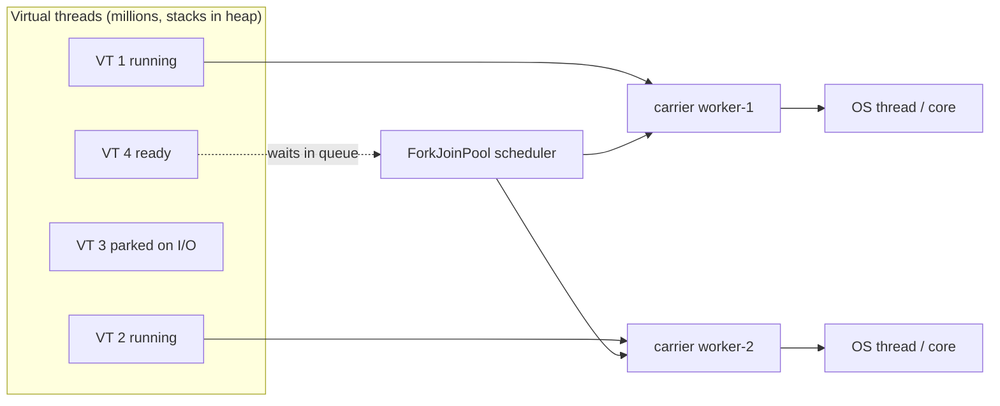
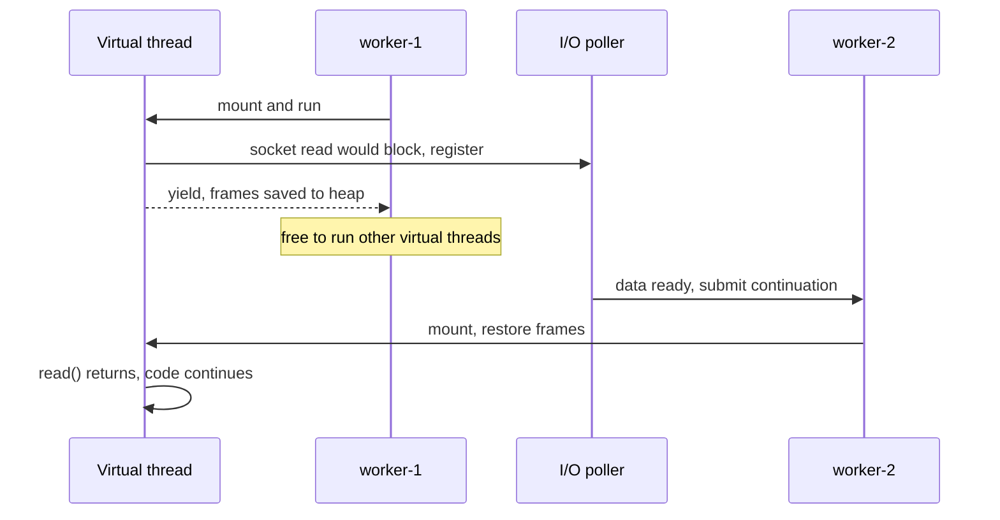
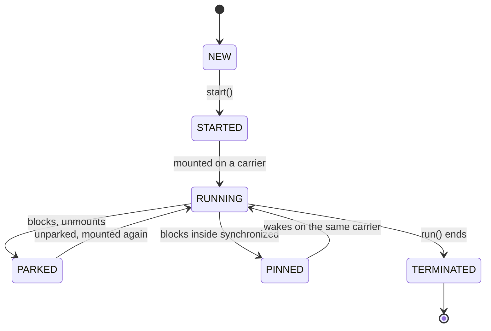

## In One Line
A **virtual thread** (final in Java 21, JEP 444) is a `java.lang.Thread` scheduled by the JVM instead of the OS: millions of them run on a handful of **carrier** platform threads, and whenever one blocks (sleep, socket I/O, locks, queues) it **unmounts** so the carrier can run another — giving you the scalability of async code while you keep writing simple, blocking, thread-per-request code.

## Mental Model
Think of a **restaurant with a few chefs and many order tickets**.

- **Platform threads** are like hiring one chef per customer. A chef who is waiting for the oven just stands there. Chefs are expensive (each needs a whole workstation — about 1 MB of stack), so you can only hire a few thousand.
- **Virtual threads** are **order tickets**. There are only as many **chefs (carrier threads)** as there are stoves (CPU cores). A chef picks up a ticket and cooks (**mounts** the virtual thread). When the dish must wait for the oven (a blocking call), the chef **clips the ticket to the rail** — with notes on exactly where the recipe stopped (the stack frames, saved in the heap) — and picks up another ticket (**unmounts**). When the oven beeps, the ticket goes back in the queue and *any* free chef continues it from the notes, maybe a different chef than before.
- Tickets are cheap paper: you can have a million of them. That is why you never "pool" tickets — you write a new one for every order.
- **Pinning** = a ticket the chef is **not allowed to clip to the rail**, because the chef is holding the pantry key (a `synchronized` monitor) in JDK 21. While that dish waits for the oven, the chef stands idle holding the key, and the whole kitchen has one chef fewer.
- Virtual threads do not make any chef cook **faster**. If every order is pure chopping (CPU-bound work), extra tickets change nothing: the kitchen is limited by chefs, not by waiting.

## Concept
### The problem: thread-per-request does not scale with OS threads
Server code is easiest to write as **one thread per request**: read the request, call the database, call another service, write the response — sequential code, meaningful stack traces, easy debugging. By Little's law, *concurrent requests = throughput × latency*: 5,000 requests/s that each spend 200 ms mostly waiting on I/O need 1,000 requests in flight, so 1,000 threads.

**Platform threads** (every `Thread` before Java 21) are thin wrappers around **OS threads**:
- each reserves a fixed stack (1 MB by default on 64-bit Linux, `-Xss`),
- creating one and switching between them goes through the kernel,
- practical limit: a few thousand per JVM.

So applications either capped concurrency with thread pools (and wasted hardware while threads sat blocked) or switched to **asynchronous/reactive** code (`CompletableFuture` chains, WebFlux, callbacks), which scales but is harder to write, read, debug and profile. Virtual threads remove the trade-off: blocking becomes cheap, so the simple style scales.

### What a virtual thread is
- An instance of `java.lang.Thread` (`isVirtual()` returns `true`) implemented **in the JDK**, not by the OS. Same API: `start`, `join`, `interrupt`, `sleep`, thread locals, `Thread.currentThread()`.
- **M:N scheduling**: M virtual threads are multiplexed over N **carrier threads** (platform threads).
- Internally each virtual thread wraps a **continuation** (`jdk.internal.vm.Continuation`). Mounting = the carrier runs the continuation. When the code blocks, the continuation **yields**: its stack frames are saved in the heap as *stack chunk* objects and the carrier is free. When the thread can continue, it is submitted to the scheduler and a carrier **mounts** it again (frames are copied back lazily, as needed).
- The stack lives in the **heap** and grows and shrinks with use, so an idle virtual thread costs a few hundred bytes to a few KB rather than a 1 MB reservation. Creating one is about as cheap as creating an object.

### The scheduler and carrier threads
| Aspect | Default (JDK 21) |
|---|---|
| Scheduler | A dedicated **`ForkJoinPool`** in FIFO mode (not the common pool) |
| Carrier threads | Named `ForkJoinPool-1-worker-N` |
| Parallelism | `Runtime.availableProcessors()`; override with `-Djdk.virtualThreadScheduler.parallelism=N` |
| Max carriers (when compensating) | 256 by default, `-Djdk.virtualThreadScheduler.maxPoolSize` |
| Time slicing | **None.** A virtual thread keeps its carrier until it blocks or ends; a CPU-bound loop is never preempted by the scheduler |
| Timed sleeps | A separate internal scheduled executor unparks sleeping virtual threads when their time is up |

`Thread.currentThread()` inside a virtual thread returns the **virtual** thread, never the carrier; the carrier's identity is only visible in `toString()`: `VirtualThread[#29]/runnable@ForkJoinPool-1-worker-1`.

### What unmounts, what captures the carrier, what pins
| Situation | Effect in JDK 21 |
|---|---|
| `Thread.sleep`, `LockSupport.park` (all `java.util.concurrent` locks, `BlockingQueue`, `Semaphore`, `CountDownLatch`, `Future.get`, `CompletableFuture.join`), `Thread.join` | **Unmounts** — the carrier is free |
| Socket and network I/O (`Socket`, `SocketChannel`, `HttpClient`, JDBC drivers over sockets) | **Unmounts**: the JDK switches the socket to non-blocking mode and parks the virtual thread until the poller reports it ready |
| Most **file I/O**, `Object.wait()` | The carrier is **captured** (blocked), but the scheduler **compensates** by temporarily adding a carrier |
| Blocking while inside a **`synchronized`** block or method | **Pinned**: the carrier is blocked and there is **no compensation** |
| Blocking while a **native method** or foreign function is on the stack | **Pinned** |

Pinning is not a correctness problem — results are still right — but it reduces the number of usable carriers. With 8 carriers, 8 pinned threads that block for a second freeze every other virtual thread for that second (snippet 4 shows the effect with one carrier).

**Finding pinning in JDK 21**: `-Djdk.tracePinnedThreads=full` (or `short`) prints a stack trace when a virtual thread blocks while pinned, marking the frame that holds a monitor with `<== monitors:1`. JFR records the event `jdk.VirtualThreadPinned` (enabled by default, threshold 20 ms).

**Fixing it**: keep `synchronized` for short, non-blocking critical sections; around frequent blocking operations (I/O inside a lock) use a `ReentrantLock` instead (see [synchronized vs ReentrantLock](lesson:b03-concurrency/06-synchronized-vs-reentrantlock)). **JDK 24 (JEP 491)** reimplemented monitors so a virtual thread can unmount while holding one; after that, `synchronized` pins only in rare cases (for example with native frames on the stack or during class initialization), and the `jdk.tracePinnedThreads` property was dropped in favour of the JFR event.

### Creating virtual threads
| API | Notes |
|---|---|
| `Thread.startVirtualThread(runnable)` | Create and start in one call |
| `Thread.ofVirtual().name("worker-", 1).start(runnable)` | Builder: name or name prefix + counter, `inheritInheritableThreadLocals(false)`, `uncaughtExceptionHandler(...)` |
| `Thread.ofVirtual().unstarted(runnable)` | Create now, `start()` later |
| `Thread.ofVirtual().factory()` | A `ThreadFactory` for frameworks that take one |
| `Executors.newVirtualThreadPerTaskExecutor()` | An `ExecutorService` that starts **one new virtual thread per task**. Unbounded |
| `Executors.newThreadPerTaskExecutor(factory)` | Same idea with your own (e.g. named) factory |

`new Thread(...)` constructors always create **platform** threads; `Thread.ofPlatform()` is the matching builder. `ExecutorService` is `AutoCloseable` since Java 19: `close()` = `shutdown()` + wait for all tasks, so `try (var ex = Executors.newVirtualThreadPerTaskExecutor()) { ... }` waits for everything submitted inside.

Frameworks can switch for you: for example Spring Boot 3.2+ runs request handling on virtual threads with `spring.threads.virtual.enabled=true`.

### How a virtual thread differs from a platform thread
| | Platform thread | Virtual thread |
|---|---|---|
| Backed by | One OS thread for its whole life | Any carrier, may change at every blocking call |
| Stack | Fixed reservation (`-Xss`, 1 MB default) | Heap-allocated stack chunks, grow and shrink |
| Creation cost | Kernel call, ~tens of µs | ~an object allocation |
| How many | Thousands | Millions |
| Daemon | Configurable | **Always daemon**; `setDaemon(false)` throws `IllegalArgumentException` |
| Priority | Configurable (1–10, a hint to the OS) | Always `NORM_PRIORITY` (5); `setPriority` is ignored |
| Thread group | Real groups | A placeholder group named `VirtualThreads` |
| Name | `Thread-N` by default | Empty string by default |
| `Thread.getAllStackTraces()` | Included | **Not included** |
| Thread dumps | `jstack`, `jcmd Thread.print` | `jcmd <pid> Thread.dump_to_file -format=json <file>` (also plain text) |
| Scheduling | OS, preemptive time slicing | JVM `ForkJoinPool`, no time slicing |

### When to use them — and when not
**Use** virtual threads when you have **many concurrent tasks that mostly wait**: HTTP servers, calls to databases and remote services, message consumers, fan-out of independent I/O calls. They improve **throughput** (more requests in flight), not **latency** (a single request is not faster).

**They do not help**:
- **CPU-bound work** (image processing, number crunching, parallel streams). Only the cores do work; use a pool sized to the cores (or parallel streams / `ForkJoinPool`).
- When the **bottleneck is elsewhere**: if the database allows 20 connections, 10,000 virtual threads still wait for those 20.

**Rules of thumb**:
1. **Never pool virtual threads.** A pool exists to reuse expensive threads and cap their number; virtual threads are cheap and should be created per task.
2. **Limit access to scarce resources with a `Semaphore`** (or a connection pool), not with a small thread pool (snippet 6).
3. **Don't cache expensive objects in `ThreadLocal`s**: each task gets a new thread, so the cache is never reused, and a million threads multiply the memory. `-Djdk.traceVirtualThreadLocals` prints a stack trace whenever a virtual thread sets a thread local (snippet 7). See [ThreadLocal](lesson:b03-concurrency/05-threadlocal).
4. **Avoid long blocking inside `synchronized` on JDK 21–23** (pinning).
5. Write plain **blocking code**; you do not need `CompletableFuture` chains to scale any more.

### Structured concurrency (preview in Java 21)
Virtual threads make it cheap to start a thread per subtask. **Structured concurrency** (JEP 453, preview in Java 21) gives those subtasks a clear owner and lifetime, like a block of code: subtasks are forked inside a scope, the scope **waits** for them, **cancels** the others when the outcome is decided, and no subtask can outlive the scope.

```java
try (var scope = new StructuredTaskScope.ShutdownOnFailure()) {
    Subtask<String> user    = scope.fork(() -> fetchUser());      // each fork = a new virtual thread
    Subtask<String> product = scope.fork(() -> fetchProduct());
    scope.join().throwIfFailed();    // wait; if one failed, the others were cancelled
    return new Order(user.get(), product.get());
}
```

| JDK 21 API | Meaning |
|---|---|
| `StructuredTaskScope.ShutdownOnFailure` | "Invoke all": the first failure cancels (interrupts) the other subtasks; `throwIfFailed()` rethrows it wrapped in `ExecutionException` |
| `StructuredTaskScope.ShutdownOnSuccess<T>` | "Invoke any": the first success cancels the others; `result()` returns it |
| `fork(callable)` | Starts a subtask in a new virtual thread; returns a `Subtask<T>` (`get()`, `state()`: `UNAVAILABLE`, `SUCCESS`, `FAILED`) |
| `join()` / `joinUntil(deadline)` | Waits for the subtasks (or the shutdown) |
| `close()` | Shuts the scope down and waits; only the owner thread may call `join`/`close` |

Compared with `ExecutorService` + `Future`s: no leaked tasks if the parent fails, automatic cancellation, and thread dumps show the parent-child tree. Scoped values bound in the parent are visible in the forked subtasks. The API is still **preview** after Java 21 (it needs `--enable-preview`) and was **redesigned in JDK 25** around `StructuredTaskScope.open()` and `Joiner` policies, so treat the exact class names above as JDK 21-specific.

### Version history
| Version | Change |
|---|---|
| 19 | Virtual threads preview (JEP 425); `ExecutorService` becomes `AutoCloseable` |
| 20 | Second preview (JEP 436) |
| **21** | **Final** (JEP 444). Structured concurrency preview (JEP 453), scoped values preview (JEP 446) |
| 24 | `synchronized` no longer pins (JEP 491) |
| 25 | Scoped values final (JEP 506); structured concurrency redesigned, still preview (JEP 505) |

## Diagram

Only mounted virtual threads use a carrier; parked ones are just heap objects waiting to be rescheduled.


A blocking call unmounts the virtual thread; it may resume on a different carrier.


Simplified from the internal states of `java.lang.VirtualThread`; `PINNED` keeps the carrier busy while waiting.

## Code
**1. Creating virtual threads and what makes them different.** `VirtualBasics.java` — run with `java VirtualBasics.java`.
```java
import java.util.concurrent.ExecutorService;
import java.util.concurrent.Executors;
import java.util.concurrent.ThreadFactory;

public class VirtualBasics {
    public static void main(String[] args) throws Exception {
        // 1. Four ways to create virtual threads
        Thread v1 = Thread.startVirtualThread(() -> System.out.println("1. startVirtualThread"));
        v1.join();

        Thread v2 = Thread.ofVirtual().name("worker-", 1).start(() ->
                System.out.println("2. ofVirtual().start -> name " + Thread.currentThread().getName()));
        v2.join();

        ThreadFactory factory = Thread.ofVirtual().name("fac-", 0).factory();
        Thread v3 = factory.newThread(() -> System.out.println("3. factory -> " + Thread.currentThread().getName()));
        v3.start();
        v3.join();

        try (ExecutorService ex = Executors.newVirtualThreadPerTaskExecutor()) {     // Java 21
            ex.submit(() -> System.out.println("4. executor task, virtual? " + Thread.currentThread().isVirtual()));
        }                                                                          // close() waits

        // 2. What is different about a virtual thread?
        Thread v = Thread.ofVirtual().unstarted(() -> { });
        System.out.println("isVirtual=" + v.isVirtual() + ", isDaemon=" + v.isDaemon()
                + ", priority=" + v.getPriority() + ", name=\"" + v.getName() + "\"");
        v.setPriority(Thread.MAX_PRIORITY);                     // silently ignored
        System.out.println("priority after setPriority(10): " + v.getPriority());
        try {
            v.setDaemon(false);
        } catch (IllegalArgumentException e) {
            System.out.println("setDaemon(false): " + e.getMessage());
        }
        System.out.println("main is virtual? " + Thread.currentThread().isVirtual());

        // 3. toString shows the carrier thread the virtual thread is mounted on
        Thread.ofVirtual().start(() -> {
            Thread me = Thread.currentThread();
            System.out.println("running as: " + me);
            System.out.println("thread group: " + me.getThreadGroup().getName());
        }).join();
    }
}
```
```output
1. startVirtualThread
2. ofVirtual().start -> name worker-1
3. factory -> fac-0
4. executor task, virtual? true
isVirtual=true, isDaemon=true, priority=5, name=""
priority after setPriority(10): 5
setDaemon(false): 'false' not legal for virtual threads
main is virtual? false
running as: VirtualThread[#29]/runnable@ForkJoinPool-1-worker-1
thread group: VirtualThreads
```
The thread id (`#29`/`#30`) and the carrier (`worker-1`, `-2`, `-3`) in the `running as` line **vary between runs**.

**2. Scale: 10,000 blocking tasks.** `ScaleDemo.java`
```java
import java.time.Duration;
import java.util.concurrent.ExecutorService;
import java.util.concurrent.Executors;
import java.util.concurrent.atomic.AtomicInteger;

public class ScaleDemo {
    static final int TASKS = 10_000;

    // A typical I/O-bound task: mostly waiting (simulated with sleep)
    static void handleRequest(AtomicInteger done) {
        try {
            Thread.sleep(Duration.ofMillis(100));
        } catch (InterruptedException e) {
            Thread.currentThread().interrupt();
        }
        done.incrementAndGet();
    }

    public static void main(String[] args) {
        run("fixed pool of 100 platform threads", Executors.newFixedThreadPool(100));
        run("one virtual thread per task", Executors.newVirtualThreadPerTaskExecutor());
    }

    static void run(String name, ExecutorService executor) {
        AtomicInteger done = new AtomicInteger();
        long start = System.nanoTime();
        try (executor) {                                     // close() waits for all tasks
            for (int i = 0; i < TASKS; i++) executor.submit(() -> handleRequest(done));
        }
        long ms = (System.nanoTime() - start) / 1_000_000;
        System.out.printf("%-36s %,d tasks in %,6d ms%n", name, done.get(), ms);
    }
}
```
```output
fixed pool of 100 platform threads   10,000 tasks in 10,435 ms
one virtual thread per task          10,000 tasks in    209 ms
```
The times **vary between runs** (10.0–10.4 s and 0.2–0.45 s in three runs); the ratio does not.

**3. Mounting and unmounting.** `MountDemo.java`
```java
import java.util.ArrayList;
import java.util.List;

public class MountDemo {
    public static void main(String[] args) throws Exception {
        List<Thread> threads = new ArrayList<>();
        for (int i = 0; i < 6; i++) {
            threads.add(Thread.ofVirtual().name("v" + i).start(() -> {
                String before = carrier();
                try {
                    Thread.sleep(50);            // blocking call: the virtual thread unmounts here
                } catch (InterruptedException e) {
                    return;
                }
                String after = carrier();        // ...and mounts again, maybe on another carrier
                System.out.println(Thread.currentThread().getName() + ": before sleep on " + before
                        + ", after sleep on " + after);
            }));
        }
        for (Thread t : threads) t.join();
    }

    // Thread.toString() of a mounted virtual thread ends with "@<carrier name>"
    static String carrier() {
        String s = Thread.currentThread().toString();
        return s.substring(s.indexOf('@') + 1);
    }
}
```
```output
v4: before sleep on ForkJoinPool-1-worker-1, after sleep on ForkJoinPool-1-worker-4
v5: before sleep on ForkJoinPool-1-worker-1, after sleep on ForkJoinPool-1-worker-4
v0: before sleep on ForkJoinPool-1-worker-1, after sleep on ForkJoinPool-1-worker-3
v2: before sleep on ForkJoinPool-1-worker-1, after sleep on ForkJoinPool-1-worker-2
v3: before sleep on ForkJoinPool-1-worker-1, after sleep on ForkJoinPool-1-worker-1
v1: before sleep on ForkJoinPool-1-worker-2, after sleep on ForkJoinPool-1-worker-4
```
Everything here **varies between runs**: line order and carrier names depend on scheduling (4 cores, so workers 1–4).

**4. Pinning.** `PinningDemo.java` — run with **one carrier** to make the effect obvious: `java -Djdk.virtualThreadScheduler.parallelism=1 PinningDemo.java`
```java
import java.util.concurrent.ExecutorService;
import java.util.concurrent.Executors;
import java.util.concurrent.locks.ReentrantLock;

public class PinningDemo {
    static final int TASKS = 4;

    public static void main(String[] args) {
        System.out.println("carriers (parallelism) = "
                + System.getProperty("jdk.virtualThreadScheduler.parallelism", "#cores"));

        time("sleep inside synchronized", () -> {
            Object lock = new Object();                   // one lock per task: no contention
            synchronized (lock) {
                sleep(200);                               // blocks while holding a monitor -> pinned
            }
        });

        time("sleep inside ReentrantLock", () -> {
            ReentrantLock lock = new ReentrantLock();
            lock.lock();
            try {
                sleep(200);                               // virtual thread unmounts normally
            } finally {
                lock.unlock();
            }
        });
    }

    static void time(String name, Runnable task) {
        long start = System.nanoTime();
        try (ExecutorService ex = Executors.newVirtualThreadPerTaskExecutor()) {
            for (int i = 0; i < TASKS; i++) ex.submit(task);
        }
        System.out.printf("%-28s %d tasks x 200 ms took %4d ms%n", name, TASKS,
                (System.nanoTime() - start) / 1_000_000);
    }

    static void sleep(long ms) {
        try { Thread.sleep(ms); } catch (InterruptedException e) { Thread.currentThread().interrupt(); }
    }
}
```
```output
carriers (parallelism) = 1
sleep inside synchronized    4 tasks x 200 ms took  809 ms
sleep inside ReentrantLock   4 tasks x 200 ms took  201 ms
```
Exact milliseconds **vary slightly** (809/812 and 201). Without the `-D` option (4 carriers on this machine) both lines take about 200 ms, because 4 pinned threads fit on 4 carriers — pinning hurts when pinned threads outnumber carriers. Adding `-Djdk.tracePinnedThreads=short` prints the culprit:
```output
carriers (parallelism) = 1
VirtualThread[#22]/runnable@ForkJoinPool-1-worker-1 reason:MONITOR
    PinningDemo.lambda$main$0(PinningDemo.java:15) <== monitors:1
sleep inside synchronized    4 tasks x 200 ms took  420 ms
sleep inside ReentrantLock   4 tasks x 200 ms took  206 ms
```
With tracing on, the `synchronized` run took about 420 ms instead of 810: a probe that recorded carrier names saw a **second carrier** appear, because printing the trace is a blocking write for which the scheduler temporarily adds a carrier. So do not time anything with tracing enabled.

**5. Structured concurrency (Java 21 preview).** `StructuredDemo.java` — `java --enable-preview --source 21 StructuredDemo.java` (the launcher first prints two `Note: ... uses preview features` lines to standard error).
```java
import java.util.concurrent.ExecutionException;
import java.util.concurrent.StructuredTaskScope;
import java.util.concurrent.StructuredTaskScope.Subtask;

public class StructuredDemo {
    record Order(String user, String product) { }

    static String fetchUser() throws InterruptedException {
        Thread.sleep(100);
        return "alice";
    }

    static String fetchProduct(boolean fail) throws InterruptedException {
        Thread.sleep(50);
        if (fail) throw new IllegalStateException("product service down");
        return "laptop";
    }

    static String slowCall() {
        try {
            Thread.sleep(5_000);
            return "finished";
        } catch (InterruptedException e) {
            System.out.println("  slowCall was cancelled (interrupted)");
            return "cancelled";
        }
    }

    // Fan out two calls, wait for both, fail fast if either fails
    static Order loadOrder(boolean productFails) throws Exception {
        try (var scope = new StructuredTaskScope.ShutdownOnFailure()) {
            Subtask<String> user = scope.fork(StructuredDemo::fetchUser);
            Subtask<String> product = scope.fork(() -> fetchProduct(productFails));
            scope.join()                       // wait for both subtasks (or the first failure)
                 .throwIfFailed();             // rethrow the failure as ExecutionException
            return new Order(user.get(), product.get());
        }                                      // close(): no subtask outlives this block
    }

    public static void main(String[] args) throws Exception {
        long start = System.nanoTime();
        System.out.println("ok: " + loadOrder(false) + " in ~" + ms(start) + " ms");

        start = System.nanoTime();
        try {
            loadOrder(true);
        } catch (ExecutionException e) {
            System.out.println("failed fast: " + e.getCause().getMessage() + " after ~" + ms(start) + " ms");
        }

        // ShutdownOnSuccess: first successful result wins, the others are cancelled
        try (var scope = new StructuredTaskScope.ShutdownOnSuccess<String>()) {
            scope.fork(StructuredDemo::slowCall);
            scope.fork(() -> { Thread.sleep(100); return "fast mirror"; });
            scope.join();
            System.out.println("first result: " + scope.result());
        }
    }

    static long ms(long start) {
        return Math.round((System.nanoTime() - start) / 1e6 / 50) * 50;   // rounded to 50 ms
    }
}
```
```output
ok: Order[user=alice, product=laptop] in ~100 ms
failed fast: product service down after ~50 ms
  slowCall was cancelled (interrupted)
first result: fast mirror
```

**6. Limit a scarce resource with a Semaphore, not a pool.** `LimitDemo.java`
```java
import java.util.concurrent.ExecutorService;
import java.util.concurrent.Executors;
import java.util.concurrent.Semaphore;
import java.util.concurrent.atomic.AtomicInteger;

public class LimitDemo {
    static final Semaphore DB_PERMITS = new Semaphore(3);   // the database allows 3 connections
    static final AtomicInteger inUse = new AtomicInteger(), maxInUse = new AtomicInteger();

    static String query(int id) throws InterruptedException {
        DB_PERMITS.acquire();                               // virtual thread unmounts while waiting
        try {
            int now = inUse.incrementAndGet();
            maxInUse.accumulateAndGet(now, Math::max);
            Thread.sleep(50);                               // simulated query
            return "row" + id;
        } finally {
            inUse.decrementAndGet();
            DB_PERMITS.release();
        }
    }

    public static void main(String[] args) {
        long start = System.nanoTime();
        try (ExecutorService ex = Executors.newVirtualThreadPerTaskExecutor()) {
            for (int i = 0; i < 30; i++) {
                int id = i;
                ex.submit(() -> query(id));
            }
        }
        System.out.println("30 virtual threads, max concurrent queries = " + maxInUse.get()
                + ", took ~" + Math.round((System.nanoTime() - start) / 1e6 / 100) * 100 + " ms");
    }
}
```
```output
30 virtual threads, max concurrent queries = 3, took ~500 ms
```

**7. Finding thread-local use in virtual threads.** `VtLocals.java` — `java -Djdk.traceVirtualThreadLocals VtLocals.java`
```java
public class VtLocals {
    static final ThreadLocal<String> TL = new ThreadLocal<>();
    public static void main(String[] args) throws Exception {
        Thread.ofVirtual().start(() -> TL.set("x")).join();
        System.out.println("done");
    }
}
```
```output
VirtualThread[#22]/runnable@ForkJoinPool-1-worker-1
    java.base/java.lang.ThreadLocal.set(ThreadLocal.java:253)
    VtLocals.lambda$main$0(VtLocals.java:4)
    java.base/java.lang.VirtualThread.run(VirtualThread.java:329)
done
```

## Walkthrough
**Snippet 1 — creation and properties.**
- `Thread.startVirtualThread(r)` creates and starts in one call. `Thread.ofVirtual()` returns a `Thread.Builder.OfVirtual`; `.name("worker-", 1)` sets a prefix and a starting counter, so the first thread is `worker-1`. `.factory()` gives a `ThreadFactory` (`fac-0` because that counter started at 0).
- `Executors.newVirtualThreadPerTaskExecutor()` starts a new virtual thread for each `submit`. The `try`-with-resources calls `close()`, which waits for the task, so line 4 is always printed before the next line.
- An unstarted virtual thread is already a daemon with priority 5 and an empty name. `setPriority(10)` is ignored; `setDaemon(false)` throws `IllegalArgumentException` with the message shown.
- `main` runs on a platform thread, so `isVirtual()` is `false` there.
- Inside a running virtual thread, `toString()` shows `VirtualThread[#id]/runnable@<carrier>`, and `getThreadGroup()` returns the placeholder group `VirtualThreads`. (After a virtual thread terminates, `getThreadGroup()` returns `null`, like for any terminated thread — that is why the demo asks from inside.)

**Snippet 2 — scale.** Each task sleeps 100 ms, the stand-in for waiting on a database or HTTP call. The fixed pool has 100 platform threads, so the 10,000 tasks run in 100 "waves": 100 × 100 ms ≈ 10 s. The virtual-thread executor starts 10,000 threads; each sleep unmounts its thread, so all 10,000 wait at the same time on 4 carriers and the whole batch finishes in roughly one sleep plus overhead. `try (executor)` (Java 9+ syntax for an existing effectively-final variable) closes and awaits each executor. The same code with CPU-bound tasks would show no such gain.

**Snippet 3 — mounting.** `carrier()` extracts the carrier name from `toString()`. Before the sleep, the six threads were mounted on whatever carriers were free (mostly `worker-1`, the first one started). `Thread.sleep` unmounts each thread; 50 ms later each one is rescheduled and mounted on **any** free carrier — often a different one. Your code never notices: `Thread.currentThread()` and all thread locals stay the same, only the carrier changed.

**Snippet 4 — pinning.** With `parallelism=1` there is exactly one carrier. In the `synchronized` version each task sleeps **while holding a monitor**, so in JDK 21 it cannot unmount: the single carrier is blocked for 200 ms per task and the four tasks run one after another (≈ 800 ms). In the `ReentrantLock` version the sleeping thread unmounts, the carrier runs the next task, and all four sleeps overlap (≈ 200 ms). The locks are per-task, so there is no contention — the slowdown is purely pinning. The trace line `reason:MONITOR` and the frame marked `<== monitors:1` point to line 15, the `sleep(200)` call inside the `synchronized` block; `short` mode prints each distinct pinned stack once.

**Snippet 5 — structured concurrency.**
- `new StructuredTaskScope.ShutdownOnFailure()` opens a scope owned by `main`. Each `fork` starts a subtask in a new virtual thread and returns a `Subtask`.
- Success case: `join()` waits for both; the slower one takes 100 ms, so the total is ~100 ms (the subtasks ran concurrently, not 150 ms). `throwIfFailed()` does nothing, and `user.get()`/`product.get()` return the results.
- Failure case: `fetchProduct` throws after 50 ms. The scope **shuts down**: the still-sleeping `fetchUser` is interrupted, `join()` returns at ~50 ms, and `throwIfFailed()` throws an `ExecutionException` whose cause is the original `IllegalStateException`.
- `ShutdownOnSuccess`: the first subtask to succeed (`fast mirror`, after 100 ms) shuts the scope down, which interrupts `slowCall` — it prints its cancellation message — and `result()` returns the winner.
- Leaving each `try` block closes the scope, which guarantees that no forked thread is still running afterwards. `ms(...)` rounds to 50 ms so the output is stable.

**Snippet 6 — Semaphore.** 30 tasks start immediately as 30 virtual threads, but `DB_PERMITS.acquire()` lets only 3 into the "query" at a time; the others **park** (unmount) cheaply while waiting. `maxInUse` records the highest concurrency seen: exactly 3. 30 queries / 3 at a time × 50 ms = 10 rounds ≈ 500 ms. This is the correct replacement for the old habit of "use a pool of 3 threads to protect the database".

**Snippet 7 — thread-local tracing.** With `-Djdk.traceVirtualThreadLocals`, every `ThreadLocal.set` in a virtual thread prints the thread and the stack, so you can find libraries that cache objects per thread. Line 4 of `VtLocals.java` is the `TL.set("x")` lambda.

## Traps
- **Pooling virtual threads** (`Executors.newFixedThreadPool(10, Thread.ofVirtual().factory())`) to limit concurrency. It works but throws away the benefit; limit the *resource* with a `Semaphore` instead.
- **Expecting CPU-bound code to get faster.** Virtual threads add concurrency for waiting, not cores for computing.
- **Pinning on JDK 21–23:** blocking I/O or `sleep` inside `synchronized` (including in libraries, e.g. old JDBC drivers or caches) blocks a carrier with no compensation. Detect with `-Djdk.tracePinnedThreads` / JFR `jdk.VirtualThreadPinned`, fix with `ReentrantLock` or upgrade to JDK 24+.
- **Timing with pinned tracing on** changes the scheduling (snippet 4).
- **Long CPU loops without blocking** hold a carrier forever — there is no time slicing. A few of them can starve all other virtual threads.
- **ThreadLocal caches** become one object per task and multiply memory by the number of threads.
- **`setDaemon(false)`** throws; a JVM does not wait for virtual threads at exit — `join()` them or use an executor's `close()`, or work may be cut off.
- **Relying on `Thread.getAllStackTraces()` or `jstack`** to see virtual threads: they are not listed; use `jcmd <pid> Thread.dump_to_file`.
- **Native code and `Object.wait()`**: both capture the carrier; `wait()` is compensated by extra carriers, which can grow the pool up to `maxPoolSize`.
- **Structured concurrency and scoped values are preview APIs in Java 21** (`--enable-preview`), and their APIs changed in later releases.

> [!WARNING] `ExecutorService.close()` waits for **all** tasks. Submitting a never-ending task inside a `try (var ex = ...)` block means the block never exits.

## Tips & Tricks
- **"Virtual threads are cheap tickets, carriers are the chefs."** Tickets: millions, never pooled. Chefs: one per core.
- **"Throughput, not speed."** They help when tasks *wait*; they do nothing for tasks that *compute*.
- **"Block freely — except while holding a monitor (on 21–23)."**
- **Migration checklist**: replace the request thread pool with `newVirtualThreadPerTaskExecutor()` (or the framework switch), replace pool-size limits with `Semaphore`s, look for `synchronized` around I/O, look for `ThreadLocal` caches, check pinning with JFR under load.
- **Identify one in a log**: `VirtualThread[#29]/runnable@ForkJoinPool-1-worker-1` — before the `@` the virtual thread, after it the carrier.
- **Name them** in production (`Thread.ofVirtual().name("req-", 0).factory()`) so thread dumps and logs are readable.
- Remember the three JEPs of Java 21: **444** virtual threads (final), **453** structured concurrency (preview), **446** scoped values (preview).

## Interview Q&A
### [Basic] What is a virtual thread and how is it different from a platform thread?
A virtual thread is a `java.lang.Thread` implemented by the JVM rather than the OS. Many virtual threads (up to millions) are multiplexed over a small pool of carrier platform threads — by default one per CPU core, in a dedicated `ForkJoinPool`. When a virtual thread blocks on something like `sleep`, a socket read or a `j.u.c` lock, it unmounts: its stack frames are stored in the heap and the carrier runs another virtual thread. A platform thread is a 1:1 wrapper around an OS thread with a fixed stack (1 MB by default), expensive to create and limited to thousands. Virtual threads are always daemon, have fixed normal priority, and are created with `Thread.ofVirtual()`, `Thread.startVirtualThread()` or `Executors.newVirtualThreadPerTaskExecutor()`.

**Follow-up:** *Does code run faster on a virtual thread?* — No. The same code executes at the same speed; the benefit is that far more tasks can wait concurrently, so throughput rises for I/O-bound workloads.

### [Basic] When should you use virtual threads, and when not?
Use them for high-concurrency, **I/O-bound** work: servers handling a request per thread, services calling databases and other services, fan-out of independent remote calls. Don't expect gains for **CPU-bound** work — there are still only as many cores; use a core-sized pool or parallel streams. Also they don't remove other bottlenecks: if the database allows 20 connections, the extra threads just wait for those connections. In short: many tasks that mostly wait → virtual threads.

**Follow-up:** *Should I rewrite my `CompletableFuture` code?* — Not necessarily, but new code can be written in the simpler blocking style and still scale; reactive code is no longer needed purely for thread scalability.

### [Intermediate] What are carrier threads, and what do "mount" and "unmount" mean?
Carrier threads are the platform threads of the virtual-thread scheduler (a FIFO `ForkJoinPool`, parallelism = number of cores by default, tunable with `jdk.virtualThreadScheduler.parallelism`). **Mounting** means a carrier starts running a virtual thread's continuation; the virtual thread's frames are (lazily) copied onto the carrier's stack. **Unmounting** happens when the virtual thread blocks: the continuation yields, its frames are kept in heap stack chunks, and the carrier becomes free. When the blocking operation completes, the virtual thread is resubmitted and may mount on a different carrier. `Thread.currentThread()` always returns the virtual thread, so the switch is invisible to application code.

**Follow-up:** *Is there preemption?* — No time slicing: a virtual thread keeps its carrier until it blocks or finishes, so long CPU-only loops can monopolise carriers.

### [Intermediate] What is pinning and how do you detect and avoid it?
A virtual thread is pinned when it cannot unmount while blocking. In JDK 21 that happens when it blocks inside a `synchronized` block or method, or with a native method/foreign function on its stack. The carrier is then blocked as well, and the scheduler does not compensate, so with few carriers the whole application can stall. Detect it with `-Djdk.tracePinnedThreads=full|short` (JDK 21) or the JFR event `jdk.VirtualThreadPinned`. Avoid it by keeping `synchronized` sections short and non-blocking, and by using `ReentrantLock` around frequent blocking operations. JDK 24 (JEP 491) removed pinning for `synchronized` in almost all cases.

**Follow-up:** *Is `Object.wait()` pinning too?* — It captures the carrier in JDK 21, but the scheduler compensates by temporarily adding a carrier thread, so it hurts less than blocking inside `synchronized` with `sleep` or I/O.

### [Intermediate] Why shouldn't you pool virtual threads? How do you limit concurrency then?
Pools exist because platform threads are expensive to create and must be capped. Virtual threads are as cheap as objects, so pooling them just adds a queue and an artificial limit, and reused threads leak thread-local state between tasks. Create one virtual thread per task (`newVirtualThreadPerTaskExecutor()`). If a downstream resource can only handle N concurrent calls, protect **that resource** with a `Semaphore(N)` or a connection pool; waiting on a semaphore just parks the virtual thread cheaply.

**Follow-up:** *Doesn't an unbounded executor risk overload?* — The limit belongs at the entry point (rate limiting, bounded request queues) and at scarce resources, not in the thread count.

### [Intermediate] How does blocking socket I/O avoid blocking the carrier?
Since the networking stack was reimplemented (the `Socket` rewrite in JDK 13 and `DatagramSocket` in JDK 15), when a virtual thread performs a blocking socket operation the JDK puts the socket in non-blocking mode. If the operation would block, the virtual thread registers the socket with an internal **poller** (epoll/kqueue/IOCP) and parks, unmounting from the carrier. When the poller sees the socket ready, it unparks the virtual thread, which is rescheduled and retries the operation. To the program it looks like an ordinary blocking read. Most file I/O cannot do this at the OS level, so it captures the carrier and the scheduler compensates.

**Follow-up:** *Does JDBC benefit?* — Yes, if the driver uses Java sockets and does not block inside `synchronized` (older drivers did, causing pinning on JDK 21).

### [Advanced] What happens to ThreadLocals with virtual threads?
They work exactly as with platform threads — each virtual thread has its own map (the preview versions allowed disabling them; Java 21 final always supports them). But patterns change: caching an expensive object per thread is useless because each task gets a fresh thread, and a million threads each holding a value can use a lot of heap. Inheritable thread locals are copied into each new virtual thread at creation. Use `-Djdk.traceVirtualThreadLocals` to find code that sets thread locals in virtual threads, and prefer `ScopedValue` for passing read-only context.

**Follow-up:** *Can a virtual thread see its carrier's thread locals?* — No; `Thread.currentThread()` is the virtual thread and only its own values are visible.

### [Advanced] What is structured concurrency and what problem does it solve?
It treats a group of concurrent subtasks as one unit of work with a clear lifetime, like a code block. In Java 21 (preview, JEP 453) you open a `StructuredTaskScope`, `fork` subtasks (each in a virtual thread), `join()`, then use the results; `close()` guarantees that no subtask outlives the scope. Policies: `ShutdownOnFailure` cancels the other subtasks as soon as one fails (then `throwIfFailed()`), `ShutdownOnSuccess` cancels the rest when one succeeds. With a plain `ExecutorService`, a failure in one `Future` leaves the others running (thread leaks), cancellation is manual, and nothing shows which tasks belong together. Structured concurrency gives automatic cancellation, error propagation and parent-child relationships visible in thread dumps; scoped values are inherited by forked subtasks.

**Follow-up:** *Is it production-ready in Java 21?* — It is a preview API (`--enable-preview`); it was redesigned in JDK 25 around `StructuredTaskScope.open()` and `Joiner`s and is still in preview there.

### [Advanced] How are virtual threads scheduled, and can you tune the scheduler?
The default scheduler is a work-stealing `ForkJoinPool` in FIFO mode, separate from the common pool. Its parallelism is `availableProcessors()` and can be set with `-Djdk.virtualThreadScheduler.parallelism`; `-Djdk.virtualThreadScheduler.maxPoolSize` (default 256) caps how many carriers may exist when the scheduler compensates for captured carriers (file I/O, `Object.wait()`). There is no API in Java 21 to plug in a custom scheduler, and no time slicing. Timed operations like `sleep` use a separate internal scheduled executor to unpark threads when their time is up.

**Follow-up:** *Why FIFO instead of the LIFO used for fork/join tasks?* — Virtual threads are independent tasks, not a recursive divide-and-conquer tree; FIFO gives fairer ordering among runnable virtual threads.

### [Advanced] How do you monitor and debug applications with many virtual threads?
Stack traces and debuggers work as usual because each virtual thread has a real Java stack. `jstack` and `Thread.getAllStackTraces()` only show platform threads; use `jcmd <pid> Thread.dump_to_file -format=json <file>` (or text) to include virtual threads, grouped by their executor or structured scope. JFR has events `jdk.VirtualThreadStart`/`End` (off by default), `jdk.VirtualThreadPinned` and `jdk.VirtualThreadSubmitFailed`. Name virtual threads through a builder/factory so logs and dumps are readable.

**Follow-up:** *What does `VirtualThread[#29]/runnable@ForkJoinPool-1-worker-1` mean?* — Virtual thread id 29, state runnable, currently mounted on carrier `ForkJoinPool-1-worker-1`.

## Quiz
### What does this print (run on a platform `main` thread)?
```java
Thread v = Thread.ofVirtual().unstarted(() -> {});
v.setPriority(Thread.MAX_PRIORITY);
System.out.println(v.getPriority() + " " + v.isDaemon() + " " + Thread.currentThread().isVirtual());
```
- [ ] `10 false false`
- [ ] `10 true false`
- [x] `5 true false`
- [ ] `5 true true`
> Virtual threads always have `NORM_PRIORITY` (5) — `setPriority` is ignored — and are always daemon threads. `main` is a platform thread, so `isVirtual()` is `false`. `10` is the tempting answer if you assume the setter works as for platform threads.

### 10,000 tasks each do 100 ms of pure CPU computation on a 4-core machine. What do virtual threads change compared with a 4-thread fixed pool?
- [ ] About 2,500 times faster, because all tasks run at once
- [x] Roughly nothing: the work is limited by the 4 cores
- [ ] Slower by a large factor because of mounting overhead
- [ ] It fails because there are more tasks than carriers
> Virtual threads help tasks that *wait*. CPU-bound tasks need cores, and there are still 4 of them (and 4 carriers). Snippet 2's huge speed-up only happens because each task sleeps.

### With `-Djdk.virtualThreadScheduler.parallelism=1`, four virtual threads each run `synchronized (new Object()) { Thread.sleep(200); }`. About how long does it take on JDK 21?
- [ ] ~200 ms, because the locks are different objects
- [x] ~800 ms, because each sleeping thread is pinned to the only carrier
- [ ] ~50 ms
- [ ] It deadlocks
> Blocking inside `synchronized` pins the virtual thread in JDK 21, so the single carrier is blocked for each 200 ms sleep in turn (snippet 4: 809 ms). Different lock objects remove *contention*, not pinning. With a `ReentrantLock` it takes ~200 ms.

### Spot the problem.
```java
// Our database allows 10 connections, so run requests on 10 virtual threads
ExecutorService ex = Executors.newFixedThreadPool(10, Thread.ofVirtual().factory());
for (Request r : requests) ex.submit(() -> handle(r));
```
- [ ] Virtual threads cannot be used with `newFixedThreadPool`
- [x] It pools virtual threads, capping all work at 10 even when most of it does not need the database; limit the database with a `Semaphore(10)` instead
- [ ] `factory()` creates platform threads
- [ ] It pins every virtual thread
> It compiles and runs, but it throws away the point of virtual threads and reuses threads across tasks. Create a virtual thread per task and guard only the scarce resource with a semaphore (snippet 6).

### Which operation unmounts a virtual thread in JDK 21 without capturing its carrier?
- [ ] `Thread.sleep()` inside a `synchronized` block
- [ ] A call into a native method that blocks
- [x] `take()` on an empty `LinkedBlockingQueue`
- [ ] `Object.wait()`
> `BlockingQueue.take()` parks through `LockSupport.park`, which unmounts the virtual thread. Sleeping inside `synchronized` and blocking in native code pin it; `Object.wait()` captures the carrier (the scheduler compensates with an extra carrier).

### In a `StructuredTaskScope.ShutdownOnFailure`, subtask A throws after 50 ms while subtask B is still sleeping for 5 s. What happens?
- [ ] `join()` waits the full 5 s, then `throwIfFailed()` throws
- [x] The scope shuts down, B is interrupted, `join()` returns at ~50 ms and `throwIfFailed()` throws `ExecutionException`
- [ ] B keeps running in the background after the scope closes
- [ ] `join()` itself throws A's exception directly
> A failure shuts the scope down, which cancels (interrupts) the remaining subtasks; `join()` returns and `throwIfFailed()` wraps the cause in `ExecutionException` (snippet 5: "failed fast ... after ~50 ms"). No subtask can outlive the scope.

### What does `setDaemon(false)` do on an unstarted virtual thread?
- [ ] Makes the JVM wait for it at exit
- [ ] Nothing, it is silently ignored like `setPriority`
- [x] Throws `IllegalArgumentException`
- [ ] Converts it into a platform thread
> Virtual threads are always daemon; the call throws `IllegalArgumentException: 'false' not legal for virtual threads` (snippet 1). `setPriority` is the setter that is silently ignored.

## Takeaways
- A virtual thread is a `java.lang.Thread` scheduled by the JVM (final in Java 21, JEP 444): millions of them share a few carrier platform threads in a dedicated FIFO `ForkJoinPool` (one per core by default).
- Blocking calls (sleep, `j.u.c` locks and queues, socket I/O) unmount the virtual thread — its frames move to the heap — and it later resumes on any carrier.
- They raise throughput for I/O-bound, thread-per-request code; they do not make CPU-bound work faster and do not remove other bottlenecks.
- Create one virtual thread per task (`Executors.newVirtualThreadPerTaskExecutor()`, `Thread.ofVirtual()`); never pool them; limit scarce resources with a `Semaphore`.
- On JDK 21–23, blocking inside `synchronized` (or native code) pins the carrier; detect with `-Djdk.tracePinnedThreads` or JFR `jdk.VirtualThreadPinned`, fix with `ReentrantLock` or JDK 24+ (JEP 491).
- Virtual threads are always daemon, always priority 5, have no real thread group, don't appear in `getAllStackTraces()`, and have no time slicing.
- Avoid `ThreadLocal` caches with virtual threads; prefer `ScopedValue` for context.
- Structured concurrency (`StructuredTaskScope`, preview in 21) forks subtasks as virtual threads, cancels the rest on failure or success, and guarantees none outlives its scope.
