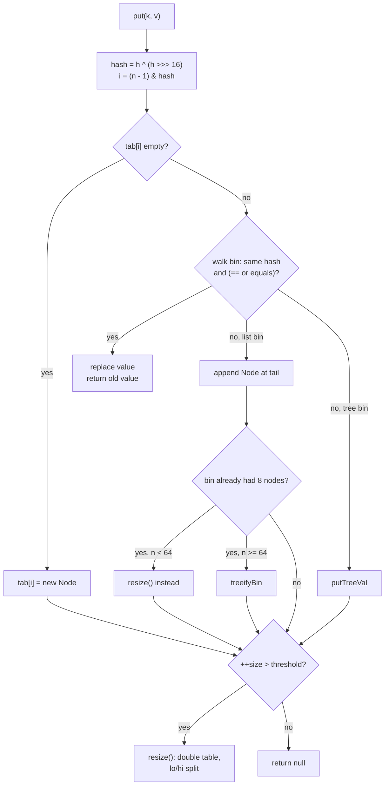
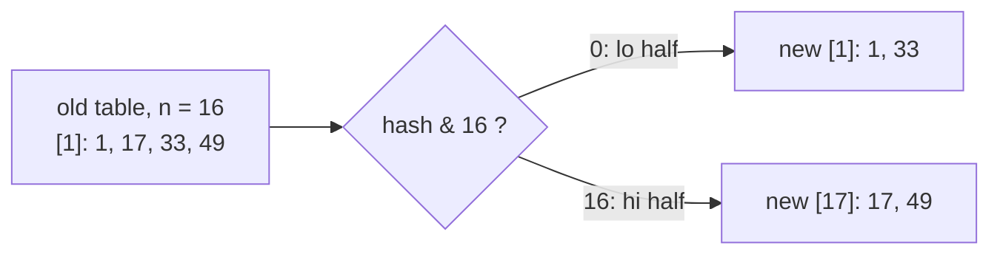
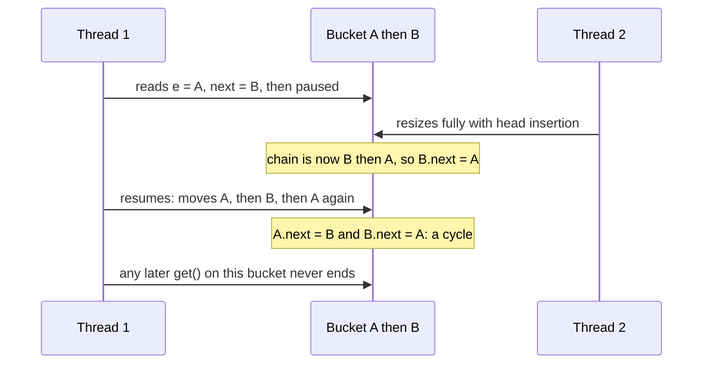

## In One Line
A `HashMap` is an array of **buckets**: it turns `key.hashCode()` into a bucket index with `hash = h ^ (h >>> 16)` and `index = (n - 1) & hash`, chains colliding keys in a list (turned into a red-black tree when a bucket passes 8 nodes and the table has at least 64 buckets), and doubles the array whenever `size > capacity × 0.75`, splitting every bucket into a "stay" half and a "move by n" half.

## Mental Model
Picture a **post office wall of numbered pigeonholes**.

- The wall is the **table** (`Node[] table`). It always has a power-of-two number of holes: 16, 32, 64, …
- Every letter carries a long postcode — the key's `hashCode()`. The clerk first **stirs** the postcode (`h ^ (h >>> 16)`) so the first digits also affect the last ones, then looks only at the **last few digits** (`& (n - 1)`) to choose a hole. That is why the wall size must be a power of two: "the last 4 binary digits" is exactly "one of 16 holes".
- Two letters in the same hole are a **collision**. They are tied together on a string (a linked list). To find a letter, the clerk goes to the hole and reads the full name on each letter on that string (`equals`).
- If one hole ever gets a string of more than 8 letters, the clerk suspects something is wrong. On a small wall (under 64 holes) the cure is **a bigger wall**. On a big wall the clerk replaces the string by a small **sorted filing tree** (a red-black tree) so a search takes log steps instead of reading every letter.
- When the wall is **75 % full**, the office builds a wall twice as big. Every letter either stays in hole `j` or moves to hole `j + oldSize`; one extra digit of its (already stirred) postcode decides. Nobody recomputes postcodes.
- If you **change the name on a letter** after filing it (a mutable key), it is still in the old hole, but nobody will ever look for it there.

## Concept
This lesson is the deep dive. Basic `HashMap` usage and the API are in [HashMap](lesson:a03-collections/14-hashmap); here we open the class and read what the JDK actually does (JDK 21 source, which is the same design as Java 8).

### The fields and the node classes
```java
public class HashMap<K,V> extends AbstractMap<K,V> implements Map<K,V>, Cloneable, Serializable {
    static final int   DEFAULT_INITIAL_CAPACITY = 1 << 4;   // 16
    static final int   MAXIMUM_CAPACITY         = 1 << 30;
    static final float DEFAULT_LOAD_FACTOR      = 0.75f;
    static final int   TREEIFY_THRESHOLD        = 8;
    static final int   UNTREEIFY_THRESHOLD      = 6;
    static final int   MIN_TREEIFY_CAPACITY     = 64;

    transient Node<K,V>[] table;      // the buckets; null until the first put
    transient Set<Map.Entry<K,V>> entrySet;
    transient int size;               // number of mappings
    transient int modCount;           // structural changes, for fail-fast iterators
    int threshold;                    // resize when size exceeds this (capacity * loadFactor)
    final float loadFactor;

    static class Node<K,V> implements Map.Entry<K,V> {
        final int hash;               // the spread hash, computed ONCE and cached
        final K key;
        V value;
        Node<K,V> next;               // next node in the same bucket
    }
}
```
Tree bins use `HashMap.TreeNode<K,V>`, which extends `LinkedHashMap.Entry<K,V>` (which extends `Node`). A `TreeNode` adds `parent`, `left`, `right`, `prev` and a `red` flag — roughly twice the memory of a `Node`, which is one reason trees are used only when really needed. (Extending `LinkedHashMap.Entry` lets a `LinkedHashMap` reuse the same tree code.)

### Step 1 — `hash()`: spreading the bits
```java
static final int hash(Object key) {
    int h;
    return (key == null) ? 0 : (h = key.hashCode()) ^ (h >>> 16);
}
```
The bucket index uses only the **low bits** of the hash (4 bits for 16 buckets). Hash codes that differ only in their **high** bits would all collide. XOR-ing the top 16 bits into the bottom 16 lets the high bits influence the index. In the Code section, keys with hash codes 65536, 131072, 196608, 262144 (multiples of 2^16) would all hit bucket 0 without spreading; with spreading they land in buckets 1, 2, 3, 4.

- **Why XOR?** It is one CPU instruction and it does not bias bits: AND pushes bits towards 0, OR towards 1, XOR keeps them balanced.
- **Why only one shift?** Java 7 used four shifts and XORs. Java 8 made spreading cheaper because tree bins now protect against bad distributions anyway; the JDK comment calls it "the cheapest possible way to reduce systematic lossage".
- **`null` key → hash 0 → bucket 0.** There is exactly one `null` key slot.
- The spread hash is stored in `Node.hash` (a `final` field), so `hashCode()` is called **once per put**, never again during lookups, resizes or tree operations.

### Step 2 — `index = (n - 1) & hash`
With `n` a power of two, `n - 1` is a mask of ones (`16 - 1 = 0b1111`), so `hash & (n - 1)` keeps the low bits: the same result as `hash mod n` for non-negative hashes, but:
- **faster** — one AND instead of a division;
- **never negative** — `-7 % 16` is `-7` (an illegal index), `-7 & 15` is `9`;
- it makes the **resize split** trivial (Step 6).

The power-of-two rule is enforced by `tableSizeFor(cap)`, which rounds any requested capacity **up** to the next power of two (`10 → 16`, `17 → 32`, `100 → 128`, `1000 → 1024`). JDK 21 does it with `-1 >>> Integer.numberOfLeadingZeros(cap - 1)`; Java 8 used a cascade of `n |= n >>> 1, 2, 4, 8, 16`.

### Step 3 — `put`: `putVal`, simplified from the JDK source
```java
final V putVal(int hash, K key, V value, boolean onlyIfAbsent, boolean evict) {
    Node<K,V>[] tab; Node<K,V> p; int n, i;
    if ((tab = table) == null || (n = tab.length) == 0)
        n = (tab = resize()).length;                          // lazy allocation of the table
    if ((p = tab[i = (n - 1) & hash]) == null)
        tab[i] = newNode(hash, key, value, null);             // empty bucket: done
    else {
        Node<K,V> e; K k;
        if (p.hash == hash && ((k = p.key) == key || (key != null && key.equals(k))))
            e = p;                                            // first node is the key
        else if (p instanceof TreeNode)
            e = ((TreeNode<K,V>) p).putTreeVal(this, tab, hash, key, value);
        else {
            for (int binCount = 0; ; ++binCount) {
                if ((e = p.next) == null) {
                    p.next = newNode(hash, key, value, null); // append at the TAIL
                    if (binCount >= TREEIFY_THRESHOLD - 1)    // the bin already had 8 nodes
                        treeifyBin(tab, hash);
                    break;
                }
                if (e.hash == hash && ((k = e.key) == key || (key != null && key.equals(k))))
                    break;                                    // existing key found
                p = e;
            }
        }
        if (e != null) {                                      // key existed: replace value
            V oldValue = e.value;
            if (!onlyIfAbsent || oldValue == null) e.value = value;
            afterNodeAccess(e);                               // hook for LinkedHashMap
            return oldValue;                                  // no modCount++, no size++
        }
    }
    ++modCount;
    if (++size > threshold) resize();                         // resize AFTER inserting
    afterNodeInsertion(evict);                                // hook for LinkedHashMap
    return null;
}
```
Things interviewers probe:
- **The match test** is `p.hash == hash && (p.key == key || key.equals(p.key))`: compare the cached int first (cheap, rejects almost everything), then identity (fast path), and only then `equals`. So `equals` is called only for keys with the **same full hash** in the same bucket.
- **Existing key:** only the **value** is replaced; the originally stored **key object is kept**. `put` returns the old value; it is not a structural modification (`modCount` unchanged), so it is allowed during iteration.
- **New key:** appended at the **tail** (Java 8+). Java 7 inserted at the head.
- `putIfAbsent` is the same method with `onlyIfAbsent = true` (and a key mapped to `null` counts as absent).
- `afterNodeAccess` / `afterNodeInsertion` / `afterNodeRemoval` are empty in `HashMap`; `LinkedHashMap` overrides them to maintain its linked list — see [LRU Cache with LinkedHashMap](lesson:b04-collections-internals/04-lru-cache-with-linkedhashmap).

### Step 4 — `get`: `getNode`
Compute `hash(key)`, go to `tab[(n - 1) & hash]`, check the **first node** (the common case), then either search the tree (`getTreeNode`) or walk the list with the same `hash` / `==` / `equals` test. Return the node's value or `null`. `containsKey` uses the same `getNode`; `containsValue` has no index to use, so it scans every bucket — O(n).

### Step 5 — collisions and treeification
A **collision** is two keys in the same bucket — either their full hashes are equal, or they differ but share the low bits. Collisions are normal; they only cost time.

| Constant | Value | Where it is used | Meaning |
|---|---|---|---|
| `TREEIFY_THRESHOLD` | 8 | `putVal`: `binCount >= 7` | Adding a node to a bin that **already has 8** nodes (the 9th) calls `treeifyBin` |
| `MIN_TREEIFY_CAPACITY` | 64 | `treeifyBin` | If the table has fewer than 64 buckets, **resize instead** of treeifying |
| `UNTREEIFY_THRESHOLD` | 6 | `TreeNode.split` during resize | A tree half with **≤ 6** nodes becomes a list again |

Verified on JDK 21 (Code, section 4): 11 keys with the same hash code in a default map — the 9th put resizes 16 → 32, the 10th resizes 32 → 64, the 11th finally turns the bucket into a tree.

**Why these numbers?**
- **8:** with a decent `hashCode()` and load factor 0.75, bucket sizes follow a Poisson distribution with mean about 0.5. The chance of 8 nodes in one bucket is about **0.00000006** (the JDK source lists this table; the Code section recomputes it). So a long chain almost always means a **bad `hashCode()` or an attack**, and that is what trees defend against.
- **6, not 8, to go back:** the gap (hysteresis) stops a bin that hovers around 8 from converting list ↔ tree on every put/remove.
- **64:** in a small table, long bins are usually caused by the table being too small. Doubling the table fixes that for every bucket and is cheaper than building `TreeNode`s.

**How a tree bin is ordered.** Tree bins are red-black trees ordered **by hash first**. When two keys have the same hash, the tree uses `compareTo` if both keys are of the same class `C implements Comparable<C>`; otherwise it falls back to a tie-break (class name, then `System.identityHashCode`) that is good for insertion but useless for lookup. Consequences:
- Different hashes in one bucket → O(log n) search, whatever the key type.
- **Identical hashes and `Comparable` keys** (e.g. `String`) → O(log n).
- **Identical hashes and non-`Comparable` keys** → `find` may have to search both subtrees: still **O(n)** in the worst case. Treeification is not magic.

A tree bin also keeps its nodes linked through `next` (and `prev`), so iteration and resize can walk it like a list; the root is moved to the front of the bucket.

**Untreeify on removal is not "6".** When removing from a tree bin, `removeTreeNode` converts it back to a list if the tree is *structurally* small (`root.right == null`, `root.left == null` or `root.left.left == null`). In the Code section the bin stayed a tree down to 4 nodes and became a list at 3; with other shapes it happens between about 2 and 6 nodes.

### Step 6 — load factor, threshold and resize
- `threshold = capacity × loadFactor`. After inserting a **new** key, `if (++size > threshold) resize()`. Default: 16 × 0.75 = 12, so the **13th** entry triggers the first resize. Inserting 100 entries into a default map resizes at the 13th, 25th, 49th and 97th put: 16 → 32 → 64 → 128 → 256.
- **Why 0.75?** A time/space trade-off. Lower (0.5) = fewer collisions, more empty buckets. Higher (1.0 or even 2.0 — values above 1 are legal) = less memory, longer chains. 0.75 keeps chains around 0–2 nodes while wasting at most about half the array. `loadFactor <= 0` or `NaN` throws `IllegalArgumentException`.
- **The table is lazy.** `new HashMap<>()` sets only `loadFactor`. `new HashMap<>(10)` stores `tableSizeFor(10) = 16` **in `threshold`** until the first `put` allocates the table (the Code section shows `threshold=16` before any put).

`resize()`:
1. `newCap = oldCap << 1`, `newThr = oldThr << 1` (or computed from the load factor for small tables).
2. Allocate the new array, then for every old bucket `j`:
   - a **single node** goes to `hash & (newCap - 1)`;
   - a **tree bin** is `split` into lo/hi halves (each untreeified if ≤ 6 nodes);
   - a **list** is split in one pass by testing **one bit**:
```java
if ((e.hash & oldCap) == 0)   // the new bit is 0
    append e to the "lo" list  -> stays at index j
else                           // the new bit is 1
    append e to the "hi" list  -> moves to index j + oldCap
```
Why this works: the new index is `hash & (2n - 1)`, which is the old index `hash & (n - 1)` plus the bit `hash & n`. Example (Code, section 3): bucket 1 of a 16-table held `1, 17, 33, 49`. `1` and `33` have bit 16 clear → stay in bucket 1; `17` and `49` have it set → move to bucket 17. Both halves **keep their relative order** — that is what fixed the Java 7 infinite loop (below).

Cost: O(n + capacity) per resize, **amortised O(1) per put**, and no `hashCode()` calls because the hash is cached.

`HashMap` **never shrinks**: `remove` and `clear()` keep the array. A map that once held a million entries keeps a million-bucket table (and iteration still visits every bucket). Copy it into a new map to release the memory.

### Sizing a map correctly
`new HashMap<>(n)` is **not** "room for n entries": `new HashMap<>(1000)` gets 1024 buckets, threshold 768, and resizes to 2048 at the 769th put. To hold `n` entries without resizing:
```java
Map<K, V> a = HashMap.newHashMap(1000);                   // Java 19+: 2048 buckets
Map<K, V> b = new HashMap<>((int) (1000 / 0.75f) + 1);   // before Java 19: same result
```
`HashSet.newHashSet`, `LinkedHashMap.newLinkedHashMap` and `WeakHashMap.newWeakHashMap` (all Java 19) do the same.

### The key contract: `equals` and `hashCode`
- **If `a.equals(b)` then `a.hashCode() == b.hashCode()`** — required. Break it (override `equals` only) and two equal keys land in different buckets or fail the cached-hash test: `get` returns `null` and the map holds "duplicates" (Code, `KeyTraps` 1).
- Unequal keys *may* share a hash code — that is only a collision.
- `hashCode()` must be **stable while the key is in the map**. Mutating a field used by `hashCode` strands the entry: it stays in the old bucket with the old cached hash, so neither the mutated key nor an equal-to-the-original key can find it (`KeyTraps` 2). It still shows up in iteration and still occupies memory — a classic leak.
- `get(Object)` takes `Object`, so `Map<Long, String>.get(1)` compiles and looks up an `Integer` — which is never equal to a `Long` → `null` (`KeyTraps` 4).
- Arrays use identity `equals`/`hashCode`: `int[]` keys never match a new array with the same contents. Use `List.of(...)` or a record.
- Best keys: `String` (immutable, `hashCode` cached in the string), wrapper types, enums (better still: `EnumMap`), records with immutable fields. Details in [equals and hashCode](lesson:b01-fundamentals/06-object-class-equals-hashcode).

### Java 7 vs Java 8+
| | Java 7 | Java 8 – 21 |
|---|---|---|
| Bucket node | `Entry<K,V>` (hash, key, value, next) | `Node<K,V>`, plus `TreeNode<K,V>` for tree bins |
| `hash()` | 4 shifts + XORs: `h ^= (h >>> 20) ^ (h >>> 12); h ^ (h >>> 7) ^ (h >>> 4)`; from 7u6 optional "alternative hashing" for `String` keys | one XOR: `h ^ (h >>> 16)`; alternative hashing removed |
| New node in a bucket | inserted at the **head** | appended at the **tail** |
| Long chains | stay lists: worst case **O(n)** | treeified (JEP 180): worst case **O(log n)** for comparable keys |
| Resize | `transfer()` recomputes every index and **reverses** each chain (head insertion) | lo/hi split with one bit test, **order preserved** |
| Concurrent resize | could create a **cycle** → `get` loops forever at 100 % CPU | no resize cycle, but still lost updates and corruption |
| `null` key | special path `putForNullKey` into bucket 0 | normal path, `hash(null) = 0` |
| API | classic methods | `getOrDefault`, `putIfAbsent`, `compute*`, `merge`, `forEach`, `replaceAll` |

**The Java 7 infinite loop.** Two threads resize the same map at the same time. Thread 1 reads `e = A, next = B` for a bucket `A → B` and is paused. Thread 2 finishes the whole transfer; head insertion reverses the chain to `B → A`, so now `B.next = A`. Thread 1 resumes with its stale view: it moves A, then B (and reads `B.next = A`), then A again, setting `A.next = B`. Result: `A → B → A` — a cycle. Any later `get` on that bucket spins forever. Java 8's tail-preserving split removed this specific failure, but not the underlying problem: **`HashMap` is not thread-safe**.

### Why `HashMap` is not thread-safe
Nothing in `putVal` is atomic or guarded:
- **Lost puts:** two threads see the same empty bucket and both do `tab[i] = newNode(...)`; one node is overwritten.
- **Wrong `size()`:** `++size` is a read-modify-write; concurrent increments are lost.
- **Lost entries during resize:** each thread may build its own new table; one of them wins `table = newTab`.
- **No visibility guarantee:** without a happens-before edge, another thread may see a stale `table` or partly linked nodes.
- **Corruption:** Java 7 resize cycles; in Java 8+ races in tree bins can also corrupt the tree (infinite loops and `ClassCastException`s have been reported).

The `LostUpdates` program below shows `size()` wrong, keys missing, and `size()` disagreeing with the entries actually present. Fixes: [ConcurrentHashMap](lesson:b03-concurrency/03-concurrenthashmap) (CAS on empty bins, a lock per bin otherwise, cooperative resizing), `Collections.synchronizedMap(new HashMap<>())` for low contention, or build the map in one thread and publish it safely as an immutable copy (`Map.copyOf`).

### Other internals worth knowing
- **Iteration** (`HashIterator`) walks the array from bucket 0 upward, following `next` in each bucket: O(n + capacity). That is why the order looks random, why it can **change after a resize** (Code: `[17, 1]` becomes `[1, 17]`), and why a huge, mostly empty map iterates slowly. `LinkedHashMap` iterates in O(n).
- **Fail-fast:** `modCount` changes on structural modifications (new key, remove, clear, resize); iterators throw `ConcurrentModificationException` when it changes under them — see [Fail-fast iterators](lesson:a03-collections/22-fail-fast-iterators). Since **Java 9**, `computeIfAbsent`/`compute`/`merge` also throw it if the mapping function modifies the same map (the recursive memoisation trap in `KeyTraps` 6). In Java 8 the same code could silently corrupt the map.
- **Serialization:** `table` is `transient`. `writeObject` writes the capacity, the size and then the key/value pairs; `readObject` re-inserts every pair, recomputing hashes. This matters because hash codes (identity hashes, `Enum.hashCode`) can differ in another JVM.
- **`clone()`** is shallow: new table and nodes, same key and value objects.
- **Hash flooding (HashDoS):** attackers who can choose keys (HTTP parameter names, JSON field names) can send thousands of strings with one hash code — `"Aa"` and `"BB"` both hash to 2112, and any concatenation of such blocks collides too. In Java 7 that made every insert O(n), so a single request could burn seconds of CPU (the 2011 multi-language disclosure). Java 8's tree bins make it O(log n) because `String` is `Comparable` (Code, section 6: 1,024 distinct strings, one hash code, one tree bin).
- **Reading internals by reflection** needs `--add-opens java.base/java.util=ALL-UNNAMED` since JDK 16/17 (strong encapsulation of JDK internals); without it you get `InaccessibleObjectException`.

### Complexity summary
| Operation | Average | Worst case (Java 8+) |
|---|---|---|
| `get`, `put`, `remove`, `containsKey` | O(1) | O(log n) with `Comparable` colliding keys; O(n) if colliding keys share one hash and are not `Comparable` |
| `containsValue` | O(n) | O(n) |
| Iteration | O(n + capacity) | O(n + capacity) |
| `resize` | O(n + capacity), amortised O(1) per put | |
| Memory | about 32 bytes per `Node` + 4 bytes per bucket (64-bit JVM, compressed references) | `TreeNode` about twice a `Node` |

> [!INTERVIEW] "HashMap is an array of nodes. `put` spreads the key's hashCode with `h ^ (h >>> 16)`, masks it with `(n - 1)` to pick a bucket, and walks the bucket comparing the cached hash, then `==`, then `equals`: match → replace the value, no match → append at the tail. A bucket that reaches 8 nodes becomes a red-black tree if the table has at least 64 buckets, otherwise the table is resized. When size exceeds capacity × 0.75 the table doubles and each bucket splits into a lo half that stays at `j` and a hi half that moves to `j + oldCap`. It allows one null key, is not thread-safe, and its order is unspecified."

## Diagram

The whole `putVal` in one picture: `hashCode` picks the bucket, `equals` decides replace-or-append, and two separate size checks (bin length and map size) decide treeify-or-resize.


The Java 8 resize split: one bit of the cached hash decides "stay at j" or "move to j + oldCap", and each half keeps its order.


The Java 7 concurrent-resize bug: head insertion reversed chains, so a thread working from a stale snapshot could link two nodes into a loop.

## Code
**1. The arithmetic of hashing** — the JDK's own `hash()` and `tableSizeFor()`, copied and run:
```java
public class HashMath {
    static final int MAXIMUM_CAPACITY = 1 << 30;

    // Copied from java.util.HashMap (JDK 8-21)
    static int hash(Object key) {
        int h;
        return (key == null) ? 0 : (h = key.hashCode()) ^ (h >>> 16);
    }

    // Copied from java.util.HashMap (JDK 21): next power of two >= cap
    static int tableSizeFor(int cap) {
        int n = -1 >>> Integer.numberOfLeadingZeros(cap - 1);
        return (n < 0) ? 1 : (n >= MAXIMUM_CAPACITY) ? MAXIMUM_CAPACITY : n + 1;
    }

    record Key(int h) {                        // a key whose hashCode we control
        @Override public int hashCode() { return h; }
    }

    public static void main(String[] args) {
        // 1. Why spread? Hash codes that differ only in the HIGH bits
        System.out.println("hashCode    index without spreading   index with spreading (n = 16)");
        for (int i = 1; i <= 4; i++) {
            Key k = new Key(i << 16);              // 65536, 131072, 196608, 262144
            System.out.printf("%-11d %-25d %d%n", k.hashCode(), k.hashCode() & 15, hash(k) & 15);
        }

        // 2. Real keys: hashCode -> hash -> bucket index in a 16-slot table
        System.out.println();
        Object[] keys = {null, 1, 17, "A", "Aa", "BB", "Java"};
        for (Object k : keys) {
            int h = k == null ? 0 : k.hashCode();
            System.out.printf("%-5s hashCode=%-8d hash=%-8d index=%d%n", k, h, hash(k), hash(k) & 15);
        }

        // 3. Why a bit mask and not %: negative hashes
        int h = -7;
        System.out.println();
        System.out.println("-7 % 16 = " + (h % 16) + ",  -7 & 15 = " + (h & 15));

        // 4. Requested capacity -> real table length
        System.out.println();
        for (int cap : new int[]{0, 1, 10, 16, 17, 100, 1000})
            System.out.print(cap + "->" + tableSizeFor(cap) + "  ");
        System.out.println();

        // 5. Why TREEIFY_THRESHOLD = 8: expected bucket sizes at load factor 0.75 (Poisson, lambda = 0.5)
        System.out.println();
        double lambda = 0.5, p = Math.exp(-lambda);
        for (int k = 0; k <= 8; k++) {
            System.out.printf("P(bucket has %d) = %.8f%n", k, p);
            p = p * lambda / (k + 1);
        }
    }
}
```
```output
hashCode    index without spreading   index with spreading (n = 16)
65536       0                         1
131072      0                         2
196608      0                         3
262144      0                         4

null  hashCode=0        hash=0        index=0
1     hashCode=1        hash=1        index=1
17    hashCode=17       hash=17       index=1
A     hashCode=65       hash=65       index=1
Aa    hashCode=2112     hash=2112     index=0
BB    hashCode=2112     hash=2112     index=0
Java  hashCode=2301506  hash=2301537  index=1

-7 % 16 = -7,  -7 & 15 = 9

0->1  1->1  10->16  16->16  17->32  100->128  1000->1024  

P(bucket has 0) = 0.60653066
P(bucket has 1) = 0.30326533
P(bucket has 2) = 0.07581633
P(bucket has 3) = 0.01263606
P(bucket has 4) = 0.00157951
P(bucket has 5) = 0.00015795
P(bucket has 6) = 0.00001316
P(bucket has 7) = 0.00000094
P(bucket has 8) = 0.00000006
```

**2. An X-ray of a real `HashMap`** — reads the private `table` and `threshold` fields by reflection, so it must be run with `java --add-opens java.base/java.util=ALL-UNNAMED HashMapXRay.java`:
```java
import java.lang.reflect.Field;
import java.util.ArrayList;
import java.util.HashMap;
import java.util.List;

// Run with:  java --add-opens java.base/java.util=ALL-UNNAMED HashMapXRay.java
public class HashMapXRay {

    // hashCode() is whatever we say; Comparable so that tree bins can order equal-hash keys
    record Key(int h, String name) implements Comparable<Key> {
        @Override public int hashCode() { return h; }
        @Override public int compareTo(Key o) { return name.compareTo(o.name); }
        @Override public String toString() { return name; }
    }

    public static void main(String[] args) throws Exception {
        // 1. The table is created lazily; the constructor argument is rounded up
        HashMap<String, Integer> lazy = new HashMap<>();
        System.out.println("1. new HashMap<>()       -> " + xray(lazy));
        lazy.put("x", 1);
        System.out.println("   after first put       -> " + xray(lazy));
        HashMap<String, Integer> sized = new HashMap<>(10);
        System.out.println("   new HashMap<>(10)     -> " + xray(sized));
        sized.put("x", 1);
        System.out.println("   after first put       -> " + xray(sized));
        HashMap<String, Integer> expected = HashMap.newHashMap(13);   // Java 19+
        expected.put("x", 1);
        System.out.println("   HashMap.newHashMap(13)-> " + xray(expected));

        // 2. Buckets and chains: null goes to bucket 0, 1/17/33/49 all land in bucket 1
        HashMap<Integer, String> map = new HashMap<>();
        map.put(null, "null");
        for (int k : new int[]{1, 17, 33, 49, 2}) map.put(k, "v" + k);
        System.out.println("2. " + xray(map));

        // 3. Resize: the 13th entry exceeds threshold 12 -> table doubles to 32
        for (int k = 3; k <= 8; k++) map.put(k, "v" + k);        // 12 entries: no resize yet
        System.out.println("3. size 12 -> " + xray(map));
        map.put(9, "v9");                                        // 13th entry
        System.out.println("   size 13 -> " + xray(map));
        map.clear();
        System.out.println("   clear() -> " + xray(map) + " (the table never shrinks)");

        // 4. Treeify: 11 keys with the SAME hashCode, default map
        HashMap<Key, Integer> bad = new HashMap<>();
        StringBuilder timeline = new StringBuilder("4. ");
        for (int i = 1; i <= 11; i++) {
            bad.put(new Key(42, "k" + i), i);
            timeline.append(i).append(':').append(capacity(bad)).append(binType(bad, 42)).append(' ');
        }
        System.out.println(timeline + "  (L = list bin, T = tree bin)");

        // 5a. Untreeify during a resize split (UNTREEIFY_THRESHOLD = 6)
        HashMap<Key, Integer> split = new HashMap<>(64);
        for (int i = 0; i < 8; i++) split.put(new Key(5, "a" + i), i);   // 5 & 127 = 5
        for (int i = 0; i < 2; i++) split.put(new Key(69, "b" + i), i);  // 69 & 127 = 69
        System.out.println("5. cap " + capacity(split) + ": bin 5 = " + binType(split, 5) + count(split, 5));
        for (int k = 10; split.size() <= 48; k++) split.put(new Key(k, "f" + k), k);  // force resize
        System.out.println("   cap " + capacity(split) + ": bin 5 = " + binType(split, 5) + count(split, 5)
                + ", bin 69 = " + binType(split, 69) + count(split, 69));

        // 5b. Untreeify on removal: decided by the tree's shape, not by a count of 6
        HashMap<Key, Integer> shrink = new HashMap<>(64);
        for (int i = 1; i <= 10; i++) shrink.put(new Key(7, "s" + i), i);
        StringBuilder removals = new StringBuilder("   removing: ");
        for (int i = 10; i >= 2; i--) {
            shrink.remove(new Key(7, "s" + i));
            removals.append(shrink.size()).append(binType(shrink, 7)).append(' ');
        }
        System.out.println(removals);

        // 6. Hash flooding: 1024 different Strings with ONE hashCode ("Aa" and "BB" collide)
        List<String> flood = new ArrayList<>(List.of(""));
        for (int round = 0; round < 10; round++) {
            List<String> next = new ArrayList<>();
            for (String s : flood) { next.add(s + "Aa"); next.add(s + "BB"); }
            flood = next;
        }
        HashMap<String, Integer> attacked = new HashMap<>();
        for (String s : flood) attacked.put(s, 1);
        int h = flood.get(0).hashCode();
        System.out.println("6. " + flood.size() + " keys, distinct hashCodes = "
                + flood.stream().mapToInt(String::hashCode).distinct().count()
                + ", cap " + capacity(attacked)
                + ", bin " + binType(attacked, h ^ (h >>> 16)) + count(attacked, h ^ (h >>> 16)));
    }

    // ---- X-ray helpers: read HashMap's private fields by reflection ----
    static final Field TABLE, THRESHOLD, NEXT, KEY;
    static {
        try {
            TABLE = HashMap.class.getDeclaredField("table");
            THRESHOLD = HashMap.class.getDeclaredField("threshold");
            Class<?> node = Class.forName("java.util.HashMap$Node");
            NEXT = node.getDeclaredField("next");
            KEY = node.getDeclaredField("key");
            for (Field f : new Field[]{TABLE, THRESHOLD, NEXT, KEY}) f.setAccessible(true);
        } catch (ReflectiveOperationException e) { throw new ExceptionInInitializerError(e); }
    }

    static Object[] table(HashMap<?, ?> m) throws Exception { return (Object[]) TABLE.get(m); }

    static int capacity(HashMap<?, ?> m) throws Exception { return table(m).length; }

    static Object firstNode(HashMap<?, ?> m, int hash) throws Exception {
        Object[] t = table(m);
        return t[hash & (t.length - 1)];
    }

    static String binType(HashMap<?, ?> m, int hash) throws Exception {
        Object n = firstNode(m, hash);
        return n == null ? "-" : n.getClass().getSimpleName().equals("TreeNode") ? "T" : "L";
    }

    static String count(HashMap<?, ?> m, int hash) throws Exception {
        int c = 0;
        for (Object n = firstNode(m, hash); n != null; n = NEXT.get(n)) c++;
        return "(" + c + ")";
    }

    static String xray(HashMap<?, ?> m) throws Exception {
        Object[] t = table(m);
        if (t == null) return "table=null, threshold=" + THRESHOLD.get(m);
        StringBuilder sb = new StringBuilder("capacity=" + t.length + ", threshold=" + THRESHOLD.get(m));
        for (int i = 0; i < t.length; i++) {
            if (t[i] == null) continue;
            List<Object> chain = new ArrayList<>();
            for (Object n = t[i]; n != null; n = NEXT.get(n)) chain.add(KEY.get(n));
            if (chain.size() > 1 || m.size() <= 6) sb.append(" [").append(i).append("]=").append(chain);
        }
        return sb.toString();
    }
}
```
```output
1. new HashMap<>()       -> table=null, threshold=0
   after first put       -> capacity=16, threshold=12 [8]=[x]
   new HashMap<>(10)     -> table=null, threshold=16
   after first put       -> capacity=16, threshold=12 [8]=[x]
   HashMap.newHashMap(13)-> capacity=32, threshold=24 [24]=[x]
2. capacity=16, threshold=12 [0]=[null] [1]=[1, 17, 33, 49] [2]=[2]
3. size 12 -> capacity=16, threshold=12 [1]=[1, 17, 33, 49]
   size 13 -> capacity=32, threshold=24 [1]=[1, 33] [17]=[17, 49]
   clear() -> capacity=32, threshold=24 (the table never shrinks)
4. 1:16L 2:16L 3:16L 4:16L 5:16L 6:16L 7:16L 8:16L 9:32L 10:64L 11:64T   (L = list bin, T = tree bin)
5. cap 64: bin 5 = T(10)
   cap 128: bin 5 = T(8), bin 69 = L(2)
   removing: 9T 8T 7T 6T 5T 4T 3L 2L 1L 
6. 1024 keys, distinct hashCodes = 1, cap 2048, bin T(1024)
```
Without the `--add-opens` flag the program fails at start-up with `InaccessibleObjectException: Unable to make field transient java.util.HashMap$Node[] java.util.HashMap.table accessible: module java.base does not "opens java.util" to unnamed module`.

**3. Key traps** — no reflection, just behaviour:
```java
import java.util.HashMap;
import java.util.HashSet;
import java.util.Map;
import java.util.Objects;
import java.util.Set;

public class KeyTraps {
    // equals() overridden, hashCode() forgotten
    static class Emp {
        final int id;
        Emp(int id) { this.id = id; }
        @Override public boolean equals(Object o) { return o instanceof Emp e && e.id == id; }
    }

    // a mutable key: its hashCode depends on a field that can change
    static class Point {
        int x, y;
        Point(int x, int y) { this.x = x; this.y = y; }
        @Override public boolean equals(Object o) { return o instanceof Point p && p.x == x && p.y == y; }
        @Override public int hashCode() { return Objects.hash(x, y); }
        @Override public String toString() { return "(" + x + "," + y + ")"; }
    }

    static final Map<Integer, Long> memo = new HashMap<>();
    static long fib(int n) {                              // memoised Fibonacci, the "clever" way
        if (n < 2) return n;
        return memo.computeIfAbsent(n, k -> fib(k - 1) + fib(k - 2));
    }

    public static void main(String[] args) {
        // 1. equals without hashCode
        Map<Emp, String> emps = new HashMap<>();
        emps.put(new Emp(1), "Asha");
        emps.put(new Emp(1), "Asha again");
        System.out.println("1. size=" + emps.size() + ", get=" + emps.get(new Emp(1)));

        // 2. Mutating a key after put
        Map<Point, String> places = new HashMap<>();
        Point p = new Point(1, 2);
        places.put(p, "home");
        p.x = 99;                                          // hashCode changes, entry stays in the old bucket
        System.out.println("2. get(p)=" + places.get(p)
                + ", get(new Point(1,2))=" + places.get(new Point(1, 2))
                + ", containsKey(p)=" + places.containsKey(p)
                + ", map=" + places);

        // 3. put on an existing key replaces the VALUE and keeps the ORIGINAL key object
        Map<String, Integer> stock = new HashMap<>();
        String k1 = new String("pen"), k2 = new String("pen");
        System.out.println("3. put#1 returns " + stock.put(k1, 10) + ", put#2 returns " + stock.put(k2, 20)
                + ", stored key is k1? " + (stock.keySet().iterator().next() == k1) + ", map=" + stock);

        // 4. Key type mismatch: Integer 1 is not equal to Long 1
        Map<Long, String> byId = new HashMap<>();
        byId.put(1L, "one");
        System.out.println("4. get(1)=" + byId.get(1) + ", get(1L)=" + byId.get(1L));

        // 5. Iteration order can change when the table grows
        Map<Integer, String> order = new HashMap<>();
        order.put(17, "a");
        order.put(1, "b");
        System.out.print("5. before resize " + order.keySet());
        for (int i = 100; i < 111; i++) order.put(i, "x");      // 13 entries -> resize to 32
        System.out.println(", after resize " + order.keySet().stream().filter(k -> k < 20).toList());

        // 6. computeIfAbsent must not modify the same map (Java 9+ detects it)
        try {
            System.out.println("6. fib(20)=" + fib(20));
        } catch (java.util.ConcurrentModificationException e) {
            System.out.println("6. fib(20) -> " + e);
        }
    }
}
```
```output
1. size=2, get=null
2. get(p)=null, get(new Point(1,2))=null, containsKey(p)=false, map={(99,2)=home}
3. put#1 returns null, put#2 returns 10, stored key is k1? true, map={pen=20}
4. get(1)=null, get(1L)=one
5. before resize [17, 1], after resize [1, 17]
6. fib(20) -> java.util.ConcurrentModificationException
```

**4. Why `HashMap` is not thread-safe** — two threads, 100,000 distinct keys each:
```java
import java.util.HashMap;
import java.util.Map;
import java.util.concurrent.ConcurrentHashMap;

public class LostUpdates {
    // Two threads put 100,000 different keys each into the same map
    static void fill(Map<Integer, Integer> map) throws InterruptedException {
        Thread t1 = new Thread(() -> { for (int i = 0; i < 100_000; i++) map.put(i, i); });
        Thread t2 = new Thread(() -> { for (int i = 100_000; i < 200_000; i++) map.put(i, i); });
        t1.start(); t2.start();
        t1.join();  t2.join();
    }

    static String report(Map<Integer, Integer> map) {
        int iterated = 0;
        for (Integer k : map.keySet()) iterated++;            // walk the buckets for real
        int missing = 0;
        for (int i = 0; i < 200_000; i++) if (!map.containsKey(i)) missing++;
        return "size()=" + map.size() + ", entries iterated=" + iterated + ", keys missing=" + missing;
    }

    public static void main(String[] args) throws InterruptedException {
        for (int run = 1; run <= 3; run++) {
            Map<Integer, Integer> plain = new HashMap<>();
            fill(plain);
            System.out.println("HashMap run " + run + ":      " + report(plain));
        }
        Map<Integer, Integer> safe = new ConcurrentHashMap<>();
        fill(safe);
        System.out.println("ConcurrentHashMap:      " + report(safe));
    }
}
```
One real run (the numbers change on every run — see the Walkthrough):
```output
HashMap run 1:      size()=200000, entries iterated=200000, keys missing=0
HashMap run 2:      size()=200000, entries iterated=200000, keys missing=0
HashMap run 3:      size()=187641, entries iterated=195288, keys missing=4712
ConcurrentHashMap:      size()=200000, entries iterated=200000, keys missing=0
```

## Walkthrough
### `HashMath`
- `hash(Object)` and `tableSizeFor(int)` are copied from the JDK so we can print intermediate values that the real `HashMap` keeps private.
- **Section 1.** `new Key(i << 16)` builds keys whose hash codes are 65536, 131072, … — their low 16 bits are all zero. `hashCode() & 15` is therefore 0 for all four: four keys, one bucket. After `h ^ (h >>> 16)`, bit 16 becomes bit 0 (and so on), so the indexes become 1, 2, 3, 4. This is the exact situation the spreading step exists for; the JDK comment mentions `Float` keys holding consecutive whole numbers as a real-world case.
- **Section 2.** Small `Integer`s hash to themselves; `hash` equals `hashCode` because `h >>> 16` is 0 for values below 65536. `1`, `17` and `"A"` (65) all land in bucket 1 (their low 4 bits are `0001`) — collisions with different hash codes. `"Aa"` and `"BB"` have the **same** hash code 2112 (`'A'*31 + 'a' = 65*31 + 97` and `'B'*31 + 'B' = 66*31 + 66`) — a full-hash collision. `"Java"` shows spreading changing a value: 2301506 becomes 2301537 because its high half (35) is XOR-ed into the low half.
- **Section 3.** `%` keeps the sign of the dividend, so `-7 % 16` is `-7`; the mask gives a valid index, 9. Negative hash codes are common (`String.hashCode` overflows freely), so `%` would need an extra `Math.abs` or `floorMod`.
- **Section 4.** Every requested capacity is rounded up to a power of two. `0` and `1` both give 1 (then the first put grows it).
- **Section 5.** `p(k) = e^-0.5 × 0.5^k / k!` — the Poisson probabilities quoted in the `HashMap` source. Eight nodes in one bucket has a probability of 6 in 100 million, which is why reaching `TREEIFY_THRESHOLD` signals a bad `hashCode()` rather than bad luck. (The JDK comment shows 0.00157952 for k = 4; we print 0.00157951 — the same number rounded from a slightly different floating-point computation.)

### `HashMapXRay`
- **Helpers.** `getDeclaredField("table")` etc. plus `setAccessible(true)` read private fields; `Class.forName("java.util.HashMap$Node")` reaches the nested node class, whose `next` and `key` fields exist in every node type (a `TreeNode` *is a* `Node`). `binType` prints `L` for a plain `Node` and `T` for a `TreeNode` at the head of a bucket; `count` follows `next` pointers (tree bins keep them too). `xray` prints capacity, threshold and the non-empty buckets (only multi-node buckets once the map has more than 6 entries, to keep lines short).
- **1 — lazy table.** A fresh `new HashMap<>()` has `table=null` and `threshold=0`. The first `put` calls `resize()`, which allocates 16 buckets and sets the threshold to 12. `"x".hashCode()` is 120, and `120 & 15 = 8`. `new HashMap<>(10)` also has no table yet, but `threshold` already holds **16** — the rounded-up initial capacity parked there until the first put. `HashMap.newHashMap(13)` computes `ceil(13 / 0.75) = 18` and rounds up to 32, so 13 entries fit without a resize (now `120 & 31 = 24`).
- **2 — buckets.** The `null` key is in bucket 0. `1, 17, 33, 49` all have low bits `0001`, so they chain in bucket 1 in **insertion order** (tail insertion). `2` sits alone in bucket 2.
- **3 — resize.** With 12 entries the map is exactly at its threshold: no resize (`size > threshold` is false). The 13th `put` inserts the node, then `++size` (13) > 12 triggers `resize()`: capacity 32, threshold 24. Bucket 1 splits by bit 16 of the hash: `1` (00001) and `33` (100001) have it clear and stay at index 1; `17` (10001) and `49` (110001) have it set and move to 1 + 16 = 17 — in their original order. `clear()` empties the buckets but keeps the 32-slot array.
- **4 — treeify timeline.** All keys have hash 42. Puts 1–8 build a list. On the 9th put the bin already had 8 nodes, so `treeifyBin` runs — but the table has only 16 buckets (< 64), so it **resizes** to 32 instead. The 10th put does the same (32 → 64). The 11th put finds a 64-bucket table and converts the bin to a tree. Note that size 11 is far below the threshold 12, so these resizes were caused by the bin, not by the load factor.
- **5a — untreeify at split.** Ten keys (eight with hash 5, two with hash 69) share bucket 5 of a 64-table and form a tree. Filler keys 10, 11, … push the size past 48 (64 × 0.75), so the table doubles to 128. Bit 64 separates them: hash 5 stays at 5, hash 69 moves to 69. The lo half has 8 nodes (> 6) and stays a tree; the hi half has 2 (≤ `UNTREEIFY_THRESHOLD`) and becomes a list.
- **5b — untreeify on removal.** Ten keys with hash 7 form a tree in a 64-bucket table. Removing them one by one, the bin is still a tree at 4 nodes and becomes a list at 3: `removeTreeNode` decided the tree was "too small" from its shape, not from a counter. The exact point depends on the tree's shape (and, for non-`Comparable` keys, on identity hash codes), which is why you see different numbers quoted online.
- **6 — hash flooding.** Ten rounds of "append `Aa` or `BB`" produce 2^10 = 1024 different 20-character strings. Because `"Aa"` and `"BB"` contribute identically to the polynomial hash, all 1024 strings have **one** hash code. The map grows normally to 2048 buckets (1024 > 768), but every key is in the same bucket — a single tree bin with 1024 nodes. Since `String` is `Comparable`, lookups in it take about 10 comparisons instead of up to 1024.

### `KeyTraps`
1. `Emp` overrides `equals` but inherits `Object.hashCode()` (an identity hash). The two `new Emp(1)` objects almost certainly get different hashes, so the second `put` never even calls `equals` — it adds a second entry. `get(new Emp(1))` uses a third identity hash and misses: `size=2, get=null`.
2. After `p.x = 99`, the entry still sits in the bucket chosen from `(1,2)` and its node still caches the old hash. `get(p)` looks in the bucket for `(99,2)` → `null`. `get(new Point(1,2))` goes to the right bucket and matches the cached hash, but `equals` compares `(1,2)` with the now-`(99,2)` key → `null`. `containsKey(p)` is `false`, yet printing the map shows `{(99,2)=home}` — the entry is unreachable but alive.
3. The two `"pen"` strings are distinct objects but `equals`. The first `put` returns `null` (new key), the second returns the old value `10` and replaces it with `20`. The identity check shows the map still holds **`k1`**: `putVal` changes `e.value` only.
4. `byId.get(1)` autoboxes `1` to an `Integer`; `Integer.equals(Long)` is `false` (and even the hash of `Long 1` is the same, so it finds the bucket and fails at `equals`). The code compiles because `get` takes `Object`.
5. With 16 buckets, `17` and `1` share bucket 1, chained in insertion order → `[17, 1]`. Adding 11 more keys makes 13 entries → resize to 32: `1` stays in bucket 1, `17` moves to bucket 17 → `[1, 17]`. Same keys, different order — never depend on `HashMap` order.
6. `computeIfAbsent(20, ...)` calls `fib(19)` inside the mapping function, which inserts into the same map. On return, `HashMap` sees that `modCount` changed while the function ran and throws `ConcurrentModificationException` (Java 9+). Fix: compute first, then `put` — or use a plain `if (!memo.containsKey(n))` check.

### `LostUpdates`
- Two threads insert disjoint key ranges, so a correct map must end with exactly 200,000 keys.
- In the run shown, runs 1 and 2 were correct by luck; run 3 lost 4,712 keys, `size()` says 187,641 while 195,288 entries are actually reachable — **both** the counter and the table were damaged. In other runs you will see different numbers (thread timing is non-deterministic), sometimes only one key lost, sometimes all three runs correct. That is exactly what makes such bugs dangerous: tests pass, production loses data.
- `ConcurrentHashMap` gives 200,000 every time.

## Traps
- **Relying on iteration order.** It depends on hash codes, capacity, insertion history and JDK version, and it changes after a resize (`KeyTraps` 5). Use `LinkedHashMap` or `TreeMap` when order matters.
- **Mutable keys.** Changing a field used by `hashCode` after `put` strands the entry: it can no longer be found or removed by key, but it still takes memory and shows up in iteration. Keys must be effectively immutable.
- **`equals` without `hashCode`** (or with a `hashCode` that uses different fields than `equals`): duplicates and failed lookups.
- **Wrong key type in `get`/`containsKey`/`remove`** — they take `Object`, so `Map<Long, …>.get(1)` compiles and returns `null`. The classic puzzle: `Set<Short> s; for (short i = 0; i < 100; i++) { s.add(i); s.remove(i - 1); }` leaves 100 elements, because `i - 1` is an `int`, boxed to `Integer`, which never equals a `Short`.
- **`new HashMap<>(n)` is not "room for n".** It is a bucket count, rounded up to a power of two, and resizes at 75 % of that. Use `HashMap.newHashMap(n)` (Java 19+).
- **The table never shrinks.** A cache map that once held millions of entries keeps its huge array after `clear()` or `remove`. Replace it with a new map.
- **Recursive `computeIfAbsent`** (memoisation) on the same `HashMap` throws `ConcurrentModificationException` since Java 9 and silently corrupted the map in Java 8.
- **Sharing a `HashMap` between threads** without synchronisation — lost entries, wrong size, and (Java 7) infinite loops. "Only one thread writes" is not enough either: readers need a happens-before edge to see the writes.
- **A constant or weak `hashCode()`** (for example `return 1;` or one that ignores most fields) turns the map into a list, or a tree at best. Treeification only gives O(log n) when the colliding keys are `Comparable`.

> [!WARNING] Myth: "a bucket becomes a tree when it has 8 entries." It is converted when an entry is **added to a bin that already has 8** (the 9th), and only if the table has **at least 64 buckets**; otherwise the table is resized. And `UNTREEIFY_THRESHOLD = 6` applies only when a resize splits a tree bin; removals untreeify based on the tree's shape.

> [!WARNING] Myth: "Java 8 fixed HashMap's thread-safety problem." Java 8 removed the resize **infinite loop** (by preserving chain order). Lost updates, wrong sizes and corrupted bins remain. Use `ConcurrentHashMap`.

## Tips & Tricks
- **Lookup in three words: "Hash, Mask, Match."** `h ^ (h >>> 16)` → `& (n - 1)` → cached hash, `==`, `equals`.
- **The numbers: "16, 0.75, 12" and "8 up, 6 down, 64 floor."** Default capacity, load factor, first threshold; treeify at 8, untreeify at 6, never treeify below 64 buckets.
- **Resize in one sentence: "lo stays, hi jumps by oldCap."** One bit (`hash & oldCap`) decides, and both halves keep their order.
- **First resize of a default map = the 13th put.** Then 25th, 49th, 97th…: `threshold + 1` each time.
- **hashCode picks the bucket, equals picks the entry.** Equal objects must have equal hashes; equal hashes do not mean equal objects.
- **Size up front:** `HashMap.newHashMap(expected)`; before Java 19, `new HashMap<>((int) (expected / 0.75f) + 1)`.
- **Good keys are immutable and cheap to hash:** `String` (caches its hash), wrappers, enums (or use `EnumMap`), records of immutable fields.
- **To explore any JDK class's internals**, run a small reflection program with `--add-opens java.base/java.util=ALL-UNNAMED`, or read the source (`lib/src.zip` in the JDK). Seeing the table beats memorising diagrams.

## Interview Q&A
### [Basic] How does HashMap work internally?
A `HashMap` keeps an array of buckets, `Node<K,V>[] table`, whose length is always a power of two (16 by default, allocated lazily on the first put). Each `Node` stores the key, the value, the key's spread hash and a `next` pointer.

On `put(k, v)` it computes `hash = h ^ (h >>> 16)` from `k.hashCode()`, picks the bucket `index = (n - 1) & hash`, and then:
- empty bucket → store a new node;
- otherwise walk the bucket comparing the cached hash, then `==`, then `equals`: a match replaces the value and returns the old one; no match appends a new node at the tail.

If a bucket already had 8 nodes it becomes a red-black tree — or, if the table has fewer than 64 buckets, the table is resized instead. After inserting a new key, if `size > capacity × loadFactor` (12 for the defaults), the table doubles and every bucket is split between index `j` and `j + oldCap`. `get` repeats the hash and index steps and searches that one bucket, so both operations are O(1) on average.

**Follow-up:** *What if two keys have the same hashCode?* — They go to the same bucket (a collision). Both are stored; `equals` tells them apart during lookups. It costs time, not correctness.

### [Basic] Why is the capacity of a HashMap always a power of two?
So that the bucket index can be computed with a bit mask: `hash & (n - 1)`. With `n = 16` the mask is `0b1111`, which keeps the low 4 bits. That is much faster than `%`, it can never give a negative index (unlike `-7 % 16`), and it makes resizing cheap: when `n` doubles, the new index is the old index plus one extra bit of the hash, so each node either stays or moves by exactly `oldCap`. Any requested capacity is rounded up by `tableSizeFor` (10 → 16, 100 → 128).

**Follow-up:** *What is the downside?* — Only the low bits choose the bucket, so hash codes that differ only in their high bits would collide. That is why `hash()` XORs the high 16 bits into the low 16.

### [Intermediate] What does `hash()` do, and why `h ^ (h >>> 16)`?
It "spreads" the hash code: the top 16 bits are XOR-ed into the bottom 16 bits, so that the high bits also influence which bucket is chosen. For example hash codes 65536, 131072, 196608 all end in 16 zero bits and would all land in bucket 0 of a 16-bucket table; after spreading they go to buckets 1, 2, 3. XOR is used because it is a single instruction and does not bias bits towards 0 or 1 like AND/OR. It is deliberately minimal — Java 7 used four shifts and XORs — because Java 8's tree bins handle pathological cases, and many common hash codes are already well distributed. The result is cached in `Node.hash`, so `hashCode()` is called once per insertion. A `null` key hashes to 0.

**Follow-up:** *Does spreading help if two keys have exactly the same hashCode?* — No. Identical hash codes always collide; only `equals` (and, in a tree bin, `compareTo`) can separate them.

### [Intermediate] What is treeification? Explain TREEIFY_THRESHOLD, UNTREEIFY_THRESHOLD and MIN_TREEIFY_CAPACITY.
Since Java 8 (JEP 180) a bucket's linked list can be converted to a red-black tree of `TreeNode`s, bringing the worst-case lookup in that bucket from O(n) to O(log n).
- `TREEIFY_THRESHOLD = 8`: when a node is added to a bin that already holds 8 nodes, `treeifyBin` is called.
- `MIN_TREEIFY_CAPACITY = 64`: `treeifyBin` resizes the table instead if it has fewer than 64 buckets — a long chain in a small table usually just means the table is too small. In a default map, 11 identical-hash keys are needed: the 9th and 10th puts resize 16 → 32 → 64, the 11th treeifies.
- `UNTREEIFY_THRESHOLD = 6`: when a resize splits a tree bin, a half with 6 or fewer nodes goes back to a list. The gap between 8 and 6 prevents flip-flopping. On `remove`, the conversion is triggered by the tree's shape instead.

With a reasonable `hashCode()` a bucket of 8 has a probability of about 6 × 10⁻⁸, so trees are a defence against bad hash functions and hash-flooding attacks, not a normal-case optimisation.

**Follow-up:** *How is the tree ordered when keys have the same hash?* — By `compareTo` if the keys are mutually `Comparable` (same class `C implements Comparable<C>`); otherwise by a tie-break on class name and identity hash code, which does not help lookups — non-comparable keys with identical hashes can still cost O(n).

### [Intermediate] What is the load factor? Why 0.75, and when exactly does a resize happen?
The load factor is the maximum ratio of entries to buckets before the table grows: `threshold = capacity × loadFactor`. After a **new** key is inserted, `if (++size > threshold) resize()`. With the defaults (16 × 0.75 = 12), the 13th entry triggers the first resize, to 32 buckets and threshold 24; then the 25th, 49th, 97th… Resizing doubles the array and redistributes all nodes — O(n), amortised O(1) per put. 0.75 balances memory and speed: at that load, chains stay very short (Poisson with mean about 0.5), while the array is at least 37.5 % full just after a resize. A lower factor trades memory for fewer collisions; a higher one (values above 1 are allowed) saves memory at the cost of longer chains.

**Follow-up:** *How would you size a map for 1,000 entries?* — `HashMap.newHashMap(1000)` in Java 19+, or `new HashMap<>((int) (1000 / 0.75f) + 1)`; both give 2048 buckets. `new HashMap<>(1000)` gives 1024 buckets and still resizes at entry 769.

### [Intermediate] How does Java 8 redistribute entries during a resize?
It does not recompute hash codes or even full indexes. Because the capacity doubles from `n` to `2n`, the new index `hash & (2n - 1)` equals the old index `j` plus the single bit `hash & n`. So `resize()` walks each old bucket once and splits it into two lists: nodes with `(hash & oldCap) == 0` form the **lo** list that stays at `j`, the others form the **hi** list placed at `j + oldCap`. Both lists keep the original relative order. Tree bins are split the same way, and each half becomes a list again if it has 6 or fewer nodes. Example: bucket 1 of a 16-table with keys 1, 17, 33, 49 becomes bucket 1 = [1, 33] and bucket 17 = [17, 49].

**Follow-up:** *Why does preserving order matter?* — Java 7 reversed chains during transfer (head insertion); with two threads resizing at once that could create a cycle and an infinite loop in `get`. Order-preserving splits cannot create such cycles.

### [Intermediate] How does HashMap handle a null key?
`hash(null)` is defined as 0, so the null key always goes to bucket 0, and the normal equality test handles it (`p.key == key` is true for `null == null`; `equals` is never called on `null`). There can be only one `null` key; any number of `null` values are allowed. In Java 7 there was a special `putForNullKey`/`getForNullKey` path; Java 8 folded it into the general code. `Hashtable`, `ConcurrentHashMap` and `Map.of` reject `null` keys and values, and `TreeMap` rejects a `null` key under natural ordering.

**Follow-up:** *Why does ConcurrentHashMap forbid nulls?* — Because `get(k) == null` would be ambiguous (absent or mapped to null), and in a concurrent map you cannot resolve it with a separate `containsKey` call — the map may change in between.

### [Intermediate] What happens if a key's hashCode changes after it was put in the map?
The entry stays in the bucket chosen from the old hash, and its node still caches the old hash value. A lookup with the mutated key computes the new hash and searches a different bucket (or fails the cached-hash check); a lookup with a key equal to the *original* state finds the right bucket but fails `equals`. So `get`, `containsKey` and `remove` all miss, while iteration and `size()` still see the entry — a memory leak and a correctness bug. That is why keys should be immutable (`String`, wrappers, records of immutable fields) or at least never mutated while in a map.

**Follow-up:** *What if a class overrides `equals` but not `hashCode`?* — Equal keys get different identity hashes, land in different buckets, and the map stores duplicates; `get` with a new equal key returns `null`.

### [Advanced] What changed in HashMap between Java 7 and Java 8?
- **Tree bins** (JEP 180): buckets with more than 8 nodes become red-black trees (if capacity ≥ 64), so the worst case drops from O(n) to O(log n) for comparable keys — a defence against poor hash codes and hash-flooding attacks.
- **Simpler `hash()`**: one `h ^ (h >>> 16)` instead of four shift/XOR steps; the 7u6 "alternative String hashing" was removed.
- **Tail insertion** instead of head insertion in a bucket.
- **Resize** splits each bucket into lo/hi lists with one bit test, preserving order, instead of recomputing every index and reversing chains — this removed the concurrent-resize infinite loop.
- **Node classes**: `Entry` became `Node`, plus `TreeNode`; the `null` key no longer has a special code path.
- **New default methods** on `Map`: `getOrDefault`, `putIfAbsent`, `compute`, `computeIfAbsent`, `computeIfPresent`, `merge`, `forEach`, `replaceAll`.

**Follow-up:** *Anything newer than Java 8?* — Java 9 made `compute*`/`merge` throw `ConcurrentModificationException` when the function modifies the map; Java 19 added `HashMap.newHashMap(int)`; Java 21's sequenced collections affect `LinkedHashMap`, not `HashMap`.

### [Advanced] Why is HashMap not thread-safe? What exactly can go wrong?
Its operations are plain reads and writes with no locking or atomics. Two threads putting into the same empty bucket can both write `tab[i]`, losing one node. `++size` is not atomic, so `size()` drifts from the real content. Two threads resizing at once each build a new table, and one overwrites the other's `table`, losing entries. Without synchronisation there is also no visibility guarantee, so readers can see stale or half-linked structures. In Java 7 a concurrent resize could even link two nodes into a cycle, making `get` loop forever; in Java 8+ races on tree bins can also corrupt them. A test with two threads inserting 100,000 distinct keys each can end with a few thousand keys missing and a `size()` that matches neither the expected nor the actual count. Use `ConcurrentHashMap`, `Collections.synchronizedMap`, or confine/immutably publish the map.

**Follow-up:** *Is `Collections.synchronizedMap` enough for "check then put"?* — No: each call is atomic, but `if (!m.containsKey(k)) m.put(k, v)` is two calls. Hold the map's lock around both, or use `ConcurrentHashMap.putIfAbsent`/`computeIfAbsent`, which are atomic.

### [Advanced] What is the worst-case time complexity of `get`, and does treeification always help?
Average O(1). Worst case in Java 7: O(n), when all keys collide in one bucket. In Java 8+, a heavily colliding bucket becomes a red-black tree ordered by hash, so keys with **different** hashes in one bucket are found in O(log n). For keys with **identical** hashes, the tree can only order them if they are mutually `Comparable` (e.g. `String`, `Integer`, a record implementing `Comparable<Self>`); then lookups are O(log n). If they are not comparable, the tree has no way to decide left or right, `find` may search both subtrees, and the worst case is O(n) again. So a good `hashCode()` matters more than treeification — and implementing `Comparable` on key classes is a cheap insurance policy.

**Follow-up:** *Why not always use trees?* — `TreeNode`s are about twice the size of `Node`s, and for the typical bucket of 0–2 entries a list is faster; trees only pay off for rare, long chains.

### [Advanced] How is a HashMap serialized, and why is `table` transient?
`table`, `size` and `modCount` are `transient`. `writeObject` writes the default fields (load factor, threshold), then the number of buckets, the size, and each key and value. `readObject` reads them back and re-inserts every pair with `putVal`, computing fresh hashes. Serializing the array as-is would be wrong because the bucket of a key depends on its hash code, and hash codes are not guaranteed to be the same in another JVM — `Object.hashCode()` is identity-based and `Enum.hashCode()` is too. It also avoids writing empty buckets.

**Follow-up:** *Is `clone()` a deep copy?* — No, it copies the table and nodes but shares the key and value objects.

## Quiz
### With default settings, after which `put` does a new `HashMap` resize for the first time, and to what?
- [ ] The 12th put, to 24 buckets
- [ ] The 16th put, to 32 buckets
- [x] The 13th put, to 32 buckets
- [ ] The 9th put, because a bucket has more than 8 entries
> The threshold is 16 × 0.75 = 12 and the check is `++size > threshold`, so the 13th entry triggers it, and capacity always doubles (16 → 32). At exactly 12 entries nothing happens yet; capacity is never a non-power of two like 24.

### What does this print?
```java
Map<Integer, String> m = new HashMap<>();
m.put(17, "a");
m.put(1, "b");
System.out.println(m.keySet());
```
- [ ] [1, 17]
- [x] [17, 1]
- [ ] It varies from run to run
- [ ] [b, a]
> `Integer` hash codes are the values, so 17 and 1 both land in bucket 1 of a 16-bucket table (low bits `0001`). New nodes are appended at the tail, so the chain is 17 then 1, and iteration follows the chain. It is deterministic for `Integer` keys — but after a resize to 32 buckets, 17 moves to bucket 17 and the order becomes `[1, 17]`.

### Every key has `hashCode() == 42`. In a `new HashMap<>()`, which put turns the bucket into a tree?
- [ ] The 8th
- [ ] The 9th
- [x] The 11th
- [ ] Never — equal hash codes can't be treeified
> Adding to a bin that already has 8 nodes calls `treeifyBin`, but with fewer than 64 buckets it resizes instead: the 9th put resizes 16 → 32, the 10th 32 → 64, and the 11th treeifies. With `new HashMap<>(64)` it would be the 9th. Equal hashes can be treeified; they are then ordered by `compareTo` if the keys are `Comparable`.

### During a resize from 16 to 32 buckets, where does a node from bucket 5 with hash 21 go?
- [ ] Bucket 5
- [x] Bucket 21
- [ ] Bucket 10
- [ ] Its hash is recomputed and it can go to any bucket
> 21 is `10101` in binary: `21 & 16` is non-zero, so it goes to the hi list at `5 + 16 = 21`. A node whose hash has bit 16 clear (e.g. 5 or 37) stays in bucket 5. The cached hash is reused; `hashCode()` is not called again.

### Spot the bug
```java
class Point {
    int x, y;
    public boolean equals(Object o) { return o instanceof Point p && p.x == x && p.y == y; }
    public int hashCode() { return Objects.hash(x, y); }
}
Map<Point, String> m = new HashMap<>();
Point p = new Point(); p.x = 1; p.y = 2;
m.put(p, "home");
p.x = 5;
System.out.println(m.get(p));
```
- [ ] `equals` and `hashCode` are inconsistent
- [x] The key is mutated after insertion, so `get` looks in the wrong bucket and prints `null`
- [ ] `Objects.hash` cannot be used in `hashCode`
- [ ] It prints `home` because the same object is used
> `equals` and `hashCode` agree, but the key changes after `put`. The node stays in the bucket for `(1,2)` with the old cached hash; `get(p)` hashes `(5,2)` and misses. Using the same object does not help, because the lookup starts from the key's *current* hash. Make key fields `final`, or use a record.

### What does this print?
```java
Set<Short> s = new HashSet<>();
for (short i = 0; i < 100; i++) {
    s.add(i);
    s.remove(i - 1);
}
System.out.println(s.size());
```
- [ ] 1
- [ ] 0
- [x] 100
- [ ] Compile error
> `i - 1` is an `int` expression, so it is boxed to an `Integer`. `remove(Object)` accepts it, but an `Integer` never equals a `Short`, so nothing is removed. The same trap makes `Map<Long, V>.get(1)` return `null`.

### Which statement about `HashMap` in Java 8+ is TRUE?
- [ ] It is thread-safe for concurrent puts because the Java 7 infinite loop was fixed
- [ ] Removing entries from a tree bin converts it back to a list exactly when it has 6 nodes
- [x] If a key already exists, `put` replaces the value but keeps the original key object
- [ ] `new HashMap<>(100)` can hold 100 entries without resizing
> `putVal` only assigns `e.value`, so the first key object stays. Java 8 removed the resize cycle, not the races; on removal, untreeifying depends on the tree's shape (6 applies only to resize splits); and `new HashMap<>(100)` gets 128 buckets with threshold 96, so it resizes at the 97th entry.

### Why does this memoised Fibonacci throw `ConcurrentModificationException` on Java 9+?
```java
static Map<Integer, Long> memo = new HashMap<>();
static long fib(int n) {
    if (n < 2) return n;
    return memo.computeIfAbsent(n, k -> fib(k - 1) + fib(k - 2));
}
```
- [ ] `HashMap` cannot store `Long` values
- [ ] `computeIfAbsent` is not allowed inside a static method
- [x] The mapping function calls `fib`, which inserts into the same map while `computeIfAbsent` is running
- [ ] Recursion depth exceeds the stack
> `HashMap.computeIfAbsent` records `modCount` before calling the function and throws if it changed afterwards (Java 9+; Java 8 could silently corrupt the map instead). Compute the value first and then `put` it, or check `containsKey` manually. The recursion is only 20 deep, far from a stack overflow.

## Takeaways
- `HashMap` = power-of-two array of `Node(hash, key, value, next)`; `hash = h ^ (h >>> 16)`, `index = (n - 1) & hash`; `null` key → hash 0 → bucket 0.
- Lookup compares the cached hash, then `==`, then `equals`; an existing key keeps its key object and only the value is replaced; new keys are appended at the tail (Java 8+).
- A bin is treeified when an entry is added to a bin that already has 8 nodes **and** the table has ≥ 64 buckets (otherwise it resizes); a split half with ≤ 6 nodes becomes a list; trees give O(log n) only for `Comparable` colliding keys.
- Resize happens when `++size > capacity × 0.75` (the 13th put by default): the table doubles and each bucket splits into lo (stays at `j`) and hi (`j + oldCap`) by testing `hash & oldCap`, preserving order; the table never shrinks.
- Keys must honour the `equals`/`hashCode` contract and must not change while in the map; `get` takes `Object`, so a wrong key type silently returns `null`.
- Java 7 → 8: tree bins, cheaper hash, tail insertion, order-preserving resize (no more infinite loop), new default methods.
- `HashMap` is not thread-safe (lost puts, wrong size, lost entries on resize); use `ConcurrentHashMap` or synchronise.
- Size maps with `HashMap.newHashMap(n)` (Java 19+) — `new HashMap<>(n)` is a bucket count, not an entry count.
