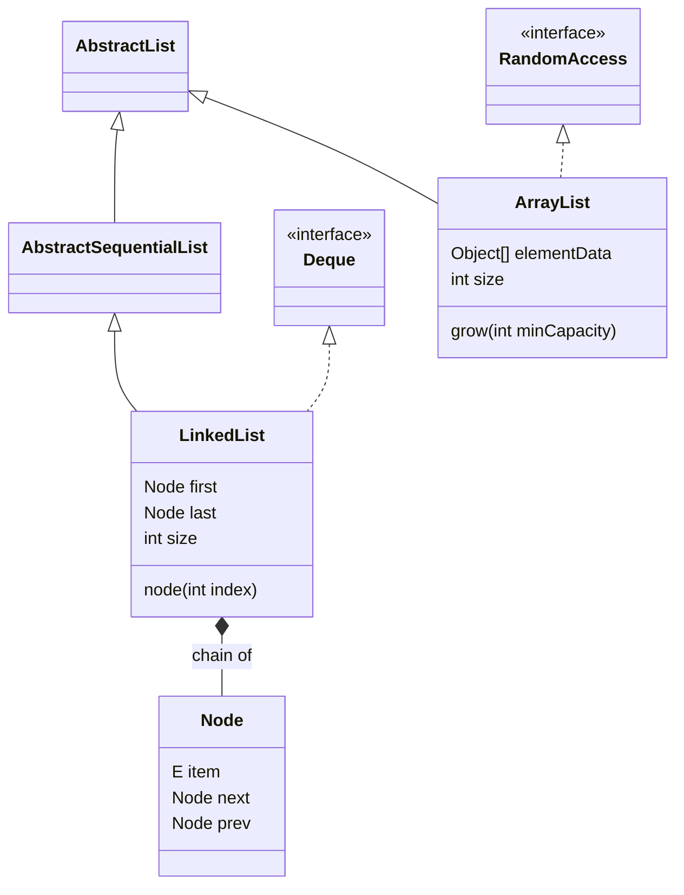
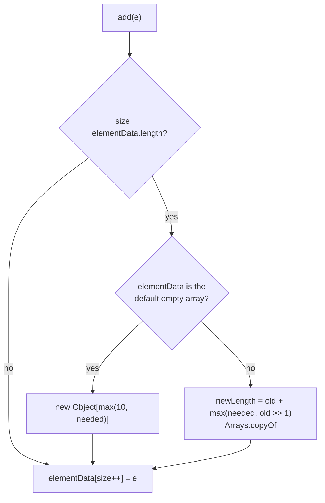
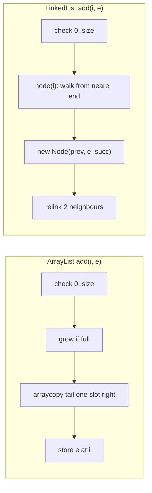

## In One Line
`ArrayList` is one contiguous `Object[]` that grows by about 1.5× (shifting with `System.arraycopy` on inserts and removes), while `LinkedList` is a chain of 24-byte `Node(prev, item, next)` objects reached only by walking from the nearer end — so the "O(1) insert" of `LinkedList` usually loses to `ArrayList`'s fast memory copy, and `ArrayList` is the right default almost every time.

## Mental Model
**ArrayList = a row of numbered lockers in one corridor.**
- Locker `i` is found instantly: walk straight to number `i` (`get(i)` is one array load).
- To put someone into locker 3, everybody from locker 3 onward moves one locker to the right — but they all move **together, in one smooth shuffle** (`System.arraycopy` is a bulk memory move).
- When the corridor is full, the building manager builds a new corridor **1.5 times longer** and moves everyone over. Expensive, but rare.
- Empty lockers at the end (spare capacity) are paid for even when unused.

**LinkedList = a human chain holding hands.**
- Each person holds the hand of the person in front (`prev`) and behind (`next`); the list only knows who is **first** and **last**.
- Inserting someone is just two people letting go and grabbing new hands — O(1) — **once you are standing there**.
- To reach person 500,000 you must walk hand to hand. The chain is clever enough to start from whichever end is nearer, but the middle is always the worst.
- Every person is a separate object in memory, possibly far from their neighbours, and each needs arms (two references) plus a body (object header): roughly 6 times the memory of a locker.

## Concept
Track A covers the APIs: [ArrayList](lesson:a03-collections/01-arraylist) and [LinkedList](lesson:a03-collections/02-linkedlist). This lesson opens both classes (JDK 21 source), measures them, and explains *why* the textbook Big-O table misleads.

### The two data structures
```java
public class ArrayList<E> extends AbstractList<E>
        implements List<E>, RandomAccess, Cloneable, java.io.Serializable {
    private static final int DEFAULT_CAPACITY = 10;
    private static final Object[] EMPTY_ELEMENTDATA = {};                  // for new ArrayList<>(0)
    private static final Object[] DEFAULTCAPACITY_EMPTY_ELEMENTDATA = {};  // for new ArrayList<>()
    transient Object[] elementData;   // capacity = elementData.length
    private int size;                 // slots actually used
    // protected transient int modCount;  inherited from AbstractList
}

public class LinkedList<E> extends AbstractSequentialList<E>
        implements List<E>, Deque<E>, Cloneable, java.io.Serializable {
    transient int size = 0;
    transient Node<E> first;
    transient Node<E> last;

    private static class Node<E> {
        E item;
        Node<E> next;
        Node<E> prev;
    }
}
```
- `ArrayList` extends `AbstractList` (index-based skeleton) and implements the `RandomAccess` **marker**. `LinkedList` extends `AbstractSequentialList` (iterator-based skeleton) and implements `Deque` instead.
- Neither is synchronized; both have fail-fast iterators driven by `modCount`.
- `LinkedList` is **not circular** and has no sentinel node: `first.prev == null`, `last.next == null`, and both are `null` when empty.

### ArrayList: capacity and growth
**Two different empty arrays.** `new ArrayList<>()` points at the shared `DEFAULTCAPACITY_EMPTY_ELEMENTDATA`; the first add allocates **10** slots (lazy since Java 7u40 — Java 6 allocated 10 in the constructor). `new ArrayList<>(0)` points at `EMPTY_ELEMENTDATA` and grows 1, 2, 3, 4, 6, 9, … The two sentinels exist only so `grow` can tell "user asked for the default" from "user asked for zero".

**`grow(minCapacity)`** (JDK 21):
```java
private Object[] grow(int minCapacity) {
    int oldCapacity = elementData.length;
    if (oldCapacity > 0 || elementData != DEFAULTCAPACITY_EMPTY_ELEMENTDATA) {
        int newCapacity = ArraysSupport.newLength(oldCapacity,
                minCapacity - oldCapacity,   // minimum growth
                oldCapacity >> 1);           // preferred growth: +50 %
        return elementData = Arrays.copyOf(elementData, newCapacity);
    } else {
        return elementData = new Object[Math.max(DEFAULT_CAPACITY, minCapacity)];
    }
}
```
- `newLength` returns `old + max(minGrowth, prefGrowth)`, i.e. **about 1.5×**, or exactly what is needed if that is more (an `addAll` of 100 elements into an empty list allocates exactly 100 slots, not 10 → 15 → … ).
- The ceiling is `ArraysSupport.SOFT_MAX_ARRAY_LENGTH = Integer.MAX_VALUE - 8` (some JVMs reserve header words in arrays). Beyond that it tries the exact size and finally throws `OutOfMemoryError` ("Required array length … is too large" or "Requested array size exceeds VM limit").
- Version history: Java 6 grew by `old * 3 / 2 + 1`; Java 7 and 8 used `old + (old >> 1)` with a separate `hugeCapacity` check; current JDKs (17, 21) route through `ArraysSupport.newLength`. Same idea, safer overflow handling.
- **Why 1.5 and not 2?** With growth factor `r`, the total elements copied over all resizes is about `n / (r - 1)` — 2n for 1.5, n for 2 — so both are amortised O(1) per add. A smaller factor wastes less memory (at most a third of the array is empty instead of half) and lets an allocator reuse earlier freed blocks. The measured cost appears in the Code section: adding a million elements to a default list allocates 30 arrays totalling 14.6 bytes per element, while the survivor is a 1,215,487-slot array (21 % slack).
- **It never shrinks automatically.** `remove`, `clear()` and `subList(...).clear()` keep the array. Call `trimToSize()` to shrink it to `size`; `ensureCapacity(n)` grows it once before a bulk load. Both count as structural changes (`modCount++`).

### ArrayList: what each operation really does
| Operation | Mechanics (JDK 21) | Cost |
|---|---|---|
| `get(i)` / `set(i, e)` | `Objects.checkIndex(i, size)` (a JIT intrinsic), then one array access | O(1) |
| `add(e)` | `modCount++`; if `size == length` → `grow`; store at `elementData[size++]` | amortised O(1) |
| `add(i, e)` | range check; grow if full; `System.arraycopy(a, i, a, i + 1, size - i)`; store | O(n − i) |
| `remove(i)` | `fastRemove`: `arraycopy(a, i + 1, a, i, size - i - 1)`, then `a[--size] = null` | O(n − i) |
| `remove(Object)` | linear scan with `equals` (a separate loop for `null`), then `fastRemove` | O(n) |
| `contains` / `indexOf` | linear scan with `equals` | O(n) |
| `removeIf(p)` | pass 1 marks matches in a bit set, pass 2 compacts survivors once | **O(n)** |
| `removeAll(c)` / `retainAll(c)` | one compacting pass calling `c.contains(e)` per element | O(n × cost of `c.contains`) |
| `clear()` | nulls every used slot, keeps the capacity | O(n) |
| `iterator().remove()` | `remove(lastRet)` — an `arraycopy` each time | O(n) **each** |

Details interviewers like:
- `add(E)` delegates to a private helper `add(e, elementData, s)` purely to keep `add`'s bytecode under 35 bytes (the default `-XX:MaxInlineSize`), so it inlines into hot loops.
- `fastRemove` nulls the vacated last slot. Without that the array would keep a hidden reference to the removed object — an "obsolete reference" memory leak (Effective Java, Item 7). The Code section shows `[A, C, D, E, null]` after `remove(1)`.
- `set` is not structural: `modCount` does not change, so `set` during a for-each is allowed; `add`/`remove` are structural and make the iterator throw `ConcurrentModificationException`.
- `elementData` is `transient`: `writeObject` writes `size` and then only the used elements, never the spare capacity.
- `subList(from, to)` is a **view** (offset + size over the same array). A structural change to the parent list invalidates it: the next access throws `ConcurrentModificationException`.

### LinkedList: what each operation really does
```java
void linkLast(E e) {                     // add(e), addLast(e), offer(e)
    final Node<E> l = last;
    final Node<E> newNode = new Node<>(l, e, null);
    last = newNode;
    if (l == null) first = newNode; else l.next = newNode;
    size++;
    modCount++;
}

Node<E> node(int index) {                // used by get, set, add(i, e), remove(i)
    if (index < (size >> 1)) {           // first half: walk forward from first
        Node<E> x = first;
        for (int i = 0; i < index; i++) x = x.next;
        return x;
    } else {                             // second half: walk backward from last
        Node<E> x = last;
        for (int i = size - 1; i > index; i--) x = x.prev;
        return x;
    }
}
```
| Operation | Mechanics | Cost |
|---|---|---|
| `addFirst` / `addLast` / `add(e)` | `linkFirst` / `linkLast`: one new node, two pointer updates | O(1) |
| `removeFirst` / `removeLast` / `poll` / `pop` | `unlinkFirst` / `unlinkLast` | O(1) |
| `get(i)` / `set(i, e)` | `node(i)`: at most `size / 2` hops | O(n); O(1) near either end |
| `add(i, e)` | `node(i)` then `linkBefore(e, succ)` | O(n) walk + O(1) link |
| `remove(i)` | `node(i)` then `unlink(x)` (fix neighbours, null the node's fields) | O(n) walk + O(1) unlink |
| `remove(Object)` / `contains` / `indexOf` | walk from `first` with `equals` | O(n) |
| `ListIterator.add` / `remove` / `set` | the iterator already holds the node | **O(1)** |
| `clear()` | walks every node and nulls `item`, `next`, `prev` | O(n) |

- `get(size - 1)` is effectively O(1): the index is in the second half, so `node` starts at `last` and makes zero hops. `get(size / 2)` is the worst case.
- `checkElementIndex` (for `get`/`set`/`remove`, `0 ≤ i < size`) and `checkPositionIndex` (for `add`, `0 ≤ i ≤ size`) are two different bound checks — the same distinction as `ArrayList`'s `Objects.checkIndex` vs `rangeCheckForAdd`.
- `clear()` unlinks every node even though dropping `first` and `last` would be enough: the JDK comment says it helps a generational GC when nodes live in different generations and frees memory even if an iterator still references a node.
- `removeIf` is not overridden: the default `Collection.removeIf` uses `Iterator.remove`, which is O(1) per removal here, so it is O(n) overall.

### Memory per element
Measured in the Code section on a 64-bit JVM with compressed references (the default for heaps under 32 GB), not counting the element objects themselves (both lists hold the same ones):

| | Bytes per element | Why |
|---|---|---|
| `ArrayList`, presized | **4** | one compressed reference per slot |
| `ArrayList`, grown from empty | 4 × up to 1.5 retained; **14.6 allocated** in total | spare capacity, plus all the discarded smaller arrays (garbage for the GC) |
| `LinkedList` | **24** | a `Node` object: 12-byte header + 3 × 4-byte references, rounded to 8 |

Without compressed references (`-XX:-UseCompressedOops`, or heaps of 32 GB and more) the same program measures 8 and 40 bytes. `LinkedList` also creates one object per element, which the garbage collector must trace one by one; an `ArrayList` is a single array.

### Why ArrayList wins even where Big-O says it shouldn't
Both lists insert in the middle in O(n). What differs is **what the n is made of**:
- `ArrayList` moves `n/2` references with `System.arraycopy`, an intrinsic `memmove` that streams through contiguous memory at gigabytes per second, helped by the CPU cache (a 64-byte cache line holds 16 compressed references) and the hardware prefetcher.
- `LinkedList` walks about `n/4` nodes, and every hop is a **dependent load**: the CPU cannot fetch node `k + 1` before node `k` arrives, and nodes allocated at different times may be scattered across the heap. Each hop can cost a cache miss (tens to hundreds of cycles).

The benchmark in the Code section inserts 50,000 elements in the middle: about 44 ms for `ArrayList` vs about 1,054 ms for `LinkedList`. "O(1) insertion" only applies when you **already hold the position** — through a `ListIterator` or at the ends.

Where `LinkedList` genuinely wins:
- **Removing or inserting many elements while iterating** with `Iterator.remove` / `ListIterator.add`: O(1) each, whereas `ArrayList`'s `Iterator.remove` is an `arraycopy` each time (832 ms vs 2 ms in the benchmark). But `ArrayList.removeIf` does the same job in one O(n) pass (0 ms), so the fix is usually "use `removeIf`", not "use `LinkedList`".
- **Inserting at the front** (`add(0, e)`): O(1) vs O(n). But `ArrayDeque` does front and back operations in O(1) with an array — faster than `LinkedList` and without per-node allocation.
- You need a `List` **and** a `Deque` in one object, or a queue that holds `null` (`ArrayDeque` forbids `null`).

### `RandomAccess`: how algorithms pick a strategy
`RandomAccess` has no methods; it tells generic algorithms that `get(i)` is fast. `java.util.Collections` checks it:
- `binarySearch` uses indexed access if the list is `RandomAccess` **or** smaller than 5,000 elements (`BINARYSEARCH_THRESHOLD`); otherwise it switches to a `ListIterator`-based search — still O(log n) comparisons but O(n) traversal.
- `reverse`, `shuffle`, `fill`, `rotate`, `copy`, `replaceAll`, `indexOfSubList` have similar thresholds (18, 5, 25, 100, 10, 11, 35).
- Write your own generic code the same way: index loop for `RandomAccess`, iterator (for-each) otherwise. A `for (int i…) list.get(i)` loop over a `LinkedList` is O(n²): 50,000 elements took over a second in the benchmark.

### Java 21: Sequenced collections
Both implement `List`, which now extends `SequencedCollection`: `getFirst()`, `getLast()`, `addFirst()`, `addLast()`, `removeFirst()`, `removeLast()` and `reversed()` (a live reverse-ordered view) exist on `ArrayList` too. Note the costs: `ArrayList.addFirst`/`removeFirst` are O(n) shifts; on `LinkedList` they are O(1).

### Choosing
| Need | Use |
|---|---|
| General-purpose list, index access, iteration, sorting | `ArrayList` (presize if you know the size) |
| Queue, stack, deque | `ArrayDeque` |
| Many removals by condition | `ArrayList.removeIf` |
| Insert/remove at the cursor while walking a huge list | `LinkedList` with `ListIterator` |
| Fixed, read-only data | `List.of(...)` |
| Read-mostly, shared between threads | `CopyOnWriteArrayList` |
| Priority order | `PriorityQueue` |

> [!INTERVIEW] "Asymptotically, LinkedList looks better for insertions, but in practice ArrayList wins almost everything: it uses about 4 bytes per element instead of 24, it is cache-friendly, and shifting with `System.arraycopy` is much faster than walking nodes. LinkedList's O(1) only applies once you already hold the node, via an iterator or at the ends — and for ends, ArrayDeque is better still."

## Diagram

One array versus a chain of node objects: `RandomAccess` marks the fast-index list, `Deque` gives `LinkedList` its O(1) end operations.


`ArrayList.add`: almost always a single store; occasionally a 1.5× copy, which averages out to O(1).


Both are O(n) in the middle: `ArrayList` pays for a bulk memory move, `LinkedList` pays for a pointer-by-pointer walk — and the walk is the slower of the two.

## Code
**1. X-ray of the real classes** — reflection needs `java --add-opens java.base/java.util=ALL-UNNAMED ListXRay.java`:
```java
import java.lang.reflect.Field;
import java.util.AbstractList;
import java.util.ArrayList;
import java.util.Collections;
import java.util.LinkedList;
import java.util.List;
import java.util.StringJoiner;

// Run with:  java --add-opens java.base/java.util=ALL-UNNAMED ListXRay.java
public class ListXRay {
    public static void main(String[] args) throws Exception {
        // 1. Two different "empty" arrays: default constructor vs explicit capacity 0
        ArrayList<Integer> byDefault = new ArrayList<>();
        ArrayList<Integer> zero = new ArrayList<>(0);
        System.out.println("1. capacity before first add: " + capacity(byDefault) + " and " + capacity(zero));
        System.out.println("   new ArrayList<>()  grows " + growth(byDefault, 50));
        System.out.println("   new ArrayList<>(0) grows " + growth(zero, 50));

        // 2. addAll grows ONCE, to max(needed, 1.5x)
        ArrayList<Integer> bulk = new ArrayList<>();
        bulk.addAll(Collections.nCopies(100, 7));
        System.out.print("2. addAll(100) on empty list -> capacity " + capacity(bulk));
        bulk.add(8);
        System.out.println(", one more add -> " + capacity(bulk));

        // 3. The array never shrinks by itself
        ArrayList<Integer> big = new ArrayList<>(Collections.nCopies(1000, 1));
        big.subList(10, 1000).clear();                       // remove 990 elements in one call
        System.out.print("3. size " + big.size() + ", capacity " + capacity(big));
        big.trimToSize();
        System.out.print(" -> trimToSize() -> " + capacity(big));
        big.ensureCapacity(500);
        System.out.println(" -> ensureCapacity(500) -> " + capacity(big));

        // 4. modCount: structural changes only
        ArrayList<String> names = new ArrayList<>(List.of("a", "b", "c"));
        int before = modCount(names);
        names.set(0, "A");
        int afterSet = modCount(names);
        names.add("d");
        int afterAdd = modCount(names);
        names.remove(0);
        System.out.println("4. modCount: start " + before + ", after set " + afterSet
                + ", after add " + afterAdd + ", after remove " + modCount(names));

        // 5. remove(index) shifts left and nulls the freed slot
        ArrayList<String> letters = new ArrayList<>(List.of("A", "B", "C", "D", "E"));
        letters.remove(1);
        System.out.println("5. after remove(1): " + slots(letters));
        letters.add(1, "X");
        System.out.println("   after add(1, X): " + slots(letters));

        // 6. LinkedList: a chain of Node(prev, item, next)
        LinkedList<String> chain = new LinkedList<>(List.of("A", "B", "C"));
        chain.addFirst("start");
        chain.add(2, "mid");
        System.out.println("6. " + nodes(chain));
    }

    // ---- reflection helpers ----
    static Field field(Class<?> c, String name) throws Exception {
        Field f = c.getDeclaredField(name);
        f.setAccessible(true);
        return f;
    }

    static int capacity(ArrayList<?> list) throws Exception {
        return ((Object[]) field(ArrayList.class, "elementData").get(list)).length;
    }

    static int modCount(ArrayList<?> list) throws Exception {
        return (int) field(AbstractList.class, "modCount").get(list);
    }

    static String growth(ArrayList<Integer> list, int adds) throws Exception {
        StringJoiner out = new StringJoiner(" -> ");
        int last = -1;
        for (int i = 0; i < adds; i++) {
            list.add(i);
            int c = capacity(list);
            if (c != last) { out.add(String.valueOf(c)); last = c; }
        }
        return out.toString();
    }

    static String slots(ArrayList<?> list) throws Exception {
        Object[] data = (Object[]) field(ArrayList.class, "elementData").get(list);
        StringJoiner out = new StringJoiner(", ", "[", "]");
        for (Object o : data) out.add(String.valueOf(o));
        return out + " size=" + list.size();
    }

    static String nodes(LinkedList<?> list) throws Exception {
        Field first = field(LinkedList.class, "first");
        Class<?> nodeClass = Class.forName("java.util.LinkedList$Node");
        Field item = field(nodeClass, "item"), next = field(nodeClass, "next"), prev = field(nodeClass, "prev");
        StringJoiner out = new StringJoiner(" <-> ");
        for (Object n = first.get(list); n != null; n = next.get(n)) {
            Object p = prev.get(n), nx = next.get(n);
            out.add("[" + (p == null ? "null" : item.get(p)) + "|" + item.get(n) + "|"
                    + (nx == null ? "null" : item.get(nx)) + "]");
        }
        return out.toString();
    }
}
```
```output
1. capacity before first add: 0 and 0
   new ArrayList<>()  grows 10 -> 15 -> 22 -> 33 -> 49 -> 73
   new ArrayList<>(0) grows 1 -> 2 -> 3 -> 4 -> 6 -> 9 -> 13 -> 19 -> 28 -> 42 -> 63
2. addAll(100) on empty list -> capacity 100, one more add -> 150
3. size 10, capacity 1000 -> trimToSize() -> 10 -> ensureCapacity(500) -> 500
4. modCount: start 0, after set 0, after add 1, after remove 2
5. after remove(1): [A, C, D, E, null] size=4
   after add(1, X): [A, X, C, D, E] size=5
6. [null|start|A] <-> [start|A|mid] <-> [A|mid|B] <-> [mid|B|C] <-> [B|C|null]
```

**2. Memory per element**, measured with HotSpot's per-thread allocation counter:
```java
import java.lang.management.ManagementFactory;
import java.util.ArrayList;
import java.util.LinkedList;
import java.util.List;
import java.util.function.Supplier;

public class ListMemory {
    static final int N = 1_000_000;
    static final Integer SAME = 42;               // one shared element: we measure the list, not the Integers

    // Bytes allocated so far by the current thread (HotSpot-specific counter)
    static long allocated() {
        var bean = (com.sun.management.ThreadMXBean) ManagementFactory.getThreadMXBean();
        return bean.getCurrentThreadAllocatedBytes();
    }

    static void measure(String label, Supplier<List<Integer>> factory, boolean print) {
        long before = allocated();
        List<Integer> list = factory.get();
        for (int i = 0; i < N; i++) list.add(SAME);
        long bytes = allocated() - before;
        if (print) System.out.printf("%-20s %,12d bytes = %4.1f bytes per element%n", label, bytes, (double) bytes / N);
    }

    public static void main(String[] args) {
        for (int round = 1; round <= 3; round++) {            // rounds 1-2 only warm up the JIT
            boolean print = round == 3;
            measure("ArrayList, default", ArrayList::new, print);
            measure("ArrayList, presized", () -> new ArrayList<>(N), print);
            measure("LinkedList", LinkedList::new, print);
        }
    }
}
```
```output
ArrayList, default     14,587,208 bytes = 14.6 bytes per element
ArrayList, presized     4,000,832 bytes =  4.0 bytes per element
LinkedList             24,000,824 bytes = 24.0 bytes per element
```

**3. Timing the operations** (a rough benchmark, not JMH):
```java
import java.util.ArrayList;
import java.util.Iterator;
import java.util.LinkedList;
import java.util.List;
import java.util.function.Consumer;
import java.util.function.Supplier;

public class ListTimings {
    static final Integer X = 7;

    static long ms(Supplier<List<Integer>> factory, int size, Consumer<List<Integer>> task) {
        List<Integer> list = factory.get();
        for (int i = 0; i < size; i++) list.add(i);
        long start = System.nanoTime();
        task.accept(list);
        return (System.nanoTime() - start) / 1_000_000;
    }

    static void row(String name, int size, Consumer<List<Integer>> task, boolean print) {
        long a = ms(ArrayList::new, size, task);
        long l = ms(LinkedList::new, size, task);
        if (print) System.out.printf("%-38s %8d ms %10d ms%n", name, a, l);
    }

    public static void main(String[] args) {
        for (int round = 1; round <= 3; round++) {            // rounds 1-2 warm up the JIT
            boolean print = round == 3;
            if (print) System.out.printf("%-38s %11s %13s%n", "operation", "ArrayList", "LinkedList");
            row("add 1,000,000 at the end", 0, l -> { for (int i = 0; i < 1_000_000; i++) l.add(X); }, print);
            row("for-each over 1,000,000", 1_000_000, l -> { long s = 0; for (int v : l) s += v; }, print);
            row("get(i) for all i, 50,000 elements", 50_000, l -> { long s = 0; for (int i = 0; i < l.size(); i++) s += l.get(i); }, print);
            row("get(size - 10) x 1,000 (1M elements)", 1_000_000, l -> { long s = 0; for (int i = 0; i < 1_000; i++) s += l.get(l.size() - 10); }, print);
            row("get(size / 2) x 1,000 (1M elements)", 1_000_000, l -> { long s = 0; for (int i = 0; i < 1_000; i++) s += l.get(l.size() / 2); }, print);
            row("add(0, x) 50,000 times", 0, l -> { for (int i = 0; i < 50_000; i++) l.add(0, X); }, print);
            row("add(size/2, x) 50,000 times", 0, l -> { for (int i = 0; i < 50_000; i++) l.add(l.size() / 2, X); }, print);
            row("iterator.remove() half of 200,000", 200_000, l -> {
                for (Iterator<Integer> it = l.iterator(); it.hasNext(); ) if (it.next() % 2 == 0) it.remove();
            }, print);
            row("removeIf(half) on 200,000", 200_000, l -> l.removeIf(v -> v % 2 == 0), print);
        }
    }
}
```
One real run on a 4-core machine (times change from run to run — see the Walkthrough):
```output
operation                                ArrayList    LinkedList
add 1,000,000 at the end                     12 ms        289 ms
for-each over 1,000,000                       3 ms          9 ms
get(i) for all i, 50,000 elements             0 ms       1042 ms
get(size - 10) x 1,000 (1M elements)          0 ms          0 ms
get(size / 2) x 1,000 (1M elements)           0 ms       1323 ms
add(0, x) 50,000 times                       94 ms          0 ms
add(size/2, x) 50,000 times                  44 ms       1054 ms
iterator.remove() half of 200,000           832 ms          2 ms
removeIf(half) on 200,000                     0 ms          2 ms
```

## Walkthrough
### `ListXRay`
- **Helpers.** `field(...)` makes a private field readable. `capacity` reads `elementData.length`; `modCount` reads the `protected transient int modCount` declared in `AbstractList`; `slots` prints the raw backing array including unused slots; `nodes` walks `LinkedList`'s `first` → `next` chain and prints each node as `[prev item | item | next item]`.
- **1.** Both lists start with a length-0 array, but they are *different* shared arrays. The default list jumps to 10 and then grows by `old >> 1`: 10 → 15 → 22 → 33 → 49 → 73. The `(0)` list has no default-10 rule: 0 → 1 (minimum growth wins because `0 >> 1` is 0), 1 → 2, 2 → 3, 3 → 4, then 6, 9, 13, …
- **2.** `addAll` asks `grow` for exactly 100 slots; since the list was the default empty one, it allocates `max(10, 100) = 100`. The next single `add` grows by half: 150.
- **3.** `new ArrayList<>(collection)` sizes the array to the collection (1000). `subList(10, 1000).clear()` removes 990 elements through the view with one `removeRange` (one `arraycopy`, then nulling the tail), but the capacity stays 1000. `trimToSize()` copies to a 10-slot array; `ensureCapacity(500)` grows it once to 500.
- **4.** The copy constructor does not touch `modCount` (0). `set` replaces an element in place — not structural, still 0. `add` and `remove` each increment it: 1, 2. That is exactly why `set` is allowed during a for-each loop and `add` is not.
- **5.** `remove(1)` shifts `C, D, E` one slot left and writes `null` into the old last slot (`size` becomes 4, capacity stays 5). `add(1, "X")` shifts them back right; the array was not full (4 < 5), so no growth.
- **6.** `new LinkedList<>(List.of("A", "B", "C"))` links three nodes; `addFirst("start")` is `linkFirst`; `add(2, "mid")` calls `node(2)` (index 2 < size/2 = 2 is false, so it walks backward from `last`) and `linkBefore("mid", node B)`. Every node knows both neighbours; the ends have `null` links.

### `ListMemory`
- `getCurrentThreadAllocatedBytes()` (a HotSpot extension, `com.sun.management.ThreadMXBean`, Java 14+) counts every byte this thread allocated, including arrays that immediately became garbage. Adding the same `Integer` object a million times means no element objects are allocated — only the list's own structure is measured. Two silent rounds let the JIT compile the loops first.
- **Presized `ArrayList`:** 4,000,832 bytes ≈ one 4-byte reference per element plus the array header and the `ArrayList` object.
- **Default `ArrayList`:** 30 arrays were allocated on the way up (10, 15, 22, …, 1,215,487 slots). Their sizes sum to about 3.65 million slots = 14.6 bytes per element. Only the last array survives (≈ 4.9 bytes per element, with 21 % spare capacity); the rest is short-lived garbage. Presizing removes both the copies and the garbage.
- **`LinkedList`:** exactly 24 bytes per element — one `Node` per `add`. The output is identical on every run because allocation, unlike time, is deterministic. With `-XX:-UseCompressedOops` the same program prints 8.0 and 40.0 bytes per element.

### `ListTimings`
- Each row builds a fresh list of each kind, runs the task once and prints milliseconds. Rounds 1 and 2 warm up the JIT; only round 3 is printed. It is a rough benchmark (no JMH, no forks, no statistics), so small numbers (0–20 ms) are noise-level and rows that allocate a lot are sensitive to garbage-collection timing — the `LinkedList` "add at the end" row varied from 6 ms to 289 ms between runs because it allocates 24 MB of nodes. Look at the rows that differ by 100× or more; they were consistent across every run.
- **for-each:** both are O(n); `ArrayList` is usually faster. In this micro-benchmark the nodes were allocated back to back, so they happen to lie close together in memory — in a long-running application they are more scattered and the gap grows.
- **`get(i)` loop:** O(1) per call vs O(n) per call — the loop is O(n²) on `LinkedList` (about 625 million hops for 50,000 elements).
- **`get(size - 10)` vs `get(size / 2)`:** the first starts at `last` and makes 9 hops; the second walks 500,000 nodes each time. This is `node(index)` choosing the nearer end.
- **`add(0, x)`:** `ArrayList` shifts everything every time (O(n²) total, yet only about 94 ms thanks to `arraycopy`); `LinkedList` links a new first node (O(1)).
- **`add(size/2, x)`:** the showdown for the textbook claim. Both are O(n); `ArrayList` moves about 25,000 references per insert on average with a bulk copy, `LinkedList` walks about 12,500 nodes per insert pointer by pointer — and is over 20 times slower.
- **`iterator.remove()`:** each removal on `ArrayList` is an `arraycopy` of the remaining tail — O(n²) in total; on `LinkedList` each is an O(1) unlink. **`removeIf`** fixes `ArrayList`: one marking pass and one compacting pass.

## Traps
- **Indexed loops over a `LinkedList`** (`for (int i = 0; i < list.size(); i++) list.get(i)`) are O(n²). Use for-each, an iterator, or check `instanceof RandomAccess`.
- **Removing inside an index loop skips elements.** `for (i…) if (list.get(i) == 2) list.remove(i);` on `[1, 2, 2, 3]` leaves `[1, 2, 3]`: after removing index 1, the second `2` moves into index 1 and `i` moves on to 2. Use `removeIf`, an explicit `Iterator`, or loop backwards.
- **`Iterator.remove` in a loop over a big `ArrayList`** is O(n²). Use `removeIf` (O(n)).
- **`removeAll(c)` with a large `List` argument** calls `c.contains` for every element: O(n × m). Pass a `HashSet`.
- **Capacity is not size.** `new ArrayList<>(20).set(0, x)` throws `IndexOutOfBoundsException: Index 0 out of bounds for length 0` — the length in that message is the *size*.
- **Capacity never shrinks.** A list that once held millions of elements keeps its big array after `clear()`; use `trimToSize()` or create a new list.
- **`subList` is a view.** After a structural change to the parent, any use of the sublist throws `ConcurrentModificationException`. Copy it (`new ArrayList<>(list.subList(a, b))`) if you need it independently.
- **Choosing `LinkedList` "because we insert a lot"** without checking *where*. Middle inserts by index are slower than `ArrayList`; head/tail inserts are better served by `ArrayDeque`.
- **`LinkedList` as a queue with `null` elements**: `poll()` returns `null` both for "empty" and for a stored `null`.
- **Trusting a quick `nanoTime` benchmark** for small differences. JIT warm-up, GC pauses and memory layout dominate at that scale; use JMH for real measurements.

> [!WARNING] Myth: "LinkedList insertion is O(1), so it beats ArrayList for inserts." Only insertion at a node you already hold (ends, or an iterator's cursor) is O(1). Insertion *by index* first walks up to n/2 nodes — measured above at more than 20× slower than `ArrayList`'s shift.

## Tips & Tricks
- **"Array copies, list chases."** `ArrayList`'s cost is bulk memory moves (fast); `LinkedList`'s cost is pointer chasing (slow). Big-O hides this constant.
- **Numbers to remember:** default capacity 10 (allocated on the first add), growth `old + old/2`, 4 bytes per `ArrayList` slot, 24 bytes per `LinkedList` node (compressed references).
- **`LinkedList.node(i)` walks from the nearer end** — `get(0)` and `get(size - 1)` are cheap, `get(size / 2)` is the worst.
- **Presize** with `new ArrayList<>(n)` or `ensureCapacity(n)` when the size is known — no copies, no garbage.
- **Bulk beats loops:** `addAll`, `removeIf`, `subList(a, b).clear()` do one `arraycopy` instead of many.
- **Default choices:** `ArrayList` for lists, `ArrayDeque` for queues and stacks, `LinkedList` almost never.
- **Declare the interface** (`List<String> names = new ArrayList<>()`), so switching implementations after a measurement is a one-line change.

## Interview Q&A
### [Basic] How are ArrayList and LinkedList implemented internally?
`ArrayList` wraps a single `Object[] elementData` plus an `int size`. Elements are stored contiguously; `get(i)` is one array access; adding at the end stores into the next free slot and occasionally grows the array by about 50 % with `Arrays.copyOf`; inserting or removing in the middle shifts the tail with `System.arraycopy`. It implements `RandomAccess`.

`LinkedList` is a doubly linked list of `Node` objects (`item`, `next`, `prev`) with `first` and `last` pointers and a `size`. Adding or removing at either end is O(1); reaching index `i` means walking from the nearer end (up to n/2 hops). It implements both `List` and `Deque`, but not `RandomAccess`. Neither class is thread-safe.

**Follow-up:** *Is LinkedList circular?* — No. `first.prev` and `last.next` are `null`; there is no sentinel node.

### [Basic] What is the default capacity of an ArrayList and how does it grow?
`new ArrayList<>()` starts with a shared empty array and allocates 10 slots on the first `add` (lazily since Java 7u40). When the array is full, `grow` creates a new array of `old + (old >> 1)` — about 1.5 times — or exactly the required size if a bulk `addAll` needs more, and copies the elements over with `Arrays.copyOf`. So the capacities are 10, 15, 22, 33, 49, 73… `new ArrayList<>(0)` uses a different empty array and grows 1, 2, 3, 4, 6, 9… The array never shrinks unless you call `trimToSize()`.

**Follow-up:** *What is the maximum size?* — About `Integer.MAX_VALUE - 8` (`SOFT_MAX_ARRAY_LENGTH`); beyond that you get `OutOfMemoryError`, often "Requested array size exceeds VM limit".

### [Intermediate] Inserting in the middle is O(n) for both lists. Which one is faster, and why?
`ArrayList`, usually by a wide margin. Its O(n) is a single `System.arraycopy` — an intrinsic bulk memory move over contiguous memory that the CPU cache and prefetcher handle extremely well. `LinkedList`'s O(n) is `node(i)`: up to n/2 dependent pointer loads, each of which may be a cache miss, and then it allocates a new node. In a measurement with 50,000 inserts at `size / 2`, `ArrayList` took about 44 ms and `LinkedList` about 1,054 ms. The O(1) relinking of `LinkedList` only pays off when you are already positioned at the node, for example through a `ListIterator`.

**Follow-up:** *And at the front?* — There `LinkedList` is O(1) and `ArrayList` O(n); but `ArrayDeque` is O(1) at both ends with an array and is the better choice.

### [Intermediate] Why is `LinkedList.get(i)` O(n), and what optimisation does it use?
There is no index structure: the only entry points are `first` and `last`, so to reach position `i` the list follows `next` pointers one by one. The private method `node(index)` checks `index < (size >> 1)`: for the first half it walks forward from `first`, for the second half backward from `last`. So the worst case is the middle, `get(0)` and `get(size - 1)` cost nothing, and the average is about n/4 hops. Still O(n), which makes an indexed `for` loop over a `LinkedList` O(n²).

**Follow-up:** *How do generic algorithms avoid that trap?* — They check the `RandomAccess` marker: `Collections.binarySearch`, `reverse`, `shuffle` etc. use index access only for `RandomAccess` lists (or small lists) and iterators otherwise.

### [Intermediate] How much memory does each list use per element?
On a 64-bit JVM with compressed references, an `ArrayList` needs one 4-byte slot per element plus unused capacity (up to about 50 % after a resize), and each resize leaves the old array as garbage — building a million-element list from the default constructor allocates about 14.6 bytes per element in total, but a presized one only 4. A `LinkedList` allocates one `Node` object per element: 12 bytes of header plus three 4-byte references = 24 bytes (40 bytes without compressed references). The element objects themselves are the same for both. `LinkedList` also gives the garbage collector a million separate objects to trace instead of one array.

**Follow-up:** *How can you measure it?* — With JOL (Java Object Layout), or with `com.sun.management.ThreadMXBean.getCurrentThreadAllocatedBytes()` around the code that builds the list.

### [Intermediate] What is the cost of removing many elements while iterating, and what is the best way?
With an explicit `Iterator` and `it.remove()`, `LinkedList` unlinks each node in O(1), so the whole pass is O(n). On an `ArrayList` each `it.remove()` shifts the remaining tail, so removing k elements costs O(k·n) — O(n²) when k is proportional to n (832 ms vs 2 ms for 100,000 removals out of 200,000). The best way on any list is `list.removeIf(predicate)`: `ArrayList` overrides it to mark matches in a bit set and then compact the array once, O(n). Removing with `list.remove(i)` inside an index loop is both slow and buggy (it skips the element after each removal).

**Follow-up:** *Why does `ArrayList.removeIf` test every element before removing anything?* — The JDK comment says it tolerates predicates that read the list while it is being scanned; only then does it compact the array, in a single pass. A side effect is that a predicate that throws leaves the list unchanged.

### [Intermediate] What is the RandomAccess interface?
A marker interface with no methods, implemented by `ArrayList`, `Vector`, `CopyOnWriteArrayList`, `Arrays.asList` and the `List.of` lists, meaning "positional access is fast, prefer an index loop". `LinkedList` does not implement it. Library code checks it to choose an algorithm: `Collections.binarySearch` does an indexed search for `RandomAccess` lists or lists under 5,000 elements, and an iterator-based search otherwise. Your own generic utilities can do the same: `if (list instanceof RandomAccess)` → index loop, else → iterator.

**Follow-up:** *Does `ArrayList.subList` implement it?* — Yes, the sublist of a `RandomAccess` list is `RandomAccess` too.

### [Advanced] Why does ArrayList grow by 1.5× and not 2× or by a fixed amount?
Any constant **factor** gives amortised O(1) appends: with factor `r`, the total number of elements copied while growing to n is about `n / (r - 1)` — 2n for 1.5 and n for 2. A fixed increment (say +10) would make appends O(n) amortised (O(n²) total copying). Between factors, 1.5 wastes less memory — at most a third of the array is unused right after growth instead of half — and, because 1.5 is below the golden ratio, the space freed by earlier arrays can eventually be large enough to reuse for a new one in simple allocators. The price is more frequent resizes. Java 6 used `old * 3 / 2 + 1`; current JDKs use `old + (old >> 1)` via `ArraysSupport.newLength`, taking the larger of that and the required size.

**Follow-up:** *How do you avoid growth entirely?* — Presize: `new ArrayList<>(n)`, `ensureCapacity(n)`, or build from a collection (`new ArrayList<>(coll)` sizes exactly).

### [Advanced] Why does `ArrayList.remove` set the last slot to null?
After shifting the tail left, the old last slot still points to an element that is now also stored one slot earlier (or was the removed element). If it were not cleared, the backing array would keep a reference the list no longer "owns", preventing garbage collection — an obsolete-reference memory leak, the example Joshua Bloch uses for a hand-written stack in Effective Java (Item 7). `fastRemove` therefore does `es[size = newSize] = null`; `clear()` nulls every slot; `LinkedList.unlink` nulls the node's `item`, `next` and `prev`.

**Follow-up:** *Does `clear()` release the array itself?* — No, the capacity stays; only the references are cleared. Use `trimToSize()` or a new list to release it.

### [Advanced] Implement a simple dynamic array (your own ArrayList).
Keep an `Object[]` and a `size`; grow by 1.5× when full; shift with `System.arraycopy`; bounds-check against `size`, not capacity; null out the freed slot.
```java
import java.util.Arrays;

public class DynamicArray<E> {
    private Object[] data = new Object[4];
    private int size;

    public void add(E e) { add(size, e); }

    public void add(int index, E e) {
        if (index < 0 || index > size) throw new IndexOutOfBoundsException("Index: " + index + ", Size: " + size);
        if (size == data.length) data = Arrays.copyOf(data, data.length + (data.length >> 1)); // grow 1.5x
        System.arraycopy(data, index, data, index + 1, size - index);                      // shift right
        data[index] = e;
        size++;
    }

    @SuppressWarnings("unchecked")
    public E get(int index) {
        if (index < 0 || index >= size) throw new IndexOutOfBoundsException("Index: " + index + ", Size: " + size);
        return (E) data[index];
    }

    public E remove(int index) {
        E old = get(index);                                                   // also checks the index
        System.arraycopy(data, index + 1, data, index, size - index - 1);    // shift left
        data[--size] = null;                                                 // let the GC reclaim it
        return old;
    }

    public int size() { return size; }

    @Override public String toString() { return Arrays.toString(Arrays.copyOf(data, size)) + " capacity=" + data.length; }

    public static void main(String[] args) {
        DynamicArray<String> a = new DynamicArray<>();
        for (String s : "A B C D E".split(" ")) a.add(s);
        System.out.println(a);
        a.add(1, "X");
        System.out.println(a);
        System.out.println("removed " + a.remove(0) + " -> " + a);
        try { a.get(5); } catch (IndexOutOfBoundsException e) { System.out.println(e.getMessage()); }
    }
}
```
```output
[A, B, C, D, E] capacity=6
[A, X, B, C, D, E] capacity=6
removed A -> [X, B, C, D, E] capacity=6
Index: 5, Size: 5
```
The generic array is an `Object[]` because `new E[n]` is illegal (type erasure); the unchecked cast in `get` is safe because only `E`s are ever stored. Capacity 4 grew once to 6 when the fifth element arrived.

**Follow-up:** *What would you add for a production version?* — A `modCount` and fail-fast iterator, `Iterable`/`List` implementation (extend `AbstractList`), `ensureCapacity`/`trimToSize`, overflow-safe growth, and `equals`/`hashCode`.

### [Advanced] When would you actually choose LinkedList today?
Rarely. Reasonable cases: you walk a very large list with a `ListIterator` and insert or remove at the cursor many times (each O(1), no shifting); you need one object that is both a `List` and a `Deque`; or you need a queue that accepts `null`. For queues and stacks `ArrayDeque` is faster and leaner; for conditional removal `ArrayList.removeIf` is O(n); for index access, iteration, sorting and memory, `ArrayList` wins. Even Joshua Bloch, who wrote `LinkedList`, has said he never uses it. The honest interview answer is "`ArrayList` by default, and I would only switch after profiling shows a problem that `LinkedList`'s O(1) cursor operations solve."

**Follow-up:** *Does Java 21 change anything?* — Both now implement `SequencedCollection`, so `ArrayList` also has `addFirst`, `getLast`, `removeFirst`, `reversed()` — but `addFirst`/`removeFirst` are O(n) shifts on `ArrayList`.

## Quiz
### After 11 calls to `add` on a `new ArrayList<>()`, what is the capacity of its backing array?
- [ ] 11
- [ ] 16
- [x] 15
- [ ] 20
> The first add allocates 10 slots; the 11th add finds the array full and grows it by half: `10 + (10 >> 1) = 15`. Java uses a 1.5× factor, not doubling (20) and not powers of two (16).

### On a `LinkedList` of 1,000,000 elements, how many node hops does `list.get(list.size() - 1)` make?
- [ ] 999,999
- [ ] 500,000
- [x] 0
- [ ] It throws, because `LinkedList` has no index access
> `node(index)` walks from `last` when the index is in the second half, and `size - 1` *is* `last`: zero hops. The worst case is the middle (about 500,000 hops). `getLast()` does the same job more clearly.

### What does this print?
```java
List<Integer> nums = new ArrayList<>(List.of(1, 2, 2, 3));
for (int i = 0; i < nums.size(); i++)
    if (nums.get(i) == 2) nums.remove(i);
System.out.println(nums);
```
- [ ] [1, 3]
- [x] [1, 2, 3]
- [ ] ConcurrentModificationException
- [ ] [1, 2, 2, 3]
> At `i = 1` the first `2` is removed and everything shifts left, so the second `2` moves into index 1 — but the loop continues with `i = 2` and never looks at it. No exception, because no iterator is involved. Use `nums.removeIf(n -> n == 2)` (which prints `[1, 3]`). (`==` works here only because small `Integer`s are cached.)

### What happens?
```java
List<String> list = new ArrayList<>(20);
list.set(0, "x");
```
- [ ] It stores "x" at index 0
- [x] `IndexOutOfBoundsException: Index 0 out of bounds for length 0`
- [ ] `NullPointerException`
- [ ] Compile error
> 20 is the *capacity*; the *size* is 0, and `set`/`get` check against the size. Only `add` can make the list longer.

### How many bytes does one `LinkedList` node take on a 64-bit JVM with compressed references (the default for heaps under 32 GB)?
- [ ] 4
- [ ] 12
- [x] 24
- [ ] 48
> A `Node` has a 12-byte object header and three 4-byte references (`item`, `next`, `prev`) = 24 bytes, already a multiple of 8. An `ArrayList` slot is 4 bytes — about six times less. Without compressed references it is 40 vs 8.

### What happens?
```java
List<Integer> base = new ArrayList<>(List.of(1, 2, 3));
List<Integer> sub = base.subList(0, 2);
base.add(4);
System.out.println(sub.size());
```
- [ ] Prints 2
- [ ] Prints 3
- [x] Throws `ConcurrentModificationException`
- [ ] Compile error
> `subList` returns a view that remembers the parent's `modCount`. The structural change `base.add(4)` makes the view invalid, and its next use throws. Copy the sublist first if the parent will change.

### Which is the most efficient way to remove every even number from a large `ArrayList<Integer>`?
- [ ] An explicit `Iterator` with `it.remove()`
- [ ] A `for` loop from the end calling `remove(i)`
- [x] `list.removeIf(n -> n % 2 == 0)`
- [ ] Copy into a `LinkedList`, remove there, copy back
> `ArrayList.removeIf` marks matches in a bit set and compacts the array in one O(n) pass. The iterator and backward loop are correct but O(n²) because every removal shifts the tail; the `LinkedList` round-trip allocates a node per element and copies twice.

### Which statement about `ArrayList` is TRUE on JDK 21?
- [ ] `new ArrayList<>()` allocates a 10-slot array in the constructor
- [ ] `remove(int)` shrinks the backing array when it is less than half full
- [x] `set(i, e)` does not change `modCount`, so it does not break an ongoing for-each loop
- [ ] `ArrayList` implements `Deque` since Java 21
> `set` is not a structural modification. The default constructor allocates lazily (on the first add), the array never shrinks automatically, and Java 21 made `List` a `SequencedCollection` — `ArrayList` still does not implement `Deque`.

## Takeaways
- `ArrayList` = one `Object[]` + `size`; `LinkedList` = doubly linked `Node(item, next, prev)` objects + `first`/`last`/`size`, not circular.
- `ArrayList` allocates 10 slots lazily on the first add and grows to `old + old/2` (or exactly what `addAll` needs); it never shrinks unless you call `trimToSize()`.
- Inserts/removes in `ArrayList` shift with `System.arraycopy`; removals null the freed slot to avoid memory leaks; `set` is not structural.
- `LinkedList.get(i)` walks from the nearer end (`index < size >> 1`), so ends are cheap and the middle is the worst; indexed loops over it are O(n²).
- Memory: about 4 bytes per `ArrayList` slot vs 24 bytes per `LinkedList` node (compressed references), and one object per element for the GC to trace.
- Both middle inserts are O(n), but `ArrayList`'s bulk copy beats `LinkedList`'s pointer chasing by an order of magnitude; `LinkedList` wins only with a cursor (`ListIterator`) or at the ends — where `ArrayDeque` is better.
- Use `removeIf` for conditional removal (O(n) on `ArrayList`), presize when the size is known, and default to `ArrayList` / `ArrayDeque`.
- `RandomAccess` is a marker that lets algorithms like `Collections.binarySearch` choose index access or iteration.
