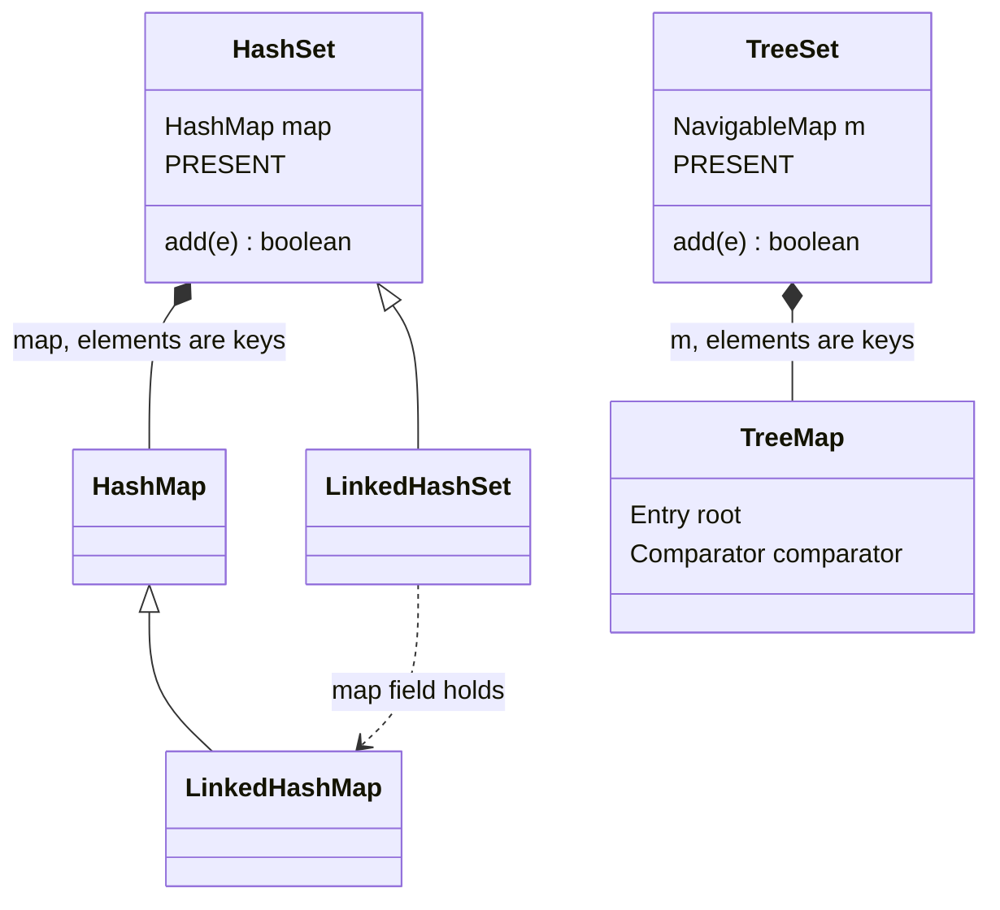
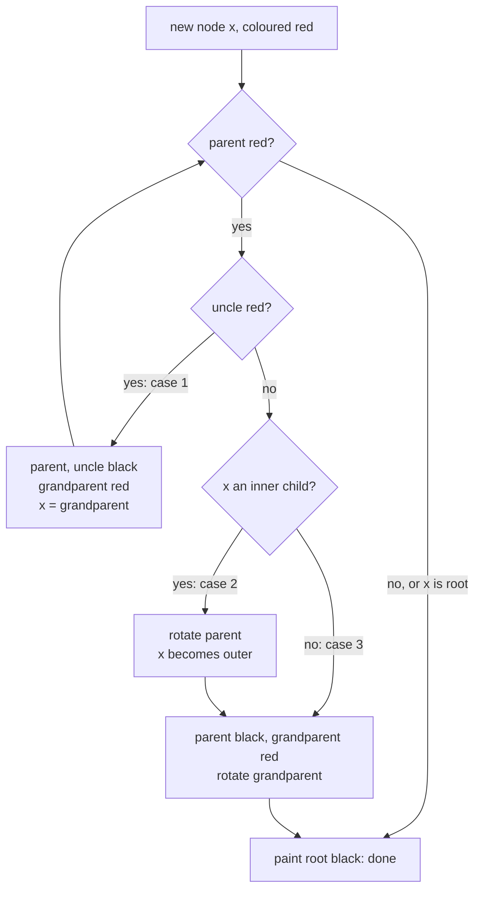
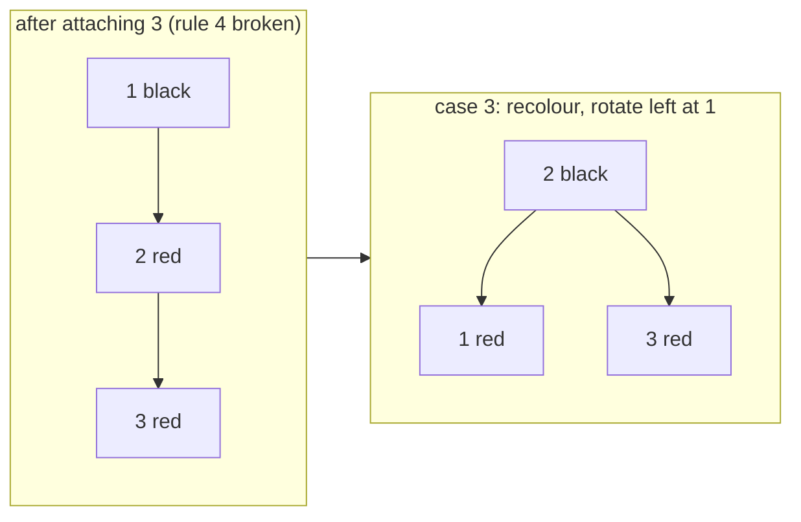

## In One Line
`TreeMap` is a **red-black tree** of `Entry(key, value, left, right, parent, color)` nodes that uses only `compareTo`/`compare` and stays balanced (height ≤ 2·log₂(n+1)) through recolouring and at most two rotations per insert; `HashSet`, `LinkedHashSet` and `TreeSet` are thin wrappers that store each element as a **key** in a `HashMap`, `LinkedHashMap` or `TreeMap` with one shared dummy value, `PRESENT`.

## Mental Model
**TreeMap = playing "guess the number" with a well-kept decision tree.** Every question is "smaller or bigger than this key?" — left or right. With a bushy tree, each answer halves what is left, so a million keys need about 20 questions. But if keys arrive in sorted order, a naive tree grows into a one-sided chain (every new key is "bigger", so it goes right, right, right…) and "guess the number" becomes "ask about every number in turn".

The **red/black stickers** are the gardener's rules that prevent this: every node gets a colour, and two rules (no red node with a red child; the same number of black nodes on every path down) make it impossible for any path to be more than twice as long as another. When an insert breaks a rule, the gardener either **repaints** a few stickers or **rotates** a small branch — a local, constant-cost fix.

**HashSet = a coat check that only cares whether your coat is there.** The coat room (a `HashMap`) needs a ticket for every hook; since the set has nothing to store besides the coat, it hangs the **same generic ticket** (`PRESENT`) on every hook. "Was this coat new?" = "was the hook empty before?" = `map.put(coat, PRESENT) == null`.

## Concept
Usage and navigation APIs are in [TreeMap](lesson:a03-collections/16-treemap), [TreeSet](lesson:a03-collections/11-treeset) and [HashSet](lesson:a03-collections/10-hashset). Hashing itself is in [HashMap Internals](lesson:b04-collections-internals/01-hashmap-internals). Here we open the classes (JDK 21).

### Part 1 — TreeMap is a red-black tree
```java
public class TreeMap<K,V> extends AbstractMap<K,V>
        implements NavigableMap<K,V>, Cloneable, java.io.Serializable {
    private final Comparator<? super K> comparator;   // null = natural ordering
    private transient Entry<K,V> root;
    private transient int size = 0;
    private transient int modCount = 0;
    private static final boolean RED = false;
    private static final boolean BLACK = true;

    static final class Entry<K,V> implements Map.Entry<K,V> {
        K key;
        V value;
        Entry<K,V> left;
        Entry<K,V> right;
        Entry<K,V> parent;       // parent links: iteration and rebalancing need no stack
        boolean color = BLACK;
    }
}
```
There is **no array, no hashing and no `equals`**. Every decision goes through one method:
```java
final int compare(Object k1, Object k2) {
    return comparator == null ? ((Comparable<? super K>) k1).compareTo((K) k2)
                              : comparator.compare((K) k1, (K) k2);
}
```
That is why a `TreeMap` treats keys as "the same" when `compare(...) == 0` even if they are not `equals` (see [Comparable vs Comparator](lesson:b01-fundamentals/09-comparable-vs-comparator)), and why a non-`Comparable` key without a comparator fails with `ClassCastException`.

### Why a plain binary search tree is not enough
A binary search tree (BST) keeps "smaller keys on the left, bigger on the right", so `get` walks one root-to-leaf path: cost = height. A random insertion order gives a height of about 2–3 × log₂ n, but **sorted input** (IDs, timestamps — very common) builds a chain of height **n**. In the Code section, 2,000 sorted keys give a plain BST of height 2,000, while a `TreeMap` holding a **million** sorted keys has height **37**.

### The red-black rules
1. Every node is red or black.
2. The root is black.
3. Every `null` child (leaf) counts as black.
4. A red node never has a red child (no two reds in a row).
5. Every path from a node down to its `null` leaves passes through the **same number of black nodes** (the *black-height*).

Rules 4 and 5 together mean the longest path (alternating black/red) is at most twice the shortest (all black). Hence **height ≤ 2·log₂(n + 1)**, so `get`, `put`, `remove`, `floorKey`, `ceilingKey`, `firstKey`… are all O(log n) *guaranteed*, not just on average. For n = 1,000,000 the bound is 39.9; the measured height was 37 and the black-height 19.

### `put`: walk, attach red, fix up
JDK 21 `put(key, value)`:
1. **Empty map:** `addEntryToEmptyMap` first calls `compare(key, key)` — a deliberate self-comparison that fails fast with `NullPointerException` (null key, natural order) or `ClassCastException` (not `Comparable`) even for the very first key. The root is created black.
2. **Walk** from the root: `cmp < 0` → left, `cmp > 0` → right, `cmp == 0` → **replace the value and return the old one** (the stored key object is kept).
3. **Attach** a new `Entry` as a leaf under the last node visited, then `fixAfterInsertion(e)`, `size++`, `modCount++`.

`fixAfterInsertion` colours the new node **red** (so black-heights are unchanged) and repairs rule 4 if its parent is also red. With `x` = the new node, `p` = parent, `g` = grandparent, `u` = uncle (`g`'s other child):

| Case | Situation | Fix | Then |
|---|---|---|---|
| 1 | uncle **red** | paint `p` and `u` black, `g` red | continue from `g` (the problem may move up) |
| 2 | uncle **black**, `x` is an *inner* child (left-right or right-left "triangle") | rotate `p` so `x` becomes an outer child | fall into case 3 |
| 3 | uncle **black**, `x` is an *outer* child (left-left or right-right "line") | paint `p` black, `g` red, rotate `g` the other way | done |

Finally the root is painted black. Case 1 is only recolouring (can repeat up the tree, O(log n) worst case, amortised O(1)); cases 2 and 3 are **at most two rotations** per insert.

A **rotation** is an O(1) pointer swap that changes shape but keeps the in-order sequence. Left-rotating `p` around its right child `r`: `r` takes `p`'s place, `p` becomes `r`'s left child, and `r`'s old left subtree becomes `p`'s right subtree.

### `remove`: the successor trick
`deleteEntry(p)`:
- If `p` has **two children**, the JDK copies its in-order **successor's key and value into `p`** and deletes the successor node instead (the successor has at most one child). The `Entry` object that held the removed key survives with a *different* key — the Code section shows the root object keep its identity while its key changes from 4 to 5.
- The node actually unlinked has 0 or 1 child. If it was **black**, removing it would shorten some paths, so `fixAfterDeletion` repairs rule 5 with recolouring and **at most three rotations**.

The successor trick has a visible consequence: `firstEntry()`, `lastEntry()`, `floorEntry()`, `ceilingEntry()`, `pollFirstEntry()`… return **immutable snapshots** (`AbstractMap.SimpleImmutableEntry`, created by `exportEntry`), because handing out the live `Entry` would let you watch a key change underneath you. Their `setValue` throws `UnsupportedOperationException`. Entries from iterating `entrySet()` are live and support `setValue`; the iterator's `remove` handles the successor trick internally.

### Iteration without recursion
In-order iteration (ascending keys) starts at the leftmost node and repeatedly calls `successor(e)`:
- if `e` has a right child → go right once, then left as far as possible;
- otherwise → climb parent links until you arrive from a left child.

No stack or recursion is needed thanks to the `parent` pointers. Each edge is walked at most twice over a full iteration, so iterating is **O(n)** (amortised O(1) per step), and `descendingMap()` uses the mirror `predecessor(e)`. `for (k : keySet()) map.get(k)` is O(n log n); iterate `entrySet()` instead.

### Building from sorted data in O(n)
Inserting n keys one by one costs O(n log n) comparisons. When the source is **already sorted with the same comparator**, `TreeMap` builds the tree directly with `buildFromSorted`: it constructs a perfectly balanced tree top-down from the iterator and paints only the nodes on the deepest, incomplete level red (`computeRedLevel`) — **no comparisons at all**. It is used by:
- `new TreeMap<>(SortedMap)` (keeps the source's comparator);
- `treeMap.putAll(sortedMap)` and `new TreeMap<>(Map)` when the target is empty and the comparators are equal;
- `new TreeSet<>(SortedSet)` and `treeSet.addAll(sortedSet)` into an empty `TreeSet` with the same comparator;
- deserialization (the stream holds entries in order).

The Code section counts **0** `compareTo` calls when copying a `TreeSet`, versus 14,892 when copying the same 1,024 elements from a `HashSet`.

### Red-black tree vs the alternatives
| Structure | Height / cost | Rotations per update | Used in the JDK by |
|---|---|---|---|
| Red-black tree | ≤ 2·log₂(n+1) | ≤ 2 (insert), ≤ 3 (delete) | `TreeMap`, `TreeSet`, `HashMap` tree bins |
| AVL tree | ≤ ≈1.44·log₂(n+2) — shallower, faster lookups | insert ≤ 2, delete up to O(log n) | — |
| Skip list | expected O(log n), probabilistic | none (random levels) | `ConcurrentSkipListMap` / `Set` — easy to make lock-free |
| B-tree | log base B, few disk pages | splits/merges | databases, file systems (not in `java.util`) |
| Plain BST | O(n) worst case (sorted input) | none | — |

Red-black trees are the classic general-purpose choice: cheap, bounded restructuring on writes and good-enough balance for reads.

### TreeMap cost summary
| Operation | Cost |
|---|---|
| `get`, `put`, `remove`, `containsKey` | O(log n) guaranteed |
| `firstKey`, `lastKey`, `floorKey`, `ceilingKey`, `higherKey`, `lowerKey`, `pollFirstEntry` | O(log n) |
| Next step of an iterator | amortised O(1) (full iteration O(n)) |
| `containsValue` | O(n) |
| `headMap` / `tailMap` / `subMap` | O(1) to create (a view); O(log n) per access |
| Build from a sorted map/set | O(n), zero comparisons |
| Memory | one 40-byte `Entry` per mapping (measured), no table |

Not synchronised; `ConcurrentSkipListMap` is the concurrent sorted map.

### Part 2 — HashSet is a HashMap in disguise
```java
public class HashSet<E> extends AbstractSet<E> implements Set<E>, Cloneable, java.io.Serializable {
    transient HashMap<E,Object> map;
    static final Object PRESENT = new Object();       // the one dummy value for every element

    public HashSet()                                    { map = new HashMap<>(); }
    public HashSet(int initialCapacity, float loadFactor) { map = new HashMap<>(initialCapacity, loadFactor); }
    HashSet(int initialCapacity, float loadFactor, boolean dummy) {   // package-private: for LinkedHashSet
        map = new LinkedHashMap<>(initialCapacity, loadFactor);
    }

    public boolean add(E e)           { return map.put(e, PRESENT) == null; }
    public boolean remove(Object o)   { return map.remove(o) == PRESENT; }
    public boolean contains(Object o) { return map.containsKey(o); }
    public Iterator<E> iterator()     { return map.keySet().iterator(); }
    public int size()                 { return map.size(); }
}
```
- **Elements are map keys.** Everything from [HashMap Internals](lesson:b04-collections-internals/01-hashmap-internals) applies unchanged: `h ^ (h >>> 16)`, power-of-two buckets, tree bins, resize at 75 %, one `null` element (hash 0), order changing after a resize, mutable-element traps, no thread safety.
- **Why `PRESENT` and not `null`?** `HashMap.put` returns the *previous value*. With a non-null dummy, `put(e, PRESENT) == null` is true **only** when `e` was absent — exactly `add`'s contract. Likewise `remove(o) == PRESENT` is true only when `o` was there. With `null` values both calls would return `null` either way and the set could not tell "new" from "duplicate". One shared `Object` costs nothing per element.
- **A duplicate `add` does not replace anything** you can observe: the map keeps the original key object and overwrites `PRESENT` with `PRESENT`.
- **The dummy `boolean` constructor** is how `LinkedHashSet` works: `LinkedHashSet` has no fields of its own; its constructors call `super(capacity, loadFactor, true)`, so the inherited `map` field holds a `LinkedHashMap` (insertion order). Java 21 adds `SequencedSet` methods on top (`getFirst`, `getLast`, `reversed`, `addFirst`, `addLast`), implemented through a private `map()` accessor.
- `HashSet(Collection c)` sizes the map so that `c` fits without resizing (never below 16 buckets); `HashSet.newHashSet(n)` (Java 19) does the same for an expected count.
- **Serialization:** `map` is `transient`; `writeObject` writes the capacity, load factor, size and the elements; `readObject` recreates a `LinkedHashMap` if `this` is a `LinkedHashSet`, otherwise a `HashMap`, and re-adds every element.
- **Memory:** a `HashSet` costs exactly as much as a `HashMap` with the same keys — 32 bytes per `Node` (with its pointless `value` field) plus the bucket array: 40.4 bytes per element when presized, 48.8 when grown from the default (the discarded smaller tables count too).

### TreeSet: the same trick over a NavigableMap
```java
public class TreeSet<E> extends AbstractSet<E> implements NavigableSet<E>, Cloneable, java.io.Serializable {
    private transient NavigableMap<E,Object> m;
    private static final Object PRESENT = new Object();

    TreeSet(NavigableMap<E,Object> m) { this.m = m; }           // package-private
    public TreeSet()                          { this(new TreeMap<>()); }
    public TreeSet(Comparator<? super E> cmp) { this(new TreeMap<>(cmp)); }
    public boolean add(E e) { return m.put(e, PRESENT) == null; }
}
```
The field is typed `NavigableMap`, not `TreeMap`, because range views reuse the same class: `subSet`, `headSet`, `tailSet` and `descendingSet` return `new TreeSet<>(m.subMap(...))` etc. — a `TreeSet` wrapped around a *view* of the parent map. So all `TreeMap` rules carry over: only `compare` is used (0 `hashCode`/`equals` calls in the Code section), `compare == 0` means duplicate, `null` is rejected under natural ordering, and Java 21's `addFirst`/`addLast` throw `UnsupportedOperationException` (the comparator decides positions).

### The whole family is map-backed
| Set | Backed by | Notes |
|---|---|---|
| `HashSet` | `HashMap` | `PRESENT` values |
| `LinkedHashSet` | `LinkedHashMap` (insertion order) | via the package-private `HashSet` constructor |
| `TreeSet` | `TreeMap` (`NavigableMap`) | `PRESENT` values; views wrap sub-maps |
| `ConcurrentHashMap.newKeySet()` | `ConcurrentHashMap` | a `KeySetView` whose values are `Boolean.TRUE` |
| `ConcurrentSkipListSet` | `ConcurrentSkipListMap` | concurrent and sorted |
| `Collections.newSetFromMap(map)` | any empty `Map<E, Boolean>` you pass | e.g. a weak set from a `WeakHashMap` |
| `EnumSet` | **not** a map: a bit vector (`long`, or `long[]` for more than 64 constants) | fastest set for enums |
| `CopyOnWriteArraySet` | `CopyOnWriteArrayList` | O(n) `contains`, for tiny read-mostly sets |
| `Set.of(...)` | its own open-addressing array | immutable, iteration order randomised per JVM run |

> [!INTERVIEW] "TreeMap is a red-black tree: it compares keys with `compareTo` or the comparator only, attaches new keys as red leaves and restores the red-black rules with recolouring and at most two rotations, so height stays below 2·log₂(n+1) and every operation is O(log n) even for sorted input. HashSet is just a HashMap whose keys are the elements and whose values are one shared dummy object, PRESENT — `add` returns `map.put(e, PRESENT) == null`. LinkedHashSet uses a LinkedHashMap and TreeSet a TreeMap the same way."

## Diagram

Each set delegates to a map and stores its elements as keys; `LinkedHashSet` has no field of its own — the inherited `map` simply holds a `LinkedHashMap`.


`fixAfterInsertion`: recolour while the uncle is red (the problem moves up), otherwise at most two rotations finish the job.


`put 3` into `{1, 2}`: the chain 1 → 2 → 3 has two reds in a row and a black uncle (null), so 2 becomes the black root with two red children — the height drops from 3 to 2.

## Code
**1. X-ray of the tree and the sets** — reflection needs `java --add-opens java.base/java.util=ALL-UNNAMED TreeXRay.java`:
```java
import java.lang.reflect.Field;
import java.util.HashSet;
import java.util.LinkedHashSet;
import java.util.List;
import java.util.Map;
import java.util.TreeMap;
import java.util.TreeSet;

// Run with:  java --add-opens java.base/java.util=ALL-UNNAMED TreeXRay.java
public class TreeXRay {
    public static void main(String[] args) throws Exception {
        // 1. Keys arrive already sorted - the worst case for a plain binary search tree
        TreeMap<Integer, String> tree = new TreeMap<>();
        for (int k = 1; k <= 8; k++) {
            tree.put(k, "v" + k);
            System.out.println("put " + k + ": " + shape(root(tree)));
        }

        // 2. Height after a million sorted inserts vs a plain BST
        TreeMap<Integer, Integer> big = new TreeMap<>();
        for (int k = 1; k <= 1_000_000; k++) big.put(k, k);
        System.out.println("1,000,000 sorted keys: height " + height(root(big))
                + ", black-height " + blackHeight(root(big))
                + " (log2 n = " + Math.round(Math.log(1_000_000) / Math.log(2)) + ")");
        Bst bst = new Bst();
        for (int k = 1; k <= 2_000; k++) bst.insert(k);
        System.out.println("plain BST, 2,000 sorted keys: height " + bst.height());

        // 3. Removing a node with two children: the successor's key moves into it
        TreeMap<Integer, String> small = new TreeMap<>();
        for (int k : new int[]{4, 2, 6, 1, 3, 5, 7}) small.put(k, "v" + k);
        Object oldRoot = root(small);
        System.out.println("before remove(4): " + shape(root(small)));
        small.remove(4);
        System.out.println("after  remove(4): " + shape(root(small))
                + "  same root Entry object? " + (root(small) == oldRoot));

        // 4. Building from a SortedMap: linear time, perfectly balanced, deepest level red
        TreeMap<Integer, String> copy = new TreeMap<>(tree);            // tree is a SortedMap
        System.out.println("copy of 1..8: " + shape(root(copy)));

        // 5. The sets are maps in disguise
        HashSet<String> hs = new HashSet<>(List.of("a", "b"));
        LinkedHashSet<String> lhs = new LinkedHashSet<>();
        TreeSet<String> ts = new TreeSet<>();
        Map<?, ?> hsMap = (Map<?, ?>) get(HashSet.class, "map", hs);
        System.out.println("HashSet uses " + hsMap.getClass().getSimpleName()
                + ", LinkedHashSet uses " + get(HashSet.class, "map", lhs).getClass().getSimpleName()
                + ", TreeSet uses " + get(TreeSet.class, "m", ts).getClass().getSimpleName());
        System.out.println("HashSet's hidden map: " + hsMap.keySet() + " -> values all the same object? "
                + (hsMap.get("a") == hsMap.get("b")) + ", value class " + hsMap.get("a").getClass().getName());
        System.out.println("add(\"c\") = " + hs.add("c") + ", add(\"c\") again = " + hs.add("c")
                + ", remove(\"c\") = " + hs.remove("c") + ", remove(\"c\") again = " + hs.remove("c"));
    }

    // ---- a plain, unbalanced binary search tree for comparison ----
    static class Bst {
        int[] key = new int[4096]; int[] left = new int[4096]; int[] right = new int[4096]; int n;
        void insert(int k) {
            key[++n] = k;
            if (n == 1) return;
            int cur = 1;
            while (true) {
                if (k < key[cur]) { if (left[cur] == 0) { left[cur] = n; return; } cur = left[cur]; }
                else { if (right[cur] == 0) { right[cur] = n; return; } cur = right[cur]; }
            }
        }
        int height() { int h = 0; for (int cur = 1; cur != 0; cur = right[cur]) h++; return h; }   // sorted input: right spine
    }

    // ---- reflection helpers ----
    static Object get(Class<?> owner, String name, Object target) throws Exception {
        Field f = owner.getDeclaredField(name);
        f.setAccessible(true);
        return f.get(target);
    }

    static Object root(TreeMap<?, ?> map) throws Exception { return get(TreeMap.class, "root", map); }

    static final Class<?> ENTRY;
    static { try { ENTRY = Class.forName("java.util.TreeMap$Entry"); } catch (Exception e) { throw new Error(e); } }

    static Object left(Object e) throws Exception { return get(ENTRY, "left", e); }
    static Object right(Object e) throws Exception { return get(ENTRY, "right", e); }
    static boolean black(Object e) throws Exception { return e == null || (boolean) get(ENTRY, "color", e); }

    // key + colour, children in brackets: 2B(1B, 3R)
    static String shape(Object e) throws Exception {
        if (e == null) return ".";
        String s = get(ENTRY, "key", e) + (black(e) ? "B" : "R");
        if (left(e) == null && right(e) == null) return s;
        return s + "(" + shape(left(e)) + ", " + shape(right(e)) + ")";
    }

    static int height(Object e) throws Exception {
        return e == null ? 0 : 1 + Math.max(height(left(e)), height(right(e)));
    }

    static int blackHeight(Object e) throws Exception {         // black nodes on the leftmost path
        int h = 0;
        for (; e != null; e = left(e)) if (black(e)) h++;
        return h;
    }
}
```
```output
put 1: 1B
put 2: 1B(., 2R)
put 3: 2B(1R, 3R)
put 4: 2B(1B, 3B(., 4R))
put 5: 2B(1B, 4B(3R, 5R))
put 6: 2B(1B, 4R(3B, 5B(., 6R)))
put 7: 2B(1B, 4R(3B, 6B(5R, 7R)))
put 8: 4B(2R(1B, 3B), 6R(5B, 7B(., 8R)))
1,000,000 sorted keys: height 37, black-height 19 (log2 n = 20)
plain BST, 2,000 sorted keys: height 2000
before remove(4): 4B(2B(1R, 3R), 6B(5R, 7R))
after  remove(4): 5B(2B(1R, 3R), 6B(., 7R))  same root Entry object? true
copy of 1..8: 4B(2B(1B, 3B), 6B(5B, 7B(., 8R)))
HashSet uses HashMap, LinkedHashSet uses LinkedHashMap, TreeSet uses TreeMap
HashSet's hidden map: [a, b] -> values all the same object? true, value class java.lang.Object
add("c") = true, add("c") again = false, remove("c") = true, remove("c") again = false
```

**2. Which methods of your element does each set call?** A key that counts its own `hashCode`, `equals` and `compareTo` calls:
```java
import java.util.HashSet;
import java.util.Set;
import java.util.TreeSet;

public class SetCalls {
    static int hashCalls, equalsCalls, compareCalls;

    // A key that counts how often each contract method is called
    record Key(int id) implements Comparable<Key> {
        @Override public int hashCode() { hashCalls++; return Integer.hashCode(id); }
        @Override public boolean equals(Object o) { equalsCalls++; return o instanceof Key k && k.id == id; }
        @Override public int compareTo(Key o) { compareCalls++; return Integer.compare(id, o.id); }
    }

    static void report(String what) {
        System.out.printf("%-38s hashCode=%-5d equals=%-5d compareTo=%d%n", what, hashCalls, equalsCalls, compareCalls);
        hashCalls = equalsCalls = compareCalls = 0;
    }

    public static void main(String[] args) {
        Set<Key> hash = new HashSet<>();
        for (int i = 0; i < 1024; i++) hash.add(new Key(i));
        report("HashSet: add 1,024 distinct keys");
        hash.contains(new Key(500));
        report("HashSet: contains(500)");
        boolean added = hash.add(new Key(500));
        report("HashSet: add(500) again -> " + added);

        TreeSet<Key> tree = new TreeSet<>();
        for (int i = 0; i < 1024; i++) tree.add(new Key(i));
        report("TreeSet: add 1,024 keys in order");
        tree.contains(new Key(500));
        report("TreeSet: contains(500)");
        added = tree.add(new Key(500));
        report("TreeSet: add(500) again -> " + added);

        new TreeSet<>(tree);
        report("TreeSet: copy of a SortedSet");
        new TreeSet<>(hash);
        report("TreeSet: copy of the HashSet");
    }
}
```
```output
HashSet: add 1,024 distinct keys       hashCode=1024  equals=0     compareTo=0
HashSet: contains(500)                 hashCode=1     equals=1     compareTo=0
HashSet: add(500) again -> false       hashCode=1     equals=1     compareTo=0
TreeSet: add 1,024 keys in order       hashCode=0     equals=0     compareTo=14892
TreeSet: contains(500)                 hashCode=0     equals=0     compareTo=10
TreeSet: add(500) again -> false       hashCode=0     equals=0     compareTo=10
TreeSet: copy of a SortedSet           hashCode=0     equals=0     compareTo=0
TreeSet: copy of the HashSet           hashCode=0     equals=0     compareTo=14892
```

**3. Memory per element** (1,000,000 `Integer` keys created beforehand, so only the structures are measured):
```java
import java.lang.management.ManagementFactory;
import java.util.HashMap;
import java.util.HashSet;
import java.util.LinkedHashSet;
import java.util.TreeMap;
import java.util.TreeSet;
import java.util.function.Consumer;

public class MapSetMemory {
    static final int N = 1_000_000;
    static final Integer[] KEYS = new Integer[N];              // created up front: not part of the measurement

    static long allocated() {
        return ((com.sun.management.ThreadMXBean) ManagementFactory.getThreadMXBean()).getCurrentThreadAllocatedBytes();
    }

    static void measure(String label, Consumer<Integer> add, boolean print) {
        long before = allocated();
        for (Integer k : KEYS) add.accept(k);
        long bytes = allocated() - before;
        if (print) System.out.printf("%-26s %5.1f bytes per element%n", label, (double) bytes / N);
    }

    public static void main(String[] args) {
        for (int i = 0; i < N; i++) KEYS[i] = i;
        for (int round = 1; round <= 3; round++) {             // rounds 1-2 only warm up the JIT
            boolean print = round == 3;
            HashMap<Integer, Integer> hm = HashMap.newHashMap(N);
            measure("HashMap (presized)", k -> hm.put(k, k), print);
            HashSet<Integer> hs = HashSet.newHashSet(N);
            measure("HashSet (presized)", hs::add, print);
            HashSet<Integer> grown = new HashSet<>();
            measure("HashSet (default, grown)", grown::add, print);
            LinkedHashSet<Integer> lhs = LinkedHashSet.newLinkedHashSet(N);
            measure("LinkedHashSet (presized)", lhs::add, print);
            TreeMap<Integer, Integer> tm = new TreeMap<>();
            measure("TreeMap", k -> tm.put(k, k), print);
            TreeSet<Integer> ts = new TreeSet<>();
            measure("TreeSet", ts::add, print);
        }
    }
}
```
```output
HashMap (presized)          40.4 bytes per element
HashSet (presized)          40.4 bytes per element
HashSet (default, grown)    48.8 bytes per element
LinkedHashSet (presized)    48.4 bytes per element
TreeMap                     40.0 bytes per element
TreeSet                     40.0 bytes per element
```

## Walkthrough
### `TreeXRay`
- **Helpers.** `get(owner, name, target)` reads a private field. `root` reads `TreeMap.root`; `left`, `right`, `black` read an `Entry`'s fields (`color` is a `boolean` where `BLACK = true`; a `null` child counts as black, rule 3). `shape` prints a subtree as `key + B/R` followed by `(left, right)`, with `.` for a missing child. `height` counts nodes on the longest path; `blackHeight` counts black nodes on the leftmost path (every path has the same count, by rule 5).
- **1 — the insertion trace**, checked against the three cases:
  - `put 1`: the root is painted black.
  - `put 2`: `2` is attached red under the black `1` — nothing is broken.
  - `put 3`: `3` (red) under `2` (red) breaks rule 4. The uncle (left of `1`) is `null` = black and `3` is an outer (right-right) child → **case 3**: `2` black, `1` red, rotate left at `1`. Result `2B(1R, 3R)` — height 2, not 3.
  - `put 4`: parent `3` red, uncle `1` red → **case 1**: `3` and `1` black, `2` red; `2` is the root, so it is repainted black.
  - `put 5`: parent `4` red, uncle (left of `3`) `null` → case 3 at `3`: `4B(3R, 5R)`.
  - `put 6`: parent `5` red, uncle `3` red → case 1: `5`, `3` black, `4` red; `4`'s parent `2` is black, so it stops.
  - `put 7`: case 3 again at `5`: `6B(5R, 7R)`.
  - `put 8`: case 1 turns `7`, `5` black and `6` red, moving the problem up: now `6` (red) is under `4` (red), whose uncle `1` is black → case 3 at the **root**: rotate left at `2`. `4` becomes the new root.
  In all eight steps every path from the root has the same number of black nodes, and no red node has a red child.
- **2 — height.** A million sorted keys give a tree of height 37 — within the 2·log₂(n+1) ≈ 39.9 bound — and black-height 19, so `get` needs at most 37 comparisons. The `Bst` class is a deliberately naive binary search tree stored in arrays (index 0 = "no child"); with sorted input every key goes right, so its height is simply the length of the right spine: 2,000 for 2,000 keys. `get` on it would be a linear scan.
- **3 — the successor trick.** The tree `4B(2B(1R, 3R), 6B(5R, 7R))` is what inserting 4, 2, 6, 1, 3, 5, 7 produces (the red leaves 1 and 3 were recoloured when the uncle was red). `remove(4)` finds that the root has two children, copies the successor `5` (leftmost of the right subtree) into the root `Entry`, and unlinks the old `5` node — a red leaf, so no fix-up is needed. `same root Entry object? true`: the object is the same, its key changed. That is why exported entries are snapshots.
- **4 — `buildFromSorted`.** `new TreeMap<>(tree)` resolves to the `TreeMap(SortedMap)` constructor, which builds `4B(2B(1B, 3B), 6B(5B, 7B(., 8R)))` directly: perfectly balanced, all black except the single node on the incomplete deepest level (`8`), which is red so that every path keeps the same black-height.
- **5 — sets.** Reading `HashSet.map` and `TreeSet.m` shows the backing maps: `HashMap`, `LinkedHashMap` (for a `LinkedHashSet` — through the inherited `map` field) and `TreeMap`. The values for `"a"` and `"b"` are the **same** plain `java.lang.Object` — `PRESENT`. `add("c")` returns `true` (put returned `null`), the second `add` `false` (put returned `PRESENT`); `remove` returns `true` (removed value was `PRESENT`) and then `false` (`null`).

### `SetCalls`
- **HashSet, 1,024 adds:** exactly 1,024 `hashCode` calls — one per `add` — even though the table resized six times (16 → 2048): the hash is cached in each `Node`. **Zero `equals` calls**: `Integer.hashCode` values are distinct, and `HashMap` compares the cached hash before calling `equals`.
- **HashSet `contains` / duplicate `add`:** 1 `hashCode` to find the bucket, 1 `equals` to confirm the match.
- **TreeSet, 1,024 adds:** zero `hashCode`/`equals`, 14,892 `compareTo` — about 14.5 per insert, a little more than log₂ 1024 = 10 because sorted inserts make the tree deeper than a perfect one (and the very first insert compares the key with itself). `contains(500)` and the duplicate `add` each walk one path: 10 comparisons.
- **Copying:** `new TreeSet<>(tree)` uses `buildFromSorted` — 0 comparisons. `new TreeSet<>(hash)` adds one by one: 14,892 again (the `HashSet` happens to iterate `Key(0..1023)` in ascending bucket order, so it is the same sequence of inserts).

### `MapSetMemory`
- `KEYS` holds a million `Integer`s created before measuring, so only the collections' own allocations count (see `ListMemory` in [ArrayList vs LinkedList Internals](lesson:b04-collections-internals/02-arraylist-vs-linkedlist-internals) for how the counter works). Two silent rounds warm up the JIT.
- **HashMap / HashSet presized:** 32 bytes per `Node` (header 12 + `hash` 4 + `key`, `value`, `next` 3 × 4 = 28, rounded up to 32) + 8.4 bytes per element for a 2,097,152-bucket table (`newHashMap(1,000,000)` needs ⌈1,000,000 / 0.75⌉ = 1,333,334 buckets, rounded up to 2²¹). **A `HashSet` costs exactly what a `HashMap` costs** — its nodes still carry a `value` reference, always pointing at `PRESENT`.
- **HashSet grown from the default:** 8.4 more bytes per element — all the smaller tables allocated and discarded on the way to 2²¹ buckets.
- **LinkedHashSet:** `LinkedHashMap.Entry` adds `before`/`after` = 40 bytes per entry, + 8.4 for the table.
- **TreeMap / TreeSet:** 40 bytes per `Entry` (header 12 + five references 20 + `boolean` 1 = 33, rounded to 40) and no table at all.

## Traps
- **Mutating a field used by `compareTo` (or `hashCode`) while the element is in a `TreeSet`/`TreeMap` (or `HashSet`)** corrupts lookups. With `Asha(30), Ravi(40), Kiran(50)` in a `TreeSet` ordered by age, setting Asha's age to 60 prints `[Asha60, Ravi40, Kiran50]` — no longer sorted — and `contains(asha)` and `remove(asha)` both return `false`, because the search for 60 goes right of 40 and 50 and never reaches Asha's node at the far left.
- **Assuming `TreeSet` uses `equals`.** It never calls `equals` or `hashCode` — only `compare`. A comparator that returns 0 for different objects silently drops them.
- **Holding on to `TreeMap` entries.** A live `Entry` can have its key replaced during another key's removal (the successor trick). Use the snapshot entries (`firstEntry()`…) or copy what you need.
- **Iterating `keySet()` and calling `get(k)`** on a `TreeMap` costs O(n log n). Iterate `entrySet()` (O(n)).
- **Loading sorted data one `put` at a time** when you already have a `SortedMap`/`SortedSet` with the same ordering: `new TreeMap<>(sortedMap)` / `new TreeSet<>(sortedSet)` is O(n) with no comparisons.
- **`null` elements:** `HashSet` and `LinkedHashSet` accept one `null` (hash 0); `TreeSet`/`TreeMap` with natural ordering throw `NullPointerException` — even on an empty map, because of the `compare(key, key)` self-check.
- **Thinking a `HashSet` saves memory compared with a `HashMap`.** It uses a full `HashMap` internally — same nodes, same table.
- **`TreeSet.addFirst` / `addLast` (Java 21)** exist on the `SequencedSet` interface but throw `UnsupportedOperationException`.

## Tips & Tricks
- **"Sets are maps with a dummy value."** `HashSet` → `HashMap`, `LinkedHashSet` → `LinkedHashMap`, `TreeSet` → `TreeMap`, all with `PRESENT`; `add(e)` = `put(e, PRESENT) == null`.
- **Red-black rules in one breath: "Root black, no red-red, same blacks on every path."** Result: height ≤ 2·log₂(n+1).
- **Insertion fix-up: "Red uncle → recolour and move up; black uncle → rotate (triangle first straightens into a line)."** At most two rotations per insert, three per delete.
- **Which methods get called?** Hash sets: `hashCode` (once per operation) + `equals` (only on a full-hash match). Tree sets: `compareTo`/`compare` only (about log₂ n per operation).
- **Numbers to quote:** a million keys → tree height ≤ 40 (measured 37); ~40 bytes per entry for `TreeMap`, `HashMap` and `HashSet` alike.
- **Need a set with special behaviour?** `Collections.newSetFromMap(...)` turns any map into a set: a weak set (`WeakHashMap`), a concurrent set (`ConcurrentHashMap`, or just `ConcurrentHashMap.newKeySet()`), a sorted concurrent set (`ConcurrentSkipListSet`).

## Interview Q&A
### [Basic] How does HashSet work internally?
A `HashSet` wraps a `HashMap<E, Object>`. Every element is stored as a **key** of that map, and every value is the same static dummy object, `PRESENT`. `add(e)` returns `map.put(e, PRESENT) == null` (true only if the key was absent), `remove(o)` returns `map.remove(o) == PRESENT`, `contains(o)` is `map.containsKey(o)`, iteration is `map.keySet().iterator()`. Consequently all `HashMap` internals apply: hashing with `h ^ (h >>> 16)`, power-of-two buckets, tree bins, resizing at 75 %, one `null` element, O(1) average operations, no ordering guarantee, not thread-safe, and the `equals`/`hashCode` contract for elements.

**Follow-up:** *How is uniqueness guaranteed?* — By the map: a key that is `equals` (with the same hash) to an existing key finds the existing node, so `put` only replaces the value and returns the old one — `add` then returns `false`.

### [Basic] What data structure is behind TreeMap and TreeSet, and what are their complexities?
A **red-black tree** — a self-balancing binary search tree. `TreeMap` stores `Entry` nodes with key, value, left, right, parent and a colour flag; `TreeSet` is a `TreeMap` whose values are a dummy `PRESENT`. Keys are ordered by `compareTo` or the supplied `Comparator` (no hashing). `get`, `put`, `remove`, `containsKey`, `first/last`, `floor/ceiling/higher/lower` are **O(log n) in the worst case**, because the red-black rules keep the height below 2·log₂(n+1). A full in-order iteration is O(n); `containsValue` is O(n).

**Follow-up:** *Why not just a plain BST?* — Sorted input would make it a linked chain of height n (2,000 keys → height 2,000), and every operation O(n).

### [Intermediate] Why does HashSet store a dummy `PRESENT` object instead of `null` values?
Because `HashSet` uses the **return value** of the map operations to implement its own contract. `HashMap.put` returns the previous value: with `PRESENT` as the value, `null` means "the key was absent" and `PRESENT` means "it was already there", so `add` can return `true`/`false` correctly. The same goes for `remove`, which returns `map.remove(o) == PRESENT`. With `null` values, `put` and `remove` would return `null` in both cases. A single shared `Object` adds no per-element cost — every node's `value` field already exists anyway.

**Follow-up:** *What value does `ConcurrentHashMap.newKeySet()` use?* — `Boolean.TRUE`; `ConcurrentHashMap` forbids `null` values altogether.

### [Intermediate] What are the rules of a red-black tree, and why do they guarantee O(log n)?
Every node is red or black; the root is black; `null` leaves count as black; a red node has no red child; and every path from a node down to its leaves contains the same number of black nodes. The shortest possible root-to-leaf path is all black, the longest alternates black and red, so no path is more than twice as long as another. A tree with black-height *b* has at least 2^b − 1 nodes, which gives height ≤ 2·log₂(n + 1). For a million sorted keys that bound is about 40; `TreeMap` measured 37.

**Follow-up:** *How is this different from an AVL tree?* — AVL keeps subtree heights within 1 (height ≤ ≈1.44·log₂ n), so lookups are slightly faster, but it rebalances more on updates (deletion may rotate all the way up); red-black trees need at most 2 rotations per insert and 3 per delete, which suits a general-purpose, write-heavy map.

### [Intermediate] Walk me through inserting a key into a TreeMap.
`put` walks from the root comparing the key with each node: left if smaller, right if larger. If a node compares equal, its value is replaced and the old value returned — the tree does not change. Otherwise a new `Entry` is attached as a leaf and `fixAfterInsertion` runs: the new node is coloured **red** (so black-heights stay equal), which can only break the "no red-red" rule. If the parent is black, done. If the parent is red and the **uncle is red**, parent and uncle become black, the grandparent red, and the check repeats from the grandparent. If the **uncle is black**, a rotation fixes it: an inner ("triangle") child is first rotated into an outer position, then the parent is painted black, the grandparent red, and the grandparent is rotated. Finally the root is painted black. Inserting 1, 2, 3 in order: after 3 there are two reds in a row with a black (null) uncle, so a left rotation at 1 makes 2 the black root with red children 1 and 3.

**Follow-up:** *What happens on the very first put?* — `addEntryToEmptyMap` calls `compare(key, key)` first, so a `null` key (natural ordering) or a non-`Comparable` key fails immediately instead of on the second put.

### [Intermediate] How does TreeMap iterate in sorted order without recursion?
Each `Entry` has a `parent` pointer. The iterator starts at the leftmost node (the smallest key) and moves with `successor(e)`: if `e` has a right subtree, the successor is that subtree's leftmost node; otherwise climb the parents until you come up from a left child — that parent is the successor. No stack is needed, each edge is traversed at most twice during a full iteration, so the whole iteration is O(n) and each step amortised O(1). Descending iteration uses the mirror image, `predecessor`. The iterators are fail-fast via `modCount`.

**Follow-up:** *Why is `for (K k : map.keySet()) map.get(k)` a bad idea on a TreeMap?* — Each `get` is another O(log n) search, making the loop O(n log n); iterate `entrySet()` instead.

### [Intermediate] Which methods of the element class do HashSet and TreeSet call?
`HashSet` calls `hashCode()` once per `add`/`contains`/`remove` and `equals()` only when a node in the bucket has exactly the same (spread) hash — for 1,024 distinct `Integer`-like keys that is 1,024 `hashCode` calls and zero `equals` calls, and resizes never call `hashCode` again because the hash is cached in the node. `TreeSet` calls only `compareTo` (or the comparator's `compare`) — about log₂ n per operation (14,892 calls for 1,024 sorted inserts, 10 for one `contains`) — and never `hashCode` or `equals`. So the element's contract is different: `equals` + `hashCode` for hash sets, a total ordering consistent with `equals` for tree sets.

**Follow-up:** *What if `compareTo` returns 0 for two unequal objects?* — The `TreeSet` treats them as duplicates and keeps only the first; a `HashSet` would keep both.

### [Advanced] Why do `firstEntry()`, `floorEntry()` and friends return immutable entries, while entries from `entrySet()` iteration are mutable?
Because of how `TreeMap` deletes a node with two children: `deleteEntry` copies the successor's **key and value into that node** and unlinks the successor's node instead. A live `Entry` object handed out earlier could therefore suddenly show a different key. The navigation methods pass their result through `exportEntry`, which returns an `AbstractMap.SimpleImmutableEntry` snapshot — `setValue` throws `UnsupportedOperationException`. `entrySet()` iterators hand out live entries (so `setValue` writes through), and the iterator's own `remove` accounts for the successor trick (it adjusts its `next` pointer when the removed entry had two children).

**Follow-up:** *How would you update the value of the first entry?* — `map.put(map.firstKey(), newValue)`, or iterate `entrySet()` and call `setValue` on the first entry.

### [Advanced] How does `new TreeMap<>(sortedMap)` build the tree in O(n)?
When the source is already sorted by the same comparator, no comparisons are needed. `buildFromSorted` builds a perfectly balanced tree recursively from the source iterator — middle element as the root, left half as the left subtree, right half as the right subtree — in one pass, O(n). To satisfy the red-black rules it colours all nodes black except those on the deepest level when that level is incomplete (`computeRedLevel`), which are red. The same fast path is used by `putAll` into an empty `TreeMap` from a `SortedMap` with an equal comparator, by `new TreeSet<>(sortedSet)` and `TreeSet.addAll` into an empty set, and by deserialization. Copying a 1,024-element `TreeSet` makes 0 comparisons; copying the same elements from a `HashSet` makes 14,892.

**Follow-up:** *Does `new TreeMap<>(hashMap)` use it?* — No; a `HashMap` is not a `SortedMap`, so every entry is `put` individually — O(n log n).

### [Advanced] How is LinkedHashSet implemented if it declares no fields?
`HashSet` has a package-private constructor `HashSet(int initialCapacity, float loadFactor, boolean dummy)` that stores a **`LinkedHashMap`** in the inherited `map` field. Every `LinkedHashSet` constructor calls it (`super(16, .75f, true)` and so on). All `HashSet` methods then work unchanged, but iteration follows the `LinkedHashMap`'s insertion-order linked list. The `boolean` parameter exists only to give the constructor a distinct signature. In Java 21 `LinkedHashSet` also implements `SequencedSet`, and its `getFirst`/`getLast`/`reversed`/`addFirst`/`addLast` methods reach the `LinkedHashMap` through a private `map()` accessor. When a `HashSet` is deserialized, `readObject` checks `this instanceof LinkedHashSet` to recreate the right map type.

**Follow-up:** *Can a LinkedHashSet be access-ordered like a LinkedHashMap?* — No; it always uses insertion order. For an access-ordered set, use `Collections.newSetFromMap(new LinkedHashMap<>(16, 0.75f, true))`.

### [Advanced] How do you get a thread-safe set — hash-based, sorted, or weak?
- Hash-based, concurrent: `ConcurrentHashMap.newKeySet()` (a `KeySetView` over a `ConcurrentHashMap` with `Boolean.TRUE` values) — lock-free reads, fine-grained writes, no `null`.
- Sorted, concurrent: `ConcurrentSkipListSet` (backed by `ConcurrentSkipListMap`, a lock-free skip list, O(log n) expected).
- Read-mostly and tiny: `CopyOnWriteArraySet`.
- Coarse-grained: `Collections.synchronizedSet(new HashSet<>())` or `synchronizedSortedSet(new TreeSet<>())` — every call takes one lock, and iteration must be wrapped in `synchronized (set) { ... }`.
- Weak elements: `Collections.newSetFromMap(new WeakHashMap<>())` (not thread-safe by itself).

`Collections.newSetFromMap(map)` is the general tool: it adapts any empty `Map<E, Boolean>` into a `Set<E>` with the map's ordering, concurrency and reference semantics.

**Follow-up:** *Why is there no `ConcurrentTreeMap`?* — Rebalancing rotations touch several nodes at once, which is hard to do without locks; skip lists need no rebalancing and can be updated with CAS, so the JDK chose `ConcurrentSkipListMap`.

## Quiz
### After `put(1)`, `put(2)`, `put(3)` into an empty `TreeMap`, what is the root and how are the nodes coloured?
- [ ] Root 1 (black), 2 red, 3 red in a chain to the right
- [x] Root 2 (black), with red children 1 and 3
- [ ] Root 3 (black), with red children 1 and 2
- [ ] Root 2 (red), with black children 1 and 3
> Inserting 3 creates a red node under the red node 2, with a black (null) uncle on an outer path: the fix paints 2 black and 1 red and rotates left at 1. A chain would violate "no red-red"; the root is always black.

### Which map backs a `LinkedHashSet`, and where is it stored?
- [ ] A `LinkedHashMap` in a private field declared by `LinkedHashSet`
- [ ] A `TreeMap`, to keep elements ordered
- [x] A `LinkedHashMap`, stored in the `map` field inherited from `HashSet` via a package-private constructor
- [ ] No map: a doubly linked list of elements
> `LinkedHashSet` declares no fields; its constructors call `HashSet(int, float, boolean dummy)`, which puts a `LinkedHashMap` into `HashSet.map`. Ordering is insertion order, not sorted.

### How many times is `hashCode()` called when 1,024 distinct elements are added to a `TreeSet`?
- [x] 0
- [ ] 1,024
- [ ] About 10,000
- [ ] 1,024, plus more on every rebalancing
> `TreeSet` → `TreeMap` uses only `compareTo`/`compare`. Hashing plays no part — which is why a `TreeSet` works for elements that do not override `hashCode`, and why its notion of "duplicate" is `compare == 0`.

### What does this print?
```java
class Person implements Comparable<Person> {
    String name; int age;
    Person(String n, int a) { name = n; age = a; }
    public int compareTo(Person o) { return Integer.compare(age, o.age); }
    public String toString() { return name + age; }
}
TreeSet<Person> set = new TreeSet<>();
Person asha = new Person("Asha", 30);
set.add(asha); set.add(new Person("Ravi", 40)); set.add(new Person("Kiran", 50));
asha.age = 60;
System.out.println(set + " " + set.contains(asha));
```
- [ ] [Ravi40, Kiran50, Asha60] true
- [x] [Asha60, Ravi40, Kiran50] false
- [ ] [Asha60, Ravi40, Kiran50] true
- [ ] ConcurrentModificationException
> The tree does not re-sort when a field changes: Asha's node stays at the far left, so printing (in-order) shows her first. `contains(asha)` searches for age 60, goes right of 40 and 50, and finds nothing. Elements of sorted collections must not change their ordering fields while inside.

### Why does `HashSet.add` return `map.put(e, PRESENT) == null` instead of storing `null` values?
- [ ] `HashMap` does not allow `null` values
- [x] With a non-null dummy value, a `null` return from `put` unambiguously means "the element was new"
- [ ] `PRESENT` makes lookups faster
- [ ] To make `HashSet` thread-safe
> `HashMap` does allow `null` values, which is exactly the problem: `put` would return `null` for both "new" and "already present". `PRESENT` makes the return value meaningful for `add` (and `remove(o) == PRESENT` for `remove`). It has no effect on speed or thread safety.

### What is the maximum height of a red-black tree with n nodes?
- [ ] log₂ n
- [x] 2·log₂(n + 1)
- [ ] n / 2
- [ ] 1.44·log₂ n
> Rules 4 and 5 allow the longest path to be at most twice the shortest, giving height ≤ 2·log₂(n+1) — about 40 for a million keys (measured: 37). 1.44·log₂ n is the AVL bound; n/2 or n would be an unbalanced tree.

### How many comparisons does `new TreeSet<>(existingTreeSet)` make for 1,024 elements?
- [ ] About 10,240 (n log n)
- [ ] 1,024
- [x] 0
- [ ] 1
> The `TreeSet(SortedSet)` constructor takes the same comparator and calls `addAll`, which detects an empty `TreeMap` and a `SortedSet` source with an equal comparator and builds the tree directly with `buildFromSorted` — linear time, no comparisons. Copying from a `HashSet` makes 14,892.

### `map.remove(k)` on a `TreeMap` removes a node with two children. What happens internally?
- [ ] The node is unlinked and its two subtrees are merged with a rotation
- [ ] The whole tree is rebuilt
- [x] The successor's key and value are copied into the node, and the successor's node (with at most one child) is unlinked instead
- [ ] The node is marked as deleted and cleaned up later
> This is the classic BST deletion trick. The `Entry` object that held `k` survives with the successor's key — which is why `TreeMap` hands out immutable snapshot entries from `firstEntry()`, `floorEntry()` and similar methods. A black-node removal is then repaired by `fixAfterDeletion` (at most three rotations).

## Takeaways
- `TreeMap` is a red-black tree of `Entry(key, value, left, right, parent, color)` nodes; it uses only `compareTo`/`compare` — never `hashCode` or `equals`.
- Red-black rules (root black, no red-red, equal black-height on every path) keep the height ≤ 2·log₂(n+1), so all key operations are O(log n) worst case — even for sorted input, which would turn a plain BST into a chain.
- Inserts attach a red leaf and fix violations: red uncle → recolour and move up; black uncle → at most two rotations. Deletes use the successor-copy trick and at most three rotations.
- Iteration follows parent pointers with `successor()` (O(n) total); navigation methods return immutable snapshot entries because live entries can change keys during deletion.
- Building from a sorted map/set with the same comparator (`new TreeMap<>(sortedMap)`, `new TreeSet<>(sortedSet)`) is O(n) with zero comparisons.
- `HashSet` = `HashMap` with elements as keys and one shared `PRESENT` value (`add` = `put(e, PRESENT) == null`); `LinkedHashSet` = the same with a `LinkedHashMap` (via a package-private constructor); `TreeSet` = a `NavigableMap`/`TreeMap` with `PRESENT`.
- Memory: about 40 bytes per element for `HashMap`, `HashSet` (a set saves nothing) and `TreeMap`/`TreeSet`; about 48 for `LinkedHashSet`.
- For special sets, use `ConcurrentHashMap.newKeySet()`, `ConcurrentSkipListSet`, `EnumSet`, or `Collections.newSetFromMap(anyMap)`.
