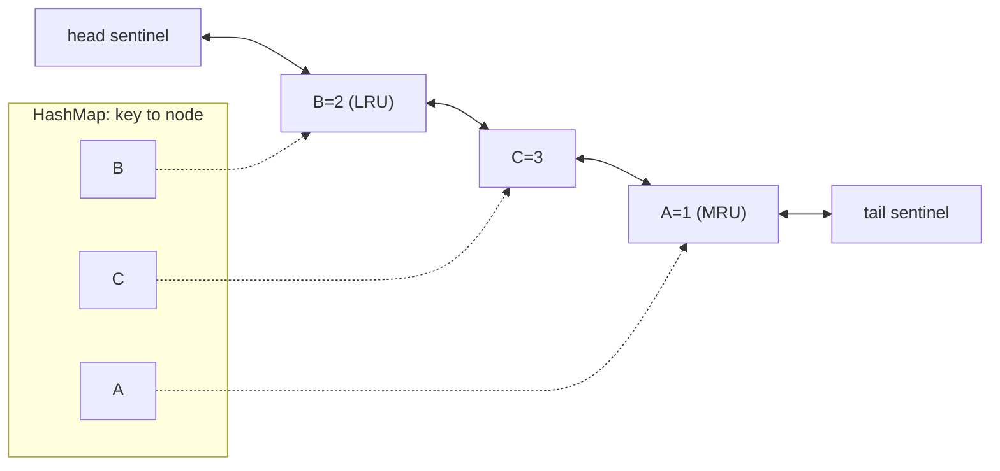
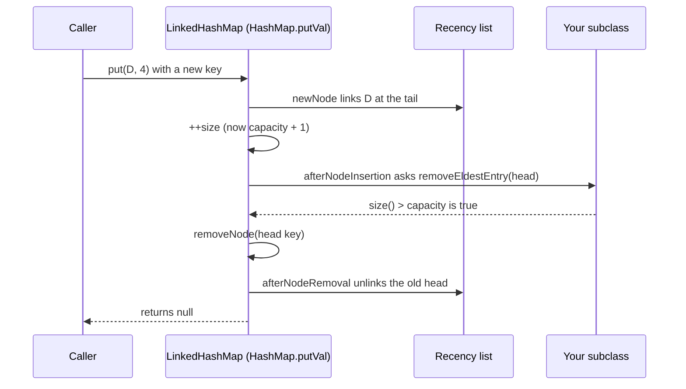
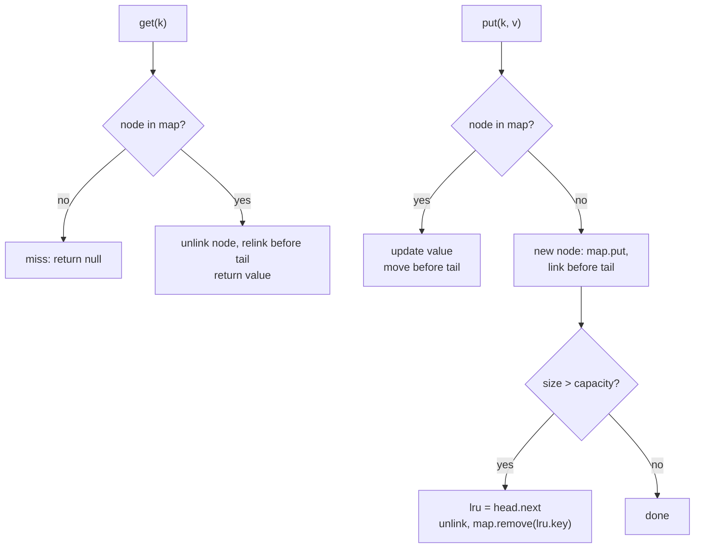

## In One Line
An LRU (least recently used) cache evicts the entry that has gone unused the longest; it needs a hash map for O(1) lookup **plus** a doubly linked list for O(1) "move to most recent" and "remove least recent" — which is exactly what `new LinkedHashMap<>(n, 0.75f, true)` with `removeEldestEntry` returning `size() > capacity` gives you, and what interviewers expect you to rebuild by hand.

## Mental Model
Picture a **narrow desk that holds only three files, stacked in a pile**.
- Whenever you **use** a file, you pull it out and put it on **top** of the pile.
- When a **new** file arrives and the desk is full, the file at the **bottom** — the one untouched the longest — goes to the archive.
- To pull a file out of the middle quickly, you keep an **index card box** (the hash map) that says exactly where each file sits in the pile, so you never search.
- To take a file out of the middle and close the gap, each file is clipped to its neighbours **above and below** (a *doubly* linked list): unclip it, clip its two neighbours together, done.

`LinkedHashMap` in access-order mode is that desk: the hash table is the card box, the `before`/`after` links are the clips, `head` is the bottom of the pile (eldest), `tail` is the top (most recent), and `removeEldestEntry` is you deciding "desk full — archive the bottom file".

## Concept
The basics of `LinkedHashMap` (insertion order, access order, Java 21 sequenced methods) are in [LinkedHashMap](lesson:a03-collections/15-linkedhashmap); the hash table underneath is in [HashMap Internals](lesson:b04-collections-internals/01-hashmap-internals). This lesson is about designing, building and hardening an LRU cache.

### Why caches evict, and what LRU assumes
A cache keeps a bounded number of expensive-to-get values in memory. When it is full, an **eviction policy** chooses a victim:

| Policy | Evicts | Good for | Weakness |
|---|---|---|---|
| **LRU** | least recently used | temporal locality ("recently used → likely used again") | a scan or loop slightly larger than the cache gets **0 %** hits |
| LFU | least frequently used | stable popularity | old heavy hitters linger; needs counts and aging |
| FIFO | oldest insertion | simplicity | evicts hot entries just because they are old |
| MRU | most recently used | cyclic scans | bad for normal workloads |
| Random | a random entry | no bookkeeping | unpredictable |
| TTL | entries older than a time limit | freshness | not a size bound by itself |
| W-TinyLFU (Caffeine) | frequency sketch + small LRU window | real-world mixed workloads | complex — use the library |

LRU is the interview default because it matches most workloads and can be done in **O(1) per operation**.

### Why "hash map + doubly linked list"
Three operations must all be O(1):
1. **Find** an entry by key → a hash map.
2. **Mark it most recently used** → move an arbitrary entry to one end of an ordering. Removing an element from the middle of a list in O(1) requires knowing its **previous** node — so the list must be **doubly** linked, and the map must point at the **node**, not just the value.
3. **Evict the least recently used** → take the node at the other end, and remove its key from the map — so each node must also store its **key**.

An `ArrayList` or `ArrayDeque` for the order would make step 2 O(n); a `PriorityQueue` of timestamps would make it O(log n). `LinkedHashMap` is precisely a `HashMap` whose entries are also threaded on a doubly linked list.

### How `LinkedHashMap` does it internally (JDK 21)
```java
public class LinkedHashMap<K,V> extends HashMap<K,V> implements SequencedMap<K,V> {
    static class Entry<K,V> extends HashMap.Node<K,V> {
        Entry<K,V> before, after;             // the recency (or insertion) list
    }
    transient LinkedHashMap.Entry<K,V> head;  // eldest = least recently used
    transient LinkedHashMap.Entry<K,V> tail;  // youngest = most recently used
    final boolean accessOrder;                // false = insertion order, true = access order
}
```
`HashMap` calls empty hook methods at the right moments; `LinkedHashMap` overrides them:

| Hook / override | Called from | What `LinkedHashMap` does |
|---|---|---|
| `newNode(...)` | `putVal` when a key is new | creates an `Entry` and links it at the **tail** |
| `afterNodeAccess(e)` | `putVal` on an existing key, `compute*`, `merge`, `replace`; plus `LinkedHashMap.get` / `getOrDefault` when `accessOrder` | in access order: unlink `e` and relink it at the **tail**, `modCount++` |
| `afterNodeInsertion(evict)` | end of `putVal` for a **new** key (and `compute`/`computeIfAbsent`/`merge` inserts) | asks `removeEldestEntry(head)`; if true, removes the head |
| `afterNodeRemoval(e)` | `removeNode` | unlinks `e` from the list |

The eviction hook, as compiled in JDK 21:
```java
void afterNodeInsertion(boolean evict) {           // possibly remove eldest
    LinkedHashMap.Entry<K,V> first;
    if (evict && (first = head) != null && removeEldestEntry(first)) {
        K key = first.key;
        removeNode(hash(key), key, null, false, true);
    }
}

protected boolean removeEldestEntry(Map.Entry<K,V> eldest) {
    return false;                                  // default: grow forever
}
```
Facts that follow directly from this code (all verified in the Code section):
- `removeEldestEntry` is asked **after every insertion of a new key**, even when the map is tiny — never when an existing key's value is replaced.
- When it is asked, the new entry is already counted: `size()` is `capacity + 1` at the moment of eviction. The test must be `size() > capacity`; `>=` keeps only `capacity - 1` entries.
- Only the **head** (one entry) is removed per insertion. The method may remove entries itself (for example with an iterator) but must then return `false` — the Javadoc allows it.
- `evict` is `false` while the map is being filled by the `LinkedHashMap(Map)` copy constructor and during deserialization, so those **do not evict** — a "cache" copied from a 5-entry map keeps 5 entries. `putAll` evicts as it goes. (The copy constructor also always creates an **insertion-ordered** map.)
- In access order, `get` moves the entry and increments `modCount` — `get` is a **structural modification**. Iterating `keySet()` while calling `get` throws `ConcurrentModificationException`; `entrySet()` iteration and `forEach` do not count as accesses.

### What counts as "use"
| Moves the entry to the MRU end (access order) | Does not |
|---|---|
| `get`, `getOrDefault` (on a present key) | `containsKey`, `containsValue` |
| `put` / `putIfAbsent` on an existing key | iterating `keySet()`, `values()`, `entrySet()`, `forEach` |
| `compute`, `computeIfPresent`, `computeIfAbsent` (present key), `merge` | `toString()`, `size()`, `firstEntry()`, `lastEntry()` |
| `replace` when it actually replaces | `get` on an absent key (nothing to move) |

So a "check then get" (`if (cache.containsKey(k)) return cache.get(k);`) records one access, and a monitoring job that iterates the cache does not disturb the LRU order.

### Implementation 1 — extend `LinkedHashMap`
```java
class LruCache<K, V> extends LinkedHashMap<K, V> {
    private final int capacity;
    LruCache(int capacity) {
        super(16, 0.75f, true);                  // accessOrder = true
        this.capacity = capacity;
    }
    @Override protected boolean removeEldestEntry(Map.Entry<K, V> eldest) {
        return size() > capacity;
    }
}
```
- **Sizing:** the table briefly holds `capacity + 1` entries, so to avoid rehashing pass `(int) Math.ceil((capacity + 1) / 0.75)` as the initial capacity. (`LinkedHashMap.newLinkedHashMap(n)` from Java 19 cannot set access order.)
- **Prefer composition for a public API.** Extending `LinkedHashMap` exposes the whole `Map` interface: `containsKey` that does not refresh, `entrySet().removeIf`, `putAll`, a copy constructor that ignores the capacity, `equals` with any map. Wrapping a private `LinkedHashMap` behind `get`/`put`/`size` methods keeps the cache's rules enforceable — and is where you add locking, statistics, weights or TTLs.
- `accessOrder = false` turns the same class into a **FIFO** cache: reads no longer move anything.
- Java 21 adds `firstEntry()` (the LRU entry), `lastEntry()` (the MRU entry), `pollFirstEntry()` (evict manually), `reversed()` (MRU → LRU view) without iterating.

### Implementation 2 — build it yourself (LeetCode 146)
```text
HashMap<K, Node>  : key -> node, O(1) lookup
Node              : key, value, prev, next
head <-> ... <-> tail : two sentinel nodes; head.next = LRU, tail.prev = MRU

get(k):   node = map.get(k); if null -> miss; else unlink(node), linkBeforeTail(node), return value
put(k,v): if node exists -> update value, move to tail
          else -> new node, map.put, linkBeforeTail; if map.size() > capacity:
                  lru = head.next; unlink(lru); map.remove(lru.key)
```
Design points interviewers probe:
- **Sentinels** (dummy `head` and `tail`) mean every real node always has a non-null `prev` and `next`: no special cases for the first, last or only node.
- **Why store the key in the node?** When evicting `head.next`, you must also delete it from the map, and the map is keyed by `K`.
- **Why doubly linked?** Unlinking a node found through the map needs its predecessor; a singly linked list would need an O(n) search.
- **Order of steps on put:** insert first, then evict if `size > capacity` — the same "capacity + 1, then trim" order `LinkedHashMap` uses. Evicting before inserting also works, but only for new keys; updating an existing key must never evict.
- Complexity: O(1) time per operation, O(capacity) space.

### Thread safety
Neither implementation is thread-safe, and an LRU cache is harder than a plain map because **every read is also a write** (it reorders the list). Consequences:
- A `ReadWriteLock` with `get` under the read lock is **wrong** — concurrent `get`s would rewire the list at the same time. Every operation needs exclusive access.
- `Collections.synchronizedMap(new LruCache<>(n))`, or `synchronized` methods on your own class, or a `ReentrantLock`: correct, simple, but one lock for everything (a contention point under heavy load). Hold the lock while iterating.
- `ConcurrentHashMap` + `ConcurrentLinkedDeque` "LRU" looks tempting, but `deque.remove(key)` is O(n) and the two structures can disagree between steps.
- Sharding: N independent LRU caches chosen by `hash(key) % N`, each with its own lock (Guava's cache used per-segment LRU queues). Eviction becomes approximately LRU per shard.
- Production answer: **Caffeine**. It stores data in a `ConcurrentHashMap`, records reads in lock-free ring buffers, replays them under a lock in batches, and evicts with W-TinyLFU, which also fixes LRU's scan problem.

The Code section runs 8 threads × 200,000 operations: with `synchronizedMap` the cache ends with exactly 100 entries, all reachable; without it, one run ended with `size()` = 941 and **zero** entries reachable by iteration — no exception, just silent corruption.

### LRU's blind spot and the fixes
LRU keeps whatever was touched last. A **cyclic scan over capacity + 1 keys** evicts each key just before it is needed again: 0 % hits (measured below — 99.9 % for 100 keys, 0.0 % for 101). A one-off full scan (a report, a backup) also flushes the whole hot set. Remedies: LRU-K / 2Q (require two accesses before promotion), segmented LRU (probation + protected segments), ARC, the midpoint-insertion LRU of database buffer pools, or W-TinyLFU. Measure the **hit ratio** (`hits / requests`) with realistic traffic before tuning.

### Common extensions
- **FIFO:** `accessOrder = false`.
- **Bounded by weight or memory**, not count: track the total weight and evict with `pollFirstEntry()` in a loop until under budget (Code, item 7).
- **TTL (expire after write):** store `(value, expiresAt)`; on `get`, treat an expired entry as a miss and remove it. With insertion order and one fixed TTL the eldest entry is also the oldest write, so `removeEldestEntry` can also drop it when `eldest.expiresAt < now`.
- **LFU in O(1):** `HashMap<K, Node>` + `HashMap<Integer, LinkedHashSet<K>>` (frequency → keys, in LRU order for ties) + a `minFrequency` counter.
- **Statistics:** count hits, misses and evictions — without them you cannot tell whether the cache helps.

### Where you meet LRU
`android.util.LruCache` is built on an access-ordered `LinkedHashMap`; CPU caches use pseudo-LRU; operating systems approximate LRU for pages (CLOCK); MySQL's InnoDB buffer pool uses a scan-resistant LRU variant; Guava and Caffeine caches, CDNs and browser caches all bound memory with LRU-like policies. Memoisation in general (see the `computeIfAbsent` trap in [HashMap Internals](lesson:b04-collections-internals/01-hashmap-internals)) becomes a bounded cache once you add eviction.

> [!INTERVIEW] "An LRU cache needs O(1) lookup, O(1) move-to-front and O(1) evict-from-back, so I combine a HashMap from key to node with a doubly linked list ordered by recency, using sentinel head and tail nodes. In Java that structure already exists: `new LinkedHashMap<>(16, 0.75f, true)` keeps entries in access order, and overriding `removeEldestEntry` to return `size() > capacity` evicts the head after each insertion. It is not thread-safe — every get reorders the list — so I'd synchronize every call or, in production, use Caffeine."

## Diagram

The two structures of every LRU cache: the map finds a node in O(1); the doubly linked list keeps recency, with the victim next to `head` and the newest next to `tail`.


How `put` of a new key becomes an eviction: insert first, then ask the hook with the eldest entry, then remove it through the normal removal path.


The hand-built cache: every path is a constant number of map operations and pointer updates, so everything is O(1).

## Code
**1. The same LRU two ways** — `LinkedHashMap` in access order, and a hand-built `HashMap` + doubly linked list:
```java
import java.util.HashMap;
import java.util.LinkedHashMap;
import java.util.Map;
import java.util.StringJoiner;

public class LruDemo {

    // 1. LRU cache in a dozen lines: access order + removeEldestEntry
    static class LinkedLru<K, V> extends LinkedHashMap<K, V> {
        private final int capacity;

        LinkedLru(int capacity) {
            super(16, 0.75f, true);                     // true = access order (LRU order)
            this.capacity = capacity;
        }

        @Override
        protected boolean removeEldestEntry(Map.Entry<K, V> eldest) {
            boolean evict = size() > capacity;          // called after every NEW key is inserted
            if (evict) System.out.print("  (evicts " + eldest.getKey() + ")");
            return evict;
        }
    }

    // 2. The same cache built by hand: HashMap for lookup + doubly linked list for recency
    static class HandLru<K, V> {
        private final class Node {
            K key; V value; Node prev, next;
            Node(K key, V value) { this.key = key; this.value = value; }
        }

        private final int capacity;
        private final Map<K, Node> index = new HashMap<>();
        private final Node head = new Node(null, null);   // sentinel: head.next = least recently used
        private final Node tail = new Node(null, null);   // sentinel: tail.prev = most recently used

        HandLru(int capacity) {
            this.capacity = capacity;
            head.next = tail;
            tail.prev = head;
        }

        public V get(K key) {
            Node n = index.get(key);
            if (n == null) return null;                    // miss
            moveToEnd(n);                                  // hit: now the most recently used
            return n.value;
        }

        public void put(K key, V value) {
            Node n = index.get(key);
            if (n != null) {                               // existing key: update and refresh
                n.value = value;
                moveToEnd(n);
                return;
            }
            n = new Node(key, value);
            index.put(key, n);
            linkAtEnd(n);
            if (index.size() > capacity) {                // over capacity: drop the LRU node
                Node eldest = head.next;
                unlink(eldest);
                index.remove(eldest.key);
                System.out.print("  (evicts " + eldest.key + ")");
            }
        }

        private void unlink(Node n) { n.prev.next = n.next; n.next.prev = n.prev; }

        private void linkAtEnd(Node n) {
            n.prev = tail.prev; n.next = tail;
            tail.prev.next = n; tail.prev = n;
        }

        private void moveToEnd(Node n) { unlink(n); linkAtEnd(n); }

        @Override public String toString() {
            StringJoiner sj = new StringJoiner(", ", "{", "}");
            for (Node n = head.next; n != tail; n = n.next) sj.add(n.key + "=" + n.value);
            return sj.toString();
        }
    }

    public static void main(String[] args) {
        String[] ops = {"put A 1", "put B 2", "put C 3", "get A", "put D 4", "get B", "put C 30", "put E 5", "get D"};

        System.out.println("LinkedHashMap LRU, capacity 3 (eldest first):");
        LinkedLru<String, Integer> lru = new LinkedLru<>(3);
        for (String op : ops) {
            String[] p = op.split(" ");
            System.out.printf("%-9s", op);
            if (p[0].equals("put")) lru.put(p[1], Integer.valueOf(p[2]));
            else System.out.print("-> " + lru.get(p[1]));
            System.out.println("  " + lru);
        }

        System.out.println("Hand-built LRU, same operations:");
        HandLru<String, Integer> hand = new HandLru<>(3);
        for (String op : ops) {
            String[] p = op.split(" ");
            System.out.printf("%-9s", op);
            if (p[0].equals("put")) hand.put(p[1], Integer.valueOf(p[2]));
            else System.out.print("-> " + hand.get(p[1]));
            System.out.println("  " + hand);
        }
    }
}
```
```output
LinkedHashMap LRU, capacity 3 (eldest first):
put A 1    {A=1}
put B 2    {A=1, B=2}
put C 3    {A=1, B=2, C=3}
get A    -> 1  {B=2, C=3, A=1}
put D 4    (evicts B)  {C=3, A=1, D=4}
get B    -> null  {C=3, A=1, D=4}
put C 30   {A=1, D=4, C=30}
put E 5    (evicts A)  {D=4, C=30, E=5}
get D    -> 4  {C=30, E=5, D=4}
Hand-built LRU, same operations:
put A 1    {A=1}
put B 2    {A=1, B=2}
put C 3    {A=1, B=2, C=3}
get A    -> 1  {B=2, C=3, A=1}
put D 4    (evicts B)  {C=3, A=1, D=4}
get B    -> null  {C=3, A=1, D=4}
put C 30   {A=1, D=4, C=30}
put E 5    (evicts A)  {D=4, C=30, E=5}
get D    -> 4  {C=30, E=5, D=4}
```

**2. The edge cases of `LinkedHashMap`-based caches:**
```java
import java.util.ConcurrentModificationException;
import java.util.LinkedHashMap;
import java.util.Map;

public class LruEdges {
    static class Lru<K, V> extends LinkedHashMap<K, V> {
        final int capacity;
        Lru(int capacity, boolean accessOrder) { super(16, 0.75f, accessOrder); this.capacity = capacity; }
        Lru(Map<K, V> source, int capacity) { super(source); this.capacity = capacity; }  // copy constructor
        @Override protected boolean removeEldestEntry(Map.Entry<K, V> eldest) {
            return size() > capacity;
        }
    }

    // Bounded by the total length of the values, not by the number of entries
    static class WeightedLru {
        private final LinkedHashMap<String, String> map = new LinkedHashMap<>(16, 0.75f, true);
        private final int maxChars;
        private int chars;

        WeightedLru(int maxChars) { this.maxChars = maxChars; }

        String get(String key) { return map.get(key); }

        void put(String key, String value) {
            String old = map.put(key, value);
            chars += value.length() - (old == null ? 0 : old.length());
            while (chars > maxChars && map.size() > 1)                  // keep at least the newest entry
                chars -= map.pollFirstEntry().getValue().length();      // pollFirstEntry = remove the LRU entry
        }

        @Override public String toString() { return map + " (" + chars + " chars)"; }
    }

    public static void main(String[] args) {
        // 1. When is removeEldestEntry asked, and what does it see?
        LinkedHashMap<String, Integer> spy = new LinkedHashMap<>(16, 0.75f, true) {
            @Override protected boolean removeEldestEntry(Map.Entry<String, Integer> eldest) {
                System.out.print("[asked: size=" + size() + ", eldest=" + eldest.getKey() + "] ");
                return size() > 2;
            }
        };
        System.out.print("1. put a: "); spy.put("a", 1); System.out.println();
        System.out.print("   put b: "); spy.put("b", 2); System.out.println();
        System.out.print("   put a again: "); spy.put("a", 10); System.out.println("(not asked) " + spy);
        System.out.print("   put c: "); spy.put("c", 3); System.out.println(spy);

        // 2. Insertion order instead of access order = FIFO cache
        Lru<String, Integer> fifo = new Lru<>(2, false);
        fifo.put("a", 1); fifo.put("b", 2); fifo.get("a"); fifo.put("c", 3);
        System.out.println("2. FIFO (accessOrder=false): " + fifo);

        // 3. Which calls count as an access?
        Lru<String, Integer> lru = new Lru<>(3, true);
        lru.put("a", 1); lru.put("b", 2); lru.put("c", 3);
        lru.containsKey("a");
        System.out.print("3. after containsKey(a): " + lru.keySet());
        lru.getOrDefault("a", 0);
        System.out.print(", getOrDefault(a): " + lru.keySet());
        lru.putIfAbsent("b", 99);
        System.out.println(", putIfAbsent(b, 99): " + lru);

        // 4. The copy constructor does NOT evict; putAll does
        Map<String, Integer> five = new LinkedHashMap<>();
        for (String k : "p q r s t".split(" ")) five.put(k, k.charAt(0) - 'a');
        Lru<String, Integer> copied = new Lru<>(five, 2);
        System.out.print("4. new Lru(fiveEntries, 2): size " + copied.size());
        Lru<String, Integer> filled = new Lru<>(2, true);
        filled.putAll(five);
        System.out.println(", putAll into Lru(2): " + filled);

        // 5. In access order, get() is a structural change
        try {
            for (String k : lru.keySet()) lru.get(k);
        } catch (ConcurrentModificationException e) {
            System.out.print("5. keySet loop + get: " + e.getClass().getSimpleName());
        }
        int sum = 0;
        for (Map.Entry<String, Integer> e : lru.entrySet()) sum += e.getValue();   // no access recorded
        System.out.println("; entrySet loop is fine, sum=" + sum + ", order " + lru.keySet());

        // 6. Java 21 SequencedMap: peek at both ends without iterating
        System.out.println("6. eldest=" + lru.firstEntry() + ", newest=" + lru.lastEntry()
                + ", newest first=" + lru.reversed().keySet());

        // 7. Evicting by total weight: composition + pollFirstEntry (Java 21)
        WeightedLru byWeight = new WeightedLru(10);
        byWeight.put("k1", "aaaa");
        byWeight.put("k2", "bbbb");
        byWeight.get("k1");                                       // k1 is now the most recent
        byWeight.put("k3", "cccccc");                             // 14 chars > 10: evict LRU until <= 10
        System.out.println("7. weight-bounded: " + byWeight);
    }
}
```
```output
1. put a: [asked: size=1, eldest=a] 
   put b: [asked: size=2, eldest=a] 
   put a again: (not asked) {b=2, a=10}
   put c: [asked: size=3, eldest=b] {a=10, c=3}
2. FIFO (accessOrder=false): {b=2, c=3}
3. after containsKey(a): [a, b, c], getOrDefault(a): [b, c, a], putIfAbsent(b, 99): {c=3, a=1, b=2}
4. new Lru(fiveEntries, 2): size 5, putAll into Lru(2): {s=18, t=19}
5. keySet loop + get: ConcurrentModificationException; entrySet loop is fine, sum=6, order [a, b, c]
6. eldest=a=1, newest=c=3, newest first=[c, b, a]
7. weight-bounded: {k1=aaaa, k3=cccccc} (10 chars)
```

**3. Hit ratio depends on the access pattern** (fixed random seed, so every run prints the same):
```java
import java.util.LinkedHashMap;
import java.util.Map;
import java.util.Random;
import java.util.function.IntSupplier;

public class LruHitRatio {
    static class Lru<K, V> extends LinkedHashMap<K, V> {
        private final int capacity;
        Lru(int capacity) { super(16, 0.75f, true); this.capacity = capacity; }
        @Override protected boolean removeEldestEntry(Map.Entry<K, V> eldest) { return size() > capacity; }
    }

    // Read-through: on a miss, "load" the value and cache it
    static void run(String pattern, IntSupplier nextKey) {
        Lru<Integer, String> cache = new Lru<>(100);
        int hits = 0, requests = 100_000;
        for (int i = 0; i < requests; i++) {
            int key = nextKey.getAsInt();
            if (cache.get(key) != null) hits++;
            else cache.put(key, "value-" + key);
        }
        System.out.printf("%-44s hit ratio %5.1f%%%n", pattern, 100.0 * hits / requests);
    }

    public static void main(String[] args) {
        Random r = new Random(42);                               // fixed seed: same numbers every run
        run("uniform over 1,000 keys", () -> r.nextInt(1_000));
        run("80% of requests to 50 hot keys (of 1,000)", () -> r.nextInt(100) < 80 ? r.nextInt(50) : r.nextInt(1_000));
        int[] i = {0};
        run("cyclic scan over 100 keys", () -> i[0]++ % 100);
        run("cyclic scan over 101 keys", () -> i[0]++ % 101);
    }
}
```
```output
uniform over 1,000 keys                      hit ratio  10.0%
80% of requests to 50 hot keys (of 1,000)    hit ratio  81.1%
cyclic scan over 100 keys                    hit ratio  99.9%
cyclic scan over 101 keys                    hit ratio   0.0%
```

**4. Making it thread-safe** — 8 threads, 200,000 read-through operations each, capacity 100:
```java
import java.util.Collections;
import java.util.LinkedHashMap;
import java.util.Map;
import java.util.concurrent.ThreadLocalRandom;

public class SafeLru {
    static class Lru<K, V> extends LinkedHashMap<K, V> {
        private final int capacity;
        Lru(int capacity) { super(16, 0.75f, true); this.capacity = capacity; }
        @Override protected boolean removeEldestEntry(Map.Entry<K, V> eldest) { return size() > capacity; }
    }

    public static void main(String[] args) throws InterruptedException {
        // Every call, INCLUDING get, takes the same lock: in access order get() rewires the list
        Map<Integer, Integer> cache = Collections.synchronizedMap(new Lru<>(100));

        Thread[] workers = new Thread[8];
        for (int t = 0; t < workers.length; t++) {
            workers[t] = new Thread(() -> {
                for (int i = 0; i < 200_000; i++) {
                    int key = ThreadLocalRandom.current().nextInt(1_000);
                    if (cache.get(key) == null) cache.put(key, key);
                }
            });
            workers[t].start();
        }
        for (Thread w : workers) w.join();

        int iterated = 0;
        boolean allFound = true;
        synchronized (cache) {                                   // iteration needs the lock held manually
            for (Integer k : cache.keySet()) {
                iterated++;
                allFound &= cache.containsKey(k);            // containsKey does not reorder
            }
        }
        System.out.println("size()=" + cache.size() + ", entries iterated=" + iterated + ", every key findable=" + allFound);
    }
}
```
```output
size()=100, entries iterated=100, every key findable=true
```
The same program with the wrapper removed (`Map<Integer, Integer> cache = new Lru<>(100);`) — one real run; the numbers differ every time:
```output
size()=941, entries iterated=0, every key findable=true
```

## Walkthrough
### `LruDemo`
- **`LinkedLru`** passes `accessOrder = true` to `LinkedHashMap(16, 0.75f, true)` and overrides `removeEldestEntry` to return `size() > capacity`. The `print` inside is only there to show *when* evictions happen.
- **`HandLru`** is the textbook design: `index` maps each key to its `Node`; `head` and `tail` are sentinel nodes, so the list is never "empty" in a way that needs `null` checks. `unlink` joins a node's two neighbours; `linkAtEnd` inserts just before `tail` (the MRU end); `moveToEnd` is both. `put` on a new key links it at the end and, if the size is now above capacity, evicts `head.next` from the list **and** from `index` (that is why the node stores its key). `toString` walks from `head.next` to `tail`, eldest first — the same order `LinkedHashMap` prints.
- **The trace (capacity 3):**
  - `put A, B, C` fill the cache in that order.
  - `get A` is a hit and moves A to the MRU end: `{B, C, A}`.
  - `put D` is a new key: size becomes 4, the hook fires and evicts the eldest, **B** — not A, because A was just used.
  - `get B` is a miss (`null`); a miss changes nothing.
  - `put C 30` updates an existing key: no eviction check, but in access order the update counts as a use, so C moves to the end with its new value.
  - `put E` evicts **A** (now the eldest); `get D` moves D to the end.
- Both implementations print identical lines: `LinkedHashMap` is the hand-built design, packaged.

### `LruEdges`
1. The anonymous subclass logs every call. `removeEldestEntry` is asked after `put a` (size 1) and `put b` (size 2) even though nothing needs evicting; it is **not** asked for `put a again` (an update — `putVal` returns before `afterNodeInsertion`), but that update does move `a` to the end: `{b=2, a=10}`. On `put c` it sees `size=3` (capacity 2 + 1) and eldest `b`, so `b` goes.
2. With `accessOrder = false`, `get("a")` does not reorder; `put c` evicts the oldest *insertion*, `a`, leaving `{b=2, c=3}` — a FIFO cache.
3. `containsKey("a")` leaves `[a, b, c]` unchanged; `getOrDefault("a", 0)` moves `a` to the end; `putIfAbsent("b", 99)` finds `b` present, keeps its value 2, but still counts as an access and moves it: `{c=3, a=1, b=2}`.
4. `super(source)` is `LinkedHashMap(Map)`, which fills the map with `evict = false` — `removeEldestEntry` never removes anything, so the "capacity 2" cache holds 5 entries (and it is insertion-ordered, because that constructor cannot set access order). `putAll` into a real `Lru(2)` evicts after each insertion and keeps the last two, `s` and `t` (values are `k.charAt(0) - 'a'`: 18 and 19).
5. Before the loop the order is `[c, a, b]`. The first `get("c")` moves `c` to the end and increments `modCount`; the key-set iterator notices on its next step and throws. Iterating `entrySet()` and reading `getValue()` does not count as an access: the sum 1 + 2 + 3 = 6 is computed and the order stays `[a, b, c]`.
6. Java 21's `SequencedMap` methods: `firstEntry()` is the LRU entry (`a=1`), `lastEntry()` the MRU entry (`c=3`), `reversed()` a live newest-first view. None of them count as an access.
7. `WeightedLru` wraps a private access-ordered `LinkedHashMap` (composition) and tracks the total characters of its values. After `k1` (4) and `k2` (4) and a `get("k1")`, the order is `k2, k1`. Adding `k3` (6) makes 14 > 10, so the loop polls the LRU entry, `k2`, leaving 10 characters. An earlier attempt at this demo overrode `put` in a subclass and updated the running total *after* `super.put(...)` — but `removeEldestEntry` runs *inside* `super.put`, before the total was updated, so nothing was ever evicted. Composition avoids that ordering trap.

### `LruHitRatio`
- A read-through loop: `get`; on a miss, "load" and `put`. `new Random(42)` makes the random sequences reproducible.
- **Uniform over 1,000 keys** with room for 100: about 10 % hits — the cache holds 10 % of the key space and no key is more popular than another. LRU cannot beat that.
- **80 % of requests to 50 hot keys:** the hot keys are used so often that they stay near the MRU end and are almost never evicted: 81.1 %.
- **Cyclic scan over 100 keys:** only the first pass misses: 99.9 %.
- **Cyclic scan over 101 keys:** each new key evicts the key that will be needed **next** (the least recently used is exactly the one coming up), so every request misses: 0.0 %. One extra key turns a perfect cache into a useless one — the classic argument for scan-resistant policies.

### `SafeLru`
- `Collections.synchronizedMap` wraps every method in `synchronized (mutex)` — including `get`, which matters because an access-ordered `get` rewires the linked list. Iteration is not covered by the wrapper, so the check runs inside `synchronized (cache)`.
- `if (cache.get(key) == null) cache.put(key, key)` is check-then-act across two calls: two threads may both miss and both load the same key. For a cache that is only wasted work (the second `put` overwrites with an equal value); if loading must happen once, use `cache.computeIfAbsent(key, loader)`, which the synchronized wrapper runs under its lock.
- With the wrapper: exactly 100 entries, all reachable. Without it, concurrent `get`s and `put`s interleave pointer updates on the same nodes: in the run shown, `size()` claims 941 entries (evictions were lost), while walking the list from `head` found **none** — the list was cut. `every key findable=true` is vacuously true because zero keys were visited. Other runs show different numbers; none are correct, and no exception warns you.

## Traps
- **Forgetting `accessOrder = true`.** `new LinkedHashMap<>()` with `removeEldestEntry` is a FIFO cache, not LRU — reads do not protect an entry.
- **`size() >= capacity`** in `removeEldestEntry` evicts one entry too early (the map holds `capacity - 1`), because the new entry is already counted when the hook runs.
- **Expecting `containsKey` to refresh an entry.** It does not; `get`/`getOrDefault` do. Conversely, a `get` used "just to check" does refresh.
- **Iterating `keySet()` and calling `get`** on an access-ordered map throws `ConcurrentModificationException` — `get` is structural there. Iterate `entrySet()` or use `forEach`.
- **Building the cache with the copy constructor** — no eviction happens and the map is insertion-ordered.
- **Updating a running total in an overridden `put` after `super.put`** — `removeEldestEntry` has already run. Use composition, or compute inside the hook.
- **Sharing the cache between threads without a lock**, or with a `ReadWriteLock` that lets `get`s run together. Every operation on an LRU cache writes.
- **Mutable keys** break the underlying `HashMap` exactly as in [HashMap Internals](lesson:b04-collections-internals/01-hashmap-internals).
- **Assuming LRU always helps.** Scans and loops larger than the cache can drive the hit ratio to 0 %. Measure it.

> [!WARNING] `removeEldestEntry` removes at most **one** entry per insertion (the head). If a single insertion can push you over budget by more than one entry (weighted caches), remove extra entries yourself and return `false`, or evict in a loop outside the hook as `WeightedLru` does.

## Tips & Tricks
- **The recipe: "`true` in the constructor, `>` in the hook."** `super(initialCapacity, 0.75f, true)` + `return size() > capacity;`.
- **"Map finds, list orders."** Hash map for O(1) lookup, doubly linked list for O(1) recency updates — say it before writing any code in an interview.
- **Sentinels save you from `null` checks**: `head.next` is the LRU node, `tail.prev` the MRU node, even in an empty cache (`head.next == tail`).
- **Store the key in the node** — eviction must remove it from the map too.
- **Java 21 shortcuts:** `firstEntry()` = next victim, `lastEntry()` = newest, `pollFirstEntry()` = evict now, `reversed()` = MRU-first view.
- **Wrap, don't extend,** when the cache is part of a public API; add hit/miss counters from day one.
- **In production, use Caffeine** (`Caffeine.newBuilder().maximumSize(10_000).expireAfterWrite(...)`): thread-safe, scan-resistant, with statistics. Hand-rolled LRU is for interviews, small single-threaded caches, and understanding.

## Interview Q&A
### [Basic] What is an LRU cache, and why does it need both a hash map and a doubly linked list?
A fixed-capacity cache that, when full, evicts the entry that was used least recently — betting that recently used data will be used again soon. All three operations must be O(1): **lookup** by key (a hash map), **marking an entry as most recently used** (moving an arbitrary node to one end of an ordering — which needs a doubly linked list, because unlinking a node in O(1) requires its predecessor, and the map must point directly at the node), and **evicting the least recently used** (removing the node at the other end, and its key from the map, which is why each node stores its key). An array or queue would make the reordering O(n); a heap of timestamps would make it O(log n).

**Follow-up:** *What does Java offer for this out of the box?* — `LinkedHashMap` in access-order mode — it is a `HashMap` whose entries are also linked in a doubly linked list.

### [Basic] How do you implement an LRU cache with LinkedHashMap?
Extend it (or wrap it), enable access order with the three-argument constructor, and override `removeEldestEntry`:
```java
class LruCache<K, V> extends LinkedHashMap<K, V> {
    private final int capacity;
    LruCache(int capacity) { super(16, 0.75f, true); this.capacity = capacity; }
    @Override protected boolean removeEldestEntry(Map.Entry<K, V> eldest) {
        return size() > capacity;
    }
}
```
With `accessOrder = true`, every `get`/`put` of a present key moves it to the tail, so the head is always the least recently used entry. After every insertion of a new key the map calls `removeEldestEntry(head)`; returning `true` removes the head. All operations stay O(1). For capacity 3: put A, B, C; get A; put D → B is evicted, leaving `{C, A, D}`.

**Follow-up:** *What happens if you pass `false` (the default)?* — The order is insertion order, reads do not move entries, and the same class becomes a FIFO cache.

### [Intermediate] How does LinkedHashMap implement access order and eviction internally?
`LinkedHashMap.Entry` extends `HashMap.Node` with `before` and `after` links, and the map keeps `head` and `tail` plus a `final boolean accessOrder`. `HashMap` calls hook methods that are empty in `HashMap` and overridden in `LinkedHashMap`: `newNode` links each new entry at the tail; `afterNodeAccess` (called when `putVal` finds an existing key, from `compute*`/`merge`/`replace`, and from `LinkedHashMap`'s own `get`/`getOrDefault`) moves the entry to the tail when `accessOrder` is true and increments `modCount`; `afterNodeRemoval` unlinks removed entries; `afterNodeInsertion(evict)` runs at the end of an insertion and, if `evict` is true, calls `removeEldestEntry(head)` and removes the head when it returns `true`. Lookups use the hash table; iteration walks the linked list.

**Follow-up:** *Why is `get` a structural modification in access order?* — Because moving the entry changes the iteration order, so `modCount` is incremented and fail-fast iterators (for example over `keySet()`) throw `ConcurrentModificationException`.

### [Intermediate] When exactly is `removeEldestEntry` called, and what does it see?
After a **new** mapping has been inserted — by `put`, `putIfAbsent`, `putAll`, `computeIfAbsent`, `compute` or `merge` — with the new entry already linked and counted, so `size()` is `capacity + 1` at the moment an eviction is due. It receives the head (the eldest entry). It is **not** called when an existing key's value is replaced, and not while the map is filled by the `LinkedHashMap(Map)` copy constructor or by deserialization (`evict = false`). It is called even for the first insertion. Returning `true` removes exactly one entry (the head); the method may also modify the map itself, in which case it should return `false`.

**Follow-up:** *What goes wrong with `return size() >= capacity`?* — The cache evicts as soon as it reaches `capacity`, so it only ever holds `capacity - 1` entries.

### [Intermediate] Implement an LRU cache without LinkedHashMap.
Use a `HashMap<K, Node>` and a doubly linked list with two sentinel nodes; the node next to `head` is the LRU entry, the node before `tail` the MRU entry:
```java
class LruCache<K, V> {
    private final class Node { K key; V value; Node prev, next; Node(K k, V v) { key = k; value = v; } }
    private final int capacity;
    private final Map<K, Node> index = new HashMap<>();
    private final Node head = new Node(null, null), tail = new Node(null, null);

    LruCache(int capacity) { this.capacity = capacity; head.next = tail; tail.prev = head; }

    public V get(K key) {
        Node n = index.get(key);
        if (n == null) return null;
        moveToEnd(n);
        return n.value;
    }

    public void put(K key, V value) {
        Node n = index.get(key);
        if (n != null) { n.value = value; moveToEnd(n); return; }
        n = new Node(key, value);
        index.put(key, n);
        linkAtEnd(n);
        if (index.size() > capacity) {
            Node lru = head.next;
            unlink(lru);
            index.remove(lru.key);
        }
    }

    private void unlink(Node n)    { n.prev.next = n.next; n.next.prev = n.prev; }
    private void linkAtEnd(Node n) { n.prev = tail.prev; n.next = tail; tail.prev.next = n; tail.prev = n; }
    private void moveToEnd(Node n) { unlink(n); linkAtEnd(n); }
}
```
Every method does a constant number of map operations and pointer updates: O(1) time, O(capacity) space. Sentinels remove all edge cases (first, last, only node); storing the key in the node lets eviction delete the map entry. The Code section runs this design and `LinkedHashMap` on the same operations and they print identical states.

**Follow-up:** *Why not `ArrayDeque` or `LinkedList` for the order?* — Moving a key found by the map requires `remove(Object)`, an O(n) scan; you need direct access to the node.

### [Advanced] How do you make an LRU cache thread-safe? Why not a ReadWriteLock?
In an LRU cache every `get` is also a write: it moves the entry in the recency list. So `get`s must not run concurrently with each other, and a `ReadWriteLock` with `get` under the read lock would corrupt the list. Correct options: `Collections.synchronizedMap(new LruCache<>(n))` (every call, including `get`, under one monitor; iteration inside `synchronized (map)`), `synchronized` methods or a `ReentrantLock` on your own class, or **sharding** (N independent caches selected by key hash, each with its own lock — approximate global LRU, much less contention). In production use **Caffeine**: a `ConcurrentHashMap` for the data, lock-free ring buffers that *record* reads, and a single maintenance thread-of-control that replays them under a lock in batches, with W-TinyLFU eviction. Without any locking, 8 threads corrupted a `LinkedHashMap` cache so badly that `size()` said 941 while zero entries were reachable through the list — without throwing.

**Follow-up:** *Is `ConcurrentHashMap` + `ConcurrentLinkedDeque` a valid concurrent LRU?* — Not really: moving a key means `deque.remove(key)`, an O(n) scan, and the map and deque can disagree between the two steps.

### [Advanced] What are the weaknesses of LRU, and what do real caches use instead?
LRU only looks at recency. A **scan** (a report reading every row, a backup) floods the cache with one-time entries and evicts the hot set; a **loop over slightly more keys than the capacity** evicts each key just before its next use — a 100-entry cache cycling over 101 keys scores 0 % hits (100 keys: 99.9 %). LRU also ignores frequency: a key used 1,000 times can be evicted by 100 one-off keys. Alternatives: **LFU** (frequency, with aging), **LRU-K** / **2Q** (an entry must be seen twice before it is protected), **segmented LRU** (probation and protected segments), **ARC** (adapts between recency and frequency), database buffer pools with **midpoint insertion**, and **W-TinyLFU** (Caffeine: a small LRU window plus a frequency sketch that admits only entries likely to be used more than the victim).

**Follow-up:** *How do you know whether a cache is helping?* — Measure the hit ratio (and load latency, eviction count) under realistic traffic; Caffeine's `recordStats()` does this for you.

### [Advanced] How would you add expiry (TTL) or a memory bound to a LinkedHashMap cache?
**TTL:** store a wrapper `(value, expiresAt)`. On `get`, if `now > expiresAt`, remove the entry and treat it as a miss (lazy expiry). With insertion order and one fixed TTL, the eldest entry is also the oldest write, so `removeEldestEntry` can additionally drop it when it has expired; a background sweep can clean up entries that are never read. **Memory/weight bound:** track the total weight of the values and, after each `put`, evict from the LRU end until under budget — `while (weight > max) weight -= weigh(map.pollFirstEntry().getValue());` (Java 21) or `iterator().next()` + `remove()` before Java 21. Doing this inside `removeEldestEntry` is possible (remove several entries, return `false`), but a subclass that updates its running total in an overridden `put` *after* `super.put` sees stale numbers, because the hook runs inside `super.put`. Composition keeps the order of operations under your control.

**Follow-up:** *Why keep at least one entry?* — If a single value is heavier than the whole budget, a naive loop would evict it immediately (or loop on an empty map); decide explicitly whether to keep it or reject it.

### [Advanced] Why might you prefer composition over extending LinkedHashMap for a cache?
Extending exposes every `Map` method, and several of them undermine the cache: `containsKey` does not refresh recency, `putAll` bulk-evicts, the copy constructor bypasses eviction entirely, `entrySet()` allows arbitrary removal, `equals` compares with any map, and callers can iterate while other threads modify it. A wrapper with a private `LinkedHashMap` and a small API (`get`, `put`, `invalidate`, `size`, `stats`) enforces the rules, is the natural place for a lock, hit/miss counters, weights and TTLs, and lets you swap the implementation (for example to Caffeine) without changing callers. It also avoids fragile coupling to `HashMap`'s internal call order, as the weighted-cache example shows.

**Follow-up:** *When is extending fine?* — For a small, private, single-threaded memo cache inside one class, the ten-line subclass is perfectly reasonable.

### [Advanced] How would you design an LFU cache with O(1) operations?
Keep three structures: `Map<K, Node>` (key → value and its use count), `Map<Integer, LinkedHashSet<K>>` (count → keys with that count, in LRU order so ties evict the least recently used), and an `int minFreq`. `get(k)`: bump the node's count, move `k` from set `count` to set `count + 1`, and if the old set was `minFreq` and is now empty, increment `minFreq`. `put(k, v)` for a new key when full: evict the first key of the `minFreq` set (`iterator().next()`), then insert `k` with count 1 and set `minFreq = 1`. Every step is O(1). LFU keeps long-term favourites that LRU would drop, but needs aging (halving counts periodically) or it never forgets yesterday's popular keys.

**Follow-up:** *Which is better, LRU or LFU?* — It depends on the workload; modern caches such as Caffeine combine both (a recency window plus frequency-based admission).

## Quiz
### With capacity 2 (access order, `size() > 2`), what remains after: `put(a)`, `put(b)`, `get(a)`, `put(c)`?
- [ ] {b, c}
- [x] {a, c}
- [ ] {a, b}
- [ ] {a, b, c}
> `get(a)` moves `a` to the most-recent end, so the eldest is `b`; inserting `c` pushes the size to 3 and `removeEldestEntry` evicts `b`. `{b, c}` would be the result without access order (FIFO).

### The same sequence on `new LinkedHashMap<>()` (default constructor) with the same `removeEldestEntry` prints what?
- [ ] {a=1, c=3}
- [x] {b=2, c=3}
- [ ] {a=1, b=2, c=3}
- [ ] {c=3}
> The default constructor uses insertion order: `get(a)` does not move anything, so `a` is still the eldest when `c` arrives. This is a FIFO cache — the most common bug when writing an "LRU" with `LinkedHashMap`.

### What does this print?
```java
Map<String, Integer> m = new LinkedHashMap<>(16, 0.75f, true) {
    protected boolean removeEldestEntry(Map.Entry<String, Integer> e) { return size() >= 3; }
};
m.put("a", 1); m.put("b", 2); m.put("c", 3); m.put("d", 4);
System.out.println(m);
```
- [ ] {b=2, c=3, d=4}
- [x] {c=3, d=4}
- [ ] {a=1, b=2, c=3}
- [ ] {d=4}
> The hook runs after the new entry is counted. With `>=`, putting `c` makes the size 3 and evicts `a`; putting `d` makes it 3 again and evicts `b`. The cache never holds more than 2 entries — use `size() > capacity`.

### In an access-ordered `LinkedHashMap`, which call does NOT move the entry to the most-recently-used end?
- [ ] `get(k)`
- [ ] `putIfAbsent(k, v)` when `k` is already present
- [x] `containsKey(k)`
- [ ] `getOrDefault(k, d)` when `k` is present
> `containsKey` is a pure lookup through the hash table. `get`, `getOrDefault`, and `put`/`putIfAbsent`/`compute*`/`merge` on a present key all call `afterNodeAccess`. So `putIfAbsent` keeps the old value but still refreshes the entry.

### What does this print?
```java
class Lru<K, V> extends LinkedHashMap<K, V> {
    final int cap;
    Lru(Map<K, V> src, int cap) { super(src); this.cap = cap; }
    protected boolean removeEldestEntry(Map.Entry<K, V> e) { return size() > cap; }
}
Map<String, Integer> five = new LinkedHashMap<>();
for (String k : "p q r s t".split(" ")) five.put(k, 1);
System.out.println(new Lru<>(five, 2).size());
```
- [ ] 2
- [x] 5
- [ ] 1
- [ ] IllegalArgumentException
> `LinkedHashMap(Map)` copies the entries with `evict = false`, so `removeEldestEntry` never triggers — and at that moment `cap` is still 0 anyway, because the superclass constructor runs before the field is assigned. The map also uses insertion order. `putAll` on a properly constructed cache would keep 2.

### Why does `for (String k : cache.keySet()) cache.get(k);` throw on an access-ordered `LinkedHashMap`?
- [ ] `keySet()` of a `LinkedHashMap` is unmodifiable
- [x] In access order `get` moves the entry and increments `modCount`, so the fail-fast iterator detects a structural change
- [ ] `get` cannot be called during any iteration
- [ ] It only throws when the cache is full
> Reordering the linked list is a structural modification in access-order mode. With insertion order the same loop is fine. Iterate `entrySet()` (reading values does not count as access) or use `forEach`.

### A cache of 100 entries serves requests that cycle through keys 0, 1, …, 100, 0, 1, … (101 distinct keys). What is its long-run LRU hit ratio?
- [ ] About 99 %
- [ ] About 50 %
- [x] 0 %
- [ ] 100 %
> Each new key evicts the least recently used key — which is precisely the next key in the cycle. Every request misses (measured: 0.0 %, versus 99.9 % for 100 keys). This scan pattern is why production caches use scan-resistant policies such as W-TinyLFU or segmented LRU.

### Why must the recency list in a hand-built LRU cache be *doubly* linked?
- [ ] To iterate from newest to oldest
- [ ] Because `HashMap` requires it
- [x] To unlink a node found through the map in O(1), which requires its predecessor
- [ ] To save memory
> The map hands you the node directly; removing it from the middle of the list means pointing its predecessor at its successor. A singly linked list would need an O(n) walk to find the predecessor. Iterating backwards is a bonus, not the reason; the second pointer costs memory rather than saving it.

## Takeaways
- LRU evicts the least recently used entry; O(1) `get`/`put`/evict needs a hash map (key → node) plus a doubly linked list ordered by recency, with nodes that store their keys.
- In Java: `new LinkedHashMap<>(cap, 0.75f, true)` (access order) + `removeEldestEntry` returning `size() > capacity`; with `false` (the default) you get FIFO.
- Internally, `HashMap` hooks do the work: `newNode` links at the tail, `afterNodeAccess` moves accessed entries to the tail, `afterNodeInsertion` asks `removeEldestEntry(head)` after each new key, `afterNodeRemoval` unlinks.
- `removeEldestEntry` runs after the new entry is counted (size = capacity + 1), only for new keys, removes at most one entry, and is skipped by the copy constructor and deserialization.
- Access = `get`, `getOrDefault`, and put/compute/merge on existing keys; not `containsKey` or iteration. In access order `get` is structural, so `keySet()` loops with `get` throw `ConcurrentModificationException`.
- The hand-built version (sentinels, `unlink`, `linkAtEnd`, evict `head.next`) is the classic interview answer; prefer composition over subclassing for a public cache API.
- An LRU cache is not thread-safe and every read writes: lock every call (no read locks), shard, or use Caffeine; unsynchronized use silently corrupts it.
- LRU fails on scans and loops just larger than the cache (0 % hits); measure the hit ratio and consider LFU, segmented LRU or W-TinyLFU.
