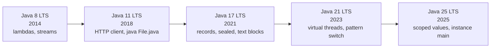
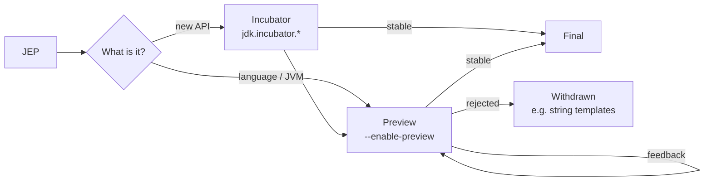
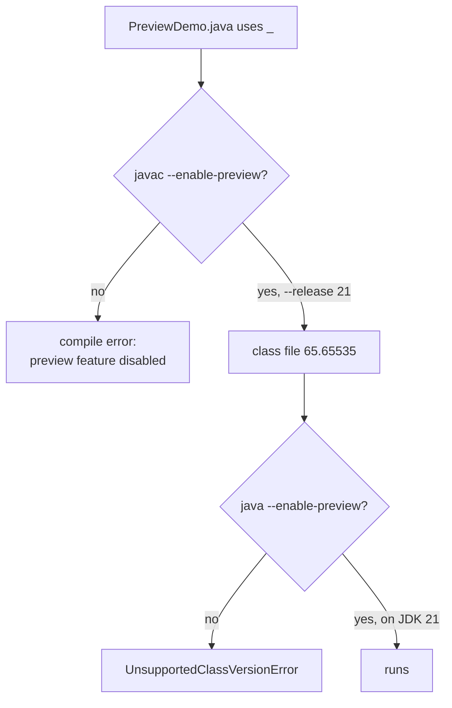

## In One Line
Since Java 10 a new Java version ships **every six months** (March and September); every few releases one is a **Long-Term Support (LTS)** release — **8, 11, 17, 21, 25** — and new language features usually arrive first as opt-in **previews** (`--enable-preview`) and become **final** one or more releases later.

## Mental Model
Think of Java releases as a **metro line with a strict timetable**.

- **A train leaves every six months, on time, whether or not every feature is ready.** A feature that is not finished simply waits for the next train. Before Java 9 it was the other way round: the train waited for the big feature (Java 8 took almost three years, Java 9 was delayed for modules).
- **Some trains are "express" trains: the LTS releases.** The maintenance crew (Oracle and other vendors) keeps servicing them with security fixes for years. The trains in between are serviced only until the next one leaves (six months). Most companies ride **from express to express**: 8 → 11 → 17 → 21 → 25.
- **Previews are the trial carriage.** It is on the train, it works, but you must deliberately walk into it (`--enable-preview`), the ticket is only valid on *that* train (a Java 21 preview only runs on Java 21), and the carriage may be redesigned or even removed before it becomes a permanent part of the train (string templates were removed after two previews).
- **Incubator modules are the prototype carriage** for new *APIs*, parked in a siding called `jdk.incubator.*` that you must explicitly add (`--add-modules`).
- **Every train has a number painted on each class file**: the class-file major version (Java 21 → 65). An old station (older JVM) refuses to accept a train built for a newer line (`UnsupportedClassVersionError`).

## Concept
### Why the release model changed
| | Before (Java 1.0 – 9) | Since Java 10 (March 2018) |
|---|---|---|
| Trigger | **Feature-driven**: ship when the big feature is ready | **Time-driven**: ship every March and September |
| Gap between releases | 2–5 years (6: 2006, 7: 2011, 8: 2014, 9: 2017) | 6 months |
| Version string | `1.8.0_202` | `21.0.10` — `FEATURE.INTERIM.UPDATE.PATCH` (JEP 322) |
| How features arrive | All at once, in a big release | Small steps; unfinished work waits or ships as preview/incubator |

Java 9 (September 2017) was the last feature-driven release (delayed for the module system); it also introduced the new version-string scheme (JEP 223), so `java -version` says `9`, not `1.9`. Java 10 (March 2018) was the first release of the six-month train.

`Runtime.version()` (Java 9) parses the running version, and `.feature()` (Java 10) gives the feature number:
```java
System.out.println(Runtime.version());              // 21.0.10+7-Ubuntu-124.04 on this machine
System.out.println(Runtime.version().feature());    // 21
```

### LTS vs non-LTS
- **LTS (Long-Term Support)** releases: **8** (Mar 2014), **11** (Sep 2018), **17** (Sep 2021), **21** (Sep 2023), **25** (Sep 2025).
- Up to Java 17 an LTS came **every three years** (every 6th release: 11 → 17). Starting with 17 the cadence became **every two years** (every 4th release: 17 → 21 → 25; the next one would be 29 in September 2027).
- A **non-LTS** release (12, 13, …, 20, 22, 23, 24, 26, 27) is not a beta: it is a fully tested, production-quality release. It simply stops receiving free updates when the next release comes out six months later, so you must keep upgrading.
- "LTS" is a **vendor support promise**, not a property of the code. OpenJDK builds all versions the same way; Oracle, Eclipse Adoptium (Temurin), Amazon (Corretto), Azul (Zulu), Microsoft, Red Hat and others decide how long they patch each version. Oracle JDK and OpenJDK builds have been functionally interchangeable since Java 11; what differs is the licence and the support contract.

> [!NOTE] As of September 2026 the latest release is **Java 27** (GA 15 Sep 2026) and the latest LTS is **Java 25**. This module focuses on **9 → 21** because Java 17 and 21 are what most interview questions and production code bases target today.

### How a feature is born: JEP, incubator, preview, final
Every significant change is a **JEP** (JDK Enhancement Proposal) with a number, e.g. *JEP 395: Records*. Interviewers are happy with the feature name and version — the numbers are a bonus.

| Stage | Used for | How you opt in | Can it still change? |
|---|---|---|---|
| **Incubator** | New **APIs** that need real-world feedback | `--add-modules jdk.incubator.xyz` (module name starts with `jdk.incubator.`) | Yes, or it can be dropped |
| **Preview** | New **language / JVM / API** features that are fully specified and implemented but not yet permanent | `javac --release N --enable-preview`, and `java --enable-preview` at run time | Yes (records changed between 14 and 16), or it can be withdrawn |
| **Experimental** | New **JVM** features (e.g. a new GC) | `-XX:+UnlockExperimentalVMOptions -XX:+UseXyz` | Yes |
| **Final / standard** | Permanent part of Java SE | Nothing | No — backward compatibility applies |

Rules for preview features you must know:
1. They are **disabled by default** — the compiler refuses the syntax: `unnamed variables are a preview feature and are disabled by default`.
2. `--enable-preview` only works with the **JDK's own version**: JDK 21 accepts `--release 21 --enable-preview` and rejects `--release 14 --enable-preview` ("preview language features are only supported for release 21").
3. The class file is **marked** with minor version `65535` (e.g. `65.65535`). The JVM refuses to load it unless you also pass `--enable-preview` to `java`, and a class compiled with Java 21 previews **only runs on Java 21** — not on 22.
4. Most language features spent **two releases in preview**; pattern matching for `switch` needed four; string templates were **withdrawn** after two previews (21, 22) and are not in Java 23.

### Version-by-version highlights (9 → 21)
Only **final** (standard) features are listed in bold columns; previews/incubators are marked.

| Java | Date | Language | Core APIs | JVM, tools, removals |
|---|---|---|---|---|
| **9** | Sep 2017 | Private interface methods; `try (r)` on effectively-final resources; diamond `<>` with anonymous classes; `_` becomes a keyword | **Modules (JPMS, Project Jigsaw)**; `List.of`/`Set.of`/`Map.of`/`Map.ofEntries`; Stream `takeWhile`/`dropWhile`/`iterate(seed, hasNext, next)`/`ofNullable`; Optional `or`/`ifPresentOrElse`/`stream`; `ProcessHandle`; `StackWalker`; `VarHandle`; Reactive Streams `Flow`; `CompletableFuture.orTimeout`; `InputStream.transferTo` | **JShell**; `jlink`; **G1 becomes the default GC**; **compact strings** (Latin-1 strings use 1 byte per char); string concatenation via `invokedynamic`; multi-release JARs; unified logging `-Xlog`; CMS deprecated; HTTP/2 client (incubator) |
| **10** | Mar 2018 | **`var`** for local variables | `List.copyOf`/`Set.copyOf`/`Map.copyOf`; `Collectors.toUnmodifiableList/Set/Map`; `Optional.orElseThrow()` (no-arg) | First six-month release; G1 parallel full GC; application class-data sharing; JVM recognises container CPU/memory limits |
| **11 LTS** | Sep 2018 | `var` in lambda parameters | **HTTP Client** (`java.net.http`, final); `String.isBlank`/`strip`/`lines`/`repeat`; `Files.readString`/`writeString`; `Optional.isEmpty`; `Predicate.not`; `Collection.toArray(IntFunction)` | **`java Hello.java`** (single-file source launch); ZGC and Epsilon GC (experimental); Flight Recorder open-sourced; TLS 1.3; **removed Java EE & CORBA modules** (JAXB, JAX-WS…); Nashorn deprecated; JavaFX no longer bundled |
| 12 | Mar 2019 | Switch expressions *(preview)* | `String.indent`/`transform`; `Collectors.teeing`; `Files.mismatch`; `CompactNumberFormat` | Shenandoah GC (experimental); default CDS archive |
| 13 | Sep 2019 | Text blocks *(preview)*; switch `yield` *(2nd preview)* | `String.formatted`, `stripIndent`, `translateEscapes` (added alongside the text-blocks preview, standard in 15) | Legacy `Socket` API reimplemented; ZGC returns unused memory |
| **14** | Mar 2020 | **Switch expressions (final)**; records *(preview)*; `instanceof` patterns *(preview)* | — | **Helpful NullPointerException messages** (on by default from 15); JFR event streaming; `jpackage` (incubator); **CMS removed** |
| **15** | Sep 2020 | **Text blocks (final)**; sealed classes *(preview)* | Hidden classes (for frameworks) | **ZGC and Shenandoah production-ready**; **Nashorn removed**; biased locking disabled |
| **16** | Mar 2021 | **Records (final)**; **pattern matching for `instanceof` (final)**; static members allowed in inner classes; local records, enums and interfaces | `Stream.toList()`; `Stream.mapMulti` | **JDK internals strongly encapsulated by default**; `jpackage` final; Vector API (incubator) |
| **17 LTS** | Sep 2021 | **Sealed classes (final)**; always-strict floating point; pattern matching for `switch` *(preview)* | `RandomGenerator` API; `HexFormat` | `--illegal-access` removed; Security Manager and Applet API deprecated for removal; macOS/AArch64 port; experimental Graal JIT/AOT removed |
| 18 | Mar 2022 | pattern `switch` *(2nd preview)* | — | **UTF-8 is the default charset**; `jwebserver` simple web server; `@snippet` in Javadoc; finalization deprecated for removal |
| 19 | Sep 2022 | Record patterns *(preview)*; pattern `switch` *(3rd preview)* | `HashMap.newHashMap(n)` | Virtual threads *(preview)*; structured concurrency *(incubator)*; FFM API *(preview)*; Linux/RISC-V port |
| 20 | Mar 2023 | Record patterns, pattern `switch` *(previews)* | — | Virtual threads *(2nd preview)*; scoped values *(incubator)*; `Thread.stop()` now always throws `UnsupportedOperationException` |
| **21 LTS** | Sep 2023 | **Pattern matching for `switch` (final)**; **record patterns (final)**; unnamed variables `_`, string templates, unnamed classes + instance `main` *(previews)* | **Sequenced collections** (`getFirst`, `getLast`, `reversed`, `addFirst`…); `Math.clamp`; `StringBuilder.repeat`; `String.splitWithDelimiters`; `Character.isEmoji` | **Virtual threads (final)**; **generational ZGC** (opt-in `-XX:+ZGenerational`); key encapsulation API; warning when agents are loaded dynamically; structured concurrency and scoped values *(previews)* |

Releases 19 and 20 delivered almost nothing final — they were the "preview factory" that fed Java 21. That is why Java 21 feels like such a big jump.

### Feature journeys: preview → final
| Feature | Preview/incubator in | Final in |
|---|---|---|
| HTTP Client | incubator 9, 10 | **11** |
| Switch expressions | 12, 13 | **14** |
| Text blocks | 13, 14 | **15** |
| Records | 14, 15 | **16** |
| Pattern matching for `instanceof` | 14, 15 | **16** |
| Sealed classes | 15, 16 | **17** |
| Pattern matching for `switch` | 17, 18, 19, 20 | **21** |
| Record patterns | 19, 20 | **21** |
| Virtual threads | 19, 20 | **21** |
| Sequenced collections | — (went straight to final) | **21** |
| Unnamed variables & patterns `_` | 21 | 22 |
| Foreign Function & Memory API | incubators 14–18, previews 19–21 | 22 |
| Stream gatherers | 22, 23 | 24 |
| Scoped values | incubator 20, previews 21–24 | 25 |
| Instance `main` & compact source files | 21–24 | 25 |
| Flexible constructor bodies (code before `super(...)`) | 22–24 | 25 |
| Module import declarations | 23, 24 | 25 |
| String templates | 21, 22 | **withdrawn** (not in 23) |
| Structured concurrency | incubator 19, 20; previews from 21 | still preview in 25 |
| Vector API | incubator since 16 | still incubating in 25 |

### After 21, in one paragraph
**22** (Mar 2024): unnamed variables `_` and the FFM API final, `java` can launch multi-file source programs. **23** (Sep 2024): Markdown in Javadoc comments, generational ZGC becomes ZGC's default mode. **24** (Mar 2025): Stream gatherers and the Class-File API final, virtual threads no longer pinned by `synchronized`, Security Manager permanently disabled, quantum-resistant ML-KEM/ML-DSA. **25 LTS** (Sep 2025): scoped values, module imports, compact source files with instance `main`, flexible constructor bodies and compact object headers become final/production. **26** (Mar 2026) removed the Applet API; **27** (Sep 2026) is the current non-LTS release.

### The Java Platform Module System (Java 9) in 60 seconds
- The JDK itself was split into ~70 modules (`java.base`, `java.sql`, `java.net.http`, …). `java --list-modules` shows them.
- Your code can declare a module in `module-info.java`: `requires` (dependencies), `exports` (packages other modules may use at compile and run time), `opens` (packages open to deep reflection, e.g. for Jackson/Hibernate), `uses`/`provides` (services).
- **Strong encapsulation**: a non-exported package is invisible, even if its classes are `public`. JDK internals (`sun.*`, `jdk.internal.*`) became inaccessible step by step: warning in 9–15 (`--illegal-access=permit`), denied by default in 16, option removed in 17. Frameworks need `--add-opens` for deep reflection into the JDK.
- The class path still works: classes on it live in the **unnamed module**, which reads every module. That is why most applications upgraded without writing `module-info.java`.
- `jlink` builds a trimmed runtime image containing only the modules your app needs.

### Garbage collector timeline
| Collector | Timeline |
|---|---|
| Parallel | Default up to Java 8 (server machines) |
| G1 | Default since **9** |
| CMS | Deprecated 9, **removed 14** |
| Epsilon (no-op) | Experimental 11 |
| ZGC (sub-millisecond pauses) | Experimental 11, production **15**, generational mode **21**, generational-only 24 |
| Shenandoah | Experimental 12, production **15** |

### Removed or locked down (things that break upgrades)
| What | When |
|---|---|
| Java EE & CORBA modules (`javax.xml.bind`, `javax.xml.ws`, `javax.annotation`…) | Removed in **11** — add them as Maven dependencies (later renamed to `jakarta.*`) |
| JavaFX | Unbundled from Oracle JDK in **11** (now OpenJFX) |
| Nashorn JavaScript engine | Deprecated 11, **removed 15** (use GraalJS) |
| Pack200, RMI activation, experimental AOT/Graal JIT | Removed 14 / 17 / 17 |
| Illegal reflective access to JDK internals | Denied by default **16**, no switch left in **17** |
| Security Manager | Deprecated for removal 17; `setSecurityManager` throws by default from 18; permanently disabled in 24 |
| Finalization (`finalize()`) | Deprecated for removal in 18 (still works in 21) |
| `Thread.stop()` | Throws `UnsupportedOperationException` since 20 |
| Applet API | Deprecated 9, for removal 17, removed in 26 |

### Why companies moved (or should move) from Java 8
- **Performance for free**: G1 improvements, compact strings, faster startup with CDS, better container awareness, generational ZGC, virtual threads for I/O-bound services.
- **Language**: `var`, switch expressions, text blocks, records, sealed types, pattern matching — less boilerplate and safer domain models.
- **Ecosystem pressure**: Spring Framework 6 / Spring Boot 3 require **Java 17**; many libraries now ship Java 17+ bytecode.
- **Security**: free public updates for old versions end; LTS versions keep getting patches from vendors.

Typical upgrade blockers: removed Java EE modules, reflection into JDK internals (fix with library upgrades or `--add-opens`), code that assumes the version starts with `1.`, code that casts the system class loader to `URLClassLoader` (not true since 9), code that relied on the platform default charset (UTF-8 since 18), and changed locale data (CLDR is the default since 9). `jdeps --jdk-internals` finds internal-API use; `jdeprscan` finds deprecated-API use.

## Diagram

The LTS "express trains": three years apart up to 17, two years apart from 17 onward. Each box names the features people upgrade *for*.


A feature can loop in preview several times (pattern `switch`: 17–20) before it becomes final; only final features are covered by Java's compatibility promise.


Preview code needs the flag **twice** (compile and run) and is tied to one exact JDK version.

## Code
**1. A tour: one feature per release, compiled and run on JDK 21** (`java VersionTour.java`):
```java
import java.nio.charset.Charset;
import java.util.ArrayList;
import java.util.HashMap;
import java.util.List;
import java.util.Map;
import java.util.function.Predicate;
import java.util.stream.Collectors;
import java.util.stream.Stream;

public class VersionTour {

    interface Greeter {                                   // Java 9: private interface methods
        default String greet(String name) { return prefix() + name; }
        private String prefix() { return "Hello, "; }
    }

    record Point(int x, int y) {}                         // Java 16: records

    sealed interface Shape permits Circle, Square {}      // Java 17: sealed types
    record Circle(double r) implements Shape {}
    record Square(double side) implements Shape {}

    static double area(Shape s) {
        return switch (s) {                               // Java 21: pattern matching for switch
            case Circle c -> Math.PI * c.r() * c.r();
            case Square(double side) -> side * side;      // Java 21: record pattern
        };                                                // no default: the switch is exhaustive
    }

    public static void main(String[] args) throws Exception {
        // Java 9
        List<Integer> nums = List.of(5, 3, 8, 1);
        System.out.println("9  List.of             : " + nums);
        System.out.println("9  takeWhile           : "
                + Stream.of(1, 2, 3, 10, 4).takeWhile(n -> n < 5).collect(Collectors.toList()));
        System.out.println("9  private iface method: " + new Greeter() {}.greet("Asha"));

        // Java 10
        var counts = new HashMap<String, Integer>();       // inferred: HashMap<String, Integer>
        counts.merge("java", 1, Integer::sum);
        System.out.println("10 var                 : " + counts);
        System.out.println("10 List.copyOf         : " + List.copyOf(new ArrayList<>(nums)));

        // Java 11
        System.out.println("11 String.repeat       : " + "ab".repeat(3));
        System.out.println("11 isBlank / strip     : " + "   ".isBlank() + " [" + "  hi  ".strip() + "]");
        System.out.println("11 Predicate.not       : "
                + Stream.of("a", "", "b").filter(Predicate.not(String::isEmpty)).collect(Collectors.toList()));

        // Java 12
        System.out.println("12 Collectors.teeing   : " + Stream.of(4, 8, 6).collect(
                Collectors.teeing(Collectors.counting(), Collectors.summingInt(n -> n),
                        (count, sum) -> "count=" + count + " sum=" + sum)));

        // Java 14
        int day = 6;
        String kind = switch (day) {                       // switch expression
            case 6, 7 -> "weekend";
            default -> "weekday";
        };
        System.out.println("14 switch expression   : " + kind);

        // Java 15
        String json = """
                {"lang": "java"}""";
        System.out.println("15 text block          : " + json);

        // Java 16
        Object o = new Point(3, 4);
        if (o instanceof Point p) {                        // pattern matching for instanceof
            System.out.println("16 record + instanceof : " + p + " x=" + p.x());
        }
        System.out.println("16 Stream.toList       : " + Stream.of("x", "y").map(String::toUpperCase).toList());

        // Java 17
        System.out.println("17 sealed (21 switch)  : " + area(new Square(3)));

        // Java 18
        System.out.println("18 default charset     : " + Charset.defaultCharset());

        // Java 19
        Map<String, Integer> sized = HashMap.newHashMap(100); // room for 100 entries without resizing
        System.out.println("19 HashMap.newHashMap  : " + sized.isEmpty());

        // Java 21
        Thread vt = Thread.ofVirtual().start(() -> {});     // virtual thread
        vt.join();
        System.out.println("21 virtual thread      : isVirtual=" + vt.isVirtual());
        System.out.println("21 getFirst / reversed : " + nums.getFirst() + " " + nums.reversed());
        System.out.println("21 Math.clamp          : " + Math.clamp(150, 0, 100));
        System.out.println("running on Java        : " + Runtime.version().feature());
    }
}
```
```output
9  List.of             : [5, 3, 8, 1]
9  takeWhile           : [1, 2, 3]
9  private iface method: Hello, Asha
10 var                 : {java=1}
10 List.copyOf         : [5, 3, 8, 1]
11 String.repeat       : ababab
11 isBlank / strip     : true [hi]
11 Predicate.not       : [a, b]
12 Collectors.teeing   : count=3 sum=18
14 switch expression   : weekend
15 text block          : {"lang": "java"}
16 record + instanceof : Point[x=3, y=4] x=3
16 Stream.toList       : [X, Y]
17 sealed (21 switch)  : 9.0
18 default charset     : UTF-8
19 HashMap.newHashMap  : true
21 virtual thread      : isVirtual=true
21 getFirst / reversed : 5 [1, 8, 3, 5]
21 Math.clamp          : 100
running on Java        : 21
```

**2. The same file compiled for an older release.** `--release 17` makes `javac` behave like a Java 17 compiler with the Java 17 API:
```text
javac --release 17 VersionTour.java
```
```output
VersionTour.java:25: error: patterns in switch statements are not supported in -source 17
            case Circle c -> Math.PI * c.r() * c.r();
                 ^
  (use -source 21 or higher to enable patterns in switch statements)
VersionTour.java:26: error: deconstruction patterns are not supported in -source 17
            case Square(double side) -> side * side;      // Java 21: record pattern
                       ^
  (use -source 21 or higher to enable deconstruction patterns)
2 errors
```
The same idea for a record (`public record Money(long cents, String currency) {}`) with `--release 15`:
```output
Money.java:1: error: records are not supported in -source 15
public record Money(long cents, String currency) {}
       ^
  (use -source 16 or higher to enable records)
1 error
```
And for Java 21 **APIs** used under `--release 17`:
```java
import java.util.List;
public class Api17 {
    public static void main(String[] args) {
        List<Integer> nums = List.of(5, 3, 8, 1);
        System.out.println(nums.getFirst());
        System.out.println(Math.clamp(150, 0, 100));
    }
}
```
```output
Api17.java:5: error: cannot find symbol
        System.out.println(nums.getFirst());
                               ^
  symbol:   method getFirst()
  location: variable nums of type List<Integer>
Api17.java:6: error: cannot find symbol
        System.out.println(Math.clamp(150, 0, 100));
                               ^
  symbol:   method clamp(int,int,int)
  location: class Math
2 errors
```
With the older-style flags `javac -source 17 -target 17 Api17.java` the **same file compiles** (only a warning: `system modules path not set in conjunction with -source 17`), produces class-file version 61, and would crash on a real Java 17 JVM with `NoSuchMethodError`.

**3. A Java 21 preview feature** (unnamed variables and patterns, JEP 443 — final in Java 22):
```java
import java.util.List;

public class PreviewDemo {
    record Point(int x, int y) {}

    public static void main(String[] args) {
        List<String> words = List.of("a", "b", "c");
        int count = 0;
        for (String _ : words) {          // JEP 443 (preview in 21, final in 22): unnamed variable
            count++;
        }
        Object o = new Point(3, 4);
        if (o instanceof Point(int x, _)) { // unnamed pattern: "I don't care about y"
            System.out.println("x = " + x + ", count = " + count);
        }
    }
}
```
`javac PreviewDemo.java` (no flag):
```output
PreviewDemo.java:9: error: unnamed variables are a preview feature and are disabled by default.
        for (String _ : words) {          // JEP 443 (preview in 21, final in 22): unnamed variable
                    ^
  (use --enable-preview to enable unnamed variables)
1 error
```
`javac --release 21 --enable-preview PreviewDemo.java`:
```output
Note: PreviewDemo.java uses preview features of Java SE 21.
Note: Recompile with -Xlint:preview for details.
```
`java PreviewDemo` (forgot the flag at run time):
```output
Error: LinkageError occurred while loading main class PreviewDemo
	java.lang.UnsupportedClassVersionError: Preview features are not enabled for PreviewDemo (class file version 65.65535). Try running with '--enable-preview'
```
`java --enable-preview PreviewDemo`:
```output
x = 3, count = 3
```
Asking for an older release with previews fails immediately — `javac --release 14 --enable-preview Money.java`:
```output
error: invalid source release 14 with --enable-preview
  (preview language features are only supported for release 21)
```

**4. Helpful NullPointerException messages** (Java 14, on by default since 15):
```java
public class HelpfulNpe {
    record Address(String city) {}
    record Customer(String name, Address address) {}

    public static void main(String[] args) {
        Customer c = new Customer("Asha", null);
        System.out.println(c.address().city().toUpperCase());
    }
}
```
```output
Exception in thread "main" java.lang.NullPointerException: Cannot invoke "HelpfulNpe$Address.city()" because the return value of "HelpfulNpe$Customer.address()" is null
	at HelpfulNpe.main(HelpfulNpe.java:7)
```
On Java 8–13 the message was just `java.lang.NullPointerException` and you had to guess which of the three calls on line 7 failed.

**5. Things that are gone or locked on Java 21:**
```java
public class Removed {
    public static void main(String[] args) throws Exception {
        try {
            System.setSecurityManager(new SecurityManager());
        } catch (UnsupportedOperationException e) {
            System.out.println("setSecurityManager -> " + e.getMessage());
        }
        Thread t = new Thread(() -> {});
        try {
            t.stop();
        } catch (UnsupportedOperationException e) {
            System.out.println("Thread.stop        -> UnsupportedOperationException");
        }
        System.out.println("nashorn engine     -> "
                + new javax.script.ScriptEngineManager().getEngineByName("nashorn"));
        try {
            Class.forName("javax.xml.bind.JAXBContext");
        } catch (ClassNotFoundException e) {
            System.out.println("JAXB               -> ClassNotFoundException: " + e.getMessage());
        }
    }
}
```
```output
setSecurityManager -> The Security Manager is deprecated and will be removed in a future release
Thread.stop        -> UnsupportedOperationException
nashorn engine     -> null
JAXB               -> ClassNotFoundException: javax.xml.bind.JAXBContext
```
The compiler also prints three `[removal]` warnings (for `SecurityManager`, `setSecurityManager` and `stop()`), because those APIs are marked `@Deprecated(forRemoval = true)`.

## Walkthrough
### 1. `VersionTour`
- **`interface Greeter` with `private String prefix()`** — Java 8 allowed `default` and `static` methods in interfaces; Java 9 added `private` (and `private static`) methods so several default methods can share helper code without making it public. `new Greeter() {}` is an anonymous class implementing the interface with no abstract methods to fill in.
- **`record Point(int x, int y) {}`** — Java 16. One line gives a final class with private final fields, a constructor, accessors `x()`/`y()`, `equals`, `hashCode` and `toString` (`Point[x=3, y=4]`). See [Records](lesson:b05-modern-java/03-records).
- **`sealed interface Shape permits Circle, Square`** — Java 17. Only the listed types may implement `Shape`. Because the compiler knows *all* subtypes, the `switch` in `area` needs **no `default`** — see [Sealed Classes](lesson:b05-modern-java/04-sealed-classes).
- **`switch (s) { case Circle c -> ...; case Square(double side) -> ... }`** — Java 21: a *type pattern* (`Circle c`) and a *record pattern* (`Square(double side)`) that pulls the component out. The label says "17 sealed (21 switch)" because the sealed type is Java 17 but pattern `switch` needs 21. Area of a 3×3 square prints `9.0` (a `double`).
- **Java 9 lines** — `List.of(5, 3, 8, 1)` creates an unmodifiable list. `takeWhile(n -> n < 5)` keeps elements **until the first failure** (`10`) and stops, so the later `4` is *not* included: `[1, 2, 3]`. `Collectors.toList()` is used because `Stream.toList()` only arrived in 16.
- **Java 10 lines** — `var counts = new HashMap<String, Integer>()` infers `HashMap<String, Integer>` from the right-hand side. `merge("java", 1, Integer::sum)` inserts 1 because the key is absent. `List.copyOf` makes an unmodifiable copy of the `ArrayList`.
- **Java 11 lines** — `"ab".repeat(3)` → `ababab`; `"   ".isBlank()` → `true` (only whitespace); `strip()` is the Unicode-aware `trim()`; `Predicate.not(String::isEmpty)` negates a method reference, which was awkward before (`s -> !s.isEmpty()`).
- **Java 12 line** — `Collectors.teeing` sends every element to **two** collectors (`counting()` → 3, `summingInt` → 18) and merges their results with the lambda.
- **Java 14 line** — a switch **expression** returns a value, uses `->` (no fall-through), and allows `case 6, 7`. Day 6 → `weekend`.
- **Java 15 line** — a text block starts with `"""` + newline. The closing `"""` directly after the content means no trailing newline; the incidental indentation is stripped, so it prints `{"lang": "java"}`.
- **Java 16 lines** — `o instanceof Point p` tests and casts in one step; `p` is in scope only where the test is true. `Stream.toList()` returns an unmodifiable list.
- **Java 18 line** — `Charset.defaultCharset()` is `UTF-8` on every OS since Java 18 (before, it depended on the OS locale — often `windows-1252` on Windows).
- **Java 19 line** — `HashMap.newHashMap(100)` creates a map sized so that 100 entries fit *without resizing*. `new HashMap<>(100)` does not mean that: the argument is the table capacity, and with load factor 0.75 it resizes after 75 entries.
- **Java 21 lines** — `Thread.ofVirtual().start(...)` starts a virtual thread; `join()` waits for it; `isVirtual()` is `true`. `nums.getFirst()` (sequenced collections) → `5`; `nums.reversed()` is a reversed **view** → `[1, 8, 3, 5]`. `Math.clamp(150, 0, 100)` → `100`.
- **`Runtime.version().feature()`** → `21`, the JDK that ran the program.

### 2. `--release` vs `-source/-target`
`--release N` (Java 9, JEP 247) sets the language level **and** compiles against the **public API of Java N**, so both new syntax and new methods are rejected. `-source N -target N` only sets the language level and class-file version; the compiler still sees the *current* JDK's library, so `getFirst()` and `Math.clamp` slip through and crash later with `NoSuchMethodError` on a real Java 17 JVM. Always use `--release` (Maven: `<maven.compiler.release>17</maven.compiler.release>`).

### 3. `PreviewDemo`
- `for (String _ : words)` — an **unnamed variable**: the loop only counts, so the element is deliberately ignored. `instanceof Point(int x, _)` uses an **unnamed pattern** for `y`.
- Without `--enable-preview` the compiler refuses the syntax. With it, compilation succeeds with two `Note:` lines and the class file gets **minor version 65535** — the "preview" stamp.
- Running without the flag fails with `UnsupportedClassVersionError` (a `LinkageError`), even on the same JDK. With the flag it prints `x = 3, count = 3`.
- `java --enable-preview --source 21 PreviewDemo.java` (source-launch mode) needs both flags too.
- In Java 22 the same code compiles with no flags at all, because JEP 456 made the feature final. That is the whole preview story in one example.

### 4. `HelpfulNpe`
`c.address()` returns `null`, then `.city()` is invoked on `null`. Since JEP 358 the JVM analyses the bytecode that failed and names **exactly** which expression was null: *"because the return value of `HelpfulNpe$Customer.address()` is null"*. `HelpfulNpe$Customer` is the binary name of the nested record.

### 5. `Removed`
- `System.setSecurityManager(...)` throws `UnsupportedOperationException` because since Java 18 the default for `-Djava.security.manager` is `disallow`.
- `Thread.stop()` has been unsafe since Java 1.2 (it could leave objects half-updated); since Java 20 it always throws `UnsupportedOperationException`.
- `getEngineByName("nashorn")` returns `null` because Nashorn was removed in Java 15 (the example in [the Nashorn lesson](lesson:a05-java8/24-nashorn) needs an external dependency).
- `javax.xml.bind.JAXBContext` is not found because JAXB left the JDK in Java 11 (JEP 320).

## Traps
- **Mixing up "introduced" and "final".** Records were *previewed* in 14 but are a Java **16** feature; sealed classes previewed in 15, final in **17**; pattern matching for `switch` previewed in 17, final in **21**; `var` is Java **10**, not 9. Interviewers usually mean the **final** version — say "final in 16 (preview in 14 and 15)" to be precise.
- **Preview code is tied to one JDK.** A JAR built with Java 21 previews does not run on 22, even with `--enable-preview`. Never ship preview features in libraries.
- **Forgetting the runtime flag.** `javac --enable-preview` is not enough; `java` also needs `--enable-preview`, or you get `UnsupportedClassVersionError ... (class file version 65.65535)`.
- **`-source/-target` instead of `--release`** — compiles calls to APIs that do not exist on the target runtime; the failure appears only in production (`NoSuchMethodError`).
- **`UnsupportedClassVersionError` is a runtime error, not a compile error.** It means "compiled by a newer JDK than the one running it". Class-file major version = Java version + 44 (52 = 8, 55 = 11, 61 = 17, 65 = 21).
- **"Non-LTS releases are betas."** False. They are production releases; the only difference is the support window.
- **`Collectors.toList()` is not `Stream.toList()`.** The first gives a (currently) mutable `ArrayList`; the second (16) gives an unmodifiable list. Replacing one with the other can break code that later calls `add`.
- **Default charset changed in 18.** `new FileReader(file)`, `String.getBytes()` and friends now use UTF-8 everywhere. Code that silently depended on `windows-1252` reads files differently after an upgrade — always pass a `Charset` explicitly.
- **Casting the system class loader to `URLClassLoader`** worked on 8 and throws `ClassCastException` since 9 (the app loader is a different class now). On Java 21, `ClassLoader.getSystemClassLoader() instanceof URLClassLoader` is `false`.
- **Parsing `java.version`** — old code did `System.getProperty("java.version").substring(2, 3)` expecting `1.8.0_202`; on Java 21 the value is `21.0.10`. Use `Runtime.version().feature()`.
- **`_` as a name.** Legal (with a warning) in Java 8, a compile error in 9–21, and since Java 22 it means an *unnamed* variable. Old code with `int _ = 5;` does not compile on a modern JDK.

> [!WARNING] "Java 21 has string templates" — it had them only as a **preview**. They were withdrawn and are not part of Java 23 or later. Never claim a preview feature as part of the language.

## Tips & Tricks
- **The LTS chant: "8, 11, 17, 21, 25"** — +3, +6, +4, +4. Three years apart until 17, two years apart after.
- **The "big four" of modern Java, in order of arrival: *Switch → Text → Records → Sealed* (14 → 15 → 16 → 17)**, then *patterns everywhere* in 21. Hook: "**S**witch **T**ext **R**ecords **S**ealed — 14, 15, 16, 17, one per release."
- **"Preview twice, then final"** fits most language features: previewed in N and N+1, final in N+2 (switch, text blocks, records, `instanceof`, sealed, record patterns, virtual threads). Pattern `switch` is the exception (four previews).
- **One-word hooks per LTS:** 11 = *HTTP client & `java File.java`*, 17 = *sealed + records era*, 21 = *virtual threads + patterns + sequenced collections*, 25 = *instance main + scoped values*.
- **Class-file major = version + 44.** `javap -v Foo.class | grep major` tells you which JDK built a class; minor `65535` means preview features.
- **Always build with `--release`**, and pick the oldest LTS you must run on.
- **When asked "what's new in Java X?"**, answer in three layers: language features, APIs, JVM/runtime (GC, performance, tooling) — plus one thing that was removed. It sounds structured and complete.
- **Upgrade toolkit:** `jdeps --jdk-internals app.jar` (internal API use), `jdeprscan` (deprecated API use), `--add-opens` as a temporary fix for reflective access.

## Interview Q&A
### [Basic] What is an LTS release, and which Java versions are LTS?
An LTS (Long-Term Support) release is a feature release that vendors commit to patch (security and bug fixes) for many years, while non-LTS releases only get updates for six months until the next release. The LTS versions are **8, 11, 17, 21 and 25**. Until Java 17 an LTS came every three years; since 17 it is every two years (17 → 21 → 25). Most companies upgrade from one LTS to the next and skip the releases in between; teams that want new features quickly follow every six-month release.

**Follow-up:** *Is a non-LTS release less stable?* — No. It goes through the same testing and is production quality; the only difference is how long it gets free updates.

### [Basic] What is the Java release cadence today, and why did it change?
Since Java 10 (March 2018), a new **feature release ships every six months**, in March and September, on a fixed date. Before that, releases were feature-driven: the release waited for the headline feature, which led to multi-year gaps (Java 8 in 2014, Java 9 in 2017 after delays for Jigsaw). The time-based model delivers smaller changes more often, lets unfinished features simply wait for the next train, and allows features to be tested by users as previews. The version string also changed to `FEATURE.INTERIM.UPDATE.PATCH` (e.g. `21.0.10`).

**Follow-up:** *What does `Runtime.version().feature()` return on Java 21?* — `21`. It is the reliable way to check the version at run time instead of parsing `java.version`.

### [Basic] Name the most important features of Java 9, 11, 17 and 21.
- **Java 9**: the module system (JPMS), JShell, `List.of`/`Set.of`/`Map.of`, private interface methods, Stream `takeWhile`/`dropWhile`, G1 as default GC, compact strings.
- **Java 11 (LTS)**: standard HTTP client (`java.net.http`), `var` in lambda parameters, new `String` methods (`isBlank`, `strip`, `lines`, `repeat`), `Files.readString`, running a single source file with `java Hello.java`; Java EE modules removed.
- **Java 17 (LTS)**: sealed classes final; everything from 12–16 — switch expressions (14), text blocks (15), records and `instanceof` patterns (16), helpful NPEs, `Stream.toList()`; strong encapsulation of JDK internals.
- **Java 21 (LTS)**: virtual threads, pattern matching for `switch`, record patterns, sequenced collections, generational ZGC; previews of unnamed variables, string templates and instance main methods.

**Follow-up:** *What came in Java 10?* — `var` for local variables, `List.copyOf`, `Collectors.toUnmodifiableList`, `Optional.orElseThrow()`.

### [Basic] What is a preview feature, and how do you use one?
A preview feature is a new language, JVM or API feature that is fully designed and implemented but **not yet permanent**, so developers can try it and give feedback. It is disabled by default. You compile with `javac --release 21 --enable-preview` (the release must be the JDK's own version) and run with `java --enable-preview`. The compiled class is marked with minor version 65535 and only runs on that exact JDK version. A preview can change in the next release or be withdrawn completely — string templates were previewed in 21 and 22 and then removed.

**Follow-up:** *How is an incubator module different?* — Incubators are for APIs, delivered as separate `jdk.incubator.*` modules you add with `--add-modules` (e.g. the HTTP client in 9–10, the Vector API since 16); previews are part of the platform itself and are switched on with `--enable-preview`.

### [Intermediate] Why would you migrate a Java 8 application to Java 17 or 21? What problems do you expect?
**Benefits**: better GC and memory use for free (G1 improvements, compact strings, ZGC/generational ZGC), faster startup (CDS), container awareness, modern language features (records, sealed types, pattern matching, text blocks, `var`, switch expressions), better diagnostics (helpful NPEs, JFR), virtual threads in 21, continued security updates, and framework requirements (Spring Boot 3 needs 17).
**Problems**: removed Java EE modules (JAXB, JAX-WS — add dependencies, often migrating to `jakarta.*`), libraries that use reflection into JDK internals (upgrade them or add `--add-opens`), code that parses the version string or casts the system class loader to `URLClassLoader`, default charset becoming UTF-8 (18), changed locale formats (CLDR), removed tools (Nashorn, Pack200). I would scan with `jdeps --jdk-internals` and `jdeprscan`, upgrade the build tools and libraries first, compile with `--release`, then run the full test suite.

**Follow-up:** *Would you jump straight from 8 to 21?* — Usually yes; the hard breaking changes (modules, encapsulation, Java EE removal) happen between 8 and 17, and 17 → 21 is smooth. Jumping once avoids migrating twice.

### [Intermediate] What is the difference between `javac --release 17` and `javac -source 17 -target 17`?
`--release 17` (Java 9+) configures the language level, the class-file version **and the API**: the compiler checks your code against the Java 17 public API, so calling a Java 21 method like `List.getFirst()` is a compile error. `-source 17 -target 17` only sets the language level and class-file version but still compiles against the JDK you are running, so the same code compiles and then fails at run time on Java 17 with `NoSuchMethodError`. That is why `--release` (or `maven.compiler.release`) is the recommended setting.

**Follow-up:** *What error do you get running a Java 21 class on Java 17?* — `UnsupportedClassVersionError`: the class has major version 65 but Java 17 only understands up to 61.

### [Intermediate] Which features went from preview to final in which release? Give the timeline for records, sealed classes and pattern matching.
- Switch expressions: preview 12, 13 → final **14**.
- Text blocks: preview 13, 14 → final **15**.
- Records: preview 14, 15 → final **16**.
- Pattern matching for `instanceof`: preview 14, 15 → final **16**.
- Sealed classes: preview 15, 16 → final **17**.
- Pattern matching for `switch`: preview 17–20 → final **21**; record patterns: preview 19, 20 → final **21**.
- Virtual threads: preview 19, 20 → final **21**.

**Follow-up:** *Can a feature change between previews?* — Yes. In the pattern-`switch` previews the guard syntax changed from `case Circle c && c.r() > 10` (17, 18) to `case Circle c when c.r() > 10` (19 onward), and parenthesized patterns were dropped before 21.

### [Intermediate] What was the Java Platform Module System (Java 9), and do you have to use it?
JPMS split the JDK into modules and lets applications declare modules with `module-info.java`: `requires` for dependencies, `exports` for public packages, `opens` for packages available to deep reflection, and `uses/provides` for services. It gives **reliable configuration** (missing modules are detected at startup) and **strong encapsulation** (non-exported packages are inaccessible even if their classes are public). It also enables `jlink` to build small custom runtimes. You do **not** have to use it: code on the class path runs in the *unnamed module*, which is how most applications still run. The part that affects everyone is the encapsulation of JDK internals — denied by default since 16 and without an opt-out switch since 17.

**Follow-up:** *What is the difference between `exports` and `opens`?* — `exports` allows compile-time and run-time access to public types; `opens` allows run-time deep reflection (including private members) — needed by frameworks like Hibernate and Jackson.

### [Intermediate] What are helpful NullPointerExceptions?
Introduced in Java 14 (JEP 358) and enabled by default since 15, they make the JVM describe precisely **what** was null. Instead of a bare `java.lang.NullPointerException` you get e.g. `Cannot invoke "Address.city()" because the return value of "Customer.address()" is null`. The JVM computes the message lazily from the bytecode only when `getMessage()` is called, so there is no cost on the normal path. Local-variable names appear only if the class was compiled with `-g`; otherwise they show as `<local1>` (e.g. `Cannot invoke "String.length()" because "<local1>" is null`).

**Follow-up:** *Can you switch it off?* — Yes, `-XX:-ShowCodeDetailsInExceptionMessages` (for example if messages might leak sensitive code details).

### [Advanced] What changed for garbage collection between Java 8 and 21?
Java 8's default (server) collector was **Parallel**. Java 9 made **G1** the default, deprecated CMS (removed in 14), and G1 kept improving (parallel full GC in 10, returning memory to the OS in 12). Java 11 added **ZGC** (experimental; production in 15) with pause times under a millisecond regardless of heap size, and **Epsilon** (a no-op collector for testing). Java 12 added **Shenandoah** (production in 15), another concurrent low-pause collector. Java 21 added **generational ZGC** (`-XX:+UseZGC -XX:+ZGenerational`), which became ZGC's default mode in 23 and the only mode in 24.

**Follow-up:** *Which GC would you pick for a latency-sensitive service with a 64 GB heap on Java 21?* — Generational ZGC; keep G1 for general-purpose throughput with moderate heaps.

### [Advanced] How are preview features enforced at the class-file level?
A class compiled with preview features gets class-file **minor version 65535** (0xFFFF) with the major version of that JDK, e.g. `65.65535` for Java 21. The JVM refuses to load such a class unless it runs with `--enable-preview` **and** its own feature version equals the major version, so preview bytecode cannot leak into another release. `javac` also refuses `--enable-preview` for any `--release` other than its own. This guarantees previews never become an accidental compatibility burden.

**Follow-up:** *How do you see it?* — `javap -v PreviewDemo.class | grep version` shows `minor version: 65535` and `major version: 65`.

## Quiz
### In which release did records become a final (non-preview) feature?
- [ ] Java 14
- [ ] Java 15
- [x] Java 16
- [ ] Java 17
> Records were previewed in 14 and 15 and finalised in **16** (JEP 395). Java 14 is the tempting answer because that is where they *first appeared* — but only as a preview behind `--enable-preview`.

### Which list contains only LTS releases?
- [ ] 8, 11, 14, 17
- [x] 11, 17, 21, 25
- [ ] 9, 11, 17, 21
- [ ] 8, 12, 17, 22
> LTS releases are 8, 11, 17, 21 and 25. Java 9 and 14 were ordinary six-month releases; 9 is often mistaken for LTS because it was a big release (modules).

### What happens here on JDK 21?
```text
javac --release 21 --enable-preview PreviewDemo.java
java PreviewDemo
```
- [ ] The program runs normally
- [ ] Compile error: preview features are disabled
- [x] `UnsupportedClassVersionError`: preview features are not enabled (class file version 65.65535)
- [ ] It runs, printing a warning about preview features
> The compile step succeeded because of `--enable-preview`, and it stamped the class with minor version 65535. The **run** step also needs `--enable-preview`; without it the JVM refuses to load the class. A compile error would only happen if `javac` were missing the flag.

### What does this print on Java 21?
```java
import java.util.stream.*;

public class TakeWhileQuiz {
    public static void main(String[] args) {
        System.out.println(Stream.of(1, 2, 3, 10, 4)
                .takeWhile(n -> n < 5)
                .collect(Collectors.toList()));
    }
}
```
- [ ] [1, 2, 3, 4]
- [x] [1, 2, 3]
- [ ] [10]
- [ ] [1, 2, 3, 10, 4]
> `takeWhile` (Java 9) stops at the **first** element that fails the test (`10`) and ignores everything after it, so `4` is never taken. `[1, 2, 3, 4]` would be the result of `filter`.

### Spot the bug: this builds fine on the CI server (JDK 21) but crashes in production (Java 17) with `NoSuchMethodError`. Why?
```text
javac -source 17 -target 17 -d out src/*.java
```
- [ ] The production JVM needs `--enable-preview`
- [x] `-source/-target` do not check the Java 17 API, so calls to Java 21 methods (like `List.getFirst()`) compiled
- [ ] Class files built by JDK 21 can never run on Java 17
- [ ] `-target 17` produces class-file version 65
> `-source/-target` only set the language level and class-file version (61 here), so the class *loads* on Java 17 — but it calls methods that do not exist there. `--release 17` would have rejected `getFirst()` at compile time with "cannot find symbol". Preview flags are irrelevant because no preview feature is used.

### Which statement about Java 21 is FALSE?
- [ ] Virtual threads are a final feature
- [ ] Pattern matching for `switch` is a final feature
- [x] String templates are a final feature
- [ ] Sequenced collections (`getFirst`, `reversed`) are a final feature
> String templates were only a **preview** in 21 (and 22) and were withdrawn before Java 23. The other three are final in 21. Sequenced collections are the tempting wrong pick because they are new in 21 — but they went straight to final without a preview.

### What is the class-file major version produced by `javac --release 17`?
- [ ] 17
- [ ] 52
- [x] 61
- [ ] 65
> Major version = Java version + 44, so 17 → 61. 52 is Java 8 and 65 is Java 21 (what JDK 21 produces without `--release`).

## Takeaways
- Since Java 10, a feature release ships every six months (March, September); LTS releases are 8, 11, 17, 21, 25 — every three years until 17, every two years since.
- New language features usually go preview → final: switch expressions 14, text blocks 15, records and `instanceof` patterns 16, sealed classes 17, pattern `switch` + record patterns + virtual threads 21.
- Preview features need `--enable-preview` at compile **and** run time, work only on that exact JDK (class file minor version 65535) and may change or be withdrawn (string templates).
- Java 9 = modules, JShell, `List.of`, private interface methods; 10 = `var`; 11 = HTTP client, new String methods, `java File.java`, Java EE modules removed.
- Java 21 = virtual threads, pattern matching for `switch`, record patterns, sequenced collections, generational ZGC.
- Compile with `--release N`, not `-source/-target`, so both syntax and API are checked against Java N; class-file major version = Java version + 44.
- Upgrade blockers from Java 8: removed Java EE modules and Nashorn, strong encapsulation of JDK internals (`--add-opens`), UTF-8 default charset (18), version-string and class-loader assumptions.
