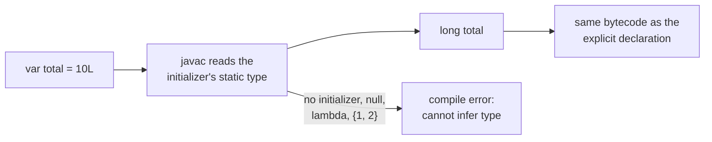
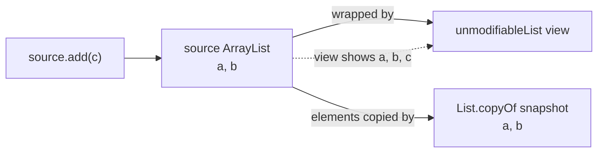
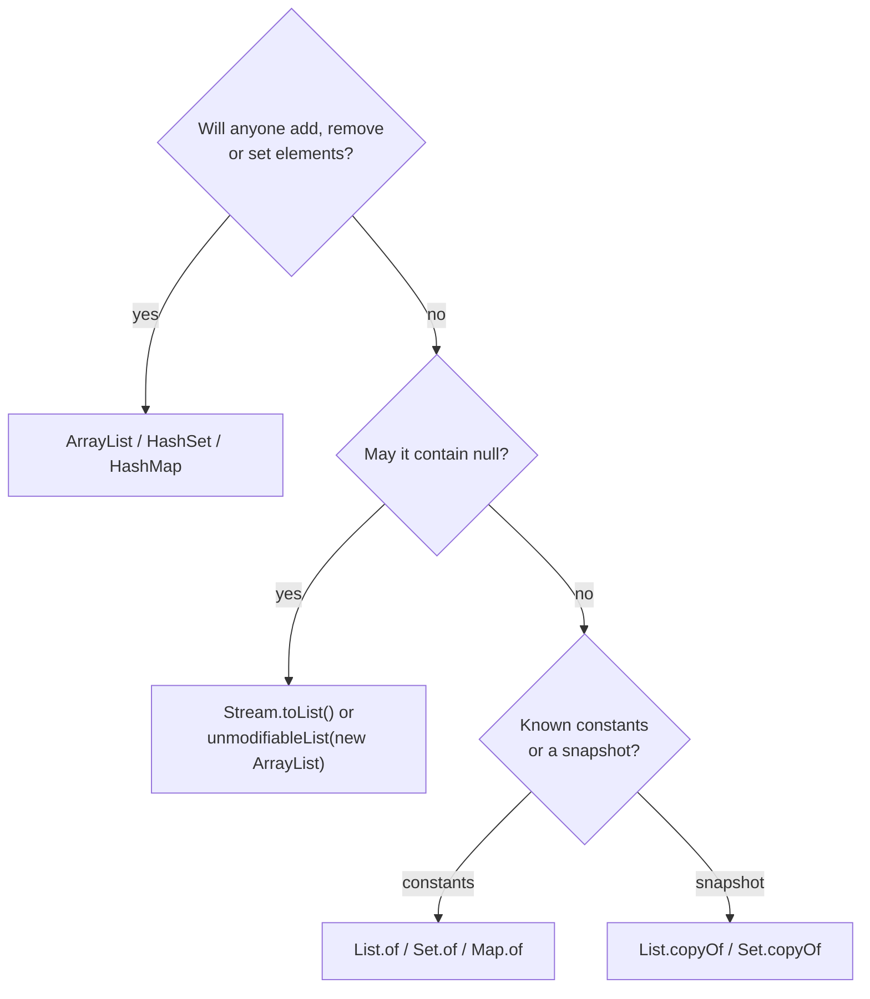

## In One Line
`var` (Java 10) lets the **compiler** infer a local variable's type from its initializer — the variable is still statically typed forever — and `List.of`/`Set.of`/`Map.of` (Java 9) plus `copyOf` (Java 10) build compact, **null-hostile, unmodifiable** collections, which is very different from `Collections.unmodifiableList`, a read-only **view** of a list that can still change underneath.

## Mental Model
**`var` is a label printer on a storage box.** When you put something into the box, the printer reads what it is and prints the label for you ("ArrayList of String"). The label is still **stuck on the box forever** — you cannot later put a `LinkedList` in the `ArrayList` box. If the box is empty (`var x;`) or you put in "nothing" (`var x = null;`), the printer has nothing to read and refuses.

**Collections are display cases:**
- `List.of(...)` is a **sealed museum case**: the exhibits were placed inside when it was built, and nobody — not visitors, not staff — can add, remove or swap them. It also refuses empty spots (`null`).
- `Collections.unmodifiableList(list)` is a **shop window**: you cannot reach through the glass, but the shopkeeper behind it (whoever holds the original `list`) can rearrange it any time, and you see every change.
- `List.copyOf(list)` is a **photograph** of the shelf: later changes to the shelf do not change the photo.
- `Arrays.asList(array)` is an **egg carton**: a fixed number of slots — you can swap an egg (`set`), but you cannot add or remove slots — and the carton *is* the array, so swapping an egg changes the array.

In every case the case is "immutable" only as a **container**: if an exhibit is itself mutable (a `StringBuilder`), someone can still change the exhibit.

## Concept
### Part 1 — `var`: local-variable type inference (Java 10, JEP 286)
`var` tells the compiler: *"work out the type from the right-hand side and write it in for me."*
```java
var names = new ArrayList<String>();   // exactly the same as: ArrayList<String> names = new ArrayList<String>();
```
- It is **static typing**, not dynamic typing. The type is fixed at compile time; assigning a different type later is a compile error.
- It has **zero runtime cost**: the class file is byte-for-byte identical to the one produced with the explicit type (shown in Code).
- The inferred type is the **static type of the initializer** — not an interface you had in mind, and not the runtime class of the object.

#### Where `var` is allowed
| Place | Example | Since |
|---|---|---|
| Local variable **with an initializer** | `var count = 0;` | 10 |
| Classic `for` loop index | `for (var i = 0; i < n; i++)` | 10 |
| Enhanced `for` loop variable | `for (var e : map.entrySet())` | 10 |
| try-with-resources resource | `try (var in = Files.newBufferedReader(p))` | 10 |
| Lambda parameters (all or none) | `(var a, var b) -> a + b` | 11 (JEP 323) |
| Record patterns | `if (o instanceof Point(var x, var y))` | 21 |

#### Where `var` is NOT allowed (and the compiler's reason)
| Code | Error |
|---|---|
| `var x;` | cannot use 'var' on variable without initializer |
| `var n = null;` | variable initializer is 'null' |
| `var arr = {1, 2};` | array initializer needs an explicit target-type |
| `var f = () -> 1;` | lambda expression needs an explicit target-type |
| `var len = String::length;` | method reference needs an explicit target-type |
| `var a = 1, b = 2;` | 'var' is not allowed in a compound declaration |
| `var arr[] = new int[3];` | 'var' is not allowed as an element type of an array |
| `var x = x + 1;` | cannot use 'var' on self-referencing variable |
| Fields, method parameters, return types, `catch (var e)` | 'var' is not allowed here |
| `(var a, b) -> a + b` | cannot mix 'var' and implicitly-typed parameters |
| `class var {}` | 'var' is a restricted type name and cannot be used for type declarations |

Why no fields, parameters or return types? Those are part of a class's **API**. If their types were inferred, a small change in a method body could silently change a public signature and break other code. Locals are private to one method, so inference is safe there.

#### How the type is inferred — the surprising cases
| Declaration | Inferred type | Note |
|---|---|---|
| `var i = 10;` | `int` | not `Integer`, not `long` |
| `var l = 10L;` | `long` | the literal suffix decides |
| `var r = 10 / 4;` | `int` (value 2) | integer division, same as always |
| `var b = (byte) 1;` | `byte` | without the cast it would be `int` |
| `var c = 'A' + 1;` | `int` (value 66) | `char + int` is `int` |
| `var list = new ArrayList<>();` | `ArrayList<Object>` | diamond has nothing to infer from |
| `var list = new ArrayList<String>();` | `ArrayList<String>` | the **class**, not `List<String>` |
| `var e = Collections.emptyList();` | `List<Object>` | no target type for the generic method |
| `var v = flag ? 1 : "one";` | an **intersection type** `Serializable & Comparable<…> & Constable & ConstantDesc` | a type you cannot write yourself |
| `var o = new Object() { int hits; };` | the **anonymous class** type | so `o.hits` compiles |

The last two are **non-denotable types** — types that exist in the compiler but that you cannot spell in source code. `var` is the only way to declare a variable of such a type, which enables a small trick: an anonymous object with extra fields usable inside the method.

#### `var` is a reserved type name, not a keyword
Old code that used `var` as a variable or method name still compiles (`var var = "x";` is legal). Only **type** names called `var` became illegal in Java 10. This is why adding `var` did not break existing programs. `yield`, `record`, `sealed` and `permits` were added the same careful way.

#### `var` in lambda parameters (Java 11)
Lambda parameters could already be implicitly typed (`(a, b) -> a + b`), so `(var a, var b) -> a + b` looks pointless. It exists for **annotations and modifiers**, which need a type position:
```java
BiFunction<Integer, Integer, Integer> add = (@NotNull var a, final var b) -> a + b;
```
Rules: all parameters use `var` or none do; you cannot mix `var` with explicit types or with bare names; a single parameter with `var` needs parentheses: `(var x) -> x`.

#### When to use `var` (style guide in short)
Use it when **the type is obvious** from the right-hand side or unimportant:
- constructor calls: `var map = new HashMap<String, List<Order>>();`
- factory methods with telling names: `var ids = List.of(1, 2, 3);`, `var in = Files.newBufferedReader(path);`
- loops: `for (var entry : map.entrySet())` instead of `Map.Entry<String, List<Order>>`.

Avoid it when:
- the type is not obvious: `var result = service.process(x);` (what is `result`?);
- precision matters for numbers: `var total = 0;` is `int` — if you meant `long` or `BigDecimal`, write it;
- combined with diamond: `var list = new ArrayList<>();` gives `ArrayList<Object>`.

Good variable names matter more with `var`: `var customers` beats `var list`.

### Part 2 — Unmodifiable collection factories
#### Before Java 9
```java
List<String> langs = Collections.unmodifiableList(new ArrayList<>(Arrays.asList("Java", "Kotlin")));
```
Three objects and a lot of noise; teams used Guava's `ImmutableList.of(...)` or the *double-brace initialisation* anti-pattern (`new ArrayList<>() {{ add("Java"); }}` creates an anonymous subclass that captures the enclosing instance).

#### The factories
| Method | Since | Notes |
|---|---|---|
| `List.of(e1, …)` | 9 | Overloads for 0–10 arguments plus a varargs one (fixed-arity overloads avoid allocating a varargs array) |
| `Set.of(e1, …)` | 9 | **Duplicates → `IllegalArgumentException`** |
| `Map.of(k1, v1, …)` | 9 | Up to **10 key-value pairs**; duplicate keys → `IllegalArgumentException` |
| `Map.ofEntries(Map.entry(k, v), …)` | 9 | Any number of entries; `Map.entry` makes an unmodifiable, non-null entry |
| `List.copyOf(c)`, `Set.copyOf(c)`, `Map.copyOf(m)` | 10 | Unmodifiable **copy**; `Set.copyOf` silently drops duplicates |
| `Collectors.toUnmodifiableList/Set/Map()` | 10 | Same family, from a stream |
| `Stream.toList()` | 16 | Unmodifiable, but **allows `null`** |

#### Properties of `List.of`/`Set.of`/`Map.of`/`copyOf`
1. **Unmodifiable.** Every mutator throws `UnsupportedOperationException`: `add`, `remove`, `set`, `clear`, `sort`, `replaceAll`, `removeIf`, `iterator().remove()`, `put`… — **even when the call would change nothing** (`List.of().clear()`, `removeIf(x -> false)`, `addAll(emptyList)`). The check is "is this a mutator?", not "would it mutate?".
2. **Null-hostile.** `null` elements, keys or values → `NullPointerException` at creation. Even **queries** with `null` throw: `List.of(1).contains(null)`, `indexOf(null)`, `Map.of(...).get(null)`, `containsKey(null)`.
3. **Duplicates rejected** by `Set.of` and `Map.of` at creation time (`duplicate element: 1`, `duplicate key: a`). This catches copy-paste bugs early.
4. **Iteration order**: `List` keeps insertion order. `Set.of`/`Map.of` order is **unspecified and deliberately randomised per JVM run** (a random salt chosen at startup), so code cannot accidentally rely on it. Use `LinkedHashSet`/`LinkedHashMap`/`TreeMap` when order matters.
5. **Value-based.** Do not use `==`, `System.identityHashCode` or `synchronized` on them; the factories are free to return a shared instance (`List.of()` always returns the same empty list) or a new one.
6. **Compact.** Specialised classes in `java.util.ImmutableCollections`: `List12`/`Set12` store one or two elements in plain fields; `ListN`/`SetN`/`MapN` use a flat array (sets and maps use open addressing — no `Node` objects like `HashMap`).
7. **Normal equality.** `equals`/`hashCode` follow the `List`/`Set`/`Map` contracts: `List.of(1, 2).equals(new ArrayList<>(List.of(1, 2)))` is `true`, and both hash codes are `994`.
8. **Serializable** (if the elements are) and **safe to share between threads** once published — nothing can change them.

#### `copyOf` in detail
- Returns an unmodifiable list with the **current** elements of the argument.
- If the argument is **already** one of these unmodifiable collections (from `List.of`/`List.copyOf`), it returns **the same instance** — copying is free. It does *not* trust `Collections.unmodifiableList` (a view of something mutable) and copies it.
- Throws `NullPointerException` if any element is `null`.
- Ideal for **defensive copies** in constructors: `this.items = List.copyOf(items);` — see [Immutable Classes](lesson:b01-fundamentals/08-immutable-classes) and [Records](lesson:b05-modern-java/03-records).

#### Unmodifiable vs immutable vs fixed-size vs view
The Javadoc deliberately says **"unmodifiable"**, not "immutable": the collection cannot change, but its **elements** can if they are mutable objects (`List.of(new StringBuilder("hi"))`). Truly immutable data = unmodifiable collection + immutable elements + nobody else holding a mutable backing reference.

| Created with | `add`/`remove` | `set` | `null` allowed | Changes if the source changes? |
|---|---|---|---|---|
| `new ArrayList<>(...)` | yes | yes | yes | no (own copy) |
| `Arrays.asList(array)` | **no** (fixed-size) | **yes**, writes into the array | yes | yes — it *is* the array |
| `Collections.unmodifiableList(list)` | no | no | yes | **yes — it is a view** |
| `List.of(...)`, `List.copyOf(...)` | no | no | **no** | no |
| `Stream.toList()` (16) | no | no | **yes** | no |
| `Collectors.toList()` | yes (in practice `ArrayList`, **not guaranteed**) | yes | yes | no |
| `Collectors.toUnmodifiableList()` (10) | no | no | **no** | no |
| `Collections.emptyList()`, `singletonList(x)` | no | no | `singletonList(null)` yes | no |

#### Arrays trap: `List.of(array)` vs `Arrays.asList(array)`
Both are varargs methods. With an **object** array (`Integer[]`) the array is spread into elements. With a **primitive** array (`int[]`), the whole array becomes **one element**: `List.of(new int[]{3, 1, 2})` is a `List<int[]>` of size 1. The same trap applies to `Arrays.asList`. Use `IntStream.of(arr).boxed().toList()` or `Arrays.stream(arr).boxed().toList()`.

#### Java 21: sequenced views
`List.of(1, 2, 3).getFirst()` → `1`, `.reversed()` → `[3, 2, 1]`. The reversed view of an unmodifiable list is also unmodifiable (`reversed().add(4)` throws `UnsupportedOperationException`).

## Diagram

`var` is resolved entirely inside `javac`; the JVM never sees it.


A view holds a **reference** to the source, so it shows later changes; `copyOf` copied the elements once and never looks at the source again.


Choosing a list: mutability first, then nulls, then "literal values vs copy of something else".

## Code
**1. `var` in action** (`java VarDemo.java`):
```java
import java.io.BufferedReader;
import java.io.StringReader;
import java.lang.annotation.ElementType;
import java.lang.annotation.Target;
import java.util.ArrayList;
import java.util.HashMap;
import java.util.List;
import java.util.function.BiFunction;

public class VarDemo {

    @Target(ElementType.PARAMETER)
    @interface NotNull {}

    public static void main(String[] args) throws Exception {
        // 1. The type comes from the initializer - and is fixed forever
        var count = 10;                 // int
        var big = 10L;                  // long
        var ratio = 10 / 4;             // int (integer division!)
        var price = 10 / 4.0;           // double
        var letter = 'A';               // char
        var name = "Asha";              // String
        System.out.println(count + " " + big + " " + ratio + " " + price + " " + letter + " " + name);

        // 2. Generics: say the type arguments on the right-hand side
        var scores = new HashMap<String, List<Integer>>();
        scores.computeIfAbsent("asha", k -> new ArrayList<>()).add(90);
        scores.computeIfAbsent("asha", k -> new ArrayList<>()).add(75);
        for (var entry : scores.entrySet()) {          // Map.Entry<String, List<Integer>>
            System.out.println(entry.getKey() + " -> " + entry.getValue());
        }

        // 3. Diamond + var = ArrayList<Object>
        var anything = new ArrayList<>();
        anything.add(1);
        anything.add("two");
        System.out.println("ArrayList<Object>: " + anything);

        // 4. Classic for loop and try-with-resources
        var sb = new StringBuilder();
        for (var i = 0; i < 3; i++) {
            sb.append('[').append(i).append(']');
        }
        System.out.println("loop: " + sb);
        try (var reader = new BufferedReader(new StringReader("line1\nline2"))) {
            System.out.println("first line: " + reader.readLine());
        }

        // 5. Java 11: var in lambda parameters - only useful for annotations/final
        BiFunction<Integer, Integer, Integer> add = (@NotNull var a, final var b) -> a + b;
        System.out.println("lambda: " + add.apply(2, 3));

        // 6. Non-denotable type: an anonymous class with its own members
        var counter = new Object() {
            int hits = 0;
            void hit() { hits++; }
        };
        counter.hit();
        counter.hit();
        System.out.println("anonymous hits = " + counter.hits);

        // 7. 'var' is a reserved type name, not a keyword
        var var = "var is still a legal variable name";
        System.out.println(var);

        // 8. final var is allowed
        final var limit = 3;
        System.out.println("limit = " + limit);

        // 9. Mixed ternary: the static type is an intersection type
        var mixed = args.length > 0 ? 1 : "one";
        System.out.println("mixed = " + mixed + " (" + mixed.getClass().getSimpleName() + ")");
    }
}
```
```output
10 10 2 2.5 A Asha
asha -> [90, 75]
ArrayList<Object>: [1, two]
loop: [0][1][2]
first line: line1
lambda: 5
anonymous hits = 2
var is still a legal variable name
limit = 3
mixed = one (String)
```

**2. What the compiler says when `var` cannot work.** Each line below is a separate one-line class compiled with `javac` on JDK 21:
```output
NoInit.java:1: error: cannot infer type for local variable x
class NoInit { void m() { var x; } }
                              ^
  (cannot use 'var' on variable without initializer)

NullInit.java:1: error: cannot infer type for local variable n
class NullInit { void m() { var n = null; } }
                                ^
  (variable initializer is 'null')

LambdaInit.java:1: error: cannot infer type for local variable f
class LambdaInit { void m() { var f = () -> 1; } }
                                  ^
  (lambda expression needs an explicit target-type)

Field.java:1: error: 'var' is not allowed here
class Field { var count = 0; }
              ^

MixLambda.java:1: error: invalid lambda parameter declaration
class MixLambda { java.util.function.BinaryOperator<Integer> op = (var a, b) -> a + b; }
                                                                  ^
  (cannot mix 'var' and implicitly-typed parameters)

ClassVar.java:1: error: 'var' not allowed here
class var { }
      ^
  as of release 10, 'var' is a restricted type name and cannot be used for type declarations
```
The inferred type is **fixed** — these three show it:
```output
Reassign.java:1: error: incompatible types: String cannot be converted to int
class Reassign { void m() { var x = 1; x = "one"; } }
                                           ^

Poly.java:1: error: incompatible types: LinkedList<String> cannot be converted to ArrayList<String>
import java.util.*; class Poly { void m() { var list = new ArrayList<String>(); list = new LinkedList<String>(); } }
                                                                                       ^

Diamond.java:1: error: incompatible types: Object cannot be converted to String
import java.util.*; class Diamond { void m() { var list = new ArrayList<>(); list.add("a"); String s = list.get(0); } }
                                                                                                               ^
```
And an error message that reveals a non-denotable intersection type (`var list = List.of(1, "a"); String s = list;`):
```output
Intersect.java:1: error: incompatible types: List<INT#1> cannot be converted to String
import java.util.*; class Intersect { void m() { var list = List.of(1, "a"); String s = list; } }
                                                                                        ^
  where INT#1,INT#2 are intersection types:
    INT#1 extends Object,Serializable,Comparable<? extends INT#2>,Constable,ConstantDesc
    INT#2 extends Object,Serializable,Comparable<?>,Constable,ConstantDesc
1 error
```

**3. `var` costs nothing at run time.** Compile these two versions of the same method:
```java
static int m() {
    var list = new ArrayList<String>();                   // version 1
    // ArrayList<String> list = new ArrayList<String>();  // version 2
    list.add("a");
    return list.size();
}
```
`cmp` reports the two `Same.class` files as **identical**, and `javap -c` shows the local is just an `ArrayList` reference:
```output
  static int m();
    Code:
       0: new           #7                  // class java/util/ArrayList
       3: dup
       4: invokespecial #9                  // Method java/util/ArrayList."<init>":()V
       7: astore_0
       8: aload_0
       9: ldc           #10                 // String a
      11: invokevirtual #12                 // Method java/util/ArrayList.add:(Ljava/lang/Object;)Z
      14: pop
      15: aload_0
      16: invokevirtual #16                 // Method java/util/ArrayList.size:()I
      19: ireturn
```

**4. The factory methods and their rules** (`java FactoryDemo.java`):
```java
import java.util.List;
import java.util.Map;
import java.util.Set;

public class FactoryDemo {

    static void attempt(String label, Runnable action) {
        try {
            action.run();
            System.out.println(label + " -> ok");
        } catch (RuntimeException e) {
            System.out.println(label + " -> " + e.getClass().getSimpleName()
                    + (e.getMessage() == null ? "" : ": " + e.getMessage()));
        }
    }

    public static void main(String[] args) {
        List<String> langs = List.of("Java", "Kotlin", "Scala");
        Set<Integer> primes = Set.of(2, 3, 5);
        Map<String, Integer> ages = Map.of("Asha", 30, "Ravi", 25);
        Map<String, Integer> many = Map.ofEntries(
                Map.entry("a", 1), Map.entry("b", 2), Map.entry("c", 3));

        System.out.println(langs + " " + langs.get(1) + " " + langs.size());
        System.out.println("equals ArrayList? " + langs.equals(new java.util.ArrayList<>(langs)));
        System.out.println("ages.get(Asha) = " + ages.get("Asha") + ", many.size() = " + many.size());

        // Unmodifiable: every mutator throws
        attempt("langs.add(\"Go\")", () -> langs.add("Go"));
        attempt("langs.set(0, \"C\")", () -> langs.set(0, "C"));
        attempt("langs.remove(\"Java\")", () -> langs.remove("Java"));
        attempt("List.of(1, 2).sort(null)", () -> List.of(1, 2).sort(null));
        attempt("List.of().clear()", () -> List.of().clear());
        attempt("primes.add(7)", () -> primes.add(7));
        attempt("ages.put(\"Kiran\", 40)", () -> ages.put("Kiran", 40));

        // Null-hostile
        attempt("List.of(\"a\", null)", () -> List.of("a", null));
        attempt("langs.contains(null)", () -> langs.contains(null));
        attempt("ages.get(null)", () -> ages.get(null));
        attempt("Map.entry(\"k\", null)", () -> Map.entry("k", null));

        // Duplicates are rejected at creation time
        attempt("Set.of(1, 2, 1)", () -> Set.of(1, 2, 1));
        attempt("Map.of(\"a\", 1, \"a\", 2)", () -> Map.of("a", 1, "a", 2));

        // Which classes are they really?
        System.out.println(List.of().getClass().getName());
        System.out.println(List.of(1).getClass().getName());
        System.out.println(List.of(1, 2, 3).getClass().getName());
        System.out.println(Set.of(1).getClass().getName() + " / " + Map.of().getClass().getName());
    }
}
```
```output
[Java, Kotlin, Scala] Kotlin 3
equals ArrayList? true
ages.get(Asha) = 30, many.size() = 3
langs.add("Go") -> UnsupportedOperationException
langs.set(0, "C") -> UnsupportedOperationException
langs.remove("Java") -> UnsupportedOperationException
List.of(1, 2).sort(null) -> UnsupportedOperationException
List.of().clear() -> UnsupportedOperationException
primes.add(7) -> UnsupportedOperationException
ages.put("Kiran", 40) -> UnsupportedOperationException
List.of("a", null) -> NullPointerException
langs.contains(null) -> NullPointerException
ages.get(null) -> NullPointerException: Cannot invoke "Object.hashCode()" because "pk" is null
Map.entry("k", null) -> NullPointerException
Set.of(1, 2, 1) -> IllegalArgumentException: duplicate element: 1
Map.of("a", 1, "a", 2) -> IllegalArgumentException: duplicate key: a
java.util.ImmutableCollections$ListN
java.util.ImmutableCollections$List12
java.util.ImmutableCollections$ListN
java.util.ImmutableCollections$Set12 / java.util.ImmutableCollections$MapN
```

**5. `Set.of`/`Map.of` iteration order changes between runs** — the same program run three times:
```java
import java.util.Map;
import java.util.Set;

public class SetOrder {
    public static void main(String[] args) {
        System.out.println(Set.of("red", "green", "blue", "cyan", "pink"));
        System.out.println(Map.of("one", 1, "two", 2, "three", 3, "four", 4));
    }
}
```
```output
[green, cyan, pink, red, blue]
{four=4, three=3, one=1, two=2}

[green, blue, red, pink, cyan]
{one=1, three=3, four=4, two=2}

[blue, red, pink, cyan, green]
{two=2, one=1, three=3, four=4}
```
Your runs will show other orders — that is the point.

**6. View vs copy, `Arrays.asList`, and collecting streams** (`java ViewVsCopy.java`):
```java
import java.util.ArrayList;
import java.util.Arrays;
import java.util.Collections;
import java.util.List;
import java.util.stream.Collectors;
import java.util.stream.Stream;

public class ViewVsCopy {
    public static void main(String[] args) {
        List<String> source = new ArrayList<>(List.of("a", "b"));

        List<String> view = Collections.unmodifiableList(source); // read-only VIEW
        List<String> copy = List.copyOf(source);                  // independent COPY

        source.add("c");                                           // change the original
        System.out.println("source = " + source);
        System.out.println("view   = " + view + "   <- sees the change");
        System.out.println("copy   = " + copy + "      <- frozen snapshot");

        // copyOf is free when the input is already an unmodifiable List.of/copyOf list
        System.out.println("copyOf(copy) == copy : " + (List.copyOf(copy) == copy));
        System.out.println("copyOf(view) == view : " + (List.copyOf(view) == view));

        // Arrays.asList: fixed-size, writes through to the array, allows null
        String[] arr = {"x", "y"};
        List<String> fixed = Arrays.asList(arr);
        fixed.set(0, null);
        System.out.println("array after set: " + Arrays.toString(arr));
        try {
            fixed.add("z");
        } catch (UnsupportedOperationException e) {
            System.out.println("Arrays.asList add -> UnsupportedOperationException");
        }

        // Three ways to collect a stream
        List<String> a = Stream.of("p", "q").collect(Collectors.toList());
        List<String> b = Stream.of("p", "q").toList();
        List<String> c = Stream.of("p", "q").collect(Collectors.toUnmodifiableList());
        a.add("r");
        System.out.println("Collectors.toList() is mutable: " + a + " " + a.getClass().getSimpleName());
        System.out.println("Stream.toList() with null: " + Stream.of("p", null).toList());
        try {
            b.add("r");
        } catch (UnsupportedOperationException e) {
            System.out.println("Stream.toList() add -> UnsupportedOperationException");
        }
        try {
            Stream.of("p", null).collect(Collectors.toUnmodifiableList());
        } catch (NullPointerException e) {
            System.out.println("toUnmodifiableList() with null -> NullPointerException");
        }
        System.out.println(c.getClass().getName());

        // Shallow: the list is fixed, its elements are not
        List<StringBuilder> builders = List.of(new StringBuilder("hi"));
        builders.get(0).append(" there");
        System.out.println("element mutated: " + builders);
    }
}
```
```output
source = [a, b, c]
view   = [a, b, c]   <- sees the change
copy   = [a, b]      <- frozen snapshot
copyOf(copy) == copy : true
copyOf(view) == view : false
array after set: [null, y]
Arrays.asList add -> UnsupportedOperationException
Collectors.toList() is mutable: [p, q, r] ArrayList
Stream.toList() with null: [p, null]
Stream.toList() add -> UnsupportedOperationException
toUnmodifiableList() with null -> NullPointerException
java.util.ImmutableCollections$List12
element mutated: [hi there]
```

## Walkthrough
### 1. `VarDemo`
- **Block 1** — each `var` takes the type of its initializer: `10` → `int`, `10L` → `long`, `10 / 4` → `int` **2** (integer division happens before any "inference"), `10 / 4.0` → `double` 2.5, `'A'` → `char`. Printing them gives `10 10 2 2.5 A Asha`.
- **Block 2** — `var scores = new HashMap<String, List<Integer>>()` keeps the long generic type on the right only. `computeIfAbsent` creates the list for `"asha"` the first time and reuses it the second time, so the value is `[90, 75]`. `for (var entry : scores.entrySet())` saves writing `Map.Entry<String, List<Integer>>`.
- **Block 3** — `new ArrayList<>()` with `var` has no target type to infer from, so the diamond picks `Object`: the list happily accepts `1` and `"two"`. Usually a mistake; the compile-error section shows the consequence (`Object cannot be converted to String`).
- **Block 4** — `var` works for the classic `for` index (`int`) and for a try-with-resources resource (`BufferedReader`), which is closed automatically. `readLine()` returns `line1`.
- **Block 5** — `(@NotNull var a, final var b) -> a + b` is the Java 11 form. The custom `@NotNull` has `@Target(ElementType.PARAMETER)`, so it may be placed on a lambda parameter; `final` stops the body reassigning `b`. The types are still inferred from `BiFunction<Integer, Integer, Integer>`; `apply(2, 3)` → `5`.
- **Block 6** — `new Object() { int hits; void hit() {...} }` is an anonymous class. With `Object counter = ...` you could not call `hit()`; with `var` the variable has the anonymous class type, so `counter.hit()` and `counter.hits` compile. Result: `anonymous hits = 2`.
- **Block 7** — `var var = ...` compiles because `var` is a reserved *type* name, not a keyword.
- **Block 8** — `final var` gives an unmodifiable local; Java has no `val`/`let` shortcut.
- **Block 9** — `args.length > 0 ? 1 : "one"`: the static type is the intersection of `Integer` and `String`'s common supertypes. With no command-line arguments the value is `"one"`, so the **runtime** class is `String` — `getClass()` always shows the runtime class, not the static type.

### 2. Compile errors
They map one-to-one to the "not allowed" table. Two deserve attention: the `Diamond` error proves `var list = new ArrayList<>()` is `ArrayList<Object>` (so `get(0)` returns `Object`), and the `Poly` error proves `var` inferred `ArrayList<String>`, not `List<String>`, so you cannot reassign a `LinkedList`. The `Intersect` message shows javac's name for the non-denotable type: `INT#1 extends Object, Serializable, Comparable<...>, Constable, ConstantDesc` — the common supertypes of `Integer` and `String`.

### 3. Bytecode
Both versions compile to the same `Same.class`, byte for byte. `astore_0` stores an `ArrayList` reference into local slot 0; there is no trace of `var`. Local variable types exist only in the compiler (and in debug info when compiled with `-g`).

### 4. `FactoryDemo`
- `List.of`, `Set.of`, `Map.of` and `Map.ofEntries(Map.entry(...))` create the collections; reading works normally (`get(1)` → `Kotlin`). `langs.equals(new ArrayList<>(langs))` is `true` because `List.equals` compares elements in order, not classes.
- `attempt(label, action)` runs a lambda and prints either `ok` or the exception class plus message — a tiny test harness.
- Every mutator throws `UnsupportedOperationException` with **no message**, including `sort(null)` on an already-sorted list and `clear()` on an empty list.
- Nulls: creation with `null`, `contains(null)` and `Map.entry("k", null)` throw `NullPointerException`. `ages.get(null)` shows a helpful-NPE message from **inside the JDK** (`"pk" is null` is a local variable in `ImmutableCollections$MapN.probe`) — an implementation detail, but it proves that `get(null)` itself fails.
- `Set.of(1, 2, 1)` and `Map.of("a", 1, "a", 2)` fail fast with `IllegalArgumentException: duplicate element: 1` / `duplicate key: a`.
- The class names show the specialised implementations: `List.of()` and `List.of(1, 2, 3)` are `ListN`, `List.of(1)` is `List12`, `Set.of(1)` is `Set12`, and `Map.of()` is `MapN` (`Map1` exists for exactly one pair). These are private classes — never depend on them.

### 5. `SetOrder`
Each JVM start picks a new random `SALT` in `ImmutableCollections`, which changes where elements land in the internal array. Within one run the order is stable; across runs it differs. This is **why this output varies**, and it is intentional: it flushes out code that wrongly depends on `Set`/`Map` iteration order. `HashSet`'s order, by contrast, is also unspecified but usually repeats between runs, which hides such bugs.

### 6. `ViewVsCopy`
- After `source.add("c")`, the **view** shows `[a, b, c]` (it delegates every read to `source`); the **copy** still shows `[a, b]`.
- `List.copyOf(copy) == copy` is `true` — no copy is made of something already unmodifiable. `List.copyOf(view) == view` is `false` — a view might change, so it is copied.
- `Arrays.asList(arr).set(0, null)` changes **the array** (`[null, y]`) and accepts `null`; `add` throws because an array cannot grow.
- `Collectors.toList()` returned a mutable `ArrayList` (the spec promises nothing about mutability — do not rely on it); `Stream.toList()` accepted `null` but rejected `add`; `Collectors.toUnmodifiableList()` rejected `null` with `NullPointerException`. Its result is the same `List12` class as `List.of`.
- `List.of(new StringBuilder("hi"))`: the list cannot change, but `get(0).append(" there")` changes the element — unmodifiable is **shallow**.

## Traps
- **`var` with diamond** — `var list = new ArrayList<>();` is `ArrayList<Object>`. Put the type argument on the right: `new ArrayList<String>()`.
- **`var` hides numeric types** — `var total = 0;` is `int`; adding large `long` values later fails to compile or overflows. `var price = 19.99;` is `double`, not `BigDecimal`.
- **`var` does not mean "program to the interface"** — `var list = new ArrayList<String>()` is an `ArrayList`. It is fine for locals, but you cannot reassign another `List` implementation.
- **`var` with a `byte`/`short`/`char` literal** — `var b = 1;` is `int`; you need `var b = (byte) 1;`.
- **Mutating a `List.of` result** — methods that return `List.of(...)` (or `Stream.toList()`) hand out unmodifiable lists; a caller calling `add`/`sort`/`Collections.sort(list)` gets `UnsupportedOperationException` at run time — there is no compile-time warning because the static type is just `List`.
- **`contains(null)` throws** on `List.of`/`Set.of`/`copyOf` collections, while `ArrayList` and `Collections.unmodifiableList` return `false`. Swapping one for the other can break defensive null checks.
- **`Set.of` with duplicates throws** — `Set.of(a, b)` where `a.equals(b)` throws `IllegalArgumentException`. If duplicates are possible, use `Set.copyOf(list)` or `new HashSet<>(list)`.
- **`Map.of` stops at 10 pairs** — with 11 pairs you get a long "no suitable method found for of(String,int,…)" compile error. Use `Map.ofEntries`.
- **Relying on `Set.of`/`Map.of` order** — changes from run to run.
- **`unmodifiableList` is not a copy** — returning `Collections.unmodifiableList(internalList)` from a getter protects against callers writing, but callers still see every later change, and the owner can still mutate it. For a snapshot, return `List.copyOf(internalList)`.
- **`Arrays.asList` writes through** — `set` changes the original array, and `add`/`remove` throw.
- **Primitive arrays in `List.of`/`Arrays.asList`** — `List.of(intArray)` is a one-element `List<int[]>`.
- **`Collectors.toList()` vs `Stream.toList()`** — replacing one with the other changes mutability (and null handling vs `toUnmodifiableList`).
- **Identity on value-based collections** — `List.of() == List.of()` happens to be `true` today (shared empty instance); never write code that depends on it.

## Tips & Tricks
- **"var = Visible on the right, Anonymous on the left."** Use `var` when the right-hand side already tells the reader the type.
- **"L-F-T-R": where `var` works** — **L**ocals (with initializer), **F**or loops (both kinds), **T**ry-with-resources, lambda pa**R**ameters (11). Never fields, parameters, return types or `catch`.
- **"Four things `var` cannot infer from": nothing, `null`, `{1, 2}`, lambdas/method refs.**
- **The factory rules in three words: "No nulls, no dupes, no changes."** (Plus: "no order" for `Set`/`Map`.)
- **View vs copy:** "*unmodifiable***View** = window, `copyOf` = photo."
- **Defensive-copy one-liner:** `this.tags = List.copyOf(tags);` — copies, rejects nulls, and is free if already unmodifiable.
- **Default for new code:** `List.of(...)` for constants, `stream.toList()` for results, `List.copyOf(...)` when storing a caller's list, `new ArrayList<>(...)` only when you really mutate.
- **Want a mutable list with initial values?** `new ArrayList<>(List.of("a", "b"))`.
- **More than 10 map entries?** `Map.ofEntries(entry("k1", v1), entry("k2", v2), ...)` with `import static java.util.Map.entry;`.

## Interview Q&A
### [Basic] What is `var` in Java? Does it make Java dynamically typed?
`var` (Java 10, JEP 286) is **local-variable type inference**: for a local variable with an initializer, the compiler infers the static type from the initializer and treats the declaration exactly as if you had written that type. Java stays **statically typed**: the type is fixed at compile time, assigning a value of another type is a compile error, and the bytecode is identical to the explicit declaration — the JVM never knows `var` was used. It only reduces redundancy, e.g. `var map = new HashMap<String, List<Order>>();`.

**Follow-up:** *Is `var` a keyword?* — No, it is a reserved type name. You can still name variables and methods `var`; you cannot name a class or interface `var` (since Java 10).

### [Basic] Where can you use `var` and where not?
Allowed: local variables **with** an initializer, the index of a classic `for` loop, the variable of an enhanced `for` loop, try-with-resources resources, lambda parameters (Java 11, all-or-nothing), and inside record patterns (Java 21). Not allowed: fields, method parameters, constructor parameters, return types, `catch` parameters, locals without an initializer, `null` initializers, array initializers `{1, 2}`, lambda or method-reference initializers, compound declarations (`var a = 1, b = 2`) and array brackets on the name (`var a[]`). Fields, parameters and return types are excluded because they form the class's API, which should never change as a side effect of editing an initializer.

**Follow-up:** *Why can't `var f = () -> 1;` compile?* — A lambda has no type of its own; it needs a target functional-interface type, and `var` provides none — each would need the other to be known first.

### [Intermediate] What type does `var` infer in tricky cases?
The static type of the initializer: `var x = 10 / 4` → `int` (value 2); `var c = 'A' + 1` → `int` 66; `var list = new ArrayList<>()` → `ArrayList<Object>`; `var list = new ArrayList<String>()` → `ArrayList<String>` (the class, not `List`); `var e = Collections.emptyList()` → `List<Object>`; `var v = flag ? 1 : "one"` → an intersection type of `Integer`'s and `String`'s common supertypes; `var o = new Object() { int hits; }` → the anonymous class type, so `o.hits` compiles. The last two are non-denotable types — you cannot write them, only `var` can hold them.

**Follow-up:** *Is using the anonymous-class trick a good idea?* — Occasionally handy for a local tuple, but since Java 16 a **local record** (`record Pair(String k, int v) {}` inside the method) is clearer.

### [Intermediate] When should you NOT use `var`?
When it hurts readability: when the type is not obvious from the right-hand side (`var result = process(data);`), when the exact numeric type matters (`var amount = 0;` is `int`, not `long`/`BigDecimal`), with the diamond operator (gives `Object` type arguments), and when you want the variable declared as an interface to stress the contract. It is great for constructor calls, well-named factory methods, long generic types and loop variables. The rule of thumb from the OpenJDK style guide: `var` should not make the code harder to understand — choose good variable names and keep the scope small.

**Follow-up:** *Why does Java 11 allow `var` in lambda parameters at all?* — To put annotations or `final` on implicitly-typed parameters, e.g. `(@NonNull var s) -> s.length()`; without a type position, annotations were not possible.

### [Basic] What are `List.of`, `Set.of` and `Map.of`, and how do they behave?
They are static factory methods (Java 9, JEP 269) that create **unmodifiable** collections in one expression. Rules: every mutator throws `UnsupportedOperationException`; `null` elements/keys/values throw `NullPointerException` (even `contains(null)` throws); `Set.of` and `Map.of` throw `IllegalArgumentException` on duplicates; `Map.of` accepts up to 10 key-value pairs (`Map.ofEntries` for more); the iteration order of `Set.of`/`Map.of` is unspecified and changes between JVM runs. They are compact, serializable, value-based and thread-safe to share.

**Follow-up:** *Why are there overloads with 0 to 10 parameters if there is a varargs version?* — Performance: a varargs call allocates an array on every call; the fixed-arity overloads avoid it for the common small cases.

### [Intermediate] What is the difference between `Collections.unmodifiableList(list)` and `List.copyOf(list)`?
`unmodifiableList` returns a **read-only view**: it wraps the original list and forwards reads to it, so later changes to the original are visible through the view, and it allows `null`. `List.copyOf` returns an **independent unmodifiable copy** of the current elements: later changes to the original are not visible, `null` elements are rejected, and if the argument is already an unmodifiable `List.of`/`copyOf` list it returns the same instance without copying. Use the view to expose a live read-only window onto internal state; use `copyOf` for defensive copies and snapshots.

**Follow-up:** *Is either of them immutable?* — Only in a shallow sense. Neither protects mutable elements; and the view is not even unchanging, because the backing list can change.

### [Intermediate] Unmodifiable vs immutable vs fixed-size — explain with JDK examples.
- **Fixed-size**: size cannot change but elements can be replaced — `Arrays.asList(array)` (`set` works and writes into the array; `add`/`remove` throw).
- **Unmodifiable view**: no changes through this reference, but the underlying collection may change — `Collections.unmodifiableList(list)`.
- **Unmodifiable collection**: no one can change the collection itself — `List.of`, `List.copyOf`, `Stream.toList()`, `Collectors.toUnmodifiableList()`.
- **Immutable** (in the strict sense): unmodifiable collection **and** immutable elements — e.g. `List.of("a", "b")` because `String` is immutable. `List.of(new StringBuilder())` is unmodifiable but not immutable.

**Follow-up:** *Why does the Javadoc avoid the word "immutable"?* — Because the collection cannot guarantee anything about its elements; "unmodifiable" describes exactly what it guarantees.

### [Intermediate] What is the difference between `Collectors.toList()`, `Collectors.toUnmodifiableList()` and `Stream.toList()`?
`Collectors.toList()` (Java 8) gives a `List` with **no guarantees** about type, mutability or thread safety — in practice an `ArrayList`, so code often mutates it, which is technically relying on unspecified behaviour. `Collectors.toUnmodifiableList()` (Java 10) gives an unmodifiable list and throws `NullPointerException` on `null` elements. `Stream.toList()` (Java 16) gives an unmodifiable list that **allows `null`**, and is the shortest to write. Prefer `Stream.toList()` unless you need a mutable result (`Collectors.toCollection(ArrayList::new)`).

**Follow-up:** *Is replacing `collect(Collectors.toList())` with `toList()` always safe?* — No: if any code later calls `add`, `remove` or `sort` on the result, it now throws `UnsupportedOperationException`.

### [Advanced] Why is the iteration order of `Set.of` and `Map.of` randomised?
The implementation (`ImmutableCollections.SetN`/`MapN`) stores elements in a flat array using open addressing, and the starting probe position is mixed with a `SALT` value chosen randomly at JVM startup. So the order is stable within one run but differs between runs. This is deliberate: the specification says the order is unspecified, and randomising it prevents programs and tests from silently depending on an accidental order (which happened a lot with `HashMap`/`HashSet`, whose order rarely changes between runs and then breaks on a JDK upgrade).

**Follow-up:** *How do you get a predictable order?* — Use `List.of` for ordered data, or `LinkedHashSet`/`LinkedHashMap` (insertion order) or `TreeSet`/`TreeMap` (sorted order); since Java 21 these are `SequencedSet`/`SequencedMap`.

### [Advanced] Why are `List.of` collections null-hostile, even for `contains(null)`?
Design choice by the collections team: `null` in collections is a frequent source of bugs and ambiguity (`map.get(k) == null` could mean "absent" or "mapped to null"). Rejecting `null` at creation keeps the collections simpler and faster, and making queries with `null` throw too gives a consistent "no nulls anywhere" contract instead of silently returning `false`. The downside: code migrating from `ArrayList` or `unmodifiableList` that calls `contains(null)` now fails at run time. If you need nulls, use `Stream.toList()`, `Collections.unmodifiableList(new ArrayList<>(...))`, or `Arrays.asList`.

**Follow-up:** *Does `Map.copyOf` accept a `HashMap` with a null value?* — No, it throws `NullPointerException`.

### [Advanced] How would you make a class's list field safely immutable?
In the constructor, copy the incoming list with `List.copyOf(items)` (copies, rejects nulls, costs nothing if it is already unmodifiable), store it in a `private final` field, and return the field directly from the getter — no copy is needed on the way out because the list cannot change. With a record: `record Order(List<Item> items) { Order { items = List.copyOf(items); } }`. The elements must also be immutable for the object to be deeply immutable.

**Follow-up:** *Why not `Collections.unmodifiableList(items)` in the constructor?* — The caller still holds `items` and can modify it, and the view would reflect those changes — the object would not be immutable.

## Quiz
### What does this print?
```java
public class Q1 {
    public static void main(String[] args) {
        var a = 7 / 2;
        var b = 7 / 2.0;
        var c = 'A' + 1;
        System.out.println(a + " " + b + " " + c);
    }
}
```
- [ ] 3.5 3.5 B
- [x] 3 3.5 66
- [ ] 3 3.5 B
- [ ] Compile error: cannot infer type
> `var` just takes the initializer's type: `7 / 2` is `int` division → `3`; `7 / 2.0` is `double` → `3.5`; `'A' + 1` promotes `char` to `int` → `66`, not `B`. You would get `B` only with `(char) ('A' + 1)`.

### Which declaration compiles?
- [ ] `var x = null;`
- [ ] `var nums = {1, 2, 3};`
- [x] `var list = new ArrayList<>();`
- [ ] `var f = () -> 42;`
> `new ArrayList<>()` compiles, inferring `ArrayList<Object>`. The others give the compiler nothing to infer from: `null` has no useful type, an array initializer and a lambda both need an explicit target type.

### What does this print?
```java
import java.util.*;

public class Q2 {
    public static void main(String[] args) {
        List<String> names = new ArrayList<>(List.of("x"));
        List<String> ro = Collections.unmodifiableList(names);
        List<String> snap = List.copyOf(names);
        names.add("y");
        System.out.println(ro.size() + " " + snap.size());
    }
}
```
- [ ] 1 1
- [x] 2 1
- [ ] 2 2
- [ ] UnsupportedOperationException
> `ro` is a **view** of `names`, so it sees the added `"y"` (size 2). `snap` is a **copy** taken before the add (size 1). No exception: `add` is called on the mutable `names`, not on the unmodifiable wrappers.

### What does this print?
```java
import java.util.*;

public class Q3 {
    public static void main(String[] args) {
        int[] nums = {3, 1, 2};
        System.out.println(List.of(nums).size() + " " + Arrays.asList(1, 2, 3).size());
    }
}
```
- [ ] 3 3
- [x] 1 3
- [ ] 3 1
- [ ] Compile error
> `List.of(E...)` cannot spread a primitive `int[]` into `Integer`s, so `E` becomes `int[]` and the list holds **one** element — the array. `Arrays.asList(1, 2, 3)` gets three boxed `Integer` varargs → size 3.

### Spot the bug: this throws at run time. Why?
```java
import java.util.*;

public class Q4 {
    static List<String> defaults() {
        return List.of("read", "write");
    }

    public static void main(String[] args) {
        List<String> perms = defaults();
        perms.add("admin");
        System.out.println(perms);
    }
}
```
- [ ] `List.of` needs at least three elements
- [x] `List.of` returns an unmodifiable list, so `add` throws `UnsupportedOperationException`
- [ ] `perms` must be declared with `var`
- [ ] `List.of` returns a fixed-size list that allows `set` but not `add`
> The static type is just `List<String>`, so it compiles, but the object is unmodifiable: `java.lang.UnsupportedOperationException at ... ImmutableCollections$AbstractImmutableCollection.add`. Fix: `new ArrayList<>(defaults())`. "Fixed-size, `set` allowed" describes `Arrays.asList`, not `List.of`.

### What happens on `Set.of("a", "b", "a")`?
- [ ] Returns a set `[a, b]`
- [ ] Returns a set with three elements
- [x] Throws `IllegalArgumentException: duplicate element: a`
- [ ] Compile error
> `Set.of` treats duplicates as a programming error and fails at creation. `Set.copyOf(List.of("a", "b", "a"))` or `new HashSet<>(...)` would quietly give `[a, b]`.

### Which statement about `List.of(1, 2).contains(null)` is true?
- [ ] It returns `false`
- [x] It throws `NullPointerException`
- [ ] It throws `UnsupportedOperationException`
- [ ] It does not compile
> The factory collections are null-hostile for queries too. `ArrayList.contains(null)` and `Collections.unmodifiableList(...).contains(null)` would return `false` — that is the tempting answer, and the difference that bites during refactoring.

## Takeaways
- `var` (Java 10) infers a local variable's static type from its initializer at compile time; the bytecode is identical to writing the type, and Java stays statically typed.
- `var` works for initialised locals, `for`/enhanced-`for` variables, try-with-resources and (Java 11) lambda parameters — never for fields, parameters, return types, `catch`, `null`, array initializers or lambdas.
- `var` infers the concrete class (`ArrayList<String>`, not `List<String>`), `ArrayList<Object>` with the diamond, `int` for `'A' + 1`, and can hold non-denotable types (anonymous classes, intersections).
- `List.of`/`Set.of`/`Map.of` (9) are unmodifiable, reject `null` (even in `contains`), reject duplicates in sets/maps, and have randomised `Set`/`Map` iteration order.
- `Collections.unmodifiableList` is a live read-only **view**; `List.copyOf` (10) is an independent **snapshot** that is free when the input is already unmodifiable.
- `Arrays.asList` is fixed-size and writes through to the array; `Collectors.toList()` is (unspecified) mutable; `Stream.toList()` (16) is unmodifiable but allows `null`; `toUnmodifiableList()` rejects `null`.
- "Unmodifiable" is shallow: an unmodifiable list of mutable objects is not immutable. Use `List.copyOf` for defensive copies in constructors and records.
