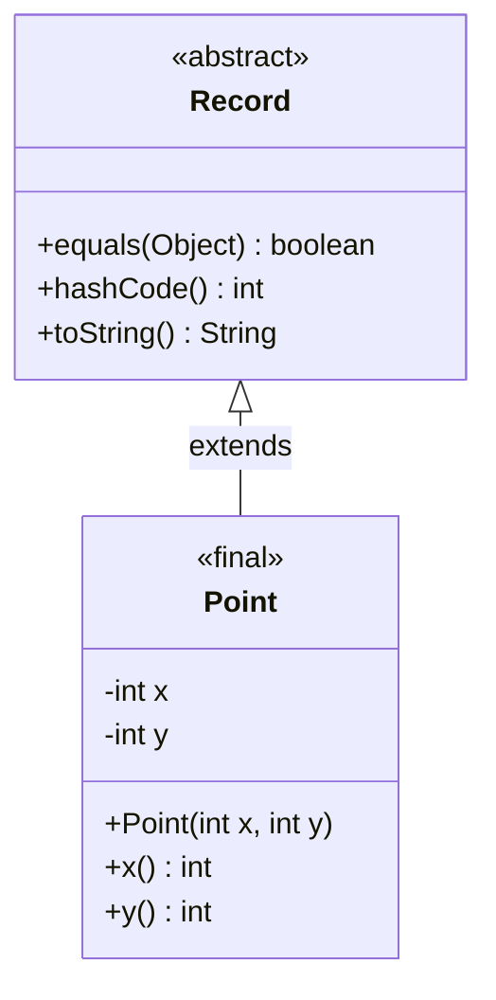
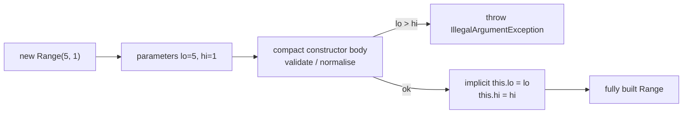
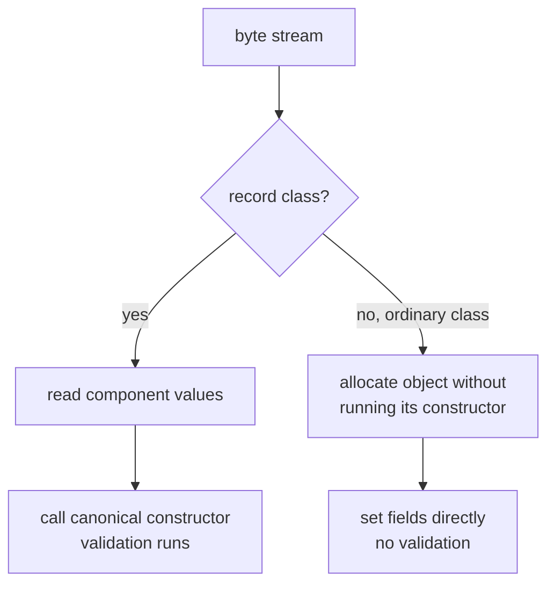

## In One Line
A **record** (final in Java 16, previewed in 14 and 15) is a transparent, shallowly immutable **data carrier**: `record Point(int x, int y) {}` gives you a `final` class with `private final` fields, a canonical constructor, accessors `x()`/`y()`, and `equals`, `hashCode` and `toString` based on **all** components — and you can still add validation, methods and static members.

## Mental Model
Think of a record as a **printed, sealed receipt**.

- The receipt's **columns are fixed** when the shop designs it: item, quantity, price. That is the **record header** `(String item, int qty, long price)`. You cannot add a hidden extra column later (no extra instance fields).
- The receipt is **printed once** at the till (the canonical constructor). The till can **check** the values before printing (compact constructor validation) and **tidy** them (trim the item name, round the price), but after printing nobody can change it (all fields `final`, no setters).
- Two receipts with the **same values** are the **same receipt** for any practical purpose (`equals` compares every column), and the receipt prints itself in a standard format (`Receipt[item=pen, qty=2, price=40]`).
- Anyone can **read** every column (public accessors) — a receipt has no secrets. That transparency is the deal: a record *is* its data.
- But if a column holds a **reference to something outside** — "see attached bag of items" — someone can still change what is in the bag. That is shallow immutability: a `List` component must be copied with `List.copyOf` to be safe.

## Concept
### Why records exist
Before Java 16, a simple immutable data class needed ~40 lines: private final fields, a constructor, getters, `equals`, `hashCode` and `toString` — code that is boring to write, easy to get wrong (forget a field in `equals`), and hides the one important fact: *this class is just data*. Lombok (`@Value`) and IDE generators patched over it. Records (JEP 395) put the idea into the language: **the state description is the API**.

| Version | Status |
|---|---|
| Java 14 | Preview (JEP 359) |
| Java 15 | Second preview (JEP 384) |
| **Java 16** | **Final** (JEP 395) — plus local records, enums and interfaces, and static members in inner classes |
| Java 19–20 | Record **patterns** preview (JEP 405, 432) |
| **Java 21** | Record patterns **final** (JEP 440) — deconstruction in `instanceof` and `switch` |

### What the compiler generates
For `record Point(int x, int y) {}`:

| Generated member | Details |
|---|---|
| `final class Point extends java.lang.Record` | Always `final`; the superclass is always `java.lang.Record`, so a record cannot extend anything else |
| `private final int x; private final int y;` | One field per **component**, in header order |
| `public Point(int x, int y)` | The **canonical constructor** — same parameters as the header |
| `public int x()`, `public int y()` | **Accessors** named exactly like the components (not `getX()`) |
| `public boolean equals(Object o)` | `true` if `o` is the **same record class** and every component is equal |
| `public int hashCode()` | Combines all component hash codes (the exact formula is unspecified) |
| `public String toString()` | `Point[x=3, y=4]` — record name plus every component |

`equals`, `hashCode` and `toString` are not generated as bytecode loops; the compiler emits an `invokedynamic` that calls `java.lang.runtime.ObjectMethods.bootstrap` once, which builds an optimised implementation from **direct field getters** (visible in `javap -v`). Consequence: they read the **fields**, not your accessor methods — an overridden accessor does not change `toString` or `equals`.

**`equals` details** (from `Record.equals` Javadoc): reference components are compared with `Objects.equals`; primitive components with the wrapper's `compare` method (`Integer.compare`, `Double.compare`, …). So a record holding `Double.NaN` **equals** another one holding `NaN` (while `NaN == NaN` is `false`), and `0.0` does **not** equal `-0.0` (while `0.0 == -0.0` is `true`).

### The three kinds of constructors
**1. Compact canonical constructor** — the usual choice. No parameter list; the parameters are implicit, and the fields are assigned **automatically at the end**:
```java
record Range(int lo, int hi) {
    Range {
        if (lo > hi) throw new IllegalArgumentException("lo > hi: " + lo + " > " + hi);
    }   // <- compiler inserts: this.lo = lo; this.hi = hi;
}
```
You can **reassign the parameters** to normalise or copy them (`name = name.strip(); emails = List.copyOf(emails);`), but you cannot write `this.lo = ...` (compile error: *cannot assign a value to final variable*) and cannot read `this.lo` (not yet initialised).

**2. Explicit canonical constructor** — the long form; you must assign **every** field yourself:
```java
record Temperature(double celsius) {
    Temperature(double celsius) {
        this.celsius = Math.round(celsius * 10) / 10.0;
    }
}
```
Rules: parameter names and types must **match** the components exactly; no `throws` clause; access must be **at least as visible** as the record (a `public` record needs a `public` canonical constructor). A record has **either** a compact **or** an explicit canonical constructor, not both.

**3. Non-canonical constructors** — any other parameter list; the first statement **must** be `this(...)`, so every path ends in the canonical constructor and its validation:
```java
record Range(int lo, int hi) {
    Range(int single) { this(single, single); }
}
```
Static factories are often clearer than extra constructors: `static Range of(int a, int b) { return new Range(Math.min(a, b), Math.max(a, b)); }`.

### What you can and cannot put in a record
| Allowed | Not allowed |
|---|---|
| Instance methods (`length()`, "withers" like `withHi(20)`) | Extra **instance fields** — *field declaration must be static* |
| **Static** fields, static methods, static initializers | **Instance initializer** blocks `{ ... }` |
| Nested types (records, enums, classes, interfaces) | `extends` anything — the superclass is fixed to `Record` |
| `implements` any interfaces (`Comparable`, `Serializable`, a sealed interface) | Being `abstract` or being extended (`cannot inherit from final`) |
| Overriding accessors, `equals`, `hashCode`, `toString` (accessors must stay `public`, same return type, no `throws`) | `native` methods |
| Type parameters: `record Pair<A, B>(A first, B second)` | Components named `clone`, `finalize`, `getClass`, `hashCode`, `notify`, `notifyAll`, `toString`, `wait` |
| Annotations on components | Setters that assign fields (fields are `final`) |

### Nested and local records are implicitly static
A record declared inside a class is a **static** nested class — it has no hidden reference to an outer instance. A **local record** (declared inside a method, Java 16) is also implicitly static, so it **cannot use** the method's local variables or the enclosing `this`:
```java
void m() {
    int n = 1;
    record R(int x) { int f() { return x + n; } }   // error: non-static variable n cannot be referenced from a static context
}
```
Local records are ideal as **named tuples** inside a method or stream pipeline (`record NameLength(String name, int length) {}`). To make this possible, Java 16 also allowed inner classes to declare static members.

### Immutability is shallow
Record fields are `final`, but a `final` reference to a mutable object still lets the object change:
- a `List` component can be modified by whoever holds the list — fix with `List.copyOf` in the compact constructor (it copies, rejects `null` elements, and the stored list is unmodifiable, so the accessor can return it directly);
- an **array** component is worse: `equals` compares arrays by **identity** (`Objects.equals` on arrays is `==`), `toString` prints `[I@1b6d3586`-style gibberish, and the array can be modified. Prefer `List<Integer>`, or override `equals`/`hashCode`/`toString` and clone on the way in and out;
- a record whose `hashCode` changes (because a mutable component changed) gets **lost** in a `HashSet`/`HashMap`.

### Records and serialization
A `Serializable` record is serialized as its component values and **deserialized by calling the canonical constructor** — so validation in the compact constructor always runs, and a malicious byte stream cannot create a record that violates its invariants. Normal classes are deserialized *without* running their constructor (fields are poked in directly), which is a classic security hole. For records, `writeObject`/`readObject`/`readObjectNoData` and `serialPersistentFields` are ignored (only `writeReplace`/`readResolve` apply), and the `serialVersionUID` does not have to match.

Records are also harder to break with reflection: `Field.setAccessible(true)` followed by `set` on a record field throws `IllegalAccessException` (*Can not set final int field …*), while the same trick works on a normal class's `final` field.

### Reflection support (Java 16)
- `Class.isRecord()` — is this class a record?
- `Class.getRecordComponents()` — the components in declaration order; each `RecordComponent` has `getName()`, `getType()`, `getGenericType()`, `getAccessor()` and its annotations.
- The canonical constructor is found with `getDeclaredConstructor(component types...)`.

This is what JSON libraries use: Jackson (2.12+) serialises records through accessors and deserialises them through the canonical constructor — no setters or no-arg constructor needed.

### Annotations on components
An annotation on a component (`record User(@NotBlank String name)`) is **propagated** to every place its `@Target` allows: the field, the accessor method, the canonical-constructor parameter, the record component itself (`ElementType.RECORD_COMPONENT`, new in 16), and type uses. That is how Bean Validation and Jackson annotations work on records.

### Record patterns (Java 21)
A record can be **deconstructed** in `instanceof` and `switch`:
```java
if (obj instanceof Point(int x, int y)) { ... }           // test + cast + extract
case Line(Point(var x1, var y1), Point(var x2, var y2)) -> ...   // nested, with var
case Point(int x, int y) when x == 0 && y == 0 -> "origin"      // with a guard
```
Deconstruction calls the **accessors**. Combined with sealed interfaces this gives exhaustive, type-safe data processing — see [Sealed Classes](lesson:b05-modern-java/04-sealed-classes) and [Switch & Pattern Matching](lesson:b05-modern-java/05-switch-expressions-and-pattern-matching).

### When to use a record — and when not
| Good fit | Poor fit |
|---|---|
| DTOs, API request/response bodies | JPA/Hibernate **entities** (need a no-arg constructor, mutable state, non-final class for lazy-loading proxies) |
| Value objects: `Money`, `Range`, `Coordinates` | Classes that need to **hide** their representation (records expose every component) |
| Compound map keys: `Map<Point, Tile>` | Objects with mutable state or identity (a `BankAccount`) |
| Multiple return values: `record MinMax(int min, int max)` | Classes that need inheritance of state from a superclass |
| Stream intermediate tuples (local records) | JavaBeans-based frameworks that require `getX()`/`setX()` |
| Algebraic data types with sealed interfaces | Large objects with many optional fields (a builder is clearer) |

### Record vs class vs Lombok
| | Record | Hand-written final class | Lombok `@Value` |
|---|---|---|---|
| Boilerplate | none | lots | none (annotation processor) |
| Accessor names | `x()` | anything, usually `getX()` | `getX()` |
| Can extend a class | no | yes | yes |
| Extra instance fields | no | yes | yes |
| Hide internal representation | no | yes | yes |
| Language feature, pattern matching | yes (record patterns) | no | no |
| Deserialization uses constructor | yes | no | no |

## Diagram

Everything in `Point` comes from the one-line header `record Point(int x, int y) {}`; `equals`/`hashCode`/`toString` are implemented for it through `invokedynamic`.


The compact constructor works on the **parameters**; the fields are assigned only after its body finishes, so an invalid record never exists.


Deserialization of records goes through the front door (the constructor); ordinary classes are rebuilt behind the constructor's back.

## Code
**1. The basics: what one line gives you** (`java RecordBasics.java`):
```java
import java.lang.reflect.Modifier;
import java.lang.reflect.RecordComponent;
import java.util.HashMap;
import java.util.HashSet;
import java.util.List;
import java.util.Map;
import java.util.Set;

public class RecordBasics {

    record Point(int x, int y) {}

    public static void main(String[] args) {
        Point p = new Point(3, 4);
        Point q = new Point(3, 4);

        System.out.println(p);                                   // toString
        System.out.println("x = " + p.x() + ", y = " + p.y());   // accessors: x(), not getX()
        System.out.println("p.equals(q) = " + p.equals(q) + ", p == q = " + (p == q));
        System.out.println("same hashCode = " + (p.hashCode() == q.hashCode()));

        Set<Point> visited = new HashSet<>(List.of(p, q, new Point(0, 0)));
        System.out.println("distinct points = " + visited.size());

        Map<Point, String> grid = new HashMap<>();
        grid.put(new Point(0, 0), "origin");
        System.out.println("lookup with a new key = " + grid.get(new Point(0, 0)));

        // What the compiler generated
        System.out.println("superclass = " + Point.class.getSuperclass().getName());
        System.out.println("final? " + Modifier.isFinal(Point.class.getModifiers())
                + ", static nested? " + Modifier.isStatic(Point.class.getModifiers())
                + ", isRecord? " + Point.class.isRecord());
        for (RecordComponent rc : Point.class.getRecordComponents()) {
            System.out.println("component " + rc.getType() + " " + rc.getName()
                    + " -> accessor " + rc.getAccessor().getName() + "()");
        }
    }
}
```
```output
Point[x=3, y=4]
x = 3, y = 4
p.equals(q) = true, p == q = false
same hashCode = true
distinct points = 2
lookup with a new key = origin
superclass = java.lang.Record
final? true, static nested? true, isRecord? true
component int x -> accessor x()
component int y -> accessor y()
```
Compiling a top-level `public record Point(int x, int y) {}` and running `javap -p Point` shows the generated members:
```output
Compiled from "Point.java"
public final class Point extends java.lang.Record {
  private final int x;
  private final int y;
  public Point(int, int);
  public final java.lang.String toString();
  public final int hashCode();
  public final boolean equals(java.lang.Object);
  public int x();
  public int y();
}
```
and `javap -v Point` shows how `toString` is implemented (excerpt):
```output
         1: invokedynamic #16,  0             // InvokeDynamic #0:toString:(LPoint;)Ljava/lang/String;
...
Record:
  int x;
  int y;
BootstrapMethods:
  0: #43 REF_invokeStatic java/lang/runtime/ObjectMethods.bootstrap:(Ljava/lang/invoke/MethodHandles$Lookup;Ljava/lang/String;Ljava/lang/invoke/TypeDescriptor;Ljava/lang/Class;Ljava/lang/String;[Ljava/lang/invoke/MethodHandle;)Ljava/lang/Object;
      #39 x;y
      #41 REF_getField Point.x:I
```

**2. Constructors, validation, normalisation, defensive copies** (`java RecordConstructors.java`):
```java
import java.util.ArrayList;
import java.util.List;
import java.util.Objects;

public class RecordConstructors {

    // Compact canonical constructor: validation only
    record Range(int lo, int hi) {
        Range {                                          // no parameter list!
            if (lo > hi) {
                throw new IllegalArgumentException("lo > hi: " + lo + " > " + hi);
            }
        }                                                // fields assigned here, automatically

        Range(int single) {                              // non-canonical: must call this(...)
            this(single, single);
        }

        static Range of(int a, int b) {                  // static factory: order the ends
            return new Range(Math.min(a, b), Math.max(a, b));
        }

        int length() { return hi - lo; }                 // ordinary instance method

        Range withHi(int newHi) { return new Range(lo, newHi); }   // "wither"
    }

    // Compact constructor that normalises and defensively copies
    record Person(String name, List<String> emails) {
        static int created = 0;                          // static fields are allowed

        Person {
            Objects.requireNonNull(name, "name");
            name = name.strip();                         // reassign the PARAMETER
            emails = List.copyOf(emails);                // unmodifiable snapshot
            created++;
        }
    }

    // Explicit canonical constructor: you assign every field yourself
    record Temperature(double celsius) {
        Temperature(double celsius) {
            if (Double.isNaN(celsius)) throw new IllegalArgumentException("NaN");
            this.celsius = Math.round(celsius * 10) / 10.0;   // round to 1 decimal
        }
    }

    public static void main(String[] args) {
        Range r = new Range(2, 9);
        System.out.println(r + " length=" + r.length());
        System.out.println(new Range(7));
        System.out.println(Range.of(9, 2));
        System.out.println(r.withHi(20) + " original still " + r);
        try {
            new Range(5, 1);
        } catch (IllegalArgumentException e) {
            System.out.println("rejected: " + e.getMessage());
        }

        List<String> mails = new ArrayList<>(List.of("asha@x.com"));
        Person asha = new Person("  Asha ", mails);
        mails.add("hacker@evil.com");                    // caller changes its own list
        System.out.println(asha + " created=" + Person.created);
        try {
            asha.emails().add("x@y.com");
        } catch (UnsupportedOperationException e) {
            System.out.println("emails() is unmodifiable");
        }
        try {
            new Person(null, List.of());
        } catch (NullPointerException e) {
            System.out.println("NPE: " + e.getMessage());
        }

        System.out.println(new Temperature(36.66));
    }
}
```
```output
Range[lo=2, hi=9] length=7
Range[lo=7, hi=7]
Range[lo=2, hi=9]
Range[lo=2, hi=20] original still Range[lo=2, hi=9]
rejected: lo > hi: 5 > 1
Person[name=Asha, emails=[asha@x.com]] created=1
emails() is unmodifiable
NPE: name
Temperature[celsius=36.7]
```

**3. Pitfalls: arrays, mutable components, floating-point equality** (`java RecordPitfalls.java`):
```java
import java.util.ArrayList;
import java.util.Arrays;
import java.util.HashSet;
import java.util.List;
import java.util.Set;

public class RecordPitfalls {

    record Bytes(int[] data) {}                          // array component
    record Team(List<String> members) {}                 // mutable component, no copy
    record Reading(double value) {}                      // double component

    // Fix for arrays: override equals/hashCode/toString
    record SafeBytes(int[] data) {
        SafeBytes { data = data.clone(); }
        @Override public int[] data() { return data.clone(); }
        @Override public boolean equals(Object o) {
            return o instanceof SafeBytes other && Arrays.equals(data, other.data);
        }
        @Override public int hashCode() { return Arrays.hashCode(data); }
        @Override public String toString() { return "SafeBytes" + Arrays.toString(data); }
    }

    public static void main(String[] args) {
        // 1. Arrays use identity equality and an unhelpful toString
        Bytes b1 = new Bytes(new int[]{1, 2});
        Bytes b2 = new Bytes(new int[]{1, 2});
        System.out.println("Bytes equal? " + b1.equals(b2));
        System.out.println("toString looks like Bytes[data=[I@...]: "
                + b1.toString().startsWith("Bytes[data=[I@"));
        System.out.println("SafeBytes equal? " + new SafeBytes(new int[]{1, 2}).equals(new SafeBytes(new int[]{1, 2}))
                + " " + new SafeBytes(new int[]{1, 2}));

        // 2. Shallow immutability: the list inside can change
        List<String> names = new ArrayList<>(List.of("Asha"));
        Team team = new Team(names);
        names.add("Ravi");
        team.members().add("Kiran");
        System.out.println(team);

        // 3. ...and a mutated record gets lost in a HashSet
        Set<Team> teams = new HashSet<>();
        teams.add(team);
        team.members().add("Meena");                     // hashCode changes
        System.out.println("contains after mutation? " + teams.contains(team));

        // 4. Primitive components are compared like Double.compare, not ==
        System.out.println("NaN:  record equals " + new Reading(Double.NaN).equals(new Reading(Double.NaN))
                + ", == " + (Double.NaN == Double.NaN));
        System.out.println("-0.0: record equals " + new Reading(0.0).equals(new Reading(-0.0))
                + ", == " + (0.0 == -0.0));
    }
}
```
```output
Bytes equal? false
toString looks like Bytes[data=[I@...]: true
SafeBytes equal? true SafeBytes[1, 2]
Team[members=[Asha, Ravi, Kiran]]
contains after mutation? false
NaN:  record equals true, == false
-0.0: record equals false, == true
```

**4. Record patterns, generic records and local records** (Java 21, `java RecordPatterns.java`):
```java
import java.util.List;

public class RecordPatterns {

    record Point(int x, int y) {}
    record Line(Point from, Point to) {}
    record Pair<A, B>(A first, B second) {}               // generic record

    static String describe(Object o) {
        return switch (o) {
            case Point(int x, int y) when x == 0 && y == 0 -> "the origin";
            case Point(int x, int y) -> "point at " + x + "," + y;
            case Line(Point(var x1, var y1), Point(var x2, var y2)) ->   // nested patterns
                    "line of length " + Math.hypot(x2 - x1, y2 - y1);
            case Pair<?, ?>(String s, Integer n) -> "pair of String and Integer: " + s + n;
            default -> "something else";
        };
    }

    public static void main(String[] args) {
        Object o = new Point(3, 4);
        if (o instanceof Point(int x, int y)) {            // deconstruct in one step
            System.out.println("x + y = " + (x + y));
        }
        for (Object thing : List.of(new Point(0, 0), new Point(1, 2),
                new Line(new Point(0, 0), new Point(3, 4)),
                new Pair<>("id-", 7), "text")) {
            System.out.println(describe(thing));
        }

        // Local record as a named tuple inside a stream pipeline
        record NameLength(String name, int length) {}
        List.of("Asha", "Ravi", "Kiran").stream()
                .map(n -> new NameLength(n, n.length()))
                .filter(nl -> nl.length() > 4)
                .forEach(System.out::println);
    }
}
```
```output
x + y = 7
the origin
point at 1,2
line of length 5.0
pair of String and Integer: id-7
something else
NameLength[name=Kiran, length=5]
```

**5. Serialization goes through the canonical constructor** (`java RecordSerialization.java`):
```java
import java.io.ByteArrayInputStream;
import java.io.ByteArrayOutputStream;
import java.io.ObjectInputStream;
import java.io.ObjectOutputStream;
import java.io.Serializable;

public class RecordSerialization {

    record Range(int lo, int hi) implements Serializable {
        Range {
            System.out.println("  Range constructor runs (" + lo + ", " + hi + ")");
            if (lo > hi) throw new IllegalArgumentException("lo > hi");
        }
    }

    static class OldRange implements Serializable {
        final int lo, hi;
        OldRange(int lo, int hi) {
            System.out.println("  OldRange constructor runs (" + lo + ", " + hi + ")");
            this.lo = lo;
            this.hi = hi;
        }
    }

    static Object roundTrip(Object o) throws Exception {
        ByteArrayOutputStream bytes = new ByteArrayOutputStream();
        try (ObjectOutputStream out = new ObjectOutputStream(bytes)) {
            out.writeObject(o);
        }
        try (ObjectInputStream in = new ObjectInputStream(new ByteArrayInputStream(bytes.toByteArray()))) {
            return in.readObject();
        }
    }

    public static void main(String[] args) throws Exception {
        System.out.println("create record:");
        Range r = new Range(1, 5);
        System.out.println("deserialize record:");
        Range copy = (Range) roundTrip(r);
        System.out.println("  " + copy + " equals original? " + copy.equals(r));

        System.out.println("create class:");
        OldRange o = new OldRange(1, 5);
        System.out.println("deserialize class:");
        OldRange oCopy = (OldRange) roundTrip(o);
        System.out.println("  lo=" + oCopy.lo + " hi=" + oCopy.hi);
    }
}
```
```output
create record:
  Range constructor runs (1, 5)
deserialize record:
  Range constructor runs (1, 5)
  Range[lo=1, hi=5] equals original? true
create class:
  OldRange constructor runs (1, 5)
deserialize class:
  lo=1 hi=5
```

**6. Reflection: how frameworks read records** (`java RecordReflection.java`):
```java
import java.lang.annotation.ElementType;
import java.lang.annotation.Retention;
import java.lang.annotation.RetentionPolicy;
import java.lang.annotation.Target;
import java.lang.reflect.Constructor;
import java.lang.reflect.RecordComponent;
import java.util.Arrays;

public class RecordReflection {

    @Retention(RetentionPolicy.RUNTIME)
    @Target({ElementType.FIELD, ElementType.METHOD, ElementType.PARAMETER, ElementType.RECORD_COMPONENT})
    @interface Label { String value(); }

    record User(@Label("user_name") String name, int age) {}

    // A tiny "JSON mapper": what Jackson and friends do with records
    static String toJson(Record r) throws Exception {
        StringBuilder sb = new StringBuilder("{");
        RecordComponent[] comps = r.getClass().getRecordComponents();   // declaration order
        for (int i = 0; i < comps.length; i++) {
            RecordComponent c = comps[i];
            Label label = c.getAnnotation(Label.class);
            String key = label != null ? label.value() : c.getName();
            Object value = c.getAccessor().invoke(r);
            sb.append('"').append(key).append("\": ")
              .append(value instanceof String ? "\"" + value + "\"" : value);
            if (i < comps.length - 1) sb.append(", ");
        }
        return sb.append('}').toString();
    }

    public static void main(String[] args) throws Exception {
        System.out.println(toJson(new User("Asha", 30)));

        // Where did @Label end up? Everywhere its @Target allows.
        System.out.println("on field:        " + User.class.getDeclaredField("name").isAnnotationPresent(Label.class));
        System.out.println("on accessor:     " + User.class.getMethod("name").isAnnotationPresent(Label.class));
        Constructor<User> canonical = User.class.getDeclaredConstructor(
                Arrays.stream(User.class.getRecordComponents())
                      .map(RecordComponent::getType)
                      .toArray(Class<?>[]::new));
        System.out.println("on ctor param:   " + canonical.getParameters()[0].isAnnotationPresent(Label.class));

        // Deserializers create records through the canonical constructor
        System.out.println(canonical.newInstance("Ravi", 25));
    }
}
```
```output
{"user_name": "Asha", "age": 30}
on field:        true
on accessor:     true
on ctor param:   true
User[name=Ravi, age=25]
```

**7. What the compiler rejects.** Each is a one-line file compiled with `javac` on JDK 21:
```output
InstField.java:1: error: field declaration must be static
record InstField(int x) { int y; }
                              ^
  (consider replacing field with record component)

Extends.java:1: error: '{' expected
record Extends(int x) extends Object { }
                     ^

AssignCompact.java:1: error: cannot assign a value to final variable x
record AssignCompact(int x) { AssignCompact { this.x = x; } }
                                                  ^

NoDelegate.java:1: error: constructor is not canonical, so its first statement must invoke another constructor of class NoDelegate
record NoDelegate(int x) { NoDelegate() { } }
                           ^

AccessorAccess.java:1: error: invalid accessor method in record AccessorAccess
public record AccessorAccess(int x) { int x() { return x; } }
                                          ^
  (accessor method must be public)

BadName.java:1: error: illegal record component name hashCode
record BadName(int hashCode) { }
                   ^

InstInit.java:1: error: instance initializers not allowed in records
record InstInit(int x) { { System.out.println(); } }
                         ^

ThrowsCanon.java:1: error: invalid canonical constructor in record ThrowsCanon
record ThrowsCanon(int x) { ThrowsCanon(int x) throws Exception { this.x = x; } }
                            ^
  (throws clause not allowed for canonical constructor)

WeakCanon.java:1: error: invalid canonical constructor in record WeakCanon
public record WeakCanon(int x) { WeakCanon(int x) { this.x = x; } }
                                 ^
  (attempting to assign stronger access privileges; was public)

ParamNames.java:1: error: invalid canonical constructor in record ParamNames
record ParamNames(int x) { ParamNames(int y) { this.x = y; } }
                           ^
  (invalid parameter names in canonical constructor)

MissingAssign.java:1: error: variable y might not have been initialized
record MissingAssign(int x, int y) { MissingAssign(int x, int y) { this.x = x; } }
                                                                               ^

SubRecord.java:1: error: cannot inherit from final Base
record Base(int x) { } class SubRecord extends Base { SubRecord() { super(1); } }
                                               ^

ClassRecord.java:1: error: 'record' not allowed here
class record { }
      ^
  as of release 14, 'record' is a restricted type name and cannot be used for type declarations
```
By contrast, `int record = 5;` as a **variable** name still compiles — `record` is a restricted identifier, not a keyword.

## Walkthrough
### 1. `RecordBasics`
- `record Point(int x, int y) {}` — the whole class. It is nested inside `RecordBasics`, so it is implicitly `static` (the output confirms `static nested? true`).
- `System.out.println(p)` → `Point[x=3, y=4]`: the generated `toString` lists every component in header order.
- `p.x()`, `p.y()` — accessors are named after the components. There is no `getX()`.
- `p.equals(q)` is `true` although `p == q` is `false`: two different objects with the same state are **equal by value**. Their `hashCode`s match too, which is what `HashSet` and `HashMap` need.
- `new HashSet<>(List.of(p, q, new Point(0, 0)))` keeps **2** points (`p` and `q` are duplicates), and `grid.get(new Point(0, 0))` finds `origin` using a brand-new key object — records make perfect compound keys.
- Reflection: the superclass is `java.lang.Record`, the class is `final`, `isRecord()` is `true`, and `getRecordComponents()` lists `int x` and `int y` with accessors `x()` and `y()`.
- The `javap -p` listing shows exactly the generated members, and `javap -v` shows `toString`/`hashCode`/`equals` are single `invokedynamic` calls bootstrapped by `ObjectMethods.bootstrap`, which receives the names `"x;y"` and **field getters** (`REF_getField Point.x:I`). The `Record:` attribute in the class file is what makes the JVM (and reflection) know it is a record.

### 2. `RecordConstructors`
- `Range { ... }` — the compact form. `new Range(2, 9)` passes, `length()` → 7.
- `Range(int single) { this(single, single); }` — a non-canonical constructor delegating to the canonical one, so `new Range(7)` → `Range[lo=7, hi=7]` and still gets validated.
- `Range.of(9, 2)` — a static factory that sorts the ends → `Range[lo=2, hi=9]`.
- `r.withHi(20)` returns a **new** record; `r` is unchanged — records are updated by copying ("withers"), like `String`.
- `new Range(5, 1)` throws from the compact constructor: `rejected: lo > hi: 5 > 1`. No invalid `Range` object ever exists.
- `Person { ... }` — `requireNonNull(name, "name")` gives the NPE message `name`; `name = name.strip()` reassigns the **parameter**, and the automatic field assignment at the end stores the stripped value (`name=Asha`); `emails = List.copyOf(emails)` stores an unmodifiable snapshot, so the caller's later `mails.add("hacker@evil.com")` has no effect and `asha.emails().add(...)` throws. `created` is a **static** field (allowed); it is `1` because the `null` attempt threw before `created++`.
- `Temperature(double celsius) { ... this.celsius = ...; }` — the explicit canonical form; you assign the field yourself, here rounding `36.66` to `36.7`.

### 3. `RecordPitfalls`
- `Bytes` with an `int[]`: equal contents, but `equals` is `false` because arrays are compared by reference, and `toString` prints the array's identity (`[I@...` — the hex part changes every run, which is why the program only checks the prefix).
- `SafeBytes` fixes it: clone in (compact constructor), clone out (overridden accessor), and content-based `equals`/`hashCode`/`toString` with `Arrays`. Note `o instanceof SafeBytes other && ...` — a pattern variable used in `equals`.
- `Team` stores the caller's `ArrayList`: both the caller (`names.add("Ravi")`) and anyone with the accessor (`team.members().add("Kiran")`) can change it → `Team[members=[Asha, Ravi, Kiran]]`.
- After adding `team` to a `HashSet` and then mutating its list, its `hashCode` changes, so `contains(team)` looks in the wrong bucket → `false`. The object is "lost" in the set.
- `Reading(double)`: `equals` uses `Double.compare`, so `NaN` equals `NaN` (`true`) and `0.0` does not equal `-0.0` (`false`) — the exact opposite of `==`. This keeps `equals` reflexive, which collections rely on.

### 4. `RecordPatterns`
- `o instanceof Point(int x, int y)` tests the type, casts, and calls the accessors to bind `x` and `y` → `x + y = 7`.
- In `describe`, the guarded case `when x == 0 && y == 0` must come **before** the unguarded `Point(int x, int y)`, otherwise it would be unreachable (dominance). `Line(Point(var x1, var y1), Point(var x2, var y2))` nests patterns; `var` infers `int`. The line from (0,0) to (3,4) has length `5.0`.
- `Pair<?, ?>(String s, Integer n)` matches only if the components' **runtime** types are `String` and `Integer` → `id-7`.
- `"text"` matches nothing specific → `default` → `something else`. A `default` is needed because `Object` is not a sealed type.
- The local record `NameLength` lives only inside `main`; only `Kiran` (length 5) passes the `> 4` filter, and `println` uses the generated `toString`.

### 5. `RecordSerialization`
The `Range` constructor message appears **twice** — once for `new Range(1, 5)` and once during `readObject`, proving deserialization re-runs the compact constructor (and its validation). `OldRange`'s message appears **only once**: its fields were restored without calling the constructor. Any validation in `OldRange`'s constructor could be bypassed by a crafted byte stream.

### 6. `RecordReflection`
- `getRecordComponents()` returns components in declaration order; `getAccessor().invoke(r)` reads each value — the same approach as Jackson.
- `@Label` has targets `FIELD`, `METHOD`, `PARAMETER` and `RECORD_COMPONENT`, so the compiler copied it to the field, the accessor, the constructor parameter and the component — all three checks print `true`, and `toJson` uses it to rename `name` to `user_name`.
- The canonical constructor is looked up by the component types (`String`, `int`) and `newInstance("Ravi", 25)` builds a record — deserializers do exactly this.

### 7. Compile errors
Each error corresponds to a rule in the "can and cannot" table. Note the `Extends` message is a plain syntax error (`'{' expected`): the grammar of a record header has no `extends` clause at all. And `ReadInCompact`-style code (`System.out.println(this.x)` inside a compact constructor) fails with *variable x might not have been initialized*, because the fields are assigned only after the body.

## Traps
- **Getter names**: records use `name()`, not `getName()`. Frameworks or templates that expect JavaBeans getters (`${user.name}` resolving to `getName()`) may not see record properties unless they support records.
- **Overriding an accessor does not change `equals`/`hashCode`/`toString`** — they read the fields directly. `record Money(long amount, String currency) { public String currency() { return currency.toUpperCase(); } }` prints `INR` from the accessor but `Money[amount=5, currency=inr]` from `toString`, and `new Money(5, "inr")` is not equal to `new Money(5, "INR")`. Normalise in the **constructor** instead.
- **Arrays and mutable collections as components** — identity-based `equals` for arrays, and shallow immutability for both. Copy with `List.copyOf` / `clone()`.
- **Mutating a record used as a `HashMap` key or `HashSet` element** — its hash code changes and lookups fail.
- **Assigning `this.x` in a compact constructor** — compile error; assign the parameter (`x = ...`) instead.
- **Reading `this.x` in a compact constructor** — not initialised yet; use the parameter `x`.
- **Validation only in a non-canonical constructor** — it can be bypassed by calling the canonical constructor directly. Always validate in the canonical (compact) constructor.
- **Records as JPA entities** — do not work (final class, no no-arg constructor, immutable). Use records for DTOs and projections.
- **`hashCode` formula** — unspecified; on JDK 21 `new Point(1, 2).hashCode()` is `33` while `Objects.hash(1, 2)` is `994`. Never persist or depend on it.
- **Local records cannot capture** local variables or `this` — they are implicitly static.
- **`record` is a restricted identifier** — you cannot name a class `record` (since 14), but `int record = 5;` still compiles.
- **"Records were added in Java 14"** — only as a preview; final in **16**.

> [!WARNING] A record is only as immutable as its components. `record Order(List<Item> items)` without `items = List.copyOf(items);` in the compact constructor is a mutable object with an immutable-looking API.

## Tips & Tricks
- **"Header = API."** Everything public about a record is in its header; if you need to hide a field, you need a class.
- **The compact-constructor recipe: *Validate, Normalise, Copy*** — `requireNonNull`/range checks, then `name = name.strip()`, then `list = List.copyOf(list)`.
- **Accessor naming mnemonic: "records don't `get`, they *are*"** — `point.x()`, not `point.getX()`.
- **"Parameters in, fields out"**: in a compact constructor you only touch parameters; the compiler writes the fields at the end.
- **Withers for updates:** `Range withHi(int hi) { return new Range(lo, hi); }` — the same pattern as `LocalDate.withYear`.
- **Local records for stream tuples** — clearer than `Map.Entry` or `Object[]` when you need to carry two values through a pipeline.
- **Sealed interface + records = algebraic data type**; then `switch` with record patterns needs no `default`.
- **Remember the dates: previewed 14, 15 → final 16; record patterns previewed 19, 20 → final 21.**

## Interview Q&A
### [Basic] What is a record in Java?
A record (Java 16, JEP 395; preview in 14 and 15) is a special kind of class for **immutable data carriers**. From a header such as `record Point(int x, int y) {}` the compiler generates a `final` class extending `java.lang.Record`, a `private final` field for each component, a canonical constructor, public accessor methods named after the components (`x()`, `y()`), and `equals`, `hashCode` and `toString` that use all components. You can add validation in a compact constructor, instance and static methods, static fields, nested types, and implement interfaces.

**Follow-up:** *Is a record the same as a Lombok `@Value` class?* — Similar result, but a record is a language feature: accessor names are `x()`, it cannot extend a class or declare extra instance fields, it supports record patterns, and deserialization goes through its canonical constructor.

### [Basic] What are the restrictions of records?
A record is implicitly `final` (cannot be extended) and implicitly extends `java.lang.Record` (cannot extend anything else); it cannot declare instance fields beyond its components, instance initializer blocks, or `native` methods; it cannot be `abstract`; its fields are `final` so there are no setters; accessor overrides must be `public` with the same return type; the canonical constructor cannot have a `throws` clause and must be at least as accessible as the record; components cannot be named `hashCode`, `toString`, `clone` and other `Object` method names. Records **can** implement interfaces, be generic, and have static members and nested types.

**Follow-up:** *Can a record have a no-argument constructor?* — Yes, as a non-canonical constructor that delegates: `Point() { this(0, 0); }`.

### [Basic] What is a compact constructor?
It is the short form of the canonical constructor with no parameter list: `Range { if (lo > hi) throw new IllegalArgumentException(); }`. The parameters are implicit, and the compiler assigns all fields **after** the body runs. Inside it you validate and may **reassign the parameters** to normalise or defensively copy them (`name = name.strip(); tags = List.copyOf(tags);`). You cannot assign `this.lo` (compile error) or read the fields (not yet initialised). It is the standard place for invariants, because every constructor must end up in the canonical one.

**Follow-up:** *Can you have both a compact and an explicit canonical constructor?* — No; both are the canonical constructor, so it would be a duplicate. Non-canonical constructors are fine but must start with `this(...)`.

### [Intermediate] Are records immutable?
**Shallowly.** The fields are `private final` and there are no setters, so the references cannot change. But if a component is a mutable object — an `ArrayList`, an array, a `Date` — its contents can still change through the caller's reference or through the accessor. To make a record deeply immutable, use immutable component types (`String`, `LocalDate`, other records) and defensively copy collections in the compact constructor with `List.copyOf`/`Map.copyOf` (which are unmodifiable, so the accessor can return them directly). Arrays need `clone()` on the way in and out.

**Follow-up:** *What goes wrong if you put a record with a mutable list into a `HashSet` and then change the list?* — Its `hashCode` changes, so `contains` looks in the wrong bucket and returns `false`; the element is effectively lost.

### [Intermediate] How do `equals` and `hashCode` work in a record?
`equals` returns `true` only if the other object is an instance of the **same record class** and every component is equal — reference components via `Objects.equals`, primitive components via the wrapper's `compare` method (so `NaN` equals `NaN`, and `0.0` does not equal `-0.0`). `hashCode` combines all component hash codes, but the exact formula is unspecified (on JDK 21 `Point(1, 2)` gives `33`). Both are implemented via `invokedynamic` and `ObjectMethods.bootstrap`, and read the **fields**, not the accessors. You may override them, e.g. for array components, but must keep the `equals`/`hashCode` contract.

**Follow-up:** *Does overriding an accessor change `equals`?* — No; the generated `equals`, `hashCode` and `toString` use fields. Normalise the data in the constructor instead of in the accessor.

### [Intermediate] When would you use a record and when a regular class?
Use a record when the class **is** its data: DTOs, API payloads, value objects (`Money`, `Range`), compound map keys, multiple return values, stream tuples, events/messages, and the cases of a sealed hierarchy. Use a class when you need to **encapsulate** representation (hide fields, change internals later), have mutable state or identity (entities, accounts), need to extend another class, need many optional fields (builder), or when a framework requires JavaBeans (JPA entities need a no-arg constructor and non-final classes for proxies).

**Follow-up:** *Can a JPA entity be a record?* — No. Records are fine as DTOs/projections (e.g. `select new com.x.OrderSummary(o.id, o.total) ...`), but entities must be mutable, non-final and have a no-arg constructor.

### [Intermediate] What is a local record and why is it useful?
A local record is declared inside a method body (Java 16). It is implicitly **static**, so it cannot capture local variables or the enclosing instance. It is useful as a named tuple for intermediate results, especially in streams: `record NameLength(String name, int length) {}` then `.map(n -> new NameLength(n, n.length()))`. It is clearer than `Map.Entry`, `Object[]` or `Pair` libraries and does not leak outside the method. Java 16 also allowed local enums and interfaces, and static members in inner classes.

**Follow-up:** *What error do you get if a local record uses a local variable?* — "non-static variable n cannot be referenced from a static context".

### [Intermediate] What are record patterns?
Final in Java 21 (JEP 440; previews in 19 and 20), record patterns **deconstruct** a record in `instanceof` and `switch`: `if (o instanceof Point(int x, int y))` tests the type and binds the components via the accessors in one step. They nest (`Line(Point(var x1, var y1), Point p2)`), accept `var` and type patterns for components, work with generic records (`Pair<?, ?>(String s, Integer n)`), and combine with guards (`when x == 0`). With sealed interfaces, a `switch` over record patterns can be exhaustive without `default`.

**Follow-up:** *Does a record pattern match `null`?* — No. `null instanceof Point(int x, int y)` is `false`, and in a `switch` a `null` selector throws `NullPointerException` unless there is a `case null`.

### [Advanced] How are records serialized differently from classes?
A serializable record is written as its component values and read back by **invoking the canonical constructor** with those values, so the compact constructor's validation always runs and a crafted stream cannot produce an invalid object. For ordinary classes, deserialization allocates the object without running its constructor and sets the fields directly (a known attack vector). For records, `readObject`, `writeObject`, `readObjectNoData` and `serialPersistentFields` are ignored — only `writeReplace` and `readResolve` are honoured — and a matching `serialVersionUID` is not required.

**Follow-up:** *Why is that safer?* — Invariants live in one place (the canonical constructor) and cannot be bypassed; with classes you must duplicate validation in `readObject` or use serialization proxies.

### [Advanced] How are `toString`, `equals` and `hashCode` implemented under the hood?
`javac` does not generate their bodies as loops. Each method contains a single `invokedynamic` instruction whose bootstrap method is `java.lang.runtime.ObjectMethods.bootstrap`, passing the record class, the component names (`"x;y"`) and method handles for the **fields**. On first call the bootstrap builds a method-handle chain specialised for that record, which the JIT can inline. Benefits: smaller class files, and the JDK can improve the implementation without recompiling records. It also explains why accessor overrides do not affect them.

**Follow-up:** *Where else does Java use `invokedynamic` like this?* — Lambdas (`LambdaMetafactory`), string concatenation since Java 9 (`StringConcatFactory`), and pattern-matching `switch` (`SwitchBootstraps`).

### [Advanced] Can reflection break a record's immutability?
Much less easily than a class's. For a normal class, `field.setAccessible(true); field.setInt(obj, 99)` changes even a `private final` field. For a record, the same `Field.set` throws `IllegalAccessException` ("Can not set final int field ...") because record fields are treated as **trusted finals** (like hidden classes' fields); the JIT can also constant-fold them. Deep reflection is still possible with lower-level tools (`Unsafe`), and mutable **components** can of course be changed through their own methods.

**Follow-up:** *What does `Class.isRecord()` return for `java.lang.Record` itself?* — `false`; only concrete record classes (direct subclasses declared with `record`) return `true`.

## Quiz
### What does this print?
```java
public class Q {
    record Point(int x, int y) {
        Point {
            if (x < 0) x = 0;
        }
    }
    public static void main(String[] args) {
        Point p = new Point(-5, 3);
        System.out.println(p.x() + " " + p);
    }
}
```
- [ ] -5 Point[x=-5, y=3]
- [x] 0 Point[x=0, y=3]
- [ ] Compile error: cannot assign to x
- [ ] 0 Point[x=-5, y=3]
> In a compact constructor, `x` is the **parameter**, and reassigning it is allowed; the field is assigned from the (modified) parameter after the body. Assigning `this.x` would be the compile error. Both the accessor and `toString` read the same field, so both show `0`.

### What does this print?
```java
public class Q3 {
    record Money(long amount, String currency) {
        public String currency() { return currency.toUpperCase(); }
    }
    public static void main(String[] args) {
        Money m = new Money(5, "inr");
        System.out.println(m.currency() + " " + m);
    }
}
```
- [ ] INR Money[amount=5, currency=INR]
- [x] INR Money[amount=5, currency=inr]
- [ ] inr Money[amount=5, currency=inr]
- [ ] Compile error: accessors cannot be overridden
> The overridden accessor returns `INR`, but the generated `toString` reads the **field** directly (via `ObjectMethods` field getters), which still holds `inr`. Overriding a public accessor is legal. To normalise, reassign the parameter in a compact constructor.

### What does this print?
```java
import java.util.*;

public class Q2 {
    record Item(String name, int qty) {}

    public static void main(String[] args) {
        Set<Item> cart = new HashSet<>();
        cart.add(new Item("pen", 2));
        cart.add(new Item("pen", 2));
        cart.add(new Item("pen", 3));
        System.out.println(cart.size() + " " + cart.contains(new Item("pen", 3)));
    }
}
```
- [ ] 3 false
- [ ] 3 true
- [x] 2 true
- [ ] 1 true
> Records get value-based `equals`/`hashCode`: the two `("pen", 2)` items are equal, so the set keeps one of them, plus `("pen", 3)` → size 2, and a new `("pen", 3)` is found. `3 false` is what a class **without** `equals`/`hashCode` would print.

### Spot the bug: why is this record not immutable?
```java
record Order(String id, List<String> items) {
    Order {
        Objects.requireNonNull(id);
    }
}
```
- [ ] Records cannot contain `List` components
- [x] `items` is stored as the caller's list, so it can be changed from outside and through `items()`
- [ ] `requireNonNull` must assign `this.id`
- [ ] The compact constructor must assign `this.items = items`
> The field is `final`, but it points to the caller's mutable list. Add `items = List.copyOf(items);` in the compact constructor. Assigning `this.items` in a compact constructor is a compile error — fields are assigned automatically.

### Which declaration compiles?
- [ ] `record R(int x) { int y; }`
- [ ] `record R(int x) extends Base {}`
- [x] `record R(int x) { static int count; R() { this(0); } }`
- [ ] `record R(int x) { int x() { return x; } }`
> Static fields and a non-canonical constructor that delegates with `this(...)` are allowed. Instance fields ("field declaration must be static"), `extends` ("'{' expected") and a non-public accessor ("accessor method must be public") are rejected.

### In which Java version did records become a standard (non-preview) feature?
- [ ] Java 14
- [ ] Java 15
- [x] Java 16
- [ ] Java 17
> Records were previewed in 14 and 15 and finalised in 16 (JEP 395). Record **patterns** came later — final in 21. Java 17 is a common guess because it is the first LTS that includes records.

### What does `new Reading(Double.NaN).equals(new Reading(Double.NaN))` return for `record Reading(double value) {}`?
- [x] true
- [ ] false
- [ ] It throws `ArithmeticException`
- [ ] It does not compile
> Record `equals` compares primitive components with `Double.compare`, which treats `NaN` as equal to itself. `Double.NaN == Double.NaN` is `false`, which is the tempting answer — but using `==` would break `equals`' reflexivity (`r.equals(r)` would be `false`).

## Takeaways
- A record (final in Java 16) is a `final` class extending `java.lang.Record` with `private final` fields, a canonical constructor, accessors named after the components, and component-based `equals`, `hashCode` and `toString`.
- Validate, normalise and defensively copy in the **compact** constructor — reassign parameters, never `this.x`; all other constructors must delegate with `this(...)`.
- Records cannot extend classes, declare instance fields or initializers, or be abstract; they can implement interfaces, be generic, and have static members, methods and nested types.
- Immutability is shallow: copy collections with `List.copyOf`, avoid arrays (identity `equals`, unreadable `toString`), and never mutate a record used as a hash key.
- Generated `equals`/`hashCode`/`toString` use `invokedynamic` (`ObjectMethods`) and read fields, not accessors; primitive components are compared with `compare` (NaN equals NaN, 0.0 ≠ -0.0).
- Deserialization of a record calls its canonical constructor, so validation always runs; reflection cannot `set` record fields.
- Record patterns (final in Java 21) deconstruct records in `instanceof` and `switch`, and combine with sealed interfaces for exhaustive, `default`-free switches.
- Use records for DTOs, value objects, keys, multiple return values and local tuples — not for JPA entities or classes that must hide their representation.
