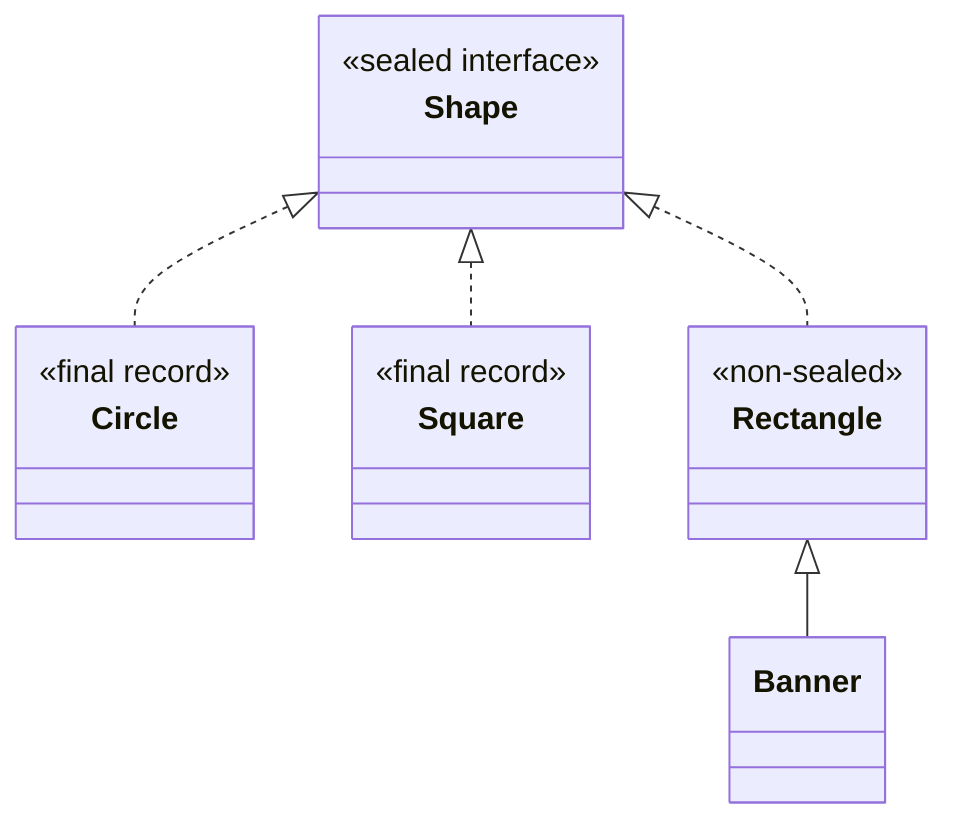
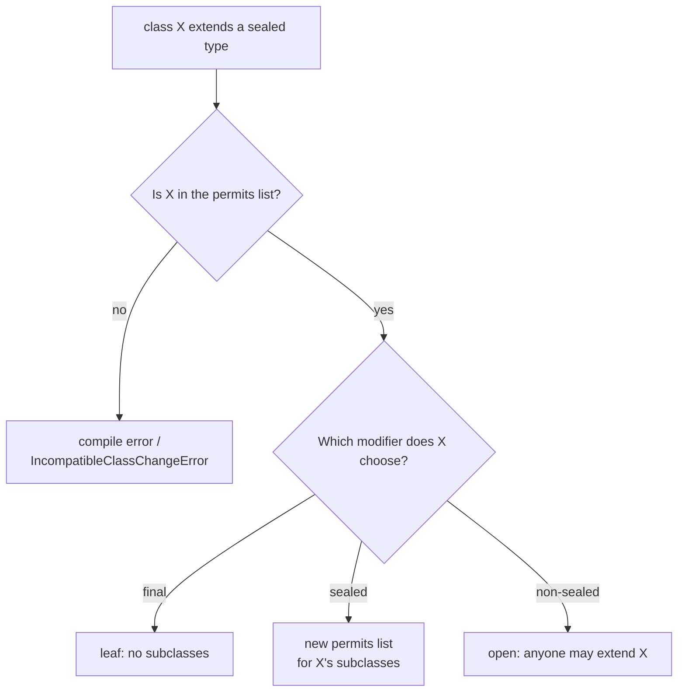
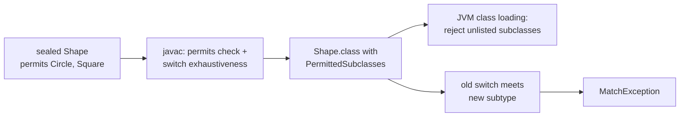

## In One Line
A **sealed** class or interface (final in Java 17, previewed in 15 and 16) lists exactly which classes may directly extend it — `sealed interface Shape permits Circle, Square {}` — each of which must say whether it is `final`, `sealed` or `non-sealed`; the compiler and the JVM enforce the list, and because the set of subtypes is **known**, a `switch` over it can be exhaustive without `default`.

## Mental Model
Think of a **private club with a membership list at the door**.

- The club (the sealed type) is **public**: anyone may talk to a member, refer to the club, pass a member around. What it controls is who can **become** a member — only the names on the list (`permits`).
- Every member must declare their **guest policy** when they join:
  - `final` — "I bring no guests" (no subclasses).
  - `sealed` — "I bring only these named guests" (its own `permits` list).
  - `non-sealed` — "my door is open, anyone I invite can come" (unrestricted subclasses below this point).
- There are **two doormen**: the compiler checks the list when you build, and the JVM checks it again when a class is loaded, so a class compiled elsewhere cannot sneak in.
- Because the organiser has the complete list, they can check the **seating plan**: "Is there a chair for every kind of member?" That is the compiler checking a `switch` for exhaustiveness. If a new member is added to the list, every seating plan that forgot them stops compiling.

## Concept
### The problem sealed types solve
Before Java 17 you had two extremes for controlling inheritance:

| Tool | Effect | Limitation |
|---|---|---|
| `final` class | Nobody may extend | Too strict — you cannot have *any* subtypes |
| Open class / interface | Anybody may extend or implement | Too loose — the author cannot rely on a fixed set of cases |
| Package-private constructor | Only classes in the same package can extend | Does not work for interfaces; the compiler does not *know* the set is closed, so it cannot help with exhaustiveness |
| `enum` | A fixed set of **instances** | Every constant has the same shape; cannot model cases carrying different data (a `Circle` has a radius, a `Rectangle` has width and height) |

A sealed type is the middle ground: **the type is widely accessible, but not freely extensible.** It is how you model "a `Shape` is a `Circle`, a `Square` or a `Rectangle` — nothing else", "a `Payment` is `Card`, `Upi` or `Cash`", "an `Expr` is a number, a sum, a product or a negation".

| Version | Status |
|---|---|
| Java 15 | Preview (JEP 360) |
| Java 16 | Second preview (JEP 397) |
| **Java 17** | **Final** (JEP 409) |
| **Java 21** | Pattern matching for `switch` + record patterns final — this is when sealed types become really useful (exhaustive switches) |

### Syntax
```java
public sealed interface Shape permits Circle, Square, Rectangle {}

public record Circle(double radius) implements Shape {}          // records are implicitly final
public record Square(double side) implements Shape {}
public non-sealed class Rectangle implements Shape { ... }        // re-opens this branch

public sealed abstract class Vehicle permits Car, Truck { ... }
public final class Car extends Vehicle { ... }
public sealed class Truck extends Vehicle permits HeavyTruck { ... }
public final class HeavyTruck extends Truck { ... }
```
`sealed`, `non-sealed` and `permits` are **contextual keywords**: they only have a special meaning in a class/interface declaration, so old code using `permits` as a variable name still compiles. `non-sealed` is Java's first hyphenated keyword.

### The rules
1. **Every permitted subclass must directly extend / implement the sealed type.** Listing a class that does not is an error (*invalid permits clause: subclass A must extend sealed class*).
2. **Every direct subclass must be listed** — any other class is rejected (*class is not allowed to extend sealed class … as it is not listed in its 'permits' clause*).
3. **Every permitted subclass must choose exactly one modifier**: `final`, `sealed` or `non-sealed` (*sealed, non-sealed or final modifiers expected*). Records are implicitly `final`; enums are implicitly `final` (or implicitly `sealed` if a constant has a body), so they need no modifier.
4. **Locality**: in a **named module**, the sealed type and its permitted subclasses must be in the **same module**; on the class path (the **unnamed module**) they must be in the **same package**.
5. **`permits` may be omitted** if all subclasses are declared in the **same source file**; the compiler infers the list from them.
6. **A sealed type must have at least one permitted subclass** (*sealed class must have subclasses*).
7. **Anonymous classes and local classes cannot extend a sealed type**, and a sealed interface is **not a functional interface**, so a lambda cannot implement it — both would create an unlisted subclass.
8. `sealed` and `final` cannot be combined (*illegal combination of modifiers*); `non-sealed` is only allowed on a class that has a sealed direct supertype.
9. A sealed type can be a class (abstract or concrete) or an interface. A sealed interface's permitted subtypes can be classes, records, enums, or interfaces (which must themselves be `sealed` or `non-sealed`).

### The three modifiers for subclasses
| Modifier | Meaning | Typical use |
|---|---|---|
| `final` | Leaf — nothing can extend it | Records, concrete value types |
| `sealed … permits …` | Another closed level | Sub-families: `Truck permits HeavyTruck, Tipper` |
| `non-sealed` | Open again — any class may extend it | An extension point: "users may define their own `Rectangle` variants" |

`non-sealed` does not break exhaustiveness: a `case Rectangle r` still matches every present and future subclass of `Rectangle`.

### Exhaustive `switch` (Java 21)
```java
static double area(Shape s) {
    return switch (s) {
        case Circle c    -> Math.PI * c.radius() * c.radius();
        case Square sq   -> sq.side() * sq.side();
        case Rectangle r -> r.w * r.h;
    };                                  // no default: the compiler knows these are all the Shapes
}
```
- Leave out a case → *the switch expression does not cover all possible input values*. This also applies to pattern `switch` **statements**.
- **Add a new subtype** (`Triangle`) → every `switch` without a `default` stops compiling until it handles `Triangle`. That is the main benefit: the compiler finds every place you must update. A `default` branch would silently swallow the new case — so **avoid `default` on sealed switches**.
- If code compiled against the old hierarchy runs with a new subtype that it has never seen (separate compilation), the compiler-inserted safety net throws **`MatchException`** (Java 21) instead of running the wrong branch.
- A permitted `enum` can be covered by its type (`case Basic b`) or by listing all constants (`case Basic.RED`, `case Basic.BLUE` — qualified enum constants as labels are Java 21).
- With record patterns you can deconstruct at the same time: `case Add(Expr l, Expr r) -> eval(l) + eval(r)`. More in [Switch & Pattern Matching](lesson:b05-modern-java/05-switch-expressions-and-pattern-matching).

### Sealed + records = algebraic data types
- A **record** is a *product type*: an `Add` is a left **and** a right expression.
- A **sealed interface** is a *sum type*: an `Expr` is a `Num` **or** an `Add` **or** a `Mul` **or** a `Neg`.

Together they let you model data precisely and process it with exhaustive pattern matching — **data-oriented programming**. It is the Java version of Kotlin's sealed classes, Scala's sealed traits, or Rust/Haskell enums. Typical uses: AST nodes, commands and events, API results (`Ok`/`Err`), state machines, payment methods, JSON values.

**Polymorphism vs pattern matching** — two ways to add behaviour:
| | Methods on the types (classic OOP) | `switch` over a sealed type |
|---|---|---|
| Add a new **type** | Easy: write one class | Every switch must be updated (the compiler lists them) |
| Add a new **operation** | Every class must be edited | Easy: write one new method with a switch |
| Best when | The set of types grows (plugins) | The set of types is fixed, operations grow (compilers, business rules) |

The sealed + `switch` approach replaces the **Visitor pattern**: no `accept`/`visit` double dispatch, and the compiler checks completeness.

### The compiler knows more about sealed types
Because the hierarchy is closed, the compiler can prove some casts impossible. With `sealed interface Cast permits A7 {}` and `final class A7 implements Cast {}`, the expression `(J) c` for an unrelated interface `J` is a **compile error** (*incompatible types: Cast cannot be converted to J*) — and so is `c instanceof J`. For a normal (non-sealed) interface the same cast compiles, because some unknown subclass might implement both.

### How the JVM enforces sealing
- `javac` writes a **`PermittedSubclasses`** attribute into the sealed type's class file (class-file version 61+). `javap -v Shape.class` shows it.
- When the JVM loads a class whose superclass or superinterface is sealed, it checks that the class is in the list. If not: **`IncompatibleClassChangeError: class Hack cannot implement sealed interface Shape`**. So a class compiled against an old, open version of `Shape` cannot be smuggled in later, and reflection or bytecode tools cannot add subclasses either.

### Reflection (Java 17)
- `Class.isSealed()` — `true` for sealed classes and interfaces.
- `Class.getPermittedSubclasses()` — the permitted subclasses as `Class<?>[]`, or **`null`** if the class is not sealed.

### Sealed types in the JDK
`java.lang.constant.ConstantDesc` is sealed and permits `ClassDesc`, `MethodHandleDesc`, `MethodTypeDesc`, `DynamicConstantDesc` and `String`, `Integer`, `Long`, `Float`, `Double` — so yes, `String` implements a sealed interface. `ClassDesc` and `MethodHandleDesc` are sealed too. JDK 21 also uses sealed types internally; the later Class-File API (final in 24) is built almost entirely from sealed interfaces and records.

### Enums are (implicitly) sealed or final
A plain enum (`enum Level { LOW, HIGH }`) is implicitly `final`. An enum where **any constant has a body** (`PLUS { int apply(...) {...} }`) is implicitly **`sealed`**, and its permitted subclasses are the anonymous constant classes (`Op$1`, `Op$2`). Enums can also be permitted subtypes of a sealed interface: `enum Basic implements Paint`.

### Sealed vs the alternatives
| Need | Use |
|---|---|
| A fixed set of **values**, all with the same fields | `enum` |
| A fixed set of **types**, each with its own data | `sealed` interface + `record`s |
| No subclasses at all | `final` |
| A public type that only your library may implement | `sealed` interface, implementations in the same module |
| An open extension point | normal (or `non-sealed`) class/interface |

### When NOT to seal
- Types meant to be extended by users of a library (plugins, SPIs, framework callbacks).
- Classes that frameworks must subclass at run time — proxy libraries (for example CGLIB-based proxies) create subclasses dynamically, and those are not in the `permits` list.
- When the set of cases is genuinely open-ended; sealing it forces a recompile of every exhaustive `switch` each time a case is added.

## Diagram

`Shape` permits exactly three direct subtypes. `Circle` and `Square` are leaves; `Rectangle` is `non-sealed`, so `Banner` (and anyone else) may extend it — yet a `case Rectangle r` still covers them all.


Every level of a sealed hierarchy must make this choice explicitly; records and enums make it implicitly (`final`).


Sealing is checked at every stage: at compile time, in the class file, when classes load, and — as a last resort — inside compiled `switch` code.

## Code
**1. Sealed interfaces, sealed classes and the three modifiers** (`java SealedBasics.java`):
```java
import java.util.Arrays;
import java.util.List;

public class SealedBasics {

    // 1. A sealed interface: exactly three kinds of Shape exist
    sealed interface Shape permits Circle, Square, Rectangle {}

    record Circle(double radius) implements Shape {}         // records are implicitly final
    record Square(double side) implements Shape {}
    non-sealed static class Rectangle implements Shape {     // re-opens this branch
        final double w, h;
        Rectangle(double w, double h) { this.w = w; this.h = h; }
    }
    static class Banner extends Rectangle {                  // allowed: Rectangle is non-sealed
        Banner() { super(10, 1); }
    }

    // 2. A sealed abstract class with a sealed sub-branch
    sealed static abstract class Vehicle permits Car, Truck {
        abstract int wheels();
    }
    static final class Car extends Vehicle { int wheels() { return 4; } }
    sealed static class Truck extends Vehicle permits HeavyTruck {
        int wheels() { return 6; }
    }
    static final class HeavyTruck extends Truck { int wheels() { return 18; } }

    // Exhaustive switch: no default needed, because Shape is sealed
    static double area(Shape s) {
        return switch (s) {
            case Circle c -> Math.PI * c.radius() * c.radius();
            case Square sq -> sq.side() * sq.side();
            case Rectangle r -> r.w * r.h;                   // also covers Banner
        };
    }

    public static void main(String[] args) {
        for (Shape s : List.of(new Circle(1), new Square(2), new Rectangle(2, 3), new Banner())) {
            System.out.printf("%-10s area = %.2f%n", s.getClass().getSimpleName(), area(s));
        }
        for (Vehicle v : List.of(new Car(), new Truck(), new HeavyTruck())) {
            System.out.println(v.getClass().getSimpleName() + " has " + v.wheels() + " wheels");
        }

        // Reflection (Java 17)
        System.out.println("Shape sealed? " + Shape.class.isSealed());
        System.out.println("permitted: " + Arrays.stream(Shape.class.getPermittedSubclasses())
                .map(Class::getSimpleName).toList());
        System.out.println("Rectangle sealed? " + Rectangle.class.isSealed()
                + ", permitted = " + Rectangle.class.getPermittedSubclasses());
        System.out.println("Truck permits " + Arrays.stream(Truck.class.getPermittedSubclasses())
                .map(Class::getSimpleName).toList());
    }
}
```
```output
Circle     area = 3.14
Square     area = 4.00
Rectangle  area = 6.00
Banner     area = 10.00
Car has 4 wheels
Truck has 6 wheels
HeavyTruck has 18 wheels
Shape sealed? true
permitted: [Circle, Square, Rectangle]
Rectangle sealed? false, permitted = null
Truck permits [HeavyTruck]
```

**2. Inferred `permits`, enums, and sealed types inside the JDK** (`java Inferred.java`):
```java
import java.util.Arrays;

public class Inferred {
    sealed interface Pet {}                     // no permits clause
    record Dog(String name) implements Pet {}
    record Cat(String name) implements Pet {}

    enum Planet { MERCURY, VENUS }              // no constant bodies
    enum Op {
        PLUS  { int apply(int a, int b) { return a + b; } },
        TIMES { int apply(int a, int b) { return a * b; } };
        abstract int apply(int a, int b);
    }

    public static void main(String[] args) {
        System.out.println("Pet permits " + Arrays.stream(Pet.class.getPermittedSubclasses())
                .map(Class::getSimpleName).toList());
        System.out.println("Planet sealed? " + Planet.class.isSealed()
                + ", final? " + java.lang.reflect.Modifier.isFinal(Planet.class.getModifiers()));
        System.out.println("Op sealed? " + Op.class.isSealed() + ", permits "
                + Arrays.stream(Op.class.getPermittedSubclasses()).map(Class::getName).toList());
        System.out.println("PLUS.apply(2, 3) = " + Op.PLUS.apply(2, 3));
        for (Class<?> c : new Class<?>[]{java.lang.constant.ConstantDesc.class,
                java.lang.constant.ClassDesc.class, java.lang.constant.MethodHandleDesc.class}) {
            System.out.println(c.getSimpleName() + " sealed? " + c.isSealed() + " permits "
                    + Arrays.stream(c.getPermittedSubclasses()).map(Class::getSimpleName).toList());
        }
    }
}
```
```output
Pet permits [Dog, Cat]
Planet sealed? false, final? true
Op sealed? true, permits [Inferred$Op$1, Inferred$Op$2]
PLUS.apply(2, 3) = 5
ConstantDesc sealed? true permits [ClassDesc, MethodHandleDesc, MethodTypeDesc, Double, DynamicConstantDesc, Float, Integer, Long, String]
ClassDesc sealed? true permits [PrimitiveClassDescImpl, ReferenceClassDescImpl]
MethodHandleDesc sealed? true permits [AsTypeMethodHandleDesc, DirectMethodHandleDesc]
```

**3. Data-oriented programming: an expression language and a `Result` type** (`java ExprDemo.java`):
```java
import java.util.List;

public class ExprDemo {

    // An algebraic data type: an Expr is EXACTLY one of these four shapes
    sealed interface Expr permits Num, Add, Mul, Neg {}
    record Num(int value) implements Expr {}
    record Add(Expr left, Expr right) implements Expr {}
    record Mul(Expr left, Expr right) implements Expr {}
    record Neg(Expr inner) implements Expr {}

    static int eval(Expr e) {
        return switch (e) {                               // exhaustive: no default
            case Num n -> n.value();
            case Add(Expr l, Expr r) -> eval(l) + eval(r);
            case Mul(Expr l, Expr r) -> eval(l) * eval(r);
            case Neg(Expr inner) -> -eval(inner);
        };
    }

    static String show(Expr e) {
        return switch (e) {
            case Num n -> String.valueOf(n.value());
            case Add(var l, var r) -> "(" + show(l) + " + " + show(r) + ")";
            case Mul(var l, var r) -> show(l) + " * " + show(r);
            case Neg(var inner) -> "-" + show(inner);
        };
    }

    static Expr simplify(Expr e) {
        return switch (e) {
            case Mul(Num(int one), Expr x) when one == 1 -> simplify(x);   // 1 * x = x
            case Add(Num(int zero), Expr x) when zero == 0 -> simplify(x); // 0 + x = x
            case Neg(Neg(Expr x)) -> simplify(x);                          // --x = x
            case Add(var l, var r) -> new Add(simplify(l), simplify(r));
            case Mul(var l, var r) -> new Mul(simplify(l), simplify(r));
            case Neg(var inner) -> new Neg(simplify(inner));
            case Num n -> n;
        };
    }

    // A generic sealed "result" type: success or failure, nothing else
    sealed interface Result<T> permits Ok, Err {}
    record Ok<T>(T value) implements Result<T> {}
    record Err<T>(String message) implements Result<T> {}

    static Result<Integer> parse(String text) {
        try {
            return new Ok<>(Integer.parseInt(text.strip()));
        } catch (NumberFormatException ex) {
            return new Err<>("not a number: '" + text + "'");
        }
    }

    public static void main(String[] args) {
        Expr e = new Add(new Num(2), new Mul(new Num(3), new Neg(new Num(4))));
        System.out.println(show(e) + " = " + eval(e));

        Expr messy = new Mul(new Num(1), new Add(new Num(0), new Neg(new Neg(new Num(7)))));
        System.out.println(show(messy) + "  simplifies to  " + show(simplify(messy)));

        for (String input : List.of("42", " 7 ", "abc")) {
            String message = switch (parse(input)) {
                case Ok<Integer>(Integer v) -> "ok, doubled = " + (v * 2);
                case Err<Integer>(String why) -> "error: " + why;
            };
            System.out.println(message);
        }
    }
}
```
```output
(2 + 3 * -4) = -10
1 * (0 + --7)  simplifies to  7
ok, doubled = 84
ok, doubled = 14
error: not a number: 'abc'
```

**4. What the compiler rejects.** Each is a one-line file compiled with `javac` on JDK 21:
```output
NotListed.java:1: error: class is not allowed to extend sealed class: NotListed (as it is not listed in its 'permits' clause)
sealed interface NotListed permits A {} final class A implements NotListed {} final class B implements NotListed {}
                                                                                    ^

NoModifier.java:1: error: sealed, non-sealed or final modifiers expected
sealed interface NoModifier permits A2 {} class A2 implements NoModifier {}
                                          ^

NotExtending.java:1: error: invalid permits clause
sealed interface NotExtending permits A3 {} final class A3 {}
                                      ^
  (subclass A3 must extend sealed class)

Anon.java:1: error: anonymous classes must not extend sealed classes
sealed interface Anon permits A4 {} final class A4 implements Anon {} class Use { Anon a = new Anon() {}; }
                                                                                                      ^

Local.java:1: error: local classes must not extend sealed classes
sealed interface Local permits A10 {} final class A10 implements Local {} class Use10 { void m() { final class L implements Local {} } }
                                                                                                         ^

Lambda.java:1: error: incompatible types: Lambda is not a functional interface
sealed interface Lambda permits A5 { void run(); } final class A5 implements Lambda { public void run() {} } class Use5 { Lambda l = () -> {}; }
                                                                                                                                     ^

NotExhaustive.java:1: error: the switch expression does not cover all possible input values
sealed interface NotExhaustive permits C1, C2 {} record C1() implements NotExhaustive {} record C2() implements NotExhaustive {} class Use6 { int m(NotExhaustive n) { return switch (n) { case C1 c -> 1; }; } }
                                                                                                                                                                              ^

NonSealedAlone.java:1: error: non-sealed modifier not allowed here
non-sealed class NonSealedAlone {}
           ^
  (class NonSealedAlone does not have any sealed supertypes)

NoSubs.java:1: error: sealed class must have subclasses
sealed class NoSubs {}
       ^

Cast.java:1: error: incompatible types: Cast cannot be converted to J
sealed interface Cast permits A7 {} final class A7 implements Cast {} interface J {} class Use7 { J m(Cast c) { return (J) c; } }
                                                                                                                           ^
```
The same cast with an ordinary interface (`interface CastOpen {}` instead of the sealed one) **compiles**. And putting the sealed interface in package `a` and its permitted class in package `b` (both on the class path) fails:
```output
pkg/src/a/Shape.java:2: error: class Shape in unnamed module cannot extend a sealed class in a different package
public sealed interface Shape permits b.Circle {}
                                       ^
1 error
```

**5. The JVM enforces the list too.** Compile `Hack implements Shape` while `Shape` is an ordinary interface, then recompile only `Shape` as `sealed interface Shape permits Circle` and run a `Main` that does `new Circle(1)` and then `new Hack()`:
```output
Circle[r=1.0]
Exception in thread "main" java.lang.IncompatibleClassChangeError: class Hack cannot implement sealed interface Shape
	at java.base/java.lang.ClassLoader.defineClass1(Native Method)
	at java.base/java.lang.ClassLoader.defineClass(ClassLoader.java:1027)
	at java.base/java.security.SecureClassLoader.defineClass(SecureClassLoader.java:150)
	at java.base/jdk.internal.loader.BuiltinClassLoader.defineClass(BuiltinClassLoader.java:862)
	at java.base/jdk.internal.loader.BuiltinClassLoader.findClassOnClassPathOrNull(BuiltinClassLoader.java:760)
	at java.base/jdk.internal.loader.BuiltinClassLoader.loadClassOrNull(BuiltinClassLoader.java:681)
	at java.base/jdk.internal.loader.BuiltinClassLoader.loadClass(BuiltinClassLoader.java:639)
	at java.base/jdk.internal.loader.ClassLoaders$AppClassLoader.loadClass(ClassLoaders.java:188)
	at java.base/java.lang.ClassLoader.loadClass(ClassLoader.java:526)
	at Main.main(Main.java:4)
```
`javap -v Shape.class` shows where the list lives:
```output
PermittedSubclasses:
  Circle
```

**6. Adding a subtype: `MatchException` vs a compile error.** `Geometry.name(Shape)` was compiled when `Shape permits Circle, Square`:
```java
public class Geometry {
    static String name(Shape s) {
        return switch (s) {              // exhaustive for Circle + Square, no default
            case Circle c -> "circle";
            case Square q -> "square";
        };
    }
}
```
Later `Shape` is changed to `permits Circle, Square, Triangle` and only `Shape`, `Triangle` and `Main` are recompiled. `Main` calls `Geometry.name(new Circle(1))` and then `Geometry.name(new Triangle(3, 4))`:
```output
circle
Exception in thread "main" java.lang.MatchException
	at Geometry.name(Geometry.java:3)
	at Main.main(Main.java:4)
```
Recompiling `Geometry` against the new `Shape` turns the run-time surprise into a compile-time error:
```output
v1/Geometry.java:3: error: the switch expression does not cover all possible input values
        return switch (s) {              // exhaustive for Circle + Square, no default
               ^
1 error
```

## Walkthrough
### 1. `SealedBasics`
- `sealed interface Shape permits Circle, Square, Rectangle {}` — only these three may implement `Shape` directly.
- `record Circle(...)` and `record Square(...)` need no modifier: records are implicitly `final`, which satisfies the rule.
- `non-sealed static class Rectangle` — this branch is re-opened, so `Banner extends Rectangle` is legal without being listed anywhere. (`static` is there only because the classes are nested inside `SealedBasics`.)
- `sealed static abstract class Vehicle permits Car, Truck` — a sealed **class** (here abstract). `Car` is `final`; `Truck` is itself `sealed permits HeavyTruck`, a closed second level. A sealed class does not have to be abstract — `new Truck()` works.
- `area(Shape s)` is a switch **expression** with no `default`. It compiles because the three cases cover every possible `Shape`; `case Rectangle r` also matches `Banner`, which is why `Banner area = 10.00` (10 × 1).
- `printf("%-10s area = %.2f%n", ...)` pads the class name to 10 characters and prints the area with two decimals: π × 1² → `3.14`.
- Virtual dispatch still works normally inside a sealed hierarchy: `wheels()` returns 4, 6 and 18.
- Reflection: `isSealed()` is `true` for `Shape`; `getPermittedSubclasses()` returns the three classes in `permits` order; for `Rectangle` (non-sealed) `isSealed()` is `false` and `getPermittedSubclasses()` returns `null` — not an empty array.

### 2. `Inferred`
- `sealed interface Pet {}` has no `permits`: because `Dog` and `Cat` are in the same source file, the compiler infers `permits Dog, Cat`.
- `Planet` has no constant bodies, so it is implicitly `final`, not sealed.
- `Op` has constants with bodies, so each constant is an anonymous subclass (`Inferred$Op$1`, `Inferred$Op$2`) and `Op` is implicitly **sealed** with exactly those permitted subclasses. `PLUS.apply(2, 3)` runs `PLUS`'s body → `5`.
- The JDK's `ConstantDesc` is sealed and permits nine types, including `String` and `Integer`; `ClassDesc` and `MethodHandleDesc` are sealed with internal implementation classes as permitted subtypes — a public API that outsiders can use but not implement.

### 3. `ExprDemo`
- `Expr` is a sum type of four records. `eval` pattern-matches with record patterns: `Add(Expr l, Expr r)` extracts both children and recurses. For `2 + 3 * -4`: `Neg(4)` → −4, `Mul` → −12, `Add` → −10.
- `show` uses `var` in the patterns and prints `(2 + 3 * -4)` — parentheses only around additions in this simple printer.
- `simplify` shows **nested patterns with guards**: `Mul(Num(int one), Expr x) when one == 1` matches "1 times anything"; `Neg(Neg(Expr x))` matches a double negation. The specific cases come first; the general `Add`/`Mul`/`Neg` cases recurse; `Num n` returns the number. `1 * (0 + --7)` becomes `7`. The switch still needs no `default`, because every `Expr` ends up in some case (the general cases make it exhaustive).
- `Result<T>` is a **generic** sealed interface with two generic records. `parse` returns `Ok` or `Err` instead of throwing, and the caller's `switch (parse(input))` must handle both — the compiler forces error handling. `" 7 "` is stripped before parsing; `"abc"` produces the `Err`.

### 4. Compile errors
- *not listed* — `B` implements `NotListed` but is not in `permits`.
- *modifiers expected* — `A2` did not choose `final`/`sealed`/`non-sealed`.
- *invalid permits clause* — `A3` is listed but does not implement the interface.
- *anonymous / local classes must not extend sealed classes* and *is not a functional interface* — all three would create a subclass that is not in the list.
- *does not cover all possible input values* — the switch forgot `C2`.
- *non-sealed modifier not allowed here* — `non-sealed` only makes sense directly below a sealed type.
- *sealed class must have subclasses* — a sealed class with no permits clause and no subclasses in the file.
- `(J) c` fails because the only possible `Cast` object is an `A7`, a `final` class that does not implement `J` — the compiler can prove the cast always fails. Without sealing, some unknown subclass could implement `J`, so the cast is allowed.
- The package error: on the class path, a sealed type and its permitted subclasses must share a package (a named module relaxes this to "same module").

### 5. `IncompatibleClassChangeError`
`Hack.class` was compiled when `Shape` was open, so `javac` never complained. At run time the JVM loads `Hack`, sees that its superinterface `Shape` has a `PermittedSubclasses` attribute that does not list `Hack`, and refuses to define the class. `Circle[r=1.0]` was printed first because `Hack` is loaded lazily, only when `new Hack()` executes on line 4.

### 6. `MatchException`
The old `Geometry` was exhaustive for `{Circle, Square}`; `javac` compiled it with a hidden fallback that throws `MatchException` for "impossible" inputs. When a `Triangle` arrives, none of the cases match, so the fallback fires — the program fails loudly instead of returning a wrong answer. Recompiling shows the real fix: handle `Triangle`.

## Traps
- **Forgetting the modifier on a permitted subclass** — `class Bike implements Vehicle` fails with *sealed, non-sealed or final modifiers expected*. Records and enums are the exception (implicitly final).
- **Putting permitted subclasses in another package** without a named module — compile error. Use one package, or a module.
- **`non-sealed` is not "a little sealed"** — it fully re-opens that branch; anyone may extend it.
- **Adding `default` to a switch over a sealed type** — it compiles, but you lose the compiler's help: a newly added subtype silently goes to `default`. Prefer listing every case.
- **Assuming exhaustiveness protects separately compiled code** — it cannot. A switch compiled against an older hierarchy throws `MatchException` when it meets a new subtype; recompile dependants when you add a permitted subtype.
- **Lambdas and anonymous classes** cannot implement sealed interfaces — sealed interfaces are not functional interfaces even with one abstract method.
- **`getPermittedSubclasses()` returns `null`** (not an empty array) for non-sealed classes — check `isSealed()` first.
- **Sealed ≠ `final`** — a sealed class can have subclasses; a `final` class cannot. `final sealed` is an illegal combination.
- **Sealing does not restrict *use*** — any code may declare variables of type `Shape` and call its methods; sealing only restricts who may *extend* or *implement* it.
- **"Sealed classes are Java 15"** — only as a preview. Final in **17**; exhaustive pattern `switch` over them is final in **21**.
- **Proxy-based frameworks** that subclass your types at run time cannot extend a sealed type.

> [!WARNING] A sealed hierarchy is part of your **API contract**. Adding a new permitted subtype is a breaking change for every client that switches over it exhaustively — treat it like adding an abstract method to an interface.

## Tips & Tricks
- **The three doors: "F-S-N" — Final, Sealed, Non-sealed.** Every permitted subclass must walk through exactly one.
- **"Sealed restricts extending, not using."** Public type, closed family.
- **Sealed interface + records = "sum of products"** (algebraic data type). Say this phrase in interviews — it shows you understand data-oriented programming.
- **No `default` on sealed switches** — let the compiler tell you what you forgot when the hierarchy grows.
- **Same file? Skip `permits`.** For small hierarchies, put the interface and its records in one file and let the compiler infer the list.
- **Prefer a sealed *interface* over a sealed abstract class** when the subtypes are records — records cannot extend classes, but they can implement interfaces.
- **Enum or sealed?** Same data for every case → `enum`. Different data per case → sealed interface + records.
- **Timeline:** preview 15, 16 → final **17**; exhaustive pattern `switch` → final **21**.
- **Debug a hierarchy quickly:** `Shape.class.getPermittedSubclasses()` or `javap -v Shape.class | grep -A3 PermittedSubclasses`.

## Interview Q&A
### [Basic] What are sealed classes and why were they added?
Sealed classes and interfaces (final in Java 17, JEP 409; previewed in 15 and 16) restrict which classes may directly extend or implement them, using the `permits` clause: `sealed interface Shape permits Circle, Square, Rectangle {}`. They sit between `final` (no subclasses) and open classes (any subclasses). They were added so that authors can **model a fixed set of alternatives** — "a Shape is exactly a Circle, Square or Rectangle" — while keeping the type public, and so that the compiler can use that knowledge, mainly for **exhaustive pattern matching** in `switch` without a `default`.

**Follow-up:** *How is this different from making the constructor package-private?* — A package-private constructor only works for classes (not interfaces), and the compiler does not know the set is closed, so it cannot check exhaustiveness or reject impossible casts; sealing is explicit, checked by the compiler and the JVM.

### [Basic] What modifiers must a permitted subclass have?
Exactly one of `final` (no further subclasses), `sealed` (with its own `permits` list) or `non-sealed` (re-opens the hierarchy — any class may extend it). Records are implicitly `final` and enums implicitly `final` or `sealed`, so they need no modifier. A permitted subclass must also directly extend the sealed type and, on the class path, live in the same package (in a named module: the same module).

**Follow-up:** *Why does Java force you to choose?* — So that the author consciously decides whether the hierarchy stays closed at each level; without an explicit choice, a subclass could silently re-open it.

### [Basic] What is the difference between `sealed`, `final` and `non-sealed`?
`final` means no class can extend this one. `sealed` means only the classes listed in `permits` can extend it. `non-sealed` is used on a subclass of a sealed type to say "from here down, anyone may extend me" — it deliberately opens one branch of a closed hierarchy. `final` and `non-sealed` are the two ends; `sealed` is the controlled middle.

**Follow-up:** *Does a `non-sealed` branch break exhaustive switches?* — No; `case Rectangle r` matches any subclass of `Rectangle`, known or unknown.

### [Intermediate] How do sealed types help with `switch`?
With pattern matching for `switch` (final in Java 21), a `switch` over a sealed type is **exhaustive** when it has a case for every permitted subtype, so no `default` is needed. If someone adds a new permitted subtype, every such switch becomes a compile error until it handles the new case — the compiler lists every place to update. Code compiled against the old hierarchy throws `MatchException` at run time if it meets the new subtype. A `default` branch would hide new cases, so it should be avoided on sealed switches.

**Follow-up:** *Is this also true for switch statements?* — Yes; a pattern switch *statement* must also be exhaustive (only old-style statements on `int`/`String`/enums without patterns are exempt).

### [Intermediate] Can a lambda or an anonymous class implement a sealed interface?
No. Anonymous classes (*anonymous classes must not extend sealed classes*) and local classes are rejected because they would be unlisted subclasses. A sealed interface is also **not a functional interface**, even with a single abstract method, so a lambda cannot target it (*is not a functional interface*). If you need lambdas, keep the functional interface separate from the sealed hierarchy.

**Follow-up:** *Can an enum be a permitted subtype?* — Yes: `sealed interface Paint permits Basic, Custom {}` with `enum Basic implements Paint { RED, BLUE }`. A switch can cover it with `case Basic b` or by listing all constants.

### [Intermediate] Where must permitted subclasses be declared?
If the sealed type is in a **named module**, its permitted subclasses must be in the **same module** (they may be in different packages). If it is in the **unnamed module** (class path), they must be in the **same package**. If all subclasses are in the **same source file** as the sealed type, the `permits` clause can be omitted and the compiler infers it. Every permitted subclass must directly extend the sealed type, and the sealed type must have at least one.

**Follow-up:** *Why this restriction?* — Sealing expresses that one team owns the whole hierarchy; the module/package boundary is the unit of ownership, and it lets the compiler see all subclasses together.

### [Intermediate] Sealed interface or enum — how do you choose?
An `enum` is a fixed set of **instances** of one class — every constant has the same fields (possibly with per-constant behaviour). A sealed interface is a fixed set of **types** — each subtype can carry different data and have many instances: `Circle(radius)`, `Rectangle(w, h)`. Use an enum for `Level { LOW, HIGH }`, `Currency`, days of the week; use a sealed interface with records for `Shape`, `PaymentMethod`, `Event`, AST nodes, results. Both support exhaustive switches.

**Follow-up:** *Is an enum itself sealed?* — An enum whose constants have bodies is implicitly sealed (its constants are its permitted anonymous subclasses); a plain enum is implicitly final.

### [Advanced] How is sealing enforced at run time?
`javac` writes a `PermittedSubclasses` attribute into the sealed type's class file. When the JVM loads a class that extends or implements a sealed type, it checks that the class is listed and in the right module/package; otherwise it throws `IncompatibleClassChangeError` ("class Hack cannot implement sealed interface Shape"). So classes compiled against an older, unsealed version, generated bytecode or custom class loaders cannot sneak into the hierarchy. `Class.isSealed()` and `getPermittedSubclasses()` expose the list through reflection.

**Follow-up:** *What happens to an old exhaustive switch when a new subtype is added and the switch is not recompiled?* — The compiler-generated fallback throws `MatchException` (Java 21) when it receives the unknown subtype.

### [Advanced] How do sealed types and records replace the Visitor pattern?
The Visitor pattern exists to add operations over a fixed class hierarchy without editing the classes, using double dispatch (`accept`/`visit`). With a sealed interface of records, an operation is simply a method with an exhaustive `switch` using type or record patterns: `case Add(Expr l, Expr r) -> eval(l) + eval(r)`. It needs no `accept` methods, no visitor interface, supports nested patterns and guards, and the compiler still guarantees every case is handled — exactly what Visitor was for, with far less code.

**Follow-up:** *When is classic polymorphism still better?* — When new **types** are added often (plugins, open hierarchies): putting the behaviour in overridden methods means adding a type does not touch existing code, whereas every exhaustive switch would need a new case.

### [Advanced] What does "algebraic data type" mean in Java?
An algebraic data type is built from **sum types** (a value is one of several alternatives) and **product types** (a value holds several fields at once). In Java, a `sealed interface` is the sum (`Expr` = `Num` | `Add` | `Mul` | `Neg`) and a `record` is the product (`Add` = left × right). Combined with pattern matching, they give **data-oriented programming**: model data as immutable, transparent values; make illegal states unrepresentable (a `Result` is `Ok` or `Err`, never both); process them with exhaustive switches.

**Follow-up:** *Give a real example.* — `sealed interface PaymentResult permits Approved, Declined, Pending` with records carrying a transaction id, a decline reason, or a retry time; the caller's switch must handle all three.

### [Advanced] Can the compiler reject a cast because of sealing?
Yes. Normally a cast from an interface type to an unrelated interface compiles, because some unknown class might implement both. If the source type is sealed and all its permitted subclasses are `final` and do not implement the target interface, no such object can exist, so the compiler reports *incompatible types* — for casts and for `instanceof`. Sealing gives the compiler a complete view of the hierarchy, making such reasoning possible.

**Follow-up:** *Would a `non-sealed` subclass change that?* — Yes; an open branch could have a subclass that implements the target interface, so the cast would be allowed again.

## Quiz
### What does this print?
```java
public class Q1 {
    sealed interface Animal permits Dog, Cat {}
    record Dog() implements Animal {}
    non-sealed static class Cat implements Animal {}
    static class Lion extends Cat {}

    static String sound(Animal a) {
        return switch (a) {
            case Dog d -> "woof";
            case Cat c -> "meow";
        };
    }

    public static void main(String[] args) {
        System.out.println(sound(new Lion()) + " " + Animal.class.getPermittedSubclasses().length);
    }
}
```
- [ ] Compile error: `Lion` is not in the `permits` list
- [ ] Compile error: the switch is not exhaustive
- [x] meow 2
- [ ] meow 3
> `Lion` extends `Cat`, not `Animal` directly, and `Cat` is `non-sealed`, so `Lion` needs no permission. A `Lion` is a `Cat`, so `case Cat c` matches → `meow`. `getPermittedSubclasses()` lists only the **direct** permitted subtypes `Dog` and `Cat` → `2`.

### Spot the bug: why doesn't this compile?
```java
public sealed interface Vehicle permits Car, Bike {}
public final class Car implements Vehicle {}
public class Bike implements Vehicle {}
```
- [ ] `Vehicle` must be an abstract class, not an interface
- [ ] `permits` cannot list classes
- [x] `Bike` must be declared `final`, `sealed` or `non-sealed`
- [ ] `Car` must be `non-sealed`
> Every permitted subclass must choose one of the three modifiers: *sealed, non-sealed or final modifiers expected*. `Car` is fine as `final`. Sealed interfaces are allowed, and `permits` lists classes.

### What does this print?
```java
public class Q2 {
    enum Level { LOW, HIGH }
    enum Op {
        ADD { int apply(int a, int b) { return a + b; } };
        abstract int apply(int a, int b);
    }
    public static void main(String[] args) {
        System.out.println(Level.class.isSealed() + " " + Op.class.isSealed());
    }
}
```
- [ ] false false
- [x] false true
- [ ] true true
- [ ] true false
> A plain enum is implicitly `final`, so `isSealed()` is `false`. An enum with a constant body has an anonymous subclass per such constant, so it is implicitly `sealed` and permits exactly those classes → `true`.

### Which of these can implement `sealed interface Shape permits Circle {}`?
- [x] `final class Circle implements Shape {}` in the same package
- [ ] `Shape s = new Shape() {};`
- [ ] `Shape s = () -> {};` (if `Shape` had one abstract method)
- [ ] `final class Square implements Shape {}` in the same file
> Only listed classes may implement it. Anonymous classes are rejected, a sealed interface is not a functional interface (so no lambdas), and `Square` is not in the `permits` list — being in the same file only helps when the `permits` clause is **omitted**.

### A library adds `Triangle` to `sealed interface Shape permits Circle, Square`. Your code has an exhaustive `switch` over `Shape` without `default`, and you run it **without recompiling** against the new library. What happens when a `Triangle` reaches the switch?
- [ ] The first case runs
- [ ] The switch returns `null`
- [x] `MatchException` is thrown
- [ ] `ClassCastException` is thrown
> The compiler inserts a hidden fallback in exhaustive switches that throws `MatchException` (Java 21) when no case matches at run time. Recompiling would instead give *the switch expression does not cover all possible input values*.

### What does this print?
```java
public class Q3 {
    sealed interface Shape permits Circle, Square {}
    record Circle(double r) implements Shape {}
    record Square(double s) implements Shape {}

    static String kind(Shape s) {
        switch (s) {
            case Circle c -> { return "round"; }
            case Square q -> { return "boxy"; }
        }
    }
    public static void main(String[] args) {
        System.out.println(kind(new Square(2)));
    }
}
```
- [ ] Compile error: missing return statement
- [ ] Compile error: switch statement needs a default
- [x] boxy
- [ ] round
> The pattern switch **statement** is exhaustive because `Shape` is sealed, so the compiler knows one of the two `return`s always runs — no `default` and no trailing `return` are needed. `new Square(2)` matches `case Square q`.

### In which release did sealed classes become a final (non-preview) feature?
- [ ] Java 15
- [ ] Java 16
- [x] Java 17
- [ ] Java 21
> Previewed in 15 and 16, final in 17 (JEP 409). Java 21 is the release where pattern matching for `switch` became final, which is what makes exhaustive switches over sealed types possible without preview flags.

## Takeaways
- Sealed classes/interfaces (final in Java 17; previews 15, 16) restrict direct subtypes to the `permits` list; the type stays public — sealing limits *extending*, not *using*.
- Every permitted subclass must directly extend the sealed type and be `final`, `sealed` or `non-sealed` (records are implicitly `final`); it must be in the same module, or the same package on the class path; `permits` can be omitted when all subclasses are in the same file.
- Anonymous and local classes cannot extend sealed types, and a sealed interface is not a functional interface (no lambdas).
- The compiler uses the closed list for exhaustive pattern `switch` (Java 21) without `default`; adding a subtype breaks every such switch at compile time, and non-recompiled code throws `MatchException`.
- The JVM enforces sealing via the `PermittedSubclasses` class-file attribute (`IncompatibleClassChangeError` for intruders); reflection offers `isSealed()` and `getPermittedSubclasses()` (`null` when not sealed).
- Enums with constant bodies are implicitly sealed; plain enums are implicitly final. The JDK's `ConstantDesc` is sealed and permits `String`, `Integer` and others.
- Sealed interfaces + records = algebraic data types (sum of products): the modern, compiler-checked replacement for the Visitor pattern when the set of types is fixed.
