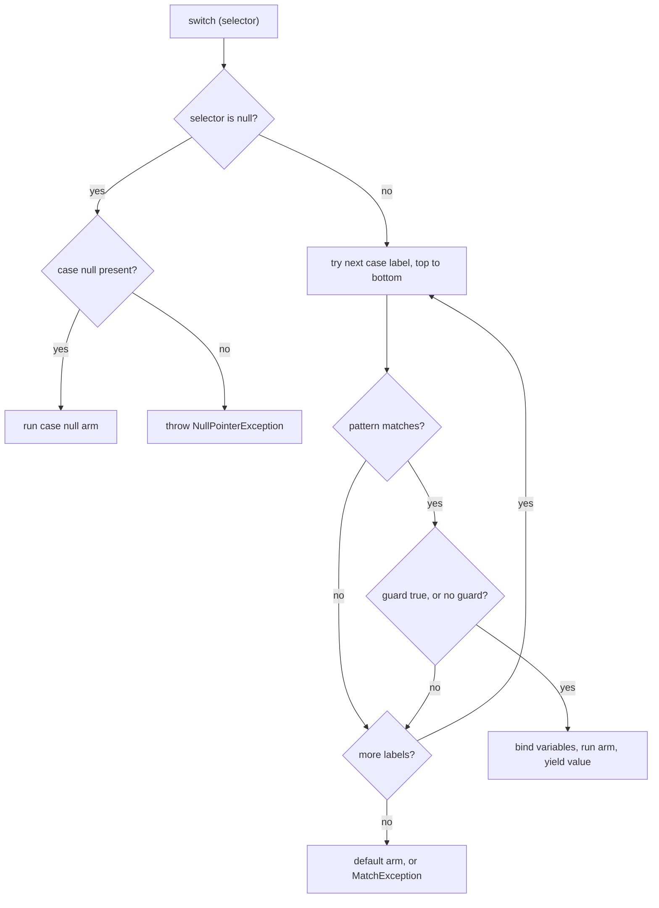
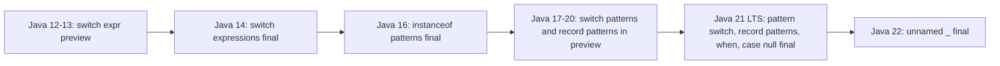
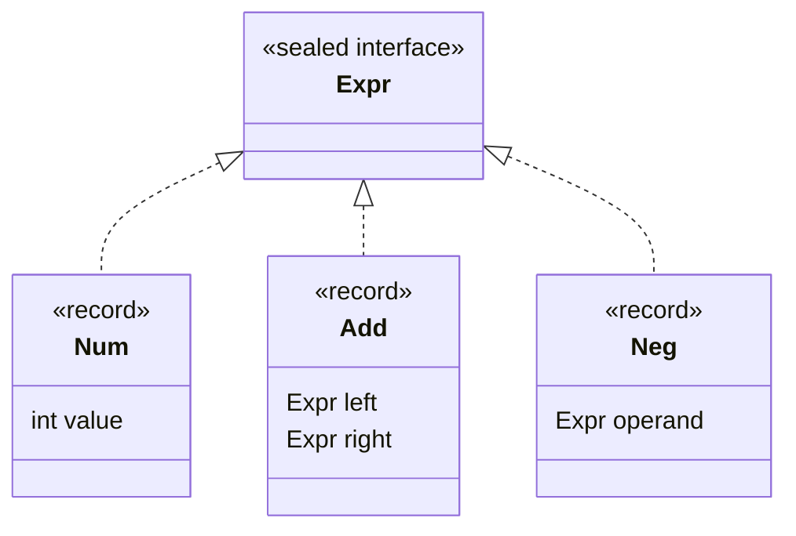

## In One Line
Modern `switch` is an **expression** that returns a value with `->` arms and no fall-through (Java 14), and **patterns** let you test a type and pull data out in one step — `o instanceof String s` (Java 16), `case Circle c` and `case Rectangle(var w, var h) when w == h` (Java 21) — so the compiler, not your discipline, checks that every case is handled.

## Mental Model
Think of a **parcel sorting machine** at a courier hub.

- The **old `switch` statement** was a row of chutes with no walls between them: a parcel dropped into chute 3 slid on into chute 4 unless someone put a `break` board in the way (fall-through).
- A **switch expression** is a machine with walled chutes: each parcel goes into exactly one chute (`->`), and the machine *must* hand back a result for every parcel. If there is a kind of parcel with no chute, the machine refuses to be built (compile error: *does not cover all possible input values*).
- A **type pattern** (`case Book b`) is a scanner that says "this is a book" *and* hands you the parcel already unwrapped as a book — no separate cast.
- A **record pattern** (`case Parcel(Address(var city, var zip), var weight)`) is an X-ray: it looks *inside* the parcel and gives you the city, zip and weight directly.
- A **guard** (`when weight > 30`) is a second check on the same chute: "books, but only heavy ones".
- **Sealed types** are the courier's official list of parcel kinds. Because the list is closed, the machine can check at build time that there is a chute for every kind — and if head office adds a new kind, every machine that forgot it stops building until you add a chute.

## Concept
### 1. The timeline — which Java version did what
| Feature | Preview in | Final in | Final JEP |
|---|---|---|---|
| `switch` on `int`/`char`/`byte`/`short` | — | 1.0 | — |
| `switch` on `enum` | — | 5 | — |
| `switch` on `String` | — | 7 | — |
| **Switch expressions** (`->`, `case 1, 2`, `yield`) | 12 (JEP 325), 13 (JEP 354: `break value` renamed to `yield`) | **14** | JEP 361 |
| **Pattern matching for `instanceof`** | 14 (JEP 305), 15 (JEP 375) | **16** | JEP 394 |
| **Pattern matching for `switch`** (type patterns, `case null`, guards) | 17, 18, 19, 20 (JEPs 406, 420, 427, 433) | **21** | JEP 441 |
| **Record patterns** (deconstruction, nesting) | 19, 20 (JEPs 405, 432) | **21** | JEP 440 |
| `when` guards | introduced in 19 (replaced the `case String s && cond` guarded patterns of 17–18) | **21** | JEP 441 |
| **Unnamed patterns and variables** `_` | 21 (JEP 443) | **22** | JEP 456 |
| Primitive types in patterns (`case int i`, switch on `long`/`double`/`boolean`) | 23, 24, 25 (JEPs 455, 488, 507) | not final as of JDK 25 | — |

Java 21 is an LTS release, so it is the first LTS where all of this (except `_`) is standard. On Java 17 (the previous LTS) you have switch expressions and `instanceof` patterns, but pattern `switch` and record patterns only as previews (`--enable-preview`).

> [!NOTE] Preview features must be switched on at compile and run time (`javac --release 21 --enable-preview`, `java --enable-preview`) and can change or disappear in the next release. Never use them in production code.

### 2. Switch expressions (Java 14)
The old `switch` is a **statement**: it does something, it returns nothing, and without `break` control **falls through** into the next case. The new form adds two independent things:

| | Colon labels `case X:` | Arrow labels `case X ->` |
|---|---|---|
| In a switch **statement** | Classic: fall-through, `break` | No fall-through; right side is an expression statement, a block or `throw` |
| In a switch **expression** | Fall-through still happens; each path must end in `yield value` | Right side is an expression (its value is the result), a block ending in `yield`, or `throw` |

```java
String kind = switch (day) {
    case SATURDAY, SUNDAY -> "weekend";                         // several labels, comma separated
    case MONDAY, TUESDAY, WEDNESDAY, THURSDAY, FRIDAY -> "weekday";
};                                                              // semicolon: it is an expression
```
Rules for switch expressions:
- **Exhaustive**: every possible selector value must be covered — by `default`, by listing all enum constants, by all permitted subtypes of a sealed type, or by an unconditional pattern. Otherwise: *the switch expression does not cover all possible input values*.
- Every arm must **produce a value or throw**. A block `{ ... }` must end with `yield value;` (otherwise: *switch rule completes without providing a value*).
- You **cannot jump out** of a switch expression: `return` (*attempt to return out of a switch expression*), `break` or `continue` to an outer statement are compile errors. Only `yield` or `throw` leave it.
- You **cannot mix** `->` and `:` in one switch (*different case kinds used in the switch*).
- The **type** of the expression follows the same rules as `?:`. If all arms are numeric, binary numeric promotion applies: `case 3 -> 1; default -> 2.5;` gives a `double`, so it prints `1.0`. If arm types are unrelated, the type is their common supertype (e.g. `Object` with an `Integer` and a `String` arm).
- If the target type is known (`String s = switch ...`), each arm is checked against it.

`yield` is a **contextual keyword** (restricted identifier), not a reserved word. `int yield = 5;` still compiles, but calling a method named `yield` without a qualifier does not: *yield outside of switch expression (to invoke a method called yield, qualify the yield with a receiver or type name)* — that is why you must write `Thread.yield()`.

### 3. Selector types
| Selector type | Allowed since |
|---|---|
| `char`, `byte`, `short`, `int` and their wrappers `Character`, `Byte`, `Short`, `Integer` | 1.0 (wrappers via unboxing since 5) |
| `enum` types | 5 |
| `String` | 7 (compiled to `hashCode()` + `equals()`) |
| **Any reference type** (`Object`, a sealed interface, a record, arrays...) with pattern labels | 21 |
| `long`, `float`, `double`, `boolean` | not allowed (*selector type long is not allowed*); only with the preview "primitive types in patterns" feature (JDK 23+) |

### 4. Pattern matching for `instanceof` (Java 16)
```java
// before: test, cast, use -- the type is written three times
if (o instanceof String) {
    String s = (String) o;
    System.out.println(s.length());
}
// Java 16+: a type pattern tests AND binds
if (o instanceof String s) {
    System.out.println(s.length());
}
```
`String s` is a **type pattern**; `s` is a **pattern variable** (binding). It exists only where the compiler can prove the match succeeded — this is called **flow scoping**:

| Code | Is `s` in scope? |
|---|---|
| `if (o instanceof String s) { here }` | Yes, inside the `if` block |
| `if (o instanceof String s && s.length() > 3)` | Yes, on the right of `&&` |
| `if (o instanceof String s \|\| s.isEmpty())` | **No** — compile error *cannot find symbol*, because the right side runs exactly when the match failed |
| `if (!(o instanceof String s)) return; s.length();` | Yes, **after** the `if`, because the method would have returned otherwise |
| `while (!(o instanceof String s)) { ... } s.length();` | Yes, after the loop |
| `o instanceof String s ? s.length() : 0` | Yes, in the true branch |

Details worth knowing:
- `null instanceof X` is always `false`, so a pattern never binds `null` and never throws.
- The pattern variable is an ordinary local: since Java 16 you may **reassign** it (in the 14–15 previews it was implicitly final). Write `o instanceof final String s` to forbid that.
- **Java 16–20**: `s instanceof String t` where `s` is already a `String` was a compile error (the test is pointless). **Java 21** allows such *unconditional* patterns (javac 21 with `--release 17` says *unconditional patterns in instanceof are not supported in -source 17*).
- Generic types must be **reifiable** or provably safe: `o instanceof List<String> l` fails with *Object cannot be safely cast to List<String>*; use `List<?> l`.
- If the cast could never succeed, it is a compile error, just like a cast: `Integer i; i instanceof String s` → *incompatible types*.
- The classic one-liner: `return other instanceof Point p && p.x == x && p.y == y;` inside `equals`.

### 5. Pattern matching for `switch` (Java 21)
```java
static String format(Object o) {
    return switch (o) {
        case null                      -> "null!";
        case Integer i when i < 0      -> "negative int " + i;
        case Integer i                 -> "int " + i;
        case String s when s.isBlank() -> "blank string";
        case String s                  -> "string \"" + s + "\"";
        case int[] arr                 -> "int array of length " + arr.length;
        default                        -> "other: " + o.getClass().getSimpleName();
    };
}
```
How it evaluates:
1. If the selector is `null`: jump to `case null` if there is one, otherwise throw **`NullPointerException`**. `default` does **not** catch `null`.
2. Otherwise test the case labels **top to bottom**. A label matches if its pattern matches *and* its `when` guard (if any) is `true`.
3. The **first** match wins; its pattern variables are in scope in the guard and in that arm only.
4. If nothing matches, run `default`. If there is no `default` (the switch was exhaustive by sealed types or enums), the compiler-generated fallback throws **`MatchException`** (possible only if classes changed after compilation — see below).

#### Dominance — order matters and the compiler checks it
A label is **dominated** if an earlier label already matches everything it could match. That is a compile error: *this case label is dominated by a preceding case label*.
```java
case CharSequence cs -> ...
case String s -> ...            // error: every String is a CharSequence
```
- An **unguarded** type pattern dominates later patterns of the same type or a subtype, and constant labels of that type (`case Integer i` then `case 1` is an error).
- A **guarded** pattern dominates nothing: `case String s when s.length() > 3` followed by `case String s` is fine (and is the idiom: specific first, general last). The reverse order is an error.
- In a switch with patterns, `default` must come after the pattern labels (a `default` before `case String s` is reported as dominating it).
- You cannot have both `default` and an **unconditional pattern** (`case Object o` for an `Object` selector): *switch has both an unconditional pattern and a default label*.

#### `case null`
- `case null ->` handles `null` explicitly; `case null, default ->` combines both.
- `case null` works in any switch whose selector is a reference type, including a plain `String` switch.
- Without `case null`, every switch — old or new — throws `NullPointerException` on a `null` selector (for compatibility).

#### Exhaustiveness
| Switch kind | Must be exhaustive? |
|---|---|
| Switch **expression** (any kind) | Always |
| Switch **statement** using patterns or `case null` | Yes (*the switch statement does not cover all possible input values*) |
| Old-style switch statement on `int`/`String`/`enum` with only constants | No (backward compatibility) |

A switch is exhaustive if it has `default`, an unconditional pattern, all constants of an enum, or covers every permitted subtype of a **sealed** type (recursively, and for record patterns every combination of components).

> [!TIP] For a sealed hierarchy or an enum, **leave out `default`**. Then adding a new subtype or constant turns every switch that forgot it into a compile error — the compiler finds all the places you must update. A `default` hides them.

#### `MatchException` and separate compilation
If `Level` had `LOW, HIGH` when the switch was compiled and a `CRITICAL` constant is added later without recompiling the switch, there is no matching arm at run time. Java 21 throws `java.lang.MatchException` from the synthetic default; Java 14–20 threw `IncompatibleClassChangeError` for enum switch expressions. An **old-style switch statement** silently does nothing for the new constant. `MatchException` is also thrown (wrapping the cause) when a record accessor throws during a record-pattern match.

#### Qualified enum constants (Java 21)
Case labels may now be qualified enum constants: `case Color.RED ->` (before 21: *an enum switch case label must be the unqualified name of an enumeration constant*). This lets you mix constants of several enums in a switch over a sealed interface they all implement.

#### Colon labels with patterns
Pattern labels work with `:` too, but you cannot fall through **into** a pattern (its variable would be unbound): *illegal fall-through to a pattern*. In practice, always use `->` with patterns.

#### How it is compiled
A `String` switch compiles to a `lookupswitch` on `hashCode()` followed by `equals()` checks — which is why a `null` `String` selector fails with *Cannot invoke "String.hashCode()"*. A pattern switch without `case null` starts with `Objects.requireNonNull(selector)`, then makes an `invokedynamic` call to `java.lang.runtime.SwitchBootstraps.typeSwitch` (or `enumSwitch`), which returns the index of the first matching label; a `tableswitch`/`lookupswitch` jumps to that arm. A guard is evaluated at the start of its arm; if it is false, the code loops back and calls `typeSwitch` again with a *restart index* of the next label (you can see this with `javap -c`).

### 6. Record patterns (Java 21)
A record pattern **deconstructs** a record into its components by calling its accessor methods:
```java
record Rectangle(double width, double height) implements Shape {}

case Rectangle(double w, double h) when w == h -> "square";
case Rectangle(var w, var h)                   -> "rectangle " + w + "x" + h;
```
- The component patterns can be type patterns (`double w`), `var` patterns (`var w` — type inferred from the component), or **nested record patterns**: `case Add(Num(int a), Num(int b)) -> new Num(a + b)`.
- Works in `instanceof` too: `if (obj instanceof Point(int x, int y)) ...`.
- **Generic records** — the type arguments are inferred: with `Box<String> box`, `case Box(var s)` gives `s` the type `String`.
- **`null`**: a record pattern never matches `null` itself. A nested `var` pattern or a type pattern that covers the whole component type (`Object a` for an `Object` component) matches a `null` component; a narrower type pattern (`String a` for an `Object` component) does not.
- Names in the pattern are yours; they do not have to match the component names.
- The number of component patterns must equal the number of record components.
- In Java 20's preview, record patterns were also allowed in enhanced `for` loops; this was **removed** in Java 21.

**Unnamed patterns (`_`)** — preview in 21, final in **22**: `case Point(int x, _)` ignores a component, `case Circle _ ->` ignores the binding, and `catch (Exception _)` names an unused variable. In JDK 21 without `--enable-preview`: *unnamed variables are a preview feature and are disabled by default*.

### 7. Guards (`when`)
- Syntax: `case <pattern> when <boolean expression> ->`.
- The guard can use the pattern's variables; any **other local variables** it uses must be final or effectively final (*local variables referenced from a guard must be final or effectively final*).
- Only pattern labels can have guards — not `case 1 when ...` or `default when ...`.
- Guards break exhaustiveness reasoning: the compiler treats a guarded case as possibly not matching, so `case Circle c when c.r() > 0` alone does **not** cover `Circle`.

### 8. Data-oriented programming: sealed + records + pattern switch
```java
sealed interface Expr permits Num, Add, Mul, Neg {}
record Num(int value) implements Expr {}
record Add(Expr left, Expr right) implements Expr {}

static int eval(Expr e) {
    return switch (e) {
        case Num n             -> n.value();
        case Add(var l, var r) -> eval(l) + eval(r);
        case Mul(var l, var r) -> eval(l) * eval(r);
        case Neg(var x)        -> -eval(x);
    };
}
```
Records model the **data** (immutable, transparent), the sealed interface lists **all the variants**, and a switch expression defines each **operation** in one place with compiler-checked exhaustiveness. This is Java's version of algebraic data types, and it replaces the Visitor pattern for closed hierarchies.

| | Classic OOP (virtual method per subclass) | Visitor pattern | Sealed + pattern switch |
|---|---|---|---|
| Add a new **type** | Easy: one new class | Hard: change every visitor | Compiler flags every switch to update |
| Add a new **operation** | Change every class | Easy: one new visitor | Easy: one new method with a switch |
| Boilerplate | Low | High (`accept`/`visit` everywhere) | Low |
| Best when | Types grow, operations are fixed | Operations grow, but you are stuck before Java 21 | Types are a closed set, operations grow |

See [Records](lesson:b05-modern-java/03-records) and [Sealed Classes](lesson:b05-modern-java/04-sealed-classes) for the two building blocks.

## Diagram

How a pattern switch picks an arm: null is handled first, then labels are tried in order, and a failed guard simply moves on to the next label.


The release to remember: **14** for switch expressions, **16** for `instanceof` patterns, **21** for everything else.


A closed set of record variants is what makes `switch (expr)` exhaustive without `default`, and what nested record patterns like `Add(Num(int a), Num(int b))` look into.

## Code
**1. Switch expressions: arrow labels, multiple labels, `yield`, typing, `null`**
```java
import java.time.DayOfWeek;

public class SwitchExpressionDemo {
    public static void main(String[] args) {
        // 1. Old statement switch: colon labels, fall-through, break needed
        int day = 3;
        String oldName;
        switch (day) {
            case 1:
                oldName = "Mon";
                break;
            case 2:
                oldName = "Tue";
                break;
            case 3:
                oldName = "Wed";          // no break: falls through into case 4!
            case 4:
                oldName = "Thu";
                break;
            default:
                oldName = "?";
        }
        System.out.println("1. old switch with a missing break: " + oldName);

        // 2. Switch EXPRESSION (Java 14): arrow labels, no fall-through, yields a value
        String newName = switch (day) {
            case 1 -> "Mon";
            case 2 -> "Tue";
            case 3 -> "Wed";
            case 4 -> "Thu";
            default -> "?";
        };
        System.out.println("2. switch expression: " + newName);

        // 3. Several labels per case, exhaustive over an enum (no default needed)
        for (DayOfWeek d : new DayOfWeek[] { DayOfWeek.SATURDAY, DayOfWeek.WEDNESDAY }) {
            String kind = switch (d) {
                case SATURDAY, SUNDAY -> "weekend";
                case MONDAY, TUESDAY, WEDNESDAY, THURSDAY, FRIDAY -> "weekday";
            };
            System.out.println("3. " + d + " is a " + kind);
        }

        // 4. A block on the right of -> must 'yield' its value
        String word = "Racecar";
        int score = switch (word.length()) {
            case 0 -> 0;
            case 1, 2, 3 -> 1;
            default -> {
                String lower = word.toLowerCase();
                boolean palindrome = new StringBuilder(lower).reverse().toString().equals(lower);
                yield palindrome ? 100 : 10;
            }
        };
        System.out.println("4. score = " + score);

        // 5. Colon labels also work in a switch expression: yield instead of break
        int month = 2;
        int days = switch (month) {
            case 4: case 6: case 9: case 11:
                yield 30;
            case 2:
                System.out.println("5. (February: ignoring leap years)");
                yield 28;
            default:
                yield 31;
        };
        System.out.println("5. days = " + days);

        // 6. Arrow labels in a plain switch STATEMENT: no value, no fall-through
        switch (day) {
            case 1, 7 -> System.out.println("6. start or end");
            case 3 -> {
                System.out.println("6. middle of the week");
                System.out.println("6. (a block, still no fall-through)");
            }
            default -> System.out.println("6. some other day");
        }

        // 7. The type of a switch expression: numeric arms are promoted, like ?:
        var mixed = switch (day) {
            case 3 -> 1;         // int
            default -> 2.5;      // double
        };
        System.out.println("7. mixed = " + mixed);
        Object boxed = switch (day) {
            case 3 -> 1;
            default -> "two";
        };
        System.out.println("7. boxed = " + boxed + " (" + boxed.getClass().getSimpleName() + ")");

        // 8. A switch expression can throw instead of yielding
        try {
            int bad = switch ("xyz") {
                case "a" -> 1;
                case "b" -> 2;
                default -> throw new IllegalArgumentException("unknown code: xyz");
            };
            System.out.println(bad);
        } catch (IllegalArgumentException e) {
            System.out.println("8. " + e.getMessage());
        }

        // 9. Switching on a null String without 'case null' throws NullPointerException
        String code = null;
        try {
            switch (code) {
                case "a" -> System.out.println("a");
                default -> System.out.println("default");
            }
        } catch (NullPointerException e) {
            System.out.println("9. NPE: default does NOT catch null");
        }
    }
}
```
```output
1. old switch with a missing break: Thu
2. switch expression: Wed
3. SATURDAY is a weekend
3. WEDNESDAY is a weekday
4. score = 100
5. (February: ignoring leap years)
5. days = 28
6. middle of the week
6. (a block, still no fall-through)
7. mixed = 1.0
7. boxed = 1 (Integer)
8. unknown code: xyz
9. NPE: default does NOT catch null
```

**2. `instanceof` patterns and flow scoping**
```java
import java.util.List;

public class InstanceofPatternDemo {
    public static void main(String[] args) {
        Object[] things = { "hello", 42, 3.5, List.of(1, 2), null, "" };
        for (Object o : things) {
            System.out.println(describe(o));
        }
        System.out.println("length of 'pattern' = " + lengthOrZero("pattern"));
        System.out.println("length of 7 = " + lengthOrZero(7));
        System.out.println(new Point(1, 2).equals(new Point(1, 2)) + " " + new Point(1, 2).equals("1,2"));
    }

    static String describe(Object o) {
        // Before Java 16: test, then cast, then use -- three mentions of String
        if (o instanceof String) {
            String old = (String) o;
            if (old.isEmpty()) return "old style: empty string";
        }
        // Java 16+: test and bind in one step; s is only in scope where the test is true
        if (o instanceof String s && !s.isEmpty()) {
            return "String of length " + s.length();
        }
        if (o instanceof Integer i) {
            return "Integer, doubled = " + (i * 2);
        }
        if (o instanceof List<?> list) {
            return "List with " + list.size() + " elements";
        }
        // null instanceof anything is false, so no NPE
        return "something else: " + o;
    }

    // Flow scoping: after the negated test returns, the binding is in scope for the rest of the method
    static int lengthOrZero(Object o) {
        if (!(o instanceof String s)) {
            return 0;
        }
        return s.length();
    }

    // The classic use: a one-line equals()
    static final class Point {
        private final int x, y;
        Point(int x, int y) { this.x = x; this.y = y; }

        @Override
        public boolean equals(Object other) {
            return other instanceof Point p && p.x == x && p.y == y;
        }

        @Override
        public int hashCode() { return 31 * x + y; }
    }
}
```
```output
String of length 5
Integer, doubled = 84
something else: 3.5
List with 2 elements
something else: null
old style: empty string
length of 'pattern' = 7
length of 7 = 0
true false
```

**3. Pattern `switch` over a sealed hierarchy: type patterns, record patterns, guards, `case null`**
```java
public class ShapeSwitchDemo {

    sealed interface Shape permits Circle, Rectangle, Triangle {}
    record Circle(double radius) implements Shape {}
    record Rectangle(double width, double height) implements Shape {}
    record Triangle(double base, double height) implements Shape {}

    // 1. Type patterns over a sealed hierarchy: exhaustive, so no default
    static double area(Shape shape) {
        return switch (shape) {
            case Circle c    -> Math.PI * c.radius() * c.radius();
            case Rectangle r -> r.width() * r.height();
            case Triangle t  -> 0.5 * t.base() * t.height();
        };
    }

    // 2. Record patterns deconstruct the components; 'when' guards refine a case
    static String classify(Shape shape) {
        return switch (shape) {
            case Circle(double r) when r == 0            -> "a point";
            case Circle(double r)                        -> "circle, r=" + r;
            case Rectangle(double w, double h) when w == h -> "square " + w + "x" + h;
            case Rectangle(var w, var h)                 -> "rectangle " + w + "x" + h;
            case Triangle t                              -> "triangle";
        };
    }

    // 3. Pattern switch over Object: order matters, case null, default
    static String format(Object o) {
        return switch (o) {
            case null                        -> "null!";
            case Integer i when i < 0        -> "negative int " + i;
            case Integer i                   -> "int " + i;
            case Long l                      -> "long " + l;
            case String s when s.isBlank()   -> "blank string";
            case String s                    -> "string \"" + s + "\"";
            case int[] arr                   -> "int array of length " + arr.length;
            case Shape s                     -> "shape with area " + String.format("%.2f", area(s));
            default                          -> "other: " + o.getClass().getSimpleName();
        };
    }

    public static void main(String[] args) {
        Shape[] shapes = { new Circle(1), new Circle(0), new Rectangle(2, 2),
                           new Rectangle(2, 3), new Triangle(4, 5) };
        for (Shape s : shapes) {
            System.out.printf("%-32s area=%6.2f  %s%n", s, area(s), classify(s));
        }
        Object[] values = { null, -5, 7, 8L, "  ", "hi", new int[3], new Rectangle(1, 4), 2.0 };
        for (Object v : values) {
            System.out.println(format(v));
        }
    }
}
```
```output
Circle[radius=1.0]               area=  3.14  circle, r=1.0
Circle[radius=0.0]               area=  0.00  a point
Rectangle[width=2.0, height=2.0] area=  4.00  square 2.0x2.0
Rectangle[width=2.0, height=3.0] area=  6.00  rectangle 2.0x3.0
Triangle[base=4.0, height=5.0]   area= 10.00  triangle
null!
negative int -5
int 7
long 8
blank string
string "hi"
int array of length 3
shape with area 4.00
other: Double
```

**4. Nested record patterns: an expression evaluator without the Visitor pattern**
```java
public class ExprDemo {

    // A tiny expression language: data (records) + one sealed type
    sealed interface Expr permits Num, Add, Mul, Neg {}
    record Num(int value) implements Expr {}
    record Add(Expr left, Expr right) implements Expr {}
    record Mul(Expr left, Expr right) implements Expr {}
    record Neg(Expr operand) implements Expr {}

    // Evaluation: one exhaustive switch replaces the whole Visitor pattern
    static int eval(Expr e) {
        return switch (e) {
            case Num n              -> n.value();
            case Add(var l, var r)  -> eval(l) + eval(r);
            case Mul(var l, var r)  -> eval(l) * eval(r);
            case Neg(var x)         -> -eval(x);
        };
    }

    // Simplification: NESTED record patterns look deep inside the tree
    static Expr simplify(Expr e) {
        return switch (e) {
            case Add(Num(int a), Num(int b))      -> new Num(a + b);       // fold constants
            case Mul(Num(int one), var x) when one == 1 -> simplify(x);   // 1 * x = x
            case Mul(Num(int zero), var x) when zero == 0 -> new Num(0);  // 0 * x = 0
            case Neg(Neg(var x))                  -> simplify(x);          // --x = x
            case Add(var l, var r)                -> new Add(simplify(l), simplify(r));
            case Mul(var l, var r)                -> new Mul(simplify(l), simplify(r));
            case Neg(var x)                       -> new Neg(simplify(x));
            case Num n                            -> n;
        };
    }

    static String show(Expr e) {
        return switch (e) {
            case Num(int v)        -> String.valueOf(v);
            case Add(var l, var r) -> "(" + show(l) + " + " + show(r) + ")";
            case Mul(var l, var r) -> show(l) + " * " + show(r);
            case Neg(var x)        -> "-" + show(x);
        };
    }

    public static void main(String[] args) {
        Expr e = new Add(new Mul(new Num(1), new Neg(new Neg(new Num(7)))),
                         new Add(new Num(2), new Num(3)));
        System.out.println("expr       : " + show(e));
        System.out.println("value      : " + eval(e));
        Expr s = simplify(e);
        System.out.println("simplified : " + show(s));
        System.out.println("as record  : " + s);
        System.out.println("value      : " + eval(s));
    }
}
```
```output
expr       : (1 * --7 + (2 + 3))
value      : 12
simplified : (7 + 5)
as record  : Add[left=Num[value=7], right=Num[value=5]]
value      : 12
```

**5. Record pattern edge cases: generic inference, `null` components, qualified enum labels, `MatchException`**
```java
public class RecordPatternEdges {
    record Box<T>(T content) {}
    record Pair(Object first, Object second) {}

    enum Color { RED, GREEN }
    enum Size { SMALL, LARGE }
    sealed interface Attr permits Color2, Size2 {}
    enum Color2 implements Attr { RED, GREEN }
    enum Size2 implements Attr { SMALL, LARGE }

    record Fragile(int x) {
        public int x() { throw new IllegalStateException("accessor failed"); }
    }

    static String unbox(Box<String> box) {
        // Java 21 infers Box<String> from the selector: no type argument needed
        return switch (box) {
            case Box(var s) when s == null -> "empty box";
            case Box(var s)                -> "box of " + s.length() + " chars";
        };
    }

    static String nulls(Object o) {
        return switch (o) {
            case Pair(String a, String b) -> "two strings: " + a + ", " + b;
            case Pair(Object a, var b)    -> "pair: " + a + ", " + b;   // Object and var match null components
            case null                     -> "null selector";
            default                       -> "not a pair";
        };
    }

    // Java 21: qualified enum constants as case labels when the selector is a sealed interface
    static String attr(Attr a) {
        return switch (a) {
            case Color2.RED   -> "red";
            case Color2.GREEN -> "green";
            case Size2 s      -> "size " + s.name().toLowerCase();
        };
    }

    public static void main(String[] args) {
        System.out.println(unbox(new Box<>("java")));
        System.out.println(unbox(new Box<>(null)));
        System.out.println(nulls(new Pair("a", "b")));
        System.out.println(nulls(new Pair("a", null)));    // String pattern does not match null
        System.out.println(nulls(new Pair(null, null)));
        System.out.println(nulls(null));
        System.out.println(nulls(42));
        System.out.println(attr(Color2.GREEN) + ", " + attr(Size2.LARGE));

        Object f = new Fragile(1);
        try {
            if (f instanceof Fragile(int x)) System.out.println(x);
        } catch (MatchException e) {
            System.out.println(e.getClass().getSimpleName() + " caused by " + e.getCause());
        }
        // A plain record pattern never matches null
        Object nothing = null;
        System.out.println(nothing instanceof Box(var c));
    }
}
```
```output
box of 4 chars
empty box
two strings: a, b
pair: a, null
pair: null, null
null selector
not a pair
green, size large
MatchException caused by java.lang.IllegalStateException: accessor failed
false
```

**6. Separate compilation: a new enum constant reaches an old exhaustive switch**
```java
// Level.java, version 1:  public enum Level { LOW, HIGH }
// Level.java, version 2:  public enum Level { LOW, HIGH, CRITICAL }
public class Main {
    static String label(Level l) {
        return switch (l) {          // exhaustive for LOW, HIGH: no default
            case LOW  -> "relax";
            case HIGH -> "act";
        };
    }
    static void stmt(Level l) {
        switch (l) {                 // old-style statement: need not be exhaustive
            case LOW: System.out.println("stmt: low"); break;
            case HIGH: System.out.println("stmt: high"); break;
        }
    }
    public static void main(String[] args) {
        for (Level l : Level.values()) {
            stmt(l);
            System.out.println(l + " -> " + label(l));
        }
    }
}
```
```text
javac -d out v1/Level.java Main.java     # compile everything against version 1
javac -d out v2/Level.java               # recompile ONLY the enum with CRITICAL
java -cp out Main
```
```output
stmt: low
LOW -> relax
stmt: high
HIGH -> act
Exception in thread "main" java.lang.MatchException
	at Main.label(Main.java:3)
	at Main.main(Main.java:17)
```
The same steps with `javac --release 17` end in `java.lang.IncompatibleClassChangeError` instead of `MatchException`.

## Walkthrough
### 1. `SwitchExpressionDemo`
- **Block 1** is the classic bug: `case 3` sets `"Wed"` but has no `break`, so control **falls through** into `case 4`, which overwrites it with `"Thu"`, then `break`s. Output `Thu` although `day` is 3.
- **Block 2** is the same logic as a switch expression. Each `->` arm is independent; there is nothing to fall into. The whole `switch (...) { ... }` is an expression assigned to `newName` and ends with `;`.
- **Block 3** uses `java.time.DayOfWeek`. `case SATURDAY, SUNDAY` lists several labels in one arm (inside a switch on an enum the constants are written unqualified). All seven constants are covered, so the expression is exhaustive **without** `default`.
- **Block 4**: the `default` arm needs several statements, so it is a block; `yield palindrome ? 100 : 10;` supplies its value. `"Racecar".length()` is 7 → `default`; lower-cased it reads the same backwards → `100`.
- **Block 5**: colon labels inside a switch *expression*. `case 4: case 6: case 9: case 11:` is the old way of grouping (stacked labels fall through into the shared `yield 30`). `case 2` runs a print, then `yield 28`. `yield` here replaces `break` — and fall-through still exists with colons, so don't forget it.
- **Block 6**: arrow labels in a switch *statement* — no value, no `yield`, no fall-through; a block `{ }` groups two statements.
- **Block 7**: the arms are `int` and `double`, so the type of the whole expression is `double` (binary numeric promotion, exactly like `cond ? 1 : 2.5`). `var mixed` is a `double`, and `1` prints as `1.0`. With a target type of `Object`, `1` is boxed to `Integer`.
- **Block 8**: an arm may be `throw ...` — it does not need to produce a value. Here `"xyz"` matches neither `"a"` nor `"b"`, so `default` throws and the `catch` prints the message.
- **Block 9**: the selector is `null`. Without `case null`, the switch throws `NullPointerException` **before** any label is examined — `default` is not a catch-all for `null`.

### 2. `InstanceofPatternDemo`
- `describe` first shows the pre-16 idiom for contrast: `instanceof String`, then an explicit cast `(String) o`, then use. The empty string `""` is the only value that returns from this block.
- `o instanceof String s && !s.isEmpty()` — `s` is bound only if the test succeeds, and it is usable on the right of `&&` because `&&` evaluates its right side only when the left is true. `"hello"` → length 5.
- `o instanceof Integer i` binds an `Integer`; `i * 2` auto-unboxes → 84.
- `3.5` is a `Double`, matching none of the tests → the fallback line.
- `o instanceof List<?> list` — `List.of(1, 2)` is a `List`; the wildcard `<?>` is required because `List<Integer>` is not checkable at runtime (erasure).
- `null` makes every `instanceof` false — no exception, the fallback prints `something else: null`.
- `lengthOrZero` shows **flow scoping** with a negated test: if the value is *not* a `String` the method returns, so after the `if` the compiler knows `s` is bound. `"pattern"` → 7, `7` → 0.
- `Point.equals` is the textbook use: `other instanceof Point p && p.x == x && p.y == y` handles `null`, the type check, the cast and the comparison in one expression. `new Point(1, 2).equals("1,2")` is `false` because a `String` is not a `Point`.

### 3. `ShapeSwitchDemo`
- `sealed interface Shape permits Circle, Rectangle, Triangle` — the compiler knows the complete list of subtypes. Each is a **record** (implicitly final), so the hierarchy is closed.
- `area` uses **type patterns**. Because all three permitted types are covered, the switch expression is exhaustive with no `default`.
- `classify` uses **record patterns**: `Circle(double r)` calls `radius()` and binds it to `r`. The guarded `case Circle(double r) when r == 0` must come **before** the unguarded `Circle(double r)`, otherwise it would be dominated. `Rectangle(var w, var h)` shows `var` component patterns (inferred `double`). `Circle(0)` → `a point`; `Rectangle(2, 2)` → `square`.
- `format` switches on `Object`: `case null` handles the `null` element; `Integer i when i < 0` catches `-5`; `8L` autoboxes to `Long`; `"  "` is blank; `new int[3]` matches the **array type pattern** `int[] arr`; `Rectangle(1, 4)` matches `case Shape s` (area 4.00); `2.0` is a `Double` → `default`, which is required because `Object` has no closed list of subtypes.
- `printf("%-32s ...")` left-aligns each record's `toString()` (records generate `Circle[radius=1.0]`) in 32 columns, `%6.2f` prints the area with two decimals, `%n` is the platform line separator.

### 4. `ExprDemo`
- Four records implement the sealed `Expr`. The tree built in `main` is `(1 * --7) + (2 + 3)`.
- `eval` is the entire interpreter: one arm per variant, recursion for children. No `accept`/`visit` methods, no double dispatch.
- `simplify` uses **nested** record patterns: `Add(Num(int a), Num(int b))` only matches an `Add` whose *both* children are `Num`s, and binds the two ints directly. `Mul(Num(int one), var x) when one == 1` rewrites `1 * x` to `x`. `Neg(Neg(var x))` removes a double negation.
- Walking the example: the root `Add` does not have two `Num` children, so the general `Add(var l, var r)` arm simplifies both sides. The left side `Mul(Num(1), Neg(Neg(Num(7))))` matches the `1 * x` rule and becomes `simplify(Neg(Neg(Num(7))))` → `Num(7)`. The right side `Add(Num(2), Num(3))` is folded to `Num(5)`. Result `Add(Num(7), Num(5))`.
- `show` prints `Mul` without parentheses, which is why the first line reads `(1 * --7 + (2 + 3))` — a display shortcut, not a precedence error. The record's own `toString()` shows the real structure: `Add[left=Num[value=7], right=Num[value=5]]`.
- Both trees evaluate to 12 — simplification preserves meaning. It is a single pass: a result such as `Add(Num(7), Num(5))` is not folded again unless you call `simplify` repeatedly.

### 5. `RecordPatternEdges`
- `unbox(Box<String> box)`: `case Box(var s)` — no `<String>` written; Java 21 infers the record's type argument from the selector, so `s` is a `String` and `s.length()` compiles. The guarded arm handles the `null` content first. The second arm is the unguarded version of the same pattern, which makes the switch exhaustive.
- `nulls`: `Pair("a", null)` does **not** match `Pair(String a, String b)` — a `String` type pattern for an `Object` component rejects `null`. It matches `Pair(Object a, var b)` because `Object` is the component's full type and `var` always matches. `case null` catches a `null` selector; `42` is not a `Pair` → `default`.
- `enum Color`/`Size` are declared but unused — they only show that plain enums exist next to the sealed ones. `Color2` and `Size2` both implement the sealed `Attr`, so `attr` can mix the **qualified constants** `Color2.RED`/`Color2.GREEN` with a type pattern `Size2 s`. Covering both enums completely makes the switch exhaustive.
- `Fragile` overrides its accessor `x()` to throw. The record pattern `Fragile(int x)` calls that accessor, and the exception arrives wrapped in `MatchException` (its `getCause()` is the original).
- `nothing instanceof Box(var c)` is `false`: a record pattern never matches `null`.

### 6. Separate compilation
- `Main` was compiled when `Level` had two constants, so `label`'s switch expression is exhaustive and the compiler inserted a hidden default that throws.
- After only `Level` is recompiled with `CRITICAL`, `Level.values()` returns three constants. For `CRITICAL`, `stmt` prints **nothing** (an old statement switch just skips unmatched values), then `label` has no arm and throws `MatchException` — at line 3, the `switch` line. With classes compiled for Java 17, the same situation throws `IncompatibleClassChangeError`.
- The lesson: exhaustive switches fail **loudly** at run time when the hierarchy changes behind their back — and recompiling makes them fail at **compile time**, which is even better.

## Traps
- **`default` does not handle `null`.** Every switch throws `NullPointerException` on a `null` selector unless it has `case null` (Java 21).
- **Dominance errors**: a general case before a specific one (`CharSequence` before `String`, `Integer i` before `case 1`, unguarded before guarded) does not compile. Put specific and guarded cases first.
- **Colon labels still fall through**, even inside a switch expression. Prefer `->` everywhere.
- **Mixed arm types change the result type**: `case 3 -> 1; default -> 2.5;` makes the expression `double`, so `1` prints as `1.0`. With `Integer` and `Double` wrapper arms, unboxing and promotion happen too.
- **`||` kills pattern variables**: `o instanceof String s || s.isEmpty()` does not compile. Use `&&`, or invert the test.
- **A pattern variable can shadow a field**: in `if (o instanceof String name)` inside a class with a field `name`, the local wins inside the scope — confusing; choose a different name.
- **`default` in a switch over a sealed type or enum** silences the compiler when a new subtype or constant is added. Omit it to get compile errors instead.
- **Guards do not count for exhaustiveness**: `case Circle c when c.radius() > 0` alone leaves `Circle` uncovered; add an unguarded `case Circle c`.
- **`return`/`break`/`continue` inside a switch expression** are compile errors — you can only `yield` or `throw`.
- **Record patterns call accessors**: an overridden accessor with side effects or exceptions runs during matching; an exception becomes `MatchException`.
- **`List<String>` in a pattern** is unchecked: use `List<?>`.
- **Preview-era syntax you may find online** (`case String s && s.length() > 3`, parenthesised patterns, record patterns in `for` loops) does **not** compile in Java 21.

> [!WARNING] `yield` is only a keyword inside a switch expression, but it still breaks old code that called a method named `yield(...)` without a qualifier. Write `this.yield(...)` or `Thread.yield()`.

## Tips & Tricks
- **Version hooks — "14, 16, 21, 22":** 14 = switch **E**xpressions, 16 = **i**nstanceof patterns, 21 = **S**witch patterns + **R**ecord patterns + `when` + `case null`, 22 = `_`. Previews always came one to four releases earlier.
- **"Arrow = no fall-through, block = yield."** If the arm is a block `{}`, it needs `yield` (in an expression).
- **"Specific first, general last"** — the same rule as ordering `catch` blocks. The compiler enforces both.
- **"Sealed + record + switch = no default."** Let the compiler tell you what you forgot.
- **Read `case Rectangle(var w, var h) when w == h` aloud** as "a rectangle whose width and height, called w and h, are equal".
- **Negated `instanceof` for guard clauses:** `if (!(o instanceof Order order)) throw ...;` then use `order` for the rest of the method.
- **One-line `equals`:** `return o instanceof Point p && x == p.x && y == p.y;`
- **Replacing an `if-else instanceof` ladder:** turn it into `switch (o) { case A a -> ...; case B b -> ...; default -> ...; }` — shorter, ordered, and checked for dominance.
- **Use `case null, default ->`** when `null` and "anything else" should be treated the same.

## Interview Q&A
### [Basic] What is the difference between a switch statement and a switch expression?
A **switch statement** performs actions and produces no value; with colon labels it falls through from one case to the next unless you `break`. A **switch expression** (final in Java 14) evaluates to a value, so you can assign or return it: `String s = switch (x) { case 1 -> "one"; default -> "many"; };`. It must be **exhaustive** (every input covered), each arm must yield a value or throw, and you cannot `return`/`break` out of it. The arrow form `case X ->` has no fall-through and can be used in both statements and expressions; several labels can share an arm with `case 1, 2, 3 ->`.

**Follow-up:** *How do you return a value from a multi-statement arm?* — Use a block and `yield value;` (Java 13 preview had `break value;`, renamed to `yield` before it became final in 14).

### [Basic] What is pattern matching for `instanceof`, and which version introduced it?
It combines the type test, the cast and the variable declaration: `if (obj instanceof String s) { s.length(); }`. It was a preview in Java 14 and 15 and became final in **Java 16** (JEP 394). The pattern variable is only in scope where the match is guaranteed — inside the `if`, on the right of `&&`, or after an `if (!(obj instanceof String s)) return;`. A `null` never matches, so it is null-safe.

**Follow-up:** *Why does `obj instanceof String s || s.isEmpty()` not compile?* — The right side of `||` only runs when the match failed, so `s` would be unbound; the compiler reports *cannot find symbol*.

### [Basic] What does `yield` do and is it a reserved keyword?
`yield` supplies the value of a switch expression from a block arm (or from a colon-style case). It is a **contextual keyword**: it has special meaning only as a statement inside a switch expression. You can still declare `int yield = 5;`, but an unqualified call to a method named `yield(...)` is rejected, so `Thread.yield()` must be written with its class name.

**Follow-up:** *Can you use `yield` in a switch statement?* — No; *yield outside of switch expression*. In a statement you just finish the arm (or `break` in colon style).

### [Intermediate] How does pattern matching for switch work in Java 21? What are guards and `case null`?
A switch over any reference type can use **patterns** as labels: `case Integer i ->`, `case String s when s.isBlank() ->`, `case Point(int x, int y) ->`. At run time `null` is handled first (by `case null`, otherwise `NullPointerException`), then labels are tried **top to bottom**; the first label whose pattern matches and whose `when` **guard** is true wins. The compiler checks **dominance** (a label that can never be reached is an error) and **exhaustiveness** (for expressions and pattern statements). It was previewed in Java 17–20 and is final in **Java 21** (JEP 441).
```java
return switch (o) {
    case null                 -> "null";
    case Integer i when i < 0 -> "negative";
    case Integer i            -> "int";
    default                   -> "other";
};
```
**Follow-up:** *Why must `case Integer i when i < 0` come before `case Integer i`?* — The unguarded pattern matches every `Integer`, so a later guarded one would be unreachable — a compile error (*dominated by a preceding case label*).

### [Intermediate] What are record patterns?
Record patterns (final in **Java 21**, JEP 440) deconstruct a record into its components by calling its accessors: `if (p instanceof Point(int x, int y))` or `case Rectangle(var w, var h) ->`. They can be **nested** — `case Line(Point(var x1, var y1), Point(var x2, var y2))` — and the component patterns can be type patterns, `var`, or further record patterns. For generic records the type arguments are inferred (`case Box(var s)` with a `Box<String>` selector). A record pattern never matches `null`, but a nested `var` or total type pattern matches a `null` component.

**Follow-up:** *What happens if an accessor throws during matching?* — The match completes abruptly with a `MatchException` whose cause is the accessor's exception.

### [Intermediate] When is a switch required to be exhaustive and how does the compiler decide?
Every **switch expression** must be exhaustive, and so must every switch **statement** that uses patterns or `case null`; old-style statements with only constants need not be. A switch is exhaustive if it has a `default`, an **unconditional** pattern (e.g. `case Object o` for an `Object` selector), all constants of an enum, or covers every permitted subtype of a **sealed** type — recursively, and for record patterns every combination of components. Guarded cases do not count, because the guard may be false.

**Follow-up:** *So what is the synthetic default for?* — Separately compiled code: if a new enum constant or permitted subclass appears at run time, the compiler-generated default throws `MatchException` (Java 21; `IncompatibleClassChangeError` for enum switch expressions in 14–20).

### [Intermediate] Which types can you switch on?
Traditionally `char`, `byte`, `short`, `int`, their wrappers, `enum` types (Java 5) and `String` (Java 7). From **Java 21**, any reference type with pattern labels — including interfaces, records and arrays. `long`, `float`, `double` and `boolean` are still not allowed (*selector type long is not allowed*); support for primitive patterns is a preview feature starting in JDK 23.

**Follow-up:** *How is a `String` switch implemented?* — `javac` switches on `hashCode()` (a `lookupswitch`) and then confirms with `equals()` to resolve collisions, so a `null` selector throws `NullPointerException` from the `hashCode()` call.

### [Intermediate] What does this print, and why? `var v = switch (3) { case 3 -> 1; default -> 2.5; }; System.out.println(v);`
`1.0`. A switch expression is typed like the conditional operator: when all arms are numeric, **binary numeric promotion** applies, so the result type is `double` and the `int` 1 becomes `1.0`. If the target type were `Object`, the arms would be boxed separately (`Integer` 1).

**Follow-up:** *Where else does this surprise people?* — `Object o = true ? 1 : 2.0;` gives `1.0` (a `Double`) for the same reason.

### [Advanced] How do sealed types, records and pattern matching replace the Visitor pattern?
Visitor exists to add operations to a fixed class hierarchy without editing it, using double dispatch (`accept`/`visit`). With Java 21 you model the variants as **records** implementing a **sealed interface** and write each operation as a method with an **exhaustive switch**:
```java
static int eval(Expr e) {
    return switch (e) {
        case Num n             -> n.value();
        case Add(var l, var r) -> eval(l) + eval(r);
        case Neg(var x)        -> -eval(x);
    };
}
```
No `accept` methods, no visitor interfaces, nested patterns can match whole shapes of the tree (`Add(Num(int a), Num(int b))`), and adding a new variant makes every non-`default` switch fail to compile — the same safety Visitor gives. This style is called **data-oriented programming**.

**Follow-up:** *When is classic polymorphism still better?* — When the set of types is open (plugins, frameworks) or keeps growing while the operations are fixed: then a virtual method per subclass keeps each type's behaviour with its data.

### [Advanced] What is dominance and what are the ordering rules in a pattern switch?
A case label is **dominated** if some earlier label matches every value it could match; the compiler rejects it as unreachable. Rules: an unguarded type pattern dominates later patterns of the same type or subtypes, and constants of that type; a guarded pattern dominates nothing; `default` must follow the pattern labels; and a switch may not contain both `default` and an unconditional pattern. For constant-only switches the old rules remain (a `default` may appear anywhere).

**Follow-up:** *Is `case Integer i when i > 0 -> ...; case 1 -> ...` legal?* — Yes; a guarded pattern does not dominate the constant `1`, though the `1` arm will only be reached for values where the guard failed — which never happens for 1, so it is dead in practice. Order constants first.

### [Advanced] What changed about `instanceof` patterns between Java 16 and Java 21?
Java 16 made them final, removed the implicit `final` of the preview (you can reassign the variable unless you write `instanceof final String s`), and made it an **error** to test an expression that is already of the pattern's type (`str instanceof String s`). Java 21 lifted that restriction — unconditional patterns are allowed — and added **record patterns** to `instanceof` (`o instanceof Point(int x, int y)`). Java 22 added unnamed `_` (`o instanceof Point(int x, _)`).

**Follow-up:** *Can you use a generic type in the pattern?* — Only if the cast is checked: `List<?>` is fine, `List<String>` from an `Object` is *cannot be safely cast*.

## Quiz
### What does this print?
```java
int x = 2;
switch (x) {
    case 1: System.out.print("A");
    case 2: System.out.print("B");
    case 3: System.out.print("C"); break;
    default: System.out.print("D");
}
```
- [ ] B
- [x] BC
- [ ] BCD
- [ ] ABC
> Colon labels fall through: execution starts at `case 2`, prints `B`, falls into `case 3`, prints `C`, then `break` stops before `default`. Answering `B` assumes arrow semantics; `BCD` ignores the `break`.

### What does this print?
```java
int k = 3;
var v = switch (k) {
    case 3 -> 1;
    default -> 2.5;
};
System.out.println(v);
```
- [ ] 1
- [x] 1.0
- [ ] 2.5
- [ ] Compile error: arms have different types
> A switch expression is typed like `?:`: numeric arms undergo binary numeric promotion, so the type is `double` and the `int` 1 becomes `1.0`. Different arm types are legal — the answer `1` forgets the promotion.

### What does this print?
```java
Object o = "Java";
String r = switch (o) {
    case String s when s.length() > 4 -> "long";
    case String s -> "short " + s.length();
    default -> "other";
};
System.out.println(r);
```
- [ ] long
- [x] short 4
- [ ] other
- [ ] Compile error: the second case is dominated
> `"Java"` has length 4, so the guard `> 4` is false and matching continues with the next label, the unguarded `String s`. There is no dominance error: a guarded pattern never dominates a later unguarded one (the reverse order would be the error).

### Spot the bug: why does this not compile?
```java
static String kind(Object o) {
    return switch (o) {
        case CharSequence cs -> "text";
        case String s        -> "string";
        default              -> "other";
    };
}
```
- [ ] `String` cannot be used as a pattern type
- [x] `case String s` is dominated by `case CharSequence cs`
- [ ] The switch is not exhaustive
- [ ] `default` must be the first label
> Every `String` is a `CharSequence`, so the second label can never be reached; javac reports *this case label is dominated by a preceding case label*. Swap the two cases. The switch is exhaustive thanks to `default`, and `default` goes last.

### What does this print?
```java
record Pair(Object first, Object second) {}

Object p = new Pair("id", null);
String m = switch (p) {
    case Pair(String a, String b) -> "strings";
    case Pair(String a, var b)    -> "string and " + b;
    default                       -> "other";
};
System.out.println(m);
```
- [ ] strings
- [x] string and null
- [ ] other
- [ ] NullPointerException
> A nested `String b` type pattern for an `Object` component does not match `null`, so the first case fails. `var b` matches anything, including `null`, so the second case wins. No NPE: matching `null` components is a normal "no match".

### What happens when `code` is `null`?
```java
String code = null;
switch (code) {
    case "a" -> System.out.println("a");
    default  -> System.out.println("default");
}
```
- [ ] Prints `default`
- [ ] Prints nothing
- [x] Throws `NullPointerException`
- [ ] Does not compile
> Without `case null`, every switch throws `NullPointerException` on a `null` selector; `default` is only for non-null values that no other label matched. Add `case null ->` or `case null, default ->` (Java 21) to handle it.

### Which statement about `if (o instanceof String s || s.isEmpty())` is true?
- [ ] It compiles; `s` is `null` when `o` is not a `String`
- [ ] It compiles but throws `ClassCastException` for non-strings
- [x] It does not compile: `s` is not in scope on the right of `||`
- [ ] It compiles only with `--enable-preview`
> The right operand of `||` runs only when the left side is false, i.e. when the pattern did **not** match, so `s` is definitely unbound there and the compiler reports *cannot find symbol*. With `&&` it would compile.

### In which Java release did pattern matching for `switch` and record patterns become final (non-preview)?
- [ ] Java 16
- [ ] Java 17
- [x] Java 21
- [ ] Java 22
> Both were finalised in Java 21 (JEPs 441 and 440) after previews in 17–20 (switch patterns) and 19–20 (record patterns). Java 16 finalised `instanceof` patterns, Java 17 only had the first preview of switch patterns, and Java 22 finalised the unnamed `_`.

## Takeaways
- Switch expressions (final in Java 14) return a value, use `->` arms with no fall-through, allow `case 1, 2, 3`, must be exhaustive, and use `yield` to return from a block arm.
- `instanceof` type patterns (final in Java 16) test, cast and bind in one step; the variable is flow-scoped (works with `&&` and after a negated early return, never with `||`), and `null` never matches.
- Pattern matching for `switch` and record patterns are final in Java 21: labels are tried top to bottom, `when` guards refine a case, `case null` handles null (otherwise NPE — `default` does not catch it).
- The compiler rejects dominated labels (specific and guarded cases first) and non-exhaustive pattern switches; sealed types and enums make a switch exhaustive without `default`.
- Record patterns deconstruct records via their accessors, can be nested and use `var`; a nested narrow type pattern does not match a `null` component, while `var` does.
- An exhaustive switch that meets an unknown enum constant or subtype at run time throws `MatchException` (Java 21), so recompile when hierarchies change and avoid `default` on sealed types.
- Sealed interfaces + records + exhaustive switch expressions = data-oriented programming, a lighter replacement for the Visitor pattern.
- Unnamed `_` patterns are preview in 21 and final in 22; primitive type patterns are still preview (JDK 23+).
