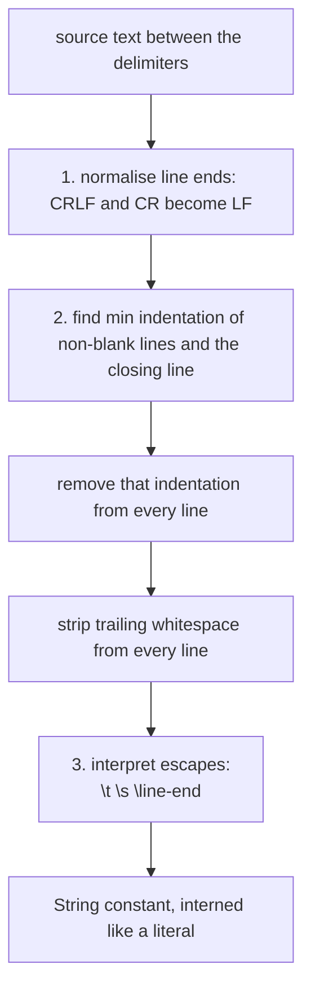
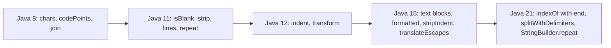

## In One Line
A **text block** (`"""` ... `"""`, final in Java 15) is a multi-line `String` literal that removes the indentation your code needs and keeps the indentation your text needs, and Java 11–21 added the small `String` methods you used to write yourself: `isBlank`, `strip`, `lines`, `repeat` (11), `indent`, `transform` (12), `formatted`, `stripIndent`, `translateEscapes` (15), plus `chars()`/`codePoints()` streams from Java 8.

## Mental Model
Think of **pasting a poem into a word processor from an indented email**.

- The email quoted the poem with four spaces in front of every line — that is the **incidental** indentation your Java code adds because the literal sits inside a method.
- Some lines of the poem are indented *further* on purpose — that is the **essential** indentation that belongs to the text.
- A good paste tool finds the **smallest common indent**, removes exactly that from every line, and leaves the extra indentation alone. It also deletes invisible trailing spaces and turns Windows line breaks into plain `\n`.
- The **closing `"""`** is your ruler: slide it to the left and the paste tool keeps more indentation; put it on the last text line and there is no final line break.

The new `String` methods are the **everyday tools** on the same word processor: "is this line blank?" (`isBlank`), "trim properly, including Unicode spaces" (`strip`), "give me the lines" (`lines`), "repeat this divider" (`repeat`), "shift this paragraph right" (`indent`), "fill in the blanks" (`formatted`).

## Concept
### 1. Version map
| Feature | Version | Notes |
|---|---|---|
| `CharSequence.chars()`, `codePoints()`, `String.join` | 8 | `chars()` returns an `IntStream` |
| Compact strings (`byte[]` + Latin-1/UTF-16 coder), `+` compiled to `invokedynamic` | 9 | JEP 254, JEP 280 — internal, no API change |
| **`isBlank()`, `lines()`, `strip()`, `stripLeading()`, `stripTrailing()`, `repeat(int)`** | **11** | also `Character.toString(int codePoint)` |
| **`indent(int)`, `transform(Function)`** | **12** | also `describeConstable()` (constants API) |
| Raw string literals (JEP 326) | — | proposed for 12, **withdrawn**; replaced by text blocks |
| Text blocks | preview 13 (JEP 355), 14 (JEP 368) | 14 added the `\<line-end>` and `\s` escapes |
| **Text blocks final**, **`formatted()`, `stripIndent()`, `translateEscapes()`**, `\s` escape | **15** | JEP 378; the three methods support text blocks |
| `CharSequence.isEmpty()` | 15 | default method |
| `indexOf(ch, begin, end)`, `indexOf(str, begin, end)`, `splitWithDelimiters`, `StringBuilder.repeat`, `Character.isEmoji` | **21** | |
| String Templates (`STR."Hi \{name}"`) | preview 21 (JEP 430), 22 (JEP 459) | **withdrawn in 23** — Java has no string interpolation |

### 2. Text block syntax
```java
String json = """
        {
          "name": "Asha",
          "age": 30
        }
        """;
```
- The opening `"""` must be followed by **nothing but whitespace and a line break**. `"""abc"""` is a compile error: *illegal text block open delimiter sequence, missing line terminator*. There are no one-line text blocks.
- The content starts on the **next line**, and ends just before the closing `"""`.
- The result is an ordinary `java.lang.String` — no new type, and a text block is a **compile-time constant**, so it is **interned** exactly like `"..."`. `"hello\n" == """<newline>hello<newline>"""` is `true`.
- `"` and `""` inside need no escaping. Three quotes in a row must be broken: `\"""` or `""\"`.
- All the usual escapes work (`\n`, `\t`, `\"`, `\\`, ...). Two escapes exist mainly for text blocks: **`\<line-end>`** joins the next line (no `\n` inserted) and **`\s`** is a single space that is never stripped. `\s` also works in normal string literals since Java 15.
- Backslashes are **not raw**: a regex still needs `\\d`. Java has no raw string literal.

### 3. How the compiler turns a text block into a String
The algorithm (JLS §3.10.6) runs three steps, in this order:
1. **Normalise line terminators**: every `\r\n` and `\r` in the source becomes `\n`, so the value is the same on Windows and Linux.
2. **Strip incidental whitespace** (the same algorithm as `String.stripIndent()`):
   - Look at every **non-blank** content line **plus the closing-delimiter line** (even though it is blank).
   - Find the **minimum** number of leading whitespace characters — this is the incidental indentation.
   - Remove that many characters from the start of each non-blank line; blank lines become empty.
   - Remove **trailing** whitespace from every line.
3. **Interpret escape sequences** (like `String.translateEscapes()`). Because this happens *last*, `\n`, `\t` and `\s` are never affected by stripping — that is why `\s` can protect a trailing space.

Consequences:
| Closing `"""` placed... | Result |
|---|---|
| on its own line, aligned with the content | content keeps its relative indentation, ends with `\n` |
| on its own line, *k* columns left of the content | every line keeps *k* extra leading spaces, ends with `\n` |
| at the end of the last content line | no trailing `\n` |
| on its own line, further *right* than the content | no effect (it is ignored when it is not the minimum — only content lines then count) |

> [!WARNING] Whitespace is counted in **characters**, not columns: a tab counts as 1, the same as one space. Mixing tabs and spaces in a text block's indentation gives surprising results (see `TabTrap` below). Use spaces only.

### 4. Putting values into text: `formatted`
Java has **no string interpolation**. Use:
- `"""...%s...%d...""".formatted(name, age)` (Java 15) — instance version of `String.format(template, args)`; same format specifiers (`%s`, `%d`, `%.2f`, `%n`, `%%`); uses the default locale (`String.format(Locale.ROOT, ...)` when the output must not depend on the machine).
- `String.join`, `StringBuilder`, `MessageFormat`, or `+` for simple cases.
- String Templates (`STR."..."`) were previewed in 21 and 22 and then **removed** in 23 for a redesign; code using them does not compile on later JDKs.

### 5. The new `String` methods in depth
| Method | Since | What it does | Watch out |
|---|---|---|---|
| `isBlank()` | 11 | `true` if empty or only whitespace (`Character.isWhitespace`) | `isEmpty()` (6) only checks `length() == 0` |
| `strip()`, `stripLeading()`, `stripTrailing()` | 11 | Remove leading/trailing **Unicode** whitespace | `trim()` removes every char `<= ' '` (U+0020), including control chars, but not Unicode spaces |
| `lines()` | 11 | Lazy `Stream<String>` split at `\n`, `\r` or `\r\n` | No trailing empty line; `"".lines()` is empty |
| `repeat(int n)` | 11 | The string `n` times | `n < 0` → `IllegalArgumentException: count is negative: -1`; `n == 0` → `""` |
| `indent(int n)` | 12 | Adds `n` spaces to each line (or removes up to `-n` leading whitespace chars), normalises line ends to `\n`, **adds a final `\n`** | `indent(0)` still changes the string (line ends, trailing `\n`) |
| `transform(Function<? super String, ? extends R> f)` | 12 | Returns `f.apply(this)` — any type `R` | Passing the result straight to an overloaded method can be ambiguous (Quiz) |
| `formatted(Object... args)` | 15 | `String.format(this, args)` | Locale-dependent |
| `stripIndent()` | 15 | Text-block indentation algorithm on any string | Also strips trailing spaces |
| `translateEscapes()` | 15 | Turns the two characters `\` `t` into a real tab, etc. | Throws `IllegalArgumentException` on a bad escape |
| `chars()` | 8 | `IntStream` of UTF-16 **code units** | Elements are `int`; cast `(char) c` to print letters |
| `codePoints()` | 8 | `IntStream` of Unicode **code points** | Correct for emoji and other supplementary characters |

#### `trim()` vs `strip()` — what counts as whitespace
| Character | `trim()` removes? | `strip()` removes? |
|---|---|---|
| space, `\t`, `\n`, `\r` | yes | yes |
| control chars like `\u0001` | yes (it is `<= ' '`) | no (not whitespace) |
| EM SPACE `\u2003` and other Unicode space separators | no | yes |
| NO-BREAK SPACE `\u00A0` (also `\u2007`, `\u202F`) | no | **no** — `Character.isWhitespace` excludes non-breaking spaces |

To remove non-breaking spaces as well: `s.replace('\u00A0', ' ').strip()` or a regex with `\\p{Z}`.

#### `lines()` vs `split("\n")`
- `lines()` understands all three line terminators; `split("\n")` leaves `\r` at the end of each line of a Windows text.
- `lines()` is **lazy** and creates no regex and no array — better for big strings, and it plugs straight into stream pipelines.
- Both drop trailing empty lines (`split` removes trailing empty strings), but `lines()` keeps empty lines in the middle — so does `split`.
- `split("\\R")` (the `\R` linebreak matcher, Java 8) is the regex equivalent when you need an array.

#### `chars()` and `codePoints()`
`chars()` returns an `IntStream` of `char` values widened to `int`. Printing them shows numbers (`98 97 110`); cast with `(char) c` or map with `Character::toString`. A character outside the Basic Multilingual Plane (e.g. an emoji) is stored as **two** `char`s (a surrogate pair), so `length()` and `chars().count()` count 2 for it, while `codePoints().count()` counts 1. Rebuild a string from an `IntStream` with `collect(StringBuilder::new, StringBuilder::appendCodePoint, StringBuilder::append)` or `mapToObj(Character::toString).collect(joining())` — `Character.toString(int)` exists since Java 11, so that method reference does not compile on Java 8.

#### Java 21 additions
- `indexOf(int ch, int beginIndex, int endIndex)` and `indexOf(String str, int beginIndex, int endIndex)` — search only inside `[begin, end)` without creating a substring.
- `splitWithDelimiters(String regex, int limit)` — like `split`, but the matched delimiters are kept as separate elements: `"1+2-3"` → `[1, +, 2, -, 3]`.
- `StringBuilder.repeat(CharSequence, int)` and `repeat(int codePoint, int count)` (also on `StringBuffer`).
- `Character.isEmoji(int)` and related emoji properties.

### 6. When to use text blocks
Use them for **multi-line** content embedded in code: JSON/XML/HTML fixtures, SQL queries, templates, expected output in tests, help text. Do not use them for one-line strings (not allowed anyway) or when the text is long enough to belong in a resource file. For SQL, never paste user input into the text with `formatted` — use `PreparedStatement` parameters.

## Diagram

Escapes are processed after stripping, which is why `\s` and `\n` survive and a tab in the indentation counts as one character.


Which release added which String tools — "11 is the big one, 15 is text blocks".

## Code
**1. Text blocks: indentation, delimiters, escapes, interning, `formatted`**
```java
public class TextBlockDemo {
    public static void main(String[] args) {
        // 1. Before Java 15: escapes and concatenation
        String oldJson = "{\n" +
                         "  \"name\": \"Asha\",\n" +
                         "  \"age\": 30\n" +
                         "}\n";

        // 2. Java 15 text block: what you see is what you get
        String json = """
                {
                  "name": "Asha",
                  "age": 30
                }
                """;
        System.out.println("1. same content? " + json.equals(oldJson));
        System.out.print(json);

        // 3. The closing delimiter's position controls the indentation that is kept
        String flush = """
            <p>hi</p>
            """;                       // closing """ aligned with the content: 0 spaces kept
        String indented = """
                <p>hi</p>
            """;                       // closing """ 4 columns further left: 4 spaces kept
        String noNewline = """
            <p>hi</p>""";              // closing """ on the content line: no trailing \n
        System.out.println("2. " + show(flush));
        System.out.println("2. " + show(indented));
        System.out.println("2. " + show(noNewline));

        // 4. Trailing spaces are stripped; \s keeps a space; \<newline> joins lines
        String trailing = """
            red   
            green\s
            """;
        System.out.println("3. " + show(trailing));
        String oneLine = """
            SELECT id, name \
            FROM users \
            WHERE active = true""";
        System.out.println("4. " + oneLine);

        // 5. Quotes need no escaping, except three in a row
        String quotes = """
            She said "hi" and ""\"wow""\"
            """;
        System.out.print("5. " + quotes);

        // 6. Escape sequences are processed LAST, after indentation stripping
        String escapes = """
            tab:\there
            newline->\nnext
            """;
        System.out.print("6. " + escapes);

        // 7. A text block is a compile-time constant String, interned like a literal
        String literal = "hello\n";
        String block = """
            hello
            """;
        System.out.println("7. equals=" + literal.equals(block) + ", same object=" + (literal == block));

        // 8. No interpolation: use formatted() (Java 15)
        String name = "Asha";
        int age = 30;
        String msg = """
            Dear %s,
            you are %d years old.
            """.formatted(name, age);
        System.out.print("8. " + msg);
    }

    // Makes invisible characters visible: spaces as '.', line feeds as \n
    static String show(String s) {
        return "[" + s.replace(" ", ".").replace("\n", "\\n") + "]";
    }
}
```
```output
1. same content? true
{
  "name": "Asha",
  "age": 30
}
2. [<p>hi</p>\n]
2. [....<p>hi</p>\n]
2. [<p>hi</p>]
3. [red\ngreen.\n]
4. SELECT id, name FROM users WHERE active = true
5. She said "hi" and """wow"""
6. tab:	here
newline->
next
7. equals=true, same object=true
8. Dear Asha,
you are 30 years old.
```

**2. The Java 11–15 `String` methods**
```java
import java.util.List;

public class StringMethodsDemo {
    public static void main(String[] args) {
        // isBlank (11) vs isEmpty (6)
        String spaces = " \t\n";
        System.out.println("1. isEmpty=" + spaces.isEmpty() + " isBlank=" + spaces.isBlank()
                + " \"\".isBlank()=" + "".isBlank());

        // strip (11) vs trim (1.0): Unicode whitespace
        String em = "\u2003hello\u2003";            // EM SPACE on both sides
        System.out.println("2. length=" + em.length() + ", after trim=" + em.trim().length()
                + ", after strip=" + em.strip().length());
        String nbsp = "\u00A0hello\u00A0";          // NO-BREAK SPACE: not whitespace for either!
        System.out.println("2. nbsp strip length=" + nbsp.strip().length()
                + ", isWhitespace(nbsp)=" + Character.isWhitespace('\u00A0'));
        String ctrl = "\u0001hello";                 // a control char below U+0020
        System.out.println("2. control char: trim length=" + ctrl.trim().length()
                + ", strip length=" + ctrl.strip().length());
        System.out.println("2. [" + "  x  ".stripLeading() + "] [" + "  x  ".stripTrailing() + "]");

        // lines (11): split on \n, \r, \r\n -- a lazy Stream<String>
        String text = "one\r\ntwo\rthree\n\nfive\n";
        List<String> lines = text.lines().toList();
        System.out.println("3. " + lines.size() + " lines: " + lines);

        // repeat (11)
        System.out.println("4. " + "ab".repeat(3) + " | [" + "x".repeat(0) + "] | " + "=".repeat(10));
        try {
            "x".repeat(-1);
        } catch (IllegalArgumentException e) {
            System.out.println("4. repeat(-1): " + e.getMessage());
        }

        // indent (12): adds/removes leading spaces per line, normalises line ends, adds final \n
        String code = "if (x) {\n    y();\n}";
        System.out.print("5. indent(4):\n" + code.indent(4));
        System.out.print("5. indent(-2):\n" + "    a\n  b\nc".indent(-2));
        System.out.println("5. indent(0) adds \\n: " + "a\r\nb".indent(0).replace("\n", "\\n"));

        // transform (12): apply any function, keeps a fluent chain
        int wordCount = "  the quick brown fox  "
                .strip()
                .transform(s -> s.split("\\s+"))
                .length;
        System.out.println("6. words = " + wordCount);
        String slug = "Hello Modern Java".transform(s -> s.toLowerCase().replace(' ', '-'));
        System.out.println("6. slug = " + slug);

        // formatted (15) == String.format(this, args)
        System.out.println("7. " + "%s scored %.1f%%".formatted("Ravi", 92.456));

        // stripIndent (15) and translateEscapes (15): what text blocks do, as methods
        String raw = "    a\n      b\n    c";
        System.out.println("8. stripIndent:\n" + raw.stripIndent());
        String escaped = "col1\\tcol2\\nrow2";          // backslash-t as two characters
        System.out.println("8. before: " + escaped);
        System.out.println("8. after : " + escaped.translateEscapes());
    }
}
```
```output
1. isEmpty=false isBlank=true "".isBlank()=true
2. length=7, after trim=7, after strip=5
2. nbsp strip length=7, isWhitespace(nbsp)=false
2. control char: trim length=5, strip length=6
2. [x  ] [  x]
3. 5 lines: [one, two, three, , five]
4. ababab | [] | ==========
4. repeat(-1): count is negative: -1
5. indent(4):
    if (x) {
        y();
    }
5. indent(-2):
  a
b
c
5. indent(0) adds \n: a\nb\n
6. words = 4
6. slug = hello-modern-java
7. Ravi scored 92.5%
8. stripIndent:
a
  b
c
8. before: col1\tcol2\nrow2
8. after : col1	col2
row2
```

**3. `chars()` and `codePoints()`**
```java
import java.util.Map;
import java.util.function.Function;
import java.util.stream.Collectors;

public class CharsDemo {
    public static void main(String[] args) {
        String word = "banana";

        // chars() (Java 8, CharSequence): an IntStream of UTF-16 code units
        System.out.println("1. " + word.chars().filter(c -> c == 'a').count() + " a's");
        word.chars().limit(3).forEach(c -> System.out.print(c + " "));     // ints, not chars!
        System.out.println();
        word.chars().limit(3).forEach(c -> System.out.print((char) c + " "));
        System.out.println();

        // Frequency map: box each char with mapToObj
        Map<Character, Long> freq = word.chars()
                .mapToObj(c -> (char) c)
                .collect(Collectors.groupingBy(Function.identity(), Collectors.counting()));
        System.out.println("2. " + freq);

        // Rebuild a String from an IntStream
        String upperVowels = word.chars()
                .map(c -> "aeiou".indexOf(c) >= 0 ? Character.toUpperCase(c) : c)
                .collect(StringBuilder::new, StringBuilder::appendCodePoint, StringBuilder::append)
                .toString();
        System.out.println("3. " + upperVowels);

        // chars() vs codePoints() for characters outside the BMP (e.g. an emoji)
        String smile = "hi\uD83D\uDE00";               // "hi" + U+1F600 GRINNING FACE
        System.out.println("4. length=" + smile.length()
                + " chars().count=" + smile.chars().count()
                + " codePoints().count=" + smile.codePoints().count());
        smile.codePoints().forEach(cp -> System.out.print(Integer.toHexString(cp) + " "));
        System.out.println();
        System.out.println("4. " + Character.getName(smile.codePointAt(2))
                + ", Character.toString(int) length=" + Character.toString(0x1F600).length());

        // Distinct letters, sorted, joined
        String letters = "hello world".chars()
                .filter(Character::isLetter)
                .distinct()
                .sorted()
                .mapToObj(Character::toString)          // Character.toString(int), Java 11
                .collect(Collectors.joining());
        System.out.println("5. " + letters);
    }
}
```
```output
1. 3 a's
98 97 110 
b a n 
2. {a=3, b=1, n=2}
3. bAnAnA
4. length=4 chars().count=4 codePoints().count=3
68 69 1f600 
4. GRINNING FACE, Character.toString(int) length=2
5. dehlorw
```

**4. Java 21 additions**
```java
import java.util.Arrays;

public class Java21Strings {
    public static void main(String[] args) {
        String s = "a-b-c-d";
        // Java 21: indexOf with an END index (search only inside [begin, end))
        System.out.println("1. " + s.indexOf('-', 2, 5) + " " + s.indexOf('-', 4, 5) + " " + s.indexOf("c-", 0, 6));
        // Java 21: split and keep the delimiters
        System.out.println("2. " + Arrays.toString("1+2-3".splitWithDelimiters("[+-]", 0)));
        System.out.println("2. " + Arrays.toString("1+2-3".split("[+-]")));
        // Java 21: StringBuilder.repeat
        StringBuilder sb = new StringBuilder("|");
        sb.repeat("ab", 3).repeat('-', 4).repeat(0x2A, 2);
        System.out.println("3. " + sb);
        // Java 21: Character.isEmoji
        System.out.println("4. " + Character.isEmoji(0x1F600) + " " + Character.isEmoji('A'));
    }
}
```
```output
1. 3 -1 4
2. [1, +, 2, -, 3]
2. [1, 2, 3]
3. |ababab----**
4. true false
```

**5. The tab trap** (the first content line starts with one tab, the second with eight spaces, the closing `"""` line with eight spaces)
```java
public class TabTrap {
    public static void main(String[] args) {
        String s = """
	one
        two
        """;
        System.out.println(s.replace(" ", ".").replace("\t", "<TAB>"));
    }
}
```
```output
one
.......two

```

**6. String Templates — preview in JDK 21 only, removed in JDK 23** (run with `java --enable-preview --source 21 Tmpl.java`)
```java
public class Tmpl {
    public static void main(String[] a) {
        String name = "Asha";
        int x = 2;
        System.out.println(STR."Hi \{name}, \{x} + \{x} = \{x + x}");
    }
}
```
```output
Hi Asha, 2 + 2 = 4
```
Without `--enable-preview`, JDK 21 refuses it: *string templates are a preview feature and are disabled by default*. Do not use this in real code; use `formatted`.

## Walkthrough
### 1. `TextBlockDemo`
- **`oldJson`** is the pre-15 way: every quote escaped as `\"`, every line ending written as `\n`, lines glued with `+`.
- **`json`** is the same text as a text block. The content lines are indented 16 spaces in the source and so is the closing `"""`, so the minimum indentation is 16 and all of it is removed; the relative two-space indentation of `"name"` and `"age"` stays. The closing `"""` is on its own line, so the value ends with `\n`. `equals` confirms the two strings are identical, and `print` (not `println`) shows it without an extra blank line.
- **`flush`, `indented`, `noNewline`** show the closing delimiter as a ruler. `show(...)` makes spaces visible as `.` and line feeds as `\n`. In `indented` the content is indented 16 but the closing `"""` only 12, so the minimum is 12 and 4 spaces survive: `[....<p>hi</p>\n]`. In `noNewline` the delimiter sits on the content line: no final `\n`.
- **`trailing`**: the line `red` is followed by three spaces in the source (invisible here) — they are stripped. `green\s` ends with the `\s` escape, which becomes a space *after* stripping, so it survives: `[red\ngreen.\n]`.
- **`oneLine`**: each line ends with `\` + line break, so the line break is removed and the lines are joined; the spaces before each `\` are kept because they are not trailing (the `\` follows them). The closing `"""` on the last line means no final `\n` — a clean one-line SQL string written over three lines.
- **`quotes`**: single and double quotes are literal. To get three quotes, one of them is escaped: `""\"` → `"""`.
- **`escapes`**: `\t` and `\n` are interpreted as a tab and a line break — the text block has three lines in its output although only two content lines in the source.
- **`literal == block`** is `true`: both are compile-time constants with the same value, so both refer to the single interned `String` in the string pool.
- **`msg`**: `%s` and `%d` are filled by `formatted(name, age)`, which is `String.format(msg, name, age)`.

### 2. `StringMethodsDemo`
- **1**: `" \t\n"` has length 3, so `isEmpty()` is false; every char is whitespace, so `isBlank()` is true. `""` is blank too.
- **2**: `em` is 7 chars (EM SPACE + `hello` + EM SPACE). EM SPACE is U+2003, which is above U+0020, so `trim()` leaves it (7); `strip()` uses `Character.isWhitespace`, which says yes, so 5 remain. NO-BREAK SPACE (U+00A0) is **not** whitespace per `Character.isWhitespace` (printed `false`), so even `strip()` keeps it (7). The control char U+0001 is `<= ' '`, so `trim()` removes it (5) while `strip()` keeps it (6). `stripLeading`/`stripTrailing` work on one side only.
- **3**: `text` mixes `\r\n`, `\r` and `\n`. `lines()` splits on all three, keeps the empty line between `three` and `five`, and does not produce an empty element for the final `\n`: 5 lines. `toList()` (Java 16) collects the stream.
- **4**: `repeat(3)`, `repeat(0)` gives `""`, a divider of ten `=`; `repeat(-1)` throws `IllegalArgumentException` with message `count is negative: -1`.
- **5**: `indent(4)` puts four spaces in front of each line (keeping the existing 4 of `y();`) and appends `\n` after the last line — which is why `print`, not `println`, is used. `indent(-2)` removes up to two leading whitespace chars: `    a` → `  a`, `  b` → `b`, `c` has none to remove. `"a\r\nb".indent(0)` turns `\r\n` into `\n` and adds a final `\n`.
- **6**: `transform` passes the string to a function and returns whatever the function returns — here a `String[]` (so `.length` is the array length field) and then a `String`. It lets you keep a left-to-right chain instead of nesting calls.
- **7**: `%.1f` rounds 92.456 to `92.5`; `%%` prints a literal `%`.
- **8**: `stripIndent()` removes the common 4 spaces, keeping the extra 2 of `b`. `escaped` contains a real backslash followed by `t` (written `\\t` in the source); `translateEscapes()` turns those two characters into a tab, and `\\n` into a line break.

### 3. `CharsDemo`
- `word.chars()` is an `IntStream`; `c == 'a'` compares an `int` with a `char` (widened), counting 3.
- Printing the elements directly shows `98 97 110` — the numeric values of `b`, `a`, `n`. Casting `(char) c` prints letters.
- `mapToObj(c -> (char) c)` boxes each value to `Character` so `groupingBy(Function.identity(), counting())` can build a `Map<Character, Long>` (a `HashMap`, which happens to print in key order here because small `Character` hash codes are their values).
- The three-argument `collect(supplier, accumulator, combiner)` builds a `StringBuilder`: `appendCodePoint(int)` accepts the `int` elements directly.
- `smile` is `hi` + U+1F600, which needs a surrogate pair: `length()` and `chars().count()` are 4, `codePoints().count()` is 3; the hex values `68 69 1f600` are `h`, `i` and the emoji. `Character.getName` returns the Unicode name; `Character.toString(0x1F600)` builds a 2-`char` string.
- The last pipeline filters letters, removes duplicates, sorts by code, and maps each `int` back to a `String` with `Character::toString` — resolving to `Character.toString(int)` (Java 11).

### 4. `Java21Strings`
- `indexOf('-', 2, 5)` searches indexes 2, 3, 4 and finds the `-` at 3. `indexOf('-', 4, 5)` searches only index 4 (`c`) — the `-` at index 5 is outside the half-open range — so `-1`. `indexOf("c-", 0, 6)` finds `c-` at 4.
- `splitWithDelimiters("[+-]", 0)` returns the pieces **and** the delimiters; plain `split` drops them.
- `StringBuilder.repeat` appends a `CharSequence` 3 times, a `char` 4 times, and code point `0x2A` (`*`) twice; it returns the builder, so calls chain.
- `Character.isEmoji(0x1F600)` is true, `'A'` is not.

### 5. `TabTrap`
The first content line starts with one tab (1 whitespace character), the second with eight spaces, the closing line with eight spaces. The minimum is **1**, so one character is removed from each line: the tab disappears from `one`, and `two` keeps 7 of its 8 spaces. An IDE showing the tab as 8 columns makes the lines look aligned, but the compiler counts characters. `println` adds the final empty line after the text block's own `\n`.

### 6. `Tmpl`
`STR` was an automatically imported template processor; `\{expr}` embedded expressions. It ran only with `--enable-preview` on JDK 21 (and 22). The feature was withdrawn in JDK 23, so it is not part of Java — interviewers sometimes ask exactly this.

## Traps
- **`"""` followed by text on the same line** does not compile — the opening delimiter must end its line.
- **Closing delimiter position**: moving it left adds indentation to *every* line; putting it on the last text line removes the final `\n`. Many "why is my JSON indented" bugs come from this.
- **Tabs vs spaces** in the indentation: each counts as one character; mixed indentation keeps unexpected whitespace.
- **Trailing spaces are silently removed.** Use `\s` (or `\040`) when a trailing space matters, e.g. fixed-width output.
- **Text blocks are not raw strings**: backslashes are still escapes, so regexes still need `\\`; `\q` is *illegal escape character*.
- **No interpolation**: `"Hello ${name}"` is just text. Use `formatted`. Code with `STR."..."` from JDK 21/22 previews does not compile any more.
- **`formatted` and SQL**: building SQL with user input via `formatted` is SQL injection — use bind parameters.
- **`trim()` vs `strip()`**: `trim()` misses Unicode spaces (U+2003, U+3000...) but removes control characters; neither removes the no-break space U+00A0 — a classic bug with data copied from web pages.
- **`isBlank()` vs `isEmpty()`** — and neither accepts `null` (`NullPointerException`); check `s == null || s.isBlank()`.
- **`indent()` always adds a trailing `\n`** and normalises line endings, even for `indent(0)`.
- **`chars()` gives `int`s**: `forEach(c -> System.out.print(c))` prints numbers. Also, it splits emoji into two surrogate `char`s — use `codePoints()` for user-visible characters.
- **`transform` returns a generic `R`**: `System.out.println(s.transform(String::toUpperCase))` does not compile — *reference to println is ambiguous* (`println(char[])` vs `println(String)`). Assign to a `String` variable first.

## Tips & Tricks
- **The ruler rule:** "Content starts after the opening line; the closing `"""` is the left margin." Align it with the content for zero indentation.
- **Escape cheat sheet for text blocks:** `\` at line end = join lines, `\s` = keep this space, `\"""` = literal triple quote.
- **"strip is Unicode-smart, trim is ASCII-old"** — prefer `strip()`, `stripLeading()`, `stripTrailing()` and `isBlank()` in new code.
- **Version hook — "11 = strip-blank-lines-repeat (SBLR), 12 = indent-transform, 15 = text blocks + formatted".**
- **Visualise whitespace** while debugging: `s.replace(" ", ".").replace("\n", "\\n")`, or `System.out.println(s.chars().boxed().toList())` to see every code.
- **Divider lines:** `"-".repeat(40)`; **padding** in tables: `"%-10s|".formatted(name)`.
- **Line-by-line processing:** `text.lines().map(String::strip).filter(l -> !l.isBlank()).toList()` — no `split`, no regex.
- **Frequency count template:** `s.chars().mapToObj(c -> (char) c).collect(groupingBy(identity(), counting()))` — use `LinkedHashMap::new` as map factory to keep first-seen order.

## Interview Q&A
### [Basic] What is a text block and in which version was it introduced?
A text block is a multi-line string literal delimited by `"""`. The opening delimiter must be followed by a line break; the content ends at the closing `"""`. The compiler removes the incidental indentation (the common leading whitespace), strips trailing spaces, normalises line endings to `\n`, and then processes escape sequences. The result is an ordinary interned `String` constant. It was previewed in Java 13 and 14 and became standard in **Java 15** (JEP 378).
```java
String sql = """
    SELECT id, name
    FROM users
    WHERE active = true
    """;
```
**Follow-up:** *Is a text block a new type?* — No, it is a `java.lang.String`; `"a\n" == """<newline>a<newline>"""` is even `true` because both constants are interned.

### [Basic] What is the difference between `trim()` and `strip()`?
`trim()` (Java 1.0) removes all leading and trailing characters whose code is `<= U+0020` — ASCII space and control characters. `strip()` (Java 11) removes leading and trailing characters for which `Character.isWhitespace` is true — including Unicode spaces such as EM SPACE (U+2003) or IDEOGRAPHIC SPACE (U+3000), but not control characters like U+0001. `stripLeading()` and `stripTrailing()` do one side. Neither removes the non-breaking space U+00A0.

**Follow-up:** *Which should new code use?* — `strip()`; it matches how `isBlank()` and `lines()` define whitespace, and it handles international text.

### [Basic] What is the difference between `isEmpty()` and `isBlank()`?
`isEmpty()` (Java 6) is `length() == 0`. `isBlank()` (Java 11) is true for an empty string **or** a string made only of whitespace (`" \t\n"`). Both throw `NullPointerException` on a `null` reference, so the typical guard is `s == null || s.isBlank()`.

**Follow-up:** *What did people use before Java 11?* — `s.trim().isEmpty()` or Apache Commons `StringUtils.isBlank`.

### [Intermediate] How does the compiler decide how much indentation to remove from a text block?
It takes all **non-blank** content lines plus the line of the **closing delimiter**, counts the leading whitespace characters of each, and removes the **minimum** from every line. So if the closing `"""` is further left than the content, the difference is kept as indentation; if the closing `"""` is at the end of the last content line, it does not count and the value has no trailing `\n`. Trailing spaces are removed from every line, and escape sequences are processed afterwards. Tabs count as one character each, so mixing tabs and spaces gives surprises. `String.stripIndent()` exposes the same algorithm.

**Follow-up:** *How do you keep a trailing space?* — End the line with `\s`, which is turned into a space only after stripping.

### [Intermediate] Does Java support string interpolation?
No. You use `String.format`/`formatted` (`"Hi %s".formatted(name)`), concatenation, `StringBuilder`, or `MessageFormat`. String Templates (`STR."Hi \{name}"`) were a preview feature in JDK 21 and 22, but they were **withdrawn in JDK 23** for a redesign, so no released Java version has interpolation as a standard feature.

**Follow-up:** *Why not just add `${}` like other languages?* — Plain interpolation makes injection (SQL, HTML, JSON) too easy; the template design tried to make the processing step explicit and safe, and it is still being reworked.

### [Intermediate] Compare `lines()` with `split("\n")`.
`lines()` (Java 11) returns a lazy `Stream<String>` and recognises `\n`, `\r` and `\r\n`; it builds no regex and no array, so it is efficient for large text and chains with stream operations. `split("\n")` is regex-based, returns an array, and leaves `\r` at the end of lines from Windows text. Both drop trailing empty lines and keep empty lines in the middle. For an array with all line endings, use `split("\\R")`.

**Follow-up:** *How do you count non-blank lines?* — `text.lines().filter(l -> !l.isBlank()).count()`.

### [Intermediate] What do `indent()` and `transform()` do?
Both came in Java 12. `indent(n)` splits the string into lines, adds `n` spaces to each line (or, for negative `n`, removes up to `|n|` leading whitespace characters), normalises line terminators to `\n` and ends every line — including the last — with `\n`. `transform(f)` simply returns `f.apply(this)`; its point is readability in fluent chains: `input.strip().transform(Parser::parse)`. The result type is whatever the function returns.

**Follow-up:** *Why might `println(s.transform(String::toUpperCase))` fail to compile?* — `transform` is generic in `R`, and `println` is overloaded (`String`, `char[]`, `Object`...), so inference is ambiguous. Assign to a typed variable first.

### [Advanced] What is the difference between `chars()` and `codePoints()`?
Java strings are UTF-16: characters outside the Basic Multilingual Plane (most emoji, some CJK) are stored as a **surrogate pair** of two `char`s. `chars()` streams UTF-16 code units — an emoji appears as two meaningless values — while `codePoints()` streams whole Unicode code points. `length()` counts code units too. So `"hi" + U+1F600` has `length()` 4, `chars().count()` 4 and `codePoints().count()` 3. For anything user-visible (reversing, counting characters, truncating), work with code points; even they are not perfect for combined emoji or accents (grapheme clusters — `BreakIterator` or regex `\X`).

**Follow-up:** *Why does `"abc".chars().forEach(System.out::print)` print `979899`?* — The elements are `int`s; map them with `(char) c` or `Character::toString`.

### [Advanced] Which `String` methods were added in Java 11, 12, 15 and 21?
- **11:** `isBlank`, `lines`, `strip`, `stripLeading`, `stripTrailing`, `repeat` (and `Character.toString(int)`).
- **12:** `indent`, `transform`, `describeConstable`.
- **15:** `formatted`, `stripIndent`, `translateEscapes` (companions of text blocks); `CharSequence.isEmpty`.
- **21:** `indexOf(ch/str, begin, end)`, `splitWithDelimiters`; plus `StringBuilder.repeat` and `Character.isEmoji`.
`chars()`/`codePoints()` and `String.join` are Java 8.

**Follow-up:** *What changed inside `String` in Java 9?* — Compact strings: the `char[]` became a `byte[]` plus a coder flag, so Latin-1 text takes one byte per character (JEP 254); string concatenation moved to `invokedynamic` (JEP 280).

### [Advanced] Write a one-liner that counts character frequencies in a string, keeping first-seen order.
```java
Map<Character, Long> freq = s.chars()
        .mapToObj(c -> (char) c)
        .collect(Collectors.groupingBy(Function.identity(), LinkedHashMap::new, Collectors.counting()));
```
`chars()` gives an `IntStream`; `mapToObj` boxes each value to `Character`; `groupingBy` with a `LinkedHashMap` factory keeps insertion order, and `counting()` produces `Long` counts. For emoji-safe counting, use `codePoints()` and `Map<Integer, Long>` or `Character.toString(cp)` keys.

**Follow-up:** *First non-repeating character?* — Build that `LinkedHashMap`, then `entrySet().stream().filter(e -> e.getValue() == 1).map(Map.Entry::getKey).findFirst()`.

## Quiz
### What does this print?
```java
String s = """
    Hello
      World
    """;
System.out.println(s.length());
```
- [ ] 12
- [ ] 13
- [x] 14
- [ ] 22
> The common indentation (4) is removed, so the value is `"Hello\n  World\n"`: 5 + 1 + 7 (two spaces + `World`) + 1 = 14. Answer 12 forgets the two essential spaces or the line breaks; 22 keeps the incidental indentation.

### What does this print?
```java
String u = """
    x
    y
 """;
System.out.println(u.replace(" ", ".").replace("\n", "|"));
```
- [ ] x|y|
- [x] ...x|...y|
- [ ] ....x|....y|
- [ ] x|y
> The closing `"""` is 3 columns left of the content and counts in the minimum-indentation calculation, so 3 spaces stay in front of each line. The closing delimiter on its own line also means each line ends with `\n`. `x|y|` would be the result if it were aligned with the content.

### What does this print?
```java
System.out.println("  ".isBlank() + " " + "  ".isEmpty());
```
- [x] true false
- [ ] false false
- [ ] true true
- [ ] false true
> `isBlank()` is true for strings made only of whitespace; `isEmpty()` only checks `length() == 0`, and `"  "` has length 2.

### What does this print?
```java
System.out.println("abc".indent(2).length());
```
- [ ] 3
- [ ] 5
- [x] 6
- [ ] 7
> `indent(2)` adds two spaces **and** terminates the (only) line with `\n`: `"  abc\n"` has length 6. Answer 5 forgets the added line terminator.

### What does this print?
```java
System.out.println("a\n\nb".lines().count());
```
- [ ] 2
- [x] 3
- [ ] 4
- [ ] 1
> `lines()` keeps empty lines in the middle: `a`, `""`, `b`. Only a trailing line terminator does not create an extra empty line.

### Spot the bug: why does this not compile?
```java
String greeting = """Hello, world""";
```
- [ ] Text blocks need `--enable-preview`
- [x] The opening `"""` must be followed by a line break
- [ ] Text blocks cannot contain commas
- [ ] The closing `"""` must be on its own line
> A text block's content always starts on the line after the opening delimiter: *illegal text block open delimiter sequence, missing line terminator*. Text blocks are final since Java 15, and the closing delimiter may sit on the last content line.

### Spot the bug: why does this line not compile?
```java
System.out.println("ab".repeat(2).transform(String::toUpperCase));
```
- [ ] `transform` does not exist on `String`
- [ ] `repeat` returns `void`
- [x] `transform` is generic, and `println` has overloads that make the call ambiguous
- [ ] `String::toUpperCase` is not a `Function`
> javac reports *reference to println is ambiguous: both println(char[]) and println(String) match* — the result type `R` of `transform` cannot be pinned down. `String up = "ab".repeat(2).transform(String::toUpperCase);` compiles and holds `ABAB`.

### Which call removes a leading EM SPACE (U+2003) from a string?
- [ ] `trim()`
- [x] `strip()`
- [ ] Both
- [ ] Neither
> `trim()` only removes characters `<= U+0020`; U+2003 is above that. `strip()` removes anything `Character.isWhitespace` accepts, which includes EM SPACE. (A no-break space U+00A0 would survive both.)

## Takeaways
- Text blocks (`"""`, final in Java 15) are ordinary interned `String` constants; the opening `"""` must end its line, and the content starts on the next line.
- The compiler normalises line endings, removes the minimum common indentation (the closing `"""` line counts), strips trailing spaces, and only then processes escapes — so `\s` keeps a space and `\` at line end joins lines.
- Java has no string interpolation: use `formatted(...)` (15) or `String.format`; String Templates were preview in 21–22 and withdrawn in 23.
- Java 11 added `isBlank`, `strip`/`stripLeading`/`stripTrailing` (Unicode-aware, unlike `trim`), `lines` (lazy, handles `\r\n`) and `repeat`.
- Java 12 added `indent` (shifts lines, always ends with `\n`) and `transform` (apply any function in a fluent chain); Java 15 added `formatted`, `stripIndent` and `translateEscapes`.
- `chars()` streams UTF-16 code units as `int`s; use `codePoints()` for emoji and other supplementary characters, and cast or map back to characters for display.
- Java 21 added `indexOf` with an end index, `splitWithDelimiters`, `StringBuilder.repeat` and `Character.isEmoji`.
