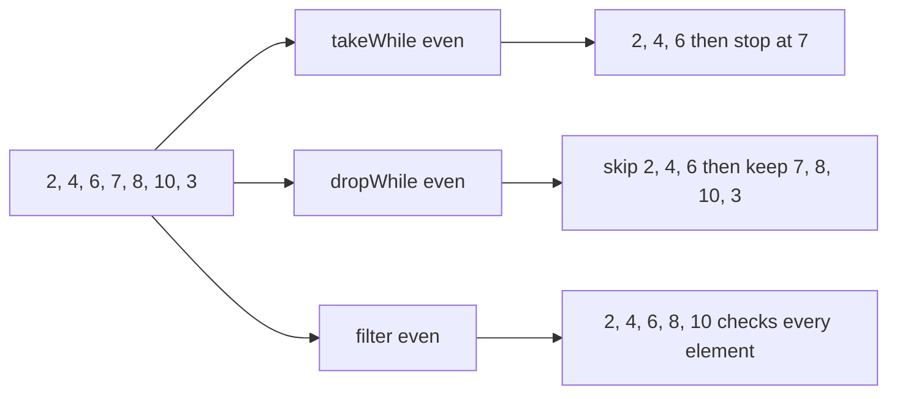
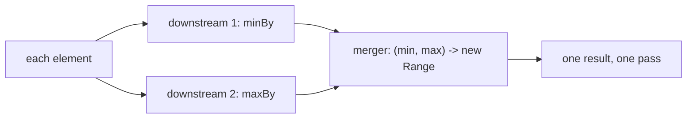
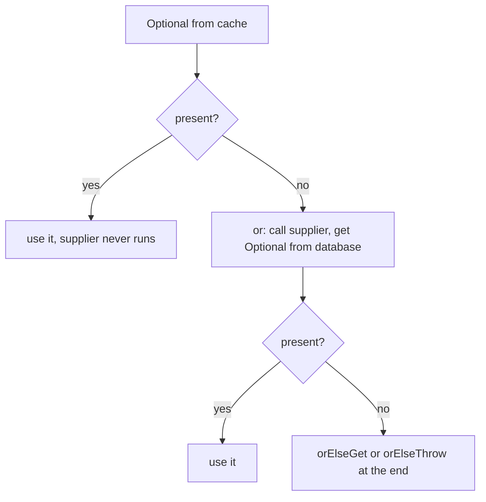

## In One Line
Java 9–16 filled the gaps in the Java 8 stream and `Optional` APIs: `takeWhile`/`dropWhile`, a three-argument `iterate` and `ofNullable` (9), `Collectors.teeing` (12), `toList()` and `mapMulti` (16) for streams, and `or`, `ifPresentOrElse`, `stream` (9), `orElseThrow()` (10) and `isEmpty` (11) for `Optional`.

## Mental Model
Think of a **conveyor belt at a fruit-packing line** (the stream) and a **gift box that may be empty** (the `Optional`).

- `filter` is a worker who checks **every** fruit and throws out the bad ones. `takeWhile` is a worker who packs fruit **until the first bad one arrives, then stops the belt**. `dropWhile` **throws away fruit until the first good one**, then lets everything through.
- The three-argument `iterate(seed, hasNext, next)` is the **machine that makes the fruit**: start with a seed, check "should I make another?", produce the next — a `for` loop on a belt.
- `ofNullable` is a slot that puts **one fruit or nothing** on the belt, never a `null`.
- `mapMulti` is a worker who can put **zero, one or many** items on the outgoing belt for each incoming fruit, by hand, without fetching a new mini-belt (`Stream`) for each one as `flatMap` does.
- `teeing` is a **splitter**: every fruit goes to two counting stations at once (say, "lightest" and "heaviest"), and a supervisor combines their two results.
- `toList()` is the **sealed crate** at the end: you can look inside, but you cannot add or remove fruit.
- For the gift box: `or` = "if this box is empty, try the other box"; `ifPresentOrElse` = "open it and do one thing if full, another if empty"; `stream` = "turn the box into a belt of zero or one items"; `isEmpty` = "is it empty?"; `orElseThrow()` = "give me the gift or shout".

## Concept
### 1. Version map
| Version | Streams / Collectors | Optional |
|---|---|---|
| **8** | `Stream` API, `Collectors`, 2-arg `iterate`, `generate` | `of`, `ofNullable`, `empty`, `map`, `flatMap`, `filter`, `orElse`, `orElseGet`, `orElseThrow(Supplier)`, `ifPresent`, `isPresent`, `get` |
| **9** | `takeWhile`, `dropWhile`, `iterate(seed, hasNext, next)`, `Stream.ofNullable`; `Collectors.filtering`, `flatMapping` | `or`, `ifPresentOrElse`, `stream` |
| **10** | `Collectors.toUnmodifiableList/Set/Map` | no-arg `orElseThrow()` |
| **11** | `Predicate.not` | `isEmpty` |
| **12** | `Collectors.teeing` | — |
| **16** | `Stream.toList()`, `mapMulti`, `mapMultiToInt/Long/Double` | — |
| 21 | Sequenced collections (`list.reversed().stream()`, `getFirst()`) — see [Java versions roadmap](lesson:b05-modern-java/01-java-versions-roadmap) | — |
| 22–24 | Stream **gatherers** (`stream.gather(Gatherers.windowFixed(3))`): preview 22 (JEP 461) and 23 (JEP 473), final in **24** (JEP 485) — not available in 21 | — |

The primitive streams (`IntStream`, `LongStream`, `DoubleStream`) got `takeWhile`, `dropWhile` and the 3-arg `iterate` in 9 too. The primitive optionals (`OptionalInt`...) got `ifPresentOrElse`, `stream` (9), `orElseThrow()` (10) and `isEmpty` (11), but **not** `or` (they also have no `map`/`filter`/`flatMap`).

### 2. `takeWhile` and `dropWhile` (Java 9)
```java
Stream.of(2, 4, 6, 7, 8, 10, 3).takeWhile(n -> n % 2 == 0)  // [2, 4, 6]
Stream.of(2, 4, 6, 7, 8, 10, 3).dropWhile(n -> n % 2 == 0)  // [7, 8, 10, 3]
Stream.of(2, 4, 6, 7, 8, 10, 3).filter(n -> n % 2 == 0)     // [2, 4, 6, 8, 10]
```
- `takeWhile(p)` returns the **longest prefix** of elements that match `p`; it stops at the first element that fails. `dropWhile(p)` discards that prefix and returns **the rest, unfiltered** (`3` survives although it is odd).
- `takeWhile ++ dropWhile` with the same predicate always gives back the original ordered stream — they split it at the first failure.
- `takeWhile` is **short-circuiting**: it can end an infinite stream (`Stream.iterate(1, n -> n + 1).takeWhile(n -> n < 50)`), where `filter` would run forever.
- Both are **stateful** intermediate operations. On an **ordered** parallel stream they must respect encounter order and can be expensive.
- On an **unordered** stream (e.g. from a `HashSet`), if some but not all elements match, the result is **nondeterministic**: any subset of the matching elements, including none. They are only meaningful for ordered data — typically **sorted** data or a sequence such as lines in a file.

### 3. `iterate(seed, hasNext, next)` (Java 9)
```java
Stream.iterate(1, p -> p <= 1000, p -> p * 2)   // like for (int p = 1; p <= 1000; p = p * 2)
```
- The **`hasNext` test runs before every element, including the seed**, exactly like a `for` condition: `Stream.iterate(100, n -> n < 10, n -> n + 1)` is empty.
- The Java 8 two-argument `iterate(seed, next)` is **infinite** and needs `limit` or `takeWhile`.
- `iterate(seed, hasNext, next)` and `iterate(seed, next).takeWhile(hasNext)` produce the same elements; the 3-arg form states the intent directly.
- The stream is sequential and ordered; `next` is applied to the previous element, so the elements depend on each other (no efficient parallel split).

### 4. `Stream.ofNullable` (Java 9)
`Stream.ofNullable(x)` is `x == null ? Stream.empty() : Stream.of(x)`. Its home is inside `flatMap`, to drop `null` results of a lookup in one step:
```java
staff.stream().flatMap(name -> Stream.ofNullable(managers.get(name)))
```
Compare `Stream.of((Object) null)` — a stream containing one `null` element — which is rarely what you want.

### 5. `Stream.toList()` (Java 16)
| | `collect(Collectors.toList())` (8) | `collect(Collectors.toUnmodifiableList())` (10) | `toList()` (16) |
|---|---|---|---|
| Modifiable? | Yes in practice (`ArrayList`), but **not guaranteed** by the spec | No | No |
| `null` elements | Allowed | `NullPointerException` | **Allowed** |
| Implementation class in JDK 21 | `ArrayList` | `ImmutableCollections$List12` / `ListN` (same as `List.of`) | `ImmutableCollections$ListN` |
| Code length | long | long | short |

- `add`, `remove`, `set`, `sort` on the result of `toList()` throw `UnsupportedOperationException`.
- It is a **copy** (snapshot) of the stream's elements, not a view: changing the source afterwards does not change it.
- Replacing `collect(Collectors.toList())` with `toList()` is **not** a pure refactoring: code that later calls `list.add(...)` on the result will now fail at run time. If you need a mutable list, say so: `collect(Collectors.toCollection(ArrayList::new))`.
- Unlike `List.of(...)`, a `toList()` result can contain `null` — so `list.contains(null)` works on it, whereas it throws on `List.of` lists.

### 6. `mapMulti` (Java 16)
```java
<R> Stream<R> mapMulti(BiConsumer<? super T, ? super Consumer<R>> mapper)
```
For each input element, the mapper receives the element and a **sink** (`Consumer<R>`), and calls `sink.accept(...)` zero or more times. It is a **one-to-many** mapping like `flatMap`, but imperative:
```java
Stream.of(1, 2, 3, 4)
      .<Integer>mapMulti((n, sink) -> {
          if (n % 2 == 0) { sink.accept(n); sink.accept(n * 10); }
      })
      .toList();                                   // [2, 20, 4, 40]
```
- Prefer it over `flatMap` when each element maps to **few** (often zero or one) results — no `Stream` object is created per element — or when the logic is easier to write with `if`/loops/recursion (for example flattening arbitrarily nested lists).
- It is also a neat **filter + cast**: `.<String>mapMulti((o, sink) -> { if (o instanceof String s) sink.accept(s); })`.
- **Type witness**: Java cannot infer `R` from calls made on the sink inside the lambda, so without `.<String>mapMulti(...)` the result is `Stream<Object>` (*List<Object> cannot be converted to List<String>*).
- `mapMultiToInt`/`ToLong`/`ToDouble` produce primitive streams with no boxing.
- The sink is only valid **during** the call; do not store it for later.

### 7. `Collectors.teeing` (Java 12)
```java
static <T, R1, R2, R> Collector<T, ?, R> teeing(Collector<? super T, ?, R1> downstream1,
                                                Collector<? super T, ?, R2> downstream2,
                                                BiFunction<? super R1, ? super R2, R> merger)
```
Every element is passed to **both** downstream collectors in a **single pass**; at the end the `merger` combines their two results into anything you like (named after the Unix `tee` command, a T-shaped pipe).
- Classic uses: min **and** max, average from sum and count, count and list, two filtered lists, a summary record.
- For only numeric min/max/average/sum/count, `IntSummaryStatistics` (`summarizingInt`) is simpler; `teeing` wins when the two results are of different kinds, or when you want a custom result type.
- For three or more results, nest `teeing` or write a custom collector — or just use a loop.
- Works with parallel streams like any collector; each downstream collector combines its own partial results.

### 8. Java 9 collectors `filtering` and `flatMapping`
They are the downstream versions of `filter` and `flatMap`, mainly for `groupingBy`/`partitioningBy`:
- `groupingBy(team, filtering(pred, toList()))` keeps **every group key**, even when a group ends up empty (`web=[]`); a `filter` before `groupingBy` would drop the key entirely.
- `groupingBy(team, flatMapping(d -> d.skills().stream(), toSet()))` flattens a collection per element into the group.
`Predicate.not(String::isBlank)` (Java 11) negates a method reference, which `String::isBlank.negate()` cannot do (a method reference has no type until it is assigned).

### 9. The new `Optional` methods
| Method | Since | Use it for |
|---|---|---|
| `or(Supplier<Optional<T>>)` | 9 | **Lazy fallback to another `Optional`** (cache → database → remote). Result is still an `Optional`. |
| `ifPresentOrElse(Consumer<T>, Runnable)` | 9 | Do one thing if present, another if empty — replaces `if (opt.isPresent()) ... else ...` |
| `stream()` | 9 | `Stream` of 0 or 1 element; `flatMap(Optional::stream)` removes empties from a stream of optionals |
| `orElseThrow()` | 10 | Same as `get()`, but the name makes the possible `NoSuchElementException` obvious; preferred over `get()` |
| `isEmpty()` | 11 | `!isPresent()`, readable in conditions and `filter(Predicate.not(...))` |

`or` vs the Java 8 methods:
| Method | Argument | Returns | Evaluated |
|---|---|---|---|
| `orElse(T other)` | a value | `T` | **always** (eagerly, even if present) |
| `orElseGet(Supplier<T>)` | a supplier of a value | `T` | only if empty |
| `or(Supplier<Optional<T>>)` | a supplier of an **Optional** | `Optional<T>` | only if empty |
| `orElseThrow(Supplier<X>)` | a supplier of an exception | `T` | only if empty |

`or` requires a non-null supplier (even when a value is present) and a supplier that does not return `null` — otherwise `NullPointerException`. Return `Optional.empty()` instead. For more on `Optional` basics and when not to use it (fields, parameters, collections), see [Optional](lesson:a05-java8/20-optional).

## Diagram

`takeWhile` and `dropWhile` cut the stream at the **first** failure; `filter` tests every element independently.


`Collectors.teeing` sends every element to two collectors at once and merges their results at the end.


`or` chains lookups lazily and keeps the result an `Optional`; finish the chain with `orElseGet`, `orElse` or `orElseThrow`.

## Code
**1. Java 9 stream additions: `takeWhile`, `dropWhile`, 3-arg `iterate`, `ofNullable`**
```java
import java.util.List;
import java.util.Map;
import java.util.stream.Collectors;
import java.util.stream.IntStream;
import java.util.stream.Stream;

public class Java9StreamDemo {
    public static void main(String[] args) {
        List<Integer> readings = List.of(2, 4, 6, 7, 8, 10, 3);

        // takeWhile: longest PREFIX that matches, stops at the first failure
        System.out.println("1. takeWhile even : " + readings.stream().takeWhile(n -> n % 2 == 0).toList());
        // dropWhile: skips that prefix, keeps EVERYTHING after the first failure
        System.out.println("2. dropWhile even : " + readings.stream().dropWhile(n -> n % 2 == 0).toList());
        // filter looks at every element -- a different question
        System.out.println("3. filter even    : " + readings.stream().filter(n -> n % 2 == 0).toList());

        // takeWhile ends an INFINITE stream -- filter would never finish here
        System.out.println("4. squares < 50   : "
                + Stream.iterate(1, n -> n + 1).map(n -> n * n).takeWhile(sq -> sq < 50).toList());

        // Skip a header block, then take the body until a blank line
        List<String> file = List.of("# title", "# author", "line 1", "line 2", "", "footer");
        System.out.println("5. body           : " + file.stream()
                .dropWhile(l -> l.startsWith("#"))
                .takeWhile(l -> !l.isBlank())
                .toList());

        // iterate(seed, hasNext, next): a for-loop as a stream (Java 9)
        System.out.println("6. powers of 2    : "
                + Stream.iterate(1, p -> p <= 1000, p -> p * 2).map(String::valueOf)
                        .collect(Collectors.joining(" ")));
        System.out.println("6. countdown      : " + IntStream.iterate(10, i -> i > 0, i -> i - 3).boxed().toList());
        // The hasNext test runs BEFORE each element, like a for-loop condition
        System.out.println("6. seed fails     : " + Stream.iterate(100, n -> n < 10, n -> n + 1).count());

        // ofNullable: 0 or 1 element -- great inside flatMap
        Map<String, String> managers = Map.of("asha", "ravi", "ravi", "meera");
        List<String> staff = List.of("asha", "ravi", "meera", "john");
        List<String> theirManagers = staff.stream()
                .flatMap(name -> Stream.ofNullable(managers.get(name)))   // skips nulls
                .toList();
        System.out.println("7. managers       : " + theirManagers);
        System.out.println("7. counts         : " + Stream.ofNullable(null).count() + " " + Stream.ofNullable("x").count());
    }
}
```
```output
1. takeWhile even : [2, 4, 6]
2. dropWhile even : [7, 8, 10, 3]
3. filter even    : [2, 4, 6, 8, 10]
4. squares < 50   : [1, 4, 9, 16, 25, 36, 49]
5. body           : [line 1, line 2]
6. powers of 2    : 1 2 4 8 16 32 64 128 256 512
6. countdown      : [10, 7, 4, 1]
6. seed fails     : 0
7. managers       : [ravi, meera]
7. counts         : 0 1
```

**2. `toList()` vs `Collectors.toList()` vs `Collectors.toUnmodifiableList()`**
```java
import java.util.ArrayList;
import java.util.Arrays;
import java.util.List;
import java.util.stream.Collectors;
import java.util.stream.Stream;

public class ToListDemo {
    public static void main(String[] args) {
        List<String> a = Stream.of("x", "y").collect(Collectors.toList());            // Java 8
        List<String> b = Stream.of("x", "y").collect(Collectors.toUnmodifiableList()); // Java 10
        List<String> c = Stream.of("x", "y").toList();                                 // Java 16

        System.out.println("classes: " + a.getClass().getName() + ", "
                + b.getClass().getName() + ", " + c.getClass().getName());

        tryAdd("Collectors.toList()", a);
        tryAdd("Collectors.toUnmodifiableList()", b);
        tryAdd("Stream.toList()", c);

        // Nulls: toList() accepts them, toUnmodifiableList() and List.of() do not
        List<String> withNull = Stream.of("x", null).toList();
        System.out.println("toList() with null: " + withNull);
        try {
            Stream.of("x", null).collect(Collectors.toUnmodifiableList());
        } catch (NullPointerException e) {
            System.out.println("toUnmodifiableList() with null: NullPointerException");
        }

        // Need a mutable list? Ask for one explicitly
        List<String> mutable = Stream.of("b", "a").collect(Collectors.toCollection(ArrayList::new));
        mutable.add("c");
        mutable.sort(null);
        System.out.println("toCollection(ArrayList::new): " + mutable);

        // toList() is a snapshot, not a view
        String[] source = { "p", "q" };
        List<String> snapshot = Arrays.stream(source).toList();
        source[0] = "CHANGED";
        System.out.println("snapshot after changing the array: " + snapshot);
    }

    static void tryAdd(String label, List<String> list) {
        try {
            list.add("z");
            System.out.printf("%-31s -> mutable: %s%n", label, list);
        } catch (UnsupportedOperationException e) {
            System.out.printf("%-31s -> UnsupportedOperationException%n", label);
        }
    }
}
```
```output
classes: java.util.ArrayList, java.util.ImmutableCollections$List12, java.util.ImmutableCollections$ListN
Collectors.toList()             -> mutable: [x, y, z]
Collectors.toUnmodifiableList() -> UnsupportedOperationException
Stream.toList()                 -> UnsupportedOperationException
toList() with null: [x, null]
toUnmodifiableList() with null: NullPointerException
toCollection(ArrayList::new): [a, b, c]
snapshot after changing the array: [p, q]
```

**3. `mapMulti`**
```java
import java.util.List;
import java.util.function.Consumer;
import java.util.stream.Stream;

public class MapMultiDemo {
    record Order(String id, List<String> items) {}

    public static void main(String[] args) {
        // 1. One element in, zero..many out: push results into the Consumer
        List<Integer> doubledEvens = Stream.of(1, 2, 3, 4)
                .<Integer>mapMulti((n, sink) -> {
                    if (n % 2 == 0) {          // zero outputs for odd numbers
                        sink.accept(n);        // two outputs for even numbers
                        sink.accept(n * 10);
                    }
                })
                .toList();
        System.out.println("1. " + doubledEvens);

        // 2. Same as flatMap, but no Stream object is created per element
        List<Order> orders = List.of(new Order("o1", List.of("pen", "ink")),
                                     new Order("o2", List.of()),
                                     new Order("o3", List.of("book")));
        List<String> viaFlatMap = orders.stream().flatMap(o -> o.items().stream()).toList();
        List<String> viaMapMulti = orders.stream()
                .<String>mapMulti((o, sink) -> o.items().forEach(sink))
                .toList();
        System.out.println("2. " + viaFlatMap + " " + viaFlatMap.equals(viaMapMulti));

        // 3. Filter + cast in one step (type test inside)
        List<Object> mixed = List.of(1, "two", 3.0, "four", 5);
        List<String> strings = mixed.stream()
                .<String>mapMulti((o, sink) -> { if (o instanceof String s) sink.accept(s); })
                .toList();
        System.out.println("3. " + strings);

        // 4. Recursive flattening of nested lists -- awkward with flatMap
        List<Object> nested = List.of(1, List.of(2, List.of(3, 4)), 5);
        List<Object> flat = nested.stream().mapMulti(MapMultiDemo::expand).toList();
        System.out.println("4. " + flat);

        // 5. Primitive variant: mapMultiToInt avoids boxing
        int totalLetters = Stream.of("ab", "cde").mapMultiToInt((s, sink) -> sink.accept(s.length())).sum();
        System.out.println("5. " + totalLetters);
    }

    static void expand(Object e, Consumer<Object> sink) {
        if (e instanceof Iterable<?> it) {
            for (Object child : it) expand(child, sink);
        } else {
            sink.accept(e);
        }
    }
}
```
```output
1. [2, 20, 4, 40]
2. [pen, ink, book] true
3. [two, four]
4. [1, 2, 3, 4, 5]
5. 5
```

**4. `Collectors.teeing`**
```java
import java.util.Comparator;
import java.util.List;
import java.util.Optional;
import java.util.stream.Collectors;
import java.util.stream.Stream;

public class TeeingDemo {
    record Employee(String name, String dept, double salary) {}
    record Range(double min, double max) {}
    record Split(List<String> passed, List<String> failed) {}

    public static void main(String[] args) {
        List<Employee> staff = List.of(
                new Employee("Asha", "IT", 90_000),
                new Employee("Ravi", "HR", 50_000),
                new Employee("Meera", "IT", 120_000),
                new Employee("John", "Sales", 65_000));

        // 1. Two results from ONE pass: min and max salary
        Range range = staff.stream().collect(Collectors.teeing(
                Collectors.minBy(Comparator.comparingDouble(Employee::salary)),
                Collectors.maxBy(Comparator.comparingDouble(Employee::salary)),
                (min, max) -> new Range(min.orElseThrow().salary(), max.orElseThrow().salary())));
        System.out.println("1. " + range);

        // 2. Average computed from sum and count (the classic example)
        double average = Stream.of(10, 20, 30, 45).collect(Collectors.teeing(
                Collectors.summingDouble(n -> n),
                Collectors.counting(),
                (sum, count) -> sum / count));
        System.out.println("2. average = " + average);

        // 3. Merge into any type: here, a String report
        String report = staff.stream().collect(Collectors.teeing(
                Collectors.filtering(e -> e.dept().equals("IT"), Collectors.counting()),   // Java 9
                Collectors.mapping(Employee::name, Collectors.joining(", ")),
                (itCount, names) -> itCount + " in IT; all: " + names));
        System.out.println("3. " + report);

        // 4. Two lists at once (partitioningBy gives a Map<Boolean, List> instead)
        List<Integer> scores = List.of(35, 80, 49, 91, 60);
        Split split = scores.stream().collect(Collectors.teeing(
                Collectors.filtering(s -> s >= 50, Collectors.mapping(String::valueOf, Collectors.toList())),
                Collectors.filtering(s -> s < 50, Collectors.mapping(String::valueOf, Collectors.toList())),
                Split::new));
        System.out.println("4. " + split);

        // 5. Empty stream: each downstream collector sees nothing
        Optional<Employee> none = Stream.<Employee>empty().collect(Collectors.teeing(
                Collectors.counting(),
                Collectors.maxBy(Comparator.comparingDouble(Employee::salary)),
                (count, max) -> max));
        System.out.println("5. " + none);
    }
}
```
```output
1. Range[min=50000.0, max=120000.0]
2. average = 26.25
3. 2 in IT; all: Asha, Ravi, Meera, John
4. Split[passed=[80, 91, 60], failed=[35, 49]]
5. Optional.empty
```

**5. The new `Optional` methods**
```java
import java.util.List;
import java.util.Map;
import java.util.NoSuchElementException;
import java.util.Optional;

public class OptionalNewMethods {
    static final Map<String, String> CACHE = Map.of("asha", "Asha (cached)");
    static final Map<String, String> DATABASE = Map.of("asha", "Asha (db)", "ravi", "Ravi (db)");

    static Optional<String> fromCache(String id) {
        System.out.println("   looking in cache for " + id);
        return Optional.ofNullable(CACHE.get(id));
    }

    static Optional<String> fromDatabase(String id) {
        System.out.println("   looking in database for " + id);
        return Optional.ofNullable(DATABASE.get(id));
    }

    public static void main(String[] args) {
        // 1. or (Java 9): a lazy fallback that returns ANOTHER Optional
        for (String id : List.of("asha", "ravi", "zoe")) {
            Optional<String> user = fromCache(id).or(() -> fromDatabase(id));
            System.out.println("1. " + id + " -> " + user);
        }

        // 2. ifPresentOrElse (Java 9): handle both cases without isPresent()/get()
        for (String id : List.of("ravi", "zoe")) {
            fromDatabase(id).ifPresentOrElse(
                    name -> System.out.println("2. found " + name),
                    () -> System.out.println("2. no user " + id));
        }

        // 3. stream (Java 9): 0 or 1 element -- flatMap away the empties
        List<String> found = List.of("asha", "zoe", "ravi").stream()
                .map(OptionalNewMethods::fromDatabase)
                .flatMap(Optional::stream)
                .toList();
        System.out.println("3. " + found);

        // 4. isEmpty (Java 11): the opposite of isPresent()
        Optional<String> missing = Optional.empty();
        System.out.println("4. isEmpty=" + missing.isEmpty() + ", isPresent=" + missing.isPresent());

        // 5. orElseThrow() (Java 10): same as get(), but the name says what happens
        System.out.println("5. " + Optional.of("value").orElseThrow());
        try {
            missing.orElseThrow();
        } catch (NoSuchElementException e) {
            System.out.println("5. orElseThrow(): " + e.getMessage());
        }
        try {
            missing.orElseThrow(() -> new IllegalArgumentException("user not found"));   // Java 8 form
        } catch (IllegalArgumentException e) {
            System.out.println("5. orElseThrow(supplier): " + e.getMessage());
        }

        // 6. or vs orElseGet: or keeps an Optional, orElseGet unwraps to a value
        String name = fromCache("zoe").or(() -> fromDatabase("zoe")).orElseGet(() -> "guest");
        System.out.println("6. " + name);
    }
}
```
```output
   looking in cache for asha
1. asha -> Optional[Asha (cached)]
   looking in cache for ravi
   looking in database for ravi
1. ravi -> Optional[Ravi (db)]
   looking in cache for zoe
   looking in database for zoe
1. zoe -> Optional.empty
   looking in database for ravi
2. found Ravi (db)
   looking in database for zoe
2. no user zoe
   looking in database for asha
   looking in database for zoe
   looking in database for ravi
3. [Asha (db), Ravi (db)]
4. isEmpty=true, isPresent=false
5. value
5. orElseThrow(): No value present
5. orElseThrow(supplier): user not found
   looking in cache for zoe
   looking in database for zoe
6. guest
```

**6. Java 9 downstream collectors and `Predicate.not`**
```java
import java.util.List;
import java.util.Map;
import java.util.Set;
import java.util.TreeMap;
import java.util.TreeSet;
import java.util.function.Predicate;
import java.util.stream.Collectors;

public class Java9Collectors {
    record Dev(String name, String team, List<String> skills) {}

    public static void main(String[] args) {
        List<Dev> devs = List.of(
                new Dev("Asha", "core", List.of("java", "sql")),
                new Dev("Ravi", "core", List.of("java", "kotlin")),
                new Dev("Meera", "web", List.of("js", "css")));

        // filtering (9): filter INSIDE each group, so empty groups survive
        Map<String, List<String>> javaDevsByTeam = devs.stream().collect(Collectors.groupingBy(
                Dev::team, TreeMap::new,
                Collectors.filtering(d -> d.skills().contains("java"),
                        Collectors.mapping(Dev::name, Collectors.toList()))));
        System.out.println("filtering  : " + javaDevsByTeam);

        // flatMapping (9): flatten each element's collection inside a group
        Map<String, Set<String>> skillsByTeam = devs.stream().collect(Collectors.groupingBy(
                Dev::team, TreeMap::new,
                Collectors.flatMapping(d -> d.skills().stream(), Collectors.toCollection(TreeSet::new))));
        System.out.println("flatMapping: " + skillsByTeam);

        // Predicate.not (11): negate a method reference
        List<String> nonBlank = List.of("a", " ", "", "b").stream().filter(Predicate.not(String::isBlank)).toList();
        System.out.println("not        : " + nonBlank);
    }
}
```
```output
filtering  : {core=[Asha, Ravi], web=[]}
flatMapping: {core=[java, kotlin, sql], web=[css, js]}
not        : [a, b]
```

## Walkthrough
### 1. `Java9StreamDemo`
- `readings` is an ordered `List.of(2, 4, 6, 7, 8, 10, 3)`.
- **1** `takeWhile(n -> n % 2 == 0)` passes 2, 4, 6, meets 7 (odd) and **stops** — 8 and 10 are never looked at although they are even.
- **2** `dropWhile` with the same predicate throws away 2, 4, 6 and, from 7 on, lets **everything** through without testing — so 3 is kept.
- **3** `filter` tests each element independently: all five even numbers.
- **4** `Stream.iterate(1, n -> n + 1)` (Java 8) is infinite. `map` squares, and `takeWhile(sq < 50)` stops at 64. With `filter(sq -> sq < 50)` instead, the terminal `toList()` would never return.
- **5** A realistic combination: `dropWhile` removes the `#` header lines, `takeWhile(!isBlank)` keeps the body up to the first blank line, so `footer` is excluded.
- **6** The 3-arg `iterate` reads like `for (p = 1; p <= 1000; p *= 2)`: 1 up to 512 (1024 fails the test). `IntStream.iterate(10, i > 0, i - 3)` gives 10, 7, 4, 1 (then -2 fails); `boxed()` turns the `IntStream` into a `Stream<Integer>` so `toList()` is available. With seed 100 and test `n < 10`, the test fails for the seed itself: the stream is empty (`count()` = 0).
- **7** `managers.get(name)` returns `null` for `meera` and `john`. `Stream.ofNullable` turns each result into a stream of 0 or 1 element, and `flatMap` merges them: `[ravi, meera]` (the managers of asha and ravi). `Map.of` is immutable, and `get` of a missing key returns `null`. The counts show 0 for `null` and 1 for `"x"`.

### 2. `ToListDemo`
- The three lists hold the same data, but their classes differ: `Collectors.toList()` gives an `ArrayList` in the current JDK; `toUnmodifiableList()` creates a `List.of`-style list (`List12` is the specialised class for one or two elements); `toList()` gives an `ImmutableCollections$ListN`. Never write code that depends on these class names — they are implementation details.
- `tryAdd` attempts `add("z")`. Only the `Collectors.toList()` list accepts it; the others throw `UnsupportedOperationException`. `printf("%-31s ...")` pads the label to 31 columns so the arrows line up.
- `Stream.of("x", null).toList()` works and prints `[x, null]`; the same stream with `toUnmodifiableList()` throws `NullPointerException`.
- `toCollection(ArrayList::new)` is the explicit way to get a list you are allowed to change; `sort(null)` sorts by natural order.
- `Arrays.stream(source).toList()` copies the elements; changing `source[0]` afterwards does not affect `snapshot`.

### 3. `MapMultiDemo`
- **1** The type witness `.<Integer>mapMulti` fixes `R = Integer`. The lambda gets each number `n` and the `sink`; for odd numbers it does nothing (0 outputs), for even numbers it emits `n` and `n * 10` (2 outputs): `[2, 20, 4, 40]`.
- **2** `o.items().forEach(sink)` passes the `sink` itself as the `Consumer` for `forEach`, emitting each item. The result equals the `flatMap` version, but no `Stream` was created per order — nice for `o2`, whose list is empty.
- **3** A type test inside the lambda: only `String` elements are emitted, already typed as `String` thanks to the pattern variable `s` and the witness `<String>`.
- **4** `mapMulti(MapMultiDemo::expand)` uses a method reference; `expand` recursively walks any `Iterable` and pushes the leaves into the sink — arbitrary nesting depth, which `flatMap` cannot express in one call. Here `R` is inferred as `Object` from `expand`'s parameter type, so no witness is needed.
- **5** `mapMultiToInt` emits `int`s into an `IntConsumer`, so `sum()` works without boxing: 2 + 3 = 5.

### 4. `TeeingDemo`
- **1** `minBy` and `maxBy` each return an `Optional<Employee>`. The merger unwraps them with `orElseThrow()` (safe here: the list is not empty) and builds a `Range` record. One pass over `staff` computes both.
- **2** `summingDouble` gives 105.0, `counting` gives 4L; the merger divides: 26.25. (`averagingDouble` does this directly — the point is the pattern.)
- **3** The two downstream collectors produce different types — a `Long` (IT headcount via `filtering`) and a `String` (all names via `mapping` + `joining`) — and the merger turns them into a `String`.
- **4** Two `filtering` collectors produce the passed and failed lists; the constructor reference `Split::new` is the merger (a `BiFunction<List<String>, List<String>, Split>`). `partitioningBy` would produce a `Map<Boolean, List<...>>` instead of a named type.
- **5** On an empty stream `counting()` yields 0 and `maxBy` yields `Optional.empty`; the merger returns the latter, which prints as `Optional.empty`. `Stream.<Employee>empty()` needs the type witness because nothing else tells the compiler the element type.

### 5. `OptionalNewMethods`
- `fromCache` and `fromDatabase` print a line when called so you can **see laziness**, and wrap `Map.get` results with `Optional.ofNullable`.
- **1** For `asha`, the cache hits and the `or` supplier is **never called** (no database line). For `ravi` the cache is empty, so `or` calls the supplier, which returns the database `Optional`. For `zoe` both are empty: the result is `Optional.empty`.
- **2** `ifPresentOrElse` runs the `Consumer` for `ravi` and the `Runnable` for `zoe`. Note the `Runnable` takes no argument — there is no value to pass.
- **3** `map(fromDatabase)` yields a `Stream<Optional<String>>`; `flatMap(Optional::stream)` turns each into 0 or 1 elements, dropping the empty one for `zoe`.
- **4** `isEmpty()` is simply `!isPresent()`.
- **5** No-arg `orElseThrow()` returns the value or throws `NoSuchElementException` with the message `No value present` — exactly what `get()` does, with an honest name. The Java 8 overload with a `Supplier` lets you choose the exception.
- **6** A lookup chain: cache → database → default. `or` keeps the result an `Optional` for the next step; `orElseGet` finally unwraps it, calling its supplier only because both lookups were empty.

### 6. `Java9Collectors`
- `groupingBy(Dev::team, TreeMap::new, downstream)` — the three-argument form with a map factory, so teams print sorted.
- `filtering(d -> knows java, mapping(name, toList()))` filters **within** each group: `web` has no Java developer but still appears with `[]`.
- `flatMapping(d -> d.skills().stream(), toCollection(TreeSet::new))` merges the skill lists of each team into one sorted, duplicate-free set: `java` appears once for `core`.
- `Predicate.not(String::isBlank)` keeps `"a"` and `"b"`; `" "` and `""` are blank.

## Traps
- **`takeWhile` is not `filter`.** It stops at the first failure; later matching elements are lost. On an unordered source (e.g. a `HashSet`) its result is not even defined.
- **`dropWhile` keeps everything after the first failure**, including elements that match the predicate.
- **3-arg `iterate` checks the condition first** — a seed that fails gives an empty stream. And its `next` must eventually make `hasNext` false, or it is infinite again.
- **`toList()` is unmodifiable.** Mechanically replacing `collect(Collectors.toList())` with `toList()` breaks callers that add to or sort the list: `UnsupportedOperationException` at run time.
- **`toList()` allows `null`, `toUnmodifiableList()` and `List.of` do not** — the three "immutable list" options are not interchangeable.
- **`mapMulti` without a type witness** infers `Stream<Object>`: *List<Object> cannot be converted to List<String>*. Write `.<String>mapMulti(...)`.
- **`teeing` merger must handle empty results**: `minBy`/`maxBy` give `Optional.empty()` for an empty stream, and `sum / count` divides by zero (`NaN` for doubles, `ArithmeticException` for `long` division).
- **`or` needs a `Supplier<Optional<T>>`, not a value**: `opt.or(() -> "default")` does not compile (*String cannot be converted to Optional<? extends String>*). Use `orElse`/`orElseGet` to get a plain value.
- **`orElse(expensiveCall())` always runs the call**, even when a value is present; use `orElseGet(() -> expensiveCall())` or `or(...)`.
- **`get()` and no-arg `orElseThrow()` behave identically**; `orElseThrow()` is preferred only because its name shows the danger.
- **`OptionalInt` has no `or`, `map` or `filter`** — convert with `boxed()` on the stream first if you need them.
- **Gatherers (`stream.gather`) are not in Java 21** — they are final only from JDK 24.

> [!WARNING] `Stream.toList()` returns `List<T>`, and the compiler will happily let you call `add` on it. The failure only shows up at run time — review every `.toList()` whose result is modified later.

## Tips & Tricks
- **Version hooks — "9 fixed the gaps, 16 shortened the ending":** Java 9 gave `takeWhile`/`dropWhile`/`iterate`/`ofNullable` and `Optional.or/ifPresentOrElse/stream`; 10 `orElseThrow()`; 11 `isEmpty`; 12 `teeing`; 16 `toList()` and `mapMulti`.
- **"take until, drop until"** — read `takeWhile(p)` as "take *until* p fails" and `dropWhile(p)` as "drop *until* p fails".
- **Loops to streams:** `for (int i = a; cond(i); i = step(i))` → `IntStream.iterate(a, i -> cond(i), i -> step(i))`.
- **`flatMap(Optional::stream)`** and **`flatMap(x -> Stream.ofNullable(f(x)))`** are the idioms for "keep only the results that exist".
- **Pick the list you need:** read-only result → `toList()`; must reject nulls → `toUnmodifiableList()`; will be modified → `toCollection(ArrayList::new)`.
- **`mapMulti` when the answer is "0 or 1, usually"; `flatMap` when you already have a stream or collection to return.**
- **`teeing` for "two answers from one pass"** — min+max, sum+count, count+list; wrap the result in a small record.
- **Optional chain recipe:** `lookupA().or(this::lookupB).or(this::lookupC).orElseThrow(() -> new NotFoundException(id))`.
- **Replace `if (opt.isPresent()) { use(opt.get()); } else { other(); }`** with `opt.ifPresentOrElse(this::use, this::other)`.

## Interview Q&A
### [Basic] What is the difference between `takeWhile`, `dropWhile` and `filter`?
All three take a predicate, but `filter` (Java 8) tests **every** element and keeps all matches. `takeWhile` (Java 9) keeps elements only **until the first one that fails**, then ends the stream — so it can terminate an infinite stream. `dropWhile` (Java 9) discards elements until the first failure and then passes **all** remaining elements unchecked. For `2, 4, 6, 7, 8, 10, 3` with "is even": `filter` → `[2, 4, 6, 8, 10]`, `takeWhile` → `[2, 4, 6]`, `dropWhile` → `[7, 8, 10, 3]`.

**Follow-up:** *What happens on an unordered stream such as `hashSet.stream()`?* — If some but not all elements match, the result is nondeterministic (any subset of the matches); use them only on ordered, usually sorted, data.

### [Basic] What is `Stream.toList()` and how does it differ from `collect(Collectors.toList())`?
`toList()` (Java 16) is a terminal operation that returns an **unmodifiable** list of the elements; it accepts `null` elements. `Collectors.toList()` (Java 8) returns a list with no guarantees about type or mutability — in practice a mutable `ArrayList`. `Collectors.toUnmodifiableList()` (Java 10) is unmodifiable too but throws `NullPointerException` on `null`. `toList()` is shorter and cheaper, but switching to it breaks code that modifies the result.

**Follow-up:** *How do you get a guaranteed mutable list?* — `collect(Collectors.toCollection(ArrayList::new))`.

### [Basic] Which methods were added to `Optional` after Java 8?
Java 9: `or(Supplier<Optional>)` (lazy fallback to another Optional), `ifPresentOrElse(Consumer, Runnable)`, `stream()` (0 or 1 element). Java 10: no-arg `orElseThrow()` (same as `get()`, better name). Java 11: `isEmpty()`. The primitive `OptionalInt`/`Long`/`Double` got `ifPresentOrElse`, `stream`, `orElseThrow()` and `isEmpty`, but not `or`.

**Follow-up:** *Why add `orElseThrow()` when `get()` exists?* — `get()` looks harmless and is often called without checking; `orElseThrow()` says in its name that it throws `NoSuchElementException`, and the Javadoc now recommends it over `get()`.

### [Intermediate] Explain the three-argument `Stream.iterate`.
`Stream.iterate(seed, hasNext, next)` (Java 9) is a stream version of a `for` loop: it starts with `seed`, checks `hasNext` **before** emitting each element (including the seed), and computes each next element from the previous one. `Stream.iterate(1, p -> p <= 1000, p -> p * 2)` gives 1, 2, 4, ... 512. The two-argument Java 8 form is infinite and needs `limit` or `takeWhile`. `IntStream`, `LongStream` and `DoubleStream` have the same method.

**Follow-up:** *Is `iterate(1, n -> n < 5, n -> n + 1)` the same as `iterate(1, n -> n + 1).takeWhile(n -> n < 5)`?* — Same elements; the 3-arg form expresses the loop directly and does not even compute the element that fails.

### [Intermediate] What is `mapMulti` and when would you use it instead of `flatMap`?
`mapMulti` (Java 16) maps each element to zero or more results by calling a provided `Consumer` (the sink) instead of returning a `Stream`:
```java
List<String> strings = objects.stream()
        .<String>mapMulti((o, sink) -> { if (o instanceof String s) sink.accept(s); })
        .toList();
```
Use it when each element produces **few** results (creating a `Stream` per element in `flatMap` is overhead), when the expansion is easier to write imperatively (conditions, loops, recursion), or with the primitive variants `mapMultiToInt` etc. to avoid boxing. You usually need a type witness (`.<String>mapMulti`) because `R` cannot be inferred from calls on the sink.

**Follow-up:** *When is `flatMap` still better?* — When you already have a collection or stream for each element (`order.items().stream()`) — it is shorter and just as fast.

### [Intermediate] What does `Collectors.teeing` do? Give an example.
`teeing(c1, c2, merger)` (Java 12) sends every element to two downstream collectors in one pass, then combines their results with a `BiFunction`:
```java
Range r = employees.stream().collect(Collectors.teeing(
        Collectors.minBy(comparingDouble(Employee::salary)),
        Collectors.maxBy(comparingDouble(Employee::salary)),
        (min, max) -> new Range(min.orElseThrow().salary(), max.orElseThrow().salary())));
```
Other uses: average from `summingDouble` and `counting`, a count plus a list, two filtered lists into a record. It avoids streaming the data twice (important when the source is a one-shot stream such as file lines).

**Follow-up:** *What if you need three results?* — Nest `teeing` inside one of the downstream collectors, write a custom `Collector`, or use a plain loop / `summarizingDouble` when the results are just statistics.

### [Intermediate] What is the difference between `or`, `orElse` and `orElseGet`?
`orElse(T)` returns the value or the given default; the default expression is **evaluated eagerly**, even if a value is present. `orElseGet(Supplier<T>)` calls the supplier only when empty and returns a plain `T`. `or(Supplier<Optional<T>>)` (Java 9) also runs lazily, but returns an **`Optional`**, so you can chain further lookups before finally unwrapping: `cache(id).or(() -> db(id)).orElseThrow()`.

**Follow-up:** *What if the supplier given to `or` returns `null`?* — `NullPointerException`; it must return `Optional.empty()` instead.

### [Advanced] How do `Optional.stream()` and `Stream.ofNullable()` help in pipelines?
Both convert "maybe a value" into a stream of 0 or 1 elements, which `flatMap` can merge — so missing values disappear without `filter(Objects::nonNull)` or `filter(Optional::isPresent).map(Optional::get)`:
```java
ids.stream().map(repo::findById).flatMap(Optional::stream).toList();        // Optional-returning lookup
names.stream().flatMap(n -> Stream.ofNullable(map.get(n))).toList();        // null-returning lookup
```
**Follow-up:** *What is the Java 8 equivalent?* — `.filter(Optional::isPresent).map(Optional::get)` or `.map(map::get).filter(Objects::nonNull)`.

### [Advanced] Why can `takeWhile` be expensive on parallel streams?
On an **ordered** stream, `takeWhile` must return exactly the prefix in encounter order. In parallel, later chunks may be processed before the chunk that contains the first failing element, so their results must be buffered and later discarded; the operation is stateful and short-circuiting with ordering constraints. If order does not matter, call `unordered()` — then any subset of matching elements is acceptable and the operation is cheap, but the result is no longer the "prefix".

**Follow-up:** *Which other operations have the same problem?* — `limit`, `skip`, `dropWhile` and `findFirst` on ordered parallel streams.

### [Advanced] What are stream gatherers, and can you use them on Java 21?
Gatherers (`Stream.gather(Gatherer)`) are user-definable **intermediate** operations — the counterpart of `Collector` for terminal operations — with built-ins such as `Gatherers.windowFixed(n)`, `windowSliding(n)`, `fold`, `scan` and `mapConcurrent`. They were previewed in JDK 22 (JEP 461) and 23 (JEP 473) and became final in **JDK 24** (JEP 485), so they are **not** available on Java 21. On 21 you write such logic with collectors, `mapMulti` or loops.

**Follow-up:** *How would you do fixed windows of 3 on Java 21?* — `IntStream.range(0, (list.size() + 2) / 3).mapToObj(i -> list.subList(3 * i, Math.min(list.size(), 3 * i + 3))).toList()`.

## Quiz
### What does this print?
```java
System.out.println(Stream.of(1, 3, 5, 6, 7).takeWhile(n -> n % 2 == 1).toList());
```
- [ ] [1, 3, 5, 7]
- [x] [1, 3, 5]
- [ ] [6]
- [ ] [6, 7]
> `takeWhile` stops at the first element that fails (6), so 7 is never taken although it is odd. `[1, 3, 5, 7]` is what `filter` would give.

### What does this print?
```java
System.out.println(Stream.of(1, 3, 5, 6, 7).dropWhile(n -> n % 2 == 1).toList());
```
- [ ] [6]
- [x] [6, 7]
- [ ] [1, 3, 5]
- [ ] [7]
> `dropWhile` removes the matching prefix 1, 3, 5 and keeps everything from the first failure on — including 7, which matches the predicate. Answer `[6]` treats it like a filter for even numbers.

### What does this print?
```java
System.out.println(Stream.iterate(1, n -> n < 20, n -> n * 3).toList());
```
- [x] [1, 3, 9]
- [ ] [1, 3, 9, 27]
- [ ] [3, 9]
- [ ] It never ends
> The condition is checked before each element: 1, 3, 9 pass; 27 fails and ends the stream. The 3-arg `iterate` is finite as soon as the condition fails.

### What does this print?
```java
System.out.println(Stream.of(5, 1, 2).takeWhile(n -> n < 3).toList());
```
- [x] []
- [ ] [1, 2]
- [ ] [5]
- [ ] [5, 1, 2]
> The very first element (5) fails the test, so `takeWhile` stops immediately and returns an empty list. `[1, 2]` is the `filter` answer; `takeWhile` only makes sense on sorted or otherwise ordered data.

### What does this print?
```java
String r = Stream.of(1, 2, 3, 4).collect(
        teeing(counting(), summingInt(x -> x), (c, s) -> s + "/" + c));
System.out.println(r);
```
- [ ] 4/10
- [x] 10/4
- [ ] 2.5
- [ ] Compile error: two collectors in one collect
> Both collectors see all elements in one pass: `counting()` gives 4, `summingInt` gives 10. The merger receives them in the order of the collectors, `(c, s)`, and builds `s + "/" + c`.

### What happens?
```java
List<String> names = Stream.of("a", "b").toList();
names.add("c");
```
- [ ] `names` becomes `[a, b, c]`
- [ ] Compile error
- [x] `UnsupportedOperationException` at run time
- [ ] `NullPointerException`
> `Stream.toList()` returns an unmodifiable list. The type is plain `List<String>`, so the compiler cannot stop the call; it fails at run time. Use `collect(Collectors.toCollection(ArrayList::new))` for a mutable list.

### Spot the bug: why does this not compile?
```java
static String displayName(Optional<String> nickname) {
    return nickname.or(() -> "anonymous");
}
```
- [ ] `or` does not exist before Java 11
- [x] `or` expects a supplier of an `Optional` and returns an `Optional`; use `orElse`/`orElseGet` for a plain value
- [ ] Lambdas cannot return string literals
- [ ] `Optional<String>` cannot be a parameter type
> `or` (Java 9) is for chaining to another `Optional`: *String cannot be converted to Optional<? extends String>*. `nickname.orElse("anonymous")` or `orElseGet(() -> "anonymous")` returns the `String`. (Optional parameters are legal, just discouraged.)

### Spot the bug: why does this not compile?
```java
List<String> tags = Stream.of(1, 2)
        .mapMulti((n, sink) -> sink.accept("#" + n))
        .toList();
```
- [ ] `mapMulti` only works on primitive streams
- [ ] `sink.accept` can be called only once per element
- [x] Without a type witness, `R` is inferred as `Object`, so the result is `List<Object>`
- [ ] `mapMulti` is a terminal operation
> The compiler cannot infer `R` from what the lambda passes to the sink, so it picks `Object`: *List<Object> cannot be converted to List<String>*. Write `.<String>mapMulti(...)`. The sink may be called any number of times, and `mapMulti` is an intermediate operation.

## Takeaways
- `takeWhile` keeps the longest matching prefix and stops at the first failure (it can end infinite streams); `dropWhile` drops that prefix and keeps everything after it; both are Java 9 and only meaningful on ordered streams.
- `Stream.iterate(seed, hasNext, next)` (Java 9) is a `for` loop as a stream — the condition is checked before every element, including the seed.
- `Stream.ofNullable` and `Optional.stream()` turn "maybe a value" into 0 or 1 elements, so `flatMap` drops missing values.
- `Stream.toList()` (Java 16) returns an unmodifiable list that allows `null`; `Collectors.toList()` is mutable in practice, `toUnmodifiableList()` rejects `null`; use `toCollection(ArrayList::new)` when you must modify the result.
- `mapMulti` (Java 16) is an imperative one-to-many map via a sink — efficient for 0/1 results, handy for type filtering and recursion; it usually needs a type witness.
- `Collectors.teeing` (Java 12) feeds every element to two collectors in one pass and merges the two results (min+max, sum+count).
- `Optional` gained `or` and `ifPresentOrElse` and `stream` (9), `orElseThrow()` (10) and `isEmpty` (11); `or` chains lazily to another `Optional`, while `orElse` evaluates its argument eagerly.
- Stream gatherers are final only in JDK 24, not in Java 21.
