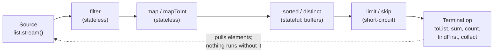
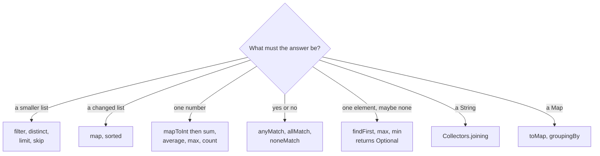

## In One Line
Almost every "solve it with Java 8 streams" warm-up question is one of about twenty moves — filter, map, sum, max, count, sort, distinct, find, match, slice, join, convert — and a strong answer gives the stream version, the plain-loop version, the edge cases and the time/space complexity.

## Mental Model
Picture a **factory conveyor belt**.

- The **bin of raw parts** at the start is the *source*: `list.stream()`, `Arrays.stream(arr)`, `IntStream.range(0, n)`, `str.chars()`.
- Each **station** along the belt is an *intermediate operation*. An inspector throws away bad parts (`filter`), a painter changes each part (`map`), a counter-clerk just watches (`peek`).
- The **packing station** at the end is the *terminal operation* (`toList`, `sum`, `count`, `findFirst`, `collect`). It is also the **power switch**: until a terminal operation is called, the belt does not move at all. That is *laziness*.
- Parts travel **one at a time through every station** before the next part enters the belt ("vertical" processing), not station-by-station for the whole batch.
- Some stations must **collect the whole batch before passing anything on**: a sorter (`sorted`) cannot hand out the smallest part until it has seen all of them. These are *stateful* operations and they break the one-at-a-time flow.
- If the packer only needs one part (`findFirst`, `anyMatch`, `limit(1)`), it shouts "stop" and the rest of the bin is never touched: *short-circuiting*.

When you solve a drill, you are just choosing which stations to put on the belt, in which order, and what the packer should produce.

## Concept
### The four-step routine for any stream drill
1. **Source** — where do the elements come from? A `List` (`list.stream()`), an `int[]` (`Arrays.stream(arr)` → `IntStream`), a `String` (`s.chars()` → `IntStream` of char codes), a range (`IntStream.rangeClosed(1, n)`), or generated values (`Stream.iterate`).
2. **Translate the English** into operations (table below). Filter first, then map: fewer elements reach the expensive steps.
3. **Terminal operation** — decide the result type: a `List`, a number, a `boolean`, an `Optional`, a `String`, a `Map`.
4. **Say out loud:** the complexity, the edge cases (empty, null, duplicates, negatives, overflow), and the plain-loop alternative.

> [!INTERVIEW] "I'll write it as a stream first because it reads like the requirement; the loop version is the same O(n) and I'll show it too."

### Phrase → operation
| The question says... | Reach for | Result |
|---|---|---|
| "only the ...", "remove all ..." | `filter(predicate)` | stream |
| "each ... converted to ...", "square", "upper-case" | `map(f)`, `mapToInt(f)` | stream |
| "sum", "total", "average" | `mapToInt(...).sum()` / `.average()`, `summaryStatistics()` | `int` / `OptionalDouble` |
| "largest", "smallest", "longest" | `max(cmp)` / `min(cmp)`, or `IntStream.max()` | `Optional` |
| "how many" | `count()` | `long` |
| "unique", "remove duplicates" | `distinct()` | stream |
| "find the duplicates" | `filter(n -> !seen.add(n))` or `groupingBy(..., counting())` | set / list |
| "sorted", "descending", "by length" | `sorted()`, `sorted(cmp)` | stream |
| "first", "any" | `findFirst()`, `findAny()` | `Optional` |
| "is there any / are all / is none" | `anyMatch` / `allMatch` / `noneMatch` | `boolean` |
| "combine into one value", "product" | `reduce(identity, op)` | value |
| "comma-separated", "join" | `Collectors.joining(sep, prefix, suffix)` | `String` |
| "page N", "skip the first N", "top N" | `skip(n)`, `limit(n)` | stream |
| "merge lists", "flatten" | `Stream.concat(a, b)`, `flatMap(List::stream)` | stream |
| "list to map" | `Collectors.toMap(k, v, merge, LinkedHashMap::new)` | `Map` |
| "group by / count per" | `groupingBy` — see [Stream Drills — Advanced](lesson:b06-coding-drills/02-stream-drills-advanced) | `Map` |

### Sources you must know
| Source | Code | Gives |
|---|---|---|
| Any collection | `list.stream()`, `set.stream()` | `Stream<T>` |
| Object array | `Arrays.stream(words)`, `Stream.of(words)` | `Stream<String>` |
| Primitive array | `Arrays.stream(intArr)` | `IntStream` (**not** `Stream.of(intArr)`, which is a `Stream<int[]>` of one element) |
| Loose values | `Stream.of(1, 2, 3)` | `Stream<Integer>` |
| A range of ints | `IntStream.range(0, n)` (end exclusive), `rangeClosed(1, n)` (end inclusive) | `IntStream` |
| Characters of a string | `s.chars()` | `IntStream` of UTF-16 char codes |
| Map entries | `map.entrySet().stream()` | `Stream<Map.Entry<K, V>>` |
| Infinite | `Stream.iterate(0, n -> n + 2)`, `Stream.generate(supplier)` — always add `limit` | `Stream<T>` |
| Bounded iterate (Java 9) | `Stream.iterate(1, n -> n <= 100, n -> n * 3)` | `Stream<T>` |

### Primitive streams: arithmetic without boxing
`Stream<Integer>` holds `Integer` objects; every `+` unboxes and re-boxes. `IntStream`, `LongStream` and `DoubleStream` work on raw values and add the arithmetic terminals `sum()`, `average()`, `max()`, `min()`, `summaryStatistics()`.

- `Stream<Integer>` → `IntStream`: `mapToInt(Integer::intValue)` (or any `ToIntFunction`).
- `IntStream` → `Stream<Integer>`: `boxed()`; to other objects: `mapToObj(i -> "item" + i)`.
- `IntStream.max()` returns `OptionalInt`; `average()` returns `OptionalDouble` (empty for no elements, never a division by zero).
- `sum()` on an `IntStream` is an `int` and **can overflow silently**; use `mapToLong(...).sum()` for big totals.

### Which terminals return `Optional`
Anything that might have **nothing** to return: `findFirst()`, `findAny()`, `max(cmp)`, `min(cmp)`, `reduce(op)` without an identity, and the primitive `max()`, `min()`, `average()`. Unwrap with `orElse(default)`, `orElseGet(supplier)`, `orElseThrow()` (Java 10) or `ifPresent(action)`. Calling `get()` without checking is a code-review red flag.

### Collecting to a list: three options
| | `stream.toList()` (Java 16) | `collect(Collectors.toList())` | `collect(Collectors.toUnmodifiableList())` (Java 10) |
|---|---|---|---|
| Mutable? | **No** — `add` throws `UnsupportedOperationException` | In practice an `ArrayList` (the spec promises nothing) | No |
| Allows `null` elements? | Yes | Yes | **No** — NPE |
| Use when | Default choice for results you only read | You need to add/remove afterwards (or use `Collectors.toCollection(ArrayList::new)` to be explicit) | You want immutability and no nulls |

### Stream or loop?
| Stream is better | Loop is better |
|---|---|
| The code reads like the requirement (`filter`, `map`, `sum`) | You need the **index** or neighbours (`a[i]` vs `a[i + 1]`) |
| No shared mutable state | You update several variables at once (min **and** max in one pass) |
| Easy to add a step, easy to parallelise later | Checked exceptions inside the body |
| Collectors do grouping/joining for free | Hot, tiny loops where boxing or lambda overhead matters |

Interviewers usually accept either, but they often ask for **the other one** as a follow-up. Knowing both is the point of these drills.

### Complexity of the common operations
| Operation | Time | Extra space | Note |
|---|---|---|---|
| `filter`, `map`, `mapToInt`, `peek` | O(n) total | O(1) | Stateless, one element at a time |
| `sorted()` | O(n log n) | O(n) | Stateful barrier: buffers everything (TimSort for objects) |
| `distinct()` | O(n) expected | O(n) | Uses a hash set internally; needs correct `equals`/`hashCode` |
| `limit(k)`, `skip(k)` | O(k) | O(1) sequential | Short-circuits the source |
| `findFirst`, `anyMatch`, `allMatch`, `noneMatch` | O(n) worst | O(1) | Stop early when the answer is known |
| `count()` | O(1) or O(n) | O(1) | Java 9+ skips the pipeline if the size is known from the source |
| `max`, `min`, `sum`, `reduce` | O(n) | O(1) | Single pass |
| `collect(toList())`, `toList()` | O(n) | O(n) | The result itself |
| `filter(list::contains)` | **O(n·m)** | O(1) | Convert the searched list to a `HashSet` first → O(n + m) |

### Edge-case checklist (say these before the interviewer does)
- **Empty input** → `Optional.empty`, `OptionalDouble.empty`, `0` from `sum()`, `true` from `allMatch`.
- **Negative numbers** → `n % 2 == 1` misses negative odd numbers (use `!= 0`); `'-'` breaks digit tricks.
- **Overflow** → `int` sums and products wrap silently; use `long`, `Math.addExact`/`multiplyExact`, or `BigInteger`.
- **Integer division** → `total / size` truncates; cast to `double` first.
- **Duplicates and ties** → `max`/`min` keep the **first** of equal elements; `toMap` throws on duplicate keys.
- **Nulls** → `sorted()`, `toMap` values, `toUnmodifiableList` and `List.of` all throw NPE on `null`.
- **Immutability** → `List.of(...)` and `stream.toList()` cannot be sorted or modified in place.

## Diagram

Elements are pulled through the pipeline by the terminal operation; stateless stations pass each element straight on, stateful ones must see everything first.


Start from the *shape of the answer*; it tells you the terminal operation, and the terminal operation tells you which intermediate steps you need.

## Code
**The harness.** Every drill snippet in the Interview Q&A section is the body of `main` in this class, run on JDK 21 exactly as shown; the outputs under each snippet are the real console output.
```java
import java.util.*;
import java.util.function.*;
import java.util.stream.*;

public class Drill {
    public static void main(String[] args) {
        // drill snippet goes here
    }
}
```

**One problem, three styles, one trace** — "sum of the squares of the even numbers":
```java
import java.util.List;

public class ThreeWays {
    public static void main(String[] args) {
        List<Integer> nums = List.of(3, 8, 5, 12, 7, 6);

        // 1. Imperative loop: you describe HOW, step by step
        int loopSum = 0;
        for (int n : nums) {
            if (n % 2 == 0) {
                loopSum += n * n;
            }
        }

        // 2. Stream of boxed Integers: you describe WHAT
        int boxedSum = nums.stream()
                .filter(n -> n % 2 == 0)
                .map(n -> n * n)
                .reduce(0, Integer::sum);

        // 3. Primitive stream: same pipeline, arithmetic on plain ints
        int primitiveSum = nums.stream()
                .filter(n -> n % 2 == 0)
                .mapToInt(n -> n * n)
                .sum();

        System.out.println(loopSum + " " + boxedSum + " " + primitiveSum);

        // 4. The same pipeline, traced: each element travels the whole line alone
        int traced = nums.stream()
                .filter(n -> {
                    System.out.println("filter " + n);
                    return n % 2 == 0;
                })
                .mapToInt(n -> {
                    System.out.println("  square " + n);
                    return n * n;
                })
                .sum();
        System.out.println("sum = " + traced);
    }
}
```
```output
244 244 244
filter 3
filter 8
  square 8
filter 5
filter 12
  square 12
filter 7
filter 6
  square 6
sum = 244
```

## Walkthrough
### The harness
- `import java.util.*;` brings in `List`, `ArrayList`, `Map`, `Set`, `Arrays`, `Collections`, `Optional`, `Comparator`, `StringJoiner` and friends.
- `import java.util.function.*;` brings in `Function` (for `Function.identity()`), `Predicate`, `BinaryOperator` and the other functional interfaces.
- `import java.util.stream.*;` brings in `Stream`, `IntStream`, `LongStream` and `Collectors`.
- Wildcard imports keep drill code short. In production code, IDEs expand them to single-type imports.

### `ThreeWays`
- `List.of(3, 8, 5, 12, 7, 6)` — an immutable list; autoboxing turns each literal into an `Integer`.
- **Style 1, the loop.** `for (int n : nums)` unboxes each `Integer` into `n`. `if (n % 2 == 0)` keeps the even ones, `loopSum += n * n` accumulates the squares: 8² + 12² + 6² = 64 + 144 + 36 = **244**.
- **Style 2, boxed stream.** `filter(n -> n % 2 == 0)` keeps 8, 12, 6. `map(n -> n * n)` produces a `Stream<Integer>` of squares — every square is boxed into a new `Integer` (above 127 there is no cache). `reduce(0, Integer::sum)` folds them: `0` is the identity (neutral element of `+`), `Integer::sum` is the `BinaryOperator<Integer>`.
- **Style 3, primitive stream.** `mapToInt(n -> n * n)` switches to an `IntStream`, so the squares are plain `int`s and `sum()` adds them without boxing. This is the idiomatic version.
- All three print `244`, so the first line is `244 244 244`.
- **The trace.** Look at the order of the output lines: `filter 3`, then `filter 8`, `square 8`, then `filter 5`... Each element goes through **both** stations before the next element starts. `3`, `5` and `7` are rejected by `filter`, so `square` never runs for them. Nothing at all would print if `.sum()` were removed, because the terminal operation is what starts the pipeline.

## Traps
The mistakes that turn a correct-looking stream answer into a wrong one:

```java
// 1. toMap rejects null VALUES
try {
    Stream.of("a", "b").collect(Collectors.toMap(k -> k, k -> k.equals("b") ? null : 1));
} catch (NullPointerException e) {
    System.out.println("toMap null value   -> NullPointerException");
}

// 2. sorted() on a list containing null
try {
    Arrays.asList(3, null, 1).stream().sorted().toList();
} catch (NullPointerException e) {
    System.out.println("sorted() with null -> NullPointerException");
}

// 3. Changing the source while streaming over it
List<Integer> src = new ArrayList<>(List.of(1, 2, 3));
try {
    src.stream().forEach(n -> { if (n == 2) src.add(99); });
} catch (ConcurrentModificationException e) {
    System.out.println("modify source      -> ConcurrentModificationException");
}

// 4. Locale-sensitive upper-casing
System.out.println("\"title\" in Turkish -> " + "title".toUpperCase(Locale.forLanguageTag("tr")).equals("TITLE"));

// 5. Boxed Integers compared with ==
List<Integer> big = List.of(1000, 1000);
System.out.println("1000 == 1000 (boxed) -> " + (big.get(0) == big.get(1)));
```
```output
toMap null value   -> NullPointerException
sorted() with null -> NullPointerException
modify source      -> ConcurrentModificationException
"title" in Turkish -> false
1000 == 1000 (boxed) -> false
```

- **`toMap` rejects `null` values** — it uses `HashMap.merge` internally, which throws NPE for `null` values. Filter them out or collect with a loop.
- **`sorted()` with a `null` element** throws NPE (natural ordering calls `compareTo` on it). Use `sorted(Comparator.nullsFirst(Comparator.naturalOrder()))`.
- **Modifying the source inside the stream** is not allowed; `ArrayList`'s spliterator detects it (here at the end of `forEach`) and throws `ConcurrentModificationException`. Collect the changes into a new list instead.
- **`toUpperCase()` without a locale** uses the default locale. In Turkish, `"title".toUpperCase()` is `"TİTLE"` (dotted capital İ), so comparisons fail. Use `toUpperCase(Locale.ROOT)` for non-display text.
- **`==` on boxed values** compares references. `Integer` caches only -128..127, so two `1000`s from a list are different objects. Use `equals`, or unbox with `mapToInt`.
- **`Integer::max` / `Math::max` as a comparator** compiles (same `(int, int) -> int` shape) but is not a comparison; `max(Integer::max)` returns garbage. Use `Integer::compare` or `Comparator.naturalOrder()`.
- **`n % 2 == 1` for odd numbers** misses negative odd numbers, because `-7 % 2` is `-1`.
- **Reusing a stream** throws `IllegalStateException: stream has already been operated upon or closed`. Create a new stream (or keep a `Supplier<Stream<T>>`).
- **`Arrays.asList(intArray)` and `Stream.of(intArray)`** see the `int[]` as **one** object. Use `Arrays.stream(intArray)` or `IntStream.of(intArray)`.
- **`stream.toList()` is unmodifiable.** Calling `add`, `remove` or `sort` on it throws `UnsupportedOperationException`.
- **`peek` for logic** — `peek` may not run at all (Java 9+ `count()` on a sized source skips the pipeline). Use it only for debugging.
- **Side effects in lambdas** (`forEach(list::add)`, the `seen.add` trick) work sequentially but break under `parallel()`. Prefer collectors.
- **`limit` on an infinite stream must come before any stateful operation** — `Stream.iterate(0, n -> n + 1).sorted().limit(5)` never finishes, because `sorted` waits for the end of an endless stream.

> [!WARNING] `filter(other::contains)` where `other` is a `List` is O(n·m). Interviewers notice. Wrap it: `Set<T> set = new HashSet<>(other);` then `filter(set::contains)`.

## Tips & Tricks
- **"Shape of the answer first."** List? Number? Boolean? Optional? String? Map? The answer's shape picks the terminal operation; work backwards from there.
- **"Filter early, map late, sort last."** Filtering first means fewer elements are mapped and sorted.
- **Maybe-nothing = Optional.** `findFirst`, `findAny`, `max`, `min`, `reduce` without identity, `average` — if the stream could be empty, you get an `Optional`.
- **Maths on primitives.** Any time you `sum`, `average`, `max` numbers, go through `mapToInt`/`mapToLong`/`mapToDouble`.
- **Comparator, not calculator.** A comparator returns *negative/zero/positive*: `Integer::compare`, `Comparator.naturalOrder()`, `Comparator.comparingInt(String::length)`. Never `Integer::max`, never `a - b`.
- **Odd = `!= 0`.** Remember "the remainder keeps the sign of the dividend".
- **HashSet before contains.** Any "common/different elements" question: turn one side into a `HashSet`.
- **Order-preserving de-duplication:** `distinct()` or `new LinkedHashSet<>(list)`. Sorted de-duplication: `new TreeSet<>(list)`.
- **Answer template:** approach in one sentence → stream code → loop code → "O(n) time, O(n) space for the result" → edge cases. Practise saying all five for every drill below.
- **Java-version badges to drop in interviews:** `toList()` (16), `takeWhile`/`dropWhile`/3-arg `iterate` (9), `orElseThrow()` (10), `toArray(String[]::new)` on collections (11), `getLast()`/`reversed()` (21).

## Interview Q&A
### [Basic] Separate the even and the odd numbers from a list of integers.
**Approach.** One `filter` per group: `n % 2 == 0` for even, `n % 2 != 0` for odd. Do **not** test odd with `== 1`: in Java the remainder takes the sign of the dividend, so `-7 % 2` is `-1`. To get both groups in a single pass, use `Collectors.partitioningBy` (next lesson).
```java
List<Integer> nums = List.of(10, 15, 8, 49, 25, 98, 32, -7);

// Stream solution
List<Integer> evens = nums.stream()
        .filter(n -> n % 2 == 0)
        .toList();
List<Integer> odds = nums.stream()
        .filter(n -> n % 2 != 0)        // safe for negatives
        .toList();
List<Integer> oddsBuggy = nums.stream()
        .filter(n -> n % 2 == 1)        // BUG: -7 % 2 is -1, not 1
        .toList();
System.out.println("even      : " + evens);
System.out.println("odd       : " + odds);
System.out.println("odd (==1) : " + oddsBuggy);

// Plain loop solution
List<Integer> evensLoop = new ArrayList<>();
for (int n : nums) {
    if (n % 2 == 0) evensLoop.add(n);
}
System.out.println("even loop : " + evensLoop);
```
```output
even      : [10, 8, 98, 32]
odd       : [15, 49, 25, -7]
odd (==1) : [15, 49, 25]
even loop : [10, 8, 98, 32]
```
**Complexity.** O(n) time per pass, O(n) extra space for the result lists.

**Follow-up:** *Do it in one pass with streams.* — `nums.stream().collect(Collectors.partitioningBy(n -> n % 2 == 0))` returns `{false=[odds], true=[evens]}`.

### [Basic] Find all numbers in a list that start with the digit 1.
**Approach.** The easy way: turn each number into text with `String.valueOf(n)` and test `startsWith("1")`. Negative numbers start with `'-'`, so strip the sign if they should count. The loop version avoids string allocation: divide by 10 until one digit is left, then compare it with 1.
```java
List<Integer> nums = List.of(10, 15, 8, 49, 25, 98, 32, 1, 111, -12);

// Stream solution: turn each number into text and test the first character
List<Integer> startsWith1 = nums.stream()
        .filter(n -> String.valueOf(n).startsWith("1"))
        .toList();
System.out.println("stream         : " + startsWith1);

// If negatives should count too, strip the sign first
List<Integer> withNegatives = nums.stream()
        .filter(n -> String.valueOf(Math.abs((long) n)).startsWith("1"))
        .toList();
System.out.println("with negatives : " + withNegatives);

// Plain loop, no strings: divide by 10 until one digit is left
List<Integer> loop = new ArrayList<>();
for (int n : nums) {
    long x = Math.abs((long) n);
    while (x >= 10) x /= 10;
    if (x == 1) loop.add(n);
}
System.out.println("loop           : " + loop);
```
```output
stream         : [10, 15, 1, 111]
with negatives : [10, 15, 1, 111, -12]
loop           : [10, 15, 1, 111, -12]
```
**Complexity.** O(n·d) time where d is the number of digits (at most 10 for an `int`), so effectively O(n); O(n) for the result.

> [!NOTE] `Math.abs((long) n)` casts first because `Math.abs(Integer.MIN_VALUE)` overflows and stays negative.

**Follow-up:** *Why not `n / 10 == 1`?* — It only works for two-digit numbers; `111 / 10` is `11`. You must keep dividing until one digit remains (or use `n / (int) Math.pow(10, digits - 1)`).

### [Basic] Square every number and keep the squares greater than 100; then sum the squares of the odd numbers.
**Approach.** `map` transforms, `filter` selects. The order matters: here the condition is on the **square**, so `map` comes first. For the sum, filter on the original number, then `mapToInt` to square into an `IntStream` and `sum()`.
```java
List<Integer> nums = List.of(1, 2, 3, 4, 5, 6, 7, 8, 9, 10, 11, 12);

// Squares greater than 100
List<Integer> bigSquares = nums.stream()
        .map(n -> n * n)
        .filter(sq -> sq > 100)
        .toList();
System.out.println("squares > 100      : " + bigSquares);

// Sum of the squares of the odd numbers (primitive stream: no boxing)
int sumOddSquares = nums.stream()
        .filter(n -> n % 2 != 0)
        .mapToInt(n -> n * n)
        .sum();
System.out.println("sum of odd squares : " + sumOddSquares);

// Plain loop
int total = 0;
for (int n : nums) {
    if (n % 2 != 0) total += n * n;
}
System.out.println("loop               : " + total);
```
```output
squares > 100      : [121, 144]
sum of odd squares : 286
loop               : 286
```
**Complexity.** O(n) time, O(1) extra space for the sum (O(k) for the k squares kept).

**Follow-up:** *What if the numbers are large?* — `n * n` overflows `int` above 46,340. Use `mapToLong(n -> (long) n * n)`.

### [Basic] Convert a list of names to upper case, and keep only those starting with "a" (any case).
**Approach.** `map(s -> s.toUpperCase(Locale.ROOT))` transforms every element; `filter` on the first character selects. Comparing a lower-cased `char` avoids allocating a new string for the test. `count()` answers "how many".
```java
List<String> names = List.of("anil", "Bhavya", "arjun", "chitra", "Asha");

// 1. Upper-case every name
List<String> upper = names.stream()
        .map(s -> s.toUpperCase(Locale.ROOT))
        .toList();
System.out.println("upper       : " + upper);

// 2. Names that start with 'a' or 'A', upper-cased
List<String> aNames = names.stream()
        .filter(s -> !s.isEmpty() && Character.toLowerCase(s.charAt(0)) == 'a')
        .map(s -> s.toUpperCase(Locale.ROOT))
        .toList();
System.out.println("a-names     : " + aNames);

// 3. How many of them?
long count = names.stream()
        .filter(s -> s.toLowerCase(Locale.ROOT).startsWith("a"))
        .count();
System.out.println("a-count     : " + count);

// Plain loop for 2
List<String> loop = new ArrayList<>();
for (String s : names) {
    if (!s.isEmpty() && Character.toLowerCase(s.charAt(0)) == 'a') {
        loop.add(s.toUpperCase(Locale.ROOT));
    }
}
System.out.println("a-names loop: " + loop);
```
```output
upper       : [ANIL, BHAVYA, ARJUN, CHITRA, ASHA]
a-names     : [ANIL, ARJUN, ASHA]
a-count     : 3
a-names loop: [ANIL, ARJUN, ASHA]
```
**Complexity.** O(n·L) where L is the average name length (upper-casing copies each string); O(n) for the result.

**Follow-up:** *Why `Locale.ROOT`?* — `toUpperCase()` uses the default locale; in Turkish, `i` becomes `İ`, which breaks comparisons. `Locale.ROOT` gives locale-neutral results.

### [Basic] Find the sum and the average of a list of integers.
**Approach.** Unbox once with `mapToInt(Integer::intValue)`, then use `sum()` and `average()`. `summaryStatistics()` gives count, sum, min, average and max in **one pass**. `average()` returns `OptionalDouble` so an empty list gives `OptionalDouble.empty` instead of a division by zero.
```java
List<Integer> nums = List.of(4, 8, 15, 16, 23, 43);

// Stream: unbox once with mapToInt, then use the primitive-stream helpers
int sum = nums.stream().mapToInt(Integer::intValue).sum();
double avg = nums.stream().mapToInt(Integer::intValue).average().orElse(0.0);
System.out.println("sum = " + sum + ", avg = " + avg);

// Everything in one pass
IntSummaryStatistics stats = nums.stream().mapToInt(Integer::intValue).summaryStatistics();
System.out.println(stats);

// reduce and a collector give the same sum
System.out.println("reduce    : " + nums.stream().reduce(0, Integer::sum));
System.out.println("collector : " + nums.stream().collect(Collectors.summingInt(Integer::intValue)));

// Plain loop (long total protects against int overflow)
long total = 0;
for (int n : nums) total += n;
double avgLoop = nums.isEmpty() ? 0.0 : (double) total / nums.size();
System.out.println("loop avg  : " + avgLoop);
System.out.println("int avg   : " + total / nums.size() + "   <- integer division bug");

// Empty input
System.out.println("empty avg : " + List.<Integer>of().stream().mapToInt(Integer::intValue).average());
```
```output
sum = 109, avg = 18.166666666666668
IntSummaryStatistics{count=6, sum=109, min=4, average=18.166667, max=43}
reduce    : 109
collector : 109
loop avg  : 18.166666666666668
int avg   : 18   <- integer division bug
empty avg : OptionalDouble.empty
```
**Complexity.** O(n) time, O(1) extra space.

**Follow-up:** *Why `long total` in the loop?* — Summing many `int`s can exceed 2,147,483,647 and wrap silently. `IntStream.sum()` has the same problem; use `mapToLong(...).sum()` for large inputs.

### [Basic] Find the maximum and minimum value in a list.
**Approach.** `Stream.max`/`min` take a `Comparator` and return `Optional`. On an `IntStream`, `max()`/`min()` need no comparator. `Collections.max`/`min` are one-liners. The loop finds both in a single pass.
```java
List<Integer> nums = List.of(42, 7, 19, 88, -3, 56);

// Stream: max/min need a Comparator and return Optional
int max = nums.stream().max(Comparator.naturalOrder()).orElseThrow();
int min = nums.stream().min(Integer::compare).orElseThrow();
System.out.println("max = " + max + ", min = " + min);

// Primitive stream: max() needs no comparator
System.out.println("IntStream max = " + nums.stream().mapToInt(Integer::intValue).max().getAsInt());

// Collections helpers
System.out.println("Collections   = " + Collections.max(nums) + " / " + Collections.min(nums));

// Plain loop: one pass for both
int hi = Integer.MIN_VALUE, lo = Integer.MAX_VALUE;
for (int n : nums) {
    if (n > hi) hi = n;
    if (n < lo) lo = n;
}
System.out.println("loop          = " + hi + " / " + lo);

// The classic bug: Integer::max is NOT a comparator
System.out.println("max(Integer::max) = " + nums.stream().max(Integer::max).get());
```
```output
max = 88, min = -3
IntStream max = 88
Collections   = 88 / -3
loop          = 88 / -3
max(Integer::max) = 42
```
**Complexity.** O(n) time, O(1) space for every version.

> [!WARNING] The last line shows the classic bug: `max(Integer::max)` compiles because `Integer.max(int, int)` has the same shape as `Comparator.compare`, but it returns the larger *value*, not a negative/zero/positive *comparison*. `Stream.max` keeps `a` whenever `compare(a, b) >= 0`, which is always true here, so it returns the first element, `42`.

**Follow-up:** *What if the list is empty?* — `max(...)` returns `Optional.empty`, `orElseThrow()` throws `NoSuchElementException`, and `Collections.max` throws `NoSuchElementException` too. Decide on a default with `orElse`.

### [Basic] Count the words longer than 4 characters, and count how often "java" occurs.
**Approach.** `filter(...).count()`. `count()` returns a `long`. For "how many times does X occur" there is also `Collections.frequency(collection, x)`, which uses `equals`.
```java
List<String> words = List.of("java", "stream", "lambda", "api", "collectors", "java");

long longWords = words.stream().filter(w -> w.length() > 4).count();
long javaCount = words.stream().filter("java"::equals).count();
System.out.println("longer than 4 : " + longWords);
System.out.println("\"java\" count  : " + javaCount);

// Built-in helper for "how many times does X occur"
System.out.println("frequency     : " + Collections.frequency(words, "java"));

// Plain loop
int loopCount = 0;
for (String w : words) {
    if (w.length() > 4) loopCount++;
}
System.out.println("loop          : " + loopCount);
```
```output
longer than 4 : 3
"java" count  : 2
frequency     : 2
loop          : 3
```
**Complexity.** O(n) time, O(1) space.

**Follow-up:** *Why `"java"::equals` instead of `w -> w.equals("java")`?* — Calling `equals` on the literal is null-safe: a `null` element gives `false` instead of an NPE.

### [Intermediate] Find the sum of the digits of a number using streams.
**Approach.** `String.valueOf(n).chars()` gives an `IntStream` of **char codes** (`'9'` is 57), so subtract `'0'` (48) or use `Character.getNumericValue`. The arithmetic loop (`% 10`, `/ 10`) is what interviewers expect as the "no library" answer.
```java
int n = 98765;

// Stream: chars() gives the char codes; subtract '0' to get the digit value
int s1 = String.valueOf(n).chars().map(c -> c - '0').sum();
int s2 = String.valueOf(n).chars().map(Character::getNumericValue).sum();
System.out.println("stream   : " + s1 + " / " + s2);

// Plain loop: peel digits off with % 10 and / 10 (no String allocation)
int x = Math.abs(n), sum = 0;
while (x != 0) {
    sum += x % 10;
    x /= 10;
}
System.out.println("loop     : " + sum);

// Negative input: the '-' sign breaks the stream version unless you strip it
int neg = -123;
System.out.println("'-' - '0' = " + ('-' - '0'));
System.out.println("negative : " + String.valueOf(Math.abs(neg)).chars().map(c -> c - '0').sum());
```
```output
stream   : 35 / 35
loop     : 35
'-' - '0' = -3
negative : 6
```
**Complexity.** O(d) time where d is the number of digits (O(log₁₀ n)); the stream version also allocates an O(d) string.

**Follow-up:** *What does `String.valueOf(-123).chars().map(c -> c - '0').sum()` give?* — `3`, not `6`: the `'-'` contributes `'-' - '0'` = -3. Take `Math.abs` first.

### [Intermediate] Multiply all numbers in a list together (and explain `reduce`).
**Approach.** `reduce(identity, accumulator)`: the identity must be neutral for the operation — `1` for multiplication, `0` for addition. Without an identity, `reduce` returns an `Optional` because the stream might be empty. Watch for overflow: 13! does not fit in an `int`.
```java
List<Integer> nums = List.of(1, 2, 3, 4, 5);

// reduce(identity, accumulator): identity must be neutral for the operation
int product = nums.stream().reduce(1, (a, b) -> a * b);
System.out.println("product      : " + product);

// Without an identity you get an Optional (the stream might be empty)
Optional<Integer> none = List.<Integer>of().stream().reduce((a, b) -> a * b);
System.out.println("empty        : " + none);

// Overflow is silent with int: 13! does not fit
System.out.println("13! as int   : " + IntStream.rangeClosed(1, 13).reduce(1, (a, b) -> a * b));
System.out.println("13! as long  : " + LongStream.rangeClosed(1, 13).reduce(1, (a, b) -> a * b));
try {
    IntStream.rangeClosed(1, 13).reduce(1, Math::multiplyExact);
} catch (ArithmeticException e) {
    System.out.println("multiplyExact: " + e.getMessage());
}

// Plain loop
long p = 1;
for (int v : nums) p *= v;
System.out.println("loop         : " + p);
```
```output
product      : 120
empty        : Optional.empty
13! as int   : 1932053504
13! as long  : 6227020800
multiplyExact: integer overflow
loop         : 120
```
**Complexity.** O(n) time, O(1) space.

**Follow-up:** *What happens with `reduce(0, (a, b) -> a * b)`?* — Always `0`, because the identity is not neutral for multiplication. In a parallel stream a wrong identity is applied once per chunk, giving different wrong answers.

### [Basic] Sort a list ascending and descending; sort strings by length, then alphabetically.
**Approach.** `sorted()` uses natural order; `sorted(Comparator.reverseOrder())` reverses it. For strings by length use `Comparator.comparingInt(String::length)`, chain a tie-breaker with `thenComparing`. `reversed()` flips everything built so far. Object sorting is **stable**, so ties keep their original order.
```java
List<Integer> nums = List.of(42, 7, 19, 88, -3, 56);
System.out.println("asc        : " + nums.stream().sorted().toList());
System.out.println("desc       : " + nums.stream().sorted(Comparator.reverseOrder()).toList());

List<String> words = List.of("kiwi", "fig", "banana", "apple", "cherry", "date");
// By length, ties alphabetically
System.out.println("len, alpha : " + words.stream()
        .sorted(Comparator.comparingInt(String::length)
                          .thenComparing(Comparator.naturalOrder()))
        .toList());
// By length, longest first (ties keep their original order: sort is stable)
System.out.println("len desc   : " + words.stream()
        .sorted(Comparator.comparingInt(String::length).reversed())
        .toList());

// Plain Java: copy (List.of is immutable) and sort in place
List<Integer> copy = new ArrayList<>(nums);
Collections.sort(copy, Collections.reverseOrder());
System.out.println("loop desc  : " + copy);
```
```output
asc        : [-3, 7, 19, 42, 56, 88]
desc       : [88, 56, 42, 19, 7, -3]
len, alpha : [fig, date, kiwi, apple, banana, cherry]
len desc   : [banana, cherry, apple, kiwi, date, fig]
loop desc  : [88, 56, 42, 19, 7, -3]
```
**Complexity.** O(n log n) time, O(n) space (the stream buffers all elements; the copy for `Collections.sort` is also O(n)).

**Follow-up:** *Why copy before `Collections.sort`?* — `List.of` is immutable; sorting it in place throws `UnsupportedOperationException`. `sorted()` never modifies the source.

### [Basic] Remove duplicates from a list while keeping the original order.
**Approach.** `distinct()` keeps the first occurrence of each element in encounter order (it uses `equals`/`hashCode`). The collection answer is `new ArrayList<>(new LinkedHashSet<>(list))`. The loop uses `Set.add`, which returns `false` for an element already present.
```java
List<Integer> nums = List.of(5, 3, 5, 1, 3, 7, 1, 9);

// Stream: distinct() keeps the FIRST occurrence, in encounter order
System.out.println("distinct      : " + nums.stream().distinct().toList());

// Collections: LinkedHashSet keeps insertion order
System.out.println("LinkedHashSet : " + new ArrayList<>(new LinkedHashSet<>(nums)));

// TreeSet sorts; HashSet has no defined order
System.out.println("TreeSet       : " + new TreeSet<>(nums));

// Plain loop with a "seen" set
Set<Integer> seen = new HashSet<>();
List<Integer> result = new ArrayList<>();
for (int n : nums) {
    if (seen.add(n)) result.add(n);   // add() returns false if already present
}
System.out.println("loop          : " + result);
```
```output
distinct      : [5, 3, 1, 7, 9]
LinkedHashSet : [5, 3, 1, 7, 9]
TreeSet       : [1, 3, 5, 7, 9]
loop          : [5, 3, 1, 7, 9]
```
**Complexity.** O(n) expected time, O(n) space for the set. `TreeSet` is O(n log n) but sorts as a bonus.

**Follow-up:** *Would `HashSet` work?* — It removes duplicates but gives **no ordering guarantee**. Small `Integer`s often come out sorted only because their hash codes equal their values, which is a coincidence, not a contract.

### [Intermediate] Find the duplicate elements in a list.
**Approach.** Three answers, from quickest to write to cleanest:
1. **`Set.add` trick** — `filter(n -> !seen.add(n))` keeps an element the second (third...) time it appears. Collect to a `LinkedHashSet` so an element seen three times is reported once. It relies on a side effect, so it is **not safe with `parallel()`**.
2. **Frequency map** — `groupingBy(identity(), LinkedHashMap::new, counting())`, then keep entries with count > 1. Pure, and gives the counts too.
3. **`Collections.frequency`** inside `filter` — short but O(n²).
```java
List<Integer> nums = List.of(5, 3, 5, 1, 3, 7, 1, 9, 5);

// 1. Stream + Set.add(): add returns false for a value seen before
Set<Integer> seen = new HashSet<>();
Set<Integer> dups = nums.stream()
        .filter(n -> !seen.add(n))
        .collect(Collectors.toCollection(LinkedHashSet::new));
System.out.println("Set.add trick : " + dups);

// 2. Pure stream (no outside state): count, then keep counts > 1
List<Integer> dups2 = nums.stream()
        .collect(Collectors.groupingBy(Function.identity(), LinkedHashMap::new, Collectors.counting()))
        .entrySet().stream()
        .filter(e -> e.getValue() > 1)
        .map(Map.Entry::getKey)
        .toList();
System.out.println("groupingBy    : " + dups2);

// 3. Slow but short: O(n^2)
List<Integer> dups3 = nums.stream()
        .filter(n -> Collections.frequency(nums, n) > 1)
        .distinct()
        .toList();
System.out.println("frequency     : " + dups3);

// Plain loop with two sets
Set<Integer> seenLoop = new HashSet<>();
Set<Integer> dupLoop = new LinkedHashSet<>();
for (int n : nums) {
    if (!seenLoop.add(n)) dupLoop.add(n);
}
System.out.println("loop          : " + dupLoop);
```
```output
Set.add trick : [5, 3, 1]
groupingBy    : [5, 3, 1]
frequency     : [5, 3, 1]
loop          : [5, 3, 1]
```
**Complexity.** Versions 1, 2 and the loop: O(n) time, O(n) space. Version 3: O(n²) time.

**Follow-up:** *And for an `int[]` whose values are 1..n?* — You can mark visited values by negating `arr[abs(v) - 1]`, giving O(n) time and O(1) extra space (see [Array & Number Programs](lesson:b06-coding-drills/04-array-and-number-programs)).

### [Basic] Find the first element of a list, and the first element greater than 50.
**Approach.** `findFirst()` returns an `Optional` — `Optional[12]` when printed. Combine with `filter` for "first matching", and unwrap with `orElse(-1)` or `ifPresent(...)`. `findFirst` is **short-circuiting**: the `peek` trace shows the stream stopped at 60 and never looked at 81 or 3.
```java
List<Integer> nums = List.of(12, 7, 45, 60, 81, 3);

System.out.println("first         : " + nums.stream().findFirst());
System.out.println("first > 50    : " + nums.stream().filter(n -> n > 50).findFirst().orElse(-1));
System.out.println("first > 100   : " + nums.stream().filter(n -> n > 100).findFirst().orElse(-1));
nums.stream()
    .filter(n -> n % 5 == 0)
    .findFirst()
    .ifPresent(n -> System.out.println("first mult 5  : " + n));

// Short-circuit proof: the stream stops as soon as it finds a match
System.out.print("visited       : ");
nums.stream()
    .peek(n -> System.out.print(n + " "))
    .filter(n -> n > 50)
    .findFirst();
System.out.println();

// Plain loop
int found = -1;
for (int n : nums) {
    if (n > 50) { found = n; break; }
}
System.out.println("loop          : " + found);
```
```output
first         : Optional[12]
first > 50    : 60
first > 100   : -1
first mult 5  : 45
visited       : 12 7 45 60 
loop          : 60
```
**Complexity.** O(k) time where k is the position of the match (O(n) worst case), O(1) space.

**Follow-up:** *`findFirst` vs `findAny`?* — Same on a sequential stream in practice; on a parallel stream `findAny` may return whichever element a thread finds first, which is faster. Use `findFirst` when order matters.

### [Intermediate] Check whether any number is odd, all are positive, none are negative.
**Approach.** `anyMatch`, `allMatch`, `noneMatch` return `boolean` and short-circuit: `anyMatch` stops at the first `true`, `allMatch` at the first `false`. On an **empty** stream `anyMatch` is `false` but `allMatch` and `noneMatch` are `true` ("vacuous truth": there is no counter-example).
```java
List<Integer> nums = List.of(4, 8, 15, 16, 23, 42);

System.out.println("any odd?       " + nums.stream().anyMatch(n -> n % 2 != 0));
System.out.println("all positive?  " + nums.stream().allMatch(n -> n > 0));
System.out.println("none negative? " + nums.stream().noneMatch(n -> n < 0));
System.out.println("contains 15?   " + nums.contains(15));

// Empty streams: "any" needs a witness, "all"/"none" are vacuously true
List<Integer> empty = List.of();
System.out.println("empty any/all/none: " + empty.stream().anyMatch(n -> n > 0)
        + " / " + empty.stream().allMatch(n -> n > 0)
        + " / " + empty.stream().noneMatch(n -> n > 0));

// Plain loop for allMatch: stop at the first counter-example
boolean allPositive = true;
for (int n : nums) {
    if (n <= 0) { allPositive = false; break; }
}
System.out.println("loop all positive? " + allPositive);
```
```output
any odd?       true
all positive?  true
none negative? true
contains 15?   true
empty any/all/none: false / true / true
loop all positive? true
```
**Complexity.** O(n) worst case, O(1) space.

**Follow-up:** *`list.contains(x)` or `stream().anyMatch(x::equals)`?* — `contains` — clearer and, for a `HashSet`, O(1). Use `anyMatch` when the condition is more than equality.

### [Intermediate] Return page 2 (size 3) of a list; generate the first 5 even numbers.
**Approach.** Pagination is `skip((page - 1) * size).limit(size)`; a page past the end is simply empty, no exception. `limit` also turns infinite streams (`Stream.iterate`, `generate`) into finite ones. Java 9's three-argument `iterate(seed, hasNext, next)` is a for-loop in stream form, and `takeWhile` stops at the **first** failing element (unlike `filter`, which checks all).
```java
List<String> items = IntStream.rangeClosed(1, 10).mapToObj(i -> "item" + i).toList();

// Pagination: page numbers start at 1
int page = 2, size = 3;
List<String> pageItems = items.stream()
        .skip((long) (page - 1) * size)
        .limit(size)
        .toList();
System.out.println("page 2        : " + pageItems);
System.out.println("page 4        : " + items.stream().skip(9).limit(3).toList());
System.out.println("page 5        : " + items.stream().skip(12).limit(3).toList());

// limit() makes an infinite stream finite
System.out.println("first 5 evens : " + Stream.iterate(0, n -> n + 2).limit(5).toList());

// Java 9: iterate(seed, hasNext, next) is a stream-shaped for-loop
System.out.println("powers of 3   : " + Stream.iterate(1, n -> n <= 100, n -> n * 3).toList());

// Java 9: takeWhile stops at the first failure (unlike filter)
System.out.println("takeWhile < 5 : " + Stream.of(1, 3, 6, 2, 4).takeWhile(n -> n < 5).toList());
System.out.println("filter < 5    : " + Stream.of(1, 3, 6, 2, 4).filter(n -> n < 5).toList());

// Plain loop version of the page
List<String> loop = new ArrayList<>();
for (int i = (page - 1) * size; i < Math.min(items.size(), page * size); i++) loop.add(items.get(i));
System.out.println("loop page 2   : " + loop);
```
```output
page 2        : [item4, item5, item6]
page 4        : [item10]
page 5        : []
first 5 evens : [0, 2, 4, 6, 8]
powers of 3   : [1, 3, 9, 27, 81]
takeWhile < 5 : [1, 3]
filter < 5    : [1, 3, 2, 4]
loop page 2   : [item4, item5, item6]
```
**Complexity.** O(skip + limit) time for the page, O(size) space for the result.

**Follow-up:** *Why cast to `long` in `skip`?* — `skip` takes a `long`; the cast also prevents `int` overflow in `(page - 1) * size` for huge page numbers.

### [Intermediate] Find the longest string in a list. What about ties?
**Approach.** `max(Comparator.comparingInt(String::length))`. On ties, `max` keeps the **first** element it met ("optional" beats "function"). To get *all* longest strings, find the maximum length first, then filter — two passes, still O(n).
```java
List<String> words = List.of("java", "stream", "lambda", "api", "optional", "function");

// max with a key comparator; ties keep the FIRST one met
String longest = words.stream()
        .max(Comparator.comparingInt(String::length))
        .orElse("");
System.out.println("longest     : " + longest);

// All words tied for the longest length (two passes)
int maxLen = words.stream().mapToInt(String::length).max().orElse(0);
List<String> allLongest = words.stream().filter(w -> w.length() == maxLen).toList();
System.out.println("all longest : " + allLongest);

// Shortest
System.out.println("shortest    : " + words.stream().min(Comparator.comparingInt(String::length)).orElse(""));

// Plain loop (strict > keeps the first on ties)
String best = "";
for (String w : words) {
    if (w.length() > best.length()) best = w;
}
System.out.println("loop        : " + best);
```
```output
longest     : optional
all longest : [optional, function]
shortest    : api
loop        : optional
```
**Complexity.** O(n) time, O(1) space (O(k) for the list of ties).

**Follow-up:** *How would you get the last of the tied words?* — `reduce((a, b) -> b.length() >= a.length() ? b : a)`, or in a loop use `>=` instead of `>`.

### [Advanced] Find the last element of a list using streams.
**Approach.** Streams have no `findLast`. Two stream tricks: `reduce((first, second) -> second)` keeps replacing the result with the newer element; `skip(size - 1).findFirst()` jumps near the end. But the honest answer is: for a `List`, use `list.get(list.size() - 1)`, or `list.getLast()` in Java 21 (from the new `SequencedCollection` interface).
```java
List<String> list = List.of("a", "b", "c", "d");

// 1. reduce that always keeps the right-hand element
System.out.println("reduce  : " + list.stream().reduce((first, second) -> second).orElse(null));

// 2. skip everything except the last element (list size is known)
System.out.println("skip    : " + list.stream().skip(list.size() - 1).findFirst().orElse(null));

// 3. Plain index access: O(1) for ArrayList / List.of
System.out.println("get     : " + list.get(list.size() - 1));

// 4. Java 21 SequencedCollection
System.out.println("getLast : " + list.getLast());

// Edge case: empty list
List<String> empty = List.of();
System.out.println("empty reduce  : " + empty.stream().reduce((a, b) -> b));
try {
    empty.getLast();
} catch (NoSuchElementException e) {
    System.out.println("empty getLast : NoSuchElementException");
}
```
```output
reduce  : d
skip    : d
get     : d
getLast : d
empty reduce  : Optional.empty
empty getLast : NoSuchElementException
```
**Complexity.** `reduce`/`skip`: O(n) time. `get(size - 1)`: O(1) on `ArrayList`/`List.of`; `getLast()` is O(1) on `ArrayList`, `LinkedList` and `ArrayDeque`.

**Follow-up:** *What does `skip(size - 1)` do on an empty list?* — `skip(-1)` throws `IllegalArgumentException`. The `reduce` version safely returns `Optional.empty`.

### [Basic] Join a list of strings into one comma-separated string, with brackets.
**Approach.** `String.join(", ", list)` for the simple case; `Collectors.joining(delimiter, prefix, suffix)` inside a stream. `joining` only works on `CharSequence`s, so map numbers with `String::valueOf` or `mapToObj`. Internally it uses a `StringJoiner`, which also supports an "empty value". In a loop, append the separator before every element except the first.
```java
List<String> langs = List.of("Java", "Kotlin", "Scala");

System.out.println(String.join(", ", langs));
System.out.println(langs.stream().collect(Collectors.joining(", ", "[", "]")));

// joining() only accepts CharSequence: map numbers to String first
System.out.println(IntStream.rangeClosed(1, 5).mapToObj(String::valueOf).collect(Collectors.joining("-")));

// StringJoiner is what joining() uses internally
StringJoiner sj = new StringJoiner(" | ", "{", "}");
sj.setEmptyValue("EMPTY");
System.out.println(sj);
langs.forEach(sj::add);
System.out.println(sj);

// Plain loop: add the separator BEFORE every element except the first
StringBuilder sb = new StringBuilder();
for (String l : langs) {
    if (sb.length() > 0) sb.append(", ");
    sb.append(l);
}
System.out.println(sb);
```
```output
Java, Kotlin, Scala
[Java, Kotlin, Scala]
1-2-3-4-5
EMPTY
{Java | Kotlin | Scala}
Java, Kotlin, Scala
```
**Complexity.** O(total characters) time and space.

**Follow-up:** *Why not `s = s + x` in a loop?* — Each `+` copies the whole string so far: O(n²) characters copied. `StringBuilder`, `StringJoiner` and `joining` are O(n).

### [Intermediate] Find the common elements of two lists, and the elements only in the first.
**Approach.** Put the second list in a `HashSet`, then `filter(set::contains)` for the intersection and `filter(x -> !set.contains(x))` for the difference. `distinct()` removes repeated values from the first list. The collection API has `retainAll` (intersection), `removeAll` (difference) and `addAll` (union) — always on a copy.
```java
List<Integer> a = List.of(1, 2, 3, 4, 5, 6, 3);
List<Integer> b = List.of(4, 5, 6, 7, 8);

// Put the list you search in a HashSet first: contains() becomes O(1)
Set<Integer> bSet = new HashSet<>(b);
List<Integer> common = a.stream().filter(bSet::contains).distinct().toList();
List<Integer> onlyInA = a.stream().filter(n -> !bSet.contains(n)).distinct().toList();
System.out.println("common         : " + common);
System.out.println("only in a      : " + onlyInA);

// Collection API: retainAll / removeAll on a copy
Set<Integer> inter = new LinkedHashSet<>(a);
inter.retainAll(bSet);
Set<Integer> union = new LinkedHashSet<>(a);
union.addAll(b);
System.out.println("retainAll      : " + inter);
System.out.println("union          : " + union);

// Plain loop
List<Integer> loop = new ArrayList<>();
for (int n : a) {
    if (bSet.contains(n) && !loop.contains(n)) loop.add(n);
}
System.out.println("loop           : " + loop);
```
```output
common         : [4, 5, 6]
only in a      : [1, 2, 3]
retainAll      : [4, 5, 6]
union          : [1, 2, 3, 4, 5, 6, 7, 8]
loop           : [4, 5, 6]
```
**Complexity.** O(n + m) expected time with the `HashSet`, O(m) extra space. `filter(listB::contains)` would be O(n·m).

**Follow-up:** *Why is `loop.contains(n)` acceptable in the loop version?* — It is not, for large inputs: it is O(k) per check. Use a `LinkedHashSet` for the result instead; it is shown only to mirror `distinct()`.

### [Intermediate] Merge two (or more) lists into one sorted list without duplicates.
**Approach.** `Stream.concat(a.stream(), b.stream())` for two lists; `Stream.of(a, b, c).flatMap(List::stream)` for any number. Then `distinct().sorted()`. A `TreeSet` does both jobs (unique + sorted) in plain Java.
```java
List<Integer> a = List.of(5, 1, 9, 3);
List<Integer> b = List.of(4, 9, 1, 8);
List<Integer> c = List.of(2, 5);

// Two lists: Stream.concat
List<Integer> merged = Stream.concat(a.stream(), b.stream())
        .distinct()
        .sorted()
        .toList();
System.out.println("concat        : " + merged);

// Any number of lists: flatMap
List<Integer> all = Stream.of(a, b, c)
        .flatMap(List::stream)
        .distinct()
        .sorted()
        .toList();
System.out.println("flatMap       : " + all);

// Plain Java: a TreeSet removes duplicates AND sorts
Set<Integer> tree = new TreeSet<>(a);
tree.addAll(b);
System.out.println("TreeSet       : " + tree);
```
```output
concat        : [1, 3, 4, 5, 8, 9]
flatMap       : [1, 2, 3, 4, 5, 8, 9]
TreeSet       : [1, 3, 4, 5, 8, 9]
```
**Complexity.** O(N log N) time for N total elements (the sort dominates), O(N) space.

**Follow-up:** *Why not nest `Stream.concat` for many lists?* — Deeply nested `concat` can cause a `StackOverflowError` and is hard to read; `flatMap` scales to any number of lists.

### [Intermediate] Convert an `int[]` to a `List<Integer>` and back; `String[]` to `List<String>` and back.
**Approach.** Primitives need boxing: `Arrays.stream(int[]).boxed().toList()`, and back with `mapToInt(Integer::intValue).toArray()`. Object arrays convert directly: `Arrays.asList(arr)` (a fixed-size **view** backed by the array) or `List.of(arr)` (an immutable **copy**), and back with `toArray(String[]::new)`.
```java
int[] arr = {3, 1, 4, 1, 5};

// int[] -> List<Integer>: box each int
List<Integer> list = Arrays.stream(arr).boxed().toList();
System.out.println("int[] -> List : " + list);

// List<Integer> -> int[]: unbox each Integer
int[] back = list.stream().mapToInt(Integer::intValue).toArray();
System.out.println("List -> int[] : " + Arrays.toString(back));

// String[] <-> List<String>
String[] words = {"x", "y", "z"};
List<String> fixedSize = Arrays.asList(words);   // view backed by the array
List<String> copy = List.of(words);               // immutable copy
String[] again = copy.toArray(String[]::new);     // Java 11 overload
System.out.println("asList / of   : " + fixedSize + " / " + copy + " / " + Arrays.toString(again));

// The trap: Arrays.asList(int[]) is a List<int[]> with ONE element
System.out.println("asList(int[]).size() = " + Arrays.asList(arr).size());

// Plain loop
List<Integer> loop = new ArrayList<>(arr.length);
for (int v : arr) loop.add(v);   // autoboxing
System.out.println("loop          : " + loop);
```
```output
int[] -> List : [3, 1, 4, 1, 5]
List -> int[] : [3, 1, 4, 1, 5]
asList / of   : [x, y, z] / [x, y, z] / [x, y, z]
asList(int[]).size() = 1
loop          : [3, 1, 4, 1, 5]
```
**Complexity.** O(n) time and space for every conversion except `Arrays.asList`, which is O(1) (no copy).

**Follow-up:** *Why is `Arrays.asList(arr).size()` 1 for an `int[]`?* — `asList(T... a)` is generic, and `T` cannot be `int`; so `T` becomes `int[]` and the whole array is the single element of a `List<int[]>`.

### [Intermediate] Reverse a list using streams.
**Approach.** Streams have no `reverse()`. Walk the indexes backwards: `IntStream.range(0, n).mapToObj(i -> list.get(n - 1 - i))`. The practical answers are `Collections.reverse(copy)` (in place) and Java 21's `list.reversed()` (a reverse-ordered **view**, no copying). The array version is the two-pointer swap.
```java
List<Integer> nums = List.of(1, 2, 3, 4, 5);

// Stream: walk the indexes backwards
int n = nums.size();
List<Integer> rev = IntStream.range(0, n)
        .mapToObj(i -> nums.get(n - 1 - i))
        .toList();
System.out.println("stream           : " + rev);

// Collections.reverse works in place, so copy first
List<Integer> copy = new ArrayList<>(nums);
Collections.reverse(copy);
System.out.println("Collections      : " + copy);

// Java 21: reversed() returns a reverse-ordered VIEW (no copy)
System.out.println("reversed() view  : " + nums.reversed());

// NOT a reverse: this sorts descending
System.out.println("sorted(reverse)  : " + List.of(3, 1, 2).stream().sorted(Comparator.reverseOrder()).toList());

// Plain loop: two-pointer swap in place
Integer[] arr = nums.toArray(Integer[]::new);
for (int i = 0, j = arr.length - 1; i < j; i++, j--) {
    Integer t = arr[i]; arr[i] = arr[j]; arr[j] = t;
}
System.out.println("two-pointer swap : " + Arrays.toString(arr));
```
```output
stream           : [5, 4, 3, 2, 1]
Collections      : [5, 4, 3, 2, 1]
reversed() view  : [5, 4, 3, 2, 1]
sorted(reverse)  : [3, 2, 1]
two-pointer swap : [5, 4, 3, 2, 1]
```
**Complexity.** O(n) time. Stream and copy: O(n) space; `reversed()` view: O(1); two-pointer swap: O(1) extra.

**Follow-up:** *Is `sorted(Comparator.reverseOrder())` a reverse?* — No, it sorts descending. `[3, 1, 2]` becomes `[3, 2, 1]`, while reversing it would give `[2, 1, 3]`.

### [Intermediate] Convert a list of strings into a map from each string to its length.
**Approach.** `Collectors.toMap(keyMapper, valueMapper)`. The two-argument form returns a `HashMap` (no order) and **throws `IllegalStateException` on a duplicate key**. The four-argument form adds a merge function for duplicates and a map supplier such as `LinkedHashMap::new` to keep insertion order.
```java
List<String> fruits = List.of("apple", "banana", "cherry", "date");

// toMap(keyMapper, valueMapper) -> HashMap (no order guarantee)
Map<String, Integer> lengths = fruits.stream()
        .collect(Collectors.toMap(Function.identity(), String::length));
System.out.println("toMap         : " + lengths);

// 4-arg form: merge function + map supplier keeps insertion order
Map<String, Integer> ordered = fruits.stream()
        .collect(Collectors.toMap(f -> f, String::length, (x, y) -> x, LinkedHashMap::new));
System.out.println("LinkedHashMap : " + ordered);

// Duplicate keys without a merge function throw
try {
    Stream.of("apple", "avocado", "banana")
          .collect(Collectors.toMap(f -> f.charAt(0), f -> f));
} catch (IllegalStateException e) {
    System.out.println("duplicate key : " + e.getMessage());
}

// Plain loop
Map<String, Integer> loop = new LinkedHashMap<>();
for (String f : fruits) loop.put(f, f.length());
System.out.println("loop          : " + loop);
```
```output
toMap         : {banana=6, date=4, apple=5, cherry=6}
LinkedHashMap : {apple=5, banana=6, cherry=6, date=4}
duplicate key : Duplicate key a (attempted merging values apple and avocado)
loop          : {apple=5, banana=6, cherry=6, date=4}
```
**Complexity.** O(n) expected time, O(n) space.

**Follow-up:** *Why does the first map print in a strange order?* — `HashMap` iterates in bucket order, which depends on hash codes and capacity. It is stable for the same JDK and inputs but not guaranteed — never rely on it. More `toMap` merge patterns are in [Stream Drills — Advanced](lesson:b06-coding-drills/02-stream-drills-advanced).

## Quiz
### What does this print?
```java
Stream<String> s = Stream.of("a", "b", "c")
        .filter(x -> {
            System.out.print("F" + x + " ");
            return true;
        });
System.out.println("done");
```
- [ ] Fa Fb Fc done
- [x] done
- [ ] Fa done
- [ ] Nothing — it does not compile
> Intermediate operations are **lazy**. Without a terminal operation the pipeline never runs, so the `filter` lambda is never called and only `done` is printed. The tempting answer "Fa Fb Fc done" assumes `filter` runs eagerly like a loop.

### What does this print?
```java
Stream.of("a", "b", "c")
      .map(x -> { System.out.print("M" + x + " "); return x.toUpperCase(); })
      .filter(x -> { System.out.print("F" + x + " "); return !x.equals("B"); })
      .forEach(x -> System.out.print("E" + x + " "));
```
- [ ] Ma Mb Mc FA FB FC EA EC
- [x] Ma FA EA Mb FB Mc FC EC
- [ ] Ma FA EA Mb FB EB Mc FC EC
- [ ] EA EC
> Streams process **one element at a time through the whole pipeline** (vertical order): `a` is mapped, filtered and printed before `b` starts. `B` fails the filter, so it never reaches `forEach` — there is no `EB`. The first option describes horizontal, batch-by-batch processing, which streams do not do.

### What does this print?
```java
Stream.of(3, 1, 2)
      .peek(n -> System.out.print("p" + n + " "))
      .sorted()
      .limit(1)
      .forEach(n -> System.out.print("got" + n));
```
- [ ] p3 got3
- [ ] p3 p1 got1
- [x] p3 p1 p2 got1
- [ ] got1
> `sorted()` is a **stateful barrier**: it must receive every element before it can emit the smallest one. So `peek` sees all three elements, and only then does `limit(1)` pass `1` downstream. `limit` cannot short-circuit anything upstream of a sort.

### What does this print?
```java
System.out.println(Stream.of(5, 30, 12, 7).max(Integer::max).get());
```
- [ ] 30
- [x] 5
- [ ] 7
- [ ] Compile error
> `Integer::max` fits the `Comparator<Integer>` shape `(Integer, Integer) -> int`, so it compiles — but it returns a value, not a comparison. `Stream.max` keeps the current element when `compare(a, b) >= 0`; `Integer.max(5, x)` is always positive here, so the first element `5` is kept. The correct call is `max(Integer::compare)` → `30`.

### What does this print on Java 21?
```java
long c = List.of(1, 2, 3).stream()
        .peek(System.out::print)
        .count();
System.out.println("count=" + c);
```
- [ ] 123count=3
- [x] count=3
- [ ] count=0
- [ ] 1count=3
> Since Java 9, `count()` may compute the size directly from a `SIZED` source without running the pipeline, so `peek` is never called. On Java 8 the answer would have been `123count=3`. This is why `peek` must never hold real logic.

### What does this print?
```java
int[] arr = {1, 2, 3};
System.out.println(Arrays.asList(arr).size() + " " + Stream.of(arr).count());
```
- [ ] 3 3
- [ ] 3 1
- [x] 1 1
- [ ] Compile error
> Both `Arrays.asList(T...)` and `Stream.of(T...)` are generic varargs methods; `T` cannot be a primitive, so `T` becomes `int[]` and the whole array is **one** element. Use `Arrays.stream(arr)` or `IntStream.of(arr)` to stream the numbers.

### What happens?
```java
Stream<Integer> s = Stream.of(1, 2, 3);
System.out.println(s.count());
System.out.println(s.count());
```
- [ ] Prints 3 and 3
- [ ] Prints 3 and 0
- [x] Prints 3, then throws `IllegalStateException`
- [ ] Compile error
> A stream can be consumed only once. The second `count()` throws `IllegalStateException: stream has already been operated upon or closed`. It compiles fine — the check is at runtime. Keep a `Supplier<Stream<Integer>>` if you need to stream the same data twice.

### What does this print?
```java
System.out.println(IntStream.range(1, 5).sum() + " " + IntStream.rangeClosed(1, 5).sum());
```
- [ ] 15 15
- [x] 10 15
- [ ] 10 10
- [ ] 15 21
> `range(1, 5)` is 1..4 (end **exclusive**) → 10; `rangeClosed(1, 5)` is 1..5 (end **inclusive**) → 15. Same convention as `substring` and array indexes.

### What happens?
```java
List<Integer> a = Stream.of(3, 1, 2).collect(Collectors.toList());
a.add(4);
List<Integer> b = Stream.of(3, 1, 2).toList();
b.add(4);
System.out.println(a + " " + b);
```
- [ ] Prints `[3, 1, 2, 4] [3, 1, 2, 4]`
- [x] Throws `UnsupportedOperationException` at `b.add(4)`
- [ ] Throws at `a.add(4)`
- [ ] Compile error
> `Collectors.toList()` returns (in practice) a mutable `ArrayList`, so `a.add(4)` works. `Stream.toList()` (Java 16) returns an **unmodifiable** list, so `b.add(4)` throws before anything is printed.

### What does this print?
```java
System.out.println(Stream.empty().allMatch(x -> false));
System.out.println(IntStream.empty().average());
System.out.println(Stream.<String>empty().collect(Collectors.joining(",", "[", "]")));
```
- [ ] false, 0.0, empty string
- [x] true, OptionalDouble.empty, []
- [ ] false, OptionalDouble.empty, []
- [ ] true, NaN, []
> `allMatch` on an empty stream is **vacuously true** (no element fails). `average()` of nothing is `OptionalDouble.empty`, not `0.0` or `NaN`. `joining` with prefix and suffix still adds them to an empty result: `[]`.

### Spot the bug: this should count the odd numbers (there are four). What does it print?
```java
List<Integer> nums = List.of(3, -5, 8, -7, 10);
long odd = nums.stream().filter(n -> n % 2 == 1).count();
System.out.println(odd);
```
- [ ] 4
- [x] 1
- [ ] 2
- [ ] 3
> `-5 % 2` and `-7 % 2` are `-1` in Java (the remainder keeps the dividend's sign), so only `3` passes `n % 2 == 1`. Fix: `n % 2 != 0`, or `Math.floorMod(n, 2) == 1`, or `(n & 1) == 1`.

## Takeaways
- Solve a stream drill in four steps: pick the source, translate each phrase into an operation, choose the terminal operation from the shape of the answer, then state complexity, edge cases and the loop version.
- Intermediate operations are lazy and process elements one at a time; the terminal operation starts the pipeline, and short-circuiting terminals (`findFirst`, `anyMatch`, `limit`) stop it early — except across a stateful barrier like `sorted()`.
- Do arithmetic on `IntStream`/`LongStream` (`mapToInt(...).sum()`, `average()`, `summaryStatistics()`); `average()` and `max()` return optionals, and `int` sums can overflow silently.
- Use real comparators (`Integer::compare`, `naturalOrder()`, `comparingInt(String::length)`) — `Integer::max` compiles but gives wrong answers; `max`/`min` keep the first of tied elements.
- `distinct()`/`LinkedHashSet` remove duplicates in order; `Set.add` returning `false` or a `groupingBy(..., counting())` map finds them; turn any searched list into a `HashSet` to avoid O(n·m).
- `stream.toList()` is unmodifiable, `Arrays.asList(int[])` is a one-element list, streams cannot be reused, and `toMap` throws on duplicate keys and `null` values.
- Test odd numbers with `n % 2 != 0`, cast before dividing for averages, and use `long` or `Math.multiplyExact` when products or sums can grow.
