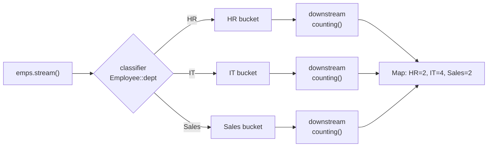
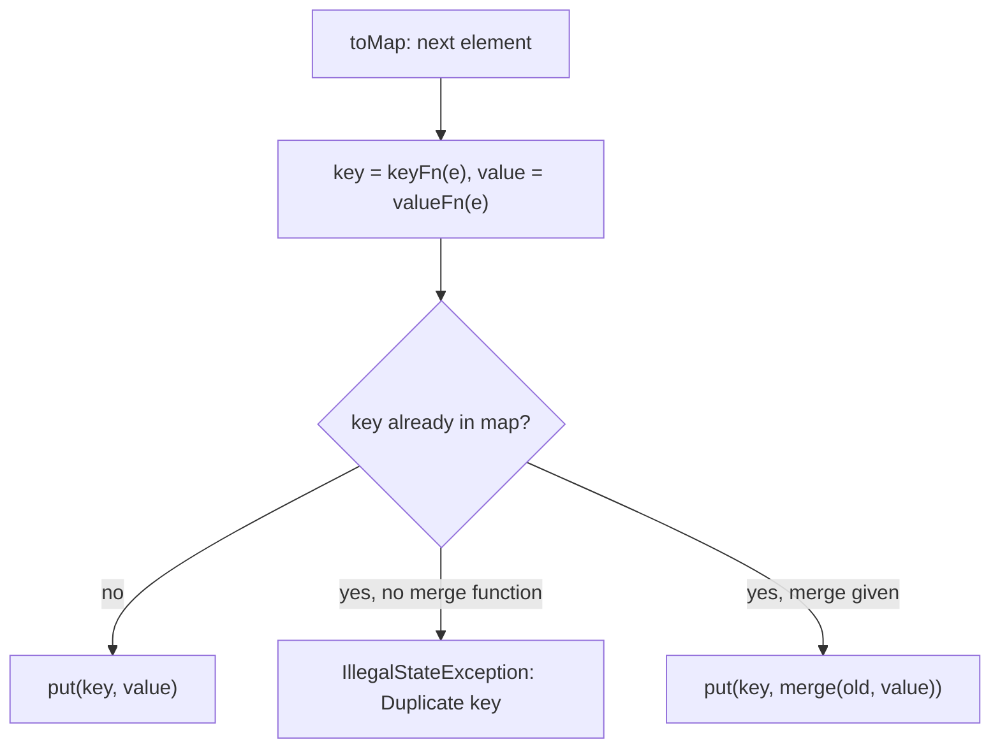
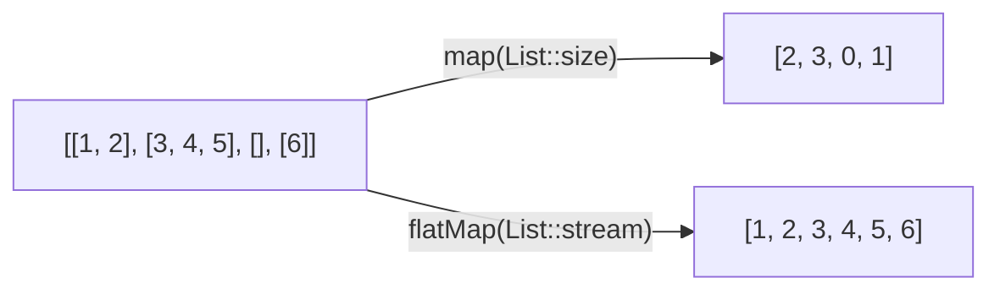

## In One Line
The "senior" stream questions — per-department counts, averages and top earners, n-th highest salary, frequency maps, sorting a map by value, flattening nested data — are all built from a handful of collector recipes: `groupingBy` + a downstream collector, `partitioningBy`, `toMap` with a merge function, and `flatMap`.

## Mental Model
Think of a **post office sorting room**.

- Letters (stream elements) arrive on a belt. A clerk reads each letter's **postcode** and drops it into the matching **pigeonhole** — that is `groupingBy(classifier)`. The postcode is the *key*, the pigeonhole is the *bucket*.
- Every pigeonhole has a **worker** who decides what to keep: the letters themselves (`toList()`), just a tally (`counting()`), the total postage (`summingInt`), only the heaviest letter (`maxBy`), or just the sender names (`mapping`). That worker is the **downstream collector**.
- A room with only **two** pigeonholes, "yes" and "no", is `partitioningBy` — and both holes always exist, even when empty.
- A **register** that has room for only **one** entry per postcode is `toMap`. When a second letter arrives with the same postcode, the clerk must be told what to do (keep the old one, keep the new one, add them up, keep the heavier one) — the **merge function**. With no instruction, the clerk panics: `IllegalStateException: Duplicate key`.
- A **bag of parcels** that must be opened so every letter inside goes on the belt individually is `flatMap`: one input becomes zero, one or many outputs.

Every drill in this lesson is: pick the postcode (key), pick the pigeonhole worker (downstream), pick the kind of cabinet (`HashMap`, `TreeMap`, `LinkedHashMap`).

## Concept
### `groupingBy` — the three overloads
| Call | Result | Use when |
|---|---|---|
| `groupingBy(classifier)` | `Map<K, List<T>>` (a `HashMap`) | You want the elements themselves |
| `groupingBy(classifier, downstream)` | `Map<K, D>` | You want a count, sum, max, names... per group |
| `groupingBy(classifier, mapFactory, downstream)` | `M` (e.g. `TreeMap<K, D>`) | You also want sorted (`TreeMap::new`) or insertion-ordered (`LinkedHashMap::new`) keys |

Internally it is a loop: for each element, compute the key (a `null` key throws NPE: *"element cannot be mapped to a null key"*), then `map.computeIfAbsent(key, k -> newContainer)` and feed the element to that group's downstream collector. The Code section shows the hand-written version. See [groupingBy in depth](lesson:a05-java8/16-collectors-grouping-by).

### Downstream collectors: what to do with each group
| Downstream | Each group becomes | Typical drill |
|---|---|---|
| `toList()`, `toSet()`, `toCollection(TreeSet::new)` | a collection | employees by department |
| `counting()` | a **`Long`** | head-count per department, character frequency |
| `summingInt(f)` / `summingLong` / `summingDouble` | a total | salary bill per department |
| `averagingInt(f)` / `averagingDouble` | a **`Double`** | average salary per department |
| `summarizingInt(f)` | `IntSummaryStatistics` (count, sum, min, avg, max) | all stats in one pass |
| `maxBy(cmp)` / `minBy(cmp)` | an **`Optional<T>`** | highest-paid per department |
| `mapping(f, downstream)` | the downstream applied to `f(element)` | names per department |
| `filtering(p, downstream)` (Java 9) | only matching elements, **empty groups kept** | seniors per department |
| `flatMapping(f, downstream)` (Java 9) | flattened values | all skills per department |
| `joining(", ")` | a `String` (after `mapping` to strings) | comma-separated names |
| `collectingAndThen(downstream, finisher)` | the downstream result post-processed | unwrap `Optional::get`, make unmodifiable |
| `groupingBy(...)` | a nested map | department → gender → count |
| `teeing(c1, c2, merger)` (Java 12) | two results combined | min **and** max in one pass |

### `partitioningBy(predicate[, downstream])`
A `groupingBy` specialised to a `boolean` key: the result is `Map<Boolean, ...>` with **both** `false` and `true` keys always present (even for an empty stream), where `groupingBy` would simply omit a missing group. Use it for "split into two lists" questions (even/odd, pass/fail, above/below a threshold).

### `toMap` — one value per key
| Overload | On duplicate key | Map type |
|---|---|---|
| `toMap(keyFn, valueFn)` | throws `IllegalStateException: Duplicate key k (attempted merging values a and b)` | `HashMap` |
| `toMap(keyFn, valueFn, merge)` | `merge.apply(oldValue, newValue)` | `HashMap` |
| `toMap(keyFn, valueFn, merge, mapFactory)` | same | your choice (`LinkedHashMap::new`, `TreeMap::new`) |

Merge functions you should know by heart:

| Merge function | Meaning |
|---|---|
| `(a, b) -> a` | keep the first value |
| `(a, b) -> b` | keep the last value |
| `Integer::sum` | add up (totals per key) |
| `Math::max`, `BinaryOperator.maxBy(cmp)` | keep the best (highest-paid per department without `Optional`) |
| `(a, b) -> a + ", " + b` | concatenate |

`toMap` also rejects **`null` values** (it uses `HashMap.merge` internally) — NPE.

### `groupingBy` or `toMap`?
- **Many values per key** (a list, a count, an average) → `groupingBy`.
- **Exactly one value per key**, or you can reduce duplicates with a simple merge → `toMap`. "Highest-paid per department" can be either: `groupingBy` + `maxBy` gives `Optional` values; `toMap` + `BinaryOperator.maxBy` gives the employee directly.

### `flatMap` — one-to-many
`map` turns each element into exactly **one** result; `flatMap` turns each element into a **stream** of results and concatenates them. Use it for: list of lists → one list, sentences → words, employees → skills, a word → its characters (`flatMapToInt(String::chars)`). Java 16 added `mapMulti`, which pushes results into a consumer instead of creating a small stream per element.

### The recipes
| Problem | Recipe |
|---|---|
| Frequency of each element | `groupingBy(Function.identity(), LinkedHashMap::new, counting())` — loop: `map.merge(x, 1, Integer::sum)` |
| Duplicates / uniques | frequency map, then filter entries with count `> 1` / `== 1` |
| Most frequent | frequency map → `entrySet().stream().max(Map.Entry.comparingByValue())` |
| n-th highest value | `distinct()` → `sorted(Comparator.reverseOrder())` → `skip(n - 1)` → `findFirst()` |
| n-th highest with the people | `groupingBy(salary, () -> new TreeMap<>(reverseOrder()), mapping(name, toList()))`, then take the n-th entry |
| Best per group | `toMap(key, identity(), BinaryOperator.maxBy(cmp))` or `groupingBy(key, collectingAndThen(maxBy(cmp), Optional::get))` |
| Sort a map by value | `entrySet().stream().sorted(...)` → `toMap(..., (a, b) -> a, LinkedHashMap::new)` |
| Top k | `sorted(cmp).limit(k)` — O(n log n); or a size-k min-heap — O(n log k) |
| Compare each element with its group | two passes: build the group aggregate map, then `filter` against it |
| Invert a one-to-many relation | `flatMap` to `Map.entry(child, parent)` pairs → `groupingBy(getKey, mapping(getValue, toList()))` |

### Which map type will I see printed?
- `groupingBy`/`toMap` default to **`HashMap`**: iteration order depends on hash codes and capacity. It is repeatable for the same inputs on the same JDK, but it is **not a contract** — never write code (or an interview answer) that relies on it.
- `TreeMap::new` → keys sorted. `LinkedHashMap::new` → keys in first-seen order. Use one of them whenever the order of the output matters, and to make answers predictable on a whiteboard.
- `Map.of(...)` iteration order is deliberately **randomised per JVM run**.

### Complexity
| Operation | Time | Extra space |
|---|---|---|
| `groupingBy` / `partitioningBy` / `toMap` into a `HashMap` | O(n) expected | O(n) |
| ... into a `TreeMap` | O(n log g) for g groups | O(n) |
| Frequency map, then `max` over entries | O(n + g) | O(g) |
| `distinct().sorted().skip(n - 1)` | O(n log n) | O(n) |
| Sort a map of g entries by value | O(g log g) | O(g) |
| Top-k with a heap | O(n log k) | O(k) |
| `flatMap` over N total inner elements | O(N) | O(1) per element (plus the result) |

## Diagram

`groupingBy` = classify each element into a bucket, then run the downstream collector separately inside every bucket.


`toMap` keeps one value per key; the merge function is the only thing that decides what happens on a collision.


`map` produces one output per input; `flatMap` opens every inner collection and pours its elements into one stream.

## Code
**The harness and the data set.** Every Q&A snippet below replaces the body of `main` in this class and was run on JDK 21; the outputs shown are real. `Employee.toString()` is overridden to print `name:salary` so grouped output stays readable. Note the tie at the top of IT: **Ravi and Divya both earn 95,000** — several drills show how ties are handled.
```java
import java.util.*;
import java.util.function.*;
import java.util.stream.*;
import static java.util.stream.Collectors.*;

public class Drill {
    record Employee(int id, String name, String dept, String gender, int age, int salary) {
        @Override
        public String toString() { return name + ":" + salary; }
    }

    static final List<Employee> EMPLOYEES = List.of(
            new Employee(1,  "Asha",   "HR",      "F", 29, 52_000),
            new Employee(2,  "Ravi",   "IT",      "M", 35, 95_000),
            new Employee(3,  "Meena",  "Finance", "F", 41, 88_000),
            new Employee(4,  "Kiran",  "IT",      "M", 26, 72_000),
            new Employee(5,  "Arjun",  "Sales",   "M", 31, 61_000),
            new Employee(6,  "Divya",  "IT",      "F", 30, 95_000),
            new Employee(7,  "Farhan", "Finance", "M", 38, 76_000),
            new Employee(8,  "Neha",   "HR",      "F", 45, 67_000),
            new Employee(9,  "Sunil",  "Sales",   "M", 50, 58_000),
            new Employee(10, "Pooja",  "IT",      "F", 24, 64_000));

    public static void main(String[] args) {
        List<Employee> emps = EMPLOYEES;
        emps.forEach(e -> System.out.printf("%-3d %-7s %-8s %s %d %,d%n",
                e.id(), e.name(), e.dept(), e.gender(), e.age(), e.salary()));
    }
}
```
```output
1   Asha    HR       F 29 52,000
2   Ravi    IT       M 35 95,000
3   Meena   Finance  F 41 88,000
4   Kiran   IT       M 26 72,000
5   Arjun   Sales    M 31 61,000
6   Divya   IT       F 30 95,000
7   Farhan  Finance  M 38 76,000
8   Neha    HR       F 45 67,000
9   Sunil   Sales    M 50 58,000
10  Pooja   IT       F 24 64,000
```

**What the collectors do inside** — `groupingBy` written as a loop, and a hand-made collector built from its four parts:
```java
import java.util.*;
import java.util.function.Function;
import java.util.stream.Collector;
import java.util.stream.Collectors;
import java.util.stream.Stream;

public class HandMadeCollectors {

    // What groupingBy(classifier) does, written as a loop
    static <T, K> Map<K, List<T>> groupBy(List<T> items, Function<? super T, ? extends K> classifier) {
        Map<K, List<T>> result = new HashMap<>();
        for (T item : items) {
            K key = Objects.requireNonNull(classifier.apply(item), "element cannot be mapped to a null key");
            result.computeIfAbsent(key, k -> new ArrayList<>()).add(item);
        }
        return result;
    }

    public static void main(String[] args) {
        List<String> words = List.of("apple", "avocado", "banana", "blueberry", "cherry", "apple");

        Map<Character, List<String>> mine = groupBy(words, w -> w.charAt(0));
        Map<Character, List<String>> jdk = words.stream().collect(Collectors.groupingBy(w -> w.charAt(0)));
        System.out.println("hand-made : " + mine);
        System.out.println("same?       " + mine.equals(jdk));

        // A collector is four functions: supplier, accumulator, combiner, (finisher)
        Collector<String, Map<String, Integer>, Map<String, Integer>> wordCounter = Collector.of(
                TreeMap::new,                                     // supplier: an empty container
                (map, w) -> map.merge(w, 1, Integer::sum),        // accumulator: fold in one element
                (m1, m2) -> {                                     // combiner: merge two partial results
                    m2.forEach((k, v) -> m1.merge(k, v, Integer::sum));
                    return m1;
                });                                               // no finisher: the container IS the result
        System.out.println("sequential: " + words.stream().collect(wordCounter));
        System.out.println("parallel  : " + words.parallelStream().collect(wordCounter));

        // The null-key rule is the same in the JDK
        try {
            Stream.of("a", "b").collect(Collectors.groupingBy(w -> w.equals("b") ? null : w));
        } catch (NullPointerException e) {
            System.out.println("null key  : " + e.getMessage());
        }
    }
}
```
```output
hand-made : {a=[apple, avocado, apple], b=[banana, blueberry], c=[cherry]}
same?       true
sequential: {apple=2, avocado=1, banana=1, blueberry=1, cherry=1}
parallel  : {apple=2, avocado=1, banana=1, blueberry=1, cherry=1}
null key  : element cannot be mapped to a null key
```

## Walkthrough
### The harness
- `import static java.util.stream.Collectors.*;` lets the drills write `groupingBy(...)`, `counting()`, `toMap(...)` instead of `Collectors.groupingBy(...)`. It does not clash with `stream.toList()`, which is an instance method of `Stream`.
- `record Employee(int id, String name, String dept, String gender, int age, int salary)` — a record gives the constructor, the accessors (`dept()`, `salary()`...), `equals` and `hashCode` for free. `salary` is an `int` so we can use `comparingInt`, `summingInt`, `averagingInt` without boxing.
- The overridden `toString()` returns `name + ":" + salary` — only for readable output.
- `EMPLOYEES` is an immutable `List.of(...)`; `100_000`-style underscores are just digit separators.
- The printed table uses `printf("%-3d %-7s %-8s %s %d %,d%n", ...)`: `%-7s` left-aligns in 7 columns, `%,d` adds thousands separators.

### `HandMadeCollectors`
- **`groupBy`** is `groupingBy(classifier)` without the stream: for every item compute the key, refuse `null` keys with the same message the JDK uses, then `computeIfAbsent(key, k -> new ArrayList<>())` creates the bucket on first use and `add(item)` fills it. `mine.equals(jdk)` is `true` — both are `HashMap<Character, List<String>>` with the same content.
- **`Collector.of(supplier, accumulator, combiner)`** shows what every collector is made of:
  - *supplier* `TreeMap::new` — creates an empty result container (once per thread in parallel);
  - *accumulator* `(map, w) -> map.merge(w, 1, Integer::sum)` — folds one element into the container: "put 1, or add 1";
  - *combiner* — merges two partial containers; only used by parallel streams;
  - no *finisher* — the container itself is the result (`IDENTITY_FINISH` is set automatically by this overload).
- Sequential and parallel give the same `{apple=2, ...}` because the accumulator and combiner agree with each other.
- The last block proves the JDK's `groupingBy` rejects a `null` key with `NullPointerException: element cannot be mapped to a null key`.

## Traps
- **`groupingBy` + `maxBy`/`minBy` gives `Map<K, Optional<V>>`**, printed as `Optional[Ravi:95000]`. Unwrap with `collectingAndThen(maxBy(cmp), Optional::get)` (safe: a group is never empty) or use `toMap` with `BinaryOperator.maxBy`.
- **`counting()` returns `Long`**, not `Integer`: `Map<String, Integer> m = ...collect(groupingBy(f, counting()))` does not compile. Use `Map<String, Long>` or `summingInt(e -> 1)`. And `long c = counts.get("missing")` throws NPE when unboxing `null` — use `getOrDefault(key, 0L)`.
- **`toMap` without a merge function** throws on the first duplicate key; `toMap` with a `null` value throws NPE.
- **`Map.Entry.comparingByValue().reversed()` does not compile** — once `.reversed()` is chained, Java can no longer infer the entry's type from the context. Write `Map.Entry.<String, Integer>comparingByValue().reversed()` or `Collections.reverseOrder(Map.Entry.comparingByValue())`.
- **n-th highest without `distinct()`** — in `[50, 90, 90, 70]` the "second highest" becomes `90`.
- **`filter` before `groupingBy` removes empty groups**; `Collectors.filtering` keeps them with an empty list.
- **Relying on `HashMap` order** — use `TreeMap::new` or `LinkedHashMap::new` when order matters. `Map.of` order changes between runs.
- **Ties** — `maxBy`/`minBy`/`BinaryOperator.maxBy` keep the **first** of equal elements, which silently drops Divya from "highest paid in IT". If ties matter, group by the salary too.
- **Passing a `collect(groupingBy(key, TreeMap::new, ...))` call straight into `System.out.println(...)`** can fail with *"inference variable R has incompatible bounds"*: `println` is overloaded, and javac cannot infer the map type while also choosing the overload. Assign the result to a typed variable first (the drills do).
- **Wrong identity in `reduce`** — in a parallel stream the identity is used once per chunk: `Stream.of(1, 2, 3).parallel().reduce(10, Integer::sum)` is not 16.
- **Collecting with side effects** (`forEach(e -> map.put(...))`) works sequentially but breaks in parallel; a collector (or `groupingByConcurrent`/`toConcurrentMap`) is the thread-safe way.

## Tips & Tricks
- **"Key, Worker, Cabinet."** Every `groupingBy` answer is: *key* (classifier), *worker* (downstream collector), *cabinet* (map type). Say them in that order and the code writes itself.
- **One value per key → `toMap`; many values per key → `groupingBy`.**
- **Frequency map in one line:** `groupingBy(Function.identity(), LinkedHashMap::new, counting())`. In a loop: `map.merge(x, 1, Integer::sum)`.
- **"D-S-S-F" for n-th highest:** `distinct`, `sorted(reverseOrder())`, `skip(n - 1)`, `findFirst`.
- **To sort a map, stream its entries** and collect into a `LinkedHashMap` (a `HashMap` would throw the order away).
- **`LinkedHashMap::new` = first-seen order, `TreeMap::new` = sorted keys.** Use one of them in every whiteboard answer so your printed output is predictable.
- **`maxBy` → `Optional`; `BinaryOperator.maxBy` → no `Optional`.** Remember: the collector can see an empty group in theory, the merge function never sees nothing.
- **Two answers in one pass?** `Collectors.teeing` (Java 12), or `summarizingInt` for count/sum/min/avg/max.
- **Name the complexity:** grouping into a `HashMap` is O(n) time and O(n) space; anything with `sorted` is O(n log n); top-k with a heap is O(n log k).

## Interview Q&A
### [Basic] Group employees by department.
**Approach.** `groupingBy(Employee::dept)` returns `Map<String, List<Employee>>` in a `HashMap`. Pass `TreeMap::new` (plus a downstream, which the three-argument overload requires) to get departments in alphabetical order. The loop version is `computeIfAbsent(key, k -> new ArrayList<>()).add(e)`.
```java
// Map<dept, List<Employee>>; a HashMap by default (no key order)
Map<String, List<Employee>> byDept = emps.stream()
        .collect(groupingBy(Employee::dept));
System.out.println(byDept);

// Sorted keys: pass a map factory (and then the downstream is required)
Map<String, List<Employee>> sorted = emps.stream()
        .collect(groupingBy(Employee::dept, TreeMap::new, toList()));
sorted.forEach((dept, list) -> System.out.println(dept + " -> " + list));

// Plain loop: computeIfAbsent creates the bucket the first time a key is seen
Map<String, List<Employee>> loop = new TreeMap<>();
for (Employee e : emps) {
    loop.computeIfAbsent(e.dept(), k -> new ArrayList<>()).add(e);
}
System.out.println("loop equals stream? " + loop.equals(sorted));
```
```output
{Sales=[Arjun:61000, Sunil:58000], Finance=[Meena:88000, Farhan:76000], HR=[Asha:52000, Neha:67000], IT=[Ravi:95000, Kiran:72000, Divya:95000, Pooja:64000]}
Finance -> [Meena:88000, Farhan:76000]
HR -> [Asha:52000, Neha:67000]
IT -> [Ravi:95000, Kiran:72000, Divya:95000, Pooja:64000]
Sales -> [Arjun:61000, Sunil:58000]
loop equals stream? true
```
**Complexity.** O(n) expected time with a `HashMap` (O(n log g) with a `TreeMap` of g departments), O(n) space.

**Follow-up:** *Why does the first map print Sales, Finance, HR, IT?* — That is `HashMap` bucket order, decided by the strings' hash codes. It is not sorted and not insertion order.

### [Basic] Count the employees in each department (and by gender).
**Approach.** `groupingBy(key, counting())`. The count is a `Long`. If you need `Integer`, use `summingInt(e -> 1)`. The loop uses `Map.merge(key, 1, Integer::sum)`: put 1 if absent, otherwise add 1.
```java
Map<String, Long> perDept = emps.stream()
        .collect(groupingBy(Employee::dept, TreeMap::new, counting()));
System.out.println("per dept   : " + perDept);

Map<String, Long> perGender = emps.stream()
        .collect(groupingBy(Employee::gender, counting()));
System.out.println("per gender : " + perGender);

// counting() gives Long; summingInt(e -> 1) gives Integer
Map<String, Integer> asInt = emps.stream()
        .collect(groupingBy(Employee::dept, TreeMap::new, summingInt(e -> 1)));
System.out.println("as Integer : " + asInt);

// Plain loop: merge(key, 1, Integer::sum) means "put 1, or add 1 to what is there"
Map<String, Integer> loop = new TreeMap<>();
for (Employee e : emps) {
    loop.merge(e.dept(), 1, Integer::sum);
}
System.out.println("loop       : " + loop);
```
```output
per dept   : {Finance=2, HR=2, IT=4, Sales=2}
per gender : {F=5, M=5}
as Integer : {Finance=2, HR=2, IT=4, Sales=2}
loop       : {Finance=2, HR=2, IT=4, Sales=2}
```
**Complexity.** O(n) time, O(g) space for g groups.

**Follow-up:** *What is `Map.merge` doing exactly?* — `merge(key, value, fn)`: if the key is absent (or mapped to `null`), store `value`; otherwise store `fn(oldValue, value)`; if `fn` returns `null`, remove the key. It returns the new value.

### [Basic] Find the average and the total salary per department.
**Approach.** `averagingInt(Employee::salary)` gives a `Double` per department; `summingInt` gives the total. `summarizingInt` returns an `IntSummaryStatistics` with count, sum, min, average and max in one pass. The loop keeps a `[sum, count]` pair per department and divides at the end.
```java
Map<String, Double> avg = emps.stream()
        .collect(groupingBy(Employee::dept, TreeMap::new, averagingInt(Employee::salary)));
System.out.println("average : " + avg);

Map<String, Integer> total = emps.stream()
        .collect(groupingBy(Employee::dept, TreeMap::new, summingInt(Employee::salary)));
System.out.println("total   : " + total);

// count, sum, min, average, max per group in one pass
IntSummaryStatistics it = emps.stream()
        .collect(groupingBy(Employee::dept, summarizingInt(Employee::salary)))
        .get("IT");
System.out.println("IT      : " + it);

// Whole company
System.out.println("company : " + emps.stream().mapToInt(Employee::salary).average().orElse(0));

// Plain loop: two maps, then divide
Map<String, int[]> sumAndCount = new TreeMap<>();
for (Employee e : emps) {
    int[] sc = sumAndCount.computeIfAbsent(e.dept(), k -> new int[2]);
    sc[0] += e.salary();
    sc[1]++;
}
sumAndCount.forEach((d, sc) -> System.out.print(d + "=" + (double) sc[0] / sc[1] + " "));
System.out.println();
```
```output
average : {Finance=82000.0, HR=59500.0, IT=81500.0, Sales=59500.0}
total   : {Finance=164000, HR=119000, IT=326000, Sales=119000}
IT      : IntSummaryStatistics{count=4, sum=326000, min=64000, average=81500.000000, max=95000}
company : 72800.0
Finance=82000.0 HR=59500.0 IT=81500.0 Sales=59500.0
```
**Complexity.** O(n) time, O(g) space.

**Follow-up:** *Why cast `(double) sc[0] / sc[1]`?* — Otherwise it is integer division and the fractional part is lost (59,500 is exact here, but 119,001 / 2 would not be).

### [Intermediate] List the employee names per department, as a list and as a comma-separated string.
**Approach.** `mapping(Employee::name, toList())` transforms each element before it goes into the group. `mapping(Employee::name, joining(", "))` builds a string instead; sort the stream first if the names inside each group must be alphabetical. `filtering` (Java 9) keeps departments with no match as empty lists, while `filter` before grouping drops them.
```java
// mapping: transform each element BEFORE it goes into the group's list
Map<String, List<String>> names = emps.stream()
        .collect(groupingBy(Employee::dept, TreeMap::new, mapping(Employee::name, toList())));
System.out.println("names  : " + names);

// Sort first, then join the names of each group into one String
Map<String, String> joined = emps.stream()
        .sorted(Comparator.comparing(Employee::name))
        .collect(groupingBy(Employee::dept, TreeMap::new, mapping(Employee::name, joining(", "))));
System.out.println("joined : " + joined);

// Java 9 filtering: keeps every department, even when nobody matches
Map<String, List<String>> over40 = emps.stream()
        .collect(groupingBy(Employee::dept, TreeMap::new,
                filtering(e -> e.age() >= 40, mapping(Employee::name, toList()))));
System.out.println("40+    : " + over40);

// filter BEFORE grouping: departments with no match disappear
Map<String, List<String>> over40b = emps.stream()
        .filter(e -> e.age() >= 40)
        .collect(groupingBy(Employee::dept, TreeMap::new, mapping(Employee::name, toList())));
System.out.println("40+ b  : " + over40b);
```
```output
names  : {Finance=[Meena, Farhan], HR=[Asha, Neha], IT=[Ravi, Kiran, Divya, Pooja], Sales=[Arjun, Sunil]}
joined : {Finance=Farhan, Meena, HR=Asha, Neha, IT=Divya, Kiran, Pooja, Ravi, Sales=Arjun, Sunil}
40+    : {Finance=[Meena], HR=[Neha], IT=[], Sales=[Sunil]}
40+ b  : {Finance=[Meena], HR=[Neha], Sales=[Sunil]}
```
**Complexity.** O(n) time for grouping (O(n log n) with the extra `sorted`), O(n) space.

**Follow-up:** *And the set of all skills per department, if each employee has a `List<String> skills`?* — `groupingBy(Employee::dept, flatMapping(e -> e.skills().stream(), toSet()))` (Java 9).

### [Intermediate] Find the highest-paid employee in each department.
**Approach.** The most-asked stream question. Four equivalent answers:
1. `groupingBy(dept, maxBy(comparingInt(salary)))` → values are `Optional<Employee>`.
2. Wrap it in `collectingAndThen(..., Optional::get)` to unwrap (a group is never empty, so `get` is safe here).
3. `toMap(dept, identity(), BinaryOperator.maxBy(cmp))` — no `Optional` at all.
4. `toMap(dept, salary, Math::max)` if only the number is needed.
Ties: IT has Ravi **and** Divya at 95,000; all of these keep the first one met. Version 5 in the code groups by salary inside each department to return **everyone** tied at the top.
```java
Comparator<Employee> bySalary = Comparator.comparingInt(Employee::salary);

// 1. groupingBy + maxBy -> Map<String, Optional<Employee>>
Map<String, Optional<Employee>> withOptional = emps.stream()
        .collect(groupingBy(Employee::dept, TreeMap::new, maxBy(bySalary)));
System.out.println("maxBy             : " + withOptional);

// 2. Unwrap the Optional with collectingAndThen
Map<String, Employee> top = emps.stream()
        .collect(groupingBy(Employee::dept, TreeMap::new,
                collectingAndThen(maxBy(bySalary), Optional::get)));
System.out.println("collectingAndThen : " + top);

// 3. toMap with a "keep the better one" merge function (no Optional at all)
Map<String, Employee> viaToMap = emps.stream()
        .collect(toMap(Employee::dept, Function.identity(),
                BinaryOperator.maxBy(bySalary), TreeMap::new));
System.out.println("toMap + maxBy     : " + viaToMap);

// 4. Only the number
Map<String, Integer> maxSalary = emps.stream()
        .collect(toMap(Employee::dept, Employee::salary, Math::max, TreeMap::new));
System.out.println("max salary only   : " + maxSalary);

// 5. ALL top earners per department (ties included)
Map<String, List<String>> allTop = emps.stream()
        .collect(groupingBy(Employee::dept, TreeMap::new,
                collectingAndThen(
                        groupingBy(Employee::salary, TreeMap::new, mapping(Employee::name, toList())),
                        bySal -> bySal.lastEntry().getValue())));
System.out.println("with ties         : " + allTop);

// Plain loop
Map<String, Employee> loop = new TreeMap<>();
for (Employee e : emps) {
    loop.merge(e.dept(), e, (old, cur) -> cur.salary() > old.salary() ? cur : old);
}
System.out.println("loop              : " + loop);
```
```output
maxBy             : {Finance=Optional[Meena:88000], HR=Optional[Neha:67000], IT=Optional[Ravi:95000], Sales=Optional[Arjun:61000]}
collectingAndThen : {Finance=Meena:88000, HR=Neha:67000, IT=Ravi:95000, Sales=Arjun:61000}
toMap + maxBy     : {Finance=Meena:88000, HR=Neha:67000, IT=Ravi:95000, Sales=Arjun:61000}
max salary only   : {Finance=88000, HR=67000, IT=95000, Sales=61000}
with ties         : {Finance=[Meena], HR=[Neha], IT=[Ravi, Divya], Sales=[Arjun]}
loop              : {Finance=Meena:88000, HR=Neha:67000, IT=Ravi:95000, Sales=Arjun:61000}
```
**Complexity.** O(n) time, O(g) space (version 5: O(n log n) worst case for the inner `TreeMap`s, O(n) space).

**Follow-up:** *Why is `Math::max` fine here when `Integer::max` was a bug as a comparator?* — Here it is used as a **merge function** (`BinaryOperator<Integer>`: "combine two salaries into one"), which is exactly what `max` does. A comparator must return negative/zero/positive, which `max` does not.

### [Basic] Partition numbers into even and odd; partition employees by salary above 70,000.
**Approach.** `partitioningBy(predicate)` returns `Map<Boolean, List<T>>`; add a downstream (`counting()`, `mapping(...)`) like with `groupingBy`. Both keys always exist.
```java
List<Integer> nums = List.of(1, 2, 3, 4, 5, 6, 7, 8, 9, 10);

Map<Boolean, List<Integer>> evenOdd = nums.stream()
        .collect(partitioningBy(n -> n % 2 == 0));
System.out.println(evenOdd);
System.out.println("evens " + evenOdd.get(true) + ", odds " + evenOdd.get(false));

// With a downstream collector
Map<Boolean, Long> highEarners = emps.stream()
        .collect(partitioningBy(e -> e.salary() > 70_000, counting()));
System.out.println("salary > 70k : " + highEarners);

Map<Boolean, List<String>> women = emps.stream()
        .collect(partitioningBy(e -> e.gender().equals("F"), mapping(Employee::name, toList())));
System.out.println("female?      : " + women);

// Both keys are ALWAYS present, even for an empty stream
System.out.println("partition {} : " + Stream.<Integer>empty().collect(partitioningBy(n -> n > 0)));
System.out.println("grouping {}  : " + Stream.<Integer>empty().collect(groupingBy(n -> n > 0)));
```
```output
{false=[1, 3, 5, 7, 9], true=[2, 4, 6, 8, 10]}
evens [2, 4, 6, 8, 10], odds [1, 3, 5, 7, 9]
salary > 70k : {false=5, true=5}
female?      : {false=[Ravi, Kiran, Arjun, Farhan, Sunil], true=[Asha, Meena, Divya, Neha, Pooja]}
partition {} : {false=[], true=[]}
grouping {}  : {}
```
**Complexity.** O(n) time, O(n) space (O(1) with `counting()`).

**Follow-up:** *When would you choose `groupingBy(x -> x % 2 == 0)` instead?* — Practically never: `partitioningBy` is purpose-built for two groups, is slightly more efficient (a two-slot map) and guarantees both keys, so `get(true)` never returns `null`.

### [Intermediate] Find the second (or n-th) highest number in a list with duplicates.
**Approach.** Stream recipe: `distinct()` → `sorted(Comparator.reverseOrder())` → `skip(n - 1)` → `findFirst()`, which returns `Optional.empty` if there are fewer than n distinct values. Without `distinct()` the duplicate `90` is reported as second highest. For n = 2 the best loop is a **single pass** tracking `first` and `second`. For general k, a **min-heap of size k** gives O(n log k).
```java
List<Integer> nums = List.of(40, 10, 90, 70, 90, 30, 70);

// n-th highest DISTINCT value: distinct -> sort descending -> skip n-1 -> first
System.out.println("2nd highest       : " + nums.stream().distinct()
        .sorted(Comparator.reverseOrder()).skip(1).findFirst().orElse(null));
System.out.println("3rd highest       : " + nums.stream().distinct()
        .sorted(Comparator.reverseOrder()).skip(2).findFirst().orElse(null));
System.out.println("9th highest       : " + nums.stream().distinct()
        .sorted(Comparator.reverseOrder()).skip(8).findFirst());

// Forgetting distinct(): the duplicate 90 is "second highest"
System.out.println("no distinct (bug) : " + nums.stream()
        .sorted(Comparator.reverseOrder()).skip(1).findFirst().orElse(null));

// Loop: 2nd highest in ONE pass, O(1) extra space
Integer first = null, second = null;
for (int x : nums) {
    if (first == null || x > first) {
        second = first;
        first = x;
    } else if (x < first && (second == null || x > second)) {
        second = x;
    }
}
System.out.println("loop 2nd highest  : " + second);

// k-th highest with a min-heap that never holds more than k values: O(n log k)
int k = 3;
PriorityQueue<Integer> heap = new PriorityQueue<>();
for (int x : new HashSet<>(nums)) {
    heap.offer(x);
    if (heap.size() > k) heap.poll();   // drop the smallest
}
System.out.println("heap 3rd highest  : " + heap.peek());
```
```output
2nd highest       : 70
3rd highest       : 40
9th highest       : Optional.empty
no distinct (bug) : 90
loop 2nd highest  : 70
heap 3rd highest  : 40
```
**Complexity.** Stream: O(n log n) time, O(n) space. Single-pass loop: O(n) time, O(1) space. Heap: O(n log k) time, O(k) space.

**Follow-up:** *Why `x < first` in the `else if`?* — To skip a value equal to `first`; otherwise the duplicate `90` would become `second`.

### [Advanced] Find the employee(s) with the n-th highest salary.
**Approach.** Group employees by salary into a `TreeMap` with a **reverse** comparator: the first entry is the top salary with all its earners, the second entry is rank 2, and so on. Ties are handled for free (rank 1 is Ravi **and** Divya). The two-step alternative finds the n-th distinct salary first, then filters employees who earn it.
```java
// salary -> names, highest salary first
TreeMap<Integer, List<String>> bySalary = emps.stream()
        .collect(groupingBy(Employee::salary,
                () -> new TreeMap<>(Comparator.reverseOrder()),
                mapping(Employee::name, toList())));
System.out.println(bySalary);

for (int n = 1; n <= 3; n++) {
    Map.Entry<Integer, List<String>> e = bySalary.entrySet().stream()
            .skip(n - 1).findFirst().orElseThrow();
    System.out.println("rank " + n + " -> " + e.getKey() + " " + e.getValue());
}

// Two-step version: find the value, then the people
int second = emps.stream().map(Employee::salary).distinct()
        .sorted(Comparator.reverseOrder()).skip(1).findFirst().orElseThrow();
List<String> who = emps.stream().filter(e -> e.salary() == second).map(Employee::name).toList();
System.out.println("2nd highest salary " + second + " earned by " + who);
```
```output
{95000=[Ravi, Divya], 88000=[Meena], 76000=[Farhan], 72000=[Kiran], 67000=[Neha], 64000=[Pooja], 61000=[Arjun], 58000=[Sunil], 52000=[Asha]}
rank 1 -> 95000 [Ravi, Divya]
rank 2 -> 88000 [Meena]
rank 3 -> 76000 [Farhan]
2nd highest salary 88000 earned by [Meena]
```
**Complexity.** O(n log s) time for s distinct salaries, O(n) space. The two-step version is O(n log n).

**Follow-up:** *This is "dense rank" — what would "rank with gaps" (SQL `RANK()`) give for rank 2?* — With two people tied at rank 1, SQL `RANK()` has no rank 2; the next person (Meena) is rank 3. Our grouping gives dense ranking, like SQL `DENSE_RANK()`.

### [Basic] Find the top 3 highest-paid employees, and the youngest and oldest employee.
**Approach.** `sorted(comparator).limit(3)`; chain `thenComparing(Employee::name)` so ties are deterministic. `min`/`max` with `comparingInt(Employee::age)` for youngest/oldest. For large n and small k, a **min-heap of size k** avoids sorting everything.
```java
// Top 3 by salary; ties broken by name
List<String> top3 = emps.stream()
        .sorted(Comparator.comparingInt(Employee::salary).reversed()
                .thenComparing(Employee::name))
        .limit(3)
        .map(e -> e.name() + " " + e.salary())
        .toList();
System.out.println("top 3    : " + top3);

// Youngest and oldest
Employee youngest = emps.stream().min(Comparator.comparingInt(Employee::age)).orElseThrow();
Employee oldest = emps.stream().max(Comparator.comparingInt(Employee::age)).orElseThrow();
System.out.println("youngest : " + youngest.name() + " (" + youngest.age() + ")");
System.out.println("oldest   : " + oldest.name() + " (" + oldest.age() + ")");

// Lowest 2 salaries in the IT department
System.out.println("IT low 2 : " + emps.stream()
        .filter(e -> e.dept().equals("IT"))
        .sorted(Comparator.comparingInt(Employee::salary))
        .limit(2)
        .toList());

// Top-k without sorting everything: a min-heap of size k, O(n log k)
PriorityQueue<Employee> heap = new PriorityQueue<>(Comparator.comparingInt(Employee::salary));
for (Employee e : emps) {
    heap.offer(e);
    if (heap.size() > 3) heap.poll();
}
List<Employee> heapTop = new ArrayList<>(heap);
heapTop.sort(Comparator.comparingInt(Employee::salary).reversed().thenComparing(Employee::name));
System.out.println("heap     : " + heapTop);
```
```output
top 3    : [Divya 95000, Ravi 95000, Meena 88000]
youngest : Pooja (24)
oldest   : Sunil (50)
IT low 2 : [Pooja:64000, Kiran:72000]
heap     : [Divya:95000, Ravi:95000, Meena:88000]
```
**Complexity.** `sorted().limit(k)`: O(n log n) time, O(n) space. Heap: O(n log k) time, O(k) space. `min`/`max`: O(n), O(1).

**Follow-up:** *Why does the heap use a **min**-heap for the **top** k?* — The heap holds the k best seen so far; its root is the weakest of them, which is exactly the one to evict when a better element arrives.

### [Intermediate] Count the occurrences of each character in a string.
**Approach.** `s.chars()` gives an `IntStream` of char codes; `mapToObj(c -> (char) c)` boxes them into `Character`s; `groupingBy(Function.identity(), LinkedHashMap::new, counting())` counts them in first-seen order. The loop uses `merge`. For lowercase ASCII only, an `int[26]` counter is the fastest and smallest.
```java
String s = "programming";

// chars() -> IntStream of codes; mapToObj boxes each one as a Character
Map<Character, Long> freq = s.chars()
        .mapToObj(c -> (char) c)
        .collect(groupingBy(Function.identity(), LinkedHashMap::new, counting()));
System.out.println("stream   : " + freq);

// Keep only the repeated characters
Map<Character, Long> repeated = freq.entrySet().stream()
        .filter(e -> e.getValue() > 1)
        .collect(toMap(Map.Entry::getKey, Map.Entry::getValue, (a, b) -> a, LinkedHashMap::new));
System.out.println("repeated : " + repeated);

// Plain loop with Map.merge
Map<Character, Integer> loop = new LinkedHashMap<>();
for (char c : s.toCharArray()) {
    loop.merge(c, 1, Integer::sum);
}
System.out.println("loop     : " + loop);

// Fastest for lowercase a-z: an int[26] counter array
int[] counts = new int[26];
for (char c : s.toCharArray()) counts[c - 'a']++;
StringBuilder sb = new StringBuilder();
for (int i = 0; i < 26; i++) {
    if (counts[i] > 0) sb.append((char) ('a' + i)).append(counts[i]).append(' ');
}
System.out.println("int[26]  : " + sb.toString().trim());
```
```output
stream   : {p=1, r=2, o=1, g=2, a=1, m=2, i=1, n=1}
repeated : {r=2, g=2, m=2}
loop     : {p=1, r=2, o=1, g=2, a=1, m=2, i=1, n=1}
int[26]  : a1 g2 i1 m2 n1 o1 p1 r2
```
**Complexity.** O(n) time. Space: O(k) for k distinct characters; O(1) (26 ints) for the array version.

**Follow-up:** *How would you handle emojis or other characters outside the BMP?* — Use `s.codePoints()` instead of `chars()`, so a surrogate pair counts as one character; key the map by `Integer` code point.

### [Intermediate] Count word frequencies in a sentence and return the top 2 words.
**Approach.** Normalise (`toLowerCase`), split on non-word characters (`\\W+`), drop empty tokens, count with `groupingBy(..., counting())`. For "top k", stream the entries and sort by value descending, then by key, and `limit(k)`.
```java
String text = "The cat and the dog; and THE bird.";

// Normalise case, split on runs of non-word characters, count
Map<String, Long> wordCount = Arrays.stream(text.toLowerCase().split("\\W+"))
        .filter(w -> !w.isEmpty())
        .collect(groupingBy(Function.identity(), TreeMap::new, counting()));
System.out.println("counts : " + wordCount);

// Top 2 by count, ties alphabetical
List<String> top2 = wordCount.entrySet().stream()
        .sorted(Map.Entry.<String, Long>comparingByValue().reversed()
                .thenComparing(Map.Entry.comparingByKey()))
        .limit(2)
        .map(e -> e.getKey() + "=" + e.getValue())
        .toList();
System.out.println("top 2  : " + top2);

// Plain loop
Map<String, Integer> loop = new TreeMap<>();
for (String w : text.toLowerCase().split("\\W+")) {
    if (!w.isEmpty()) loop.merge(w, 1, Integer::sum);
}
System.out.println("loop   : " + loop);
```
```output
counts : {and=2, bird=1, cat=1, dog=1, the=3}
top 2  : [the=3, and=2]
loop   : {and=2, bird=1, cat=1, dog=1, the=3}
```
**Complexity.** O(n) to count (O(n log w) with a `TreeMap` of w distinct words), O(w log w) to sort the entries, O(w) space.

**Follow-up:** *Why `Map.Entry.<String, Long>comparingByValue()` with the explicit type?* — Because `.reversed()` is chained on it; without the type witness the compiler cannot infer the entry type and the code does not compile (see the Quiz).

### [Intermediate] Find the most frequent element in a list.
**Approach.** Build a frequency map, then `max(Map.Entry.comparingByValue())` over its entries. The loop can do it in a single pass: `merge` returns the new count, so the leader can be updated immediately.
```java
List<Integer> nums = List.of(3, 7, 3, 9, 7, 3, 1);

Map.Entry<Integer, Long> mode = nums.stream()
        .collect(groupingBy(Function.identity(), counting()))
        .entrySet().stream()
        .max(Map.Entry.comparingByValue())
        .orElseThrow();
System.out.println("stream : " + mode.getKey() + " occurs " + mode.getValue() + " times");

// Plain loop: count and track the leader in the same pass
Map<Integer, Integer> counts = new HashMap<>();
int best = nums.get(0), bestCount = 0;
for (int x : nums) {
    int c = counts.merge(x, 1, Integer::sum);   // merge returns the new value
    if (c > bestCount) {
        best = x;
        bestCount = c;
    }
}
System.out.println("loop   : " + best + " occurs " + bestCount + " times");
```
```output
stream : 3 occurs 3 times
loop   : 3 occurs 3 times
```
**Complexity.** O(n) time, O(k) space for k distinct elements.

**Follow-up:** *Which element wins a tie?* — The stream version returns whichever tied entry the `HashMap` iterates first (not specified). The loop returns the element that **reached** the top count first. If ties matter, sort entries by count then by value, or collect all entries with the max count.

### [Intermediate] Sort a map by its values in descending order.
**Approach.** A map cannot be sorted in place; stream its `entrySet()`, sort the entries, and collect into a **`LinkedHashMap`** (which preserves the sorted insertion order). Tie-break with `thenComparing(Map.Entry.comparingByKey())` so the result does not depend on the source map's order. Sorting by **key** only needs `new TreeMap<>(map)`.
```java
Map<String, Integer> scores = Map.of("Asha", 82, "Ravi", 95, "Meena", 78, "Kiran", 95);

// Value descending, ties by key; LinkedHashMap keeps the sorted order
LinkedHashMap<String, Integer> byValueDesc = scores.entrySet().stream()
        .sorted(Map.Entry.<String, Integer>comparingByValue().reversed()
                .thenComparing(Map.Entry.comparingByKey()))
        .collect(toMap(Map.Entry::getKey, Map.Entry::getValue, (a, b) -> a, LinkedHashMap::new));
System.out.println("by value desc : " + byValueDesc);

// Same comparator without the type witness
Comparator<Map.Entry<String, Integer>> desc =
        Collections.reverseOrder(Map.Entry.comparingByValue());
List<Map.Entry<String, Integer>> entries = new ArrayList<>(scores.entrySet());
entries.sort(desc.thenComparing(Map.Entry.comparingByKey()));
System.out.println("list of pairs : " + entries);

// Sorting by KEY needs no stream at all
System.out.println("by key        : " + new TreeMap<>(scores));
```
```output
by value desc : {Kiran=95, Ravi=95, Asha=82, Meena=78}
list of pairs : [Kiran=95, Ravi=95, Asha=82, Meena=78]
by key        : {Asha=82, Kiran=95, Meena=78, Ravi=95}
```
**Complexity.** O(m log m) time for m entries, O(m) space.

**Follow-up:** *Why is the merge function `(a, b) -> a` there if the keys are unique?* — It is not needed for correctness, but the only `toMap` overload that accepts a map factory (`LinkedHashMap::new`) also requires a merge function.

### [Intermediate] Convert a list to a map when keys can repeat (`toMap` merge functions).
**Approach.** Show the failure first (`IllegalStateException: Duplicate key pen`), then choose a merge: `Integer::sum` to total, `(a, b) -> a` to keep the first, `(a, b) -> b` to keep the last. `groupingBy(key, summingInt(...))` is the equivalent for totals. Unique keys (employee ids) need no merge.
```java
record Sale(String product, int qty) { }
List<Sale> sales = List.of(new Sale("pen", 10), new Sale("book", 2),
        new Sale("pen", 5), new Sale("ink", 7), new Sale("book", 3));

// 1. Duplicate key, no merge function
try {
    sales.stream().collect(toMap(Sale::product, Sale::qty));
} catch (IllegalStateException e) {
    System.out.println("no merge   : " + e.getMessage());
}

// 2. Merge = add the quantities
System.out.println("sum        : " + sales.stream()
        .collect(toMap(Sale::product, Sale::qty, Integer::sum, LinkedHashMap::new)));

// 3. Keep the first / the last value seen
System.out.println("keep first : " + sales.stream()
        .collect(toMap(Sale::product, Sale::qty, (a, b) -> a, LinkedHashMap::new)));
System.out.println("keep last  : " + sales.stream()
        .collect(toMap(Sale::product, Sale::qty, (a, b) -> b, LinkedHashMap::new)));

// 4. The groupingBy equivalent of "sum"
System.out.println("groupingBy : " + sales.stream()
        .collect(groupingBy(Sale::product, LinkedHashMap::new, summingInt(Sale::qty))));

// 5. Unique keys need no merge: id -> name
System.out.println("id -> name : " + emps.stream().collect(toMap(Employee::id, Employee::name)));
```
```output
no merge   : Duplicate key pen (attempted merging values 10 and 5)
sum        : {pen=15, book=5, ink=7}
keep first : {pen=10, book=2, ink=7}
keep last  : {pen=5, book=3, ink=7}
groupingBy : {pen=15, book=5, ink=7}
id -> name : {1=Asha, 2=Ravi, 3=Meena, 4=Kiran, 5=Arjun, 6=Divya, 7=Farhan, 8=Neha, 9=Sunil, 10=Pooja}
```
**Complexity.** O(n) expected time, O(k) space for k distinct keys.

**Follow-up:** *What does the error message tell you?* — Since Java 9 it names the key **and** both values (`attempted merging values 10 and 5`); Java 8 only printed the first value, which was confusing.

### [Intermediate] Flatten a list of lists; list all distinct skills of a team.
**Approach.** `flatMap(List::stream)` turns each inner list into a stream and joins them; an empty inner list contributes nothing. For objects that hold collections (`Dev.skills()`), `flatMap(d -> d.skills().stream())`. To invert the relation (skill → developers), `flatMap` to `Map.entry(skill, name)` pairs and group them.
```java
List<List<Integer>> nested = List.of(List.of(1, 2), List.of(3, 4, 5), List.of(), List.of(6));

// flatMap: each inner list becomes a stream, and the streams are joined
System.out.println("flatMap   : " + nested.stream().flatMap(List::stream).toList());
// map keeps one output per input
System.out.println("map       : " + nested.stream().map(List::size).toList());

record Dev(String name, List<String> skills) { }
List<Dev> devs = List.of(
        new Dev("Asha", List.of("Java", "SQL")),
        new Dev("Ravi", List.of("Java", "Kotlin", "Docker")),
        new Dev("Divya", List.of("Python", "SQL")));

// All distinct skills, sorted
Set<String> allSkills = devs.stream()
        .flatMap(d -> d.skills().stream())
        .collect(toCollection(TreeSet::new));
System.out.println("skills    : " + allSkills);

// Invert the relation: skill -> developers
Map<String, List<String>> whoKnows = devs.stream()
        .flatMap(d -> d.skills().stream().map(skill -> Map.entry(skill, d.name())))
        .collect(groupingBy(Map.Entry::getKey, TreeMap::new, mapping(Map.Entry::getValue, toList())));
System.out.println("who knows : " + whoKnows);

// Plain loop
List<Integer> flat = new ArrayList<>();
for (List<Integer> inner : nested) flat.addAll(inner);
System.out.println("loop      : " + flat);
```
```output
flatMap   : [1, 2, 3, 4, 5, 6]
map       : [2, 3, 0, 1]
skills    : [Docker, Java, Kotlin, Python, SQL]
who knows : {Docker=[Ravi], Java=[Asha, Ravi], Kotlin=[Ravi], Python=[Divya], SQL=[Asha, Divya]}
loop      : [1, 2, 3, 4, 5, 6]
```
**Complexity.** O(N) time for N total inner elements; O(N) space for the result (`TreeSet`: O(N log s) for s distinct skills).

**Follow-up:** *`map(List::stream)` instead of `flatMap`?* — You get a `Stream<Stream<Integer>>`: one stream object per inner list, not the numbers.

### [Intermediate] From a list of sentences, get the unique words and the distinct letters.
**Approach.** `flatMap(line -> Arrays.stream(line.split("\\s+")))` turns lines into words; `map(String::toLowerCase)` + `distinct()` + `sorted()` gives the unique vocabulary. `flatMapToInt(String::chars)` produces an `IntStream` of every character; `collect(StringBuilder::new, StringBuilder::appendCodePoint, StringBuilder::append)` builds a string from int code points. Java 16's `mapMulti` is an alternative to `flatMap` that avoids creating a stream per element.
```java
List<String> lines = List.of("Java is fun", "streams are fun", "java streams");

// Unique words, case-insensitive, sorted
List<String> words = lines.stream()
        .flatMap(line -> Arrays.stream(line.split("\\s+")))
        .map(String::toLowerCase)
        .distinct()
        .sorted()
        .toList();
System.out.println("unique words : " + words);

System.out.println("word count   : " + lines.stream()
        .flatMap(line -> Arrays.stream(line.split("\\s+")))
        .count());

// flatMapToInt: every line becomes an IntStream of chars
String letters = lines.stream()
        .flatMapToInt(String::chars)
        .filter(Character::isLetter)
        .map(Character::toLowerCase)
        .distinct()
        .sorted()
        .collect(StringBuilder::new, StringBuilder::appendCodePoint, StringBuilder::append)
        .toString();
System.out.println("letters      : " + letters);

// Java 16 mapMulti: push 0..n results per element, no inner stream objects
List<String> viaMapMulti = lines.stream()
        .<String>mapMulti((line, sink) -> {
            for (String w : line.split(" ")) sink.accept(w);
        })
        .toList();
System.out.println("mapMulti     : " + viaMapMulti);
```
```output
unique words : [are, fun, is, java, streams]
word count   : 8
letters      : aefijmnrstuv
mapMulti     : [Java, is, fun, streams, are, fun, java, streams]
```
**Complexity.** O(C log u) for C characters and u unique words (the sort), O(C) space.

**Follow-up:** *Why `split("\\s+")` and not `split(" ")`?* — `\\s+` treats any run of whitespace (several spaces, tabs) as one separator; `" "` would create empty tokens for double spaces.

### [Advanced] Group a list of words into anagram groups.
**Approach.** Two words are anagrams if their **sorted letters** are equal, so the sorted letters make the perfect grouping key: `listen`, `silent`, `enlist` → `eilnst`. `LinkedHashMap::new` keeps groups in first-seen order. Filter groups of size > 1 for "real" anagram groups.
```java
List<String> words = List.of("listen", "silent", "enlist", "google", "gogole", "cat", "act", "dog");

// Key = the word's letters in sorted order: all anagrams share it
Map<String, List<String>> groups = words.stream()
        .collect(groupingBy(w -> {
            char[] cs = w.toCharArray();
            Arrays.sort(cs);
            return new String(cs);
        }, LinkedHashMap::new, toList()));
System.out.println(groups);

// Only real groups (2+ words)
System.out.println(groups.values().stream().filter(g -> g.size() > 1).toList());

// Plain loop
Map<String, List<String>> loop = new LinkedHashMap<>();
for (String w : words) {
    char[] cs = w.toCharArray();
    Arrays.sort(cs);
    loop.computeIfAbsent(new String(cs), k -> new ArrayList<>()).add(w);
}
System.out.println(loop.values());
```
```output
{eilnst=[listen, silent, enlist], eggloo=[google, gogole], act=[cat, act], dgo=[dog]}
[[listen, silent, enlist], [google, gogole], [cat, act]]
[[listen, silent, enlist], [google, gogole], [cat, act], [dog]]
```
**Complexity.** O(n · L log L) time for n words of length L (sorting each word), O(n · L) space.

**Follow-up:** *Can you avoid the sort?* — Yes: use a 26-letter count signature as the key (e.g. `Arrays.toString(int[26])`), giving O(n · L) time.

### [Advanced] Count employees by department and, within each department, by gender (multi-level grouping).
**Approach.** Pass a second `groupingBy` as the downstream of the first: the result is `Map<String, Map<String, Long>>`. Any downstream can sit at the leaf (`counting()`, `mapping(name, toList())`). A single-level alternative uses a composite key such as `dept + "/" + gender` (or a `record Key(String dept, String gender)`).
```java
// Two levels: dept -> (gender -> count)
Map<String, Map<String, Long>> deptGender = emps.stream()
        .collect(groupingBy(Employee::dept, TreeMap::new,
                groupingBy(Employee::gender, TreeMap::new, counting())));
System.out.println(deptGender);

// Two levels with a different leaf: dept -> (gender -> names)
Map<String, Map<String, List<String>>> names = emps.stream()
        .collect(groupingBy(Employee::dept, TreeMap::new,
                groupingBy(Employee::gender, TreeMap::new, mapping(Employee::name, toList()))));
names.forEach((dept, byGender) -> System.out.println(dept + " " + byGender));

// Alternative: one level with a composite key
Map<String, Long> composite = emps.stream()
        .collect(groupingBy(e -> e.dept() + "/" + e.gender(), TreeMap::new, counting()));
System.out.println(composite);
```
```output
{Finance={F=1, M=1}, HR={F=2}, IT={F=2, M=2}, Sales={M=2}}
Finance {F=[Meena], M=[Farhan]}
HR {F=[Asha, Neha]}
IT {F=[Divya, Pooja], M=[Ravi, Kiran]}
Sales {M=[Arjun, Sunil]}
{Finance/F=1, Finance/M=1, HR/F=2, IT/F=2, IT/M=2, Sales/M=2}
```
**Complexity.** O(n) expected time (O(n log g) with `TreeMap`s), O(n) space.

**Follow-up:** *Why does HR have no `M` entry?* — Groups exist only when an element maps to them; `groupingBy` never creates empty groups (unlike `partitioningBy`). Use `getOrDefault("M", 0L)` when reading.

### [Intermediate] Which department has the most employees, and which has the highest average salary?
**Approach.** Two stages: aggregate per department with `groupingBy`, then stream the **entries** of that map and take `max(Map.Entry.comparingByValue())`. `.map(Map.Entry::getKey)` extracts just the name. Note that the biggest department (IT) is not the best-paid (Finance).
```java
Map.Entry<String, Long> biggest = emps.stream()
        .collect(groupingBy(Employee::dept, counting()))
        .entrySet().stream()
        .max(Map.Entry.comparingByValue())
        .orElseThrow();
System.out.println("most employees     : " + biggest);

String bestPaid = emps.stream()
        .collect(groupingBy(Employee::dept, averagingInt(Employee::salary)))
        .entrySet().stream()
        .max(Map.Entry.comparingByValue())
        .map(Map.Entry::getKey)
        .orElseThrow();
System.out.println("highest avg salary : " + bestPaid);

// Departments sorted by head-count, then name
System.out.println("by head-count      : " + emps.stream()
        .collect(groupingBy(Employee::dept, counting()))
        .entrySet().stream()
        .sorted(Map.Entry.<String, Long>comparingByValue().reversed()
                .thenComparing(Map.Entry.comparingByKey()))
        .map(Map.Entry::getKey)
        .toList());
```
```output
most employees     : IT=4
highest avg salary : Finance
by head-count      : [IT, Finance, HR, Sales]
```
**Complexity.** O(n + g) time, O(g) space (O(g log g) for the sorted list).

**Follow-up:** *What if two departments tie?* — `max` returns one of them depending on map iteration order; add `.thenComparing(Map.Entry.comparingByKey())` to make it deterministic, or collect all entries equal to the max value.

### [Advanced] Find employees who earn more than their department's average.
**Approach.** It needs **two passes**: first build `Map<dept, average>`, then filter each employee against the average of **their own** department. Trying to do it in one pipeline leads to O(n²) nested streams. The simpler variant compares with a single company-wide average.
```java
// Pass 1: average per department
Map<String, Double> avgByDept = emps.stream()
        .collect(groupingBy(Employee::dept, averagingInt(Employee::salary)));

// Pass 2: compare each employee with their own department's average
List<String> aboveDeptAvg = emps.stream()
        .filter(e -> e.salary() > avgByDept.get(e.dept()))
        .map(e -> e.name() + "(" + e.dept() + ")")
        .toList();
System.out.println("above dept avg    : " + aboveDeptAvg);

// Simpler variant: above the company average
double companyAvg = emps.stream().mapToInt(Employee::salary).average().orElse(0);
System.out.println("company avg       : " + companyAvg);
System.out.println("above company avg : " + emps.stream()
        .filter(e -> e.salary() > companyAvg)
        .map(Employee::name)
        .toList());
```
```output
above dept avg    : [Ravi(IT), Meena(Finance), Arjun(Sales), Divya(IT), Neha(HR)]
company avg       : 72800.0
above company avg : [Ravi, Meena, Divya, Farhan]
```
**Complexity.** O(n) time (two linear passes), O(g) space for the averages.

**Follow-up:** *Why not compute the department average inside the `filter`?* — `emps.stream().filter(e -> e.salary() > emps.stream().filter(x -> x.dept().equals(e.dept()))...average())` works but recomputes an average for every employee: O(n²).

### [Advanced] Get the minimum and maximum salary (or count and total) in a single pass.
**Approach.** `Collectors.teeing(c1, c2, merger)` (Java 12) sends every element to **two** collectors and combines the two results with the merger function. Before Java 12 you would use `summarizingInt` (numbers only) or a custom collector.
```java
// Collectors.teeing (Java 12): two collectors over ONE pass, then a merger
String range = emps.stream()
        .collect(teeing(
                minBy(Comparator.comparingInt(Employee::salary)),
                maxBy(Comparator.comparingInt(Employee::salary)),
                (min, max) -> min.orElseThrow() + " .. " + max.orElseThrow()));
System.out.println("salary range : " + range);

record CountAndTotal(long count, int total) { }
CountAndTotal ct = emps.stream()
        .collect(teeing(counting(), summingInt(Employee::salary), CountAndTotal::new));
System.out.println("teeing       : " + ct + " -> avg " + (double) ct.total() / ct.count());

// Two lists in one pass: names of juniors and seniors
List<List<String>> split = emps.stream()
        .collect(teeing(
                filtering(e -> e.age() < 30, mapping(Employee::name, toList())),
                filtering(e -> e.age() >= 45, mapping(Employee::name, toList())),
                List::of));
System.out.println("<30 / 45+    : " + split);
```
```output
salary range : Asha:52000 .. Ravi:95000
teeing       : CountAndTotal[count=10, total=728000] -> avg 72800.0
<30 / 45+    : [[Asha, Kiran, Pooja], [Neha, Sunil]]
```
**Complexity.** O(n) time, one pass; O(1) space for min/max (O(n) for the two lists).

**Follow-up:** *Why is `CountAndTotal::new` allowed when `counting()` returns `Long` and the record takes `long`?* — Method references allow unboxing conversion of arguments, so `(Long, Integer)` is adapted to `(long, int)`.

### [Intermediate] Group employees by age decade and by salary band.
**Approach.** The classifier can compute **any** key: `age / 10 * 10` truncates 29 to 20, and `+ "s"` makes the label `"20s"`. A nested ternary maps salaries to `"high"`/`"mid"`/`"low"` bands. `TreeMap::new` sorts the labels.
```java
// Classifier can compute any key: here the age decade
Map<String, List<String>> byDecade = emps.stream()
        .collect(groupingBy(e -> (e.age() / 10 * 10) + "s", TreeMap::new,
                mapping(Employee::name, toList())));
System.out.println(byDecade);

// Salary bands with a readable label
Map<String, Long> bands = emps.stream()
        .collect(groupingBy(e -> e.salary() >= 80_000 ? "high"
                               : e.salary() >= 60_000 ? "mid" : "low",
                TreeMap::new, counting()));
System.out.println(bands);

// Strings grouped by length
Map<Integer, List<String>> byLength = Stream.of("a", "bb", "cc", "ddd", "e")
        .collect(groupingBy(String::length, TreeMap::new, toList()));
System.out.println(byLength);
```
```output
{20s=[Asha, Kiran, Pooja], 30s=[Ravi, Arjun, Divya, Farhan], 40s=[Meena, Neha], 50s=[Sunil]}
{high=3, low=2, mid=5}
{1=[a, e], 2=[bb, cc], 3=[ddd]}
```
**Complexity.** O(n) time (O(n log g) with the `TreeMap`), O(n) space.

**Follow-up:** *Why are the band keys printed high, low, mid?* — `TreeMap` sorts strings alphabetically. To order bands logically, use an `enum` key (`EnumMap`/`TreeMap` sort enums by declaration order).

## Quiz
### What does this print?
```java
Map<Integer, Optional<String>> m = Stream.of("kiwi", "fig", "plum", "pear")
        .collect(groupingBy(String::length, maxBy(Comparator.<String>naturalOrder())));
System.out.println(m);
```
```output
{3=Optional[fig], 4=Optional[plum]}
```
- [ ] {3=fig, 4=plum}
- [x] {3=Optional[fig], 4=Optional[plum]}
- [ ] {3=Optional[fig], 4=Optional[pear]}
- [ ] {4=plum}
> `maxBy` is a downstream collector that returns an **`Optional`**, so every value prints as `Optional[...]`. Among the four-letter words, the natural (alphabetical) maximum of kiwi/plum/pear is `plum`. To get plain values, wrap it: `collectingAndThen(maxBy(...), Optional::get)`. (The type witness `Comparator.<String>naturalOrder()` is needed because inference fails inside the nested generic call.)

### What does this print?
```java
List<Integer> none = List.of();
System.out.println(none.stream().collect(partitioningBy(n -> n > 0)));
System.out.println(none.stream().collect(groupingBy(n -> n > 0)));
```
```output
{false=[], true=[]}
{}
```
- [ ] {} and {}
- [x] {false=[], true=[]} and {}
- [ ] {false=[], true=[]} twice
- [ ] null and {}
> `partitioningBy` always creates both the `false` and `true` keys; `groupingBy` only creates a group when an element maps to it, so an empty stream gives an empty map.

### What happens?
```java
Map<Integer, String> m = Stream.of("one", "two", "three")
        .collect(toMap(String::length, s -> s));
System.out.println(m);
```
- [ ] Prints {3=two, 5=three}
- [ ] Prints {3=one, 5=three}
- [x] Throws `IllegalStateException: Duplicate key 3 (attempted merging values one and two)`
- [ ] Compile error
> "one" and "two" both have length 3. The two-argument `toMap` has no merge function, so a duplicate key throws. Add `(a, b) -> a` (keep first) or `(a, b) -> b` (keep last).

### What happens?
```java
Map<String, Integer> m = Map.of("a", 1, "b", 2);
m.entrySet().stream()
        .sorted(Map.Entry.comparingByValue().reversed())
        .forEach(System.out::println);
```
- [ ] Prints b=2 then a=1
- [ ] Prints a=1 then b=2
- [x] Compile error
- [ ] Runtime `ClassCastException`
> Chaining `.reversed()` onto `Map.Entry.comparingByValue()` breaks target typing: the compiler infers `Comparator<Map.Entry<Object, V>>`, which does not fit `Comparator<? super Map.Entry<String, Integer>>` ("no suitable method found for sorted"). Fix: `Map.Entry.<String, Integer>comparingByValue().reversed()` or `Collections.reverseOrder(Map.Entry.comparingByValue())`.

### What does this print?
```java
List<List<String>> data = List.of(List.of("a", "b"), List.of("c"), List.of());
System.out.println(data.stream().map(List::stream).count() + " "
        + data.stream().flatMap(List::stream).count());
```
```output
3 3
```
- [ ] 3 2
- [x] 3 3
- [ ] 6 3
- [ ] 1 3
> `map(List::stream)` produces **one** element (a `Stream`) per inner list: 3. `flatMap` concatenates the inner elements: "a", "b", "c" = 3 — the empty list contributes nothing. Equal numbers, for different reasons.

### What does this print?
```java
Map<Character, Long> m = Stream.of("banana", "cherry", "blueberry", "apple", "avocado")
        .collect(groupingBy(s -> s.charAt(0), TreeMap::new, counting()));
System.out.println(m);
```
```output
{a=2, b=2, c=1}
```
- [ ] {b=2, c=1, a=2}
- [x] {a=2, b=2, c=1}
- [ ] {a=1, b=2, c=1}
- [ ] {a=[apple, avocado], b=[banana, blueberry], c=[cherry]}
> The key is the first character; `TreeMap::new` sorts keys (`a`, `b`, `c`) regardless of encounter order; `counting()` replaces the lists with counts.

### What does this print on a typical multi-core machine?
```java
int sum = Stream.of(1, 2, 3).parallel().reduce(10, Integer::sum);
System.out.println(sum);
```
```output
36
```
- [ ] 16
- [x] 36
- [ ] 6
- [ ] 10
> The identity `10` is not neutral for `+`. In a parallel stream, each chunk starts from the identity: the three elements here were split into three chunks, so the result is (10+1) + (10+2) + (10+3) = 36. Sequentially it would be 16. The exact wrong answer depends on how the stream is split — the lesson is that the identity must satisfy `op(identity, x) == x`.

### What does this print?
```java
Map<String, Long> counts = Stream.of("x", "y", "x")
        .collect(groupingBy(s -> s, counting()));
System.out.println(counts.get("z") + " " + counts.getOrDefault("z", 0L));
```
```output
null 0
```
- [ ] 0 0
- [x] null 0
- [ ] Throws NullPointerException
- [ ] Compile error
> `get` on a missing key returns `null` (string concatenation prints it as "null"); `getOrDefault` returns the default `0L`. Assigning `counts.get("z")` to a primitive `long` **would** throw an NPE while unboxing.

### Spot the bug: what does this print for the "second highest score"?
```java
List<Integer> scores = List.of(50, 90, 90, 70);
Integer second = scores.stream()
        .sorted(Comparator.reverseOrder())
        .skip(1)
        .findFirst()
        .orElse(-1);
System.out.println(second);
```
```output
90
```
- [ ] 70
- [x] 90
- [ ] 50
- [ ] -1
> Sorted descending: `[90, 90, 70, 50]`; skipping one leaves the **duplicate** 90. The intended answer, 70, needs `distinct()` before `sorted`.

### What does this print?
```java
Map<Boolean, Long> m = IntStream.rangeClosed(1, 5).boxed()
        .collect(partitioningBy(n -> n > 3, counting()));
System.out.println(m);
```
```output
{false=3, true=2}
```
- [ ] {true=2, false=3}
- [x] {false=3, true=2}
- [ ] {false=[1, 2, 3], true=[4, 5]}
- [ ] {true=2}
> 1, 2, 3 fail `n > 3`, 4 and 5 pass. `counting()` replaces the lists with counts. The partition map always prints `false` first.

## Takeaways
- `groupingBy(key, mapFactory, downstream)`: choose the key, the per-group worker (`counting`, `summingInt`, `averagingInt`, `maxBy`, `mapping`, `filtering`, nested `groupingBy`) and the map type (`TreeMap::new` sorted, `LinkedHashMap::new` first-seen).
- `partitioningBy` is a two-bucket `groupingBy` whose `true` and `false` keys always exist; `groupingBy` never creates empty groups.
- `toMap` keeps one value per key; without a merge function a duplicate key throws `IllegalStateException`, and `null` values throw NPE. Merge patterns: keep first, keep last, `Integer::sum`, `BinaryOperator.maxBy`.
- Highest-paid per department: `groupingBy` + `maxBy` gives `Optional` values; `collectingAndThen(..., Optional::get)` or `toMap` + `BinaryOperator.maxBy` gives the employee; ties need grouping by salary.
- n-th highest = `distinct` → `sorted(reverseOrder())` → `skip(n - 1)` → `findFirst`; a single-pass loop (n = 2) or a size-k heap is faster.
- Frequency map = `groupingBy(identity(), LinkedHashMap::new, counting())` or `map.merge(x, 1, Integer::sum)`; most frequent = `max(Map.Entry.comparingByValue())` over its entries.
- Sort a map by value by streaming its entries into a `LinkedHashMap`; `Map.Entry.comparingByValue().reversed()` needs a type witness to compile.
- `flatMap` turns one element into many (lists of lists, sentences to words, objects to their skills); `counting()` returns `Long`, and `Collectors.teeing` gives two results in one pass.
