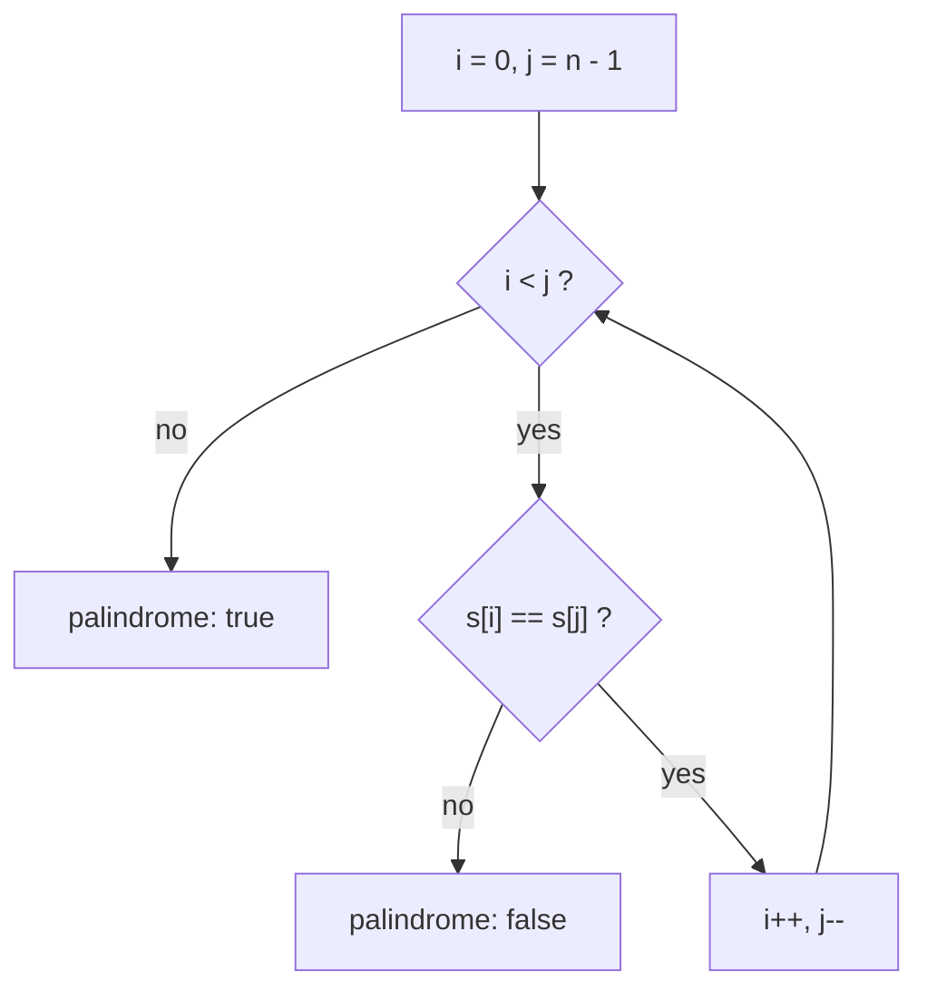
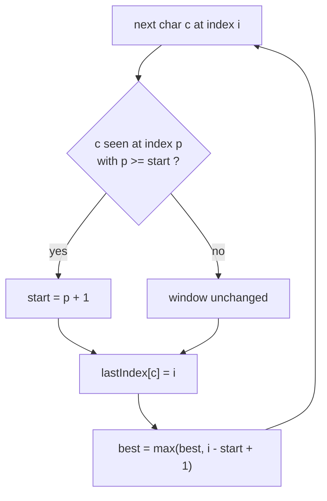
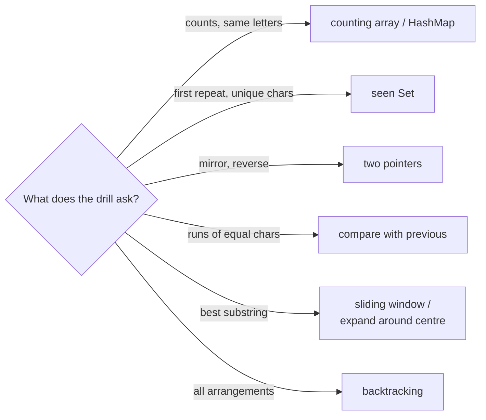

## In One Line
The classic string programs — reverse, palindrome, anagram, first unique or repeated character, duplicates, vowels, reverse words, compression and their harder cousins — are all built from six techniques: char arithmetic, counting arrays, hash maps and sets, two pointers, run scanning and the sliding window.

## Mental Model
Think of a string as a **row of numbered lockers**, each holding one character. The row is **sealed**: you can look into any locker instantly (`charAt(i)` is O(1)), but you can never change what is inside. To "change" a string you build a new row, and the tool for building rows cheaply is a **workbench** (`StringBuilder`).

Every string drill is one of a few ways of walking past the lockers:
- **Tally sheet** — walk once and put a stroke next to each letter on a sheet with 26 boxes (`int[26]`), or in a notebook with a page per character (`HashMap`). Anagrams, first unique character, duplicates and pangrams are tally-sheet problems.
- **Two guards** — one starts at the first locker, one at the last, and they walk towards each other comparing or swapping. Reverse and palindrome are two-guard problems.
- **A guard with a memory** — walk left to right remembering the previous locker, so you notice where a run of equal characters ends. Compression and word counting are run problems.
- **A sliding frame** — a frame over a stretch of lockers that grows on the right and shrinks on the left when a rule breaks. "Longest substring without repeating characters" is a frame problem.

## Concept
### Strings are immutable — build with `StringBuilder`
- Every method that seems to modify a `String` (`toUpperCase`, `replace`, `concat`, `trim`) **returns a new string**. Writing `s.toUpperCase();` without using the result does nothing.
- `result = result + c` inside a loop copies the whole string every time: O(n²) characters copied. Use a `StringBuilder` (O(n) total, amortised O(1) per `append`). `StringBuffer` is the old synchronized version — never needed for local variables.
- Useful `StringBuilder` methods: `append`, `reverse()`, `insert(i, x)` (O(n)), `deleteCharAt(i)`, `setCharAt(i, c)`, `setLength(n)`, `charAt`, `length`.

### Characters are numbers
A `char` is an unsigned 16-bit **UTF-16 code unit**, so arithmetic works on it:
| Expression | Value | Used for |
|---|---|---|
| `c - 'a'` | 0..25 for `'a'..'z'` | index into `int[26]` |
| `c - '0'` | 0..9 for `'0'..'9'` | digit value |
| `(char) ('a' + i)` | the i-th letter | building output from a counting array |
| `'a' - 'A'` | 32 | the distance between cases in ASCII |
| `'a' + 'b'` | **195** (an `int`) | the trap: `char + char` is numeric addition |

Key codes: `'0'` = 48, `'A'` = 65, `'a'` = 97. The `Character` class has what you need: `isLetter`, `isDigit`, `isLetterOrDigit`, `isWhitespace`, `isUpperCase`, `isLowerCase`, `toUpperCase`, `toLowerCase`, `getNumericValue`.

> [!NOTE] Characters outside the Basic Multilingual Plane (most emojis) take **two** `char`s — a *surrogate pair*. `length()` counts chars, not visible characters. Use `codePoints()` and `Character.charCount` when the input may contain them; `StringBuilder.reverse()` already keeps pairs together.

### The techniques behind every string drill
| Technique | Idea | Drills | Cost |
|---|---|---|---|
| **Counting array** | `int[26]` (lowercase), `int[128]` (ASCII), `int[256]` (Latin-1) indexed by the char | anagram, first unique, pangram, duplicates | O(n) time, O(1) space |
| **Hash map of counts** | `map.merge(c, 1, Integer::sum)`; `LinkedHashMap` keeps first-seen order | same drills for any character set | O(n) time, O(k) space |
| **"Seen" set** | `Set.add` returns `false` for a repeat | first repeated, remove duplicates | O(n), O(k) |
| **Two pointers** | `i` from the left, `j` from the right, move inwards | reverse, palindrome | O(n), O(1) |
| **Run scanning** | compare `s.charAt(i)` with `s.charAt(i - 1)` | compression, remove adjacent duplicates, count words | O(n) |
| **Sliding window** | window `[start, i]` with an invariant, move `start` when broken | longest substring without repeats | O(n) |
| **Expand around centre** | grow a palindrome outwards from each of 2n − 1 centres | longest palindromic substring | O(n²), O(1) |
| **Backtracking** | choose, recurse, un-choose | permutations | O(n · n!) |

### The `String` API you need for drills
| Method | Gotcha |
|---|---|
| `charAt(i)`, `length()`, `toCharArray()` | `toCharArray()` copies (O(n)); `charAt` does not |
| `indexOf(ch or str [, from])`, `lastIndexOf`, `contains` | return -1 when absent; naive search, O(n·m) worst case |
| `substring(begin, end)` | `end` is **exclusive**; copies the characters (since Java 7u6) |
| `split(regex [, limit])` | the argument is a **regex** (`"."`, `"|"` must be escaped); trailing empty strings are dropped, leading ones kept; `limit = -1` keeps everything |
| `replace(target, replacement)` vs `replaceAll(regex, replacement)` | `replace` is literal and replaces **all** occurrences; `replaceAll` uses a regex |
| `trim()` vs `strip()` (11) | `trim` removes chars ≤ `' '`; `strip` removes all Unicode whitespace |
| `isEmpty()` vs `isBlank()` (11) | `" ".isEmpty()` is `false`, `" ".isBlank()` is `true` |
| `equals`, `equalsIgnoreCase`, `contentEquals`, `compareTo` | never compare content with `==` |
| `String.join(sep, parts)`, `String.valueOf(x)`, `repeat(n)` (11), `chars()`, `codePoints()` | `chars()` is an `IntStream` of codes — cast with `(char)` |
| `toUpperCase()` / `toLowerCase()` | locale-sensitive; pass `Locale.ROOT` for non-display text |

### Clarify before you code
Interviewers leave these open on purpose; asking them earns points:
1. **Case** — is `"Madam"` a palindrome? are `"Listen"`/`"silent"` anagrams?
2. **Spaces and punctuation** — ignore them or not?
3. **Character set** — lowercase a–z (use `int[26]`), ASCII, or any Unicode (use a `HashMap`, maybe code points)?
4. **Empty and null input** — what should be returned?
5. **Ties / "first"** — first by position, or first to repeat?

## Diagram

Two pointers: each step checks one pair and shrinks the problem from both ends — O(n) time, O(1) space.


Sliding window for "longest substring without repeating characters": the window `[start, i]` never contains a repeat; `start` only ever moves right, so the whole scan is O(n).


Recognise the technique from the wording, then the code follows a known template.

## Code
**The building blocks in one program** — char arithmetic, a counting array, two pointers, a frequency map, a `StringBuilder` and a character stream:
```java
import java.util.LinkedHashMap;
import java.util.Map;

public class StringToolkit {
    public static void main(String[] args) {
        String s = "Hello, World";

        // 1. char arithmetic: a char is a number (a UTF-16 code unit)
        System.out.println("'e' - 'a' = " + ('e' - 'a')
                + ", '7' - '0' = " + ('7' - '0')
                + ", (char) ('a' + 25) = " + (char) ('a' + 25));

        // 2. A counting array indexed by letter: counts[c - 'a']
        int[] counts = new int[26];
        for (char c : s.toLowerCase().toCharArray()) {
            if (c >= 'a' && c <= 'z') counts[c - 'a']++;
        }
        System.out.println("count 'l' = " + counts['l' - 'a'] + ", count 'o' = " + counts['o' - 'a']);

        // 3. Two pointers walking in from both ends
        char[] arr = s.toCharArray();
        for (int i = 0, j = arr.length - 1; i < j; i++, j--) {
            char t = arr[i];
            arr[i] = arr[j];
            arr[j] = t;
        }
        System.out.println("reversed     = " + new String(arr));

        // 4. A frequency map that remembers first-seen order
        Map<Character, Integer> freq = new LinkedHashMap<>();
        for (char c : s.toCharArray()) {
            freq.merge(c, 1, Integer::sum);
        }
        System.out.println("frequencies  = " + freq);

        // 5. StringBuilder: mutable, amortised O(1) append
        StringBuilder sb = new StringBuilder();
        for (String w : s.split(",\\s*")) {
            sb.append(w.toUpperCase()).append('|');
        }
        sb.setLength(sb.length() - 1);              // drop the trailing separator
        System.out.println("builder      = " + sb);

        // 6. String -> IntStream of chars -> String
        String letters = s.chars()
                .filter(Character::isLetter)
                .collect(StringBuilder::new, StringBuilder::appendCodePoint, StringBuilder::append)
                .toString();
        System.out.println("letters only = " + letters);
    }
}
```
```output
'e' - 'a' = 4, '7' - '0' = 7, (char) ('a' + 25) = z
count 'l' = 3, count 'o' = 2
reversed     = dlroW ,olleH
frequencies  = {H=1, e=1, l=3, o=2, ,=1,  =1, W=1, r=1, d=1}
builder      = HELLO|WORLD
letters only = HelloWorld
```

Every Interview Q&A answer below is a complete program, run on JDK 21, with its real output.

## Walkthrough
- **Char arithmetic.** `'e' - 'a'` is 101 − 97 = 4, the index of `e` in the alphabet. `'7' - '0'` is 55 − 48 = 7, the digit value. `(char) ('a' + 25)` converts the `int` 122 back to `'z'`; without the cast it would print `122`.
- **Counting array.** `s.toLowerCase()` makes `H` and `W` countable; the `if (c >= 'a' && c <= 'z')` guard skips the comma and space, which would otherwise produce a negative index. `counts['l' - 'a']` reads the box for `l`: 3 (`He-l-l-o, Wor-l-d`). `o` appears twice.
- **Two pointers.** `i` starts at 0 and `j` at the last index; they swap and move towards each other until they meet. `new String(arr)` builds the result: `dlroW ,olleH`.
- **Frequency map.** `freq.merge(c, 1, Integer::sum)` inserts 1 for a new character or adds 1 to the existing count. `LinkedHashMap` prints keys in first-seen order, including `,` and the space.
- **`StringBuilder`.** `s.split(",\\s*")` splits on a comma followed by any whitespace: `["Hello", "World"]`. Each word is upper-cased and followed by `|`; `setLength(length - 1)` removes the trailing separator — a common trick for joining without an `if`.
- **Character stream.** `s.chars()` is an `IntStream`; `filter(Character::isLetter)` keeps letters (the `int` overload of `isLetter` is used); the three-argument `collect` creates a `StringBuilder`, appends each code point, and merges builders (only used in parallel): `HelloWorld`.

## Traps
The traps below were run as one snippet (inside `main`, with `java.util.*` and `java.util.regex.Pattern` imported):
```java
// 1. split() takes a REGEX: "." matches every character, "|" is an empty alternation
System.out.println("split(\".\")   : " + Arrays.toString("a.b.c".split(".")));
System.out.println("split(\"\\\\.\") : " + Arrays.toString("a.b.c".split("\\.")));
System.out.println("split(\"|\")   : " + Arrays.toString("a|b".split("|")));
System.out.println("quote        : " + Arrays.toString("a|b".split(Pattern.quote("|"))));

// 2. int[26] indexed with c - 'a' breaks on anything that is not a lowercase letter
try {
    int[] counts = new int[26];
    for (char c : "Java".toCharArray()) counts[c - 'a']++;
} catch (ArrayIndexOutOfBoundsException e) {
    System.out.println("int[26]      : " + e.getMessage());
}

// 3. chars() gives ints: forgetting the (char) cast prints numbers
System.out.println("chars()      : " + "hi".chars().mapToObj(c -> c).toList()
        + " vs " + "hi".chars().mapToObj(c -> (char) c).toList());
```
```output
split(".")   : []
split("\\.") : [a, b, c]
split("|")   : [a, |, b]
quote        : [a, b]
int[26]      : Index -23 out of bounds for length 26
chars()      : [104, 105] vs [h, i]
```

- **`split` takes a regex.** `"."` matches every character, so every token is empty and all trailing empty strings are removed: `[]`. `"|"` is an empty alternation that matches between characters. Escape (`"\\."`) or use `Pattern.quote`.
- **`int[26]` with `c - 'a'`** only works for lowercase `a`–`z`. `'J' - 'a'` = −23 → `ArrayIndexOutOfBoundsException`. Lower-case first and guard, or use `int[128]`/`int[256]`/a `HashMap`.
- **`chars()` returns `int`s.** `mapToObj(c -> c)` gives `Integer`s (`[104, 105]`); cast with `(char) c` to get characters.
- **`==` compares references.** `s == new StringBuilder(s).reverse().toString()` is always `false` for a new string; use `equals`.
- **Ignoring the result of a string method.** `s.toUpperCase();` alone changes nothing — strings are immutable.
- **`char + char` is an `int`.** `'a' + 'b'` is 195; put a `String` first (`"" + 'a' + 'b'`) or use a `StringBuilder`.
- **`"".split(regex)` has length 1** (one empty string), and a leading separator creates a leading empty token — trim first, and check `isEmpty()` before counting words.
- **`Character.isDigit` accepts every Unicode digit** (e.g. Arabic-Indic `٣`), while `\\d` in a regex is ASCII-only by default. And `"".chars().allMatch(...)` is `true` — an empty string is not a number.
- **`String.valueOf(null)`** calls the `char[]` overload and throws NPE; `String.valueOf((Object) null)` and `"" + null` give `"null"`.
- **Recursion on long strings** (recursive reverse, permutations) costs O(n) stack frames and O(n²) copying — fine to show, but mention `StackOverflowError` for very long inputs.
- **Surrogate pairs** — a char-by-char swap splits emojis into invalid halves; `StringBuilder.reverse()` does not.

## Tips & Tricks
- **"Count, Seen, Two ends, Runs, Window."** Five words for the five everyday techniques: counting array/map, seen set, two pointers, run scanning, sliding window.
- **`c - 'a'` for letters, `c - '0'` for digits, `(char)` to go back.**
- **Anagram = same counts.** Sort (O(n log n)) or count with `+1`/`-1` in one `int[26]` (O(n)); always check lengths first.
- **"First" questions need order:** a second pass over the **string** (not over a `HashMap`), or a `LinkedHashMap`.
- **Join without an `if`:** append separator after each element, then `setLength(length - 1)`; or use `String.join`/`Collectors.joining`.
- **Rotation check in one line:** `a.length() == b.length() && (a + a).contains(b)`.
- **Compression loop trick:** run the loop to `i <= n` so the last run is flushed inside the loop.
- **Palindrome of a number:** rebuild it reversed with `rev = rev * 10 + x % 10` — no strings, use `long` to avoid overflow.
- **Say the charset assumption out loud:** "I'll assume lowercase ASCII, so an `int[26]` works; for Unicode I'd switch to a `HashMap<Integer, Integer>` over code points."

## Interview Q&A
### [Basic] Reverse a string (in as many ways as you can).
**Approach.** The library answer is `new StringBuilder(s).reverse()`. The expected "without library" answer is **two pointers** on a `char[]` (swap ends, move inwards) or a loop from the end into a `StringBuilder`. Recursion and streams are good to mention but worse in practice. Note the emoji check: a char-by-char swap breaks surrogate pairs, `StringBuilder.reverse()` does not.
```java
import java.util.stream.IntStream;

public class ReverseString {

    // 1. Library: StringBuilder.reverse() (keeps surrogate pairs together)
    static String withBuilder(String s) {
        return new StringBuilder(s).reverse().toString();
    }

    // 2. Two pointers on a char array: swap the ends and move inwards
    static String twoPointers(String s) {
        char[] a = s.toCharArray();
        for (int i = 0, j = a.length - 1; i < j; i++, j--) {
            char t = a[i];
            a[i] = a[j];
            a[j] = t;
        }
        return new String(a);
    }

    // 3. Loop from the end into a StringBuilder
    static String backwards(String s) {
        StringBuilder sb = new StringBuilder(s.length());
        for (int i = s.length() - 1; i >= 0; i--) {
            sb.append(s.charAt(i));
        }
        return sb.toString();
    }

    // 4. Recursion: reverse(rest) + first char
    static String recursive(String s) {
        if (s.length() <= 1) return s;
        return recursive(s.substring(1)) + s.charAt(0);
    }

    // 5. Stream: read the indexes backwards
    static String stream(String s) {
        return IntStream.range(0, s.length())
                .mapToObj(i -> String.valueOf(s.charAt(s.length() - 1 - i)))
                .reduce("", String::concat);
    }

    public static void main(String[] args) {
        String s = "Java Ace";
        System.out.println("builder     : " + withBuilder(s));
        System.out.println("two pointers: " + twoPointers(s));
        System.out.println("backwards   : " + backwards(s));
        System.out.println("recursive   : " + recursive(s));
        System.out.println("stream      : " + stream(s));

        // "ab" followed by one emoji, which is TWO chars (a surrogate pair)
        String emoji = "ab😀";
        String expected = "😀ba";
        System.out.println("emoji ok (builder)     ? " + withBuilder(emoji).equals(expected));
        System.out.println("emoji ok (two pointers)? " + twoPointers(emoji).equals(expected));
    }
}
```
```output
builder     : ecA avaJ
two pointers: ecA avaJ
backwards   : ecA avaJ
recursive   : ecA avaJ
stream      : ecA avaJ
emoji ok (builder)     ? true
emoji ok (two pointers)? false
```
**Complexity.** Builder, two pointers, backwards loop: O(n) time, O(n) space for the new string. Recursive: O(n²) time (each level copies a substring) and O(n) stack. The stream with `String::concat` is also O(n²).

**Follow-up:** *Why can't you reverse a `String` in place?* — `String` is immutable; you always build a new one. In-place reversal only exists for a `char[]` or a `StringBuilder`.

### [Basic] Check whether a string (or a number) is a palindrome.
**Approach.** Two pointers compare `s[i]` with `s[j]` and stop at the first mismatch — O(1) extra space and early exit. For sentences, skip non-alphanumeric characters and compare case-insensitively. `s.equals(new StringBuilder(s).reverse().toString())` is the one-liner. For a number, rebuild it reversed arithmetically and compare.
```java
import java.util.stream.IntStream;

public class Palindrome {

    // Two pointers: compare the ends, move inwards. No extra string.
    static boolean isPalindrome(String s) {
        int i = 0, j = s.length() - 1;
        while (i < j) {
            if (s.charAt(i++) != s.charAt(j--)) return false;
        }
        return true;
    }

    // Sentence version: skip anything that is not a letter or digit, ignore case
    static boolean isSentencePalindrome(String s) {
        int i = 0, j = s.length() - 1;
        while (i < j) {
            char a = s.charAt(i), b = s.charAt(j);
            if (!Character.isLetterOrDigit(a)) { i++; continue; }
            if (!Character.isLetterOrDigit(b)) { j--; continue; }
            if (Character.toLowerCase(a) != Character.toLowerCase(b)) return false;
            i++;
            j--;
        }
        return true;
    }

    // Short versions
    static boolean viaReverse(String s) {
        return s.equals(new StringBuilder(s).reverse().toString());
    }

    static boolean viaStream(String s) {
        return IntStream.range(0, s.length() / 2)
                .allMatch(i -> s.charAt(i) == s.charAt(s.length() - 1 - i));
    }

    // Number palindrome without converting to a String
    static boolean isPalindrome(int n) {
        if (n < 0) return false;
        long reversed = 0;
        for (int x = n; x > 0; x /= 10) {
            reversed = reversed * 10 + x % 10;
        }
        return reversed == n;
    }

    public static void main(String[] args) {
        for (String w : new String[] {"madam", "racecar", "hello", "abba", "a", ""}) {
            System.out.printf("%-10s two-pointer=%-5b reverse=%-5b stream=%b%n",
                    "\"" + w + "\"", isPalindrome(w), viaReverse(w), viaStream(w));
        }
        String sentence = "A man, a plan, a canal: Panama";
        System.out.println("sentence plain    : " + isPalindrome(sentence));
        System.out.println("sentence cleaned  : " + isSentencePalindrome(sentence));
        System.out.println("121 / -121 / 10   : " + isPalindrome(121) + " / " + isPalindrome(-121) + " / " + isPalindrome(10));
    }
}
```
```output
"madam"    two-pointer=true  reverse=true  stream=true
"racecar"  two-pointer=true  reverse=true  stream=true
"hello"    two-pointer=false reverse=false stream=false
"abba"     two-pointer=true  reverse=true  stream=true
"a"        two-pointer=true  reverse=true  stream=true
""         two-pointer=true  reverse=true  stream=true
sentence plain    : false
sentence cleaned  : true
121 / -121 / 10   : true / false / false
```
**Complexity.** O(n) time; O(1) space for two pointers, O(n) for the reverse-and-compare version. Number version: O(d) for d digits.

**Follow-up:** *Why is `-121` not a palindrome?* — Read backwards it is `121-`. Negative numbers are never palindromes by the usual definition, so the method returns `false` immediately.

### [Basic] Check whether two strings are anagrams.
**Approach.** Anagrams have exactly the same character counts. (1) Sort both char arrays and compare — simple, O(n log n). (2) One `int[26]`: `+1` for each char of `a`, `-1` for each char of `b`, all counts must end at 0 — O(n). (3) A `HashMap` for any character set. Always compare **lengths first**. For phrases, normalise (lower-case, remove non-letters).
```java
import java.util.Arrays;
import java.util.HashMap;
import java.util.Map;

public class Anagram {

    // 1. Sort both and compare: O(n log n)
    static boolean bySorting(String a, String b) {
        if (a.length() != b.length()) return false;
        char[] x = a.toCharArray(), y = b.toCharArray();
        Arrays.sort(x);
        Arrays.sort(y);
        return Arrays.equals(x, y);
    }

    // 2. Count with an int[26]: +1 for a, -1 for b, all must end at 0. O(n)
    static boolean byCounting(String a, String b) {
        if (a.length() != b.length()) return false;
        int[] count = new int[26];
        for (int i = 0; i < a.length(); i++) {
            count[a.charAt(i) - 'a']++;
            count[b.charAt(i) - 'a']--;
        }
        for (int c : count) {
            if (c != 0) return false;
        }
        return true;
    }

    // 3. Any characters: a HashMap of counts
    static boolean byMap(String a, String b) {
        if (a.length() != b.length()) return false;
        Map<Character, Integer> counts = new HashMap<>();
        for (char c : a.toCharArray()) counts.merge(c, 1, Integer::sum);
        for (char c : b.toCharArray()) {
            if (counts.merge(c, -1, Integer::sum) < 0) return false;   // b has more of c
        }
        return true;
    }

    // Phrases: ignore case and everything that is not a letter
    static String normalise(String s) {
        return s.toLowerCase().replaceAll("[^a-z]", "");
    }

    public static void main(String[] args) {
        System.out.println("listen/silent sort  : " + bySorting("listen", "silent"));
        System.out.println("listen/silent count : " + byCounting("listen", "silent"));
        System.out.println("listen/silent map   : " + byMap("listen", "silent"));
        System.out.println("rat/car             : " + byCounting("rat", "car"));
        System.out.println("aab/abb             : " + byMap("aab", "abb"));
        System.out.println("Dormitory/Dirty room: "
                + byCounting(normalise("Dormitory"), normalise("Dirty room!")));
    }
}
```
```output
listen/silent sort  : true
listen/silent count : true
listen/silent map   : true
rat/car             : false
aab/abb             : false
Dormitory/Dirty room: true
```
**Complexity.** Sorting: O(n log n) time, O(n) space (copies). Counting: O(n) time, O(1) space. Map: O(n) time, O(k) space.

**Follow-up:** *Why is `byMap` safe with `< 0` only?* — Lengths are equal, so if no count ever goes negative while subtracting `b`, every count must end at exactly 0.

### [Intermediate] Find the first non-repeated character in a string.
**Approach.** Two passes: first count every character, then walk the **string again** and return the first character whose count is 1. With a `LinkedHashMap` the second pass can walk the map instead, because it remembers first-seen order. The stream version builds the same `LinkedHashMap` with `groupingBy`. `indexOf(c) == lastIndexOf(c)` is the shortest code but O(n²).
```java
import java.util.LinkedHashMap;
import java.util.Map;
import java.util.Optional;
import java.util.function.Function;
import java.util.stream.Collectors;

public class FirstNonRepeated {

    // 1. Two passes over a counting array (ASCII / Latin-1): O(n) time, O(1) space
    static int firstUniqueIndex(String s) {
        int[] counts = new int[256];
        for (int i = 0; i < s.length(); i++) counts[s.charAt(i)]++;
        for (int i = 0; i < s.length(); i++) {
            if (counts[s.charAt(i)] == 1) return i;
        }
        return -1;
    }

    // 2. LinkedHashMap keeps first-seen order, so the first count==1 entry is the answer
    static Character firstUniqueMap(String s) {
        Map<Character, Integer> counts = new LinkedHashMap<>();
        for (char c : s.toCharArray()) counts.merge(c, 1, Integer::sum);
        for (Map.Entry<Character, Integer> e : counts.entrySet()) {
            if (e.getValue() == 1) return e.getKey();
        }
        return null;
    }

    // 3. Stream version of 2
    static Optional<Character> firstUniqueStream(String s) {
        return s.chars()
                .mapToObj(c -> (char) c)
                .collect(Collectors.groupingBy(Function.identity(), LinkedHashMap::new, Collectors.counting()))
                .entrySet().stream()
                .filter(e -> e.getValue() == 1)
                .map(Map.Entry::getKey)
                .findFirst();
    }

    // 4. Shortest code: a char is unique if its first and last index are the same. O(n^2)
    static Character firstUniqueIndexOf(String s) {
        for (char c : s.toCharArray()) {
            if (s.indexOf(c) == s.lastIndexOf(c)) return c;
        }
        return null;
    }

    public static void main(String[] args) {
        for (String s : new String[] {"swiss", "programming", "aabbcc", "Java"}) {
            int i = firstUniqueIndex(s);
            System.out.printf("%-12s array=%-4s map=%-5s stream=%-16s indexOf=%s%n",
                    s, i < 0 ? "-" : s.charAt(i) + "@" + i, firstUniqueMap(s),
                    firstUniqueStream(s), firstUniqueIndexOf(s));
        }
    }
}
```
```output
swiss        array=w@1  map=w     stream=Optional[w]      indexOf=w
programming  array=p@0  map=p     stream=Optional[p]      indexOf=p
aabbcc       array=-    map=null  stream=Optional.empty   indexOf=null
Java         array=J@0  map=J     stream=Optional[J]      indexOf=J
```
**Complexity.** Array and map versions: O(n) time; O(1) space for the fixed-size array, O(k) for the map. `indexOf` version: O(n²) time, O(1) space.

**Follow-up:** *Can you do it in one pass?* — Yes: store for each character its first index (or −1 once it repeats), then scan the fixed-size table (256 entries) for the smallest valid index. It is still O(n) but only walks the string once — useful for a stream of characters.

### [Basic] Find the first repeated character in a string.
**Approach.** Walk once with a "seen" `HashSet` (or `boolean[256]`): the first character whose `add` returns `false` is the answer. Clarify the question: in `"abba"`, the character that **repeats first** is `b` (its second copy appears at index 2), while the **first character that has a repeat** is `a`. Both readings are shown.
```java
import java.util.HashSet;
import java.util.Optional;
import java.util.Set;

public class FirstRepeated {

    // "First repeated" = the first character whose SECOND occurrence comes earliest
    static Character firstRepeated(String s) {
        Set<Character> seen = new HashSet<>();
        for (char c : s.toCharArray()) {
            if (!seen.add(c)) return c;          // add() is false: seen before
        }
        return null;
    }

    // Same idea with a boolean[256] instead of a HashSet
    static char firstRepeatedArray(String s) {
        boolean[] seen = new boolean[256];
        for (char c : s.toCharArray()) {
            if (seen[c]) return c;
            seen[c] = true;
        }
        return '\0';
    }

    // Stream version (stateful filter: fine sequentially, not in parallel)
    static Optional<Character> firstRepeatedStream(String s) {
        Set<Character> seen = new HashSet<>();
        return s.chars().mapToObj(c -> (char) c).filter(c -> !seen.add(c)).findFirst();
    }

    // Other reading: the first character (by position) that occurs more than once
    static Character firstCharThatRepeats(String s) {
        for (int i = 0; i < s.length(); i++) {
            if (s.indexOf(s.charAt(i), i + 1) != -1) return s.charAt(i);
        }
        return null;
    }

    public static void main(String[] args) {
        for (String s : new String[] {"programming", "abba", "abc"}) {
            System.out.printf("%-12s set=%-5s array=%-5s stream=%-13s firstThatRepeats=%s%n",
                    s, firstRepeated(s), firstRepeatedArray(s) == '\0' ? "none" : firstRepeatedArray(s),
                    firstRepeatedStream(s), firstCharThatRepeats(s));
        }
    }
}
```
```output
programming  set=r     array=r     stream=Optional[r]   firstThatRepeats=r
abba         set=b     array=b     stream=Optional[b]   firstThatRepeats=a
abc          set=null  array=none  stream=Optional.empty firstThatRepeats=null
```
**Complexity.** Set/array: O(n) time, O(k) or O(1) space. `firstCharThatRepeats` with `indexOf(c, i + 1)`: O(n²).

**Follow-up:** *Why is the stream version's `seen` set a smell?* — The filter lambda has side effects, which the Stream API forbids for correctness in parallel; it works only because the stream is sequential and ordered.

### [Basic] Find the duplicate characters in a string and how often they occur.
**Approach.** Build a frequency map (lower-cased, spaces skipped), then print or collect entries with count > 1. A `LinkedHashMap` keeps first-seen order so the output is predictable. The stream version is the frequency-map recipe from [Stream Drills — Advanced](lesson:b06-coding-drills/02-stream-drills-advanced).
```java
import java.util.LinkedHashMap;
import java.util.Map;
import java.util.function.Function;
import java.util.stream.Collectors;

public class DuplicateCharacters {
    public static void main(String[] args) {
        String s = "Programming in Java";

        // Loop: count every character (ignoring case and spaces), print counts > 1
        Map<Character, Integer> counts = new LinkedHashMap<>();
        for (char c : s.toLowerCase().toCharArray()) {
            if (c != ' ') counts.merge(c, 1, Integer::sum);
        }
        System.out.print("loop   : ");
        counts.forEach((c, n) -> {
            if (n > 1) System.out.print(c + "=" + n + " ");
        });
        System.out.println();

        // Stream: frequency map, keep entries with count > 1
        Map<Character, Long> dups = s.toLowerCase().chars()
                .filter(c -> c != ' ')
                .mapToObj(c -> (char) c)
                .collect(Collectors.groupingBy(Function.identity(), LinkedHashMap::new, Collectors.counting()))
                .entrySet().stream()
                .filter(e -> e.getValue() > 1)
                .collect(Collectors.toMap(Map.Entry::getKey, Map.Entry::getValue, (a, b) -> a, LinkedHashMap::new));
        System.out.println("stream : " + dups);

        // Only WHICH characters are duplicated, as a String
        String which = dups.keySet().stream().map(String::valueOf).collect(Collectors.joining());
        System.out.println("which  : " + which);
    }
}
```
```output
loop   : r=2 g=2 a=3 m=2 i=2 n=2 
stream : {r=2, g=2, a=3, m=2, i=2, n=2}
which  : rgamin
```
**Complexity.** O(n) time, O(k) space for k distinct characters.

**Follow-up:** *And without any collection?* — Sort the char array and count runs of equal neighbours: O(n log n) time, O(n) for the array copy (O(1) extra if you may modify it).

### [Basic] Count the vowels and consonants in a string.
**Approach.** Lower-case once, consider only letters `a`–`z`, and test membership in `"aeiou"` with `indexOf`. The switch expression with multiple labels (`case 'a', 'e', 'i', 'o', 'u' ->`, Java 14) is a clean `isVowel`. Streams: `chars().filter(...).count()`. Digits, spaces and punctuation are neither vowels nor consonants.
```java
import java.util.Set;

public class VowelsConsonants {

    static int[] count(String s) {
        int vowels = 0, consonants = 0;
        for (char c : s.toLowerCase().toCharArray()) {
            if (c >= 'a' && c <= 'z') {                // letters only
                if ("aeiou".indexOf(c) >= 0) vowels++;
                else consonants++;
            }
        }
        return new int[] {vowels, consonants};
    }

    // switch with multiple labels (Java 14 arrow form)
    static boolean isVowel(char c) {
        return switch (Character.toLowerCase(c)) {
            case 'a', 'e', 'i', 'o', 'u' -> true;
            default -> false;
        };
    }

    public static void main(String[] args) {
        String s = "Hello World, Java 21!";
        int[] vc = count(s);
        System.out.println("loop   : vowels=" + vc[0] + ", consonants=" + vc[1]);

        long vowels = s.chars().filter(c -> isVowel((char) c)).count();
        long consonants = s.chars().filter(Character::isLetter).filter(c -> !isVowel((char) c)).count();
        System.out.println("stream : vowels=" + vowels + ", consonants=" + consonants);

        Set<Character> vowelSet = Set.of('a', 'e', 'i', 'o', 'u');
        System.out.println("set    : vowels=" + s.toLowerCase().chars().filter(c -> vowelSet.contains((char) c)).count());
    }
}
```
```output
loop   : vowels=5, consonants=9
stream : vowels=5, consonants=9
set    : vowels=5
```
**Complexity.** O(n) time, O(1) space (the lower-cased copy is O(n)).

**Follow-up:** *What about `y` or accented letters like `é`?* — State the assumption: English vowels a, e, i, o, u only; `Character.isLetter('é')` is `true`, so with the stream version `é` would count as a consonant unless you normalise accents first (`java.text.Normalizer`).

### [Basic] Reverse the words of a sentence; then reverse each word in place.
**Approach.** Word order: `trim()` and `split("\\s+")` (so repeated spaces do not create empty words), then append the words backwards with single spaces — or reverse the list with `Collections.reverse` and `String.join`. Reversing each word: split on spaces, reverse each word with `StringBuilder`, join with `Collectors.joining(" ")`.
```java
import java.util.Arrays;
import java.util.Collections;
import java.util.List;
import java.util.stream.Collectors;

public class ReverseWords {

    // "Java is fun" -> "fun is Java" (extra spaces collapsed)
    static String reverseWordOrder(String s) {
        String[] words = s.trim().split("\\s+");
        StringBuilder sb = new StringBuilder();
        for (int i = words.length - 1; i >= 0; i--) {
            sb.append(words[i]);
            if (i > 0) sb.append(' ');
        }
        return sb.toString();
    }

    // Same with the Collections API: Arrays.asList is a view, reverse() works on it
    static String reverseWordOrderApi(String s) {
        List<String> words = Arrays.asList(s.trim().split("\\s+"));
        Collections.reverse(words);
        return String.join(" ", words);
    }

    // "Java is fun" -> "avaJ si nuf" (word order kept, letters reversed)
    static String reverseEachWord(String s) {
        return Arrays.stream(s.split(" "))
                .map(w -> new StringBuilder(w).reverse().toString())
                .collect(Collectors.joining(" "));
    }

    public static void main(String[] args) {
        String s = "  Java   is fun  ";
        System.out.println("[" + reverseWordOrder(s) + "]");
        System.out.println("[" + reverseWordOrderApi(s) + "]");
        System.out.println("[" + reverseEachWord("Java is fun") + "]");
        System.out.println("split(\" \") on the padded string: " + Arrays.toString(s.split(" ")));
    }
}
```
```output
[fun is Java]
[fun is Java]
[avaJ si nuf]
split(" ") on the padded string: [, , Java, , , is, fun]
```
**Complexity.** O(n) time and O(n) space for all versions.

**Follow-up:** *Why does `Collections.reverse` work on `Arrays.asList(...)` when `add` would not?* — `Arrays.asList` returns a fixed-size list backed by the array: `set` is allowed (reverse only swaps with `set`), while `add`/`remove` throw `UnsupportedOperationException`.

### [Intermediate] Compress a string using counts of repeated characters (`aaabbc` → `a3b2c1`).
**Approach.** Run scanning: keep a `count`; while the current char equals the previous one, increment; when the run ends, append the char and its count. Looping to `i <= n` flushes the last run without extra code after the loop. The classic variant returns the original string if the "compressed" one is not shorter. The decoder must handle **multi-digit counts** (`a12`). The regex `(.)\1*` matches one run per match.
```java
import java.util.regex.Pattern;
import java.util.stream.Collectors;

public class Compression {

    // Run-length encoding: "aaabbc" -> "a3b2c1"
    static String compress(String s) {
        if (s.isEmpty()) return s;
        StringBuilder sb = new StringBuilder();
        int count = 1;
        for (int i = 1; i <= s.length(); i++) {
            if (i < s.length() && s.charAt(i) == s.charAt(i - 1)) {
                count++;
            } else {                                   // run ended (or string ended)
                sb.append(s.charAt(i - 1)).append(count);
                count = 1;
            }
        }
        return sb.toString();
    }

    // Classic variant: return the original if compression does not make it shorter
    static String compressIfShorter(String s) {
        String c = compress(s);
        return c.length() < s.length() ? c : s;
    }

    // Reverse operation, supports multi-digit counts: "a12b1" -> 12 a's and one b
    static String decompress(String s) {
        StringBuilder sb = new StringBuilder();
        int i = 0;
        while (i < s.length()) {
            char c = s.charAt(i++);
            int n = 0;
            while (i < s.length() && Character.isDigit(s.charAt(i))) {
                n = n * 10 + (s.charAt(i++) - '0');
            }
            sb.append(String.valueOf(c).repeat(n));   // String.repeat: Java 11
        }
        return sb.toString();
    }

    // Regex one-liner (Java 9 Matcher.results): (.)\1* matches one run
    static String compressRegex(String s) {
        return Pattern.compile("(.)\\1*").matcher(s).results()
                .map(m -> m.group(1) + m.group().length())
                .collect(Collectors.joining());
    }

    public static void main(String[] args) {
        System.out.println(compress("aaabbc"));
        System.out.println(compress("aabcccccaaa"));
        System.out.println(compressIfShorter("aabcccccaaa") + " / " + compressIfShorter("abc"));
        System.out.println(compress("aaaaaaaaaaaa"));
        System.out.println(decompress("a12b1"));
        System.out.println(compressRegex("aabcccccaaa"));
        System.out.println("[" + compress("") + "]");
    }
}
```
```output
a3b2c1
a2b1c5a3
a2b1c5a3 / abc
a12
aaaaaaaaaaaab
a2b1c5a3
[]
```
**Complexity.** O(n) time, O(n) space for the output.

**Follow-up:** *What breaks if the input can contain digits?* — `a3` in the input would be ambiguous with a count. Real run-length formats escape digits or store counts in a fixed-width/binary form.

### [Basic] Count the occurrences of a character and of a substring.
**Approach.** A character: a loop with `charAt`, `chars().filter(...).count()`, or the length difference after `replace`. A substring: repeated `indexOf(sub, from)`; jump by `sub.length()` for non-overlapping matches or by 1 for overlapping ones (`"ana"` occurs once or twice in `"banana"`). `split(regex, -1).length - 1` works for single characters (the `-1` keeps trailing empty strings).
```java
public class CountOccurrences {

    static int countChar(String s, char ch) {
        int n = 0;
        for (int i = 0; i < s.length(); i++) {
            if (s.charAt(i) == ch) n++;
        }
        return n;
    }

    // Non-overlapping: jump past each match
    static int countSubstring(String s, String sub) {
        int count = 0, from = 0;
        while ((from = s.indexOf(sub, from)) != -1) {
            count++;
            from += sub.length();
        }
        return count;
    }

    // Overlapping: move one position after each match
    static int countOverlapping(String s, String sub) {
        int count = 0, from = 0;
        while ((from = s.indexOf(sub, from)) != -1) {
            count++;
            from++;
        }
        return count;
    }

    public static void main(String[] args) {
        String s = "banana";
        System.out.println("loop    'a' : " + countChar(s, 'a'));
        System.out.println("stream  'a' : " + s.chars().filter(c -> c == 'a').count());
        System.out.println("replace 'a' : " + (s.length() - s.replace("a", "").length()));
        System.out.println("\"ana\" non-overlapping : " + countSubstring(s, "ana"));
        System.out.println("\"ana\" overlapping     : " + countOverlapping(s, "ana"));
        System.out.println("split trick  \"a\"      : " + (s.split("a", -1).length - 1));
    }
}
```
```output
loop    'a' : 3
stream  'a' : 3
replace 'a' : 3
"ana" non-overlapping : 1
"ana" overlapping     : 2
split trick  "a"      : 3
```
**Complexity.** Character: O(n). Substring: O(n·m) worst case with `indexOf`'s naive search, O(n) typical.

**Follow-up:** *Why `split("a", -1)`?* — Without the limit, trailing empty strings are removed: `"banana".split("a")` gives `[b, n, n]` (3 tokens, 3 occurrences only by luck); for `"aaa"` it would give `[]`.

### [Basic] Remove duplicate characters, keeping the first occurrence.
**Approach.** A "seen" set plus a `StringBuilder`: append a character only when `add` returns `true`. Streams: `chars().distinct()` keeps encounter order. Without collections: keep `s.charAt(i)` only if `s.indexOf(s.charAt(i)) == i` (O(n²)). Removing only **adjacent** duplicates is a different question: compare with the last appended character.
```java
import java.util.LinkedHashSet;
import java.util.Set;
import java.util.stream.Collectors;

public class RemoveDuplicateChars {

    // Keep the first occurrence of each character
    static String withSet(String s) {
        Set<Character> seen = new LinkedHashSet<>();
        StringBuilder sb = new StringBuilder();
        for (char c : s.toCharArray()) {
            if (seen.add(c)) sb.append(c);
        }
        return sb.toString();
    }

    // Stream: distinct() on the char codes keeps encounter order
    static String withStream(String s) {
        return s.chars()
                .distinct()
                .mapToObj(c -> String.valueOf((char) c))
                .collect(Collectors.joining());
    }

    // No collections: keep a char only where it first appears. O(n^2)
    static String withIndexOf(String s) {
        StringBuilder sb = new StringBuilder();
        for (int i = 0; i < s.length(); i++) {
            if (s.indexOf(s.charAt(i)) == i) sb.append(s.charAt(i));
        }
        return sb.toString();
    }

    // Variant: remove only CONSECUTIVE duplicates ("aaabbbac" -> "abac")
    static String removeAdjacent(String s) {
        StringBuilder sb = new StringBuilder();
        for (char c : s.toCharArray()) {
            if (sb.length() == 0 || sb.charAt(sb.length() - 1) != c) sb.append(c);
        }
        return sb.toString();
    }

    public static void main(String[] args) {
        System.out.println(withSet("programming") + " " + withStream("programming") + " " + withIndexOf("programming"));
        System.out.println(withSet("banana") + " " + withStream("banana") + " " + withIndexOf("banana"));
        System.out.println(removeAdjacent("aaabbbac"));
    }
}
```
```output
progamin progamin progamin
ban ban ban
abac
```
**Complexity.** Set and stream: O(n) time, O(k) space. `indexOf`: O(n²) time, O(1) extra. Adjacent: O(n).

**Follow-up:** *Can you use a `boolean[256]` instead of a `Set`?* — Yes, for ASCII/Latin-1 input it is faster and allocation-free: `if (!seen[c]) { seen[c] = true; sb.append(c); }`.

### [Basic] Remove all white space from a string.
**Approach.** `replaceAll("\\s", "")` removes every whitespace character (space, tab, newline...). `replace(" ", "")` removes only spaces — the tab and newline stay (see the output). The loop uses `Character.isWhitespace`. To normalise instead of removing: `trim().replaceAll("\\s+", " ")`. `strip()` (Java 11) also removes Unicode spaces that `trim()` misses.
```java
public class RemoveWhitespace {

    static String removeAllWhitespace(String s) {
        StringBuilder sb = new StringBuilder(s.length());
        for (char c : s.toCharArray()) {
            if (!Character.isWhitespace(c)) sb.append(c);
        }
        return sb.toString();
    }

    public static void main(String[] args) {
        String s = "  Java \t is\n fun  ";
        System.out.println("[" + s.replaceAll("\\s", "") + "]");            // regex: every whitespace char
        System.out.println("[" + removeAllWhitespace(s) + "]");             // loop
        System.out.println("[" + s.replace(" ", "") + "]");                 // spaces only: tab and newline stay
        System.out.println("[" + s.trim().replaceAll("\\s+", " ") + "]");   // normalise: single spaces

        // trim() vs strip() (Java 11): trim only removes chars <= ' '
        String em = "\u2003hi\u2003";                                 // EM SPACE on both sides
        System.out.println("trim  length: " + em.trim().length());
        System.out.println("strip length: " + em.strip().length());
        System.out.println("isBlank     : " + " \t\n".isBlank());           // Java 11
    }
}
```
```output
[Javaisfun]
[Javaisfun]
[Java	is
fun]
[Java is fun]
trim  length: 4
strip length: 2
isBlank     : true
```
**Complexity.** O(n) time and space.

**Follow-up:** *`isEmpty()` or `isBlank()`?* — `isEmpty()` is `length() == 0`; `isBlank()` (Java 11) is also `true` for strings made only of whitespace.

### [Basic] Check whether a string contains only digits.
**Approach.** Loop and check `'0' <= c <= '9'`; reject `null`/empty explicitly. `s.matches("\\d+")` is the regex answer (the `+` rejects the empty string). Beware `chars().allMatch(Character::isDigit)`: it is `true` for the empty string and for non-ASCII digits. `Integer.parseInt` is not a digit check — it throws for values beyond `int` range.
```java
public class OnlyDigits {

    // ASCII digits only; empty string is NOT a number
    static boolean isNumeric(String s) {
        if (s == null || s.isEmpty()) return false;
        for (int i = 0; i < s.length(); i++) {
            char c = s.charAt(i);
            if (c < '0' || c > '9') return false;
        }
        return true;
    }

    public static void main(String[] args) {
        String arabic = "٣٤";   // Arabic-Indic digits three and four
        String[] inputs = {"12345", "12a45", "", "-12", arabic};
        for (String s : inputs) {
            System.out.printf("%-8s loop=%-5b regex=%-5b allMatch(isDigit)=%b%n",
                    s.equals(arabic) ? "arabic" : "\"" + s + "\"",
                    isNumeric(s), s.matches("\\d+"), s.chars().allMatch(Character::isDigit));
        }
        try {
            Integer.parseInt("99999999999");
        } catch (NumberFormatException e) {
            System.out.println("parseInt: " + e.getMessage());
        }
    }
}
```
```output
"12345"  loop=true  regex=true  allMatch(isDigit)=true
"12a45"  loop=false regex=false allMatch(isDigit)=false
""       loop=false regex=false allMatch(isDigit)=true
"-12"    loop=false regex=false allMatch(isDigit)=false
arabic   loop=false regex=false allMatch(isDigit)=true
parseInt: For input string: "99999999999"
```
**Complexity.** O(n) time, O(1) space (the regex compiles a `Pattern` each call; precompile it if called often).

**Follow-up:** *And to allow a leading minus sign?* — `s.matches("-?\\d+")`, or in the loop start from index 1 when `s.charAt(0) == '-'` and the length is > 1.

### [Basic] Count the words in a sentence.
**Approach.** `trim()` then `split("\\s+")`, with an explicit check for the empty string. Without `trim`, a leading space produces an empty first token (see the output), and `"".split(...)` has length 1. The loop version counts transitions from whitespace to non-whitespace and needs no special cases.
```java
import java.util.Arrays;

public class CountWords {

    static int countWords(String s) {
        String t = s.trim();
        return t.isEmpty() ? 0 : t.split("\\s+").length;
    }

    // Loop: a word starts where a non-space follows a space (or the start)
    static int countWordsLoop(String s) {
        int count = 0;
        boolean inWord = false;
        for (char c : s.toCharArray()) {
            if (Character.isWhitespace(c)) {
                inWord = false;
            } else if (!inWord) {
                inWord = true;
                count++;
            }
        }
        return count;
    }

    public static void main(String[] args) {
        String s = "  Java  is\tfun ";
        System.out.println("split : " + countWords(s));
        System.out.println("loop  : " + countWordsLoop(s));
        System.out.println("empty : " + countWords("") + " / " + countWordsLoop(""));
        // Why trim first?
        System.out.println(Arrays.toString(s.split("\\s+")) + " length " + s.split("\\s+").length);
        System.out.println("\"\".split(...).length = " + "".split("\\s+").length);
    }
}
```
```output
split : 3
loop  : 3
empty : 0 / 0
[, Java, is, fun] length 4
"".split(...).length = 1
```
**Complexity.** O(n) time; split: O(n) space, loop: O(1) space.

**Follow-up:** *Why doesn't the trailing space create an empty token?* — `split` removes **trailing** empty strings (unless the limit is negative), but it keeps **leading** ones.

### [Intermediate] Check whether one string is a rotation of another.
**Approach.** Every rotation of `a` is a substring of `a + a` (`"waterbottlewaterbottle"` contains `"erbottlewat"`). Check the lengths first, otherwise `"a"` would be "a rotation of" `"aa"`. Rotating left by k: `s.substring(k) + s.substring(0, k)` with `k %= length`.
```java
public class Rotation {

    // b is a rotation of a  <=>  same length and b appears inside a + a
    static boolean isRotation(String a, String b) {
        return a.length() == b.length() && (a + a).contains(b);
    }

    // Rotate left by k positions
    static String rotateLeft(String s, int k) {
        if (s.isEmpty()) return s;
        k %= s.length();
        return s.substring(k) + s.substring(0, k);
    }

    public static void main(String[] args) {
        System.out.println(isRotation("waterbottle", "erbottlewat"));
        System.out.println(isRotation("abcd", "cdab"));
        System.out.println(isRotation("abcd", "acbd"));
        System.out.println(isRotation("aa", "a"));
        System.out.println(rotateLeft("abcdef", 2) + " " + rotateLeft("abcdef", 8));
    }
}
```
```output
true
true
false
false
cdefab cdefab
```
**Complexity.** O(n) space for `a + a`; `contains` is O(n²) worst case with the JDK's naive search (O(n) with KMP).

**Follow-up:** *How would you check without extra space?* — Try each shift k and compare `a.charAt((i + k) % n)` with `b.charAt(i)` for all i: O(n²) time, O(1) space.

### [Intermediate] Swap two strings without using a third variable.
**Approach.** Concatenate, then cut: `a = a + b`; `b` = the first `a.length() - b.length()` characters (the old `a`); `a` = what follows (the old `b`). It is a puzzle, not an optimisation: new `String` objects are created anyway.
```java
public class SwapStrings {
    public static void main(String[] args) {
        String a = "Hello", b = "World";
        System.out.println("before: a=" + a + ", b=" + b);

        a = a + b;                                        // a = "HelloWorld"
        b = a.substring(0, a.length() - b.length());      // b = "Hello"
        a = a.substring(b.length());                      // a = "World"

        System.out.println("after : a=" + a + ", b=" + b);
    }
}
```
```output
before: a=Hello, b=World
after : a=World, b=Hello
```
**Complexity.** O(n + m) time and space for the concatenation and substrings.

**Follow-up:** *Does swapping inside a method `swap(String a, String b)` change the caller's variables?* — No. Java passes references by value; reassigning the parameters inside the method does not affect the caller (see [pass-by-value](lesson:b01-fundamentals/04-pass-by-value)).

### [Basic] Capitalise the first letter of every word.
**Approach.** Stream: split into words, upper-case the first char, lower-case the rest, join with a space (repeated spaces collapse). Loop: walk the characters with a `startOfWord` flag that becomes `true` after whitespace — this keeps the original spacing.
```java
import java.util.Arrays;
import java.util.stream.Collectors;

public class CapitalizeWords {

    // Stream: split, fix each word, join (collapses repeated spaces)
    static String capitalize(String s) {
        return Arrays.stream(s.trim().split("\\s+"))
                .map(w -> Character.toUpperCase(w.charAt(0)) + w.substring(1).toLowerCase())
                .collect(Collectors.joining(" "));
    }

    // Loop: keeps the original spacing; upper-case a letter that follows whitespace
    static String capitalizeLoop(String s) {
        StringBuilder sb = new StringBuilder(s.length());
        boolean startOfWord = true;
        for (char c : s.toCharArray()) {
            sb.append(startOfWord ? Character.toUpperCase(c) : Character.toLowerCase(c));
            startOfWord = Character.isWhitespace(c);
        }
        return sb.toString();
    }

    public static void main(String[] args) {
        String s = "hello   wORLD from jAVA";
        System.out.println("[" + capitalize(s) + "]");
        System.out.println("[" + capitalizeLoop(s) + "]");
    }
}
```
```output
[Hello World From Java]
[Hello   World From Java]
```
**Complexity.** O(n) time and space.

**Follow-up:** *What happens with an empty word?* — `w.charAt(0)` would throw `StringIndexOutOfBoundsException`; that is why the stream version trims and splits on `\\s+`, which never yields an empty word from a non-blank string.

### [Intermediate] Find the longest common prefix of an array of strings.
**Approach.** Vertical scan: take column i of the first word and check it in every other word; stop at the first mismatch or when a word runs out. Alternative: sort a copy — only the lexicographically **first and last** words need comparing, because every other word lies between them.
```java
import java.util.Arrays;

public class LongestCommonPrefix {

    // Vertical scan: compare column i of every word with the first word
    static String lcp(String[] words) {
        if (words.length == 0) return "";
        for (int i = 0; i < words[0].length(); i++) {
            char c = words[0].charAt(i);
            for (int j = 1; j < words.length; j++) {
                if (i >= words[j].length() || words[j].charAt(i) != c) {
                    return words[0].substring(0, i);
                }
            }
        }
        return words[0];
    }

    // Sort, then only the first and last words need comparing
    static String lcpSorted(String[] words) {
        if (words.length == 0) return "";
        String[] w = words.clone();
        Arrays.sort(w);
        String first = w[0], last = w[w.length - 1];
        int i = 0;
        while (i < first.length() && i < last.length() && first.charAt(i) == last.charAt(i)) i++;
        return first.substring(0, i);
    }

    public static void main(String[] args) {
        String[][] tests = {
                {"flower", "flow", "flight"},
                {"dog", "racecar", "car"},
                {"interview", "internet", "interval", "internal"},
                {"same"}};
        for (String[] t : tests) {
            System.out.println(Arrays.toString(t) + " -> [" + lcp(t) + "] [" + lcpSorted(t) + "]");
        }
    }
}
```
```output
[flower, flow, flight] -> [fl] [fl]
[dog, racecar, car] -> [] []
[interview, internet, interval, internal] -> [inter] [inter]
[same] -> [same] [same]
```
**Complexity.** Vertical scan: O(S) where S is the total number of characters, O(1) space. Sorting: O(n log n · m) comparisons, O(n) space for the copy.

**Follow-up:** *Why is comparing only the first and last sorted words enough?* — In sorted order, any prefix shared by the first and last word is shared by everything between them.

### [Basic] Count uppercase letters, lowercase letters, digits, spaces and special characters; toggle the case.
**Approach.** One loop with an `if / else if` chain of `Character` tests; everything that is not a letter, digit or whitespace is "special". Streams need one pass per category (`chars().filter(Character::isUpperCase).count()`). Toggling is `isUpperCase ? toLowerCase : toUpperCase` per character.
```java
public class CharacterTypes {
    public static void main(String[] args) {
        String s = "Java 21 Rocks! @2025";

        int upper = 0, lower = 0, digits = 0, spaces = 0, special = 0;
        for (char c : s.toCharArray()) {
            if (Character.isUpperCase(c)) upper++;
            else if (Character.isLowerCase(c)) lower++;
            else if (Character.isDigit(c)) digits++;
            else if (Character.isWhitespace(c)) spaces++;
            else special++;
        }
        System.out.printf("loop   : upper=%d lower=%d digits=%d spaces=%d special=%d%n",
                upper, lower, digits, spaces, special);

        System.out.printf("stream : upper=%d lower=%d digits=%d%n",
                s.chars().filter(Character::isUpperCase).count(),
                s.chars().filter(Character::isLowerCase).count(),
                s.chars().filter(Character::isDigit).count());

        // Toggle the case of every letter
        StringBuilder toggled = new StringBuilder();
        for (char c : s.toCharArray()) {
            toggled.append(Character.isUpperCase(c) ? Character.toLowerCase(c) : Character.toUpperCase(c));
        }
        System.out.println("toggle : " + toggled);
    }
}
```
```output
loop   : upper=2 lower=7 digits=6 spaces=3 special=2
stream : upper=2 lower=7 digits=6
toggle : jAVA 21 rOCKS! @2025
```
**Complexity.** O(n) time, O(1) space (O(n) for the toggled copy).

**Follow-up:** *Why use `Character.isUpperCase` rather than `c >= 'A' && c <= 'Z'`?* — It also handles non-ASCII letters (`É`, `Ω`). Use the range check only when the problem says ASCII.

### [Intermediate] Check whether a sentence is a pangram (contains every letter a–z).
**Approach.** Mark each letter seen in a `boolean[26]` and count distinct letters; or set bit `c - 'a'` in an `int` mask and compare with `(1 << 26) - 1` (26 ones). Stream: `filter(a–z).distinct().count() == 26`. Listing the **missing** letters is a nice extension.
```java
import java.util.stream.Collectors;
import java.util.stream.IntStream;

public class Pangram {

    // boolean[26] + a counter of distinct letters seen
    static boolean isPangram(String s) {
        boolean[] seen = new boolean[26];
        int distinct = 0;
        for (char c : s.toLowerCase().toCharArray()) {
            if (c >= 'a' && c <= 'z' && !seen[c - 'a']) {
                seen[c - 'a'] = true;
                distinct++;
            }
        }
        return distinct == 26;
    }

    // Bitmask: bit i set = letter 'a' + i seen
    static boolean isPangramBits(String s) {
        int mask = 0;
        for (char c : s.toLowerCase().toCharArray()) {
            if (c >= 'a' && c <= 'z') mask |= 1 << (c - 'a');
        }
        return mask == (1 << 26) - 1;
    }

    static boolean isPangramStream(String s) {
        return s.toLowerCase().chars().filter(c -> c >= 'a' && c <= 'z').distinct().count() == 26;
    }

    static String missingLetters(String s) {
        String lower = s.toLowerCase();
        return IntStream.rangeClosed('a', 'z')
                .filter(c -> lower.indexOf(c) < 0)
                .mapToObj(c -> String.valueOf((char) c))
                .collect(Collectors.joining());
    }

    public static void main(String[] args) {
        String fox = "The quick brown fox jumps over the lazy dog";
        String hello = "Hello World";
        System.out.println(isPangram(fox) + " " + isPangramBits(fox) + " " + isPangramStream(fox));
        System.out.println(isPangram(hello) + " " + isPangramBits(hello) + " " + isPangramStream(hello));
        System.out.println("missing from \"Hello World\": " + missingLetters(hello));
    }
}
```
```output
true true true
false false false
missing from "Hello World": abcfgijkmnpqstuvxyz
```
**Complexity.** O(n) time, O(1) space.

**Follow-up:** *Can you stop early?* — Yes: return `true` as soon as the distinct counter reaches 26, which helps for long inputs.

### [Advanced] Print all permutations of a string.
**Approach.** Recursion: for each character of `rest`, append it to `prefix` and recurse on the remaining characters; when `rest` is empty, `prefix` is one permutation. With repeated characters, either de-duplicate with a `Set`, or sort the characters and **skip a character equal to the previous one when the previous one is unused** at this level (backtracking with a `used[]` array).
```java
import java.util.ArrayList;
import java.util.Arrays;
import java.util.LinkedHashSet;
import java.util.List;
import java.util.Set;

public class Permutations {

    // Choose each remaining char as the next one, recurse on the rest
    static void permute(String prefix, String rest, List<String> out) {
        if (rest.isEmpty()) {
            out.add(prefix);
            return;
        }
        for (int i = 0; i < rest.length(); i++) {
            permute(prefix + rest.charAt(i),
                    rest.substring(0, i) + rest.substring(i + 1), out);
        }
    }

    // Unique permutations without a Set: sort, then skip a char equal to
    // the previous one at the same level if that previous one is unused
    static void permuteUnique(char[] chars, boolean[] used, StringBuilder cur, List<String> out) {
        if (cur.length() == chars.length) {
            out.add(cur.toString());
            return;
        }
        for (int i = 0; i < chars.length; i++) {
            if (used[i]) continue;
            if (i > 0 && chars[i] == chars[i - 1] && !used[i - 1]) continue;
            used[i] = true;
            cur.append(chars[i]);
            permuteUnique(chars, used, cur, out);
            cur.deleteCharAt(cur.length() - 1);      // backtrack
            used[i] = false;
        }
    }

    public static void main(String[] args) {
        List<String> abc = new ArrayList<>();
        permute("", "abc", abc);
        System.out.println(abc + " count=" + abc.size());

        List<String> aab = new ArrayList<>();
        permute("", "aab", aab);
        Set<String> uniqueViaSet = new LinkedHashSet<>(aab);
        System.out.println(aab + " -> unique " + uniqueViaSet);

        char[] chars = "aab".toCharArray();
        Arrays.sort(chars);
        List<String> unique = new ArrayList<>();
        permuteUnique(chars, new boolean[chars.length], new StringBuilder(), unique);
        System.out.println("backtracking unique: " + unique);
    }
}
```
```output
[abc, acb, bac, bca, cab, cba] count=6
[aab, aba, aab, aba, baa, baa] -> unique [aab, aba, baa]
backtracking unique: [aab, aba, baa]
```
**Complexity.** O(n · n!) time (n! permutations, each O(n) to build), O(n) recursion depth, O(n · n!) to store the results.

**Follow-up:** *How many permutations does `"aabb"` have?* — 4! / (2! · 2!) = 6 distinct ones (24 with duplicates).

### [Advanced] Find the longest substring without repeating characters.
**Approach.** Sliding window: keep `start` and a map of each character's last index. When the current character was last seen **inside** the window (`prev >= start`), move `start` to `prev + 1`. After each step, the window `[start, i]` has no repeats, so compare its length with the best. The `prev >= start` check matters: in `"abba"`, the second `a` was seen at index 0, which is already outside the window (start = 2), so `start` must not jump back.
```java
import java.util.HashMap;
import java.util.Map;

public class LongestUniqueSubstring {

    // Sliding window [start, i]: no repeated character inside it
    static String longestUnique(String s) {
        Map<Character, Integer> lastIndex = new HashMap<>();
        int start = 0, bestStart = 0, bestLen = 0;
        for (int i = 0; i < s.length(); i++) {
            char c = s.charAt(i);
            Integer prev = lastIndex.get(c);
            if (prev != null && prev >= start) {
                start = prev + 1;                  // jump past the earlier copy
            }
            lastIndex.put(c, i);
            if (i - start + 1 > bestLen) {
                bestLen = i - start + 1;
                bestStart = start;
            }
        }
        return s.substring(bestStart, bestStart + bestLen);
    }

    public static void main(String[] args) {
        for (String s : new String[] {"abcabcbb", "bbbbb", "pwwkew", "abba", "dvdf", ""}) {
            String r = longestUnique(s);
            System.out.printf("%-9s -> \"%s\" (%d)%n", "\"" + s + "\"", r, r.length());
        }
    }
}
```
```output
"abcabcbb" -> "abc" (3)
"bbbbb"   -> "b" (1)
"pwwkew"  -> "wke" (3)
"abba"    -> "ab" (2)
"dvdf"    -> "vdf" (3)
""        -> "" (0)
```
**Complexity.** O(n) time (each index enters the window once), O(k) space for k distinct characters (O(1) with an `int[128]` of last indexes).

**Follow-up:** *What does the brute force cost?* — Checking every substring for uniqueness is O(n³) (O(n²) substrings × O(n) check), or O(n²) with an incremental set.

### [Advanced] Convert a string to an `int` without `Integer.parseInt`.
**Approach.** Handle an optional sign, then for each char check it is a digit and do `result = result * 10 + (c - '0')`. Detect overflow **before** it wraps: accumulating in a `long` and comparing with the limit is the simplest (the negative limit is one larger: 2,147,483,648). Throw `NumberFormatException` for empty input, a lone sign, bad characters and overflow — then compare with the JDK on the same inputs.
```java
public class StringToInt {

    // Behaves like Integer.parseInt for base 10: optional sign, digits only, no overflow
    static int parse(String s) {
        if (s == null || s.isEmpty()) throw new NumberFormatException("empty input");
        int i = 0;
        boolean negative = false;
        char first = s.charAt(0);
        if (first == '-' || first == '+') {
            negative = first == '-';
            i = 1;
            if (s.length() == 1) throw new NumberFormatException("sign only: " + s);
        }
        long limit = negative ? -(long) Integer.MIN_VALUE : Integer.MAX_VALUE;   // 2147483648 or 2147483647
        long result = 0;
        for (; i < s.length(); i++) {
            char c = s.charAt(i);
            if (c < '0' || c > '9') throw new NumberFormatException("bad char '" + c + "' in " + s);
            result = result * 10 + (c - '0');
            if (result > limit) throw new NumberFormatException("out of int range: " + s);
        }
        return (int) (negative ? -result : result);
    }

    public static void main(String[] args) {
        String[] inputs = {"123", "+42", "-2147483648", "2147483647", "2147483648", "12a", "-", ""};
        for (String in : inputs) {
            String mine, jdk;
            try { mine = String.valueOf(parse(in)); } catch (NumberFormatException e) { mine = "NFE"; }
            try { jdk = String.valueOf(Integer.parseInt(in)); } catch (NumberFormatException e) { jdk = "NFE"; }
            System.out.printf("%-14s mine=%-12s parseInt=%s%n", "\"" + in + "\"", mine, jdk);
        }
    }
}
```
```output
"123"          mine=123          parseInt=123
"+42"          mine=42           parseInt=42
"-2147483648"  mine=-2147483648  parseInt=-2147483648
"2147483647"   mine=2147483647   parseInt=2147483647
"2147483648"   mine=NFE          parseInt=NFE
"12a"          mine=NFE          parseInt=NFE
"-"            mine=NFE          parseInt=NFE
""             mine=NFE          parseInt=NFE
```
**Complexity.** O(n) time, O(1) space.

**Follow-up:** *How does the JDK avoid a `long`?* — `Integer.parseInt` accumulates the **negative** value (`result = result * 10 - digit`), because the negative range is one larger, and checks `result < multmin` before multiplying.

### [Advanced] Find the longest palindromic substring.
**Approach.** Every palindrome is symmetric around a centre, which is either a character (odd length) or a gap between two characters (even length) — 2n − 1 centres. Expand from each centre while both ends match; the longest expansion wins. `expand` returns `r - l - 1` because the loop stops one step **past** the palindrome on both sides.
```java
public class LongestPalindromicSubstring {

    // Expand around each of the 2n-1 centres (a char, or the gap between two chars)
    static String longestPalindrome(String s) {
        if (s.length() < 2) return s;
        int bestStart = 0, bestLen = 1;
        for (int centre = 0; centre < s.length(); centre++) {
            int odd = expand(s, centre, centre);          // "aba": centre is a char
            int even = expand(s, centre, centre + 1);     // "abba": centre is a gap
            int len = Math.max(odd, even);
            if (len > bestLen) {
                bestLen = len;
                bestStart = centre - (len - 1) / 2;
            }
        }
        return s.substring(bestStart, bestStart + bestLen);
    }

    // Grow outwards while both ends match; return the palindrome's length
    static int expand(String s, int l, int r) {
        while (l >= 0 && r < s.length() && s.charAt(l) == s.charAt(r)) {
            l--;
            r++;
        }
        return r - l - 1;
    }

    public static void main(String[] args) {
        for (String s : new String[] {"babad", "cbbd", "forgeeksskeegfor", "a", "abcd"}) {
            System.out.println(s + " -> " + longestPalindrome(s));
        }
    }
}
```
```output
babad -> bab
cbbd -> bb
forgeeksskeegfor -> geeksskeeg
a -> a
abcd -> a
```
**Complexity.** O(n²) time, O(1) space. (Brute force is O(n³); Manacher's algorithm is O(n) but rarely expected.)

**Follow-up:** *Why does `"babad"` return `"bab"` and not `"aba"`?* — Both have length 3; the first one found (centre index 1) is kept because only a strictly longer palindrome replaces the best.

## Quiz
### What does this print?
```java
System.out.println("a" + 1 + 2);
System.out.println(1 + 2 + "a");
System.out.println('a' + 'b' + "c");
```
- [ ] a3 / 3a / abc
- [x] a12 / 3a / 195c
- [ ] a12 / 12a / abc
- [ ] a3 / 3a / 195c
> `+` is evaluated left to right. `"a" + 1` is `"a1"`, then `"a12"`. `1 + 2` is integer addition (3) before meeting `"a"`. `'a' + 'b'` is `char + char` = 97 + 98 = 195 (an `int`), then `+ "c"` gives `"195c"`.

### What does this print?
```java
String s = "java";
s.toUpperCase();
s.concat(" rocks");
System.out.println(s);
```
- [ ] JAVA ROCKS
- [ ] JAVA
- [x] java
- [ ] java rocks
> Strings are immutable: `toUpperCase()` and `concat()` return **new** strings, which are discarded here. `s` still refers to `"java"`.

### What does this print?
```java
System.out.println("a,b,,c,,".split(",").length);
System.out.println(",a,b".split(",").length);
System.out.println("".split(",").length);
```
```output
4
3
1
```
- [ ] 6 3 0
- [x] 4 3 1
- [ ] 4 2 1
- [ ] 6 3 1
> `split` removes **trailing** empty strings: `"a,b,,c,,"` → `[a, b, , c]` = 4. A **leading** empty string is kept: `",a,b"` → `[, a, b]` = 3. `"".split(",")` returns the original string as the only element: `[""]` = 1.

### What does this print?
```java
String s1 = "Java";
String s2 = "Ja" + "va";
String part = "Ja";
String s3 = part + "va";
System.out.println((s1 == s2) + " " + (s1 == s3) + " " + s1.equals(s3));
```
```output
true false true
```
- [ ] true true true
- [x] true false true
- [ ] false false true
- [ ] true false false
> `"Ja" + "va"` is a **compile-time constant**, folded to `"Java"` and taken from the string pool, so `s1 == s2`. `part + "va"` involves a variable, so it is built at runtime into a new object: `==` is `false`, but `equals` is `true`.

### What does this print?
```java
StringBuilder a = new StringBuilder("abc");
StringBuilder b = new StringBuilder("abc");
System.out.println(a.equals(b) + " " + "abc".contentEquals(a) + " " + (a.compareTo(b) == 0));
```
```output
false true true
```
- [ ] true true true
- [x] false true true
- [ ] false false true
- [ ] Compile error: `compareTo` is not defined
> `StringBuilder` does not override `equals` (identity comparison) → `false`. `String.contentEquals(CharSequence)` compares the characters → `true`. Since Java 11, `StringBuilder` implements `Comparable<StringBuilder>`, so `compareTo` compiles and returns 0.

### Spot the bug: why does this print `false` for "madam"?
```java
String s = "madam";
boolean palindrome = s == new StringBuilder(s).reverse().toString();
System.out.println(palindrome);
```
- [ ] `reverse()` returns `void`
- [x] `==` compares references; the reversed string is a new object
- [ ] "madam" is not a palindrome with an odd length
- [ ] `toString()` adds quotes
> `new StringBuilder(s).reverse().toString()` creates a new `String` object with the same characters; `==` checks whether both references point to the same object, which they never do here. Use `s.equals(...)`.

### What does this print?
```java
char c = 'a';
c += 2;
int i = 'a' + 2;
System.out.println(c + " " + i + " " + (char) i + " " + ('7' - '0'));
```
```output
c 99 c 7
```
- [ ] c c c 7
- [x] c 99 c 7
- [ ] 99 99 c 7
- [ ] Compile error at `c += 2`
> Compound assignment `c += 2` includes an implicit cast back to `char`, so it compiles and `c` becomes `'c'`. `'a' + 2` is an `int` (99). `(char) 99` is `'c'`. `'7' - '0'` is 55 − 48 = 7. (`c = c + 2` without a cast would **not** compile.)

### What does this print?
```java
String s = "Mississippi";
System.out.println(s.indexOf("ss") + " " + s.lastIndexOf("ss") + " " + s.indexOf('s', 4) + " " + s.indexOf("x"));
```
```output
2 5 5 -1
```
- [ ] 2 6 5 -1
- [x] 2 5 5 -1
- [ ] 3 6 5 0
- [ ] 2 5 6 -1
> Indexes in "Mississippi": M0 i1 s2 s3 i4 s5 s6 i7 p8 p9 i10. First "ss" starts at 2, last at 5; the first `'s'` at or after index 4 is at 5; a missing substring gives −1.

### What does this print?
```java
System.out.println("banana".replace("a", "o") + " " + "a.b.c".replaceAll(".", "-") + " " + "a.b.c".replace(".", "-"));
```
```output
bonono ----- a-b-c
```
- [ ] bonono a-b-c a-b-c
- [x] bonono ----- a-b-c
- [ ] bonana ----- a-b-c
- [ ] bonono a-b-c -----
> `replace` replaces **all** occurrences, literally. `replaceAll` takes a **regex**, and `.` matches any character, so all five characters become `-`. That regex-vs-literal difference is the trap.

### What does this print?
```java
String x = null;
System.out.println("value: " + x);
System.out.println(String.valueOf((Object) null));
System.out.println(String.valueOf(x).length());
```
```output
value: null
null
4
```
- [ ] Throws NPE at the first line
- [x] value: null / null / 4
- [ ] value: / null / 0
- [ ] value: null / null / throws NPE
> String concatenation turns `null` into `"null"`. `String.valueOf((Object) null)` returns `"null"`. `String.valueOf(x)` with `x` declared as `String` picks the `Object` overload too, so the result is the 4-character string `"null"`.

### What happens?
```java
System.out.println(String.valueOf(null));
```
- [ ] Prints `null`
- [ ] Prints an empty line
- [x] Throws `NullPointerException`
- [ ] Compile error
> With a bare `null` literal, overload resolution picks the **most specific** candidate: `valueOf(char[])` is more specific than `valueOf(Object)`. That method reads the array's length, so it throws NPE. Casting (`(Object) null`) selects the other overload.

### What does this print?
```java
String s = "Hello";
for (char c : s.toCharArray()) {
    c = Character.toUpperCase(c);
}
System.out.println(s + " " + s.substring(1, 1).isEmpty() + " " + s.substring(5).length());
```
```output
Hello true 0
```
- [ ] HELLO true 0
- [x] Hello true 0
- [ ] Hello false 0
- [ ] Throws StringIndexOutOfBoundsException
> The for-each variable `c` is a **copy** of each char; assigning to it changes nothing in `s` (and strings are immutable anyway). `substring(1, 1)` is empty (begin == end), and `substring(5)` on a 5-character string is the empty string — legal, because `begin` may equal `length()`.

## Takeaways
- Strings are immutable: every "modifying" method returns a new string, `==` compares references, and loops should build output with a `StringBuilder` (O(n)), not `+=` (O(n²)).
- Characters are numbers: `c - 'a'` indexes an `int[26]`, `c - '0'` gives a digit's value, `(char)` converts back, and `'a' + 'b'` is the `int` 195.
- Counting problems (anagram, first unique, duplicates, pangram) use a counting array (O(1) space, fixed charset) or a `LinkedHashMap` (any charset, first-seen order); "first" answers need a second pass in string order.
- Mirror problems (reverse, palindrome) use two pointers; run problems (compression, adjacent duplicates, word count) compare each char with the previous one.
- "Longest substring without repeats" is a sliding window with last-seen indexes (O(n)); "longest palindromic substring" expands around 2n − 1 centres (O(n²)); permutations are backtracking (O(n · n!)).
- `split` takes a regex, drops trailing empty strings but keeps leading ones, and `"".split(x)` has length 1; `replace` is literal while `replaceAll` is a regex.
- Always state assumptions: case sensitivity, spaces and punctuation, the character set (ASCII vs Unicode, surrogate pairs), and what to return for empty or null input.
