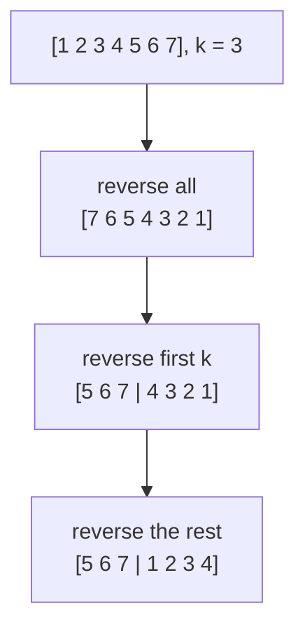
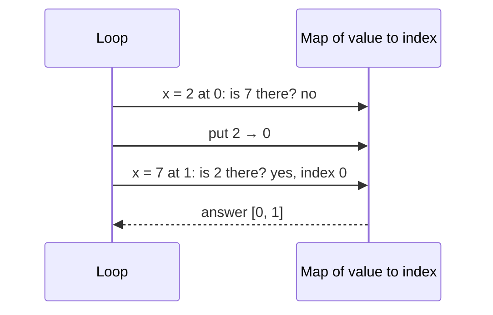
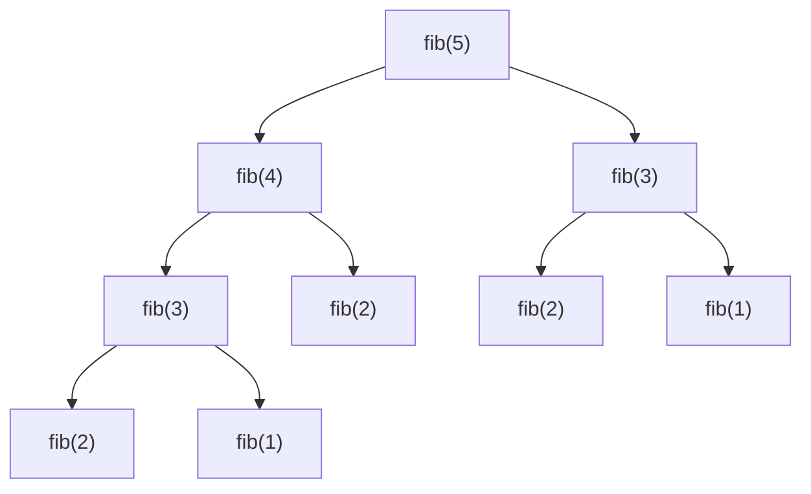

## In One Line
The array and number programs every Java interview draws from — second largest, missing number, duplicates, rotation, two-sum, Kadane, binary search, Fibonacci, primes, factorial, Armstrong, swapping without a temp — reduce to a few techniques (one pass with trackers, hashing, two pointers, reversal, digit extraction, maths formulas) plus constant attention to integer overflow.

## Mental Model
Think of an array as a **row of numbered parking spaces**: the row has a fixed length painted on the ground (`a.length`), every space has an address (`a[i]`, O(1) to reach), and you can repark a car in any space (arrays are mutable, unlike strings).

The techniques are ways of walking the row:
- **A single attendant with a clipboard** walks once and keeps a few notes: "biggest so far", "second biggest", "best sum ending here". That is **one pass with trackers** (second largest, Kadane, min/max).
- **A guest book at the entrance** remembers every car seen: "have I seen this plate before?", "where is the car whose number completes my total?". That is **hashing** (duplicates, two-sum).
- **Two attendants** start at different places — both ends, or a *reader* and a *writer* moving in the same direction. That is **two pointers** (reverse, move zeros, remove duplicates, merge, two-sum on sorted data).
- **Turning a section of the row around** three times shifts every car by k spaces: **rotation by reversal**.

Numbers are a row of **digits**: `% 10` reads the last digit, `/ 10` drops it. And every number type is an **odometer** with a limited number of wheels — go past the maximum and it silently rolls over to the minimum. That is **overflow**, the trap hidden in half of these programs.

## Concept
### Arrays in Java — the facts you are expected to know
- Fixed length (`a.length`, a **field**, no parentheses), zero-based, indexes out of range throw `ArrayIndexOutOfBoundsException`.
- New arrays are filled with defaults: `0`, `0.0`, `false`, `'\u0000'`, `null`.
- Arrays are **objects**: `b = a` copies the reference (both names see the same elements). `a.clone()`, `Arrays.copyOf`, `Arrays.copyOfRange` make new arrays (shallow copies).
- `a.equals(b)` is identity (arrays do not override `equals`); use `Arrays.equals` / `Arrays.deepEquals`. Print with `Arrays.toString` / `Arrays.deepToString`.
- `Arrays.sort(int[])` uses Dual-Pivot Quicksort (O(n log n) average, not stable — irrelevant for primitives); `Arrays.sort(Object[])` uses TimSort (stable). `Arrays.binarySearch` needs sorted input and returns `-(insertionPoint + 1)` when absent.
- `Arrays.asList(int[])` is a `List<int[]>` with **one** element — box to `Integer[]` or use streams.

### The techniques
| Technique | Idea | Drills | Typical cost |
|---|---|---|---|
| **One pass with trackers** | keep a few variables updated per element | second largest, min/max, Kadane | O(n), O(1) |
| **Hashing** | `HashSet` "seen", `HashMap` value → index or count | duplicates, two-sum, pair counts | O(n), O(n) |
| **Sort first** | equal values become neighbours; order enables two pointers | duplicates, second largest | O(n log n) |
| **Two pointers (opposite ends)** | `lo`/`hi` move towards each other | reverse, two-sum on sorted input | O(n), O(1) |
| **Two pointers (read/write)** | `read` scans everything, `write` marks the end of the kept prefix | move zeros, remove duplicates from sorted | O(n), O(1) |
| **Merge** | take the smaller head of two sorted sequences | merge sorted arrays | O(n + m) |
| **Reversal trick** | reverse all, reverse the first k, reverse the rest | rotate by k | O(n), O(1) |
| **Maths identity** | sum 1..n = n(n+1)/2; `x ^ x = 0` | missing number | O(n), O(1) |
| **Index as hash** | values 1..n: mark value v by negating `a[v - 1]` | duplicates / missing in 1..n | O(n), O(1) extra |
| **Halving** | discard half of a sorted range each step | binary search | O(log n) |

### Number techniques
- **Digit extraction:** `digit = x % 10; x /= 10;` — used by reverse, palindrome, sum of digits, Armstrong, count digits. Rebuild a reversed number with `rev = rev * 10 + digit`.
- **Primality:** a composite n has a divisor ≤ √n, so trial division only goes up to √n (and skips even numbers). Many primes at once → **Sieve of Eratosthenes**, O(n log log n).
- **GCD:** Euclid, `gcd(a, b) = gcd(b, a % b)`; `lcm = a / gcd * b` (divide first).
- **Recursion vs iteration vs memoisation:** naive recursive Fibonacci is O(2ⁿ); memoisation or a loop is O(n).
- **Bits:** `n & 1` (odd?), `n & (n - 1)` (clear lowest set bit → power of two, bit counting), `x ^ y` (XOR swap, missing number).

### Overflow — know the limits
| Type | Max value | Largest n! that fits | Largest Fibonacci that fits |
|---|---|---|---|
| `int` | 2,147,483,647 (≈ 2.1 × 10⁹) | 12! = 479,001,600 | F(46) = 1,836,311,903 |
| `long` | 9,223,372,036,854,775,807 (≈ 9.2 × 10¹⁸) | 20! | F(92) |
| `BigInteger` | unlimited | any | any |

Integer arithmetic **wraps silently** (two's complement). Protect yourself with: a wider type (`(long) n * (n + 1)`), `Math.addExact` / `multiplyExact` (throw `ArithmeticException`), `BigInteger`, overflow-safe formulas (`lo + (hi - lo) / 2`), and checks **before** the operation (`result > (MAX - d) / 10`). Note the asymmetric range: `Math.abs(Integer.MIN_VALUE)` is still negative.

### Complexity summary of this lesson's drills
| Drill | Best approach | Time | Extra space |
|---|---|---|---|
| Second largest | one pass | O(n) | O(1) |
| Missing number | sum formula / XOR | O(n) | O(1) |
| Duplicates | `HashSet`; marking if values are 1..n | O(n) | O(n); O(1) |
| Rotate by k | reversal | O(n) | O(1) |
| Two-sum | `HashMap` | O(n) | O(n) |
| Reverse / move zeros / dedupe sorted | two pointers | O(n) | O(1) |
| Max subarray | Kadane | O(n) | O(1) |
| Merge sorted | two pointers | O(n + m) | O(n + m) output |
| Binary search | halving | O(log n) | O(1) |
| Bubble sort | early-exit passes | O(n²), O(n) if sorted | O(1) |
| Fibonacci | loop | O(n) | O(1) |
| Is prime | trial division to √n | O(√n) | O(1) |
| Primes ≤ n | sieve | O(n log log n) | O(n) |
| Factorial | loop / `BigInteger` | O(n) | O(1) |
| Armstrong, reverse number | digit extraction | O(d) digits | O(1) |
| GCD | Euclid | O(log min(a, b)) | O(1) |

## Diagram

Rotation by reversal: the first reversal moves the last k elements to the front (backwards); the next two reversals fix the order inside each part. O(n) time, O(1) space.


Two-sum in one pass: look up the complement **before** storing the current value, so an element is never paired with itself.


Naive recursion recomputes the same subproblems (`fib(3)` twice, `fib(2)` three times); the call tree grows exponentially. Memoisation or a loop computes each value once.

## Code
**The array and number building blocks in one program** — creation and defaults, copying, sorting and searching, streams, digit extraction and integer limits:
```java
import java.util.Arrays;
import java.util.stream.IntStream;

public class ArrayToolkit {
    public static void main(String[] args) {
        // 1. Creating arrays: fixed length, zero-based, default values
        int[] zeros = new int[4];
        int[] nums = {42, 7, 19, 88, -3};
        int[][] grid = {{1, 2}, {3, 4, 5}};              // jagged: rows can differ
        System.out.println("defaults  : " + Arrays.toString(zeros) + ", length " + nums.length);
        System.out.println("2D        : " + Arrays.deepToString(grid) + ", row 1 length " + grid[1].length);

        // 2. Copying: clone / copyOf / copyOfRange create NEW arrays
        int[] copy = nums.clone();
        int[] bigger = Arrays.copyOf(nums, 7);           // pads with 0
        int[] middle = Arrays.copyOfRange(nums, 1, 4);   // [1, 4)
        copy[0] = 0;
        System.out.println("copies    : " + Arrays.toString(nums) + " " + Arrays.toString(bigger) + " " + Arrays.toString(middle));

        // 3. Sorting, searching, filling, comparing
        int[] sorted = nums.clone();
        Arrays.sort(sorted);
        System.out.println("sorted    : " + Arrays.toString(sorted) + ", index of 19 = " + Arrays.binarySearch(sorted, 19));
        Arrays.fill(zeros, 7);
        System.out.println("filled    : " + Arrays.toString(zeros));
        System.out.println("equals    : " + (nums == copy) + " " + Arrays.equals(nums, nums.clone()));

        // 4. Streams over int[]
        System.out.println("sum/max   : " + IntStream.of(nums).sum() + " / " + IntStream.of(nums).max().getAsInt());

        // 5. Digit extraction: the loop behind reverse, palindrome, Armstrong, sum of digits
        int n = 9075, reversed = 0, digitSum = 0;
        for (int x = n; x > 0; x /= 10) {
            int digit = x % 10;                           // last digit
            reversed = reversed * 10 + digit;
            digitSum += digit;
        }
        System.out.println("digits    : reversed " + reversed + ", sum " + digitSum);

        // 6. Integer limits: arithmetic wraps silently
        System.out.println("int max   : " + Integer.MAX_VALUE + " + 1 = " + (Integer.MAX_VALUE + 1));
        System.out.println("long max  : " + Long.MAX_VALUE);
        try {
            Math.addExact(Integer.MAX_VALUE, 1);
        } catch (ArithmeticException e) {
            System.out.println("addExact  : " + e.getMessage());
        }
    }
}
```
```output
defaults  : [0, 0, 0, 0], length 5
2D        : [[1, 2], [3, 4, 5]], row 1 length 3
copies    : [42, 7, 19, 88, -3] [42, 7, 19, 88, -3, 0, 0] [7, 19, 88]
sorted    : [-3, 7, 19, 42, 88], index of 19 = 2
filled    : [7, 7, 7, 7]
equals    : false true
sum/max   : 153 / 88
digits    : reversed 5709, sum 21
int max   : 2147483647 + 1 = -2147483648
long max  : 9223372036854775807
addExact  : integer overflow
```

Every Interview Q&A answer below is a complete program, run on JDK 21, with its real output. The Quiz snippets were run inside a `main` with `java.util.*` imported.

## Walkthrough
- **Creation.** `new int[4]` is `[0, 0, 0, 0]` — elements get default values. `{42, 7, 19, 88, -3}` is an array initializer; `nums.length` is a field (5). `int[][] grid = {{1, 2}, {3, 4, 5}}` is an array of arrays, and rows may have different lengths ("jagged"); `Arrays.deepToString` prints nested arrays.
- **Copying.** `clone()` makes a new array with the same values; changing `copy[0]` does not affect `nums` (the printed `nums` is unchanged). `Arrays.copyOf(nums, 7)` copies and pads with zeros; `copyOfRange(nums, 1, 4)` copies indexes 1..3 (end exclusive): `[7, 19, 88]`.
- **Sort, search, fill, compare.** `Arrays.sort` sorts in place (we sorted a clone). `binarySearch(sorted, 19)` returns index 2. `Arrays.fill` sets every element. `nums == copy` is `false` (different objects); `Arrays.equals` compares element by element: `true`.
- **Streams.** `IntStream.of(nums)` streams the primitives: sum 153, max 88.
- **Digit extraction.** For 9075: digits come out as 5, 7, 0, 9; `reversed = reversed * 10 + digit` builds 5709, and the digits sum to 21. The same three lines drive the reverse, palindrome and Armstrong programs.
- **Limits.** `Integer.MAX_VALUE + 1` wraps to `-2147483648` without any error; `Math.addExact` detects the same overflow and throws `ArithmeticException: integer overflow`.

## Traps
- **Integer overflow is silent.** `n * (n + 1) / 2` overflows `int` for n = 100,000 (see the missing-number drill); `13!` and `F(47)` do not fit an `int`, `21!` and `F(93)` do not fit a `long`. Use `long`, `Math.*Exact` or `BigInteger`.
- **`(lo + hi) / 2`** overflows for large indexes (the famous binary-search bug, present in the JDK until 2006). Use `lo + (hi - lo) / 2` or `(lo + hi) >>> 1`.
- **`Math.abs(Integer.MIN_VALUE)` is negative**, and so is `-Integer.MIN_VALUE`. Cast to `long` first when you need the magnitude.
- **Second largest with duplicates** — a naive `else if (x > second)` makes `second` equal to `first` when the maximum repeats. Require `x < first`.
- **Sentinel values** — starting `max` at `0` fails for all-negative arrays; start at `Integer.MIN_VALUE` or at `a[0]`. Starting `second` at `Integer.MIN_VALUE` cannot distinguish "no second value" from a real `MIN_VALUE` element; use a `long` sentinel or `OptionalInt`.
- **`Collections.reverse(Arrays.asList(intArray))` silently does nothing** — the list holds one element, the `int[]` itself.
- **`b = a` does not copy an array**; both names refer to the same object. `a.equals(b)` compares references.
- **Two-sum self-pairing** — putting the current value into the map before looking up its complement pairs `3` with itself for target 6.
- **Rotating by k ≥ n or negative k** — normalise with `((k % n) + n) % n`; forgetting it gives `ArrayIndexOutOfBoundsException` or wrong results.
- **`Math.pow` returns a `double`** — fine for small digit powers, but rounding can bite for large values; an integer power loop is exact.
- **XOR swap of a slot with itself** (`i == j`) zeroes the value (see the swap drill).
- **Naive recursion** (Fibonacci, factorial of big n) is exponential or risks `StackOverflowError`; prefer loops, or memoise.
- **Floating-point equality** — `0.1 + 0.2 != 0.3`. Compare with a tolerance or use `BigDecimal` for money.

## Tips & Tricks
- **"Tracker, Table, Two pointers, Turn around."** One pass with trackers, a hash table, two pointers, and the reversal trick solve most array questions.
- **Before coding, ask:** sorted? duplicates? negatives? range of values (1..n)? can I modify the input? expected size (overflow)?
- **Sum 1..n = n(n + 1)/2 — say "and I'll use a long".**
- **Missing number: sum or XOR.** XOR cannot overflow at all.
- **Rotate right by k = reverse all, reverse first k, reverse rest.** Rotate left by k = rotate right by n − k.
- **Two-sum: "check, then put".**
- **Kadane in one line:** `cur = max(x, cur + x); best = max(best, cur)` — "extend or restart".
- **Binary search template:** `while (lo <= hi)`, `mid = lo + (hi - lo) / 2`, move `lo = mid + 1` or `hi = mid - 1`; when absent, `lo` is the insertion point.
- **Primes:** "up to the square root, odd numbers only"; for many primes, "sieve starting at p·p".
- **Know the numbers:** 12! (int), 20! (long), F(46) (int), F(92) (long), 153/370/371/407 (3-digit Armstrong numbers).

## Interview Q&A
### [Basic] Find the second largest element in an array.
**Approach.** One pass with two trackers: when `x` beats `first`, the old `first` becomes `second`; when `x` is strictly between `second` and `first`, it becomes `second`. Using `x < first` in the second branch ignores duplicates of the maximum. `long` sentinels (or `OptionalInt`) handle arrays that contain `Integer.MIN_VALUE` or have no second distinct value. Sorting and streams are shorter but O(n log n). The same single pass also finds min and max.
```java
import java.util.Arrays;
import java.util.Comparator;
import java.util.OptionalInt;

public class SecondLargest {

    // One pass, two trackers. long sentinels so Integer.MIN_VALUE is a valid element.
    static OptionalInt secondLargest(int[] a) {
        long first = Long.MIN_VALUE, second = Long.MIN_VALUE;
        for (int x : a) {
            if (x > first) {
                second = first;          // old largest becomes second
                first = x;
            } else if (x < first && x > second) {
                second = x;              // strictly between: new second
            }
        }
        return second == Long.MIN_VALUE ? OptionalInt.empty() : OptionalInt.of((int) second);
    }

    // Sort a copy, then walk back from the end past the duplicates of the max
    static OptionalInt bySorting(int[] a) {
        int[] s = a.clone();
        Arrays.sort(s);
        for (int i = s.length - 2; i >= 0; i--) {
            if (s[i] != s[s.length - 1]) return OptionalInt.of(s[i]);
        }
        return OptionalInt.empty();
    }

    // Stream: distinct values, descending, skip the largest
    static OptionalInt byStream(int[] a) {
        return Arrays.stream(a).boxed()
                .distinct()
                .sorted(Comparator.reverseOrder())
                .skip(1)
                .mapToInt(Integer::intValue)
                .findFirst();
    }

    public static void main(String[] args) {
        int[][] tests = {{12, 35, 1, 10, 34, 1}, {10, 10, 10}, {5, 5, 4}, {Integer.MIN_VALUE, -1}, {7}};
        for (int[] t : tests) {
            System.out.printf("%-26s loop=%-25s sort=%-25s stream=%s%n",
                    Arrays.toString(t), secondLargest(t), bySorting(t), byStream(t));
        }

        // Largest and smallest in the same single pass
        int[] a = tests[0];
        int max = Integer.MIN_VALUE, min = Integer.MAX_VALUE;
        for (int x : a) {
            max = Math.max(max, x);
            min = Math.min(min, x);
        }
        System.out.println("max=" + max + " min=" + min + " | stats: " + Arrays.stream(a).summaryStatistics());
    }
}
```
```output
[12, 35, 1, 10, 34, 1]     loop=OptionalInt[34]           sort=OptionalInt[34]           stream=OptionalInt[34]
[10, 10, 10]               loop=OptionalInt.empty         sort=OptionalInt.empty         stream=OptionalInt.empty
[5, 5, 4]                  loop=OptionalInt[4]            sort=OptionalInt[4]            stream=OptionalInt[4]
[-2147483648, -1]          loop=OptionalInt[-2147483648]  sort=OptionalInt[-2147483648]  stream=OptionalInt[-2147483648]
[7]                        loop=OptionalInt.empty         sort=OptionalInt.empty         stream=OptionalInt.empty
max=35 min=1 | stats: IntSummaryStatistics{count=6, sum=93, min=1, average=15.500000, max=35}
```
**Complexity.** Loop: O(n) time, O(1) space. Sort and stream: O(n log n) time, O(n) space.

**Follow-up:** *And the k-th largest?* — Keep a min-heap of size k (O(n log k)), or use Quickselect (O(n) average); see the n-th highest drill in [Stream Drills — Advanced](lesson:b06-coding-drills/02-stream-drills-advanced).

### [Basic] Find the missing number in an array containing 1..n with one number missing.
**Approach.** The expected sum of 1..n is n(n + 1)/2; the missing number is expected − actual. Compute it in `long`: for n = 100,000 the `int` formula overflows (705,082,704 instead of 5,000,050,000). The XOR version cannot overflow: XOR-ing 1..n and all array values cancels everything except the missing number. For **several** missing numbers, mark presence in a `boolean[]`.
```java
import java.util.ArrayList;
import java.util.List;
import java.util.stream.IntStream;

public class MissingNumber {

    // Expected sum of 1..n minus actual sum. long avoids overflow of n*(n+1)
    static int bySum(int[] a, int n) {
        long expected = (long) n * (n + 1) / 2;
        long actual = 0;
        for (int x : a) actual += x;
        return (int) (expected - actual);
    }

    // x ^ x = 0 and x ^ 0 = x: XOR of 1..n and of the array leaves the missing value
    static int byXor(int[] a, int n) {
        int x = 0;
        for (int i = 1; i <= n; i++) x ^= i;
        for (int v : a) x ^= v;
        return x;
    }

    // Several missing numbers: mark what is present
    static List<Integer> allMissing(int[] a, int n) {
        boolean[] present = new boolean[n + 1];
        for (int v : a) present[v] = true;
        List<Integer> missing = new ArrayList<>();
        for (int i = 1; i <= n; i++) {
            if (!present[i]) missing.add(i);
        }
        return missing;
    }

    public static void main(String[] args) {
        int[] a = {1, 2, 4, 5, 6};
        System.out.println("sum    : " + bySum(a, 6));
        System.out.println("xor    : " + byXor(a, 6));
        System.out.println("stream : " + (IntStream.rangeClosed(1, 6).sum() - IntStream.of(a).sum()));
        System.out.println("many   : " + allMissing(new int[] {1, 2, 4, 6, 7}, 8));

        // Why the long: with n = 100_000 the int formula overflows
        int n = 100_000;
        System.out.println("int formula  : " + n * (n + 1) / 2);
        System.out.println("long formula : " + (long) n * (n + 1) / 2);
    }
}
```
```output
sum    : 3
xor    : 3
stream : 3
many   : [3, 5, 8]
int formula  : 705082704
long formula : 5000050000
```
**Complexity.** O(n) time; O(1) space for sum/XOR, O(n) for the `boolean[]`.

**Follow-up:** *What if the array is sorted?* — Binary search for the first index where `a[i] != i + 1`: O(log n).

### [Intermediate] Find the duplicate elements in an array.
**Approach.** (1) `HashSet`: a failed `add` means "seen before" — O(n) time and space. (2) Sort a copy and compare neighbours — O(n log n), no set. (3) If the values are in 1..n, use the array itself as the set: for value v, negate `a[v - 1]`; finding it already negative means v is a duplicate — O(n) time, O(1) extra space (it modifies the array, so work on a copy or restore it). The brute force compares all pairs — O(n²), and it reports duplicates in the order their *pairs* are found (`[3, 2]`).
```java
import java.util.ArrayList;
import java.util.Arrays;
import java.util.HashSet;
import java.util.LinkedHashSet;
import java.util.List;
import java.util.Map;
import java.util.Set;
import java.util.function.Function;
import java.util.stream.Collectors;

public class ArrayDuplicates {

    // 1. HashSet: O(n) time, O(n) space
    static Set<Integer> withSet(int[] a) {
        Set<Integer> seen = new HashSet<>();
        Set<Integer> dups = new LinkedHashSet<>();
        for (int x : a) {
            if (!seen.add(x)) dups.add(x);
        }
        return dups;
    }

    // 2. Sort, then equal values are neighbours: O(n log n), no extra set
    static List<Integer> withSorting(int[] a) {
        int[] s = a.clone();
        Arrays.sort(s);
        List<Integer> dups = new ArrayList<>();
        for (int i = 1; i < s.length; i++) {
            if (s[i] == s[i - 1] && (dups.isEmpty() || dups.get(dups.size() - 1) != s[i])) dups.add(s[i]);
        }
        return dups;
    }

    // 3. Values are 1..n: use the array itself as the "seen" set by negating a[v - 1]. O(n), O(1)
    static List<Integer> withMarking(int[] input) {
        int[] a = input.clone();
        List<Integer> dups = new ArrayList<>();
        for (int i = 0; i < a.length; i++) {
            int v = Math.abs(a[i]);
            if (a[v - 1] < 0) dups.add(v);        // already marked: seen before
            else a[v - 1] = -a[v - 1];            // mark v as seen
        }
        return dups;
    }

    public static void main(String[] args) {
        int[] a = {4, 3, 2, 7, 8, 2, 3, 1};
        System.out.println("set     : " + withSet(a));
        System.out.println("sorting : " + withSorting(a));
        System.out.println("marking : " + withMarking(a));

        Map<Integer, Long> counts = Arrays.stream(a).boxed()
                .collect(Collectors.groupingBy(Function.identity(), Collectors.counting()));
        System.out.println("stream  : " + counts.entrySet().stream()
                .filter(e -> e.getValue() > 1).map(Map.Entry::getKey).sorted().toList());

        // Brute force: compare every pair. O(n^2), fine only for tiny inputs
        Set<Integer> brute = new LinkedHashSet<>();
        for (int i = 0; i < a.length; i++)
            for (int j = i + 1; j < a.length; j++)
                if (a[i] == a[j]) brute.add(a[i]);
        System.out.println("brute   : " + brute);
    }
}
```
```output
set     : [2, 3]
sorting : [2, 3]
marking : [2, 3]
stream  : [2, 3]
brute   : [3, 2]
```
**Complexity.** Set: O(n)/O(n). Sorting: O(n log n)/O(n) for the copy. Marking: O(n)/O(1). Brute force: O(n²)/O(1).

**Follow-up:** *Exactly one duplicate in n + 1 values from 1..n, without modifying the array and in O(1) space?* — Floyd's cycle detection: treat `i → a[i]` as a linked list; the duplicate is the cycle entrance (LeetCode 287).

### [Intermediate] Rotate an array to the right by k positions.
**Approach.** The reversal algorithm works in place: reverse the whole array, then the first k elements, then the rest. Normalise k with `((k % n) + n) % n` so k > n and negative k (left rotation) work. With extra space, element i moves to `(i + k) % n`. For lists, `Collections.rotate(list, k)` does it.
```java
import java.util.ArrayList;
import java.util.Arrays;
import java.util.Collections;
import java.util.List;

public class RotateArray {

    // Right-rotate by k with three reversals: O(n) time, O(1) extra space
    static void rotateRight(int[] a, int k) {
        int n = a.length;
        if (n == 0) return;
        k = ((k % n) + n) % n;          // handles k > n and negative k
        reverse(a, 0, n - 1);           // [7 6 5 4 3 2 1]
        reverse(a, 0, k - 1);           // [5 6 7 | 4 3 2 1]
        reverse(a, k, n - 1);           // [5 6 7 | 1 2 3 4]
    }

    static void reverse(int[] a, int i, int j) {
        for (; i < j; i++, j--) {
            int t = a[i];
            a[i] = a[j];
            a[j] = t;
        }
    }

    // With a second array: element i goes to (i + k) % n. O(n) time, O(n) space
    static int[] rotateCopy(int[] a, int k) {
        int n = a.length;
        int[] r = new int[n];
        for (int i = 0; i < n; i++) r[(i + k) % n] = a[i];
        return r;
    }

    public static void main(String[] args) {
        int[] a = {1, 2, 3, 4, 5, 6, 7};
        rotateRight(a, 3);
        System.out.println("reversal, k=3  : " + Arrays.toString(a));

        int[] b = {1, 2, 3, 4, 5, 6, 7};
        rotateRight(b, 10);
        System.out.println("reversal, k=10 : " + Arrays.toString(b));

        int[] c = {1, 2, 3, 4, 5, 6, 7};
        rotateRight(c, -2);             // negative = rotate left
        System.out.println("left by 2      : " + Arrays.toString(c));

        System.out.println("copy, k=3      : " + Arrays.toString(rotateCopy(new int[] {1, 2, 3, 4, 5, 6, 7}, 3)));

        List<Integer> list = new ArrayList<>(List.of(1, 2, 3, 4, 5, 6, 7));
        Collections.rotate(list, 3);
        System.out.println("Collections    : " + list);
    }
}
```
```output
reversal, k=3  : [5, 6, 7, 1, 2, 3, 4]
reversal, k=10 : [5, 6, 7, 1, 2, 3, 4]
left by 2      : [3, 4, 5, 6, 7, 1, 2]
copy, k=3      : [5, 6, 7, 1, 2, 3, 4]
Collections    : [5, 6, 7, 1, 2, 3, 4]
```
**Complexity.** Reversal: O(n) time, O(1) space. Copy: O(n) time, O(n) space. Rotating one step at a time k times: O(n·k).

**Follow-up:** *How do you rotate left by k?* — Rotate right by n − k, or reverse the first k, reverse the rest, then reverse all.

### [Intermediate] Two-sum: find two indexes whose values add up to a target.
**Approach.** One pass with a `HashMap<value, index>`: for each element, check whether `target - x` was already seen; if yes, return both indexes; otherwise store `x`. Checking before storing prevents pairing an element with itself (`[3, 2, 4]`, target 6 → `[1, 2]`, not `[0, 0]`). If the array is **sorted**, two pointers from both ends need no extra space. Counting all pairs uses a map of counts.
```java
import java.util.Arrays;
import java.util.HashMap;
import java.util.Map;

public class TwoSum {

    // One pass with a map value -> index: O(n) time, O(n) space
    static int[] twoSum(int[] a, int target) {
        Map<Integer, Integer> indexOf = new HashMap<>();
        for (int i = 0; i < a.length; i++) {
            Integer j = indexOf.get(target - a[i]);   // have we seen the complement?
            if (j != null) return new int[] {j, i};
            indexOf.put(a[i], i);                     // store AFTER checking: no self-pairing
        }
        return new int[0];
    }

    // Sorted input: two pointers from both ends. O(n) time, O(1) space
    static int[] twoSumSorted(int[] sorted, int target) {
        int lo = 0, hi = sorted.length - 1;
        while (lo < hi) {
            int sum = sorted[lo] + sorted[hi];
            if (sum == target) return new int[] {sorted[lo], sorted[hi]};
            if (sum < target) lo++;
            else hi--;
        }
        return new int[0];
    }

    // How many index pairs (i < j) add up to target? Count complements seen so far
    static int countPairs(int[] a, int target) {
        Map<Integer, Integer> seen = new HashMap<>();
        int pairs = 0;
        for (int x : a) {
            pairs += seen.getOrDefault(target - x, 0);
            seen.merge(x, 1, Integer::sum);
        }
        return pairs;
    }

    public static void main(String[] args) {
        System.out.println(Arrays.toString(twoSum(new int[] {2, 7, 11, 15}, 9)));
        System.out.println(Arrays.toString(twoSum(new int[] {3, 2, 4}, 6)));
        System.out.println(Arrays.toString(twoSum(new int[] {3, 3}, 6)));
        System.out.println(Arrays.toString(twoSum(new int[] {1, 2}, 7)));
        System.out.println("sorted : " + Arrays.toString(twoSumSorted(new int[] {1, 2, 3, 4, 6, 8}, 10)));
        System.out.println("pairs  : " + countPairs(new int[] {1, 5, 7, -1, 5}, 6));
    }
}
```
```output
[0, 1]
[1, 2]
[0, 1]
[]
sorted : [2, 8]
pairs  : 3
```
**Complexity.** Map: O(n) time, O(n) space. Sorted two pointers: O(n) time, O(1) space (O(n log n) if you must sort first). Brute force: O(n²).

**Follow-up:** *Why does the sorted version move `lo` when the sum is too small?* — Increasing `lo` is the only move that can increase the sum; every pair with the current `lo` and a smaller `hi` is even smaller, so they can all be skipped safely.

### [Basic] Reverse an array in place.
**Approach.** Two pointers from both ends, swapping until they meet. A stream can build a reversed **copy**. `Collections.reverse(Arrays.asList(boxed))` works for an `Integer[]` because `asList` is a write-through view — but for an `int[]` it silently does nothing.
```java
import java.util.Arrays;
import java.util.Collections;
import java.util.stream.IntStream;

public class ReverseArray {

    static void reverseInPlace(int[] a) {
        for (int i = 0, j = a.length - 1; i < j; i++, j--) {
            int t = a[i];
            a[i] = a[j];
            a[j] = t;
        }
    }

    public static void main(String[] args) {
        int[] a = {1, 2, 3, 4, 5};
        reverseInPlace(a);
        System.out.println("two pointers : " + Arrays.toString(a));

        int[] b = {1, 2, 3, 4, 5};
        int[] copy = IntStream.range(0, b.length).map(i -> b[b.length - 1 - i]).toArray();
        System.out.println("stream copy  : " + Arrays.toString(copy));

        // Works for Integer[]: Arrays.asList is a view that writes through to the array
        Integer[] boxed = {1, 2, 3, 4, 5};
        Collections.reverse(Arrays.asList(boxed));
        System.out.println("Integer[]    : " + Arrays.toString(boxed));

        // Silently does NOTHING for int[]: asList(int[]) is a List<int[]> of size 1
        int[] prim = {1, 2, 3, 4, 5};
        Collections.reverse(Arrays.asList(prim));
        System.out.println("int[] (trap) : " + Arrays.toString(prim));
    }
}
```
```output
two pointers : [5, 4, 3, 2, 1]
stream copy  : [5, 4, 3, 2, 1]
Integer[]    : [5, 4, 3, 2, 1]
int[] (trap) : [1, 2, 3, 4, 5]
```
**Complexity.** O(n) time; in place: O(1) space, stream copy: O(n).

**Follow-up:** *How many swaps does it take?* — ⌊n/2⌋; the middle element of an odd-length array stays in place.

### [Basic] Move all zeros to the end, keeping the order of the other elements.
**Approach.** Read/write pointers: the loop reads every element; non-zeros are copied to `a[write++]`, so they keep their order; then the tail from `write` to the end is filled with zeros. A stream can concatenate the non-zeros and the zeros into a new array.
```java
import java.util.Arrays;
import java.util.stream.IntStream;

public class MoveZeros {

    // Read pointer (the loop) and write pointer: copy non-zeros forward, fill the tail with 0
    static void moveZeros(int[] a) {
        int write = 0;
        for (int x : a) {
            if (x != 0) a[write++] = x;
        }
        while (write < a.length) a[write++] = 0;
    }

    public static void main(String[] args) {
        int[] a = {0, 1, 0, 3, 12, 0, 5};
        moveZeros(a);
        System.out.println("in place : " + Arrays.toString(a));

        int[] b = {0, 1, 0, 3, 12, 0, 5};
        int[] viaStream = IntStream.concat(
                Arrays.stream(b).filter(x -> x != 0),
                Arrays.stream(b).filter(x -> x == 0)).toArray();
        System.out.println("stream   : " + Arrays.toString(viaStream));
    }
}
```
```output
in place : [1, 3, 12, 5, 0, 0, 0]
stream   : [1, 3, 12, 5, 0, 0, 0]
```
**Complexity.** O(n) time; O(1) space in place, O(n) for the stream copy.

**Follow-up:** *Can you do it with swaps in one pass?* — Yes: when `a[read] != 0`, swap `a[read]` and `a[write]` and increment `write`; it performs fewer writes when there are few zeros.

### [Intermediate] Find the maximum subarray sum (Kadane's algorithm).
**Approach.** At each index, the best subarray **ending here** either extends the previous one or starts fresh: `current = max(a[i], current + a[i])`. The answer is the best `current` seen. Tracking where the current run started gives the subarray itself. Starting from `a[0]` (not 0) makes all-negative arrays work (answer: the largest element).
```java
import java.util.Arrays;

public class MaxSubarray {

    // Kadane: best sum of a subarray ENDING here = max(this element, previous best + this element)
    static int[] kadane(int[] a) {
        int best = a[0], current = a[0];
        int start = 0, bestStart = 0, bestEnd = 0;
        for (int i = 1; i < a.length; i++) {
            if (a[i] > current + a[i]) {        // starting fresh is better than extending
                current = a[i];
                start = i;
            } else {
                current += a[i];
            }
            if (current > best) {
                best = current;
                bestStart = start;
                bestEnd = i;
            }
        }
        return new int[] {best, bestStart, bestEnd};
    }

    public static void main(String[] args) {
        int[][] tests = {{-2, 1, -3, 4, -1, 2, 1, -5, 4}, {-3, -1, -2}, {5, 4, -1, 7, 8}};
        for (int[] t : tests) {
            int[] r = kadane(t);
            System.out.println(Arrays.toString(t) + " -> sum " + r[0] + " "
                    + Arrays.toString(Arrays.copyOfRange(t, r[1], r[2] + 1)));
        }
    }
}
```
```output
[-2, 1, -3, 4, -1, 2, 1, -5, 4] -> sum 6 [4, -1, 2, 1]
[-3, -1, -2] -> sum -1 [-1]
[5, 4, -1, 7, 8] -> sum 23 [5, 4, -1, 7, 8]
```
**Complexity.** O(n) time, O(1) space. (Brute force over all subarrays is O(n²) with running sums, O(n³) without.)

**Follow-up:** *What does initialising `best = 0` break?* — For `[-3, -1, -2]` it would return 0 (an empty subarray), although the problem requires at least one element; the right answer is −1.

### [Basic] Merge two sorted arrays into one sorted array.
**Approach.** Two pointers, one per array: repeatedly take the smaller head (`<=` keeps equal elements from the first array first, i.e. stable), then copy the leftovers. This is the merge step of merge sort. Concatenating and sorting is shorter but slower.
```java
import java.util.Arrays;
import java.util.stream.IntStream;

public class MergeSortedArrays {

    // Two pointers: take the smaller head each time. O(n + m)
    static int[] merge(int[] a, int[] b) {
        int[] r = new int[a.length + b.length];
        int i = 0, j = 0, k = 0;
        while (i < a.length && j < b.length) {
            r[k++] = a[i] <= b[j] ? a[i++] : b[j++];   // <= keeps it stable
        }
        while (i < a.length) r[k++] = a[i++];          // leftovers of a
        while (j < b.length) r[k++] = b[j++];          // leftovers of b
        return r;
    }

    public static void main(String[] args) {
        int[] a = {1, 4, 7, 10}, b = {2, 3, 7, 12, 15};
        System.out.println("merge  : " + Arrays.toString(merge(a, b)));
        System.out.println("stream : " + Arrays.toString(IntStream.concat(Arrays.stream(a), Arrays.stream(b)).sorted().toArray()));
        System.out.println("empty  : " + Arrays.toString(merge(new int[0], b)));
    }
}
```
```output
merge  : [1, 2, 3, 4, 7, 7, 10, 12, 15]
stream : [1, 2, 3, 4, 7, 7, 10, 12, 15]
empty  : [2, 3, 7, 12, 15]
```
**Complexity.** Two pointers: O(n + m) time, O(n + m) for the output. Concat + sort: O((n + m) log(n + m)).

**Follow-up:** *Merge into the first array, which has enough free space at the end?* — Fill from the **back**: compare the largest remaining elements and write them at the end, so nothing is overwritten before it is read (LeetCode 88).

### [Basic] Remove duplicates from a sorted array in place and return the new length.
**Approach.** In a sorted array duplicates are adjacent. Keep `write` at the end of the unique prefix; copy `a[read]` there whenever it differs from the last kept value. Elements beyond the returned length are leftovers and are ignored (see "whole array now").
```java
import java.util.Arrays;

public class DedupSorted {

    // Sorted input: keep a write pointer at the end of the unique prefix. O(n), O(1)
    static int removeDuplicates(int[] a) {
        if (a.length == 0) return 0;
        int write = 1;
        for (int read = 1; read < a.length; read++) {
            if (a[read] != a[write - 1]) a[write++] = a[read];
        }
        return write;                   // new logical length
    }

    public static void main(String[] args) {
        int[] a = {1, 1, 2, 2, 2, 3, 4, 4};
        int len = removeDuplicates(a);
        System.out.println("length " + len + " -> " + Arrays.toString(Arrays.copyOf(a, len)));
        System.out.println("whole array now: " + Arrays.toString(a));
        System.out.println("stream: " + Arrays.toString(Arrays.stream(new int[] {1, 1, 2, 2, 2, 3, 4, 4}).distinct().toArray()));
    }
}
```
```output
length 4 -> [1, 2, 3, 4]
whole array now: [1, 2, 3, 4, 2, 3, 4, 4]
stream: [1, 2, 3, 4]
```
**Complexity.** O(n) time, O(1) space.

**Follow-up:** *Allow each value at most twice?* — Compare with `a[write - 2]` instead of `a[write - 1]` (start `write` at 2).

### [Basic] Implement binary search.
**Approach.** On a sorted array, compare the key with the middle element and discard half the range each step. Compute the middle as `lo + (hi - lo) / 2` (or `(lo + hi) >>> 1`) to avoid overflow. When the key is absent, `lo` ends at the insertion point; returning `-(lo + 1)` matches `Arrays.binarySearch`. To find the **first** occurrence among duplicates, keep searching left after a hit.
```java
import java.util.Arrays;

public class BinarySearch {

    // Returns the index, or -(insertionPoint + 1) like Arrays.binarySearch
    static int binarySearch(int[] a, int key) {
        int lo = 0, hi = a.length - 1;
        while (lo <= hi) {
            int mid = lo + (hi - lo) / 2;          // (lo + hi) / 2 can overflow
            if (a[mid] == key) return mid;
            if (a[mid] < key) lo = mid + 1;
            else hi = mid - 1;
        }
        return -(lo + 1);
    }

    // With duplicates: leftmost index of key (keep searching left after a hit)
    static int firstOccurrence(int[] a, int key) {
        int lo = 0, hi = a.length - 1, found = -1;
        while (lo <= hi) {
            int mid = (lo + hi) >>> 1;             // unsigned shift: also overflow-safe
            if (a[mid] >= key) {
                if (a[mid] == key) found = mid;
                hi = mid - 1;
            } else {
                lo = mid + 1;
            }
        }
        return found;
    }

    public static void main(String[] args) {
        int[] a = {2, 5, 8, 12, 16, 23, 38, 56, 72, 91};
        System.out.println("23 -> " + binarySearch(a, 23) + " (JDK " + Arrays.binarySearch(a, 23) + ")");
        System.out.println("7  -> " + binarySearch(a, 7) + " (JDK " + Arrays.binarySearch(a, 7) + ")");
        System.out.println("first 7 in [1,7,7,7,9] -> " + firstOccurrence(new int[] {1, 7, 7, 7, 9}, 7));
    }
}
```
```output
23 -> 5 (JDK 5)
7  -> -3 (JDK -3)
first 7 in [1,7,7,7,9] -> 1
```
**Complexity.** O(log n) time, O(1) space (recursive version: O(log n) stack).

**Follow-up:** *Why `-(lo + 1)` and not `-lo`?* — The insertion point can be 0; `-0` would look like "found at index 0". Adding 1 guarantees a negative result for every absent key.

### [Basic] Sort an array without `Arrays.sort` (bubble sort).
**Approach.** Repeatedly swap adjacent elements that are out of order; after pass p, the p largest values are in their final places, so the inner loop shrinks. A `swapped` flag stops early when a pass makes no swap — an already sorted array takes one pass. Mention that real code uses `Arrays.sort`.
```java
import java.util.Arrays;

public class BubbleSort {

    static int bubbleSort(int[] a) {
        int passes = 0;
        for (int pass = 0; pass < a.length - 1; pass++) {
            passes++;
            boolean swapped = false;
            // after each pass the largest remaining value has "bubbled" to the end
            for (int i = 0; i < a.length - 1 - pass; i++) {
                if (a[i] > a[i + 1]) {
                    int t = a[i];
                    a[i] = a[i + 1];
                    a[i + 1] = t;
                    swapped = true;
                }
            }
            if (!swapped) break;        // no swap: already sorted
        }
        return passes;
    }

    public static void main(String[] args) {
        int[] a = {64, 34, 25, 12, 22, 11, 90};
        int passes = bubbleSort(a);
        System.out.println(Arrays.toString(a) + " in " + passes + " passes");

        int[] sorted = {1, 2, 3, 4, 5};
        System.out.println(Arrays.toString(sorted) + " in " + bubbleSort(sorted) + " pass (early exit)");

        int[] b = {64, 34, 25, 12, 22, 11, 90};
        Arrays.sort(b);                 // what you use in real code
        System.out.println("Arrays.sort: " + Arrays.toString(b));
    }
}
```
```output
[11, 12, 22, 25, 34, 64, 90] in 6 passes
[1, 2, 3, 4, 5] in 1 pass (early exit)
Arrays.sort: [11, 12, 22, 25, 34, 64, 90]
```
**Complexity.** O(n²) time worst and average, O(n) best (sorted, with the flag); O(1) space; stable.

**Follow-up:** *Which simple sort would you choose for nearly sorted data?* — Insertion sort: O(n + inversions), stable, in place — TimSort uses it for small runs.

### [Basic] Print the Fibonacci series and compute F(n).
**Approach.** Iteratively keep the last two values: O(n) time, O(1) space. Naive recursion follows the definition but recomputes subproblems — F(20) needs 21,891 calls. Memoisation stores each F(k) once. `Stream.iterate` over `{a, b}` pairs generates the series. F(92) is the largest value that fits a `long`; beyond it, use `BigInteger`.
```java
import java.math.BigInteger;
import java.util.stream.Stream;

public class Fibonacci {

    // Iterative: O(n) time, O(1) space. F(0)=0, F(1)=1
    static long fib(int n) {
        long a = 0, b = 1;
        for (int i = 0; i < n; i++) {
            long next = a + b;
            a = b;
            b = next;
        }
        return a;
    }

    // Naive recursion: O(2^n) — the same values are recomputed again and again
    static long calls = 0;
    static long fibRecursive(int n) {
        calls++;
        return n < 2 ? n : fibRecursive(n - 1) + fibRecursive(n - 2);
    }

    // Memoised recursion: each F(k) computed once. O(n) time, O(n) space
    static long fibMemo(int n, long[] memo) {
        if (n < 2) return n;
        if (memo[n] != 0) return memo[n];
        return memo[n] = fibMemo(n - 1, memo) + fibMemo(n - 2, memo);
    }

    public static void main(String[] args) {
        StringBuilder series = new StringBuilder();
        for (int i = 0; i < 10; i++) series.append(fib(i)).append(' ');
        System.out.println("first 10  : " + series.toString().trim());

        System.out.println("stream    : " + Stream.iterate(new long[] {0, 1}, f -> new long[] {f[1], f[0] + f[1]})
                .limit(10).map(f -> f[0]).toList());

        System.out.println("recursive F(20) = " + fibRecursive(20) + " using " + calls + " calls");
        System.out.println("memo F(50)      = " + fibMemo(50, new long[51]));
        System.out.println("F(92)           = " + fib(92) + "  (largest that fits in long)");
        System.out.println("F(93) as long   = " + fib(93) + "  (overflowed)");

        BigInteger x = BigInteger.ZERO, y = BigInteger.ONE;
        for (int i = 0; i < 100; i++) {
            BigInteger next = x.add(y);
            x = y;
            y = next;
        }
        System.out.println("F(100) BigInteger = " + x);
    }
}
```
```output
first 10  : 0 1 1 2 3 5 8 13 21 34
stream    : [0, 1, 1, 2, 3, 5, 8, 13, 21, 34]
recursive F(20) = 6765 using 21891 calls
memo F(50)      = 12586269025
F(92)           = 7540113804746346429  (largest that fits in long)
F(93) as long   = -6246583658587674878  (overflowed)
F(100) BigInteger = 354224848179261915075
```
**Complexity.** Loop: O(n) time, O(1) space. Naive recursion: O(φⁿ) ≈ O(1.618ⁿ) time, O(n) stack. Memo: O(n) time and space.

**Follow-up:** *Can F(n) be computed faster than O(n)?* — Yes, O(log n) with matrix exponentiation or the fast-doubling identities; Binet's formula uses floating point and loses precision for large n.

### [Basic] Check whether a number is prime.
**Approach.** Numbers below 2 are not prime; 2 and 3 are; even numbers above 2 are not. Then test odd divisors up to √n — if n had a divisor larger than √n, it would also have one smaller. Write the loop condition as `(long) i * i <= n` so `i * i` cannot overflow near `Integer.MAX_VALUE` (which is prime). `BigInteger.isProbablePrime` is the library answer.
```java
import java.math.BigInteger;
import java.util.stream.IntStream;

public class PrimeCheck {

    // Trial division up to sqrt(n), odd divisors only
    static boolean isPrime(int n) {
        if (n < 2) return false;
        if (n < 4) return true;              // 2 and 3
        if (n % 2 == 0) return false;
        for (int i = 3; (long) i * i <= n; i += 2) {   // long: i * i must not overflow
            if (n % i == 0) return false;
        }
        return true;
    }

    static boolean isPrimeStream(int n) {
        return n > 1 && IntStream.rangeClosed(2, (int) Math.sqrt(n)).noneMatch(i -> n % i == 0);
    }

    public static void main(String[] args) {
        int[] tests = {0, 1, 2, 3, 4, 17, 25, 97, 7919, Integer.MAX_VALUE};
        for (int n : tests) {
            System.out.printf("%-10d loop=%-5b stream=%-5b BigInteger=%b%n",
                    n, isPrime(n), isPrimeStream(n), BigInteger.valueOf(n).isProbablePrime(20));
        }
    }
}
```
```output
0          loop=false stream=false BigInteger=false
1          loop=false stream=false BigInteger=false
2          loop=true  stream=true  BigInteger=true
3          loop=true  stream=true  BigInteger=true
4          loop=false stream=false BigInteger=false
17         loop=true  stream=true  BigInteger=true
25         loop=false stream=false BigInteger=false
97         loop=true  stream=true  BigInteger=true
7919       loop=true  stream=true  BigInteger=true
2147483647 loop=true  stream=true  BigInteger=true
```
**Complexity.** O(√n) time, O(1) space.

**Follow-up:** *Why does the stream version use `Math.sqrt` but the loop uses `i * i <= n`?* — Both bound the divisors by √n; the multiplication avoids floating point entirely, and the `long` cast avoids overflow.

### [Intermediate] Print all primes up to n (Sieve of Eratosthenes).
**Approach.** Assume every number is prime; for each prime p, cross out its multiples starting at p·p (smaller multiples were already crossed out by smaller primes). What remains uncrossed is prime. There are 78,498 primes below one million. Trial division per number is simpler but slower.
```java
import java.util.ArrayList;
import java.util.List;
import java.util.stream.IntStream;

public class Sieve {

    // Sieve of Eratosthenes: cross out multiples of every prime, starting at p*p
    static List<Integer> primesUpTo(int n) {
        boolean[] composite = new boolean[n + 1];
        List<Integer> primes = new ArrayList<>();
        for (int p = 2; p <= n; p++) {
            if (composite[p]) continue;
            primes.add(p);
            for (long m = (long) p * p; m <= n; m += p) {
                composite[(int) m] = true;
            }
        }
        return primes;
    }

    public static void main(String[] args) {
        System.out.println("up to 50  : " + primesUpTo(50));
        System.out.println("count < 1,000,000 : " + primesUpTo(1_000_000).size());

        // Stream + trial division: shorter, much slower for big n
        System.out.println("stream    : " + IntStream.rangeClosed(2, 50)
                .filter(n -> IntStream.rangeClosed(2, (int) Math.sqrt(n)).noneMatch(d -> n % d == 0))
                .boxed().toList());
    }
}
```
```output
up to 50  : [2, 3, 5, 7, 11, 13, 17, 19, 23, 29, 31, 37, 41, 43, 47]
count < 1,000,000 : 78498
stream    : [2, 3, 5, 7, 11, 13, 17, 19, 23, 29, 31, 37, 41, 43, 47]
```
**Complexity.** Sieve: O(n log log n) time, O(n) space. Trial division for every number: O(n√n).

**Follow-up:** *Why start crossing at p·p?* — Any smaller multiple k·p with k < p has a prime factor smaller than p and was already crossed out.

### [Basic] Compute the factorial of a number.
**Approach.** A loop multiplying 2..n (0! = 1 by definition). A recursive version is a classic but uses O(n) stack. Overflow is the real topic: 20! is the largest factorial that fits a `long`, 21! silently wraps to a negative number, `Math.multiplyExact` detects it, and `BigInteger` handles any size.
```java
import java.math.BigInteger;
import java.util.stream.LongStream;

public class Factorial {

    static long factorial(int n) {
        if (n < 0) throw new IllegalArgumentException("n must be >= 0");
        long result = 1;
        for (int i = 2; i <= n; i++) result *= i;
        return result;
    }

    static long factorialRecursive(int n) {
        return n <= 1 ? 1 : n * factorialRecursive(n - 1);
    }

    static BigInteger factorialBig(int n) {
        BigInteger result = BigInteger.ONE;
        for (int i = 2; i <= n; i++) result = result.multiply(BigInteger.valueOf(i));
        return result;
    }

    public static void main(String[] args) {
        System.out.println("0!  = " + factorial(0));
        System.out.println("5!  = " + factorial(5) + " / " + factorialRecursive(5)
                + " / " + LongStream.rangeClosed(1, 5).reduce(1, (a, b) -> a * b));
        System.out.println("20! = " + factorial(20) + "  (largest that fits in long)");
        System.out.println("21! = " + factorial(21) + "  (silently overflowed)");
        try {
            LongStream.rangeClosed(1, 21).reduce(1, Math::multiplyExact);
        } catch (ArithmeticException e) {
            System.out.println("21! with multiplyExact: " + e.getMessage());
        }
        System.out.println("25! = " + factorialBig(25));
    }
}
```
```output
0!  = 1
5!  = 120 / 120 / 120
20! = 2432902008176640000  (largest that fits in long)
21! = -4249290049419214848  (silently overflowed)
21! with multiplyExact: long overflow
25! = 15511210043330985984000000
```
**Complexity.** O(n) multiplications, O(1) space (recursion: O(n) stack). `BigInteger` multiplications get slower as the numbers grow.

**Follow-up:** *How many trailing zeros does 100! have?* — Count the factors of 5: ⌊100/5⌋ + ⌊100/25⌋ = 24.

### [Basic] Check whether a number is an Armstrong number.
**Approach.** An Armstrong (narcissistic) number equals the sum of its digits, each raised to the number of digits: 153 = 1³ + 5³ + 3³. Count the digits, extract them with `% 10`, sum the powers. An integer power loop is exact; `Math.pow` returns a `double` (fine for small values). All single-digit numbers are Armstrong numbers.
```java
import java.util.ArrayList;
import java.util.List;
import java.util.stream.IntStream;

public class Armstrong {

    // n is Armstrong if the sum of its digits, each raised to the number of digits, equals n
    static boolean isArmstrong(int n) {
        if (n < 0) return false;
        int digits = String.valueOf(n).length();
        long sum = 0;
        for (int x = n; x > 0; x /= 10) {
            sum += power(x % 10, digits);
        }
        return sum == n;
    }

    // Integer power: avoids Math.pow's double rounding
    static long power(int base, int exp) {
        long r = 1;
        for (int i = 0; i < exp; i++) r *= base;
        return r;
    }

    public static void main(String[] args) {
        System.out.println("153 -> " + isArmstrong(153) + ", 154 -> " + isArmstrong(154) + ", 9474 -> " + isArmstrong(9474));

        List<Integer> all = new ArrayList<>();
        for (int i = 1; i < 100_000; i++) {
            if (isArmstrong(i)) all.add(i);
        }
        System.out.println("1..99999 : " + all);

        // Stream version of the check
        int n = 371;
        String s = String.valueOf(n);
        int sum = s.chars().map(c -> (int) Math.pow(c - '0', s.length())).sum();
        System.out.println("stream 371 -> " + (sum == n));
    }
}
```
```output
153 -> true, 154 -> false, 9474 -> true
1..99999 : [1, 2, 3, 4, 5, 6, 7, 8, 9, 153, 370, 371, 407, 1634, 8208, 9474, 54748, 92727, 93084]
stream 371 -> true
```
**Complexity.** O(d²) with the power loop (O(d) with `Math.pow`) for d digits — effectively O(1) for an `int`.

**Follow-up:** *Is 0 an Armstrong number?* — By the definition, yes (0¹ = 0); the drill scans from 1, so say which convention you use.

### [Basic] Swap two numbers without a temporary variable.
**Approach.** Arithmetic (`a = a + b; b = a - b; a = a - b`) and XOR (`a ^= b; b ^= a; a ^= b`) both work — the arithmetic version works **even when `a + b` overflows**, because `int` arithmetic wraps consistently (modulo 2³²). The one-liner `a = a + b - (b = a)` relies on left-to-right evaluation. The famous trap: XOR-swapping an array slot with itself zeroes it.
```java
public class SwapNumbers {
    public static void main(String[] args) {
        // 1. Arithmetic
        int a = 10, b = 20;
        a = a + b;          // 30
        b = a - b;          // 10
        a = a - b;          // 20
        System.out.println("arithmetic : a=" + a + " b=" + b);

        // 2. XOR: x ^ x = 0, x ^ 0 = x
        int c = 10, d = 20;
        c = c ^ d;
        d = c ^ d;          // (c ^ d) ^ d = c
        c = c ^ d;          // (c ^ d) ^ c = d
        System.out.println("xor        : c=" + c + " d=" + d);

        // 3. One-liner: evaluated left to right, (e = f) assigns and returns f
        int e = 10, f = 20;
        e = e + f - (f = e);
        System.out.println("one-liner  : e=" + e + " f=" + f);

        // Overflow does not break the arithmetic swap: int arithmetic wraps consistently
        int x = Integer.MAX_VALUE, y = 1;
        x = x + y;
        y = x - y;
        x = x - y;
        System.out.println("overflow   : x=" + x + " y=" + y);

        // Trap: XOR-swapping a slot with ITSELF zeroes it
        int[] arr = {7, 9};
        int i = 0, j = 0;   // same index
        arr[i] ^= arr[j];
        arr[j] ^= arr[i];
        arr[i] ^= arr[j];
        System.out.println("same slot  : arr[0]=" + arr[0]);
    }
}
```
```output
arithmetic : a=20 b=10
xor        : c=20 d=10
one-liner  : e=20 f=10
overflow   : x=1 y=2147483647
same slot  : arr[0]=0
```
**Complexity.** O(1) time and space. In real code a temporary variable is clearer and just as fast.

**Follow-up:** *Can a `swap(int a, int b)` method swap the caller's variables?* — No; Java passes copies of the values. Swap elements of an array or fields of an object instead.

### [Basic] Reverse the digits of an integer.
**Approach.** Pop the last digit with `% 10` and push it onto the result with `rev * 10 + digit`. For negative numbers, `% 10` is negative, so the sign is carried automatically (`-120` → `-21`). Accumulate in a `long` and report overflow (here: return 0, the LeetCode convention). Counting digits uses the same loop (0 has one digit).
```java
public class ReverseNumber {

    // Pop the last digit (% 10) and push it onto rev (* 10 +). Returns 0 on int overflow.
    static int reverse(int n) {
        long rev = 0;
        while (n != 0) {
            rev = rev * 10 + n % 10;    // n % 10 is negative for negative n: the sign is kept
            n /= 10;
        }
        if (rev > Integer.MAX_VALUE || rev < Integer.MIN_VALUE) return 0;
        return (int) rev;
    }

    static int countDigits(int n) {
        if (n == 0) return 1;
        int count = 0;
        for (long x = Math.abs((long) n); x > 0; x /= 10) count++;
        return count;
    }

    public static void main(String[] args) {
        System.out.println(reverse(12345) + " " + reverse(-120) + " " + reverse(1534236469));
        System.out.println("via String: " + Integer.parseInt(new StringBuilder("12345").reverse().toString()));
        System.out.println("digits: " + countDigits(0) + " " + countDigits(12345) + " " + countDigits(Integer.MIN_VALUE));
    }
}
```
```output
54321 -21 0
via String: 54321
digits: 1 5 10
```
**Complexity.** O(d) time for d digits, O(1) space.

**Follow-up:** *Why is `(int) Math.log10(n) + 1` a risky digit counter?* — It fails for 0 and negatives, and floating-point rounding can be off for values near powers of 10; the loop is exact.

### [Intermediate] Find the GCD and LCM of two numbers.
**Approach.** Euclid's algorithm: `gcd(a, b) = gcd(b, a % b)` until the remainder is 0. `lcm(a, b) = a / gcd(a, b) * b` — divide **before** multiplying and use `long` so the result does not overflow. The GCD of an array is a `reduce` over `gcd`. `BigInteger.gcd` exists in the JDK.
```java
import java.math.BigInteger;
import java.util.Arrays;

public class GcdLcm {

    // Euclid: gcd(a, b) = gcd(b, a % b), and gcd(a, 0) = a
    static int gcd(int a, int b) {
        while (b != 0) {
            int t = a % b;
            a = b;
            b = t;
        }
        return Math.abs(a);
    }

    static int gcdRecursive(int a, int b) {
        return b == 0 ? Math.abs(a) : gcdRecursive(b, a % b);
    }

    // Divide first, then multiply: avoids overflowing a * b
    static long lcm(int a, int b) {
        if (a == 0 || b == 0) return 0;
        return Math.abs((long) a / gcd(a, b) * b);
    }

    public static void main(String[] args) {
        System.out.println("gcd(48, 18) = " + gcd(48, 18) + " / " + gcdRecursive(48, 18)
                + " / " + BigInteger.valueOf(48).gcd(BigInteger.valueOf(18)));
        System.out.println("lcm(48, 18) = " + lcm(48, 18));
        int[] nums = {12, 18, 24};
        System.out.println("gcd of " + Arrays.toString(nums) + " = " + Arrays.stream(nums).reduce(GcdLcm::gcd).getAsInt());
        System.out.println("lcm(100000, 99999) = " + lcm(100_000, 99_999));
    }
}
```
```output
gcd(48, 18) = 6 / 6 / 6
lcm(48, 18) = 144
gcd of [12, 18, 24] = 6
lcm(100000, 99999) = 9999900000
```
**Complexity.** O(log min(a, b)) time, O(1) space (recursive: O(log) stack).

**Follow-up:** *Why is Euclid so fast?* — Every two steps the larger number at least halves, so the number of steps is logarithmic (the worst case is consecutive Fibonacci numbers).

### [Intermediate] Convert decimal to binary, count set bits, and check for a power of two.
**Approach.** Repeatedly divide by 2 and read the remainders backwards (`Integer.toBinaryString` is the library call; negatives print their 32-bit two's complement). `n & (n - 1)` clears the lowest set bit, so looping until 0 counts the ones (Kernighan), and a positive n is a power of two exactly when `n & (n - 1) == 0`. `n & 1` tests oddness and works for negatives, unlike `n % 2 == 1`.
```java
public class BitTricks {

    // Decimal -> binary by repeated division by 2 (remainders read backwards)
    static String toBinary(int n) {
        if (n == 0) return "0";
        StringBuilder sb = new StringBuilder();
        while (n > 0) {
            sb.append(n % 2);
            n /= 2;
        }
        return sb.reverse().toString();
    }

    // Kernighan: n & (n - 1) clears the lowest set bit
    static int countSetBits(int n) {
        int count = 0;
        while (n != 0) {
            n &= n - 1;
            count++;
        }
        return count;
    }

    static boolean isPowerOfTwo(int n) {
        return n > 0 && (n & (n - 1)) == 0;
    }

    public static void main(String[] args) {
        System.out.println("13 -> " + toBinary(13) + " / " + Integer.toBinaryString(13));
        System.out.println("\"1101\" base 2 -> " + Integer.parseInt("1101", 2));
        System.out.println("-5 -> " + Integer.toBinaryString(-5));
        System.out.println("set bits in 13: " + countSetBits(13) + " / " + Integer.bitCount(13)
                + ", in -1: " + countSetBits(-1));
        System.out.println("power of two 64, 96, 1, 0: " + isPowerOfTwo(64) + " " + isPowerOfTwo(96)
                + " " + isPowerOfTwo(1) + " " + isPowerOfTwo(0));
        System.out.println("odd via bit: 7 & 1 = " + (7 & 1) + ", -7 & 1 = " + (-7 & 1));
    }
}
```
```output
13 -> 1101 / 1101
"1101" base 2 -> 13
-5 -> 11111111111111111111111111111011
set bits in 13: 3 / 3, in -1: 32
power of two 64, 96, 1, 0: true false true false
odd via bit: 7 & 1 = 1, -7 & 1 = 1
```
**Complexity.** Binary conversion: O(log n). Kernighan: O(number of set bits). Power of two: O(1).

**Follow-up:** *What does this `toBinary(-5)` return?* — An empty string: the `while (n > 0)` loop never runs for a negative number. For negatives use `Integer.toBinaryString` (32-bit two's complement), or convert the unsigned value `n & 0xFFFFFFFFL` with the same loop on a `long`.

## Quiz
### What does this print?
```java
int[] a = {1, 2, 3};
int[] b = a;
int[] c = a.clone();
b[0] = 9;
System.out.println(a[0] + " " + c[0] + " " + (a == b) + " " + a.equals(c) + " " + Arrays.equals(a, new int[] {9, 2, 3}));
```
```output
9 1 true false true
```
- [ ] 1 1 true false true
- [x] 9 1 true false true
- [ ] 9 9 true true true
- [ ] 9 1 false false false
> `b = a` copies the **reference**, so `b[0] = 9` changes `a[0]`. `clone()` made a separate array, so `c[0]` stays 1. `a == b` is `true` (same object). `a.equals(c)` is `false` — arrays inherit identity `equals` from `Object`. `Arrays.equals` compares contents: `true`.

### What does this print?
```java
System.out.println(Arrays.toString(new int[3]) + " " + Arrays.toString(new String[2])
        + " " + Arrays.toString(new boolean[1]) + " " + Arrays.toString(new double[1]));
```
```output
[0, 0, 0] [null, null] [false] [0.0]
```
- [ ] [0, 0, 0] [, ] [false] [0]
- [x] [0, 0, 0] [null, null] [false] [0.0]
- [ ] Compile error: arrays must be initialised
- [ ] [] [] [] []
> New arrays are filled with default values: `0` for `int`, `null` for references, `false` for `boolean`, `0.0` for `double`. Local *variables* need initialisation; array *elements* never do.

### What does this print?
```java
int max = Integer.MAX_VALUE;
System.out.println((max + 1) + " " + Math.abs(Integer.MIN_VALUE) + " " + (-Integer.MIN_VALUE == Integer.MIN_VALUE));
```
```output
-2147483648 -2147483648 true
```
- [ ] 2147483648 2147483648 false
- [x] -2147483648 -2147483648 true
- [ ] Throws ArithmeticException
- [ ] -2147483648 2147483648 false
> `int` arithmetic wraps: `MAX_VALUE + 1` is `MIN_VALUE`. The positive counterpart of `MIN_VALUE` (2,147,483,648) does not exist in `int`, so `Math.abs(MIN_VALUE)` and `-MIN_VALUE` both return `MIN_VALUE` itself. No exception is ever thrown — only the `*Exact` methods throw.

### What does this print?
```java
System.out.println(7 / 2 + " " + (-7 / 2) + " " + (-7 % 2) + " " + Math.floorMod(-7, 2) + " " + 7 / 2.0);
```
```output
3 -3 -1 1 3.5
```
- [ ] 3 -4 1 1 3.5
- [x] 3 -3 -1 1 3.5
- [ ] 3.5 -3.5 -1 1 3.5
- [ ] 3 -3 1 1 3
> Integer division truncates **toward zero**: `-7 / 2` is `-3`. The remainder has the sign of the dividend: `-7 % 2` is `-1`. `Math.floorMod` gives the mathematical (non-negative for a positive divisor) result `1`. `7 / 2.0` is floating-point division: `3.5`.

### What does this print?
```java
System.out.println((0.1 + 0.2 == 0.3) + " " + (0.1 + 0.2) + " " + (0.1f + 0.2f == 0.3f));
```
```output
false 0.30000000000000004 true
```
- [ ] true 0.3 true
- [x] false 0.30000000000000004 true
- [ ] false 0.30000000000000004 false
- [ ] true 0.30000000000000004 true
> 0.1 and 0.2 have no exact binary representation; their `double` sum is 0.30000000000000004, which is not equal to the `double` nearest to 0.3. In `float` precision the rounding errors happen to cancel, so the `float` comparison is `true` — by luck, which is exactly why you never compare floating-point values with `==`.

### What does this print?
```java
Integer a = 127, b = 127;
Integer c = 128, d = 128;
System.out.println((a == b) + " " + (c == d) + " " + c.equals(d));
```
```output
true false true
```
- [ ] true true true
- [x] true false true
- [ ] false false true
- [ ] true false false
> Autoboxing uses `Integer.valueOf`, which caches -128..127: both 127s are the same object. 128 is outside the cache, so two different objects are created and `==` is `false`. `equals` compares values: `true`.

### What does this print?
```java
int x = 5;
x = x++ + ++x;
int y = 5;
y = y++;
System.out.println(x + " " + y);
```
```output
12 5
```
- [ ] 11 6
- [x] 12 5
- [ ] 12 6
- [ ] 13 5
> `x++` yields 5 and makes `x` 6; `++x` makes `x` 7 and yields 7; 5 + 7 = 12 is assigned to `x`. In `y = y++`, the old value 5 is saved, `y` becomes 6, then the assignment writes the saved 5 back: `y` is 5.

### What does this print?
```java
long microsPerDay = 24 * 60 * 60 * 1000 * 1000;
long millisPerDay = 24 * 60 * 60 * 1000;
System.out.println(microsPerDay / millisPerDay);
```
```output
5
```
- [ ] 1000
- [x] 5
- [ ] 0
- [ ] Throws ArithmeticException
> The right-hand sides are computed in `int` **before** being widened to `long`. 24·60·60·1000·1000 = 86,400,000,000 overflows `int` and becomes 500,654,080; divided by 86,400,000 that is 5. Fix: make the first operand a `long` — `24L * 60 * 60 * 1000 * 1000`.

### Spot the bug: what does this print?
```java
int lo = 1_500_000_000, hi = 2_000_000_000;
System.out.println((lo + hi) / 2 + " " + (lo + (hi - lo) / 2) + " " + ((lo + hi) >>> 1));
```
```output
-397483648 1750000000 1750000000
```
- [ ] 1750000000 1750000000 1750000000
- [x] -397483648 1750000000 1750000000
- [ ] Throws ArithmeticException
- [ ] 1750000000 -397483648 1750000000
> `lo + hi` = 3,500,000,000 overflows `int` and wraps negative, so the classic `(lo + hi) / 2` midpoint is wrong. `lo + (hi - lo) / 2` never exceeds `hi`, and `>>> 1` treats the wrapped sum as unsigned, which is exactly right.

### What does this print?
```java
System.out.println(Math.round(2.5) + " " + Math.round(-2.5) + " " + (int) 3.99 + " " + (int) -3.99 + " " + Math.floor(-3.5));
```
```output
3 -2 3 -3 -4.0
```
- [ ] 3 -3 4 -4 -3.0
- [x] 3 -2 3 -3 -4.0
- [ ] 2 -2 3 -3 -4.0
- [ ] 3 -3 3 -3 -4.0
> `Math.round(x)` is `floor(x + 0.5)`: 2.5 → 3, but -2.5 → -2 (it rounds half **up**, towards positive infinity). A cast truncates toward zero: 3.99 → 3, -3.99 → -3. `Math.floor(-3.5)` goes down to -4.0 and returns a `double`.

### What does this print?
```java
int[] arr = {3, 1, 2};
int[] sorted = arr;
Arrays.sort(sorted);
System.out.println(Arrays.toString(arr) + " " + arr.length + " " + "abc".length());
```
```output
[1, 2, 3] 3 3
```
- [ ] [3, 1, 2] 3 3
- [x] [1, 2, 3] 3 3
- [ ] Compile error: `arr.length()` is needed
- [ ] [3, 1, 2] 3 Compile error
> `sorted = arr` does not copy, so `Arrays.sort(sorted)` sorts the one shared array. Arrays have a `length` **field** (no parentheses); strings have a `length()` **method** — mixing them up is a compile error, not a different output.

## Takeaways
- Most array drills are one of: a single pass with trackers (second largest, min/max, Kadane), hashing (duplicates, two-sum), two pointers (reverse, merge, move zeros, dedupe sorted, two-sum on sorted), the reversal trick (rotation) or halving (binary search).
- State assumptions before coding — sorted, duplicates, negatives, value range 1..n, may I modify the input — because each one changes the best algorithm.
- Missing number: sum formula in `long` or XOR; duplicates in 1..n: negate `a[v - 1]` for O(1) extra space; two-sum: check the complement before storing.
- Number drills rely on digit extraction (`% 10`, `/ 10`), the √n bound for primes, the sieve for many primes, Euclid for GCD, and loops or memoisation instead of naive recursion.
- Integer overflow is silent: know the limits (12! and F(46) for `int`, 20! and F(92) for `long`), widen before multiplying, use `Math.*Exact` or `BigInteger`, and compute midpoints as `lo + (hi - lo) / 2`.
- Arrays are objects: `b = a` aliases, `equals` is identity (use `Arrays.equals`), `length` is a field, new elements get default values, and `Arrays.asList(int[])` is a one-element list.
- Integer division truncates toward zero, `%` keeps the dividend's sign (`n % 2 != 0` or `n & 1` for odd), `Math.abs(Integer.MIN_VALUE)` is negative, and `0.1 + 0.2 != 0.3`.
