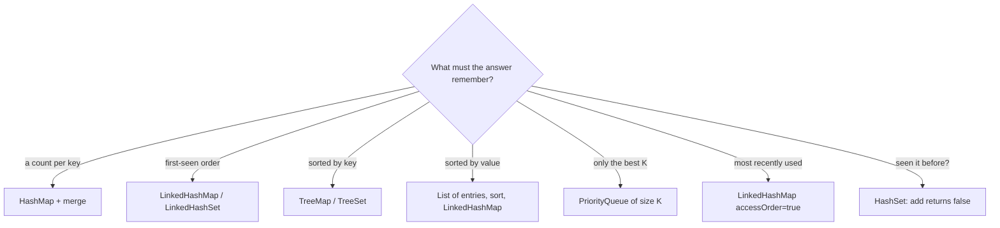
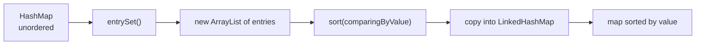
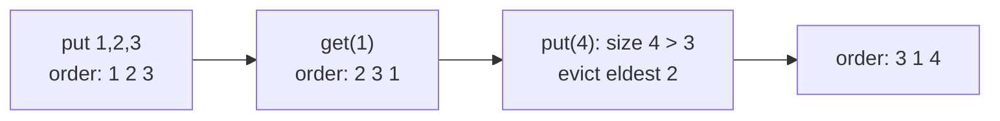

## In One Line
Almost every "collections program" in an interview is solved by picking the **right container for what the answer must remember** — counts (`HashMap` + `merge`), first-seen order (`LinkedHashMap`/`LinkedHashSet`), sorted order (`TreeMap`/`TreeSet` or a sorted `List` of entries), recency (`LinkedHashMap` in access order), or "best K so far" (`PriorityQueue`) — and then writing a short loop around it.

## Mental Model
Think of a **stationery cupboard with labelled boxes**. Before you start a job, you ask "what do I need to keep track of?" and grab the matching box:

| Job in the cupboard | Box you grab | Java container |
|---|---|---|
| Tally marks per item | A box with one tray per label | `HashMap<K, Integer>` + `merge` |
| "Who arrived first?" | A queue of name cards in arrival order | `LinkedHashMap` / `LinkedHashSet` |
| Alphabetical index cards | A card index that files itself | `TreeMap` / `TreeSet` |
| "Have I seen this already?" | A tick list | `HashSet` (`add` returns `false` for a repeat) |
| Keep only the top 3 | A tray that holds exactly 3 and throws out the worst | `PriorityQueue` of size K |
| Recently-used shelf | A shelf where every item you touch moves to the front and the back item falls off | `LinkedHashMap(…, true)` + `removeEldestEntry` |

The interview trick is the same every time: say which box you need and **why**, then the code is a loop that puts things into it and reads them back out.

## Concept
### How to attack any collections drill
1. **Clarify** — Must the output keep the original order? Sorted? How to break ties? Case-sensitive? Can there be `null`s or duplicates? Can I modify the input?
2. **Name the container** (table above) and say its cost.
3. **Code the loop**, using the idioms below.
4. **Test edge cases out loud** — empty input, one element, all duplicates, ties.
5. **State time and space complexity.**

> [!INTERVIEW] "I'll use a `LinkedHashMap` because I need O(1) counting *and* the first-seen order; a `HashMap` would lose the order and a `TreeMap` would sort instead."

### Pattern 1 — counting with a map
| Idiom | Code | Notes |
|---|---|---|
| `merge` | `map.merge(k, 1, Integer::sum)` | Shortest. Puts 1 if absent, otherwise applies the function to old and new. Returns the new value. |
| `getOrDefault` | `map.put(k, map.getOrDefault(k, 0) + 1)` | Easiest to explain; two lookups. |
| `compute` | `map.compute(k, (key, v) -> v == null ? 1 : v + 1)` | Most general. |
| Streams | `groupingBy(identity(), counting())` | Values are **`Long`**, not `Integer`. |
| `int[26]` / `int[128]` | `count[c - 'a']++` | Fastest for a small fixed alphabet. |

`merge`/`compute` with a function that returns `null` **remove** the entry — handy for decrementing counts to zero.

### Pattern 2 — the order you need decides the map/set
| Need | Map | Set | Cost of put / get |
|---|---|---|---|
| No order | `HashMap` | `HashSet` | O(1) average |
| Insertion (first-seen) order | `LinkedHashMap` | `LinkedHashSet` | O(1) average |
| Access (recency) order | `LinkedHashMap(cap, lf, true)` | — | O(1) average |
| Sorted by key / element | `TreeMap` | `TreeSet` | O(log n) |

`HashMap` order is **not** insertion order and **not** sorted — it follows bucket positions. Small `Integer` keys often *look* sorted because `Integer.hashCode()` is the value itself; do not rely on it.

### Pattern 3 — the "seen set"
`Set.add` returns `true` if the element was new and `false` if it was already there. One line gives you "remove duplicates keeping order" (`if (seen.add(x)) out.add(x)`) and "find duplicates" (`if (!seen.add(x)) dups.add(x)`).

### Pattern 4 — maps sort by key only; to sort by value, sort the entries
A `TreeMap` can only order by **key**. To order by value: copy `map.entrySet()` into a `List`, sort it with `Map.Entry.comparingByValue()`, and copy the result into a **`LinkedHashMap`** (the only map that keeps the order you insert). With streams: `sorted(...)` then `toMap(k, v, (a, b) -> a, LinkedHashMap::new)`.

> [!WARNING] Never try `new TreeMap<>(comparatorThatLooksAtValues)`. A `TreeMap` uses its comparator as its *equality*, so two keys with equal values collapse into one entry and `get` stops finding keys.

### Pattern 5 — build comparators, don't hand-write them
| Building block | Meaning |
|---|---|
| `Comparator.comparing(Employee::dept)` | Sort by a key (must be `Comparable`) |
| `comparingInt / comparingLong / comparingDouble` | Same, no boxing |
| `.thenComparing(Employee::name)` | Tie-breaker |
| `.thenComparing(Employee::salary, Comparator.reverseOrder())` | Tie-breaker in reverse, only for that key |
| `.reversed()` | Reverse **everything built so far** |
| `Comparator.nullsFirst(...)` / `nullsLast(...)` | Handle `null` keys instead of throwing NPE |
| `Map.Entry.comparingByKey()` / `comparingByValue()` | For sorting map entries |
| `Integer.compare(a, b)` / `Double.compare(a, b)` | Safe numeric compare — never `a - b` (overflow) |

`List.sort` and `Collections.sort` use **TimSort**: O(n log n) and **stable** — equal elements keep their previous relative order, which is why chaining sorts works.

### Pattern 6 — set algebra
| Operation | Code (on a copy!) | Result |
|---|---|---|
| Union | `s.addAll(other)` | elements in either |
| Intersection | `s.retainAll(other)` | elements in both |
| Difference A − B | `s.removeAll(other)` | elements only in A |
| Symmetric difference | `(A − B) ∪ (B − A)` | elements in exactly one |

These methods **mutate the receiver**, so always start from `new LinkedHashSet<>(a)` or `new ArrayList<>(a)`. Their speed depends on the **argument's** `contains`: pass a `HashSet` (O(1)) rather than a `List` (O(n)).

### Pattern 7 — heaps for "top K", two pointers for sorted inputs
- **Top K**: keep a *min*-heap of size K ordered "worst first"; after each `offer`, `poll` if the size exceeds K. Cost O(n log K) instead of O(n log n) for a full sort.
- **Merging sorted lists**: two indexes walk both lists once and always take the smaller head — O(n + m).

### Pattern 8 — removing while iterating
A for-each loop hides an `Iterator`. Calling `list.remove(...)` inside it changes the list behind the iterator's back, and the next `next()` throws `ConcurrentModificationException` (fail-fast). Use `Iterator.remove()`, `Collection.removeIf(...)`, or an index loop running **backwards**.

### Complexity cheat sheet for drills
| Operation | ArrayList | LinkedList | HashMap/HashSet | TreeMap/TreeSet | PriorityQueue |
|---|---|---|---|---|---|
| add / put | O(1) amortised (end) | O(1) (ends) | O(1) avg | O(log n) | O(log n) |
| get by index | O(1) | O(n) | — | — | — |
| contains / get by key | O(n) | O(n) | O(1) avg | O(log n) | O(n) |
| remove | O(n) | O(1) at ends / via iterator | O(1) avg | O(log n) | O(log n) poll |
| sort | O(n log n) | O(n log n) (copies to array) | — | already sorted | — |

## Diagram

Start every drill from this question; the container you pick usually *is* the solution.


Maps sort only by key, so "sort a map by value" really means "sort its entries, then store them in an order-keeping map".


In access order every `get`/`put` moves the key to the end; the head (eldest) is the least recently used, and `removeEldestEntry` evicts it.

## Code
**1. Word-frequency report** — normalise, count, sort by count then word, keep the order, take the top 3.
```java
import java.util.*;

public class WordFrequencyReport {
    public static void main(String[] args) {
        String text = "The quick brown fox. The lazy dog! the FOX, the end?";

        // 1. Normalise: lower-case, keep only letters and spaces, split on runs of spaces
        String[] words = text.toLowerCase().replaceAll("[^a-z ]", "").split("\\s+");

        // 2. Count: merge() inserts 1 for a new word, otherwise adds 1 to the old count
        Map<String, Integer> counts = new HashMap<>();
        for (String w : words) {
            counts.merge(w, 1, Integer::sum);
        }
        System.out.println("Distinct words : " + counts.size());

        // 3. Sort entries: count descending, then word ascending (tie-breaker)
        List<Map.Entry<String, Integer>> entries = new ArrayList<>(counts.entrySet());
        entries.sort(Map.Entry.<String, Integer>comparingByValue().reversed()
                .thenComparing(Map.Entry.comparingByKey()));

        // 4. Copy into a LinkedHashMap so the sorted order is kept
        Map<String, Integer> sorted = new LinkedHashMap<>();
        for (Map.Entry<String, Integer> e : entries) {
            sorted.put(e.getKey(), e.getValue());
        }
        System.out.println("By frequency   : " + sorted);

        // 5. Top 3
        System.out.println("Top 3          : " + entries.subList(0, 3));
    }
}
```
```output
Distinct words : 7
By frequency   : {the=4, fox=2, brown=1, dog=1, end=1, lazy=1, quick=1}
Top 3          : [the=4, fox=2, brown=1]
```

**2. LRU cache in 10 lines with `LinkedHashMap`**
```java
import java.util.*;

public class LruCacheDemo {
    static class LruCache<K, V> extends LinkedHashMap<K, V> {
        private final int capacity;

        LruCache(int capacity) {
            super(16, 0.75f, true);          // true = access order (LRU first, MRU last)
            this.capacity = capacity;
        }

        @Override
        protected boolean removeEldestEntry(Map.Entry<K, V> eldest) {
            return size() > capacity;         // called by put(); true = evict the eldest
        }
    }

    public static void main(String[] args) {
        LruCache<Integer, String> cache = new LruCache<>(3);
        cache.put(1, "one");
        cache.put(2, "two");
        cache.put(3, "three");
        System.out.println("After 3 puts : " + cache);

        cache.get(1);                          // 1 becomes most recently used
        System.out.println("After get(1) : " + cache);

        cache.put(4, "four");                  // over capacity: evicts LRU = 2
        System.out.println("After put(4) : " + cache);

        cache.put(3, "THREE");                 // update also counts as an access
        System.out.println("After put(3) : " + cache);
        System.out.println("get(2)       : " + cache.get(2));
    }
}
```
```output
After 3 puts : {1=one, 2=two, 3=three}
After get(1) : {2=two, 3=three, 1=one}
After put(4) : {3=three, 1=one, 4=four}
After put(3) : {1=one, 4=four, 3=THREE}
get(2)       : null
```
Both outputs are deterministic: `String` and `Integer` hash codes do not change between runs, and the printed maps are ordered ones.

## Walkthrough
### 1. `WordFrequencyReport`
- `text.toLowerCase()` — "The", "the" and "FOX"/"fox" must count as the same word, so case is normalised first.
- `.replaceAll("[^a-z ]", "")` — a regex that deletes every character that is **not** a lower-case letter or a space, removing `.`, `!`, `,` and `?`. Doing this before splitting avoids words like `"fox."`.
- `.split("\\s+")` — splits on one or more whitespace characters, so double spaces do not create empty words. (`\\s` in Java source is the regex `\s`.)
- `counts.merge(w, 1, Integer::sum)` — the core counting idiom. If `w` is absent it stores `1`; otherwise it calls `Integer.sum(oldValue, 1)` and stores the result. It replaces the three-line `if (containsKey) ... else ...` dance.
- `counts.size()` — seven distinct words: `the, quick, brown, fox, lazy, dog, end`.
- `new ArrayList<>(counts.entrySet())` — a `Map` cannot be sorted, but a `List` of its `Map.Entry` objects can.
- `Map.Entry.<String, Integer>comparingByValue().reversed()` — compare by count, highest first. The explicit type witness `<String, Integer>` is needed because `reversed()` is called on the result: without it, Java cannot infer the entry type and the chain does not compile.
- `.thenComparing(Map.Entry.comparingByKey())` — equal counts (all the words that appear once) are ordered alphabetically, making the output deterministic: `brown, dog, end, lazy, quick`.
- `new LinkedHashMap<>()` + the copy loop — a `LinkedHashMap` remembers insertion order, so the map prints in the sorted order. Putting the sorted entries into a `HashMap` would scramble them again.
- `entries.subList(0, 3)` — a *view* of the first three entries; `Map.Entry.toString()` prints `key=value`. On a list with fewer than 3 entries this would throw `IndexOutOfBoundsException`; production code would use `Math.min(3, entries.size())`.

### 2. `LruCacheDemo`
- `extends LinkedHashMap<K, V>` — `LinkedHashMap` is a `HashMap` plus a doubly linked list through all entries; that list gives the ordering.
- `super(16, 0.75f, true)` — initial capacity 16, load factor 0.75, and **`accessOrder = true`**. With `false` (the default) the list is in insertion order; with `true`, every `get`, `put` of an existing key, `getOrDefault`, `compute`, `merge` etc. moves that entry to the **end** (most recently used).
- `removeEldestEntry(eldest)` — a hook that `put`/`putAll` call *after* inserting a new entry. `eldest` is the head of the list (least recently used). Returning `true` makes the map remove it. `size() > capacity` therefore keeps the cache at most `capacity` entries.
- After three puts the order is `1, 2, 3`. `get(1)` moves 1 to the end: `2, 3, 1`.
- `put(4, ...)` makes the size 4 > 3, so the eldest (`2`) is evicted: `3, 1, 4`.
- `put(3, "THREE")` updates an existing key — that is an access, so 3 moves to the end: `1, 4, 3`. No eviction, because the size did not grow.
- `get(2)` returns `null` — 2 was evicted. (A `null` return is ambiguous if the cache may hold `null` values; `containsKey` tells the two apart.)

The full story of how `LinkedHashMap` maintains this list is in [LRU cache with LinkedHashMap](lesson:b04-collections-internals/04-lru-cache-with-linkedhashmap).

## Traps
- **Sorting by value with a `TreeMap` comparator.** `new TreeMap<>((k1, k2) -> 0)` treats every key as equal: after `put("x", 1); put("y", 2)` the map is `{x=2}`. A value-based comparator does the same for equal values and also breaks `get` (the value is not known when you look up a key).
- **`Collectors.toMap` and duplicate keys.** Without a merge function it throws `IllegalStateException: Duplicate key IN (attempted merging values Pune and Delhi)`. The 3-argument form returns a `HashMap` — so after `sorted(...)` you **must** use the 4-argument form with `LinkedHashMap::new`, or the sort is thrown away.
- **`(a, b) -> a - b` as a comparator overflows.** With `Integer.MIN_VALUE` in the list, `[3, MIN_VALUE, 5, -2]` sorts to `[-2, 3, 5, -2147483648]`. Use `Integer::compare` or `Comparator.naturalOrder()`.
- **`List<Integer>.remove(1)` removes index 1**, not the value 1. Use `remove(Integer.valueOf(1))` for the value.
- **`retainAll`/`removeAll`/`addAll` mutate the receiver.** Calling them on `List.of(...)`, `Set.of(...)` or `Arrays.asList(...)` (for size changes) throws `UnsupportedOperationException`. Always work on a copy.
- **`Comparator.comparing(s -> s.name()).reversed()` does not compile** — with `.reversed()` chained, the lambda parameter is inferred as `Object` (`cannot find symbol: method name()`). Fix: a method reference (`Student::name`), a typed lambda `(Student s) -> ...`, or a type witness `Comparator.<Student, String>comparing(...)`.
- **Comparing counts with `==`.** `freq.get("x") == freq.get("y")` is `false` for two counts of 200 but `true` for two counts of 100 — `Integer` objects are only cached from -128 to 127. Use `equals` or unbox to `int`.
- **`groupingBy(..., counting())` gives `Long` values**, so `map.get(k) == 1` compiles only because of unboxing and `Map<String, Integer> m = ...counting()` does not compile.
- **An access-ordered `LinkedHashMap` changes on `get`.** Looping over `keySet()` and calling `get(k)` inside the loop throws `ConcurrentModificationException`; iterate `entrySet()` instead.
- **A `TreeSet`/`TreeMap` with a comparator drops "duplicates" by that comparator**, not by `equals`: a `TreeSet` ordered by GPA keeps only one student per GPA.
- **`Collections.frequency` inside a loop** is O(n²). Fine for a 10-element demo, wrong for "scale this up" follow-ups.

## Tips & Tricks
- **"Count → HashMap, Order → Linked, Sorted → Tree, Top-K → Heap, Recent → access-order."** Say the matching word first, then code.
- **`merge(k, 1, Integer::sum)`** is the one-liner to memorise for every frequency question.
- **`if (seen.add(x))`** — "if it is new". **`if (!seen.add(x))`** — "if it is a duplicate".
- **Sort by value = "entries → list → sort → LinkedHashMap".** Four words, four lines.
- **Comparator chains read left to right**: primary key first, tie-breakers after. Put `.reversed()` at the end only if you want to reverse the whole chain; otherwise pass `Comparator.reverseOrder()` to that one key.
- **Copy before set algebra**: `new LinkedHashSet<>(a)` keeps a's order and removes its duplicates in one step.
- **Pass a `HashSet` to `retainAll`/`removeAll`/`contains` loops** — the speed depends on the argument's `contains`.
- For a fixed alphabet (lower-case letters, ASCII), an `int[26]` or `int[128]` counter beats any map.
- State ties explicitly: "for equal counts I'll sort alphabetically so the output is deterministic" — interviewers love that sentence.

## Interview Q&A
### [Basic] Sort a HashMap by its values (ascending and descending).
**Approach:** A map can only be ordered by key, so sort a `List` of its entries with `Map.Entry.comparingByValue()` and copy them into a `LinkedHashMap`. For descending, reverse the comparator and add a key tie-breaker so equal values have a defined order. For "just the key with the max value", no sort is needed: `Collections.max` is O(n).
```java
import java.util.*;
import java.util.stream.*;

public class SortMapByValue {
    public static void main(String[] args) {
        Map<String, Integer> scores = new HashMap<>();
        scores.put("Asha", 82);
        scores.put("Ravi", 95);
        scores.put("Kiran", 67);
        scores.put("Meena", 95);
        scores.put("John", 74);

        // Way 1: list of entries + sort + LinkedHashMap (works on every Java version)
        List<Map.Entry<String, Integer>> entries = new ArrayList<>(scores.entrySet());
        entries.sort(Map.Entry.comparingByValue());
        Map<String, Integer> ascending = new LinkedHashMap<>();
        for (Map.Entry<String, Integer> e : entries) {
            ascending.put(e.getKey(), e.getValue());
        }
        System.out.println("Ascending  : " + ascending);

        // Way 2: stream, descending by value, ties broken by key
        Map<String, Integer> descending = scores.entrySet().stream()
                .sorted(Map.Entry.<String, Integer>comparingByValue(Comparator.reverseOrder())
                        .thenComparing(Map.Entry.comparingByKey()))
                .collect(Collectors.toMap(Map.Entry::getKey, Map.Entry::getValue,
                        (a, b) -> a, LinkedHashMap::new));
        System.out.println("Descending : " + descending);

        // Key with the highest value, no sorting needed: O(n)
        String best = Collections.max(scores.entrySet(), Map.Entry.comparingByValue()).getKey();
        System.out.println("Top scorer : " + best);
    }
}
```
```output
Ascending  : {Kiran=67, John=74, Asha=82, Ravi=95, Meena=95}
Descending : {Meena=95, Ravi=95, Asha=82, John=74, Kiran=67}
Top scorer : Ravi
```
In the ascending result, the tie `Ravi=95, Meena=95` follows the `HashMap`'s iteration order (the sort is stable and had no tie-breaker); the descending result breaks the tie by name. `Collections.max` returns the *first* maximum it meets in iteration order.

**Complexity:** O(n log n) time for the sort, O(n) extra space for the list and the new map; `Collections.max` is O(n) time, O(1) space.

**Follow-up:** *Why not a `TreeMap` with a comparator on values?* — A `TreeMap`'s comparator defines key equality; entries with equal values would be merged and `get(key)` would no longer work.

### [Basic] Sort a map by its keys — natural, reverse, case-insensitive and custom order.
**Approach:** Copy it into a `TreeMap`, optionally with a comparator. Watch out: a comparator that says two keys are equal makes them **one** key.
```java
import java.util.*;

public class SortMapByKey {
    public static void main(String[] args) {
        Map<String, Integer> stock = new LinkedHashMap<>();
        stock.put("banana", 12);
        stock.put("apple", 7);
        stock.put("cherry", 30);
        stock.put("Apple", 5);

        System.out.println("Natural     : " + new TreeMap<>(stock));   // 'A' (65) sorts before 'a' (97)

        Map<String, Integer> reverse = new TreeMap<>(Comparator.reverseOrder());
        reverse.putAll(stock);
        System.out.println("Reverse     : " + reverse);

        Map<String, Integer> ignoreCase = new TreeMap<>(String.CASE_INSENSITIVE_ORDER);
        ignoreCase.putAll(stock);                   // "apple" and "Apple" compare as EQUAL keys
        System.out.println("Ignore case : " + ignoreCase);

        Map<String, Integer> byLength = new TreeMap<>(
                Comparator.comparingInt(String::length).thenComparing(Comparator.naturalOrder()));
        byLength.putAll(stock);
        System.out.println("By length   : " + byLength);
    }
}
```
```output
Natural     : {Apple=5, apple=7, banana=12, cherry=30}
Reverse     : {cherry=30, banana=12, apple=7, Apple=5}
Ignore case : {apple=5, banana=12, cherry=30}
By length   : {Apple=5, apple=7, banana=12, cherry=30}
```
Look at `Ignore case : {apple=5, ...}`: `"apple"` was put first, so the map keeps that **key**; when `"Apple"` arrived it counted as the same key, so only the **value** was replaced with 5. Without `thenComparing(naturalOrder())`, the by-length map would also have merged `apple`/`Apple` (both length 5) and `banana`/`cherry` (both length 6).

**Complexity:** O(n log n) time to build the `TreeMap`, O(n) space.

**Follow-up:** *How do you get the entries with keys between "b" and "d"?* — `TreeMap` is a `NavigableMap`: `map.subMap("b", true, "d", false)`, plus `headMap`, `tailMap`, `floorKey`, `ceilingKey`.

### [Basic] Remove duplicates from a list while keeping the original order.
**Approach:** A `LinkedHashSet` removes duplicates *and* keeps insertion order. Alternatives: `stream().distinct()` (keeps encounter order), a manual "seen set" loop, or `removeIf` with a seen set to do it in place. A plain `HashSet` or `TreeSet` loses the original order.
```java
import java.util.*;
import java.util.stream.*;

public class RemoveDuplicates {
    public static void main(String[] args) {
        List<Integer> input = List.of(5, 3, 5, 1, 3, 7, 1, 9);

        // 1. LinkedHashSet: set semantics + insertion order
        List<Integer> viaSet = new ArrayList<>(new LinkedHashSet<>(input));
        System.out.println("LinkedHashSet : " + viaSet);

        // 2. Stream distinct(): keeps encounter order for ordered streams
        List<Integer> viaStream = input.stream().distinct().collect(Collectors.toList());
        System.out.println("distinct()    : " + viaStream);

        // 3. Manual: a HashSet remembers what we have already seen
        List<Integer> manual = new ArrayList<>();
        Set<Integer> seen = new HashSet<>();
        for (Integer x : input) {
            if (seen.add(x)) {            // add() returns false if x was already present
                manual.add(x);
            }
        }
        System.out.println("Manual        : " + manual);

        // 4. In place on a mutable list: removeIf with the same trick
        List<Integer> inPlace = new ArrayList<>(input);
        Set<Integer> seen2 = new HashSet<>();
        inPlace.removeIf(x -> !seen2.add(x));
        System.out.println("removeIf      : " + inPlace);

        // Wrong tool: HashSet loses the order (here it happens to sort small Integers)
        System.out.println("HashSet       : " + new HashSet<>(input));
        System.out.println("TreeSet       : " + new TreeSet<>(input) + "  (sorted, not original order)");
    }
}
```
```output
LinkedHashSet : [5, 3, 1, 7, 9]
distinct()    : [5, 3, 1, 7, 9]
Manual        : [5, 3, 1, 7, 9]
removeIf      : [5, 3, 1, 7, 9]
HashSet       : [1, 3, 5, 7, 9]
TreeSet       : [1, 3, 5, 7, 9]  (sorted, not original order)
```
The `HashSet` line only *looks* sorted because small `Integer`s hash to themselves and land in buckets 1, 3, 5, 7, 9; with other values or with strings the order would look random.

**Complexity:** O(n) average time and O(n) extra space for every set-based version (the `TreeSet` is O(n log n)). A nested-loop version without a set would be O(n²).

**Follow-up:** *And for a sorted array, in place, without extra memory?* — Two pointers: a write index advances only when `a[read] != a[write - 1]`, giving O(n) time and O(1) space.

### [Basic] Count the frequency of each word in a sentence.
**Approach:** Split into words, then count with a map. `merge` is the shortest idiom, `getOrDefault` the easiest to explain, `groupingBy + counting` the stream version. Choose the map by the order you want to print: `HashMap` (any), `TreeMap` (alphabetical), `LinkedHashMap` (first seen).
```java
import java.util.*;
import java.util.function.Function;
import java.util.stream.*;

public class WordFrequency {
    public static void main(String[] args) {
        String sentence = "java is fun and java is powerful and java is everywhere";
        String[] words = sentence.split("\\s+");

        // 1. merge(): the shortest correct idiom
        Map<String, Integer> merge = new HashMap<>();
        for (String w : words) merge.merge(w, 1, Integer::sum);
        System.out.println("merge       : " + merge);

        // 2. getOrDefault(): same result, easy to explain
        Map<String, Integer> gd = new TreeMap<>();          // TreeMap = alphabetical output
        for (String w : words) gd.put(w, gd.getOrDefault(w, 0) + 1);
        System.out.println("TreeMap     : " + gd);

        // 3. Streams: groupingBy + counting gives Long values
        Map<String, Long> stream = Arrays.stream(words)
                .collect(Collectors.groupingBy(Function.identity(), LinkedHashMap::new, Collectors.counting()));
        System.out.println("groupingBy  : " + stream + "  (first-seen order)");
    }
}
```
```output
merge       : {java=3, powerful=1, everywhere=1, and=2, is=3, fun=1}
TreeMap     : {and=2, everywhere=1, fun=1, is=3, java=3, powerful=1}
groupingBy  : {java=3, is=3, fun=1, and=2, powerful=1, everywhere=1}  (first-seen order)
```
**Complexity:** O(n) average time for the hash maps (n = number of words, treating word length as constant), O(n log d) for the `TreeMap` with d distinct words; O(d) space.

**Follow-up:** *How do you handle punctuation and case?* — Normalise first: `text.toLowerCase().replaceAll("[^a-z ]", "").split("\\s+")`, exactly as in the Code section.

### [Intermediate] Find the top K most frequent words (ties alphabetical).
**Approach:** Count with a map, then keep a **min-heap of size K** ordered "worst first" (lowest count; for equal counts, the alphabetically *later* word is worse). After each `offer`, `poll` when the heap grows past K. At the end, poll everything out (worst to best) and reverse.
```java
import java.util.*;

public class TopKFrequent {
    static List<String> topK(String[] words, int k) {
        Map<String, Integer> freq = new HashMap<>();
        for (String w : words) freq.merge(w, 1, Integer::sum);

        // Min-heap ordered by "worst first": lower count first, and for equal counts
        // the alphabetically LATER word first (so it is evicted before the earlier one)
        Comparator<String> worstFirst = Comparator.<String>comparingInt(freq::get)
                .thenComparing(Comparator.<String>reverseOrder());
        PriorityQueue<String> heap = new PriorityQueue<>(worstFirst);

        for (String w : freq.keySet()) {
            heap.offer(w);
            if (heap.size() > k) heap.poll();     // drop the current worst: heap never exceeds k
        }

        List<String> result = new ArrayList<>();
        while (!heap.isEmpty()) result.add(heap.poll());
        Collections.reverse(result);               // heap gives worst..best; we want best..worst
        return result;
    }

    public static void main(String[] args) {
        String[] words = {"i", "love", "java", "i", "love", "coding", "java", "i", "code"};
        System.out.println("Top 2: " + topK(words, 2));
        System.out.println("Top 3: " + topK(words, 3));
    }
}
```
```output
Top 2: [i, java]
Top 3: [i, java, love]
```
`java` and `love` both appear twice; the tie-breaker puts `java` first alphabetically.

**Complexity:** O(n + d log K) time (n words, d distinct), O(d + K) space. Sorting all entries instead would be O(d log d) — fine for small inputs, but the heap wins when K ≪ d.

**Follow-up:** *Can you do it in O(n)?* — Bucket sort by frequency: an array of lists indexed by count (0..n), then walk from the highest bucket down until K words are collected.

### [Basic] Find the first non-repeating character in a string.
**Approach:** Count characters in a `LinkedHashMap` (it remembers first-seen order), then return the first entry whose count is 1. Two passes, no nested loops.
```java
import java.util.*;

public class FirstNonRepeating {
    static Character firstUnique(String s) {
        Map<Character, Integer> freq = new LinkedHashMap<>();   // remembers first-seen order
        for (char c : s.toCharArray()) freq.merge(c, 1, Integer::sum);
        for (Map.Entry<Character, Integer> e : freq.entrySet()) {
            if (e.getValue() == 1) return e.getKey();
        }
        return null;
    }

    public static void main(String[] args) {
        String s = "swiss";
        Map<Character, Integer> freq = new LinkedHashMap<>();
        for (char c : s.toCharArray()) freq.merge(c, 1, Integer::sum);
        System.out.println("Frequencies of \"swiss\" : " + freq);
        System.out.println("First unique in swiss : " + firstUnique("swiss"));
        System.out.println("First unique in aabb  : " + firstUnique("aabb"));
        System.out.println("First unique in level : " + firstUnique("level"));
    }
}
```
```output
Frequencies of "swiss" : {s=3, w=1, i=1}
First unique in swiss : w
First unique in aabb  : null
First unique in level : v
```
**Complexity:** O(n) time, O(k) space for k distinct characters (O(1) for a fixed alphabet).

**Follow-up:** *Without a map?* — Use `int[128]` (ASCII) counts in the first pass, then scan the *string* again and return the first char with count 1. Same O(n), less memory and no boxing.

### [Basic] Find the duplicate elements in a list.
**Approach:** Walk the list with a `seen` set; any element for which `add` returns `false` is a duplicate. Collect duplicates in a `LinkedHashSet` so each is reported once, in order. For counts, group and filter `> 1`.
```java
import java.util.*;
import java.util.function.Function;
import java.util.stream.*;

public class FindDuplicates {
    public static void main(String[] args) {
        List<String> names = List.of("amy", "bob", "amy", "cat", "bob", "amy", "dan");

        // 1. Set.add returns false for a repeat
        Set<String> seen = new HashSet<>();
        Set<String> dups = new LinkedHashSet<>();       // each duplicate reported once, in order
        for (String n : names) {
            if (!seen.add(n)) dups.add(n);
        }
        System.out.println("Duplicates       : " + dups);

        // 2. With counts
        Map<String, Long> counts = names.stream()
                .collect(Collectors.groupingBy(Function.identity(), LinkedHashMap::new, Collectors.counting()));
        Map<String, Long> repeated = new LinkedHashMap<>();
        counts.forEach((k, v) -> { if (v > 1) repeated.put(k, v); });
        System.out.println("Repeated counts  : " + repeated);

        // 3. Collections.frequency: short but O(n^2)
        Set<String> slow = new LinkedHashSet<>();
        for (String n : names) if (Collections.frequency(names, n) > 1) slow.add(n);
        System.out.println("frequency() way  : " + slow);
    }
}
```
```output
Duplicates       : [amy, bob]
Repeated counts  : {amy=3, bob=2}
frequency() way  : [amy, bob]
```
**Complexity:** seen-set and grouping: O(n) time, O(n) space. `Collections.frequency` in a loop: O(n²) time — mention it only to reject it.

**Follow-up:** *Array of n+1 integers in 1..n, one duplicate, O(1) extra space?* — Floyd's cycle detection on `i -> a[i]`, or (if you may modify it) mark visited indexes by negating values.

### [Basic] Sort a list of employees by department, then salary (high to low), then name — and handle missing values.
**Approach:** Build the comparator from `Comparator.comparing` + `thenComparing`. Reverse a *single* key by passing `Comparator.reverseOrder()` to that key. Use `nullsLast` for fields that may be `null`. Never compare doubles by subtraction.
```java
import java.util.*;

public class SortEmployees {
    record Employee(String name, String dept, double salary, Integer age) { }

    public static void main(String[] args) {
        List<Employee> staff = new ArrayList<>(List.of(
                new Employee("Ravi",  "IT",    90_000, 31),
                new Employee("Asha",  "HR",    60_000, null),
                new Employee("Kiran", "IT",    90_000, 28),
                new Employee("Meena", "Sales", 75_000, 35),
                new Employee("John",  "HR",    60_000, 40)));

        // 1. Department A-Z, then salary high-to-low, then name A-Z
        staff.sort(Comparator.comparing(Employee::dept)
                .thenComparing(Employee::salary, Comparator.reverseOrder())
                .thenComparing(Employee::name));
        staff.forEach(e -> System.out.println(e.dept() + " " + e.salary() + " " + e.name()));

        // 2. By age, missing ages last
        staff.sort(Comparator.comparing(Employee::age, Comparator.nullsLast(Comparator.naturalOrder())));
        System.out.println("By age: " + staff.stream().map(e -> e.name() + "(" + e.age() + ")").toList());

        // 3. Old-school anonymous class, salary descending
        Collections.sort(staff, new Comparator<Employee>() {
            @Override
            public int compare(Employee a, Employee b) {
                return Double.compare(b.salary(), a.salary());   // never "return (int)(b - a)"
            }
        });
        System.out.println("By salary desc: " + staff.stream().map(Employee::name).toList());
    }
}
```
```output
HR 60000.0 Asha
HR 60000.0 John
IT 90000.0 Kiran
IT 90000.0 Ravi
Sales 75000.0 Meena
By age: [Kiran(28), Ravi(31), Meena(35), John(40), Asha(null)]
By salary desc: [Kiran, Ravi, Meena, John, Asha]
```
The last line shows **stability**: Kiran and Ravi (both 90 000) stay in the age order from the previous sort, as do John and Asha.

**Complexity:** O(n log n) time; TimSort uses up to O(n) temporary space.

**Follow-up:** *Why is `(int) (b.salary() - a.salary())` wrong?* — The cast truncates differences smaller than 1 to 0 ("equal") and large differences can overflow `int`; `Double.compare` also orders `NaN` and `-0.0` consistently.

### [Intermediate] Implement `Comparable` for a natural order and use `Comparator`s for other orders. What happens in a `TreeSet`?
**Approach:** `Comparable.compareTo` defines the one natural order inside the class (here: roll number). Any other order is an external `Comparator`. A `TreeSet`/`TreeMap` uses whichever ordering it was given as its **equality test**.
```java
import java.util.*;

public class ComparableVsComparator {
    static class Student implements Comparable<Student> {
        final int roll;
        final String name;
        final double gpa;

        Student(int roll, String name, double gpa) {
            this.roll = roll;
            this.name = name;
            this.gpa = gpa;
        }

        @Override
        public int compareTo(Student other) {           // natural order = by roll number
            return Integer.compare(this.roll, other.roll);
        }

        @Override
        public String toString() {
            return roll + ":" + name + ":" + gpa;
        }
    }

    public static void main(String[] args) {
        List<Student> list = new ArrayList<>(List.of(
                new Student(3, "Zoya", 8.1), new Student(1, "Arun", 7.5),
                new Student(4, "Bala", 9.0), new Student(2, "Mira", 8.1)));

        Collections.sort(list);                                        // uses compareTo
        System.out.println("Natural (roll) : " + list);

        list.sort(Comparator.comparingDouble((Student s) -> s.gpa).reversed()
                .thenComparing(s -> s.name));
        System.out.println("GPA desc, name : " + list);

        // TreeSet uses the comparator for equality: equal GPA = "duplicate" = dropped!
        Set<Student> byGpa = new TreeSet<>(Comparator.comparingDouble(s -> s.gpa));
        byGpa.addAll(list);
        System.out.println("TreeSet by GPA : " + byGpa + " (size " + byGpa.size() + ")");
    }
}
```
```output
Natural (roll) : [1:Arun:7.5, 2:Mira:8.1, 3:Zoya:8.1, 4:Bala:9.0]
GPA desc, name : [4:Bala:9.0, 2:Mira:8.1, 3:Zoya:8.1, 1:Arun:7.5]
TreeSet by GPA : [1:Arun:7.5, 2:Mira:8.1, 4:Bala:9.0] (size 3)
```
Zoya disappeared from the `TreeSet`: her GPA compares equal to Mira's, and Mira was added first. Note the typed lambda `(Student s) -> s.gpa` — it is what lets `.reversed()` compile.

**Complexity:** sorting O(n log n); `TreeSet` inserts O(log n) each, O(n log n) total, O(n) space.

**Follow-up:** *What does "consistent with equals" mean?* — `a.compareTo(b) == 0` exactly when `a.equals(b)`. If not, sorted collections (which use `compareTo`) and hash collections (which use `equals`) disagree about duplicates — `BigDecimal("1.0")` vs `BigDecimal("1.00")` is the JDK's famous example. More in [Comparable vs Comparator](lesson:b01-fundamentals/09-comparable-vs-comparator).

### [Intermediate] Implement an LRU cache using `LinkedHashMap`.
**Approach:** Extend `LinkedHashMap` with `accessOrder = true` so every access moves an entry to the end, and override `removeEldestEntry` to return `size() > capacity`. The full, commented program and its output are in the **Code** section (`LruCacheDemo`); the core is:
```java
static class LruCache<K, V> extends LinkedHashMap<K, V> {
    private final int capacity;

    LruCache(int capacity) {
        super(16, 0.75f, true);          // access order
        this.capacity = capacity;
    }

    @Override
    protected boolean removeEldestEntry(Map.Entry<K, V> eldest) {
        return size() > capacity;         // evict the least recently used
    }
}
```
```output
After 3 puts : {1=one, 2=two, 3=three}
After get(1) : {2=two, 3=three, 1=one}
After put(4) : {3=three, 1=one, 4=four}
After put(3) : {1=one, 4=four, 3=THREE}
get(2)       : null
```
**Complexity:** `get` and `put` are O(1) average; space O(capacity).

**Follow-up:** *Is it thread-safe?* — No. Even `get` modifies the linked list in access order, so a read-write lock is not enough; wrap it with `Collections.synchronizedMap(...)` (every call locked), or use a concurrent cache library such as Caffeine in real systems.

### [Advanced] Implement an LRU cache without `LinkedHashMap` (O(1) get and put).
**Approach:** Combine a `HashMap<K, Node>` (O(1) lookup) with your own **doubly linked list** (O(1) move-to-front and remove-last). Two sentinel nodes (`head`, `tail`) remove all null checks. `get`: look up, unlink, add at front. `put`: update-and-move if present; otherwise evict `tail.prev` if full, then add at front.
```java
import java.util.*;

public class LruCacheFromScratch {
    static class LruCache<K, V> {
        private class Node {
            K key; V value; Node prev, next;
            Node(K key, V value) { this.key = key; this.value = value; }
        }

        private final int capacity;
        private final Map<K, Node> index = new HashMap<>();
        private final Node head = new Node(null, null);   // sentinel: head.next = most recent
        private final Node tail = new Node(null, null);   // sentinel: tail.prev = least recent

        LruCache(int capacity) {
            this.capacity = capacity;
            head.next = tail;
            tail.prev = head;
        }

        V get(K key) {
            Node n = index.get(key);
            if (n == null) return null;
            unlink(n);
            addFirst(n);                                  // touched: move to the front
            return n.value;
        }

        void put(K key, V value) {
            Node n = index.get(key);
            if (n != null) {                              // update + touch
                n.value = value;
                unlink(n);
                addFirst(n);
                return;
            }
            if (index.size() == capacity) {               // evict least recently used
                Node lru = tail.prev;
                unlink(lru);
                index.remove(lru.key);
            }
            n = new Node(key, value);
            addFirst(n);
            index.put(key, n);
        }

        private void unlink(Node n) {
            n.prev.next = n.next;
            n.next.prev = n.prev;
        }

        private void addFirst(Node n) {
            n.next = head.next;
            n.prev = head;
            head.next.prev = n;
            head.next = n;
        }

        @Override
        public String toString() {                        // most recent first
            StringJoiner sj = new StringJoiner(", ", "[", "]");
            for (Node n = head.next; n != tail; n = n.next) sj.add(n.key + "=" + n.value);
            return sj.toString();
        }
    }

    public static void main(String[] args) {
        LruCache<String, Integer> cache = new LruCache<>(2);
        cache.put("a", 1);
        cache.put("b", 2);
        System.out.println(cache);
        System.out.println("get(a) = " + cache.get("a") + " -> " + cache);
        cache.put("c", 3);                                // evicts b
        System.out.println("put(c) -> " + cache);
        System.out.println("get(b) = " + cache.get("b"));
    }
}
```
```output
[b=2, a=1]
get(a) = 1 -> [a=1, b=2]
put(c) -> [c=3, a=1]
get(b) = null
```
The node stores its **key** so that eviction can also remove the entry from the `HashMap`.

**Complexity:** `get`/`put` O(1) average time; O(capacity) space.

**Follow-up:** *Why a doubly linked list, not a singly linked one?* — Removing a node from the middle needs its predecessor; with `prev` pointers that is O(1), with a singly linked list it is O(n).

### [Basic] Merge two lists — concatenate, union without duplicates, and alternate elements.
**Approach:** Concatenation = copy + `addAll`. Union without duplicates = `LinkedHashSet` + `addAll` (keeps first-seen order) or `Stream.concat(...).distinct()`. Alternating = one index loop with bounds checks for unequal lengths.
```java
import java.util.*;
import java.util.stream.*;

public class MergeLists {
    public static void main(String[] args) {
        List<String> a = List.of("x", "y", "z");
        List<String> b = List.of("y", "w", "x", "v");

        // 1. Concatenate (keeps duplicates)
        List<String> all = new ArrayList<>(a);
        all.addAll(b);
        System.out.println("Concatenated    : " + all);

        // 2. Union without duplicates, first-seen order
        Set<String> union = new LinkedHashSet<>(a);
        union.addAll(b);
        System.out.println("Union           : " + union);

        // 3. Stream version of the same
        System.out.println("Stream concat   : " + Stream.concat(a.stream(), b.stream()).distinct().toList());

        // 4. Alternate (zip) the two lists: a0 b0 a1 b1 ... then the leftovers
        List<String> zipped = new ArrayList<>();
        for (int i = 0; i < Math.max(a.size(), b.size()); i++) {
            if (i < a.size()) zipped.add(a.get(i));
            if (i < b.size()) zipped.add(b.get(i));
        }
        System.out.println("Alternated      : " + zipped);
    }
}
```
```output
Concatenated    : [x, y, z, y, w, x, v]
Union           : [x, y, z, w, v]
Stream concat   : [x, y, z, w, v]
Alternated      : [x, y, y, w, z, x, v]
```
**Complexity:** all O(n + m) time and space (hash operations O(1) average).

**Follow-up:** *Why `new ArrayList<>(a)` first instead of `a.addAll(b)`?* — `a` is a `List.of(...)` (immutable), so `a.addAll(b)` throws `UnsupportedOperationException`; and even for a mutable list you usually must not modify the caller's input.

### [Intermediate] Merge two sorted lists into one sorted list.
**Approach:** Two pointers. Compare the heads, append the smaller, advance that pointer; when one list runs out, copy the rest of the other. Using `<=` takes from the first list on ties, which keeps the merge stable (this is the merge step of merge sort).
```java
import java.util.*;

public class MergeSortedLists {
    static List<Integer> merge(List<Integer> a, List<Integer> b) {
        List<Integer> out = new ArrayList<>(a.size() + b.size());
        int i = 0, j = 0;
        while (i < a.size() && j < b.size()) {
            if (a.get(i) <= b.get(j)) out.add(a.get(i++));   // <= keeps the merge stable
            else                      out.add(b.get(j++));
        }
        while (i < a.size()) out.add(a.get(i++));            // copy what is left
        while (j < b.size()) out.add(b.get(j++));
        return out;
    }

    public static void main(String[] args) {
        List<Integer> a = List.of(1, 4, 4, 9, 12);
        List<Integer> b = List.of(2, 4, 10);
        System.out.println("Two-pointer merge : " + merge(a, b));
        System.out.println("Empty + b         : " + merge(List.of(), b));

        // Shortcut if you are allowed: add all then sort, O((n+m) log(n+m))
        List<Integer> lazy = new ArrayList<>(a);
        lazy.addAll(b);
        Collections.sort(lazy);
        System.out.println("addAll + sort     : " + lazy);
    }
}
```
```output
Two-pointer merge : [1, 2, 4, 4, 4, 9, 10, 12]
Empty + b         : [2, 4, 10]
addAll + sort     : [1, 2, 4, 4, 4, 9, 10, 12]
```
`a.get(i) <= b.get(j)` compares two `Integer`s with `<=`, which unboxes them — safe. (`==` on two `Integer`s would compare references.)

**Complexity:** O(n + m) time, O(n + m) space for the output. The "add all then sort" shortcut is O((n+m) log(n+m)).

**Follow-up:** *And K sorted lists?* — Put the head of each list in a `PriorityQueue` keyed by value; repeatedly poll the smallest and push its successor: O(N log K) for N total elements.

### [Basic] Find the common elements of two lists.
**Approach:** Put one list in a `HashSet` and keep the elements of the other that it contains. `retainAll` does this in one call, but it mutates its receiver — call it on a copy and pass a `HashSet` so each `contains` is O(1). Decide whether duplicates matter: a set result has none, `List.retainAll` keeps all of the first list's copies, and a **multiset intersection** keeps each element min(countA, countB) times.
```java
import java.util.*;
import java.util.stream.*;

public class CommonElements {
    public static void main(String[] args) {
        List<Integer> a = List.of(4, 9, 5, 4, 1);
        List<Integer> b = List.of(9, 4, 9, 8, 4, 7);

        // 1. retainAll on a COPY (retainAll mutates the receiver)
        Set<Integer> common = new LinkedHashSet<>(a);
        common.retainAll(new HashSet<>(b));        // pass a HashSet so contains() is O(1)
        System.out.println("retainAll (set)    : " + common);

        // 2. Stream + HashSet lookup, order of a, no duplicates
        Set<Integer> bSet = new HashSet<>(b);
        System.out.println("stream filter      : " + a.stream().filter(bSet::contains).distinct().toList());

        // 3. retainAll on a List keeps a's duplicates
        List<Integer> listCopy = new ArrayList<>(a);
        listCopy.retainAll(b);
        System.out.println("retainAll (list)   : " + listCopy);

        // 4. Multiset intersection: each element min(countA, countB) times
        Map<Integer, Integer> countB = new HashMap<>();
        for (int x : b) countB.merge(x, 1, Integer::sum);
        List<Integer> multi = new ArrayList<>();
        for (int x : a) {
            Integer c = countB.get(x);
            if (c != null && c > 0) {
                multi.add(x);
                countB.put(x, c - 1);              // use each b element only once
            }
        }
        System.out.println("with duplicates    : " + multi);
    }
}
```
```output
retainAll (set)    : [4, 9]
stream filter      : [4, 9]
retainAll (list)   : [4, 9, 4]
with duplicates    : [4, 9, 4]
```
Here `retainAll (list)` and the multiset answer coincide; they differ when `a` has more copies than `b` (e.g. `a = [4, 4, 4]`, `b = [4]`: `retainAll` keeps `[4, 4, 4]`, the multiset intersection gives `[4]`).

**Complexity:** O(n + m) average time with a `HashSet`/`HashMap`, O(m) extra space. `listCopy.retainAll(b)` with a `List` argument is O(n·m).

**Follow-up:** *Both lists are sorted — can you avoid the extra set?* — Yes: two pointers, advance the smaller side, emit when equal. O(n + m) time, O(1) extra space.

### [Intermediate] Find the difference and symmetric difference of two lists.
**Approach:** Difference A − B = copy of A, `removeAll(B)`. Symmetric difference = (A − B) ∪ (B − A). Use `LinkedHashSet` copies to keep order and leave the inputs untouched.
```java
import java.util.*;

public class SetDifference {
    public static void main(String[] args) {
        List<String> oldTeam = List.of("amy", "bob", "cat", "dan");
        List<String> newTeam = List.of("bob", "dan", "eve", "fay");

        Set<String> left = new LinkedHashSet<>(oldTeam);
        left.removeAll(new HashSet<>(newTeam));
        System.out.println("Left the team  (A - B) : " + left);

        Set<String> joined = new LinkedHashSet<>(newTeam);
        joined.removeAll(new HashSet<>(oldTeam));
        System.out.println("Joined the team (B - A): " + joined);

        Set<String> symmetric = new LinkedHashSet<>(left);
        symmetric.addAll(joined);
        System.out.println("Symmetric difference   : " + symmetric);

        Set<String> stayed = new LinkedHashSet<>(oldTeam);
        stayed.retainAll(new HashSet<>(newTeam));
        System.out.println("Intersection           : " + stayed);
        System.out.println("Originals untouched    : " + oldTeam + " " + newTeam);
    }
}
```
```output
Left the team  (A - B) : [amy, cat]
Joined the team (B - A): [eve, fay]
Symmetric difference   : [amy, cat, eve, fay]
Intersection           : [bob, dan]
Originals untouched    : [amy, bob, cat, dan] [bob, dan, eve, fay]
```
**Complexity:** O(n + m) average time, O(n + m) space.

**Follow-up:** *Is there a performance trap in `AbstractSet.removeAll`?* — Yes: if the receiver set is not larger than the argument, it iterates the receiver and calls `argument.contains(...)` for each element. With a `List` argument that is O(n·m) — another reason to pass a `HashSet`.

### [Intermediate] Group a list of words into anagram groups.
**Approach:** Anagrams have the same letters, so sorting the letters gives a common **key** (`"eat"`, `"tea"`, `"ate"` → `"aet"`). Map each key to a list with `computeIfAbsent(key, k -> new ArrayList<>()).add(word)`.
```java
import java.util.*;
import java.util.stream.*;

public class GroupAnagrams {
    static String key(String w) {
        char[] c = w.toCharArray();
        Arrays.sort(c);                   // anagrams share the same sorted letters
        return new String(c);
    }

    public static void main(String[] args) {
        String[] words = {"eat", "tea", "tan", "ate", "nat", "bat"};

        Map<String, List<String>> groups = new LinkedHashMap<>();
        for (String w : words) {
            groups.computeIfAbsent(key(w), k -> new ArrayList<>()).add(w);
        }
        System.out.println("Map    : " + groups);
        System.out.println("Groups : " + groups.values());

        // Stream version
        System.out.println("Stream : " + Arrays.stream(words)
                .collect(Collectors.groupingBy(GroupAnagrams::key, LinkedHashMap::new, Collectors.toList()))
                .values());
    }
}
```
```output
Map    : {aet=[eat, tea, ate], ant=[tan, nat], abt=[bat]}
Groups : [[eat, tea, ate], [tan, nat], [bat]]
Stream : [[eat, tea, ate], [tan, nat], [bat]]
```
**Complexity:** O(n · L log L) time for n words of length L (sorting each word), O(n · L) space.

**Follow-up:** *Faster key?* — Count letters into `int[26]` and use `Arrays.toString(counts)` (or a string built from the counts) as the key: O(n · L).

### [Intermediate] Sort elements by frequency (most frequent first; ties by smaller value).
**Approach:** Count with a map, then sort the list with a comparator that looks up each element's count: `comparingInt(freq::get).reversed()`, then natural order as the tie-breaker.
```java
import java.util.*;

public class SortByFrequency {
    public static void main(String[] args) {
        List<Integer> nums = new ArrayList<>(List.of(4, 6, 2, 6, 4, 4, 9, 2, 6));

        Map<Integer, Integer> freq = new HashMap<>();
        for (int n : nums) freq.merge(n, 1, Integer::sum);

        // Most frequent first; equal frequency -> smaller number first
        nums.sort(Comparator.<Integer>comparingInt(freq::get).reversed()
                .thenComparing(Comparator.naturalOrder()));
        System.out.println("Sorted by frequency : " + nums);
        System.out.println("Frequencies         : " + freq);
    }
}
```
```output
Sorted by frequency : [4, 4, 4, 6, 6, 6, 2, 2, 9]
Frequencies         : {2=2, 4=3, 6=3, 9=1}
```
`4` and `6` both appear three times; the tie-breaker puts `4` first.

**Complexity:** O(n log n) time (each comparison is an O(1) map lookup), O(d) space for d distinct values.

**Follow-up:** *What if ties must keep first-appearance order instead?* — Record each value's first index in a second map (or use a `LinkedHashMap` for counts and sort its entries, relying on the sort's stability), and use that as the tie-breaker.

### [Intermediate] Remove elements from a list while iterating over it.
**Approach:** Never call `list.remove` inside a for-each loop. Use `Iterator.remove()`, `removeIf` (simplest, O(n) on `ArrayList`), or an index loop going **backwards** so removals do not shift the elements you have yet to visit. For maps, call `removeIf` on `entrySet()`.
```java
import java.util.*;

public class RemoveWhileIterating {
    public static void main(String[] args) {
        List<Integer> nums = new ArrayList<>(List.of(1, 2, 3, 4, 5, 6));

        // WRONG: structural change inside for-each
        try {
            for (Integer n : nums) {
                if (n % 2 == 0) nums.remove(n);      // remove(Object) because n is Integer
            }
        } catch (ConcurrentModificationException e) {
            System.out.println("for-each + remove -> " + e.getClass().getSimpleName() + ", list now " + nums);
        }

        // RIGHT 1: Iterator.remove()
        List<Integer> a = new ArrayList<>(List.of(1, 2, 3, 4, 5, 6));
        for (Iterator<Integer> it = a.iterator(); it.hasNext(); ) {
            if (it.next() % 2 == 0) it.remove();
        }
        System.out.println("Iterator.remove     -> " + a);

        // RIGHT 2: removeIf (Java 8+), O(n) for ArrayList
        List<Integer> b = new ArrayList<>(List.of(1, 2, 3, 4, 5, 6));
        b.removeIf(n -> n % 2 == 0);
        System.out.println("removeIf            -> " + b);

        // RIGHT 3: loop backwards by index
        List<Integer> c = new ArrayList<>(List.of(1, 2, 3, 4, 5, 6));
        for (int i = c.size() - 1; i >= 0; i--) {
            if (c.get(i) % 2 == 0) c.remove(i);      // remove(int index)
        }
        System.out.println("backwards index     -> " + c);

        // Map: remove entries while iterating
        Map<String, Integer> stock = new HashMap<>(Map.of("pen", 0, "ink", 5, "cap", 0));
        stock.entrySet().removeIf(e -> e.getValue() == 0);
        System.out.println("map removeIf        -> " + stock);
    }
}
```
```output
for-each + remove -> ConcurrentModificationException, list now [1, 3, 4, 5, 6]
Iterator.remove     -> [1, 3, 5]
removeIf            -> [1, 3, 5]
backwards index     -> [1, 3, 5]
map removeIf        -> {ink=5}
```
The first removal (of `2`) succeeded; the *next* call to the hidden iterator's `next()` noticed `modCount` had changed and threw.

**Complexity:** `removeIf` on `ArrayList` is O(n) (it compacts once). `Iterator.remove` and the backwards loop on `ArrayList` are O(n²) in the worst case, because every removal shifts the tail; on `LinkedList`, `Iterator.remove` is O(1) per removal.

**Follow-up:** *Does `CopyOnWriteArrayList` throw here?* — No: its iterator works on a snapshot (fail-safe), so for-each + `remove` is allowed, but every write copies the whole array.

### [Intermediate] Convert a list to a map when keys can repeat — and invert a map.
**Approach:** `Collectors.toMap(key, value)` throws on a duplicate key; pass a merge function to choose a winner, or use `groupingBy` + `mapping` to keep all values. To invert a map (value → keys), use `computeIfAbsent` into lists.
```java
import java.util.*;
import java.util.stream.*;

public class ListToMap {
    record City(String name, String country) { }

    public static void main(String[] args) {
        List<City> cities = List.of(new City("Pune", "IN"), new City("Lyon", "FR"),
                new City("Delhi", "IN"), new City("Paris", "FR"), new City("Oslo", "NO"));

        // toMap with duplicate keys and no merge function -> IllegalStateException
        try {
            cities.stream().collect(Collectors.toMap(City::country, City::name));
        } catch (IllegalStateException e) {
            System.out.println("No merge fn: " + e.getMessage());
        }

        // Keep the first value per key
        Map<String, String> first = cities.stream()
                .collect(Collectors.toMap(City::country, City::name, (x, y) -> x, TreeMap::new));
        System.out.println("Keep first : " + first);

        // Keep all values per key
        Map<String, List<String>> all = cities.stream()
                .collect(Collectors.groupingBy(City::country, TreeMap::new,
                        Collectors.mapping(City::name, Collectors.toList())));
        System.out.println("Group all  : " + all);

        // Invert a map: value -> list of keys (loop version)
        Map<String, String> capitalOf = new LinkedHashMap<>();
        capitalOf.put("Pune", "IN"); capitalOf.put("Lyon", "FR"); capitalOf.put("Delhi", "IN");
        Map<String, List<String>> inverted = new LinkedHashMap<>();
        capitalOf.forEach((city, cc) -> inverted.computeIfAbsent(cc, k -> new ArrayList<>()).add(city));
        System.out.println("Inverted   : " + inverted);
    }
}
```
```output
No merge fn: Duplicate key IN (attempted merging values Pune and Delhi)
Keep first : {FR=Lyon, IN=Pune, NO=Oslo}
Group all  : {FR=[Lyon, Paris], IN=[Pune, Delhi], NO=[Oslo]}
Inverted   : {IN=[Pune, Delhi], FR=[Lyon]}
```
**Complexity:** O(n) average time into hash maps, O(n log k) into a `TreeMap` with k keys; O(n) space.

**Follow-up:** *What does `toMap` do with a `null` value?* — It throws `NullPointerException` (it uses `merge` internally, which rejects null values); use `groupingBy` or a loop with `put` if values can be null.

## Quiz
### What does this print?
```java
List<Integer> list = new ArrayList<>(List.of(10, 20, 30));
list.remove(1);
list.remove(Integer.valueOf(10));
System.out.println(list);
```
- [ ] [20, 30]
- [x] [30]
- [ ] [10, 30]
- [ ] Throws IndexOutOfBoundsException
> `remove(1)` with an `int` picks the overload `remove(int index)` and removes the element at index 1 (`20`), leaving `[10, 30]`. `remove(Integer.valueOf(10))` picks `remove(Object)` and removes the value `10`, leaving `[30]`. The tempting `[20, 30]` assumes `remove(1)` removes the value 1 — overload resolution prefers the exact `int` match over boxing.

### What does this print?
```java
List<String> list = new ArrayList<>(List.of("a", "b", "c"));
for (String s : list) {
    if (s.equals("b")) list.remove(s);
}
System.out.println(list);
```
- [ ] ConcurrentModificationException
- [x] [a, c]
- [ ] [a, b, c]
- [ ] [a]
> Removing the **second-to-last** element makes the size 2 while the hidden iterator's cursor is already 2, so `hasNext()` returns `false` and the loop ends *before* `next()` can detect the change. No exception, and `"c"` is simply never visited. Removing `"a"` instead does throw `ConcurrentModificationException`. Fail-fast is best-effort — never rely on it either way.

### What does this print?
```java
Set<String> set = new TreeSet<>(Comparator.comparing(String::length));
set.addAll(List.of("pear", "fig", "kiwi", "apple", "plum"));
System.out.println(set);
```
- [ ] [fig, kiwi, pear, plum, apple]
- [x] [fig, pear, apple]
- [ ] [apple, fig, kiwi, pear, plum]
- [ ] [fig, plum, apple]
> A `TreeSet` treats elements with `compare(...) == 0` as duplicates. `kiwi` and `plum` have the same length as `pear` (added first), so they are dropped. The result is one word per length: 3, 4, 5. Add `.thenComparing(Comparator.naturalOrder())` to keep them all.

### What does this print?
```java
Map<String, Integer> m = new LinkedHashMap<>(16, 0.75f, true);
m.put("a", 1); m.put("b", 2); m.put("c", 3);
m.get("a");
m.put("b", 20);
m.getOrDefault("zz", 0);
System.out.println(m.keySet());
```
- [ ] [a, b, c]
- [ ] [b, c, a]
- [x] [c, a, b]
- [ ] [c, b, a]
> With `accessOrder = true`, every access moves the key to the end. `get("a")` → `b, c, a`; `put("b", 20)` updates an existing key, which is an access → `c, a, b`. `getOrDefault("zz", 0)` finds nothing, so nothing moves. `[a, b, c]` would be the insertion-order answer (the default `false`).

### What does this print?
```java
Map<String, Integer> m = new HashMap<>();
System.out.println(m.put("a", 1));
System.out.println(m.put("a", 2));
System.out.println(m.merge("a", 5, Integer::sum));
System.out.println(m.putIfAbsent("a", 9));
System.out.println(m);
```
- [ ] null, null, 7, null, {a=9}
- [x] null, 1, 7, 7, {a=7}
- [ ] 1, 2, 7, 9, {a=9}
- [ ] null, 1, 5, 7, {a=5}
> (Printed one per line.) `put` returns the **previous** value: `null`, then `1`. `merge` returns the **new** value: `2 + 5 = 7`. `putIfAbsent` returns the **existing** value (`7`) and does not replace it, so the map stays `{a=7}`. Mixing up "previous" vs "new" return values is the trap.

### What does this print?
```java
Set<Short> set = new HashSet<>();
for (short i = 0; i < 100; i++) {
    set.add(i);
    set.remove(i - 1);
}
System.out.println(set.size());
```
- [ ] 1
- [ ] 0
- [x] 100
- [ ] Compile error
> `i - 1` is an `int` expression (arithmetic promotes `short` to `int`), so `remove` receives an `Integer`. A `Short` never `equals` an `Integer`, so nothing is ever removed and all 100 `Short`s stay. It compiles because `remove` takes `Object`. The tempting answer `1` assumes each previous element is removed.

### Spot the bug: why is `-2147483648` sorted last?
```java
List<Integer> nums = new ArrayList<>(List.of(3, Integer.MIN_VALUE, 5, -2));
nums.sort((x, y) -> x - y);
System.out.println(nums);   // [-2, 3, 5, -2147483648]
```
- [ ] `List.sort` is not stable
- [x] `x - y` overflows for large differences, so the comparator returns the wrong sign
- [ ] `Integer` must be unboxed before sorting
- [ ] Sorting needs `Collections.sort`, not `List.sort`
> For example `3 - Integer.MIN_VALUE` overflows to a negative number, so the comparator claims `3 < MIN_VALUE`. Use `Integer::compare` or `Comparator.naturalOrder()`, which gives `[-2147483648, -2, 3, 5]`. Stability has nothing to do with it — the comparator itself is broken.

### What does this print?
```java
Map<Integer, String> m = new HashMap<>();
m.put(30, "c"); m.put(10, "a"); m.put(20, "b"); m.put(17, "q");
System.out.println(m);
```
- [ ] {30=c, 10=a, 20=b, 17=q}
- [ ] {10=a, 17=q, 20=b, 30=c}
- [x] {17=q, 20=b, 10=a, 30=c}
- [ ] The order changes on every run
> `HashMap` iterates bucket by bucket. `Integer.hashCode()` is the value, and with 16 buckets the index is (roughly) `value % 16`: 17→1, 20→4, 10→10, 30→14. So it is neither insertion order nor sorted — but it *is* deterministic for these keys. Never promise either order for a `HashMap`.

### What does this print?
```java
List<String> base = new ArrayList<>(List.of("a"));
List<String> view = Collections.unmodifiableList(base);
List<String> copy = List.copyOf(base);
base.add("b");
System.out.println(view + " " + copy);
```
- [ ] [a] [a]
- [x] [a, b] [a]
- [ ] [a, b] [a, b]
- [ ] UnsupportedOperationException
> `Collections.unmodifiableList` is a read-only **view**: you cannot modify through it, but it shows changes made to the backing list. `List.copyOf` makes an independent immutable **copy**. Only writes *through* `view` would throw `UnsupportedOperationException`.

## Takeaways
- Pick the container by what the answer must remember: counts → `HashMap` + `merge`, first-seen order → `LinkedHashMap`/`LinkedHashSet`, sorted → `TreeMap`/`TreeSet`, top K → `PriorityQueue` of size K, recency → access-ordered `LinkedHashMap`.
- To sort a map by value, sort a list of its entries (`Map.Entry.comparingByValue()`) and copy them into a `LinkedHashMap`; with streams use the 4-argument `toMap(..., LinkedHashMap::new)`.
- `Set.add` returns `false` for a repeat — the one-line core of "remove duplicates" and "find duplicates".
- Build comparators with `comparing`/`thenComparing`/`reverseOrder`/`nullsLast`; never subtract numbers in a comparator; a `TreeSet`/`TreeMap` treats `compare == 0` as a duplicate key.
- `addAll`/`retainAll`/`removeAll` give union/intersection/difference but mutate the receiver — work on a copy and pass a `HashSet` argument.
- LRU cache = `LinkedHashMap(cap, 0.75f, true)` + `removeEldestEntry(size() > capacity)`; from scratch = `HashMap` + doubly linked list, both O(1).
- Remove while iterating with `removeIf` or `Iterator.remove`, never `list.remove` inside for-each (`ConcurrentModificationException`).
- `HashMap` order is neither insertion nor sorted; small `Integer` keys only look sorted.
