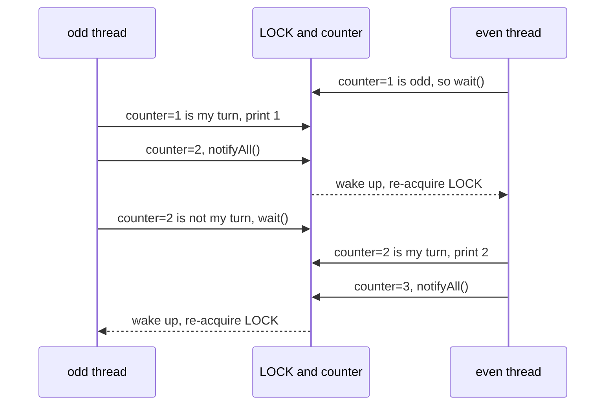
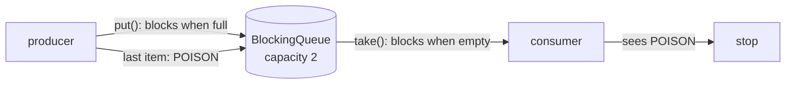
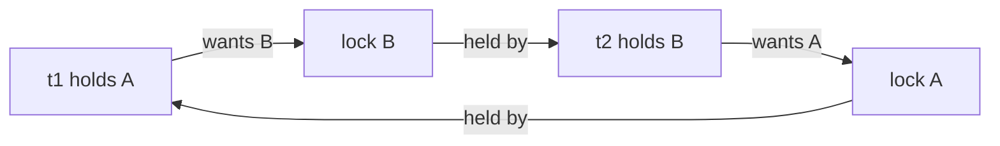

## In One Line
Every "write a multithreaded program" question is one of five shapes — **take turns** (odd/even, 1..N with 3 threads), **hand work over** (producer-consumer), **don't lock each other out** (deadlock), **create exactly once** (thread-safe singleton), or **split and combine** (parallel sum) — and each shape has a standard recipe: a guarded `wait` loop or semaphores, a `BlockingQueue`, a global lock order, a holder class or `volatile` double-check, and an executor with futures.

## Mental Model
Think of a **relay race on a single-lane track**.

- **Taking turns** — only the runner holding the **baton** may run. A runner who does not have it waits at the side (`wait()`); the runner who finishes hands the baton over and shouts (`notifyAll()` / `semaphore.release()`). A shared scoreboard (`counter`, `turn`) says whose turn it is — the baton itself is the lock.
- **Producer-consumer** — a kitchen hatch with room for 2 plates. The cook blocks when the hatch is full; the waiter blocks when it is empty. A `BlockingQueue` *is* that hatch.
- **Deadlock** — two runners each hold one baton and wait for the other's. Nobody moves, forever. The fix is a rule: "always pick up the red baton before the blue one".
- **Singleton** — one trophy for the whole event. Several people may rush to create it at the same moment; the organiser (class initialisation or a lock) makes sure only one is ever made.
- **Parallel sum** — split the track into four lanes, one runner per lane, then add up their times at the finish line (`Future.get()`, `join()`).

## Concept
### The recipes at a glance
| Problem | Classic tool | Modern / simpler tool |
|---|---|---|
| Threads take turns in a fixed order | `synchronized` + `while (!myTurn) wait()` + `notifyAll()` | One `Semaphore` per thread (baton passing), or `ReentrantLock` + one `Condition` per thread |
| Producer-consumer | `synchronized` bounded buffer with `wait`/`notifyAll` | `ArrayBlockingQueue` / `LinkedBlockingQueue` `put`/`take`, poison pill to stop |
| Deadlock | Show two threads locking A→B and B→A | Fix: global lock order, or `tryLock(timeout)` and back off |
| Shared counter | `synchronized` method | `AtomicInteger` (CAS), `LongAdder` (high contention) |
| Thread-safe singleton | `synchronized getInstance()` | Holder idiom, `enum`, or double-checked locking with `volatile` |
| Parallel sum / split work | `Thread`s + `join()` | `ExecutorService.invokeAll`, `CompletableFuture.allOf`, `ForkJoinPool`, parallel streams |
| Wait for N tasks | `join()` each thread | `CountDownLatch`, `invokeAll`, `allOf` |
| Timeouts | — | `Future.get(timeout)` + `cancel(true)`, `completeOnTimeout` / `orTimeout` |

### Recipe 1 — the guarded block (turn taking with `wait`/`notifyAll`)
```java
synchronized (LOCK) {
    while (!myTurn()) LOCK.wait();   // 1. wait IN A LOOP until the condition holds
    doMyWork();                       // 2. act while holding the lock
    changeTheTurn();                  // 3. change the shared state
    LOCK.notifyAll();                 // 4. wake the others so they re-check
}
```
- `wait()`, `notify()` and `notifyAll()` must be called **while holding that object's monitor**, otherwise `IllegalMonitorStateException`.
- `wait()` **releases** the lock and suspends the thread; when woken, the thread must **re-acquire** the lock before `wait()` returns.
- Always `while`, never `if`: a thread can wake up **spuriously**, or be woken when it is not its turn (another thread was the intended one). The loop re-checks the condition.
- With **more than two** threads use `notifyAll()`: `notify()` wakes one arbitrary waiter, which may be the wrong one; it goes back to waiting and nobody wakes the right thread — the program hangs.
- The **condition variable** (`counter`, `turn`) is ordinary shared state, protected by the same lock. The lock gives both mutual exclusion and visibility.

Details and the full lifecycle are in [wait and notify](lesson:a06-threads/06-wait-notify) and [notifyAll](lesson:a06-threads/07-notify-all).

### Recipe 2 — baton passing with semaphores
A `Semaphore` holds *permits*. `acquire()` takes one (blocks if there are none), `release()` adds one — any thread may release, there is no ownership. Give thread 0 a semaphore with 1 permit and all others 0; each thread acquires *its own* semaphore, does its step, and releases the *next* thread's semaphore. No shared counter, no `notifyAll`, and it scales to K threads. More in [Semaphore](lesson:a06-threads/14-semaphore).

### Recipe 3 — `ReentrantLock` + `Condition`s for targeted wake-ups
`lock.newCondition()` creates a separate wait set. With one `Condition` per thread you can `signal()` exactly the next thread instead of waking everyone. `await()`/`signal()` are the `Lock` equivalents of `wait()`/`notify()` and follow the same rules (hold the lock, loop on the condition).

### Recipe 4 — producer-consumer with a `BlockingQueue`
| Method | Queue full / empty behaviour |
|---|---|
| `put(e)` / `take()` | **block** until space / an element is available |
| `offer(e)` / `poll()` | return `false` / `null` immediately |
| `offer(e, t, unit)` / `poll(t, unit)` | block up to a timeout |
| `add(e)` / `remove()` | throw `IllegalStateException` / `NoSuchElementException` |

| Implementation | Use it when |
|---|---|
| `ArrayBlockingQueue` | fixed capacity, one lock, predictable memory |
| `LinkedBlockingQueue` | optionally bounded (default `Integer.MAX_VALUE` — effectively unbounded), separate put/take locks |
| `SynchronousQueue` | zero capacity: every `put` waits for a `take` (direct hand-off) |
| `PriorityBlockingQueue` | unbounded, consumers take the highest priority first |
| `DelayQueue` | elements become available only after their delay |

To stop consumers, send a **poison pill** (a special value meaning "no more work"), one per consumer, or interrupt them. The theory is in [BlockingQueue and concurrent collections](lesson:b03-concurrency/04-blockingqueue-and-concurrent-collections).

### Recipe 5 — deadlock: cause, detection, cure
A deadlock needs all four **Coffman conditions**: *mutual exclusion*, *hold and wait*, *no pre-emption*, and *circular wait*. Break any one and it cannot happen:
- **Lock ordering** (breaks circular wait) — every thread takes locks in the same global order (e.g. by account id).
- **`tryLock(timeout)`** (breaks hold-and-wait) — if the second lock is not available, release the first, back off randomly, retry.
- **One coarser lock**, or **open calls** (never call foreign code while holding a lock).

Detect it with `jstack <pid>` / `jcmd <pid> Thread.print` ("Found one Java-level deadlock"), or programmatically with `ThreadMXBean.findDeadlockedThreads()`. See [Deadlock](lesson:a06-threads/09-deadlock).

### Recipe 6 — atomicity: `count++` is three steps
`count++` is *read, add, write*. Two threads can read the same old value and both write old+1 — one update is lost. Fixes: `synchronized` (mutual exclusion), `AtomicInteger.incrementAndGet()` (lock-free compare-and-swap loop), `LongAdder` (per-thread cells summed on read — fastest under heavy contention). `volatile` alone does **not** help: it guarantees visibility, not atomicity. See [atomics and CAS](lesson:b03-concurrency/02-atomics-and-cas).

### Recipe 7 — safe lazy initialisation
| Singleton style | Lazy? | Thread-safe? | Notes |
|---|---|---|---|
| Eager `static final` field | No | Yes (class init) | Simplest |
| `synchronized getInstance()` | Yes | Yes | Locks on every call |
| Double-checked locking | Yes | **Only with `volatile`** | Without `volatile`, another thread can see a non-null reference to a not-yet-constructed object |
| Holder class (`Lazy.INSTANCE`) | Yes | Yes (JVM class-init lock) | Best general answer |
| `enum` with one constant | No (on first use of the enum) | Yes | Also safe against serialization and reflection |

### Recipe 8 — split and combine
1. Split the input into chunks (≈ number of cores, or a size threshold).
2. Each task computes a **local** result — no shared mutable state, no locks.
3. Combine: `Future.get()` / `invokeAll`, `CompletableFuture.allOf(...).join()`, `left.join() + right.compute()` in fork/join, or let a parallel stream do all three steps.
4. Always use a `long` accumulator for big sums, and always `shutdown()` your executors (or use try-with-resources on `ExecutorService`, Java 19+).

### Hygiene rules that interviewers look for
- `start()` runs the code on a new thread; `run()` just calls the method on the current thread.
- Catching `InterruptedException`: either rethrow it or **restore the flag** with `Thread.currentThread().interrupt()`.
- Release locks and permits in `finally`.
- A printed line is **not** atomic with the operation before it: "Consumed 2" can appear before "Produced 2". Interleaved output varies between runs — say so.
- `Thread.sleep` inside `synchronized` keeps the lock; `wait` releases it.
- An `ExecutorService` with non-daemon threads keeps the JVM alive until it is shut down.

## Diagram

The shared counter decides whose turn it is; `wait()` releases the lock so the other thread can move, and `notifyAll()` makes the sleeper re-check the condition.


The queue does all the waiting and waking for you; a poison pill is how the producer says "no more items".


A cycle of "holds one, waits for the other" is a deadlock; forcing every thread to take A before B makes the cycle impossible.

## Code
**1. Odd/even printer — two threads, one lock, a shared counter**
```java
public class OddEvenPrinter {
    private static final int MAX = 10;
    private static int counter = 1;                      // shared state, guarded by LOCK
    private static final Object LOCK = new Object();

    public static void main(String[] args) throws InterruptedException {
        Thread odd  = new Thread(() -> print(1), "odd");  // prints when counter % 2 == 1
        Thread even = new Thread(() -> print(0), "even"); // prints when counter % 2 == 0
        even.start();                                     // start order does not matter
        odd.start();
        odd.join();
        even.join();
        System.out.println("done");
    }

    private static void print(int remainder) {
        while (true) {
            synchronized (LOCK) {
                while (counter <= MAX && counter % 2 != remainder) {
                    try {
                        LOCK.wait();                      // releases LOCK while waiting
                    } catch (InterruptedException e) {
                        Thread.currentThread().interrupt();
                        return;
                    }
                }
                if (counter > MAX) {                      // finished: wake the other thread and exit
                    LOCK.notifyAll();
                    return;
                }
                System.out.println(Thread.currentThread().getName() + " -> " + counter);
                counter++;
                LOCK.notifyAll();                         // it is the other thread's turn now
            }
        }
    }
}
```
```output
odd -> 1
even -> 2
odd -> 3
even -> 4
odd -> 5
even -> 6
odd -> 7
even -> 8
odd -> 9
even -> 10
done
```
This output is the same on every run: the counter forces strict alternation, whichever thread the scheduler starts first.

**2. Producer-consumer with `ArrayBlockingQueue` and a poison pill**
```java
import java.util.concurrent.*;

public class ProducerConsumerBlockingQueue {
    private static final int POISON = -1;                 // "no more items" marker

    public static void main(String[] args) throws InterruptedException {
        BlockingQueue<Integer> queue = new ArrayBlockingQueue<>(2);

        Thread producer = new Thread(() -> {
            try {
                for (int i = 1; i <= 5; i++) {
                    queue.put(i);                          // blocks while the queue is full
                    System.out.println("Produced " + i);
                }
                queue.put(POISON);                         // tell the consumer to stop
            } catch (InterruptedException e) { Thread.currentThread().interrupt(); }
        }, "producer");

        Thread consumer = new Thread(() -> {
            try {
                while (true) {
                    int x = queue.take();                  // blocks while the queue is empty
                    if (x == POISON) break;
                    System.out.println("  Consumed " + x);
                }
                System.out.println("Consumer saw the poison pill and stopped");
            } catch (InterruptedException e) { Thread.currentThread().interrupt(); }
        }, "consumer");

        producer.start(); consumer.start();
        producer.join(); consumer.join();
    }
}
```
One real run (**the interleaving varies between runs**):
```output
Produced 1
Produced 2
Produced 3
  Consumed 1
  Consumed 2
  Consumed 3
  Consumed 4
Produced 4
  Consumed 5
Produced 5
Consumer saw the poison pill and stopped
```

## Walkthrough
### 1. `OddEvenPrinter`
- `private static int counter = 1` — the **shared state** that says whose turn it is. It is only read and written inside `synchronized (LOCK)`, which gives both mutual exclusion and memory visibility, so it does not need `volatile`.
- `private static final Object LOCK = new Object()` — a private lock object. Locking on a private object (instead of `this` or a class literal) means no outside code can grab the same monitor by accident.
- `new Thread(() -> print(1), "odd")` — the lambda is the thread's `Runnable`; the second argument names the thread, which is what `Thread.currentThread().getName()` prints later. `print(1)` means "print when `counter % 2 == 1`".
- `even.start(); odd.start();` — deliberately starting `even` first shows that the start order does not matter: the even thread finds `counter = 1`, sees it is not its turn and waits.
- `odd.join(); even.join();` — `main` waits for both threads to finish before printing `done`. `join` also guarantees `main` sees everything they wrote.
- `while (true) { synchronized (LOCK) { ... } }` — each round enters the lock, does one step and leaves; the outer loop repeats until the thread returns.
- `while (counter <= MAX && counter % 2 != remainder) LOCK.wait();` — the **guarded wait**. `wait()` releases `LOCK`, so the other thread can enter. The loop re-checks after every wake-up (spurious wake-ups, or a wake-up meant for someone else). The `counter <= MAX` part lets a waiting thread leave when the work is over.
- `catch (InterruptedException e) { Thread.currentThread().interrupt(); return; }` — `wait()` throws if the thread is interrupted; we restore the interrupt flag (catching it cleared the flag) and stop.
- `if (counter > MAX) { LOCK.notifyAll(); return; }` — the exit path. Waking the other thread before leaving is essential: without it, a thread still inside `wait()` would sleep forever and `join()` would hang.
- `System.out.println(...); counter++; LOCK.notifyAll();` — do the work, pass the turn, wake the other thread. The printed line is inside the lock, so the output order is exactly the order of events.

### 2. `ProducerConsumerBlockingQueue`
- `new ArrayBlockingQueue<>(2)` — a bounded, array-backed, thread-safe FIFO queue with room for 2 items. Bounding the queue gives **back-pressure**: a fast producer cannot run out of memory.
- `queue.put(i)` — inserts, **blocking** while the queue is full. All the waiting, waking and locking happens inside the queue (a `ReentrantLock` with `notFull`/`notEmpty` conditions — the same design as `MyBlockingQueue` in the Q&A).
- `queue.put(POISON)` — after the last real item, the producer sends a sentinel value that cannot be real data. With several consumers you send one pill per consumer.
- `int x = queue.take()` — removes the head, **blocking** while the queue is empty. Unboxing into `int` is safe because a `BlockingQueue` never holds `null` (it rejects `null` elements).
- `if (x == POISON) break;` — the consumer stops cleanly instead of blocking forever.
- **Why the output varies:** `put` and the following `println` are two separate steps. The consumer can `take` item 4 and print "Consumed 4" before the producer thread gets CPU time to print "Produced 4". The *queue* order is always 1..5 — only the printing interleaves differently from run to run.

## Traps
- **`if` instead of `while` around `wait()`.** After a spurious wake-up, or when a different consumer took the item first, the thread continues with a false condition — e.g. `remove()` on an empty queue throws `NoSuchElementException`.
- **`notify()` with more than two threads.** It wakes one arbitrary waiter; if it is the wrong one, it waits again and nobody else is woken — a silent hang. Use `notifyAll()` or separate `Condition`s.
- **`wait`/`notify` without holding the monitor** throws `IllegalMonitorStateException` — also when you hold a *different* object's lock.
- **Forgetting the final `notifyAll()`** when a thread exits a turn-taking loop leaves the other thread waiting forever.
- **`t.run()` instead of `t.start()`** runs the code in the current thread — no concurrency at all, and the "worker" prints `main` as its thread name.
- **Swallowing `InterruptedException`** (`catch (InterruptedException e) {}`) loses the cancellation request. Restore it with `Thread.currentThread().interrupt()`.
- **Not shutting down an `ExecutorService`** keeps its non-daemon threads alive, so the JVM never exits.
- **`volatile int count; count++`** is still a race — `volatile` gives visibility, not atomicity.
- **Double-checked locking without `volatile`** can publish a partially constructed object (the reference assignment can be reordered before the constructor's writes become visible).
- **`IntStream.sum()` returns `int`**: summing 1..10,000,000 gives `-2004260032`. Use `asLongStream()` / `mapToLong` / a `long` accumulator.
- **Blocking tasks in the common pool** (`parallelStream`, `CompletableFuture.supplyAsync` without an executor) starve every other user of that pool. Pass your own executor for I/O.
- **`Semaphore.release()` has no owner check** — releasing without acquiring silently *adds* a permit and breaks the limit. Always pair `acquire` with `release` in `finally`.
- **Daemon threads are killed when the last non-daemon thread ends**; their `finally` blocks do not run.

## Tips & Tricks
- **The four-line guarded block:** *lock → while-not-my-turn wait → work + change turn → notifyAll.* Write it the same way every time.
- **"Wait in a While, Wake them All."** (`while` + `notifyAll`) — the two rules that fix 90% of broken wait/notify code.
- **Turn formula for K threads:** thread `id` prints `n` when `(n - 1) % K == id`.
- **Baton passing:** "acquire mine, release next" — `turn[id].acquire(); ...; turn[(id + 1) % K].release();`.
- **Producer-consumer in an interview:** mention the `wait`/`notifyAll` version to show you understand it, then say "in production I'd use `ArrayBlockingQueue` with `put`/`take` and a poison pill".
- **Deadlock one-liner:** "Take locks in a global order; if you can't, `tryLock` with a timeout and back off."
- **Singleton one-liner:** "Holder idiom for lazy, `enum` for bullet-proof, and DCL only with `volatile`."
- **Parallel sum checklist:** split, local sums, combine, `long`, shutdown.
- **When output varies, say it**: "the interleaving of the print lines is non-deterministic, but the final sum/order of the queue is guaranteed".

## Interview Q&A
### [Basic] Print odd and even numbers alternately using two threads (wait/notify).
**Approach:** Two threads share one lock object and a `counter`. Each thread waits in a `while` loop until the counter's parity matches its own, prints, increments, and calls `notifyAll()`. When the counter passes the maximum, each thread wakes the other and exits. The complete program, its output and a line-by-line walkthrough are in the **Code** section (`OddEvenPrinter`); the heart of it:
```java
synchronized (LOCK) {
    while (counter <= MAX && counter % 2 != remainder) LOCK.wait();
    if (counter > MAX) { LOCK.notifyAll(); return; }
    System.out.println(Thread.currentThread().getName() + " -> " + counter);
    counter++;
    LOCK.notifyAll();
}
```
```output
odd -> 1
even -> 2
odd -> 3
even -> 4
odd -> 5
even -> 6
odd -> 7
even -> 8
odd -> 9
even -> 10
done
```
**Complexity:** O(N) time for N numbers (plus two context switches per number — the program is deliberately *slower* than one thread); O(1) space.

**Follow-up:** *Why `notifyAll()` when there are only two threads?* — With exactly two threads `notify()` also works, but `notifyAll()` stays correct if a third thread is added, and costs nothing here. The `while` loop is what makes either one safe.

### [Intermediate] Solve odd/even without `wait`/`notify`.
**Approach:** Two semaphores act as turn tokens: `oddTurn` starts with 1 permit, `evenTurn` with 0. Each thread acquires its own token, prints, and releases the other's token. Each thread can simply loop over its own numbers (odd: 1, 3, 5…; even: 2, 4, 6…) — no shared counter at all.
```java
import java.util.concurrent.Semaphore;

public class OddEvenSemaphore {
    public static void main(String[] args) throws InterruptedException {
        int max = 10;
        Semaphore oddTurn = new Semaphore(1);    // odd goes first
        Semaphore evenTurn = new Semaphore(0);

        Thread odd = new Thread(() -> {
            for (int i = 1; i <= max; i += 2) {
                oddTurn.acquireUninterruptibly();     // wait for my turn
                System.out.print(i + " ");
                evenTurn.release();                   // hand the turn over
            }
        });
        Thread even = new Thread(() -> {
            for (int i = 2; i <= max; i += 2) {
                evenTurn.acquireUninterruptibly();
                System.out.print(i + " ");
                oddTurn.release();
            }
        });
        odd.start(); even.start();
        odd.join(); even.join();
        System.out.println();
    }
}
```
```output
1 2 3 4 5 6 7 8 9 10 
```
The release/acquire pair also creates a *happens-before* edge, so each thread sees the other's printed output in order.

**Complexity:** O(N) time, O(1) space.

**Follow-up:** *What about an odd `max`, like 9?* — Each thread's own loop bound stops it after its last number, so it just works; the final `release()` adds a permit nobody takes, which is harmless.

### [Intermediate] Print 1 to N using three threads in order (T1: 1, T2: 2, T3: 3, T1: 4 …).
**Approach:** Generalise the guarded block: thread `id` (0, 1, 2) may print `next` only when `(next - 1) % 3 == id`. Because three threads wait on the same monitor, you **must** use `notifyAll()`; `notify()` could wake the wrong thread and hang the program. Starting the threads in reverse order proves the order comes from the logic, not the scheduler.
```java
public class ThreeThreadsInOrder {
    private static final int N = 10, THREADS = 3;
    private static int next = 1;                         // next number to print, guarded by LOCK
    private static final Object LOCK = new Object();

    public static void main(String[] args) throws InterruptedException {
        Thread[] workers = new Thread[THREADS];
        for (int t = 0; t < THREADS; t++) {
            final int id = t;                            // thread id prints numbers with (n-1) % 3 == id
            workers[t] = new Thread(() -> run(id), "T" + (t + 1));
        }
        for (int t = THREADS - 1; t >= 0; t--) workers[t].start();   // start in reverse on purpose
        for (Thread w : workers) w.join();
    }

    private static void run(int id) {
        synchronized (LOCK) {
            while (true) {
                while (next <= N && (next - 1) % THREADS != id) {
                    try { LOCK.wait(); } catch (InterruptedException e) { return; }
                }
                if (next > N) { LOCK.notifyAll(); return; }
                System.out.println(Thread.currentThread().getName() + ": " + next++);
                LOCK.notifyAll();                        // notify() could wake the wrong thread
            }
        }
    }
}
```
```output
T1: 1
T2: 2
T3: 3
T1: 4
T2: 5
T3: 6
T1: 7
T2: 8
T3: 9
T1: 10
```
Here the whole loop sits inside one `synchronized` block — fine, because `wait()` releases the lock on every turn.

**Complexity:** O(N) printed numbers, but each `notifyAll` wakes all K−1 waiters, so about O(N·K) wake-ups in total; O(1) extra space.

**Follow-up:** *How do you avoid waking threads that cannot proceed?* — Use one `Semaphore` or one `Condition` per thread and signal only the next one (next two questions).

### [Intermediate] Print 1 to N with K threads using semaphores (baton passing).
**Approach:** An array of K semaphores; only `turn[0]` starts with a permit. Thread `id` prints `id+1, id+1+K, id+1+2K …`; before each number it acquires `turn[id]`, after it releases `turn[(id + 1) % K]`. Exactly one thread can run at any moment and exactly the right one is woken.
```java
import java.util.concurrent.Semaphore;

public class ThreeThreadsSemaphores {
    public static void main(String[] args) throws InterruptedException {
        int n = 9, k = 3;
        Semaphore[] turn = new Semaphore[k];
        for (int i = 0; i < k; i++) turn[i] = new Semaphore(i == 0 ? 1 : 0);   // T1 starts

        Thread[] ts = new Thread[k];
        for (int i = 0; i < k; i++) {
            final int id = i;
            ts[i] = new Thread(() -> {
                for (int value = id + 1; value <= n; value += k) {
                    turn[id].acquireUninterruptibly();
                    System.out.print(Thread.currentThread().getName() + "=" + value + " ");
                    turn[(id + 1) % k].release();        // pass the baton to the next thread
                }
            }, "T" + (i + 1));
            ts[i].start();
        }
        for (Thread t : ts) t.join();
        System.out.println();
    }
}
```
```output
T1=1 T2=2 T3=3 T1=4 T2=5 T3=6 T1=7 T2=8 T3=9 
```
**Complexity:** O(N) time with exactly one wake-up per number; O(K) space for the semaphores.

**Follow-up:** *Why `acquireUninterruptibly()`?* — It keeps the demo short (no checked `InterruptedException`). In production prefer `acquire()` so a shutdown can interrupt a waiting thread.

### [Intermediate] Print "ABC" repeatedly with three threads using `ReentrantLock` and `Condition`.
**Approach:** One lock, one `Condition` per letter, and a `turn` field. Each thread awaits *its own* condition until `turn == me`, prints, advances `turn`, and signals only the next thread's condition — targeted wake-ups, unlike `notifyAll()`.
```java
import java.util.concurrent.locks.*;

public class PrintABCConditions {
    private final Lock lock = new ReentrantLock();
    private final Condition[] turnOf = { lock.newCondition(), lock.newCondition(), lock.newCondition() };
    private int turn = 0;                                // 0 = A, 1 = B, 2 = C

    void printLetter(int me, int rounds) {
        for (int r = 0; r < rounds; r++) {
            lock.lock();
            try {
                while (turn != me) turnOf[me].awaitUninterruptibly();
                System.out.print((char) ('A' + me));
                turn = (turn + 1) % 3;
                turnOf[turn].signal();                   // wake exactly the next thread
            } finally {
                lock.unlock();
            }
        }
    }

    public static void main(String[] args) throws InterruptedException {
        PrintABCConditions p = new PrintABCConditions();
        Thread[] ts = new Thread[3];
        for (int i = 0; i < 3; i++) {
            final int me = i;
            ts[i] = new Thread(() -> p.printLetter(me, 4));
            ts[i].start();
        }
        for (Thread t : ts) t.join();
        System.out.println();
    }
}
```
```output
ABCABCABCABC
```
`(char) ('A' + me)` — `'A' + me` is an `int` (65, 66, 67), so it is cast back to `char` to print a letter. `lock.unlock()` sits in `finally` so an exception can never leave the lock held.

**Complexity:** O(rounds × 3) time, one wake-up per letter; O(1) space.

**Follow-up:** *What if a thread calls `signal()` before the other thread started waiting?* — Nothing is lost: the waiting thread checks `turn` *before* awaiting, sees it is already its turn, and never waits. That is exactly why the condition is state, not the signal itself.

### [Intermediate] Implement producer-consumer with `wait`/`notify` (a bounded buffer).
**Approach:** A class wraps a queue and a capacity. `put` waits while full, adds, `notifyAll()`; `take` waits while empty, removes, `notifyAll()`. Both are `synchronized` on the buffer, so `wait()` is called on `this`. Both producers and consumers wait on the same monitor, so `notifyAll()` is needed to make sure the right kind of thread is woken.
```java
import java.util.*;

public class ProducerConsumerWaitNotify {
    static class BoundedBuffer<T> {
        private final Queue<T> items = new LinkedList<>();
        private final int capacity;

        BoundedBuffer(int capacity) { this.capacity = capacity; }

        public synchronized void put(T item) throws InterruptedException {
            while (items.size() == capacity) {           // ALWAYS a while loop, never if
                wait();                                   // buffer full: release lock and wait
            }
            items.add(item);
            notifyAll();                                  // wake consumers waiting for "not empty"
        }

        public synchronized T take() throws InterruptedException {
            while (items.isEmpty()) {
                wait();                                   // buffer empty: wait for a producer
            }
            T item = items.remove();
            notifyAll();                                  // wake producers waiting for "not full"
            return item;
        }
    }

    public static void main(String[] args) throws InterruptedException {
        BoundedBuffer<Integer> buffer = new BoundedBuffer<>(2);

        Thread producer = new Thread(() -> {
            try {
                for (int i = 1; i <= 5; i++) {
                    buffer.put(i);
                    System.out.println("Produced " + i);
                }
            } catch (InterruptedException e) { Thread.currentThread().interrupt(); }
        });
        Thread consumer = new Thread(() -> {
            try {
                int sum = 0;
                for (int i = 1; i <= 5; i++) {
                    int x = buffer.take();
                    sum += x;
                    System.out.println("  Consumed " + x);
                }
                System.out.println("Sum = " + sum);
            } catch (InterruptedException e) { Thread.currentThread().interrupt(); }
        });
        producer.start(); consumer.start();
        producer.join(); consumer.join();
    }
}
```
One real run (**interleaving varies**; the last line is always `Sum = 15`):
```output
Produced 1
  Consumed 1
  Consumed 2
Produced 2
Produced 3
Produced 4
Produced 5
  Consumed 3
  Consumed 4
  Consumed 5
Sum = 15
```
"Consumed 2" before "Produced 2" is not a bug: item 2 *was* put before it was taken, but the producer's `println` runs after `put` returns, outside the lock.

**Complexity:** O(1) per `put`/`take` (plus waiting); O(capacity) space.

**Follow-up:** *Why is `if (items.isEmpty()) wait();` wrong?* — With two consumers, both can be woken by one `notifyAll()`; the first takes the item, the second continues past the `if` and calls `remove()` on an empty queue (`NoSuchElementException`). Spurious wake-ups cause the same failure.

### [Basic] Implement producer-consumer with a `BlockingQueue`.
**Approach:** Replace the hand-written buffer by `ArrayBlockingQueue`: `put` blocks when full, `take` blocks when empty. End the consumer with a poison pill. The full program with a line-by-line walkthrough is in the **Code** section (`ProducerConsumerBlockingQueue`); the essential lines:
```java
BlockingQueue<Integer> queue = new ArrayBlockingQueue<>(2);
// producer
for (int i = 1; i <= 5; i++) queue.put(i);
queue.put(POISON);
// consumer
while (true) {
    int x = queue.take();
    if (x == POISON) break;
    System.out.println("  Consumed " + x);
}
```
Another real run of the same program (compare with the one in the Code section — **the interleaving varies**):
```output
Produced 1
Produced 2
  Consumed 1
  Consumed 2
Produced 3
  Consumed 3
  Consumed 4
Produced 4
Produced 5
  Consumed 5
Consumer saw the poison pill and stopped
```
**Complexity:** O(1) per operation; O(capacity) space.

**Follow-up:** *How do you stop 3 consumers?* — Put 3 poison pills (one per consumer), or interrupt them / shut down their executor with `shutdownNow()`, which interrupts threads blocked in `take()`.

### [Advanced] Implement your own blocking queue with `ReentrantLock` and two `Condition`s.
**Approach:** This is how `ArrayBlockingQueue` is built. One lock, two wait sets: producers wait on `notFull`, consumers on `notEmpty`. Because the wait sets are separate, `signal()` (not `signalAll()`) is enough — a producer only ever wakes a consumer and vice versa.
```java
import java.util.*;
import java.util.concurrent.locks.*;

public class MyBlockingQueue<T> {
    private final Deque<T> items = new ArrayDeque<>();
    private final int capacity;
    private final ReentrantLock lock = new ReentrantLock();
    private final Condition notFull = lock.newCondition();    // producers wait here
    private final Condition notEmpty = lock.newCondition();   // consumers wait here

    public MyBlockingQueue(int capacity) { this.capacity = capacity; }

    public void put(T item) throws InterruptedException {
        lock.lock();
        try {
            while (items.size() == capacity) notFull.await();
            items.addLast(item);
            notEmpty.signal();                 // exactly one waiting consumer can proceed
        } finally {
            lock.unlock();
        }
    }

    public T take() throws InterruptedException {
        lock.lock();
        try {
            while (items.isEmpty()) notEmpty.await();
            T item = items.removeFirst();
            notFull.signal();                  // exactly one waiting producer can proceed
            return item;
        } finally {
            lock.unlock();
        }
    }

    public static void main(String[] args) throws InterruptedException {
        MyBlockingQueue<String> q = new MyBlockingQueue<>(1);
        Thread producer = new Thread(() -> {
            try {
                for (String s : List.of("a", "b", "c")) q.put(s);
                q.put("END");
            } catch (InterruptedException e) { Thread.currentThread().interrupt(); }
        });
        producer.start();
        StringBuilder got = new StringBuilder();
        for (String s = q.take(); !s.equals("END"); s = q.take()) got.append(s);
        producer.join();
        System.out.println("Consumed in order: " + got);
    }
}
```
```output
Consumed in order: abc
```
**Complexity:** O(1) per `put`/`take`; O(capacity) space.

**Follow-up:** *Why does `LinkedBlockingQueue` scale better than `ArrayBlockingQueue` under load?* — It uses **two** locks (`putLock`, `takeLock`), so a producer and a consumer can work at the same time; `ArrayBlockingQueue` uses one lock for both ends.

### [Intermediate] Write a program that deadlocks, and detect the deadlock.
**Approach:** Thread `t1` locks A then B; thread `t2` locks B then A; a short sleep between the two locks makes sure each grabs its first lock before trying the second. The threads are daemons so the demo can end; `ThreadMXBean.findDeadlockedThreads()` reports the cycle.
```java
import java.lang.management.*;

public class DeadlockDemo {
    static final Object A = new Object();
    static final Object B = new Object();

    public static void main(String[] args) throws InterruptedException {
        Thread t1 = new Thread(() -> {
            synchronized (A) {
                System.out.println("t1 holds A, wants B");
                pause(100);                               // make the bad interleaving certain
                synchronized (B) { System.out.println("t1 got B"); }
            }
        }, "t1");
        Thread t2 = new Thread(() -> {
            synchronized (B) {
                System.out.println("t2 holds B, wants A");
                pause(100);
                synchronized (A) { System.out.println("t2 got A"); }
            }
        }, "t2");
        t1.setDaemon(true);                               // so the JVM can exit despite the deadlock
        t2.setDaemon(true);
        t1.start(); t2.start();

        Thread.sleep(500);
        ThreadMXBean mx = ManagementFactory.getThreadMXBean();
        long[] ids = mx.findDeadlockedThreads();          // null when there is no deadlock
        System.out.println("Deadlocked threads: " + (ids == null ? 0 : ids.length));
        for (ThreadInfo info : mx.getThreadInfo(ids)) {
            System.out.println(info.getThreadName() + " is " + info.getThreadState()
                    + " waiting for a lock held by " + info.getLockOwnerName());
        }
    }

    static void pause(long ms) {
        try { Thread.sleep(ms); } catch (InterruptedException e) { Thread.currentThread().interrupt(); }
    }
}
```
One real run (the order of the first two lines, and of the two thread reports, can vary):
```output
t1 holds A, wants B
t2 holds B, wants A
Deadlocked threads: 2
t1 is BLOCKED waiting for a lock held by t2
t2 is BLOCKED waiting for a lock held by t1
```
"t1 got B" and "t2 got A" never print. A thread waiting to enter a `synchronized` block is in state `BLOCKED` and cannot be interrupted out of it.

**Complexity:** not an algorithm — the point is the lock cycle; detection cost is O(threads).

**Follow-up:** *How would you find it in a running production JVM?* — `jstack <pid>` or `jcmd <pid> Thread.print` prints "Found one Java-level deadlock" with both stacks; monitoring tools call the same `ThreadMXBean` API.

### [Intermediate] Fix the deadlock.
**Approach:** Break the *circular wait*: all threads acquire the locks in the **same global order** (A before B). Then no thread can hold B while waiting for A, so no cycle can form. For locks chosen at runtime (bank accounts), order by a unique key such as the account id.
```java
public class DeadlockFixed {
    static final Object A = new Object();
    static final Object B = new Object();

    public static void main(String[] args) throws InterruptedException {
        // FIX: every thread takes the locks in the SAME global order: A, then B
        Runnable task = () -> {
            synchronized (A) {
                System.out.println(Thread.currentThread().getName() + " holds A");
                pause(100);
                synchronized (B) {
                    System.out.println(Thread.currentThread().getName() + " holds A and B");
                }
            }
        };
        Thread t1 = new Thread(task, "t1");
        Thread t2 = new Thread(task, "t2");
        t1.start(); t2.start();
        t1.join(); t2.join();
        System.out.println("No deadlock");
    }

    static void pause(long ms) {
        try { Thread.sleep(ms); } catch (InterruptedException e) { Thread.currentThread().interrupt(); }
    }
}
```
One real run (**t1 and t2 may swap**, but each thread's two lines always stay together):
```output
t1 holds A
t1 holds A and B
t2 holds A
t2 holds A and B
No deadlock
```
**Complexity:** O(1) extra; the cost is reduced concurrency while a thread holds both locks.

**Follow-up:** *How do you order two `Account` objects that have no natural order?* — Compare a unique immutable id; if ids can tie, fall back to `System.identityHashCode` plus a global tie-breaker lock.

### [Advanced] Transfer money between accounts without deadlock using `tryLock`.
**Approach:** Break *hold and wait*: take the first lock with `tryLock(timeout)`, then try the second the same way; if either fails, release everything, sleep a random short time (to avoid **livelock** — both threads retrying in lock-step), and retry. The test runs 1,000 transfers in both directions on 4 threads; the total must stay 2,000.
```java
import java.util.concurrent.*;
import java.util.concurrent.locks.*;

public class TransferTryLock {
    static class Account {
        final String id;
        int balance;
        final ReentrantLock lock = new ReentrantLock();
        Account(String id, int balance) { this.id = id; this.balance = balance; }
    }

    // Try both locks with a timeout; if we cannot get both, release what we hold and retry
    static boolean transfer(Account from, Account to, int amount) throws InterruptedException {
        while (true) {
            if (from.lock.tryLock(50, TimeUnit.MILLISECONDS)) {
                try {
                    if (to.lock.tryLock(50, TimeUnit.MILLISECONDS)) {
                        try {
                            if (from.balance < amount) return false;
                            from.balance -= amount;
                            to.balance += amount;
                            return true;
                        } finally {
                            to.lock.unlock();
                        }
                    }
                } finally {
                    from.lock.unlock();
                }
            }
            Thread.sleep(ThreadLocalRandom.current().nextInt(1, 10));   // back off, avoid livelock
        }
    }

    public static void main(String[] args) throws Exception {
        Account x = new Account("X", 1000), y = new Account("Y", 1000);
        ExecutorService pool = Executors.newFixedThreadPool(4);
        for (int i = 0; i < 1000; i++) {
            final boolean flip = i % 2 == 0;              // half X->Y, half Y->X: the classic deadlock shape
            pool.submit(() -> flip ? transfer(x, y, 1) : transfer(y, x, 1));
        }
        pool.shutdown();
        System.out.println("Finished in time: " + pool.awaitTermination(10, TimeUnit.SECONDS));
        System.out.println("X=" + x.balance + " Y=" + y.balance + " total=" + (x.balance + y.balance));
    }
}
```
```output
Finished in time: true
X=1000 Y=1000 total=2000
```
`pool.submit(() -> ...)` with a lambda that returns a value and may throw `InterruptedException` is treated as a `Callable<Boolean>`. `awaitTermination` returning `true` proves no worker got stuck; the reads of `balance` in `main` are safe because `awaitTermination` returning `true` happens-after all tasks completed.

**Complexity:** O(1) per transfer when uncontended; retries add latency under contention. O(1) space.

**Follow-up:** *`tryLock()` without a timeout vs `lock()`?* — `tryLock()` returns immediately (and even barges ahead of a fair lock's queue); `lock()` waits forever and cannot be interrupted — `lockInterruptibly()` can.

### [Basic] Show a race condition on a shared counter and fix it.
**Approach:** Two threads each increment a plain `int` a million times — updates get lost because `count++` is read-modify-write. Fix it with `synchronized`, `AtomicInteger` (CAS), or `LongAdder`. Each phase runs separately so they do not slow each other down.
```java
import java.util.concurrent.atomic.*;

public class RaceConditionCounter {
    static int unsafe = 0;
    static int synced = 0;
    static final AtomicInteger atomic = new AtomicInteger();
    static final LongAdder adder = new LongAdder();

    static synchronized void incSynced() { synced++; }

    static void runTwice(Runnable body) throws InterruptedException {
        Thread t1 = new Thread(body), t2 = new Thread(body);
        t1.start(); t2.start();
        t1.join(); t2.join();                   // join() also makes the threads' writes visible to main
    }

    public static void main(String[] args) throws InterruptedException {
        final int N = 1_000_000;
        runTwice(() -> { for (int i = 0; i < N; i++) unsafe++; });          // read-modify-write race
        runTwice(() -> { for (int i = 0; i < N; i++) incSynced(); });       // one thread at a time
        runTwice(() -> { for (int i = 0; i < N; i++) atomic.incrementAndGet(); });   // CAS loop
        runTwice(() -> { for (int i = 0; i < N; i++) adder.increment(); }); // striped cells

        System.out.println("unsafe        = " + unsafe + "  (expected " + 2 * N + ")");
        System.out.println("synchronized  = " + synced);
        System.out.println("AtomicInteger = " + atomic.get());
        System.out.println("LongAdder     = " + adder.sum());
    }
}
```
One real run (**the `unsafe` value varies** — in five runs on a 4-core machine it was 1851743, 1984786, 1934985, 1965991 and, once, a lucky 2000000):
```output
unsafe        = 1851743  (expected 2000000)
synchronized  = 2000000
AtomicInteger = 2000000
LongAdder     = 2000000
```
A race does not *always* show up — that is what makes it dangerous. The three fixed counters are always exactly 2,000,000.

**Complexity:** O(N) increments per thread; synchronized/atomic add contention cost per increment; O(1) space (`LongAdder` O(cores)).

**Follow-up:** *Would `volatile int` fix it?* — No. `volatile` makes each read and write visible, but two threads can still read the same value and both write value+1.

### [Intermediate] Why is the classic lazy singleton not thread-safe? Prove it.
**Approach:** `if (instance == null) instance = new X();` is a **check-then-act** race: several threads can all see `null` before any of them assigns. A `CountDownLatch` "starting gun" releases 8 threads at the same moment, and a slow constructor widens the window.
```java
import java.util.*;
import java.util.concurrent.*;
import java.util.concurrent.atomic.AtomicInteger;

public class BrokenSingleton {
    static final AtomicInteger created = new AtomicInteger();
    private static BrokenSingleton instance;

    private BrokenSingleton() {
        created.incrementAndGet();
        try { Thread.sleep(10); } catch (InterruptedException ignored) { }   // widen the race window
    }

    static BrokenSingleton getInstance() {        // NOT thread-safe: check-then-act race
        if (instance == null) {
            instance = new BrokenSingleton();
        }
        return instance;
    }

    public static void main(String[] args) throws Exception {
        ExecutorService pool = Executors.newFixedThreadPool(8);
        CountDownLatch go = new CountDownLatch(1);
        List<Future<BrokenSingleton>> fs = new ArrayList<>();
        for (int i = 0; i < 8; i++) fs.add(pool.submit(() -> { go.await(); return getInstance(); }));
        go.countDown();
        Set<Object> distinct = Collections.newSetFromMap(new IdentityHashMap<>());
        for (Future<BrokenSingleton> f : fs) distinct.add(f.get());
        pool.shutdown();
        System.out.println("constructor calls: " + created.get() + ", distinct instances returned: " + distinct.size());
    }
}
```
One real run (**the numbers vary**; without the `sleep` the race is rarer, but still possible):
```output
constructor calls: 8, distinct instances returned: 8
```
`Collections.newSetFromMap(new IdentityHashMap<>())` builds a set that compares by **reference** (`==`), which is exactly "how many different objects did we get?".

**Complexity:** O(1) per call — the problem is correctness, not speed.

**Follow-up:** *Simplest fix?* — Make `getInstance()` `synchronized` (correct, but every call takes a lock), or use the holder idiom (next question).

### [Intermediate] Write a thread-safe lazy singleton — double-checked locking, holder idiom and enum.
**Approach:** DCL checks without the lock (fast path), then locks and checks again; the field **must be `volatile`** so a thread can never see a reference to a half-constructed object. The holder idiom relies on the JVM initialising `Lazy` only on first use, under its class-initialisation lock. The enum is initialised the same way and is also safe against reflection and serialization. The test hits all three from 16 threads at once.
```java
import java.util.*;
import java.util.concurrent.*;
import java.util.concurrent.atomic.AtomicInteger;

public class ThreadSafeSingleton {
    // 1. Double-checked locking: volatile is REQUIRED
    static final class Dcl {
        static final AtomicInteger created = new AtomicInteger();
        private static volatile Dcl instance;
        private Dcl() { created.incrementAndGet(); }

        static Dcl getInstance() {
            Dcl local = instance;                  // one volatile read on the fast path
            if (local == null) {                   // 1st check, no lock
                synchronized (Dcl.class) {
                    local = instance;
                    if (local == null) {           // 2nd check, with the lock
                        instance = local = new Dcl();
                    }
                }
            }
            return local;
        }
    }

    // 2. Initialization-on-demand holder: lazy + thread-safe via class initialization
    static final class Holder {
        static final AtomicInteger created = new AtomicInteger();
        private Holder() { created.incrementAndGet(); }
        private static class Lazy { static final Holder INSTANCE = new Holder(); }
        static Holder getInstance() { return Lazy.INSTANCE; }
    }

    // 3. Enum: thread-safe, serialization- and reflection-proof
    enum EnumSingleton {
        INSTANCE;
        final int id = new Random().nextInt();
    }

    public static void main(String[] args) throws Exception {
        int threads = 16;
        ExecutorService pool = Executors.newFixedThreadPool(threads);
        CountDownLatch startGun = new CountDownLatch(1);          // release all threads together
        List<Future<Object[]>> results = new ArrayList<>();
        for (int i = 0; i < threads; i++) {
            results.add(pool.submit(() -> {
                startGun.await();
                return new Object[]{ Dcl.getInstance(), Holder.getInstance(), EnumSingleton.INSTANCE };
            }));
        }
        startGun.countDown();

        Set<Object> dcl = Collections.newSetFromMap(new IdentityHashMap<>());
        Set<Object> holder = Collections.newSetFromMap(new IdentityHashMap<>());
        Set<Object> en = Collections.newSetFromMap(new IdentityHashMap<>());
        for (Future<Object[]> f : results) {
            Object[] r = f.get();
            dcl.add(r[0]); holder.add(r[1]); en.add(r[2]);
        }
        pool.shutdown();
        System.out.println("DCL    distinct instances: " + dcl.size() + ", constructor calls: " + Dcl.created.get());
        System.out.println("Holder distinct instances: " + holder.size() + ", constructor calls: " + Holder.created.get());
        System.out.println("Enum   distinct instances: " + en.size());
    }
}
```
```output
DCL    distinct instances: 1, constructor calls: 1
Holder distinct instances: 1, constructor calls: 1
Enum   distinct instances: 1
```
The `local` variable in DCL is an optimisation from *Effective Java*: the common path reads the `volatile` field only once.

**Complexity:** O(1) per call; after initialisation the holder and enum cost nothing extra, DCL costs one volatile read.

**Follow-up:** *Why exactly is `volatile` needed in DCL?* — `instance = new Dcl()` is allocate, construct, assign; without a happens-before edge, another thread may see the assignment before the constructor's writes and use a half-built object. `volatile` forbids that reordering for readers of the field. More in [Singleton](lesson:a10-patterns/01-singleton) and [the Java memory model](lesson:b03-concurrency/01-java-memory-model-and-volatile).

### [Intermediate] Compute the sum of a large array in parallel with `ExecutorService`.
**Approach:** Split the array into `parts` chunks (ceiling division so nothing is left out), create one `Callable<Long>` per chunk that sums into a **local** variable, run them with `invokeAll` (which waits for all and returns futures in task order), and add the results. Check against the formula n(n+1)/2.
```java
import java.util.*;
import java.util.concurrent.*;

public class ParallelSumExecutor {
    public static void main(String[] args) throws Exception {
        int n = 10_000_000;
        int[] data = new int[n];
        for (int i = 0; i < n; i++) data[i] = i + 1;          // 1..n, expected sum n(n+1)/2

        int parts = 4;
        ExecutorService pool = Executors.newFixedThreadPool(parts);
        try {
            List<Callable<Long>> tasks = new ArrayList<>();
            int chunk = (n + parts - 1) / parts;               // ceiling division
            for (int p = 0; p < parts; p++) {
                final int from = p * chunk;
                final int to = Math.min(n, from + chunk);      // exclusive end
                tasks.add(() -> {
                    long sum = 0;                              // local variable: no sharing, no locks
                    for (int i = from; i < to; i++) sum += data[i];
                    System.out.println(Thread.currentThread().getName() + " summed [" + from + ", " + to + ")");
                    return sum;
                });
            }
            long total = 0;
            for (Future<Long> f : pool.invokeAll(tasks)) {     // waits for all, results in task order
                total += f.get();
            }
            System.out.println("Parallel sum = " + total);
            System.out.println("Formula      = " + (long) n * (n + 1) / 2);
        } finally {
            pool.shutdown();
        }
    }
}
```
One real run (**the order of the four "summed" lines varies**; the sums never do):
```output
pool-1-thread-1 summed [0, 2500000)
pool-1-thread-2 summed [2500000, 5000000)
pool-1-thread-4 summed [7500000, 10000000)
pool-1-thread-3 summed [5000000, 7500000)
Parallel sum = 50000005000000
Formula      = 50000005000000
```
`(long) n * (n + 1) / 2` casts *before* multiplying; `n * (n + 1)` in `int` would overflow.

**Complexity:** O(n) total work, about O(n / p) wall-clock time on p cores plus task overhead; O(p) extra space.

**Follow-up:** *Is it actually faster than one loop?* — Only for large arrays and CPU-bound work. For small inputs, thread start-up and coordination cost more than the loop; always measure (JMH), and remember memory bandwidth limits simple sums.

### [Intermediate] Compute the same parallel sum with `CompletableFuture`.
**Approach:** `supplyAsync(supplier, pool)` starts each chunk; `allOf(...)` gives a future that completes when all of them have; then each `join()` returns immediately. For exactly two parts, `thenCombine` merges two futures with a function.
```java
import java.util.*;
import java.util.concurrent.*;
import java.util.stream.*;

public class ParallelSumCompletableFuture {
    public static void main(String[] args) {
        int n = 10_000_000, parts = 4;
        int[] data = IntStream.rangeClosed(1, n).toArray();
        ExecutorService pool = Executors.newFixedThreadPool(parts);
        try {
            int chunk = n / parts;
            List<CompletableFuture<Long>> futures = new ArrayList<>();
            for (int p = 0; p < parts; p++) {
                int from = p * chunk, to = (p == parts - 1) ? n : from + chunk;
                futures.add(CompletableFuture.supplyAsync(() -> {
                    long s = 0;
                    for (int i = from; i < to; i++) s += data[i];
                    return s;
                }, pool));
            }
            // allOf completes when every future has completed; join() then never blocks
            long total = CompletableFuture.allOf(futures.toArray(new CompletableFuture[0]))
                    .thenApply(v -> futures.stream().mapToLong(CompletableFuture::join).sum())
                    .join();
            System.out.println("allOf sum       = " + total);

            // Two halves combined with thenCombine
            CompletableFuture<Long> left  = CompletableFuture.supplyAsync(() -> sum(data, 0, n / 2), pool);
            CompletableFuture<Long> right = CompletableFuture.supplyAsync(() -> sum(data, n / 2, n), pool);
            System.out.println("thenCombine sum = " + left.thenCombine(right, Long::sum).join());
        } finally {
            pool.shutdown();
        }
    }

    static long sum(int[] a, int from, int to) {
        long s = 0;
        for (int i = from; i < to; i++) s += a[i];
        return s;
    }
}
```
```output
allOf sum       = 50000005000000
thenCombine sum = 50000005000000
```
The last chunk takes `to = n`, so a remainder from `n / parts` is never lost. The `from`/`to` locals are effectively final, which is what lets the lambdas capture them.

**Complexity:** O(n) work, ≈ O(n / p) wall-clock; O(p) space.

**Follow-up:** *`join()` vs `get()`?* — Both wait; `join()` throws the unchecked `CompletionException`, `get()` throws the checked `ExecutionException`/`InterruptedException`. See [CompletableFuture](lesson:a05-java8/23-completablefuture).

### [Advanced] Parallel sum with fork/join and parallel streams — and the overflow trap.
**Approach:** `RecursiveTask<Long>` splits the range in half until it is below a threshold, **forks** the left half, computes the right half itself, then **joins** the left. Work-stealing threads in the `ForkJoinPool` pick up forked halves. Parallel streams use the same common pool behind the scenes.
```java
import java.util.concurrent.*;
import java.util.stream.*;

public class ParallelSumForkJoin {
    static class SumTask extends RecursiveTask<Long> {
        private static final int THRESHOLD = 100_000;       // below this, just loop
        private final int[] a;
        private final int from, to;

        SumTask(int[] a, int from, int to) { this.a = a; this.from = from; this.to = to; }

        @Override
        protected Long compute() {
            if (to - from <= THRESHOLD) {
                long s = 0;
                for (int i = from; i < to; i++) s += a[i];
                return s;
            }
            int mid = (from + to) >>> 1;
            SumTask left = new SumTask(a, from, mid);
            SumTask right = new SumTask(a, mid, to);
            left.fork();                                    // run left asynchronously
            long r = right.compute();                       // do right in this thread
            return left.join() + r;                         // then wait for left
        }
    }

    public static void main(String[] args) {
        int n = 10_000_000;
        int[] data = IntStream.rangeClosed(1, n).toArray();
        System.out.println("ForkJoin sum        = " + ForkJoinPool.commonPool().invoke(new SumTask(data, 0, n)));
        System.out.println("Parallel stream sum = " + IntStream.of(data).parallel().asLongStream().sum());
        System.out.println("LongStream sum      = " + LongStream.rangeClosed(1, n).parallel().sum());
        System.out.println("WRONG int sum       = " + IntStream.of(data).parallel().sum() + "  (int overflow)");
    }
}
```
```output
ForkJoin sum        = 50000005000000
Parallel stream sum = 50000005000000
LongStream sum      = 50000005000000
WRONG int sum       = -2004260032  (int overflow)
```
`(from + to) >>> 1` is the overflow-safe midpoint. The last line is the classic bug: `IntStream.sum()` returns an `int`, which wraps around silently.

**Complexity:** O(n) work, O(n / p + log n) span; O(log n) recursion depth.

**Follow-up:** *Why fork one half and compute the other, instead of forking both?* — The current thread would otherwise sit idle waiting; computing one half itself halves the number of tasks and keeps the thread busy. See [parallel streams](lesson:a05-java8/19-parallel-streams).

### [Basic] Make `main` wait until several threads/tasks finish.
**Approach:** For raw threads, `join()` each one. For pool tasks (pool threads never die), use a `CountDownLatch` counted down in `finally`, or `invokeAll`, or `CompletableFuture.allOf`.
```java
import java.util.*;
import java.util.concurrent.*;

public class WaitForAll {
    public static void main(String[] args) throws InterruptedException {
        // 1. join(): wait for each thread to die
        List<Thread> threads = new ArrayList<>();
        for (int i = 1; i <= 3; i++) {
            int id = i;
            Thread t = new Thread(() -> sleep(id * 50));
            threads.add(t);
            t.start();
        }
        for (Thread t : threads) t.join();
        System.out.println("join: all 3 threads finished");

        // 2. CountDownLatch: wait for N events (works with pools, where threads never die)
        ExecutorService pool = Executors.newFixedThreadPool(3);
        CountDownLatch done = new CountDownLatch(3);
        for (int i = 1; i <= 3; i++) {
            int id = i;
            pool.execute(() -> {
                try { sleep(id * 50); } finally { done.countDown(); }   // always count down
            });
        }
        boolean ok = done.await(2, TimeUnit.SECONDS);
        System.out.println("latch: all 3 tasks finished = " + ok + ", count = " + done.getCount());
        pool.shutdown();
    }

    static void sleep(long ms) {
        try { Thread.sleep(ms); } catch (InterruptedException e) { Thread.currentThread().interrupt(); }
    }
}
```
```output
join: all 3 threads finished
latch: all 3 tasks finished = true, count = 0
```
**Complexity:** the wait lasts as long as the slowest task (~150 ms here); O(k) space for k threads.

**Follow-up:** *Can a `CountDownLatch` be reused?* — No, it counts down once. For repeated phases use `CyclicBarrier` or `Phaser`. See [CountDownLatch](lesson:a06-threads/12-countdownlatch).

### [Intermediate] Run a task with a timeout and cancel it if it is too slow.
**Approach:** `future.get(timeout, unit)` throws `TimeoutException`; then `cancel(true)` interrupts the worker, whose blocking call (`sleep`) throws `InterruptedException`. With `CompletableFuture` (Java 9+) use `completeOnTimeout(fallback, …)` or `orTimeout(…)` without blocking a thread.
```java
import java.util.concurrent.*;

public class FutureTimeout {
    public static void main(String[] args) throws Exception {
        ExecutorService pool = Executors.newSingleThreadExecutor();
        Future<String> slow = pool.submit(() -> {
            try {
                Thread.sleep(5_000);
                return "finished";
            } catch (InterruptedException e) {
                System.out.println("task: interrupted, cleaning up");
                throw e;
            }
        });
        try {
            System.out.println(slow.get(200, TimeUnit.MILLISECONDS));
        } catch (TimeoutException e) {
            System.out.println("main: timed out after 200 ms");
            System.out.println("cancel(true) = " + slow.cancel(true));   // interrupts the worker
        }
        pool.shutdown();
        System.out.println("terminated = " + pool.awaitTermination(1, TimeUnit.SECONDS));
        System.out.println("isCancelled = " + slow.isCancelled() + ", isDone = " + slow.isDone());

        // CompletableFuture (Java 9+): timeouts without blocking
        String v = CompletableFuture.supplyAsync(() -> { sleep(1_000); return "late"; })
                .completeOnTimeout("fallback", 100, TimeUnit.MILLISECONDS)
                .join();
        System.out.println("completeOnTimeout -> " + v);
    }

    static void sleep(long ms) {
        try { Thread.sleep(ms); } catch (InterruptedException e) { Thread.currentThread().interrupt(); }
    }
}
```
One real run (the "task: interrupted" line races with the `cancel(true) = true` line, so **those two can swap**):
```output
main: timed out after 200 ms
task: interrupted, cleaning up
cancel(true) = true
terminated = true
isCancelled = true, isDone = true
completeOnTimeout -> fallback
```
A cancelled future counts as **done**. Note that `completeOnTimeout` does *not* stop the late task — it just completes the future with the fallback first.

**Complexity:** bounded by the timeout; O(1) space.

**Follow-up:** *Does `cancel(true)` kill the thread?* — No. It only sets the interrupt flag; the task stops only if it reacts to interruption (blocking calls throw, loops check `isInterrupted()`).

### [Intermediate] Allow at most 2 threads to use a resource at the same time.
**Approach:** A `Semaphore(2)`: `acquire()` before using the resource, `release()` in `finally`. An `AtomicInteger` tracks how many are inside, and `accumulateAndGet(now, Math::max)` records the maximum seen, proving the limit holds.
```java
import java.util.concurrent.*;
import java.util.concurrent.atomic.AtomicInteger;

public class SemaphoreLimit {
    public static void main(String[] args) throws InterruptedException {
        Semaphore permits = new Semaphore(2);                 // at most 2 threads inside
        AtomicInteger inside = new AtomicInteger();
        AtomicInteger maxSeen = new AtomicInteger();
        ExecutorService pool = Executors.newFixedThreadPool(6);

        for (int i = 1; i <= 6; i++) {
            int id = i;
            pool.execute(() -> {
                try {
                    permits.acquire();
                    try {
                        int now = inside.incrementAndGet();
                        maxSeen.accumulateAndGet(now, Math::max);
                        System.out.println("task " + id + " using the resource (" + now + " inside)");
                        Thread.sleep(100);
                        inside.decrementAndGet();
                    } finally {
                        permits.release();                    // release in finally, always
                    }
                } catch (InterruptedException e) { Thread.currentThread().interrupt(); }
            });
        }
        pool.shutdown();
        pool.awaitTermination(5, TimeUnit.SECONDS);
        System.out.println("max concurrent = " + maxSeen.get());
    }
}
```
One real run (**which tasks pair up varies**; the maximum is always 2):
```output
task 1 using the resource (1 inside)
task 2 using the resource (2 inside)
task 3 using the resource (2 inside)
task 4 using the resource (2 inside)
task 6 using the resource (2 inside)
task 5 using the resource (2 inside)
max concurrent = 2
```
**Complexity:** 6 tasks × 100 ms / 2 permits ≈ 300 ms wall-clock; O(1) space.

**Follow-up:** *Semaphore(1) vs a lock?* — A binary semaphore has no owner (any thread may release it) and is not reentrant; a `ReentrantLock` must be unlocked by the thread that locked it and can be re-entered.

### [Basic] Stop a running thread gracefully.
**Approach:** Never `Thread.stop()` (deprecated, unsafe, and it throws `UnsupportedOperationException` since Java 20). Either loop on a **`volatile` flag** that another thread clears, or use **interruption**, which also wakes a thread blocked in `sleep`/`wait`/`join`.
```java
public class StopThreadGracefully {
    static class Worker implements Runnable {
        private volatile boolean running = true;      // volatile: the change is visible to the worker
        int loops;

        public void run() {
            while (running) loops++;
            System.out.println("worker: saw running=false, exiting");
        }
        void stop() { running = false; }
    }

    public static void main(String[] args) throws InterruptedException {
        // 1. volatile flag
        Worker w = new Worker();
        Thread t1 = new Thread(w);
        t1.start();
        Thread.sleep(50);
        w.stop();
        t1.join();
        System.out.println("flag: stopped = " + !t1.isAlive());

        // 2. interrupt(): also wakes a thread blocked in sleep/wait/join
        Thread t2 = new Thread(() -> {
            try {
                while (!Thread.currentThread().isInterrupted()) {
                    Thread.sleep(1_000);                 // blocking call: throws when interrupted
                }
            } catch (InterruptedException e) {
                System.out.println("sleeper: interrupted while sleeping, flag now "
                        + Thread.currentThread().isInterrupted());
            }
        });
        t2.start();
        Thread.sleep(50);
        t2.interrupt();
        t2.join();
        System.out.println("interrupt: stopped = " + !t2.isAlive());
    }
}
```
```output
worker: saw running=false, exiting
flag: stopped = true
sleeper: interrupted while sleeping, flag now false
interrupt: stopped = true
```
"flag now false": throwing `InterruptedException` **clears** the interrupt flag — which is why code that catches it and continues should call `Thread.currentThread().interrupt()` again.

**Complexity:** O(1); the thread stops at its next flag check or blocking call.

**Follow-up:** *What if `running` is not `volatile`?* — The JIT may hoist the read out of the loop (`while (true)`), and the worker may never see the change — an infinite loop.

### [Advanced] Run 10,000 blocking tasks efficiently (Java 21 virtual threads).
**Approach:** `Executors.newVirtualThreadPerTaskExecutor()` gives every task its own **virtual thread**. When a virtual thread blocks (`sleep`, socket read), it unmounts from its carrier platform thread, so 10,000 sleeping tasks need only a handful of OS threads. The executor is `AutoCloseable`; `close()` waits for all tasks.
```java
import java.util.concurrent.*;
import java.util.stream.*;

public class VirtualThreadsDemo {
    public static void main(String[] args) throws Exception {
        long start = System.nanoTime();
        try (ExecutorService exec = Executors.newVirtualThreadPerTaskExecutor()) {   // Java 21
            var futures = IntStream.range(0, 10_000)
                    .mapToObj(i -> exec.submit(() -> {
                        Thread.sleep(100);             // blocking parks the virtual thread cheaply
                        return i;
                    }))
                    .toList();
            long sum = 0;
            for (var f : futures) sum += f.get();
            System.out.println("sum = " + sum);
        }                                              // close() waits for all tasks
        long ms = (System.nanoTime() - start) / 1_000_000;
        System.out.println("10,000 blocking tasks took under 2 s: " + (ms < 2_000));
        Thread vt = Thread.ofVirtual().start(() -> {});
        vt.join();
        System.out.println("isVirtual = " + vt.isVirtual());
    }
}
```
```output
sum = 49995000
10,000 blocking tasks took under 2 s: true
isVirtual = true
```
The program prints a boolean instead of the exact milliseconds because the timing varies by machine. With a fixed pool of 4 platform threads, the same work would take about 10,000 × 100 ms / 4 = 250 s.

**Complexity:** O(n) tasks; wall-clock ≈ the longest single task when tasks mostly wait; memory is a few hundred bytes to a few KB per virtual thread instead of ~1 MB of stack per platform thread.

**Follow-up:** *When do virtual threads not help?* — CPU-bound work (still limited by cores), and code that blocks while **pinned** — inside `synchronized` on JDK 21 (fixed in JDK 24) or in native calls. See [virtual threads](lesson:b03-concurrency/07-virtual-threads).

## Quiz
### What does this print?
```java
Thread t = new Thread(() -> System.out.println("running in " + Thread.currentThread().getName()), "worker");
t.run();
System.out.println(t.getState());
```
- [ ] running in worker, then TERMINATED
- [x] running in main, then NEW
- [ ] running in worker, then RUNNABLE
- [ ] Nothing — the thread was never started
> `t.run()` is an ordinary method call on the **current** thread (`main`), so the lambda prints `running in main`. No new thread was ever started, so its state is still `NEW`. Only `t.start()` creates a new call stack and would print `worker`.

### What happens?
```java
Thread t = new Thread(() -> {});
t.start();
t.join();
t.start();
```
- [ ] The thread runs a second time
- [x] `IllegalThreadStateException` on the second `start()`
- [ ] Nothing, the second `start()` is ignored
- [ ] Compile error
> A `Thread` object can be started only once; after it is `TERMINATED` it can never be restarted. The real run printed `IllegalThreadStateException` and then `TERMINATED` for `t.getState()`. To run the work again, create a new `Thread` or submit the `Runnable` to an executor.

### What does this print?
```java
Object lock = new Object();
try { lock.wait(100); } catch (IllegalMonitorStateException e) { System.out.println("IMSE"); }
try { lock.notify(); } catch (IllegalMonitorStateException e) { System.out.println("IMSE again"); }
```
- [ ] Nothing: wait times out after 100 ms and notify does nothing
- [ ] IMSE only
- [x] IMSE, then IMSE again
- [ ] Compile error: wait must be in a synchronized block
> `wait` and `notify` require the caller to own the object's monitor (be inside `synchronized (lock)`). The compiler cannot check that, so both calls fail at **runtime** with `IllegalMonitorStateException`.

### What does this print?
```java
Thread d = new Thread(() -> {
    try { Thread.sleep(500); } catch (InterruptedException e) { }
    System.out.println("daemon finished");
});
d.setDaemon(true);
d.start();
System.out.println("main finished");
```
- [ ] main finished, then daemon finished
- [x] main finished
- [ ] daemon finished, then main finished
- [ ] IllegalThreadStateException
> When the last non-daemon thread (`main`) ends, the JVM exits and kills daemon threads immediately — the sleeping daemon never prints. Without `setDaemon(true)` both lines would print. (`setDaemon` must be called *before* `start()`, otherwise it throws `IllegalThreadStateException`.)

### What does this print?
```java
Thread.currentThread().interrupt();
System.out.println(Thread.interrupted());
System.out.println(Thread.interrupted());
Thread.currentThread().interrupt();
System.out.println(Thread.currentThread().isInterrupted());
System.out.println(Thread.currentThread().isInterrupted());
```
- [ ] true, true, true, true
- [x] true, false, true, true
- [ ] true, false, true, false
- [ ] false, false, true, true
> (One value per line.) The static `Thread.interrupted()` returns the flag **and clears it**, so the second call returns `false`. The instance method `isInterrupted()` only reads the flag, so it returns `true` twice. Mixing these two up is a classic bug.

### What does this print?
```java
int r = CompletableFuture.supplyAsync(() -> 10 / 0)
        .thenApply(x -> x + 1)
        .exceptionally(ex -> {
            System.out.println(ex.getClass().getSimpleName() + " / " + ex.getCause().getClass().getSimpleName());
            return -1;
        })
        .join();
System.out.println(r);
```
- [ ] ArithmeticException / null, then -1
- [x] CompletionException / ArithmeticException, then -1
- [ ] The program throws ArithmeticException
- [ ] 1
> `10 / 0` throws inside the async stage; `thenApply` is skipped; the downstream `exceptionally` receives the failure **wrapped** in a `CompletionException` whose cause is the `ArithmeticException`. It recovers with `-1`, so `join()` returns normally.

### What does this print?
```java
ExecutorService pool = Executors.newSingleThreadExecutor();
Future<?> f = pool.submit(() -> { int x = 1 / 0; });
System.out.println("submitted");
try { f.get(); } catch (ExecutionException e) { System.out.println("get: " + e.getCause()); }
pool.shutdown();
```
- [ ] A stack trace for ArithmeticException, then submitted
- [x] submitted, then get: java.lang.ArithmeticException: / by zero
- [ ] submitted only — the exception is lost
- [ ] get: ExecutionException
> `submit` captures the task's exception inside the `Future`; nothing is printed by the pool. It is rethrown only by `get()`, wrapped in `ExecutionException` (the cause is the original). With `execute(...)` instead of `submit`, the exception would go to the thread's uncaught-exception handler and print a stack trace. If you never call `get()`, a `submit`ted task's exception is silently lost.

### What does this print?
```java
Object lock = new Object();
Thread t = new Thread(() -> { synchronized (lock) { System.out.println("t got the lock"); } });
synchronized (lock) {
    t.start();
    Thread.sleep(200);
    System.out.println("state while main sleeps holding lock: " + t.getState());
}
t.join();
System.out.println(t.getState());
```
- [ ] t got the lock, then state ... WAITING, then TERMINATED
- [x] state ... BLOCKED, then t got the lock, then TERMINATED
- [ ] state ... TIMED_WAITING, then t got the lock, then TERMINATED
- [ ] state ... RUNNABLE, then t got the lock, then TERMINATED
> `Thread.sleep` does **not** release the monitor, so `t` cannot enter `synchronized (lock)` and is `BLOCKED` (waiting for a monitor). `WAITING` is for `wait()`/`join()` without timeout; `TIMED_WAITING` would describe `main` itself while sleeping. After `main` leaves the block, `t` runs and terminates.

### What does this print?
```java
static ThreadLocal<Integer> tl = ThreadLocal.withInitial(() -> 0);
// in main:
tl.set(42);
Thread t = new Thread(() -> System.out.println("worker sees " + tl.get()));
t.start(); t.join();
System.out.println("main sees " + tl.get());
```
- [ ] worker sees 42, main sees 42
- [x] worker sees 0, main sees 42
- [ ] worker sees null, main sees 42
- [ ] worker sees 0, main sees 0
> Each thread has its **own** copy of a `ThreadLocal`. `main` set 42 only for itself; the new thread gets the initial value from `withInitial` (0). `InheritableThreadLocal` would copy the parent's value at thread creation. See [ThreadLocal](lesson:b03-concurrency/05-threadlocal).

### Spot the bug in this consumer.
```java
public synchronized T take() throws InterruptedException {
    if (items.isEmpty()) {
        wait();
    }
    T item = items.remove();
    notifyAll();
    return item;
}
```
- [ ] `notifyAll()` must be `notify()`
- [x] `if` must be `while`: after waking up the queue may still be empty
- [ ] `wait()` must be called on `items`, not `this`
- [ ] `take()` must not be `synchronized`
> With several consumers, one `notifyAll()` wakes them all; the first one takes the item, the others continue past the `if` and call `remove()` on an empty queue (`NoSuchElementException`). Spurious wake-ups cause the same failure. Waiting on `this` is correct here because the method is `synchronized` on `this`.

## Takeaways
- Turn-taking recipe: `synchronized` on one lock, `while (!myTurn) wait()`, do the work, change the shared turn/counter, `notifyAll()`; thread `id` of K prints `n` when `(n - 1) % K == id`.
- Semaphores (acquire mine, release next) and `ReentrantLock` + one `Condition` per thread give targeted wake-ups without a shared `notifyAll`.
- Producer-consumer: hand-written = bounded buffer with `while`-guarded `wait` + `notifyAll`; production = `ArrayBlockingQueue` `put`/`take` plus a poison pill per consumer.
- Deadlock needs a cycle of "hold one lock, wait for another"; prevent it with a global lock order or `tryLock(timeout)` + random back-off; detect it with `jstack` or `ThreadMXBean.findDeadlockedThreads()`.
- `count++` is not atomic: use `synchronized`, `AtomicInteger` or `LongAdder`; `volatile` gives visibility only.
- Thread-safe lazy singleton: holder idiom or `enum`; double-checked locking only with a `volatile` field.
- Parallel sum: split into chunks, sum locally into a `long`, combine with `invokeAll`/`allOf`/fork-join, and always shut the executor down.
- Interleaved output from several threads varies between runs; the guaranteed results (final sum, queue order) do not — say which is which.
