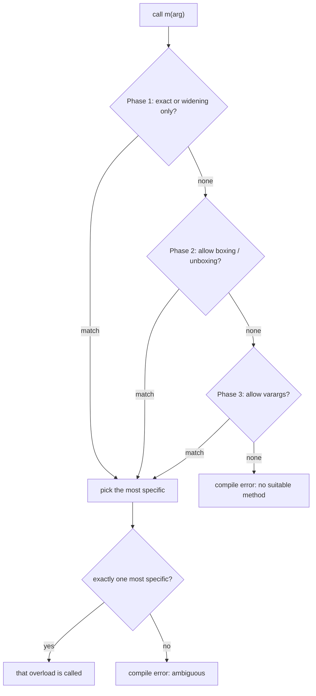
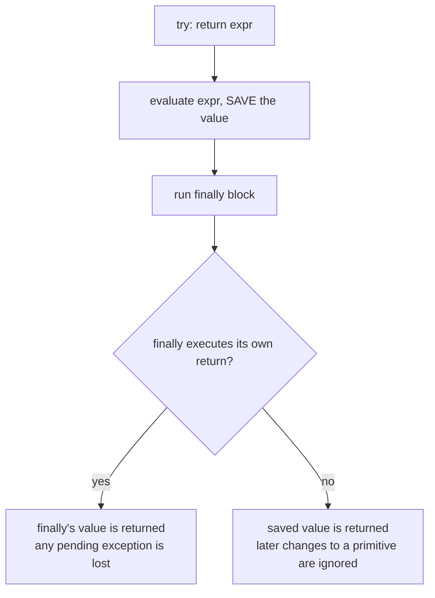
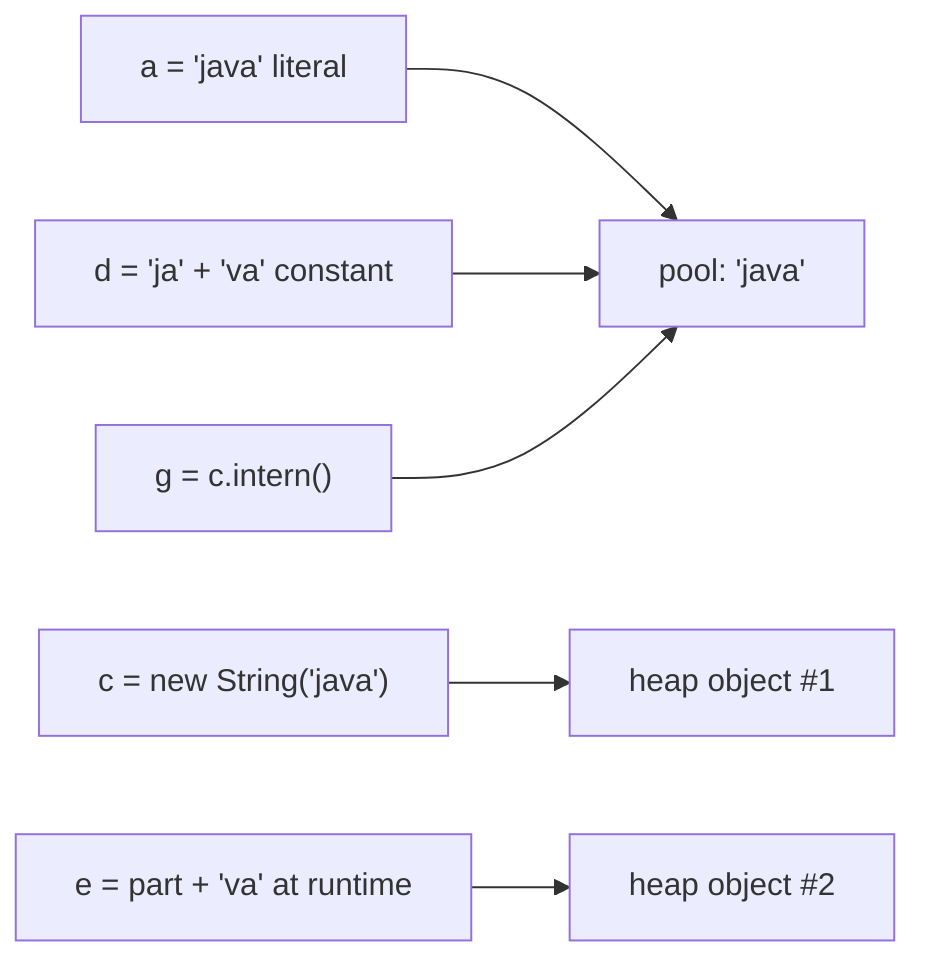

## In One Line
"What does this print?" questions are not about guessing — each one tests **one precise language rule** (reference vs value `==`, caches, constant folding, evaluation order, numeric promotion, overflow, IEEE 754 floating point, initialisation order, overload resolution, `finally` semantics, laziness), so learn the ~15 rules, trace the code slowly with them, and the answer follows mechanically.

## Mental Model
Treat yourself as a **slow, literal-minded CPU with a rule book**.

- A human reads `i = i++` and "sees" an increment. The CPU reads it as: *save the old value 5, add 1 to `i`, then store the saved 5 back into `i`*. The CPU is always right.
- The **rule book** has chapters: *Identity* (`==` on objects, pools, caches), *Arithmetic* (promotion, overflow, division, floating point), *Evaluation order* (left to right, operands before operators), *Types* (overloads, ternary typing, `char` maths), *Objects* (initialisation order, hiding vs overriding), *Control flow* (`finally`, short-circuit, switch fall-through) and *Laziness* (streams, `Optional`).
- Interview trick questions are written to make the "human reading" and the "CPU reading" disagree. Your job is to refuse the human reading, open the right chapter, and trace step by step — writing intermediate values down if needed.

## Concept
### How to solve any predict-the-output question
1. **Find the trap category** — is there a `==` on objects? mixed types in arithmetic? a `++` used twice? a `return` inside `try`? a `static` member called through an instance? an overload with `null` or a primitive argument?
2. **Trace left to right**, evaluating each operand fully before the operator, and write down every intermediate value and its **type**.
3. **Apply the rule** from the table below.
4. **Check for compile errors and exceptions** before computing values — "does not compile" and "throws NPE" are common correct answers.
5. Say the rule out loud in the interview: *"`i++` yields the old value, so…"* — the reasoning scores more than the number.

These puzzles test semantics, not algorithms, so each Q&A below ends with the **rule to remember** instead of a time/space complexity.

### The rule book
| Chapter | Rule | Classic trap |
|---|---|---|
| Identity | `==` on references compares **addresses**; `equals` compares content (if overridden) | `new String("a") == "a"` is `false` |
| String pool | Literals and **compile-time constant expressions** are interned; runtime concatenation creates new objects; `intern()` returns the pooled copy | `"ja" + "va" == "java"` is `true`, `part + "va" == "java"` is `false` |
| Wrapper caches | `Integer`, `Short`, `Byte`, `Long`, `Character` (0–127) cache **-128..127**; `Boolean` caches both; `Float`/`Double` cache nothing | `Integer 128 == Integer 128` is `false` |
| Mixed `==` | `Integer == int` **unboxes** and compares values; `Long.equals(Integer)` is always `false` | `map.get(1)` on a `Map<Long, …>` returns `null` |
| Evaluation order | Operands are evaluated **left to right**, fully, before the operator; an array index before the right-hand side | `arr[i++] = i` |
| Increment | `i++` yields the **old** value, `++i` the **new** one; the variable changes immediately | `i = i++` leaves `i` unchanged |
| Promotion | `byte`, `short`, `char` become `int` in arithmetic; mixed operands widen to the wider type | `'a' + 'b'` is `195` |
| String `+` | Left to right; once one operand is a `String`, `+` means concatenation | `1 + 2 + "3" + 4 + 5` is `"3345"` |
| Compound assignment | `x op= y` means `x = (T) (x op y)` — a **hidden narrowing cast** | `byte b = 10; b *= 30;` gives `44` |
| Overflow | `int`/`long` arithmetic **wraps silently**; narrowing casts keep the low bits | `Integer.MAX_VALUE + 1` is `-2147483648` |
| Division | Integer division truncates **toward zero**; `%` takes the sign of the **dividend**; integer `/ 0` throws, floating `/ 0` gives `Infinity`/`NaN` | `-7 / 2` is `-3`, `-7 % 2` is `-1` |
| Floating point | Binary fractions are inexact; `NaN != NaN`; `0.0 == -0.0` but `Double.equals` distinguishes them | `0.1 + 0.2 != 0.3` |
| Rounding | Casts truncate toward zero; `Math.round(x)` returns the nearest `long`, **ties toward positive infinity** (think `floor(x + 0.5)`) | `Math.round(-2.5)` is `-2` |
| Overloads | Chosen at **compile time** from static types: phase 1 widening only, phase 2 boxing, phase 3 varargs; then the **most specific** | `m(null)` picks `m(String)` over `m(Object)` |
| Dispatch | Instance methods are overridden (runtime type); fields and static methods are **hidden** (static type) | `parentRef.field` shows the parent's field |
| Initialisation | Static: once, parent first, textual order. Per object: `super(...)` first, then field initialisers and instance blocks in textual order, then the constructor body | An overridden method called from a parent constructor sees `null`/`0` |
| Ternary | Numeric operands get **binary numeric promotion**; `int` and `Integer` operands give an `int` (unboxing) | `true ? Integer.valueOf(1) : Double.valueOf(2)` prints `1.0` |
| `finally` | Runs after the `return` value is **evaluated and saved**; a `return` in `finally` replaces it and swallows exceptions; `System.exit` skips it | `return x; finally { x = 2; }` still returns the old `x` |
| Short-circuit | `&&`/`||` skip the right side when the answer is known; `&`/`|` evaluate both | side effects in the skipped operand never happen |
| Laziness | Stream intermediate operations run only when a terminal operation pulls elements, one element at a time; `orElse(arg)` evaluates `arg` eagerly | `peek` with no terminal prints nothing |

### Compile error or runtime exception?
Many "trick" answers are neither a value nor a crash, but a **compile error**: `short s = 1; s = s + 1;` (lossy conversion), `m(null)` with `m(String)` and `m(StringBuilder)` (ambiguous), an unreachable statement after `return`, using a variable after a `for (int i ...)` loop. Exceptions to expect at runtime: `NullPointerException` (unboxing `null`, switch on a `null` string, `null.length()`), `ArithmeticException` (integer `/ 0`, `Math.addExact`), `ArrayIndexOutOfBoundsException`, `ClassCastException`, `ConcurrentModificationException`.

### Where each rule is taught in depth
[String pool](lesson:b01-fundamentals/07-string-pool-and-immutability), [wrapper classes](lesson:a02-core/15-wrapper-classes), [data types and casting](lesson:b01-fundamentals/02-data-types-and-casting), [operators](lesson:b01-fundamentals/03-operators-and-control-flow), [initialisation order](lesson:b01-fundamentals/12-initialization-order), [method overloading](lesson:a01-oop/07-method-overloading), [polymorphism](lesson:a01-oop/04-polymorphism), [advanced exceptions](lesson:b01-fundamentals/11-exceptions-advanced), [pass-by-value](lesson:b01-fundamentals/04-pass-by-value), [equals and hashCode](lesson:b01-fundamentals/06-object-class-equals-hashcode), [stream operations](lesson:a05-java8/13-stream-operations).

## Diagram

Overload resolution stops at the first phase that finds any applicable method — that is why widening (`n(long)`) beats boxing (`n(Integer)`), which beats varargs (`n(int...)`).


The saved value is a copy for primitives but a reference for objects — so `x = 2` in `finally` is ignored, while `sb.append("b")` is visible.


Everything that points into the pool is `==` to every other pool reference; each `new` or runtime concatenation is a separate heap object.

## Code
**The warm-up: twelve one-liners, twelve different rules.** Cover the output and predict each line before reading on.
```java
public class WarmUp {
    static int tricky() {
        try {
            return 1;
        } finally {
            System.out.print("finally-");
        }
    }

    public static void main(String[] args) {
        System.out.println(1 + 2 + "3" + 4 + 5);               // line 1
        System.out.println('a' + 'b' + "c");                    // line 2
        Integer x = 127, y = 127, p = 128, q = 128;
        System.out.println((x == y) + " " + (p == q));          // line 3
        String s1 = "hi", s2 = "h" + "i", s3 = new String("hi");
        System.out.println((s1 == s2) + " " + (s1 == s3));      // line 4
        int i = 1;
        i = i++ + ++i;
        System.out.println(i);                                  // line 5
        System.out.println(Integer.MAX_VALUE + 1);              // line 6
        System.out.println(0.1 + 0.2 == 0.3);                   // line 7
        System.out.println(Double.NaN == Double.NaN);           // line 8
        System.out.println(-7 % 3 + " " + 7 / -2);              // line 9
        System.out.println(Math.round(-1.5) + " " + Math.round(1.5));   // line 10
        System.out.println(tricky());                           // line 11
        System.out.println((byte) 130);                         // line 12
    }
}
```
```output
3345
195c
true false
true false
4
-2147483648
false
false
-1 -3
-1 2
finally-1
-126
```

## Walkthrough
- **Line 1 — `1 + 2 + "3" + 4 + 5` → `3345`.** `+` is left-associative. `1 + 2` is integer addition (`3`); `3 + "3"` is the first `String` operand, so from here on everything is concatenation: `"33"`, `"334"`, `"3345"`.
- **Line 2 — `'a' + 'b' + "c"` → `195c`.** Two `char`s are promoted to `int` and added (`97 + 98 = 195`) *before* the string appears; then `195 + "c"`.
- **Line 3 — `true false`.** Autoboxing calls `Integer.valueOf`, which returns cached objects for -128..127. Both 127s are the same object; each 128 is a new object, so `==` (reference comparison) is `false`. The parentheses matter: without them, `x == y + " "` would not even compile.
- **Line 4 — `true false`.** `"h" + "i"` is a compile-time constant expression, folded by `javac` into the literal `"hi"` and taken from the pool; `new String("hi")` always creates a new heap object.
- **Line 5 — `i = i++ + ++i` → `4`.** Left operand: `i++` yields `1`, `i` becomes 2. Right operand: `++i` makes `i` 3 and yields `3`. Sum `1 + 3 = 4` is assigned to `i`, overwriting the 3.
- **Line 6 — `-2147483648`.** `int` arithmetic wraps around in two's complement: `0x7FFFFFFF + 1 = 0x80000000`, which is `Integer.MIN_VALUE`. No exception.
- **Line 7 — `false`.** `0.1` and `0.2` have no exact binary representation; their sum is `0.30000000000000004`, a different `double` from the literal `0.3`.
- **Line 8 — `false`.** IEEE 754 defines `NaN` as unequal to everything, including itself. Use `Double.isNaN`.
- **Line 9 — `-1 -3`.** `%` takes the sign of the dividend (`-7 % 3 = -1`), and integer division truncates toward zero (`7 / -2 = -3.5 → -3`). `Math.floorMod`/`floorDiv` give the mathematical versions (`2` and `-4`).
- **Line 10 — `-1 2`.** `Math.round` returns the nearest whole number and breaks ties toward **positive infinity**, not away from zero: `-1.5` is equally close to `-2` and `-1`, so the answer is `-1`; `1.5` gives `2`. (A good mental model is `floor(x + 0.5)`; since Java 7 the real implementation also handles edge cases such as `0.49999999999999994`, which rounds to `0` even though `floor(0.49999999999999994 + 0.5)` is `1.0`.)
- **Line 11 — `finally-1`.** `println(tricky())` must evaluate its argument first. Inside, `return 1` saves the value, the `finally` block prints `finally-` (with `print`, no newline), and then `1` is returned and printed by `println`.
- **Line 12 — `-126`.** Narrowing to `byte` keeps the low 8 bits: `130 = 0b1000_0010`, which as a signed byte is `130 - 256 = -126`.

## Traps
- **Precedence of `+` over `==`**: `"a == c: " + a == c` compares the concatenated string with `c` and prints only `false`.
- **Assuming wrapper `==` works because it worked in a test** with small numbers — the cache hides the bug until values exceed 127.
- **`Long` keys looked up with `int` literals**: `map.get(1)` boxes to `Integer`, which never equals a `Long` → `null`.
- **Constant folding only for constant variables**: `final String x = "ja"` folds; a non-final variable or a `final` initialised from a method call does not.
- **Overload resolution uses the static type**, never the runtime type: `speak(animalRefToDog)` calls `speak(Animal)`.
- **`equals(MyType other)` overloads instead of overriding** `equals(Object)`; collections never call it. Always write `@Override public boolean equals(Object o)`.
- **Compound assignment hides a cast**: `b *= 30` compiles and silently truncates, while `b = b * 30` is a compile error.
- **Ternary with `Integer` and `int` operands unboxes** — a `null` `Integer` throws `NullPointerException` even when the result is assigned to an `Integer`.
- **`Math.abs(Integer.MIN_VALUE)` is negative** — there is no positive `int` 2147483648.
- **`24 * 60 * 60 * 1000 * 1000` overflows before being stored in a `long`**: make the first operand `24L`.
- **A `return` (or `break`/`continue`) in `finally` swallows exceptions** — `javac` compiles it, and only with `-Xlint:finally` does it warn `finally clause cannot complete normally`.
- **Classic `switch` on a `null` `String` throws NPE**; only a Java 21 pattern `switch` with `case null` handles it.
- **`println(char[])` prints the characters**, but `"" + charArray` prints `[C@<hash>`, which differs from run to run.
- **Printing with `+ " "` between booleans needs parentheses**, or the code does not compile.

## Tips & Tricks
- **"Save, then finally."** A `return` value is saved before `finally` runs; only a `return` in `finally` can replace it.
- **"String sticks."** Once a `String` appears in a `+` chain, everything to its right is concatenated; everything to its left was already computed as numbers.
- **"Cache is a byte."** Wrapper caches cover exactly the range of a `byte`: -128 to 127.
- **"Post gives the past."** `i++` returns the past (old) value; `++i` returns the present (new) value.
- **"Widen, box, then spread."** Overload phases: widening first, then boxing, then varargs.
- **"Parent static, child static, then per object: parent block+ctor, child block+ctor."** — the initialisation order in one breath.
- **"Round half up (toward +∞)."** `Math.round(-2.5) = -2`, `Math.round(2.5) = 3`; `Math.rint` rounds half to even.
- **"Dividend decides the sign."** `-7 % 2 = -1`, `7 % -2 = 1`. Test odd with `n % 2 != 0`.
- **"NaN is lonely."** It is not equal to anything, not even itself; every comparison with it is `false`.
- When stuck, **write a table**: variable, value, type after each step. It turns every puzzle into bookkeeping.

## Interview Q&A
### [Basic] String pool — what do these `==` comparisons print?
**How to reason:** literals and constant expressions come from the pool (`a`, `b`, `d`, `f`); `new String` and runtime concatenation create new objects (`c`, `e`); `intern()` returns the pooled object. The last line is a precedence trap.
```java
public class StringPoolPuzzle {
    public static void main(String[] args) {
        String a = "java";
        String b = "java";                 // same literal -> same pooled object
        String c = new String("java");     // new object on the heap
        String d = "ja" + "va";            // constant expression -> folded at compile time
        String part = "ja";
        String e = part + "va";            // runtime concatenation -> new object
        final String fpart = "ja";
        String f = fpart + "va";           // fpart is a constant variable -> folded
        String g = c.intern();             // returns the pooled "java"

        System.out.println(a == b);
        System.out.println(a == c);
        System.out.println(a == d);
        System.out.println(a == e);
        System.out.println(a == f);
        System.out.println(a == g);
        System.out.println(a.equals(c));
        System.out.println("a == c: " + a == c);
    }
}
```
```output
true
false
true
false
true
true
true
false
```
The last line prints just `false`: `+` binds tighter than `==`, so it compares the string `"a == c: java"` with `c`.

**Rule:** `==` is `true` only for the same object; compile-time constants (literals, `final` variables with constant initialisers, and expressions of them) share the pooled object. Always compare strings with `equals`.

**Follow-up:** *How many objects does `new String("java")` create?* — One new heap `String` every time; the literal `"java"` is also placed in the pool when the class is loaded/resolved if it is not there already — so "one or two", depending on whether the literal was already pooled.

### [Basic] Wrapper caches — which `==` comparisons are `true`?
**How to reason:** autoboxing calls `valueOf`, which caches -128..127 for `Integer`/`Long`/`Short`/`Byte`; `Double` has no cache; `Integer == int` unboxes; `equals` across wrapper types is always `false`.
```java
import java.util.*;

public class WrapperCachePuzzle {
    public static void main(String[] args) {
        Integer a = 127, b = 127;
        Integer c = 128, d = 128;
        System.out.println(a == b);
        System.out.println(c == d);
        System.out.println(c.equals(d));
        int primitive = 128;
        System.out.println(c == primitive);        // unboxing: compares values

        Long big = 127L, big2 = 127L;
        System.out.println(big == big2);           // Long also caches -128..127
        Double x = 1.0, y = 1.0;
        System.out.println(x == y);                // Double/Float have no cache

        Long id = 1L;
        System.out.println(id.equals(1));          // Long vs Integer
        Map<Long, String> users = new HashMap<>();
        users.put(1L, "Asha");
        System.out.println(users.get(1));          // get(Object): Integer key 1 != Long key 1L
    }
}
```
```output
true
false
true
true
true
false
false
null
```
**Rule:** compare wrapper *values* with `equals` (same type) or unbox to primitives; `==` on wrappers is reference comparison that only "works" inside the cache. The `Integer` cache's upper bound can be raised with `-XX:AutoBoxCacheMax`, which is one more reason never to rely on it.

**Follow-up:** *Why does `new Integer(5) == new Integer(5)` differ from `Integer.valueOf(5) == Integer.valueOf(5)`?* — The constructor always creates a new object (`false`); `valueOf` returns the cached one (`true`). The constructors are deprecated for removal since Java 9/16.

### [Intermediate] Static blocks, instance blocks and constructors with inheritance — what is printed?
**How to reason:** the main class is initialised before `main` (0), then `M`. The first `new B()` initialises `A` then `B` (1, 4), then builds the object: `A`'s instance block and constructor (2, 3), then `B`'s (5, 6). The second `new B()` repeats only the object part.
```java
public class InitOrderPuzzle {
    static { System.out.print("0"); }

    public static void main(String[] args) {
        System.out.print("M");
        new B();
        System.out.println();
        new B();
        System.out.println();
    }
}

class A {
    static { System.out.print("1"); }
    { System.out.print("2"); }
    A() { System.out.print("3"); }
}

class B extends A {
    static { System.out.print("4"); }
    { System.out.print("5"); }
    B() { System.out.print("6"); }
}
```
```output
0M142356
2356
```
**Rule:** static initialisation happens once per class, parent before child, on first active use; every `new` runs parent instance initialisers + parent constructor body, then child instance initialisers + child constructor body.

**Follow-up:** *Would `B.someStaticConstant` (a `static final int = 5`) trigger "14"?* — No. A compile-time constant is inlined into the caller, so the class is not initialised. See [initialisation order](lesson:b01-fundamentals/12-initialization-order).

### [Advanced] Static fields initialised in textual order — why is `b` zero?
**How to reason:** static initialisers run top to bottom. `INSTANCE = new Counter()` runs the constructor *first*, when `a` and `b` are still at their default `0`, making both 1. Then `static int a;` has no initialiser (stays 1), but `static int b = 0;` **re-assigns** 0.
```java
public class StaticOrderPuzzle {
    public static void main(String[] args) {
        System.out.println("a = " + Counter.a + ", b = " + Counter.b);
    }
}

class Counter {
    static Counter INSTANCE = new Counter();   // runs the constructor FIRST
    static int a;                              // no initializer: keeps the value set by the constructor
    static int b = 0;                          // initializer runs AFTER the constructor: resets b

    Counter() {
        a++;
        b++;
    }
}
```
```output
a = 1, b = 0
```
**Rule:** static fields get default values during linking, then the static initialisers run **in textual order** as one `<clinit>` method; a later explicit initialiser overwrites earlier changes.

**Follow-up:** *How do you fix it?* — Declare the instance field **after** the counters, or use the holder idiom so the singleton is created on first use.

### [Advanced] A parent constructor calls an overridden method — what does the child print?
**How to reason:** `new Derived()` → `Derived()` calls `super()` → `Base()` calls `show()`, which is dispatched to `Derived.show()`. `Derived`'s field initialisers have **not run yet**, so `name` is `null` and `count` is `0`. But `constant` is a `final` field with a constant initialiser — the compiler inlines `"K"` at every use, so it prints `K` even now. After `super()` returns, the fields are initialised and the second `show()` prints the real values.
```java
public class ConstructorOverridePuzzle {
    public static void main(String[] args) {
        new Derived();
    }
}

class Base {
    Base() {
        show();                                // virtual call from a constructor
    }
    void show() { System.out.println("Base.show"); }
}

class Derived extends Base {
    String name = "Derived";
    int count = 5;
    final String constant = "K";               // constant variable: inlined by the compiler

    Derived() {
        super();
        show();
    }

    @Override
    void show() { System.out.println(name + " " + count + " " + constant); }
}
```
```output
null 0 K
Derived 5 K
```
**Rule:** overridden methods are dispatched to the runtime class even during construction, before the subclass's fields are initialised. Never call overridable methods from a constructor.

**Follow-up:** *Why is `constant` not `null` in the first line?* — A `final` field initialised with a compile-time constant is a *constant variable*; `javac` replaces reads of it with the literal `"K"`, so the field is never actually read.

### [Intermediate] Overload resolution — which overload runs for `null`, `5`, `'a'` and a `byte`?
**How to reason:** apply the three phases. `m(null)`: both apply, `String` is more specific than `Object`. `n(5)`: phase 1 (widening) finds `n(long)`, so boxing and varargs are never considered. `p(5)`: no phase-1 match; phase 2 boxes to `Integer`, which is an `Object`. `q(5)`: `int` widens to `double`; `int` can never box to `Long`. `r('a')`: `char` widens to `int`. `t(b)`: `byte` widens to `short`, `int` and `long`; `short` is the most specific.
```java
public class OverloadPuzzle {
    static void m(Object o)  { System.out.println("m(Object)"); }
    static void m(String s)  { System.out.println("m(String)"); }

    static void n(long x)    { System.out.println("n(long)"); }
    static void n(Integer x) { System.out.println("n(Integer)"); }
    static void n(int... x)  { System.out.println("n(int...)"); }

    static void p(Object o)  { System.out.println("p(Object)"); }
    static void p(int... x)  { System.out.println("p(int...)"); }

    static void q(double d)  { System.out.println("q(double)"); }
    static void q(Long l)    { System.out.println("q(Long)"); }

    static void r(int i)     { System.out.println("r(int)"); }
    static void r(String s)  { System.out.println("r(String)"); }

    static void t(short s)   { System.out.println("t(short)"); }
    static void t(int i)     { System.out.println("t(int)"); }
    static void t(long l)    { System.out.println("t(long)"); }

    public static void main(String[] args) {
        m(null);          // most specific: String is more specific than Object
        n(5);             // phase 1: widening int -> long wins over boxing and varargs
        p(5);             // phase 2: boxing int -> Integer -> Object wins over varargs
        q(5);             // int widens to double; int cannot box to Long
        r('a');           // char widens to int
        byte b = 10;
        t(b);             // byte -> short is the most specific widening
    }
}
```
```output
m(String)
n(long)
p(Object)
q(double)
r(int)
t(short)
```
And when neither candidate is more specific, it does not compile:
```java
public class OverloadAmbiguous {
    static void m(String s)        { }
    static void m(StringBuilder s) { }

    public static void main(String[] args) {
        m(null);
    }
}
```
```output
OverloadAmbiguous.java:6: error: reference to m is ambiguous
        m(null);
        ^
  both method m(String) in OverloadAmbiguous and method m(StringBuilder) in OverloadAmbiguous match
1 error
error: compilation failed
```
**Rule:** widening beats boxing beats varargs; among the applicable methods of the first successful phase, the most specific wins; unrelated candidates (`String` vs `StringBuilder`) are ambiguous. Fix with a cast: `m((String) null)`.

**Follow-up:** *Does widening followed by boxing exist (`int` → `long` → `Long`)?* — No. Java can box then widen a reference (`int` → `Integer` → `Object`), but never widen a primitive then box. That is why `q(5)` cannot call `q(Long)`.

### [Intermediate] Overloading uses the static type — and why is `equals(Point)` a bug?
**How to reason:** overloads are chosen at compile time from the **declared** type: `a` is declared `Animal`, so `speak(Animal)` is chosen even though the object is a `Dog`. `Point.equals(Point)` does not override `Object.equals(Object)` — it is a new overload. `p1.equals(p2)` (static type `Point`) picks it; `p1.equals(o2)` (static type `Object`) and every collection call `equals(Object)`, which is still `Object`'s identity check.
```java
import java.util.*;

public class StaticTypeOverloadPuzzle {
    static class Animal { }
    static class Dog extends Animal { }

    static String speak(Animal a) { return "animal"; }
    static String speak(Dog d)    { return "dog"; }

    static class Point {
        final int x, y;
        Point(int x, int y) { this.x = x; this.y = y; }

        public boolean equals(Point other) {          // OVERLOADS equals(Object), does not override it
            return other != null && x == other.x && y == other.y;
        }

        @Override
        public int hashCode() { return Objects.hash(x, y); }
    }

    public static void main(String[] args) {
        Animal a = new Dog();
        System.out.println(speak(a));                 // overload chosen at compile time
        System.out.println(speak(new Dog()));
        System.out.println(a.getClass().getSimpleName());

        Point p1 = new Point(1, 2), p2 = new Point(1, 2);
        Object o2 = p2;
        System.out.println(p1.equals(p2));            // equals(Point)
        System.out.println(p1.equals(o2));            // equals(Object) from Object: reference check
        System.out.println(List.of(p1).contains(p2)); // collections call equals(Object)
        System.out.println(new HashSet<>(List.of(p1)).contains(p2));
    }
}
```
```output
animal
dog
Dog
true
false
false
false
```
**Rule:** overloading = compile time, static types; overriding = runtime, object type. An `@Override` annotation on `equals(Point)` would have turned this bug into a compile error.

**Follow-up:** *How do you get runtime selection by argument type?* — Double dispatch (the Visitor pattern), or a pattern-matching `switch` on the argument (Java 21).

### [Intermediate] Field hiding, static hiding and overriding — which version is printed?
**How to reason:** fields and static methods are resolved from the **static type** (`P`); only the instance method `inst()` is dispatched to the object (`C`). A static method called through a `null` reference does not throw — the reference is never dereferenced.
```java
public class HidingPuzzle {
    public static void main(String[] args) {
        P p = new C();
        System.out.println(p.field);
        System.out.println(((C) p).field);
        System.out.println(p.stat());
        System.out.println(p.inst());

        P nothing = null;
        System.out.println(nothing.stat());      // static call: the reference is never used
    }
}

class P {
    String field = "P.field";
    static String stat() { return "P.static"; }
    String inst() { return "P.instance"; }
}

class C extends P {
    String field = "C.field";                    // hides P.field
    static String stat() { return "C.static"; }  // hides P.stat()
    @Override
    String inst() { return "C.instance"; }       // overrides P.inst()
}
```
```output
P.field
C.field
P.static
C.instance
P.static
```
**Rule:** "methods override, fields and statics hide". Calling a static method through an instance compiles (with a warning) but is resolved as `P.stat()`.

**Follow-up:** *How many `field`s does a `C` object have?* — Two: `P.field` and `C.field`. `super.field` inside `C` reaches the hidden one.

### [Intermediate] `return` inside `try` with a `finally` — what is returned?
**How to reason:** `return x` evaluates and **saves** `x` (the value 1), then runs `finally`. Changing the variable does not change the saved value, but mutating a saved *reference's* object does. A `return` in `finally` replaces the saved value — and also discards an exception in flight. `System.exit` stops the JVM, so its `finally` never runs.
```java
public class FinallyReturnPuzzle {
    static int primitive() {
        int x = 1;
        try {
            return x;                  // the value 1 is saved here
        } finally {
            x = 2;                     // changes the variable, not the saved value
        }
    }

    static StringBuilder reference() {
        StringBuilder sb = new StringBuilder("a");
        try {
            return sb;                 // the REFERENCE is saved
        } finally {
            sb.append("b");            // mutates the object it points to
        }
    }

    @SuppressWarnings("finally")
    static int finallyReturns() {
        try {
            return 1;
        } finally {
            return 2;                  // overrides the try's return
        }
    }

    @SuppressWarnings("finally")
    static int swallows() {
        try {
            throw new IllegalStateException("boom");
        } finally {
            return 3;                  // the exception is silently discarded
        }
    }

    static String order() {
        try {
            System.out.print("try ");
            return "return";
        } finally {
            System.out.print("finally ");
        }
    }

    public static void main(String[] args) {
        System.out.println(primitive());
        System.out.println(reference());
        System.out.println(finallyReturns());
        System.out.println(swallows());
        System.out.println(order());
        try {
            System.out.println("exiting");
            System.exit(0);
        } finally {
            System.out.println("finally after exit?");
        }
    }
}
```
```output
1
ab
2
3
try finally return
exiting
```
**Rule:** `finally` always runs after the `try`/`catch` completes (normally, by `return`, or by exception) — except when the JVM halts (`System.exit`, a crash, a killed process). Never `return` from `finally`.

**Follow-up:** *What if the `catch` block returns and `finally` modifies the variable?* — Same rule: the catch's return value is saved first, so the modification is ignored (see the quiz).

### [Advanced] try-with-resources — in what order are resources opened, closed and exceptions reported?
**How to reason:** resources open in declaration order and close in **reverse** order, *before* the `catch` and `finally` blocks run. If the body throws and a `close()` also throws, the body's exception is the primary one and the close failure is attached as **suppressed**.
```java
public class TryWithResourcesPuzzle {
    static class Res implements AutoCloseable {
        private final String name;
        private final boolean failOnClose;

        Res(String name, boolean failOnClose) {
            this.name = name;
            this.failOnClose = failOnClose;
            System.out.println("open " + name);
        }

        @Override
        public void close() {
            System.out.println("close " + name);
            if (failOnClose) throw new IllegalStateException("close " + name + " failed");
        }
    }

    public static void main(String[] args) {
        try (Res a = new Res("A", false); Res b = new Res("B", true)) {
            System.out.println("body");
            throw new RuntimeException("body failed");
        } catch (Exception e) {
            System.out.println("catch: " + e.getMessage());
            for (Throwable s : e.getSuppressed()) System.out.println("suppressed: " + s.getMessage());
        } finally {
            System.out.println("finally");
        }
    }
}
```
```output
open A
open B
body
close B
close A
catch: body failed
suppressed: close B failed
finally
```
**Rule:** open in order, close in reverse, then `catch`, then `finally`; close exceptions are suppressed into the primary exception. (With a classic `try`/`finally` that closes manually, a close exception would *replace* the body's exception.)

**Follow-up:** *What if only `close()` throws?* — Then the close exception is the primary exception and reaches the `catch`. More in [advanced exceptions](lesson:b01-fundamentals/11-exceptions-advanced).

### [Basic] `i++` and `++i` puzzles — what are the final values?
**How to reason:** evaluate operands left to right; `i++` yields the old value and increments immediately; the assignment happens **last** and overwrites the variable.
```java
public class IncrementPuzzle {
    public static void main(String[] args) {
        int i = 5;
        i = i++;                        // old value 5 is assigned back
        System.out.println("i = " + i);

        int j = 5;
        j = j++ + ++j;                  // 5 + 7
        System.out.println("j = " + j);

        int k = 5;
        int r = k++ + k++;              // 5 + 6, k ends at 7
        System.out.println("r = " + r + ", k = " + k);

        int m = 5;
        m += m++ * m--;                 // m = 5 + (5 * 6)
        System.out.println("m = " + m);

        int n = 1;
        n = n++ + n++ * ++n;            // 1 + 2 * 4
        System.out.println("n = " + n);

        int[] arr = {0, 0};
        int idx = 0;
        arr[idx++] = idx;               // index evaluated first (0), then the right side (1)
        System.out.println("arr = " + arr[0] + "," + arr[1]);

        int x = 10;
        System.out.println(x++ + " " + x + " " + ++x + " " + x);
    }
}
```
```output
i = 5
j = 12
r = 11, k = 7
m = 35
n = 9
arr = 1,0
10 11 12 12
```
Trace of `m += m++ * m--`: the compound assignment saves the left `m` (5) first; `m++` yields 5 (m = 6); `m--` yields 6 (m = 5); `5 + 5 * 6 = 35`. In `n = n++ + n++ * ++n`, precedence decides *grouping* (`*` before `+`), but operands are still *evaluated* left to right: 1, 2, 4.

**Rule:** precedence groups, evaluation order is always left to right, and assignment is the final step.

**Follow-up:** *Is `i = i++` undefined behaviour like in C?* — No. Java fully specifies evaluation order, so the answer is always `5` on every JVM.

### [Intermediate] Compound assignment — what do these print, and which line does not compile?
**How to reason:** `x op= y` is `x = (T) (x op y)`, with an implicit cast back to `x`'s type. The narrowing keeps the low bits (integers) or truncates (from `double`).
```java
public class CompoundAssignPuzzle {
    public static void main(String[] args) {
        short s = 10;
        s += 5;                         // s = (short) (s + 5)
        System.out.println("s = " + s);

        byte b = 10;
        b *= 30;                        // (byte) 300 = 44
        System.out.println("b = " + b);

        int i = 5;
        i += 3.7;                       // (int) (5 + 3.7) = 8
        System.out.println("i = " + i);

        char c = 'a';
        c *= 2;                         // (char) 194
        System.out.println("c = " + (int) c);

        int big = Integer.MAX_VALUE;
        big += 1L;                      // (int) (2147483647L + 1L)
        System.out.println("big = " + big);

        long L = 10;
        int t = 3;
        t += L * 1_000_000_000L;        // (int) 10_000_000_003L
        System.out.println("t = " + t);
    }
}
```
```output
s = 15
b = 44
i = 8
c = 194
big = -2147483648
t = 1410065411
```
The explicit form does not compile, because `s + 5` is an `int`:
```java
public class CompoundAssignError {
    public static void main(String[] args) {
        short s = 10;
        s = s + 5;
    }
}
```
```output
CompoundAssignError.java:4: error: incompatible types: possible lossy conversion from int to short
        s = s + 5;
              ^
1 error
error: compilation failed
```
**Rule:** compound assignment operators include a silent narrowing cast; plain assignment does not. `300 & 0xFF = 44`, and `10_000_000_003 mod 2³² = 1_410_065_411`.

**Follow-up:** *Why does `byte b = 10;` compile if `10` is an `int`?* — Assignment of a **constant** `int` expression that fits in the target type is allowed (implicit narrowing for constants). `byte b = someIntVariable;` does not compile.

### [Basic] `char` arithmetic and string concatenation — what is printed?
**How to reason:** `char` + number is an `int`; `+` is evaluated left to right and turns into concatenation at the first `String`; `char` compound assignment casts back; a ternary with a `char` and an `int` **constant** that fits has type `char`, but with an `int` **variable** it has type `int`.
```java
public class CharPuzzle {
    public static void main(String[] args) {
        char c = 'A';
        System.out.println(c + 1);               // char + int -> int
        System.out.println((char) (c + 1));
        System.out.println("" + c + 1);          // left to right: "A" + 1
        System.out.println(c + 1 + "");          // 66 first, then ""
        c += 1;                                  // compound: implicit cast back to char
        c++;
        System.out.println(c);
        System.out.println('a' + 'b');           // 97 + 98
        System.out.println("" + 'a' + 'b');
        System.out.println('a' + 'b' + "c");
        System.out.println(1 + 2 + "3" + 4 + 5);
        char d = 97;                             // int constant fits in char: allowed
        System.out.println(d);
        int zero = 0;
        System.out.println(true ? 'x' : zero);   // char vs int VARIABLE -> int
        System.out.println(true ? 'x' : 0);      // char vs int CONSTANT that fits -> char
        System.out.println((int) '0' + " " + ('7' - '0'));
    }
}
```
```output
66
B
A1
66
C
195
ab
195c
3345
a
120
x
48 7
```
`'7' - '0'` is the standard trick to turn a digit character into its number (the digits `'0'..'9'` are consecutive codes 48..57).

**Rule:** `char` is an unsigned 16-bit number; it only prints as a letter when the expression's type is still `char`.

**Follow-up:** *What does `System.out.println((char) 65 + 1)` print?* — `66`: the cast applies to `65` only, then `char + int` is an `int`.

### [Advanced] The conditional operator's type rules — why does `1` print as `1.0`?
**How to reason:** when both operands are numeric (boxed or not), the result type comes from **binary numeric promotion**: `Integer` and `Double` → `double`, so `1` becomes `1.0`. With a reference operand (`"one"`), no promotion happens. With `int` and `Integer` operands, the type is `int` — the `Integer` is **unboxed**, so a `null` throws NPE even when the target is `Integer`.
```java
public class TernaryPuzzle {
    public static void main(String[] args) {
        Object o = true ? Integer.valueOf(1) : Double.valueOf(2.0);
        System.out.println(o);                                  // numeric promotion to double!

        Object o2 = true ? 1 : "one";                           // reference types: no promotion
        System.out.println(o2 + " " + o2.getClass().getSimpleName());

        System.out.println(false ? 1 : 2L);                     // int and long -> long
        System.out.println(true ? 1 : 2.0);                     // int and double -> double

        Integer nothing = null;
        Integer safe = false ? Integer.valueOf(1) : nothing;    // both Integer: no unboxing
        System.out.println(safe);
        try {
            Integer boom = false ? 1 : nothing;                 // int and Integer -> int: unboxes null
            System.out.println(boom);
        } catch (NullPointerException e) {
            System.out.println("NullPointerException");
        }
    }
}
```
```output
1.0
1 Integer
2
1.0
null
NullPointerException
```
**Rule:** the conditional operator has a single result type decided at compile time; numeric operands are promoted (and unboxed) to a common primitive type. Keep both branches the same type, or use `if`/`else`.

**Follow-up:** *Where does this bite in real code?* — `Integer count = map.containsKey(k) ? map.get(k) : 0;` throws NPE when the key maps to `null` — use `getOrDefault`.

### [Intermediate] `NaN`, infinities and negative zero — what do these comparisons print?
**How to reason:** IEEE 754 rules: `NaN` compares unequal to everything (all `<`, `>`, `==` are `false`, `!=` is `true`); `Double.equals` compares bit patterns, so `NaN.equals(NaN)` is `true` and `0.0.equals(-0.0)` is `false`; floating division by zero gives `±Infinity`, integer division by zero throws.
```java
public class NaNPuzzle {
    public static void main(String[] args) {
        double nan = 0.0 / 0;
        System.out.println(nan);
        System.out.println(nan == nan);
        System.out.println(nan != nan);
        System.out.println(Double.isNaN(nan));
        System.out.println(Double.valueOf(nan).equals(nan));
        System.out.println(nan > 0 || nan <= 0);
        System.out.println(0.0 == -0.0);
        System.out.println(Double.valueOf(0.0).equals(-0.0));
        System.out.println(Math.min(0.0, -0.0));
        System.out.println(1.0 / 0 + " " + -1.0 / 0);
        System.out.println(Math.sqrt(-1));
        System.out.println((int) Double.NaN + " " + (int) Double.POSITIVE_INFINITY);
        try {
            System.out.println(1 / 0);
        } catch (ArithmeticException e) {
            System.out.println("ArithmeticException: " + e.getMessage());
        }
    }
}
```
```output
NaN
false
true
true
true
false
true
false
-0.0
Infinity -Infinity
NaN
0 2147483647
ArithmeticException: / by zero
```
`nan > 0 || nan <= 0` is `false` — the "law of excluded middle" does not hold for `NaN`. Casting `NaN` to `int` gives `0`; casting `Infinity` saturates to `Integer.MAX_VALUE`.

**Rule:** test with `Double.isNaN`; `==` and `Double.equals` disagree exactly on `NaN` and `-0.0` (which is why `HashSet<Double>` treats `NaN` as one element).

**Follow-up:** *Is there any `x` for which `x != x`?* — Yes, `Double.NaN` / `Float.NaN` — the only values not equal to themselves.

### [Basic] Integer overflow and narrowing casts — what is printed?
**How to reason:** `int` arithmetic is done in 32 bits and wraps; the target type of an assignment does not matter (`long wrong = int * int` overflows *before* widening); narrowing keeps the low bits.
```java
public class OverflowPuzzle {
    public static void main(String[] args) {
        int max = Integer.MAX_VALUE;
        System.out.println(max + 1);
        System.out.println(max * 2);
        System.out.println(Math.abs(Integer.MIN_VALUE));
        System.out.println(-Integer.MIN_VALUE);

        long wrong = 24 * 60 * 60 * 1000 * 1000;      // int arithmetic, THEN widened
        long right = 24L * 60 * 60 * 1000 * 1000;     // long from the first operand
        System.out.println(wrong + " vs " + right);

        System.out.println((int) 3_000_000_000L);
        System.out.println((byte) 200);
        System.out.println((short) 70_000);
        System.out.println((byte) 128 + " " + (byte) -129);

        try {
            Math.addExact(max, 1);
        } catch (ArithmeticException e) {
            System.out.println("addExact: " + e.getMessage());
        }
    }
}
```
```output
-2147483648
-2
-2147483648
-2147483648
500654080 vs 86400000000
-1294967296
-56
4464
-128 127
addExact: integer overflow
```
`(byte) 200 = 200 - 256 = -56`; `(short) 70_000 = 70_000 - 65_536 = 4_464`; `Math.abs(MIN_VALUE)` overflows back to itself.

**Rule:** overflow is silent in Java; use `long`, `Math.*Exact` methods (throw on overflow) or `BigInteger` when values can grow.

**Follow-up:** *Why is `(low + high) / 2` a famous binary-search bug?* — For large indexes `low + high` overflows to a negative number; use `low + (high - low) / 2` or `(low + high) >>> 1`.

### [Intermediate] Floating-point precision and rounding — what is printed?
**How to reason:** most decimal fractions are not exact in binary; `float` and `double` round differently, so `0.1f == 0.1` is `false` (but `0.5` is exact in both); casts truncate toward zero; `Math.round` rounds half toward positive infinity; `Math.rint` rounds half to even; `BigDecimal(String)` is exact, `BigDecimal(double)` shows the double's true value.
```java
import java.math.BigDecimal;

public class FloatingPuzzle {
    public static void main(String[] args) {
        System.out.println(0.1 + 0.2);
        System.out.println(0.1 + 0.2 == 0.3);
        System.out.println(0.1f + 0.2f);
        System.out.println(1.0 - 0.9);
        System.out.println(0.1f == 0.1);
        System.out.println(0.5f == 0.5);
        System.out.println((int) 3.99 + " " + (int) -3.99);
        System.out.println(Math.round(2.5) + " " + Math.round(-2.5) + " " + Math.round(-2.6));
        System.out.println(Math.floor(-2.5) + " " + Math.ceil(-2.5) + " " + Math.rint(2.5));
        System.out.println(new BigDecimal("0.1").add(new BigDecimal("0.2")));
        System.out.println(new BigDecimal(0.1));
        System.out.println(new BigDecimal("2.0").equals(new BigDecimal("2.00")));
        System.out.println(new BigDecimal("2.0").compareTo(new BigDecimal("2.00")));
        System.out.println(16_777_216f + 1 == 16_777_216f);
    }
}
```
```output
0.30000000000000004
false
0.3
0.09999999999999998
false
true
3 -3
3 -2 -3
-3.0 -2.0 2.0
0.3
0.1000000000000000055511151231257827021181583404541015625
false
0
true
```
`0.1f + 0.2f` *prints* `0.3` only because `Float.toString` prints the shortest decimal that identifies the float — the value is still inexact. `BigDecimal.equals` compares scale too (`2.0` vs `2.00`), `compareTo` does not. `2²⁴ + 1` is not representable as a `float`, so adding 1 changes nothing.

**Rule:** never use `==` on computed floating-point values (compare with a tolerance), and use `BigDecimal` built from **strings** for money.

**Follow-up:** *Which rounding mode does `Math.round` use?* — Nearest value with ties toward positive infinity ("half up" in the mathematical sense, so `-2.5` becomes `-2`); for banker's rounding use `Math.rint` or `BigDecimal.setScale(n, RoundingMode.HALF_EVEN)`.

### [Basic] Integer division and remainder with negative numbers — what is printed?
**How to reason:** `/` on integers truncates toward zero; `%` satisfies `(a / b) * b + a % b == a`, so its sign follows the **dividend**; `floorDiv`/`floorMod` round toward negative infinity. Mixed `int`/`double` arithmetic happens in `double` only from the point where a `double` appears.
```java
public class DivisionPuzzle {
    static boolean isOddBroken(int n) { return n % 2 == 1; }
    static boolean isOdd(int n)       { return n % 2 != 0; }

    public static void main(String[] args) {
        System.out.println(7 / 2 + " " + -7 / 2);
        System.out.println(-7 % 2 + " " + 7 % -2);
        System.out.println(Math.floorDiv(-7, 2) + " " + Math.floorMod(-7, 2));
        System.out.println(7 / 2 * 2.0);
        System.out.println(7 / 2.0);
        System.out.println(1 / 2 + 1 / 2);
        System.out.println(5.5 % 2);
        System.out.println(isOddBroken(-3) + " " + isOdd(-3));
        int total = 7, count = 2;
        double avgWrong = total / count;
        double avgRight = (double) total / count;
        System.out.println(avgWrong + " " + avgRight);
    }
}
```
```output
3 -3
-1 1
-4 1
6.0
3.5
0
1.5
false true
3.0 3.5
```
`7 / 2 * 2.0`: `7 / 2` is integer division (`3`) *before* the `double` appears, so the result is `6.0`, not `7.0`. `double avgWrong = total / count` divides as `int` first, then widens `3` to `3.0`.

**Rule:** the operand types at *each* operator decide the arithmetic; cast **before** dividing. Test oddness with `% 2 != 0`.

**Follow-up:** *When do you need `floorMod`?* — For wrap-around indexes with negative values, e.g. `Math.floorMod(i - 1, n)` for "previous index in a circular array".

### [Intermediate] Shift and bitwise operators — what is printed?
**How to reason:** for `int`, only the low 5 bits of the shift distance are used (`1 << 32` is `1 << 0`); `>>` copies the sign bit, `>>>` shifts in zeros; `byte` and `short` operands are promoted to `int` (sign-extended) before shifting.
```java
public class ShiftPuzzle {
    public static void main(String[] args) {
        System.out.println(1 << 31);
        System.out.println(1 << 32);          // shift distance is taken mod 32 for int
        System.out.println(1L << 32);
        System.out.println(-8 >> 1);          // arithmetic: keeps the sign
        System.out.println(-8 >>> 28);        // logical: fills with zeros
        System.out.println(-1 >>> 1);
        System.out.println((5 & 3) + " " + (5 | 3) + " " + (5 ^ 3) + " " + ~5);
        byte b = (byte) 0xF0;                  // -16
        System.out.println(b >>> 4);          // b is promoted to int -16 first
        System.out.println((b & 0xFF) >>> 4);
        int x = 6, y = 9;
        x ^= y; y ^= x; x ^= y;               // XOR swap
        System.out.println(x + " " + y);
    }
}
```
```output
-2147483648
1
4294967296
-4
15
2147483647
1 7 6 -6
268435455
15
9 6
```
`~5 = -6` because `~x == -x - 1` in two's complement. `b >>> 4` on a negative `byte` gives a huge positive `int`; mask with `& 0xFF` first to treat the byte as unsigned.

**Rule:** shifts on `int` use `distance & 31` (on `long`, `& 63`); `byte`/`short`/`char` are promoted to `int` before any shift or bitwise operation.

**Follow-up:** *How do you check whether `n` is a power of two?* — `n > 0 && (n & (n - 1)) == 0`.

### [Basic] Short-circuit operators and side effects — what are `a`, `b` and `x`?
**How to reason:** `&&` skips its right operand when the left is `false`; `||` skips it when the left is `true`; the non-short-circuit `&`/`|` always evaluate both. `if (flag = true)` is an assignment whose value is `true`.
```java
public class ShortCircuitPuzzle {
    public static void main(String[] args) {
        int a = 0, b = 0;
        if (a++ > 0 && b++ > 0) { }
        System.out.println(a + " " + b);       // && skipped the right side

        if (a++ > 0 | b++ > 0) { }
        System.out.println(a + " " + b);       // | evaluates both sides

        String s = null;
        System.out.println(s != null && s.length() > 0);
        try {
            System.out.println(s != null & s.length() > 0);
        } catch (NullPointerException e) {
            System.out.println("NPE from &");
        }

        boolean flag = false;
        if (flag = true) {                     // assignment, not comparison
            System.out.println("assigned, so the if runs");
        }

        int x = 5;
        boolean r = x > 3 || ++x > 0;
        System.out.println(r + " " + x);
    }
}
```
```output
1 0
2 1
false
NPE from &
assigned, so the if runs
true 5
```
**Rule:** never put required side effects in the right operand of `&&`/`||`; use `&&` for null guards. `if (x = 5)` does not compile for `int` (not a `boolean`), but the `boolean` version compiles silently.

**Follow-up:** *Is `&` on booleans ever useful?* — When both sides must run (e.g. validate two fields and report both errors); otherwise use `&&`.

### [Intermediate] `switch` fall-through, `default` placement and `null` — what is printed?
**How to reason:** a classic `switch` jumps to the matching label and **falls through** until a `break`; `default` can be anywhere and falls through too; a classic `switch` on a `null` `String` throws NPE; the arrow form never falls through; a Java 21 pattern `switch` may include `case null`.
```java
public class SwitchPuzzle {
    public static void main(String[] args) {
        int x = 2;
        switch (x) {
            case 1: System.out.print("one ");
            case 2: System.out.print("two ");
            case 3: System.out.print("three ");
            default: System.out.print("default ");
        }
        System.out.println();

        int y = 5;
        switch (y) {
            default: System.out.print("D ");   // no match: jump to default, then FALL THROUGH
            case 1:  System.out.print("1 ");
                     break;
            case 2:  System.out.print("2 ");
        }
        System.out.println();

        String day = "SAT";
        String kind = switch (day) {            // arrow form: no fall-through, must be exhaustive
            case "SAT", "SUN" -> "weekend";
            default -> "weekday";
        };
        System.out.println(kind);

        String nothing = null;
        try {
            switch (nothing) {
                case "a": System.out.println("a"); break;
                default:  System.out.println("default");
            }
        } catch (NullPointerException e) {
            System.out.println("NPE: classic switch on null");
        }

        Object obj = null;
        String res = switch (obj) {             // Java 21 pattern switch can handle null
            case null -> "null handled";
            case String str -> "string " + str;
            default -> "other";
        };
        System.out.println(res);
    }
}
```
```output
two three default 
D 1 
weekend
NPE: classic switch on null
null handled
```
**Rule:** colon-style cases fall through, arrow-style cases do not; `null` goes to `default` **never** — it throws unless there is an explicit `case null` (Java 21). See [switch expressions and pattern matching](lesson:b05-modern-java/05-switch-expressions-and-pattern-matching).

**Follow-up:** *Can a `switch` on strings be slower than `if`/`else`?* — No; `javac` compiles it to a `hashCode` switch plus `equals` checks, which is usually faster for many cases.

### [Basic] Arrays — equality and printing: what is printed?
**How to reason:** arrays do not override `equals` or `toString`; `Arrays.equals` compares one level, `Arrays.deepEquals` recurses; `println(char[])` is a special overload that prints the characters; `Arrays.asList(int[])` is a list with **one** element (the array), because generics cannot hold primitives.
```java
import java.util.*;

public class ArrayPuzzle {
    public static void main(String[] args) {
        int[] a = {1, 2, 3};
        int[] b = {1, 2, 3};
        System.out.println(a == b);
        System.out.println(a.equals(b));
        System.out.println(Arrays.equals(a, b));

        int[][] d1 = {{1}, {2}};
        int[][] d2 = {{1}, {2}};
        System.out.println(Arrays.equals(d1, d2) + " " + Arrays.deepEquals(d1, d2));

        char[] chars = {'h', 'i'};
        System.out.println(chars);                     // println(char[]) prints the characters
        System.out.println("chars: " + chars);         // String concat calls Object.toString
        System.out.println(Arrays.toString(chars));

        System.out.println(Arrays.asList(a).size());   // List<int[]> with ONE element
        Integer[] boxed = {1, 2, 3};
        System.out.println(Arrays.asList(boxed).size());

        int[] defaults = new int[2];
        String[] names = new String[2];
        System.out.println(defaults[0] + " " + names[0]);
    }
}
```
One real run (**the hash after `[C@` differs between runs**; everything else is fixed):
```output
false
false
true
false true
hi
chars: [C@29176cc1
[h, i]
1
3
0 null
```
**Rule:** use `Arrays.equals`/`deepEquals`/`toString`/`deepToString` for arrays; array elements default to `0`/`false`/`null`.

**Follow-up:** *What is `[C@29176cc1`?* — `Object.toString()`: the JVM type descriptor (`[C` = array of `char`), `@`, and the identity hash code in hex.

### [Basic] Pass-by-value — what survives each method call?
**How to reason:** Java passes a **copy of every variable**. For objects, the copy is a reference: the method can mutate the shared object, but reassigning its parameter only changes its own copy. `String` and `Integer` are immutable, so "changing" them means reassigning — invisible to the caller.
```java
import java.util.*;

public class PassByValuePuzzle {
    static void swap(Integer x, Integer y) { Integer t = x; x = y; y = t; }
    static void reassign(StringBuilder sb) { sb = new StringBuilder("new"); }
    static void mutate(StringBuilder sb)   { sb.append("+changed"); }
    static void changeString(String s)     { s = s + " world"; }
    static void fill(int[] arr)            { arr[0] = 99; arr = new int[]{-1}; }
    static void clear(List<String> list)   { list.clear(); list = null; }

    public static void main(String[] args) {
        Integer p = 1, q = 2;
        swap(p, q);
        System.out.println(p + " " + q);

        StringBuilder sb = new StringBuilder("old");
        reassign(sb);
        System.out.println(sb);
        mutate(sb);
        System.out.println(sb);

        String s = "hello";
        changeString(s);
        System.out.println(s);

        int[] arr = {1, 2};
        fill(arr);
        System.out.println(arr[0]);

        List<String> list = new ArrayList<>(List.of("x"));
        clear(list);
        System.out.println(list + " " + (list == null));
    }
}
```
```output
1 2
old
old+changed
hello
99
[] false
```
**Rule:** mutation through a reference is visible to the caller; reassignment of a parameter never is. A `swap(a, b)` method cannot be written in Java.

**Follow-up:** *So is Java pass-by-reference for objects?* — No: it passes references **by value**. In true pass-by-reference (C++ `&`), `reassign` would change the caller's variable. See [pass-by-value](lesson:b01-fundamentals/04-pass-by-value).

### [Intermediate] `equals` without `hashCode`, and a mutated key — what do the collections report?
**How to reason:** `HashSet`/`HashMap` first use `hashCode` to pick a bucket and only then call `equals`. Without a matching `hashCode`, two equal objects (almost always) land in different buckets and both are stored. Mutating a key after insertion changes its hash, so the entry is stranded in its old bucket.
```java
import java.util.*;

public class HashCodePuzzle {
    static class NoHash {
        final int id;
        NoHash(int id) { this.id = id; }
        @Override
        public boolean equals(Object o) {                 // equals WITHOUT hashCode
            return o instanceof NoHash n && n.id == id;
        }
    }

    static class Key {
        int id;
        Key(int id) { this.id = id; }
        @Override public boolean equals(Object o) { return o instanceof Key k && k.id == id; }
        @Override public int hashCode() { return Integer.hashCode(id); }
    }

    public static void main(String[] args) {
        Set<NoHash> set = new HashSet<>();
        set.add(new NoHash(1));
        set.add(new NoHash(1));
        System.out.println(set.size());
        System.out.println(new NoHash(1).equals(new NoHash(1)));
        System.out.println(set.contains(new NoHash(1)));

        Map<Key, String> map = new HashMap<>();
        Key k = new Key(1);
        map.put(k, "one");
        k.id = 2;                                         // mutate a key after insertion
        System.out.println(map.get(k) + " " + map.get(new Key(1)) + " " + map.size());

        System.out.println("Aa".hashCode() + " " + "BB".hashCode());
    }
}
```
```output
2
true
false
null null 1
2112 2112
```
After `k.id = 2`, `get(k)` looks in bucket 2 (entry is in bucket 1); `get(new Key(1))` finds the bucket but `equals` fails because the stored key now has id 2. The entry is unreachable yet still counted. `"Aa"` and `"BB"` show that different strings can share a hash code — that is fine, `equals` resolves it.

**Rule:** override `equals` and `hashCode` together, and never mutate fields that take part in them while the object is a key or set element (prefer immutable keys such as `String`, records).

**Follow-up:** *Why is the first result "almost always" 2?* — With `Object.hashCode` (identity hash), two distinct objects collide only by rare chance; if they did, `equals` would run and the set would keep one. See [equals and hashCode](lesson:b01-fundamentals/06-object-class-equals-hashcode).

### [Intermediate] Stream laziness and `Optional.orElse` — in what order are lines printed?
**How to reason:** intermediate operations (`peek`, `filter`, `map`) only *describe* work; nothing runs until a terminal operation. Elements then flow **one at a time** through the whole pipeline ("vertical" order), and short-circuiting terminals (`findFirst`) stop early. `orElse(x)` evaluates `x` **before** the call, even when the `Optional` has a value; `orElseGet(supplier)` calls it only when empty.
```java
import java.util.*;
import java.util.stream.*;

public class LazinessPuzzle {
    static String expensive() {
        System.out.print("[computing] ");
        return "default";
    }

    public static void main(String[] args) {
        Stream<String> s = Stream.of("a", "b", "c").peek(x -> System.out.print("peek " + x + " "));
        System.out.println("no terminal operation yet");

        List<String> out = Stream.of("a", "b", "c")
                .filter(x -> { System.out.print("filter " + x + " "); return !x.equals("b"); })
                .map(x -> { System.out.print("map " + x + " "); return x.toUpperCase(); })
                .collect(Collectors.toList());
        System.out.println();
        System.out.println(out);

        Optional<Integer> first = Stream.of(5, 8, 12, 3)
                .filter(n -> { System.out.print("test " + n + " "); return n > 6; })
                .findFirst();                                  // short-circuits
        System.out.println("-> " + first.get());

        System.out.println(Optional.of("value").orElse(expensive()));
        System.out.println(Optional.of("value").orElseGet(() -> expensive()));
        System.out.println(Optional.empty().orElseGet(() -> expensive()));
    }
}
```
```output
no terminal operation yet
filter a map a filter b filter c map c 
[A, C]
test 5 test 8 -> 8
[computing] value
value
[computing] default
```
`b` is filtered out, so it never reaches `map`; `findFirst` stops after `8`, so `12` and `3` are never tested.

**Rule:** streams are lazy, element-by-element and short-circuiting; method arguments (including `orElse`'s) are always evaluated before the call.

**Follow-up:** *Does `sorted()` change the vertical order?* — Yes: it is a stateful barrier that must consume every element before passing any on, so all upstream operations run for all elements first.

## Quiz
### What does this print?
```java
Integer i1 = 1000, i2 = 1000;
System.out.println(i1 <= i2 && i1 >= i2 && i1 != i2);
```
- [ ] false
- [x] true
- [ ] Compile error
- [ ] NullPointerException
> `<=` and `>=` are numeric operators, so they **unbox** and compare values (both `true`). `!=` on two `Integer` objects compares **references**; 1000 is outside the cache, so they are different objects (`true`). The tempting `false` assumes `!=` also compares values.

### What does this print?
```java
char c = 'a';
c += 1;
System.out.println(c + 1);
```
- [ ] b1
- [ ] c
- [x] 99
- [ ] Compile error at `c += 1`
> `c += 1` is allowed (compound assignment casts back to `char`) and makes `c` = `'b'` (98). `c + 1` is `char + int`, an `int` expression, so it prints `99`, not the letter `c`.

### What does this print?
```java
System.out.println("a,b,,c,,".split(",").length);
System.out.println("".split(",").length);
```
- [ ] 6 and 0
- [ ] 5 and 1
- [x] 4 and 1
- [ ] 4 and 0
> `split(regex)` removes **trailing** empty strings, leaving `["a", "b", "", "c"]` (the empty string *between* commas stays). Splitting an empty string gives an array with one element, the empty string itself. Use `split(",", -1)` to keep trailing empties.

### What does this print?
```java
Map<List<String>, Integer> m = new HashMap<>();
List<String> key = new ArrayList<>();
m.put(key, 1);
key.add("x");
System.out.println(m.get(key) + " " + m.containsKey(key) + " " + m.size());
```
- [ ] 1 true 1
- [x] null false 1
- [ ] null false 0
- [ ] ConcurrentModificationException
> `List.hashCode()` depends on its elements; after `key.add("x")` the key hashes to a different bucket, so the map cannot find its own entry — yet the entry is still stored (`size` is 1). Never mutate an object while it is used as a hash key.

### What does this print?
```java
for (int i = 0; i < 3; i++); {
    System.out.println("x");
}
```
- [ ] x x x (three lines)
- [x] x (one line)
- [ ] Nothing
- [ ] Compile error
> The `;` right after the `for (...)` is an **empty statement** that forms the loop body. The block `{ ... }` below is just a normal block that runs once after the loop. It compiles because the block does not use `i`.

### What does this print?
```java
static int count = 0;
static int next() { return ++count; }
// in main:
int[] a = new int[3];
a[next()] = next() * 10 + next();
System.out.println(java.util.Arrays.toString(a) + " " + count);
```
- [ ] [0, 0, 12] 3
- [x] [0, 23, 0] 3
- [ ] [0, 12, 0] 3
- [ ] [0, 0, 23] 3
> Java evaluates the array **index** before the right-hand side: the index is `next() = 1`; then `next() * 10 + next()` is `2 * 10 + 3 = 23`. So `a[1] = 23`. Answers assuming the right side is evaluated first put `12` or index 3.

### What does this print?
```java
String s = "Java";
s.concat(" 21").toUpperCase();
s += null;
System.out.println(s + s.length());
```
- [ ] JAVA 21null11
- [ ] Java8
- [x] Javanull8
- [ ] NullPointerException
> Strings are immutable: `concat(...).toUpperCase()` builds new strings that are thrown away. `s += null` concatenates the text `"null"`, so `s` is `"Javanull"` (length 8). Concatenating `null` never throws.

### What does this print?
```java
System.out.println(Math.min(Integer.MIN_VALUE, 0) + " " + Math.min(Double.MIN_VALUE, 0.0));
```
- [ ] -2147483648 4.9E-324
- [x] -2147483648 0.0
- [ ] 0 0.0
- [ ] -2147483648 -1.7976931348623157E308
> `Integer.MIN_VALUE` is the most negative `int`, but `Double.MIN_VALUE` is the smallest **positive** `double` (`4.9E-324`), so `0.0` is smaller. The most negative double is `-Double.MAX_VALUE`.

### What does this print?
```java
static String m(long x)    { return "long"; }
static String m(Integer x) { return "Integer"; }
static String m(Object x)  { return "Object"; }
// in main:
Integer boxed = 5;
short sh = 5;
System.out.println(m(5) + " " + m(boxed) + " " + m(sh) + " " + m(5.0));
```
- [ ] Integer Integer Integer Object
- [x] long Integer long Object
- [ ] long Integer Object Object
- [ ] long long long Object
> `m(5)`: phase 1 widening `int → long` wins before boxing. `m(boxed)`: the argument is already an `Integer` — exact match. `m(sh)`: `short` widens to `long` in phase 1. `m(5.0)`: `double` cannot widen to `long`, so phase 2 boxes it to `Double`, which only matches `Object`.

### What does this print?
```java
public class Q10 {
    static int x = 10;
    int y = x++;
    public static void main(String[] args) {
        Q10 a = new Q10();
        Q10 b = new Q10();
        System.out.println(a.y + " " + b.y + " " + x);
    }
}
```
- [ ] 10 10 11
- [x] 10 11 12
- [ ] 11 12 12
- [ ] 10 11 11
> The instance initialiser `y = x++` runs once per object. The first object gets `10` (x becomes 11), the second gets `11` (x becomes 12). The static `x` is shared by all instances.

### What does this print?
```java
long x = Integer.MAX_VALUE + 1;
long y = Integer.MAX_VALUE + 1L;
System.out.println(x + " " + y);
```
- [ ] 2147483648 2147483648
- [x] -2147483648 2147483648
- [ ] Compile error: integer overflow
- [ ] -2147483648 -2147483648
> `Integer.MAX_VALUE + 1` is computed in `int` and wraps to `-2147483648` **before** it is widened to `long`. In the second line `1L` makes the addition `long`. `javac` does not reject constant overflow.

### What does `f()` return?
```java
static int f() {
    int i = 0;
    try { i = 1; throw new RuntimeException(); }
    catch (RuntimeException e) { i = 2; return i; }
    finally { i = 3; }
}
```
- [ ] 1
- [x] 2
- [ ] 3
- [ ] It throws RuntimeException
> The `catch` handles the exception and executes `return i`, which saves the value `2`. The `finally` block then sets the local `i` to 3, but that does not change the saved return value. Only a `return` inside `finally` could replace it.

## Takeaways
- Trace like the JVM: operands left to right, every intermediate value with its type, assignment last — `i = i++` leaves `i` unchanged and `arr[i++] = i` uses the old index.
- `==` on objects compares references: string literals and compile-time constants are pooled, runtime concatenation is not; `Integer`/`Long`/`Short`/`Byte` cache -128..127, `Double` caches nothing.
- Arithmetic rules: `byte`/`short`/`char` promote to `int`, `+` becomes concatenation after the first `String`, compound assignment hides a cast, `int` overflow wraps silently, integer division truncates toward zero and `%` follows the dividend's sign.
- Floating point: `0.1 + 0.2 != 0.3`, `NaN != NaN`, `0.0 == -0.0`, floating `/ 0` is `Infinity` but integer `/ 0` throws; `Math.round` rounds half toward +∞.
- Overloads are picked at compile time from static types (widening, then boxing, then varargs, then most specific); fields and static methods are hidden, only instance methods are overridden.
- Initialisation: statics once, parent first, in textual order; per object `super(...)`, then fields and instance blocks, then the constructor body — overridden methods called from a parent constructor see default values.
- `finally` runs after the return value is saved; a `return` in `finally` replaces it and swallows exceptions; `System.exit` skips `finally`; try-with-resources closes in reverse order and suppresses close exceptions.
- The ternary operator promotes and unboxes numeric operands (`Integer` + `int` → `int`, NPE on `null`); streams are lazy and element-by-element; `orElse` evaluates its argument eagerly.
