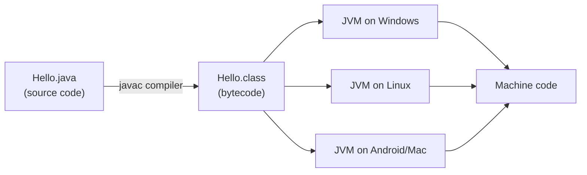

# How Java Works — JDK, JRE & JVM

## The big idea: write once, run anywhere

Java source code is **not** compiled directly to machine code. It is compiled to an
intermediate form called **bytecode** (`.class` files), which runs on a **Java Virtual
Machine (JVM)**. Any device with a JVM can run the same bytecode — that's the famous
*"write once, run anywhere"*.



## JDK vs JRE vs JVM

| Piece | Stands for | What it contains | Who needs it |
|-------|-----------|------------------|--------------|
| **JVM** | Java Virtual Machine | Executes bytecode; handles memory, garbage collection, JIT compilation | Everyone (part of JRE) |
| **JRE** | Java Runtime Environment | JVM + core libraries (`java.lang`, `java.util`, …) | People who only *run* Java apps |
| **JDK** | Java Development Kit | JRE + developer tools (`javac`, `jar`, `javadoc`, debugger) | People who *write* Java |

Rule of thumb: **JDK ⊃ JRE ⊃ JVM**.

## Your first program

```java
public class Hello {
    public static void main(String[] args) {
        System.out.println("Hello, Java!");
    }
}
```

Compile and run from a terminal:

```
$ javac Hello.java     // produces Hello.class (bytecode)
$ java Hello           // JVM loads and runs it
```

**Output:**

```
Hello, Java!
```

## What happens inside the JVM?

1. **Class loader** reads `Hello.class` into memory.
2. **Bytecode verifier** checks the code is safe (no illegal memory access).
3. **Interpreter** starts executing bytecode instruction by instruction.
4. **JIT (Just-In-Time) compiler** watches for "hot" code that runs often and compiles it
   to native machine code for speed.
5. **Garbage collector (GC)** automatically frees objects that are no longer referenced —
   you never call `free()` in Java.

## Key facts to remember

- Java is **compiled AND interpreted**: source → bytecode (compile time), bytecode → machine
  code (run time).
- The file name must match the `public` class name (`Hello` → `Hello.java`).
- One `.java` file can hold many classes, but only **one public class**.
- Java is **statically typed** (types checked at compile time) and **object-oriented**
  (almost everything lives inside a class).

> 💡 **Interview line:** "Java is platform independent, but the JVM itself is platform
> dependent — each OS has its own JVM implementation."
