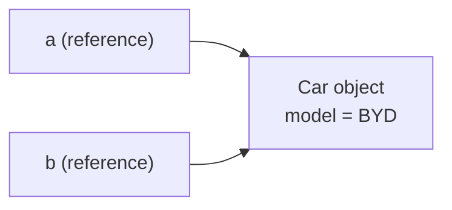

# Classes & Objects

## Class = blueprint, Object = instance

A **class** describes what its objects will know (fields) and do (methods). An **object**
is a concrete instance created with `new`, living on the heap.

```java
public class Car {
    // fields (state)
    String model;
    int speed;

    // methods (behavior)
    void accelerate(int by) {
        speed += by;
        System.out.println(model + " now at " + speed + " km/h");
    }

    public static void main(String[] args) {
        Car c1 = new Car();          // create object #1
        c1.model = "Civic";
        Car c2 = new Car();          // create object #2 — independent state
        c2.model = "Swift";

        c1.accelerate(40);
        c1.accelerate(20);
        c2.accelerate(30);
    }
}
```

**Output:**

```
Civic now at 40 km/h
Civic now at 60 km/h
Swift now at 30 km/h
```

Each object has its **own copy** of instance fields — accelerating `c1` never touches `c2`.

## References vs objects

```java
public class ReferenceDemo {
    public static void main(String[] args) {
        Car a = new Car();       // one object
        a.model = "Tesla";
        Car b = a;               // b points to the SAME object — no copy made!
        b.model = "BYD";

        System.out.println(a.model);
        System.out.println(a == b);   // same reference?
    }
}
```

**Output:**

```
BYD
true
```

`Car b = a` copies the **reference**, not the object. Changing through either variable
changes the one shared object.



## What happens at `new Car()`?

1. JVM allocates heap memory for the object.
2. Instance fields get **default values** (`0`, `false`, `null`).
3. Instance initializer blocks run, then the **constructor** runs.
4. `new` returns the reference.

When no references point to an object any more, the **garbage collector** reclaims it —
you never delete objects manually.

## Anatomy cheat-sheet

```java
public class Student {
    // 1. fields
    private String name;
    private int marks;

    // 2. constructor
    public Student(String name, int marks) {
        this.name = name;
        this.marks = marks;
    }

    // 3. methods
    public boolean hasPassed() { return marks >= 40; }

    // 4. toString — how the object prints
    @Override
    public String toString() {
        return name + " (" + marks + ")";
    }

    public static void main(String[] args) {
        Student s = new Student("Asha", 82);
        System.out.println(s);            // uses toString()
        System.out.println("passed? " + s.hasPassed());
    }
}
```

**Output:**

```
Asha (82)
passed? true
```

> 💡 Always override `toString()` on model classes — the default
> (`Student@1b6d3586`) tells you nothing useful.
