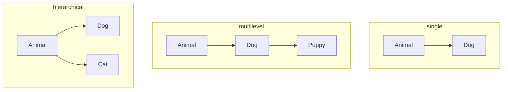

# Inheritance

## The IS-A relationship

Inheritance lets a class (**subclass/child**) reuse and extend another class
(**superclass/parent**) with `extends`. Use it only when the child truly **is a** parent:
a `Dog` is an `Animal`; a `Car` is *not* an `Engine` (that's HAS-A → composition).

```java
class Animal {
    String name;
    Animal(String name) { this.name = name; }
    void eat() { System.out.println(name + " is eating"); }
}

class Dog extends Animal {
    Dog(String name) { super(name); }        // parent constructor first
    void bark() { System.out.println(name + " says woof"); }
}

public class InheritDemo {
    public static void main(String[] args) {
        Dog d = new Dog("Rex");
        d.eat();     // inherited from Animal
        d.bark();    // Dog's own method
    }
}
```

**Output:**

```
Rex is eating
Rex says woof
```

## Types of inheritance in Java



Java classes support **single, multilevel and hierarchical** inheritance — but **not
multiple inheritance of classes** (`class A extends B, C` ❌). Why? The *diamond problem*:
if both parents define the same method, which one wins? Interfaces sidestep this
(a class may implement many interfaces).

## Upcasting and downcasting

```java
public class CastDemo {
    public static void main(String[] args) {
        Animal a = new Dog("Buddy");   // upcast: always safe, implicit
        a.eat();
        // a.bark();                   // ❌ compile error — Animal has no bark()

        if (a instanceof Dog d) {      // downcast: check first!
            d.bark();
        }

        Animal plain = new Animal("Generic");
        System.out.println(plain instanceof Dog);  // false → downcast would throw
    }
}
```

**Output:**

```
Buddy is eating
Buddy says woof
false
```

Downcasting without a check risks `ClassCastException` at runtime.

## What is (and isn't) inherited

| Member | Inherited? |
|--------|-----------|
| `public` / `protected` fields & methods | ✅ |
| package-private (no modifier) | ✅ only within the same package |
| `private` members | ❌ (exist in the object, but not accessible) |
| Constructors | ❌ (but child constructors call them via `super`) |
| `static` members | shared via class, not truly "inherited-overridable" |

## Object — the root of everything

Every class without an explicit `extends` silently extends `java.lang.Object`,
inheriting `toString()`, `equals()`, `hashCode()`, `getClass()` and more.

```java
public class RootDemo {
    public static void main(String[] args) {
        Object o = new Dog("Max");   // any object fits in an Object variable
        System.out.println(o.getClass().getSimpleName());
    }
}
```

**Output:**

```
Dog
```

## Composition over inheritance

If you only want to **reuse code** (not model an IS-A truth), prefer holding a field:

```java
class Engine { void start() { System.out.println("engine started"); } }

public class CarHasEngine {                 // Car HAS-A Engine
    private final Engine engine = new Engine();
    void drive() { engine.start(); System.out.println("driving"); }
    public static void main(String[] args) { new CarHasEngine().drive(); }
}
```

**Output:**

```
engine started
driving
```

> 💡 **Interview line:** "Inheritance is IS-A, composition is HAS-A; favor composition
> unless there's a genuine subtype relationship."
