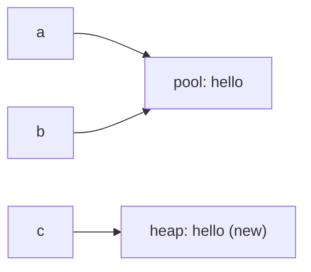

# String Basics — Immutability, Pool, == vs equals

## Strings are immutable

A `String` object can **never change**. Every "modification" creates a *new* String:

```java
public class ImmutableDemo {
    public static void main(String[] args) {
        String s = "java";
        s.toUpperCase();                 // result thrown away!
        System.out.println(s);

        s = s.toUpperCase();             // reassign to capture the NEW string
        System.out.println(s);
    }
}
```

**Output:**

```
java
JAVA
```

Why immutable? Safe to share between threads, safe as `HashMap` keys (hash can be cached),
and enables the **string pool**.

## The string pool

String **literals** are stored in a special area (the pool) and **reused**:

```java
public class PoolDemo {
    public static void main(String[] args) {
        String a = "hello";              // goes to the pool
        String b = "hello";              // reuses the SAME pooled object
        String c = new String("hello");  // forces a NEW heap object

        System.out.println(a == b);          // same object?
        System.out.println(a == c);          // different objects
        System.out.println(a.equals(c));     // same characters
        System.out.println(a == c.intern()); // intern() returns the pooled one
    }
}
```

**Output:**

```
true
false
true
true
```



## == vs equals() — the golden rule

- `==` compares **references** (same object?).
- `equals()` compares **content** (same characters?).

**Always use `equals()` for string comparison.** The `==` trap only "works" sometimes
because of the pool — never rely on it.

```java
public class CompareDemo {
    public static void main(String[] args) {
        String name = "Java";
        System.out.println(name.equals("java"));           // case matters
        System.out.println(name.equalsIgnoreCase("java"));
        System.out.println("apple".compareTo("banana"));   // negative → apple < banana
        System.out.println("Constant".equals(null));       // safe: false, no NPE
    }
}
```

**Output:**

```
false
true
-1
false
```

> 💡 Null-safe habit: write `"expected".equals(variable)` — literal first — so a `null`
> variable can't throw a `NullPointerException`.

## Concatenation & the + operator

```java
public class ConcatDemo {
    public static void main(String[] args) {
        System.out.println("Sum: " + 1 + 2);     // left-to-right: string first!
        System.out.println("Sum: " + (1 + 2));   // parentheses fix it
        System.out.println(1 + 2 + " points");   // ints add first here
    }
}
```

**Output:**

```
Sum: 12
Sum: 3
3 points
```

Once a `String` enters the expression, everything after it is string-concatenated —
a classic quiz trap.

## Text blocks (Java 15+)

```java
public class TextBlockDemo {
    public static void main(String[] args) {
        String json = """
                {
                  "name": "Java",
                  "version": 21
                }""";
        System.out.println(json);
    }
}
```

**Output:**

```
{
  "name": "Java",
  "version": 21
}
```

No more `\n` and `\"` noise for multi-line strings.
