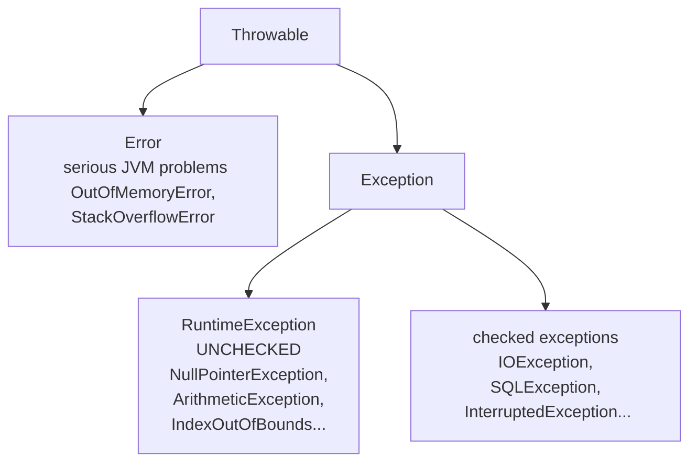

# Exception Handling — Basics & Hierarchy

## What is an exception?

An event that disrupts normal program flow — dividing by zero, opening a missing file,
calling a method on `null`. Java models each as an **object** thrown up the call stack
until something **catches** it (or the program dies with a stack trace).

## The hierarchy



| Kind | Compiler forces handling? | Typical cause | Examples |
|------|:---:|---|---|
| **Checked** | ✅ catch or declare | external conditions you must plan for | `IOException`, `SQLException` |
| **Unchecked** (`RuntimeException`) | ❌ | programming bugs | `NullPointerException`, `ArithmeticException` |
| **Error** | ❌ (don't catch) | JVM-level failure | `OutOfMemoryError` |

## try / catch / finally

```java
public class TryCatchDemo {
    public static void main(String[] args) {
        try {
            int[] a = new int[3];
            System.out.println("before the crash");
            int x = 10 / 0;                       // throws ArithmeticException
            System.out.println("never reached");
        } catch (ArithmeticException e) {
            System.out.println("caught: " + e.getMessage());
        } finally {
            System.out.println("finally always runs");
        }
        System.out.println("program continues normally");
    }
}
```

**Output:**

```
before the crash
caught: / by zero
finally always runs
program continues normally
```

Key behavior:

- Execution jumps from the throwing line **straight to the matching catch** — code in
  between is skipped.
- `finally` runs **whether or not** an exception occurred — even after a `return`.
  (Only `System.exit()` or a JVM crash skips it.)

## Multiple catch blocks — order matters

Catch **subclasses before superclasses**, or the compiler complains:

```java
public class MultiCatch {
    static void risky(int mode) {
        if (mode == 1) throw new NumberFormatException("bad number");
        if (mode == 2) throw new IllegalStateException("bad state");
    }
    public static void main(String[] args) {
        for (int mode = 1; mode <= 2; mode++) {
            try {
                risky(mode);
            } catch (NumberFormatException e) {          // specific first
                System.out.println("number problem: " + e.getMessage());
            } catch (RuntimeException e) {               // broader later
                System.out.println("other runtime: " + e.getMessage());
            }
        }

        // Java 7+ multi-catch: one block, several types
        try {
            risky(2);
        } catch (NumberFormatException | IllegalStateException e) {
            System.out.println("multi-catch got: " + e.getClass().getSimpleName());
        }
    }
}
```

**Output:**

```
number problem: bad number
other runtime: bad state
multi-catch got: IllegalStateException
```

## Reading a stack trace

```java
public class TraceDemo {
    static void a() { b(); }
    static void b() { String s = null; s.length(); }
    public static void main(String[] args) {
        try {
            a();
        } catch (NullPointerException e) {
            System.out.println("type    : " + e.getClass().getName());
            System.out.println("thrown in: " + e.getStackTrace()[0].getMethodName());
        }
    }
}
```

**Output:**

```
type    : java.lang.NullPointerException
thrown in: b
```

Uncaught, the same bug prints the familiar trace — read it **top-down**: the first line
is where it happened, the lines below are who called whom.

```
Exception in thread "main" java.lang.NullPointerException: ...
    at TraceDemo.b(TraceDemo.java:3)
    at TraceDemo.a(TraceDemo.java:2)
    at TraceDemo.main(TraceDemo.java:6)
```

> 💡 **Interview line:** "Checked exceptions are for recoverable, expected failures;
> unchecked exceptions signal bugs that should be fixed, not caught."
