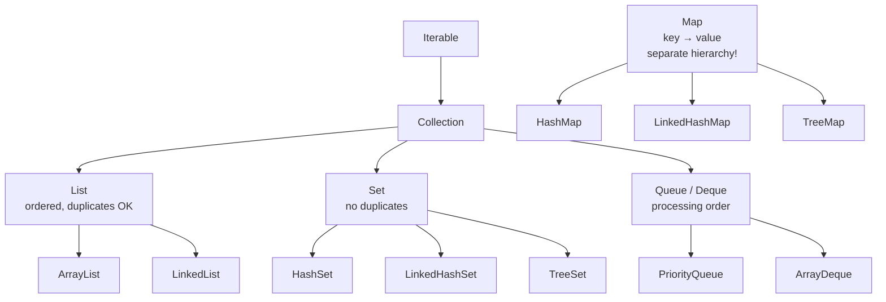

# Collections Framework — The Big Picture

## Why collections?

Arrays are fixed-size and low-level. The **Collections Framework** (`java.util`) provides
ready-made, resizable data structures with consistent interfaces: lists, sets, queues and
maps.

## The hierarchy



Note: **`Map` is not a `Collection`** — it's a parallel hierarchy (it stores pairs, not
single elements).

## Choosing the right one

| You need… | Use | Why |
|-----------|-----|-----|
| ordered list, fast random access | `ArrayList` | backed by array, O(1) `get` |
| many inserts/removes at the ends | `ArrayDeque` / `LinkedList` | O(1) at both ends |
| uniqueness, order irrelevant | `HashSet` | O(1) add/contains |
| uniqueness, insertion order kept | `LinkedHashSet` | hash + linked list |
| uniqueness, sorted | `TreeSet` | red-black tree, O(log n) |
| key → value lookup | `HashMap` | O(1) average |
| key → value, sorted keys | `TreeMap` | O(log n), range queries |
| FIFO processing | `ArrayDeque` | queue semantics |
| always process smallest/highest priority | `PriorityQueue` | binary heap |

## One example, four behaviors

```java
import java.util.*;

public class OverviewDemo {
    public static void main(String[] args) {
        String[] data = {"banana", "apple", "cherry", "apple"};

        List<String> list = new ArrayList<>(Arrays.asList(data));
        Set<String> hashSet = new HashSet<>(list);
        Set<String> treeSet = new TreeSet<>(list);
        Map<String, Integer> lengths = new HashMap<>();
        for (String s : data) lengths.put(s, s.length());

        System.out.println("List (keeps dupes & order): " + list);
        System.out.println("HashSet (unique, no order) : " + hashSet);
        System.out.println("TreeSet (unique, sorted)   : " + treeSet);
        System.out.println("Map (key→value)            : " + lengths);
    }
}
```

**Output:**

```
List (keeps dupes & order): [banana, apple, cherry, apple]
HashSet (unique, no order) : [banana, cherry, apple]
TreeSet (unique, sorted)   : [apple, banana, cherry]
Map (key→value)            : {banana=6, apple=5, cherry=6}
```

(`HashSet` iteration order is unspecified — it may differ on your machine.)

## The Collections utility class

`java.util.Collections` (plural!) is a bag of static helpers:

```java
import java.util.*;

public class CollectionsUtil {
    public static void main(String[] args) {
        List<Integer> nums = new ArrayList<>(List.of(5, 1, 4, 2, 3));

        Collections.sort(nums);
        System.out.println("sorted   : " + nums);
        Collections.reverse(nums);
        System.out.println("reversed : " + nums);
        Collections.shuffle(nums, new Random(42));   // seeded → reproducible
        System.out.println("shuffled : " + nums);
        System.out.println("max = " + Collections.max(nums)
                + ", min = " + Collections.min(nums));
        System.out.println("frequency of 3: " + Collections.frequency(nums, 3));

        List<Integer> locked = Collections.unmodifiableList(nums);
        try {
            locked.add(99);
        } catch (UnsupportedOperationException e) {
            System.out.println("unmodifiable list refused add()");
        }
    }
}
```

**Output:**

```
sorted   : [1, 2, 3, 4, 5]
reversed : [5, 4, 3, 2, 1]
shuffled : [4, 2, 5, 1, 3]
max = 5, min = 1
frequency of 3: 1
unmodifiable list refused add()
```

## Immutable factories (Java 9+)

```java
List<String> l = List.of("a", "b");
Set<Integer> s = Set.of(1, 2, 3);
Map<String, Integer> m = Map.of("one", 1, "two", 2);
```

All three are **truly immutable** — any mutation throws
`UnsupportedOperationException`, and `List.of` rejects `null` elements.

> 💡 **Interview line:** "Program to the interface": declare variables as `List`, `Set`,
> `Map` — not `ArrayList`, `HashSet`, `HashMap` — so implementations can be swapped freely.
