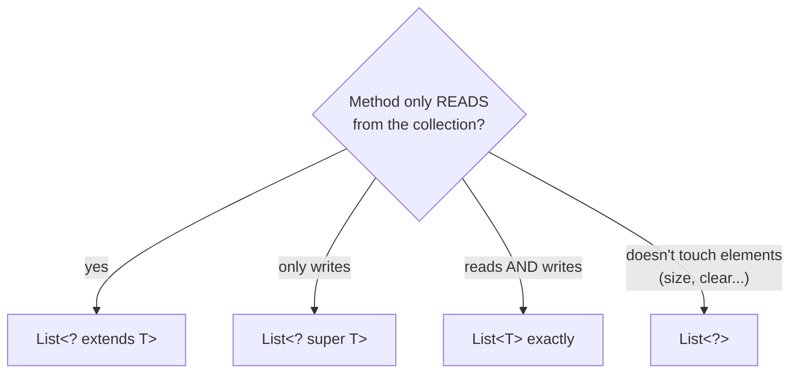

# Wildcards — ?, extends & super (PECS)

## The invariance surprise

`List<Integer>` is **not** a `List<Number>`, even though `Integer` extends `Number`:

```java
List<Number> nums = new ArrayList<Integer>();   // ❌ compile error
```

Why? If it compiled, you could `nums.add(3.14)` and corrupt the integer list. Wildcards
express the flexible relationships safely.

## `? extends T` — a producer you can read from

"Some unknown subtype of T." You may **read** elements as T, but **add nothing**
(the compiler can't prove what the unknown type is):

```java
import java.util.*;

public class ExtendsDemo {
    static double total(List<? extends Number> list) {
        double sum = 0;
        for (Number n : list) sum += n.doubleValue();   // reading is safe
        // list.add(1);        // ❌ can't add — might be a List<Double>!
        return sum;
    }

    public static void main(String[] args) {
        List<Integer> ints = List.of(1, 2, 3);
        List<Double> doubles = List.of(0.5, 1.5);
        System.out.println(total(ints));      // works for both now
        System.out.println(total(doubles));
    }
}
```

**Output:**

```
6.0
2.0
```

## `? super T` — a consumer you can write into

"Some unknown supertype of T." You may **add** T's, but reads only give `Object`:

```java
import java.util.*;

public class SuperDemo {
    static void addEvens(List<? super Integer> sink) {
        sink.add(2);                 // adding Integer is safe
        sink.add(4);
        // Integer i = sink.get(0); // ❌ reads come back as Object
    }

    public static void main(String[] args) {
        List<Integer> ints = new ArrayList<>();
        List<Number> nums = new ArrayList<>();
        List<Object> objs = new ArrayList<>();

        addEvens(ints);   // Integer is a super of Integer ✓
        addEvens(nums);   // Number  is a super of Integer ✓
        addEvens(objs);   // Object  is a super of Integer ✓

        System.out.println(ints + " " + nums + " " + objs);
    }
}
```

**Output:**

```
[2, 4] [2, 4] [2, 4]
```

## PECS — Producer Extends, Consumer Super

| The parameter… | Use | You can |
|----------------|-----|---------|
| *produces* values you read | `? extends T` | `get` as T, not `add` |
| *consumes* values you write | `? super T` | `add` T, `get` only Object |
| both reads and writes | exact `T` | everything |

The JDK itself follows PECS — look at `Collections.copy`:

```java
public static <T> void copy(List<? super T> dest, List<? extends T> src)
```

`src` produces (extends), `dest` consumes (super). A full example:

```java
import java.util.*;

public class PecsCopy {
    static <T> void copy(List<? super T> dest, List<? extends T> src) {
        for (T item : src) dest.add(item);
    }

    public static void main(String[] args) {
        List<Integer> src = List.of(1, 2, 3);
        List<Number> dest = new ArrayList<>();
        copy(dest, src);                     // Integer → Number list: fine!
        System.out.println(dest);
    }
}
```

**Output:**

```
[1, 2, 3]
```

## Unbounded wildcard — `?`

"A list of *something*, don't care what." Read-only as `Object`; useful for
type-agnostic utilities:

```java
import java.util.*;

public class Unbounded {
    static void printSize(List<?> any) {
        System.out.println("size = " + any.size());
        // any.add("x");    // ❌ only null can be added to List<?>
    }
    public static void main(String[] args) {
        printSize(List.of(1, 2, 3));
        printSize(List.of("a"));
    }
}
```

**Output:**

```
size = 3
size = 1
```

## Quick decision guide



> 💡 **Interview line:** "Arrays are covariant (`Integer[]` IS-A `Number[]`) and fail at
> runtime with `ArrayStoreException`; generics are invariant and fail at compile time —
> that's the safer trade."
