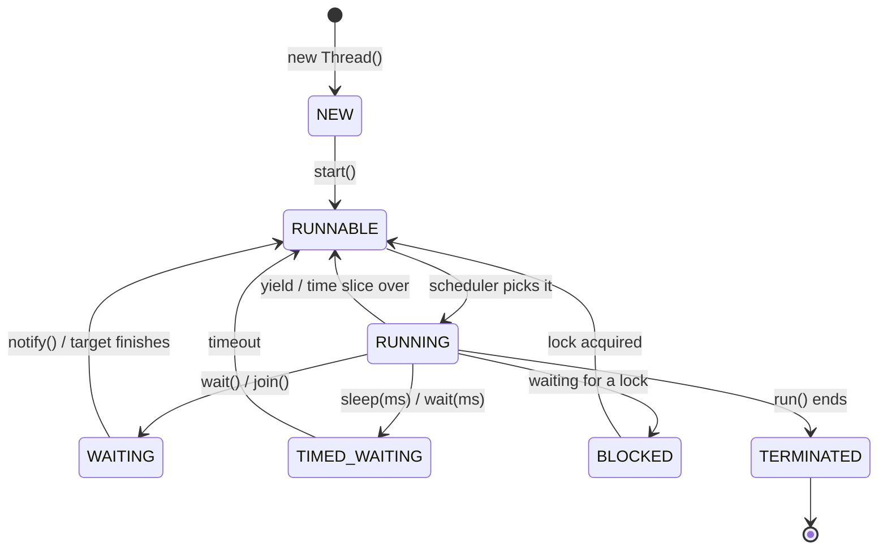

# Creating Threads & the Thread Lifecycle

## What is a thread?

An independent path of execution inside one process. All threads share the heap
(objects), but each has its own stack. Your program always starts with one thread: `main`.

## Two classic ways to create a thread

```java
public class CreateThreads {
    // way 1: extend Thread
    static class Worker extends Thread {
        @Override public void run() {
            System.out.println("Worker running in: " + Thread.currentThread().getName());
        }
    }

    public static void main(String[] args) throws InterruptedException {
        new Worker().start();

        // way 2: implement Runnable (preferred — keeps your class free to extend others)
        Runnable job = () -> System.out.println("Runnable running in: "
                + Thread.currentThread().getName());
        Thread t2 = new Thread(job, "my-runnable-thread");
        t2.start();

        t2.join();   // wait for t2 before finishing
        System.out.println("main done: " + Thread.currentThread().getName());
    }
}
```

**Output (order of first two lines may vary):**

```
Worker running in: Thread-0
Runnable running in: my-runnable-thread
main done: main
```

**Prefer `Runnable`** (or `Callable`, next chapters): it separates the *task* from the
*thread machinery*, works with lambdas and executor pools.

## start() vs run() — the #1 trap

```java
public class StartVsRun {
    public static void main(String[] args) {
        Runnable job = () -> System.out.println("running in: "
                + Thread.currentThread().getName());

        new Thread(job).run();     // ❌ runs like a normal method call — no new thread!
        new Thread(job).start();   // ✅ JVM creates a real new thread
    }
}
```

**Output:**

```
running in: main
running in: Thread-1
```

- `run()` directly = plain method call on the **current** thread.
- `start()` = new call stack, then the JVM invokes `run()` there.
- Calling `start()` twice on the same Thread throws `IllegalThreadStateException`.

## The thread lifecycle



```java
public class LifecycleDemo {
    public static void main(String[] args) throws InterruptedException {
        Thread t = new Thread(() -> {
            try { Thread.sleep(200); } catch (InterruptedException ignored) { }
        });

        System.out.println("after new    : " + t.getState());
        t.start();
        System.out.println("after start  : " + t.getState());
        Thread.sleep(50);
        System.out.println("while asleep : " + t.getState());
        t.join();
        System.out.println("after join   : " + t.getState());
    }
}
```

**Output:**

```
after new    : NEW
after start  : RUNNABLE
while asleep : TIMED_WAITING
after join   : TERMINATED
```

## Threads run concurrently — order is not guaranteed

```java
public class Interleaving {
    public static void main(String[] args) {
        Runnable counter = () -> {
            for (int i = 1; i <= 3; i++)
                System.out.println(Thread.currentThread().getName() + " → " + i);
        };
        new Thread(counter, "A").start();
        new Thread(counter, "B").start();
    }
}
```

**One possible output (yours may differ — that's the point!):**

```
A → 1
B → 1
A → 2
B → 2
B → 3
A → 3
```

The OS scheduler interleaves threads unpredictably. Any code that assumes a particular
order without synchronization is buggy.

> 💡 **Interview line:** "`start()` may only be called once and creates a new call stack;
> `run()` is just a method — calling it yourself gives you concurrency-flavored
> single-threading."
