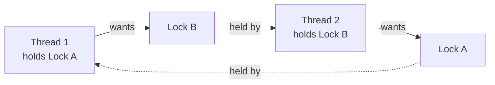

# Deadlock — Detection & Prevention

## What is a deadlock?

Two (or more) threads each hold a lock the other needs — everyone waits forever.



## A deadlock you can run (with a timeout escape hatch)

```java
public class DeadlockDemo {
    static final Object LOCK_A = new Object();
    static final Object LOCK_B = new Object();

    public static void main(String[] args) throws InterruptedException {
        Thread t1 = new Thread(() -> {
            synchronized (LOCK_A) {
                System.out.println("t1: holding A, wants B");
                sleep(100);
                synchronized (LOCK_B) {
                    System.out.println("t1: got both (never prints)");
                }
            }
        });
        Thread t2 = new Thread(() -> {
            synchronized (LOCK_B) {                       // ⚠️ opposite order!
                System.out.println("t2: holding B, wants A");
                sleep(100);
                synchronized (LOCK_A) {
                    System.out.println("t2: got both (never prints)");
                }
            }
        });

        t1.start(); t2.start();
        t1.join(1000); t2.join(1000);      // give them a second…

        System.out.println("t1 state: " + t1.getState());
        System.out.println("t2 state: " + t2.getState());
        System.out.println("deadlocked — exiting (JVM kill required in real life)");
        System.exit(0);
    }

    static void sleep(long ms) {
        try { Thread.sleep(ms); } catch (InterruptedException ignored) { }
    }
}
```

**Output:**

```
t1: holding A, wants B
t2: holding B, wants A
t1 state: BLOCKED
t2 state: BLOCKED
deadlocked — exiting (JVM kill required in real life)
```

Both threads are `BLOCKED` forever — the classic circular wait.

## The four Coffman conditions

Deadlock requires **all four**; break any one and it's impossible:

1. **Mutual exclusion** — resources can't be shared.
2. **Hold and wait** — a thread holds one lock while waiting for another.
3. **No preemption** — locks can't be forcibly taken away.
4. **Circular wait** — a cycle of threads each waiting on the next.

## Prevention strategy #1 — global lock ordering

The standard fix: **everyone acquires locks in the same order**. Circular wait becomes
impossible:

```java
public class OrderedLocks {
    static final Object LOCK_A = new Object();
    static final Object LOCK_B = new Object();

    static void doWork(String name) {
        synchronized (LOCK_A) {              // ALWAYS A first…
            synchronized (LOCK_B) {          // …then B — in every thread
                System.out.println(name + ": got both locks");
            }
        }
    }

    public static void main(String[] args) throws InterruptedException {
        Thread t1 = new Thread(() -> doWork("t1"));
        Thread t2 = new Thread(() -> doWork("t2"));
        t1.start(); t2.start();
        t1.join(); t2.join();
        System.out.println("no deadlock possible");
    }
}
```

**Output:**

```
t1: got both locks
t2: got both locks
no deadlock possible
```

## Prevention strategy #2 — tryLock with timeout

`ReentrantLock.tryLock(timeout)` refuses to wait forever — a thread that can't get the
second lock backs off, releasing what it holds:

```java
import java.util.concurrent.TimeUnit;
import java.util.concurrent.locks.ReentrantLock;

public class TryLockDemo {
    static final ReentrantLock A = new ReentrantLock();
    static final ReentrantLock B = new ReentrantLock();

    static boolean transfer() throws InterruptedException {
        if (A.tryLock(50, TimeUnit.MILLISECONDS)) {
            try {
                if (B.tryLock(50, TimeUnit.MILLISECONDS)) {
                    try { return true; } finally { B.unlock(); }
                }
            } finally { A.unlock(); }
        }
        return false;      // caller can retry — no deadlock, just a failed attempt
    }

    public static void main(String[] args) throws Exception {
        System.out.println("transfer succeeded? " + transfer());
    }
}
```

**Output:**

```
transfer succeeded? true
```

## Deadlock checklist

- Acquire multiple locks in one **globally agreed order** (e.g. by account id:
  `lock(min(a,b))` then `lock(max(a,b))`).
- Keep lock scopes tiny; never call **unknown/foreign code** while holding a lock.
- Prefer one lock over two; prefer no lock (immutability, confinement) over one.
- Diagnose live deadlocks with `jstack <pid>` — it prints "Found one Java-level
  deadlock" with both stack traces.

Related conditions worth knowing for interviews:

| Term | Meaning |
|------|---------|
| **Livelock** | threads keep responding to each other but make no progress (endless polite back-off) |
| **Starvation** | a thread never gets scheduled/lock because others always win |

> 💡 **Interview line:** "My default deadlock answer: consistent lock ordering; my
> defensive answer: tryLock with timeout and back-off."
