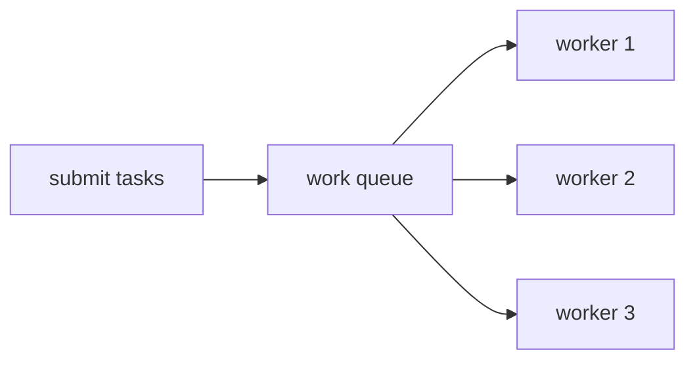

# Executor Framework — Thread Pools, Callable & Future

## Why not `new Thread()` everywhere?

Threads are expensive (~1 MB stack each) and unbounded creation can kill the JVM.
A **thread pool** reuses a fixed set of worker threads to run many tasks — this is the
production way to do concurrency.



## ExecutorService basics

```java
import java.util.concurrent.*;

public class PoolDemo {
    public static void main(String[] args) throws InterruptedException {
        ExecutorService pool = Executors.newFixedThreadPool(2);   // 2 workers

        for (int i = 1; i <= 4; i++) {
            final int id = i;
            pool.submit(() -> {
                System.out.println("task " + id + " on " + Thread.currentThread().getName());
                try { Thread.sleep(100); } catch (InterruptedException ignored) { }
            });
        }

        pool.shutdown();                              // no new tasks; finish queued ones
        pool.awaitTermination(5, TimeUnit.SECONDS);
        System.out.println("all tasks finished");
    }
}
```

**Output (typical — 4 tasks share 2 threads):**

```
task 1 on pool-1-thread-1
task 2 on pool-1-thread-2
task 3 on pool-1-thread-1
task 4 on pool-1-thread-2
all tasks finished
```

**Always `shutdown()`** — a live pool's worker threads keep the JVM running.

## Callable & Future — tasks that return values

`Runnable` returns nothing; `Callable<V>` returns a value and may throw checked
exceptions. `submit()` hands back a `Future<V>` — a ticket for the eventual result:

```java
import java.util.List;
import java.util.concurrent.*;

public class FutureDemo {
    public static void main(String[] args) throws Exception {
        ExecutorService pool = Executors.newFixedThreadPool(3);

        Callable<Integer> slowSquare = () -> { Thread.sleep(200); return 7 * 7; };

        Future<Integer> future = pool.submit(slowSquare);
        System.out.println("submitted; doing other work…");
        System.out.println("isDone yet? " + future.isDone());

        Integer result = future.get();          // blocks until ready
        System.out.println("result = " + result);

        // invokeAll: run a batch, wait for all
        List<Callable<String>> jobs = List.of(
                () -> "alpha", () -> "beta", () -> "gamma");
        for (Future<String> f : pool.invokeAll(jobs)) {
            System.out.println("got " + f.get());
        }

        pool.shutdown();
    }
}
```

**Output:**

```
submitted; doing other work…
isDone yet? false
result = 49
got alpha
got beta
got gamma
```

If the task threw, `future.get()` throws `ExecutionException` wrapping the real cause.

## The factory methods

| `Executors.…` | Behavior | Use for |
|---|---|---|
| `newFixedThreadPool(n)` | exactly n threads, unbounded queue | steady CPU/IO workloads |
| `newCachedThreadPool()` | grows/shrinks on demand | many short bursty tasks |
| `newSingleThreadExecutor()` | one thread, tasks in order | serialized background work |
| `newScheduledThreadPool(n)` | delayed & periodic tasks | timers, heartbeats |
| `newVirtualThreadPerTaskExecutor()` (21+) | one **virtual** thread per task | massive IO-bound concurrency |

## Scheduled tasks

```java
import java.util.concurrent.*;

public class ScheduleDemo {
    public static void main(String[] args) throws InterruptedException {
        ScheduledExecutorService sched = Executors.newScheduledThreadPool(1);

        sched.scheduleAtFixedRate(
                () -> System.out.println("tick " + System.nanoTime() / 1_000_000_000 % 60),
                0, 200, TimeUnit.MILLISECONDS);

        Thread.sleep(650);
        sched.shutdown();
        System.out.println("scheduler stopped");
    }
}
```

**Output (times vary):**

```
tick 12
tick 12
tick 12
tick 13
scheduler stopped
```

## Virtual threads (Java 21) — the game changer

Virtual threads are JVM-managed, cost ~a few hundred bytes, and you can run **millions**.
Blocking is cheap — no more pool-sizing gymnastics for IO-bound work:

```java
import java.util.concurrent.*;
import java.util.stream.IntStream;

public class VirtualDemo {
    public static void main(String[] args) throws Exception {
        try (var exec = Executors.newVirtualThreadPerTaskExecutor()) {
            var futures = IntStream.range(0, 10_000)
                    .mapToObj(i -> exec.submit(() -> {
                        Thread.sleep(50);      // 10k blocked threads: no problem
                        return i;
                    })).toList();
            int sum = 0;
            for (var f : futures) sum += (int) f.get();
            System.out.println("10,000 virtual-thread tasks done, sum = " + sum);
        }
    }
}
```

**Output:**

```
10,000 virtual-thread tasks done, sum = 49995000
```

> 💡 **Interview line:** "Rule of thumb — platform-thread pools sized ~CPU cores for
> CPU-bound work; virtual threads (or bigger pools) for IO-bound work."
