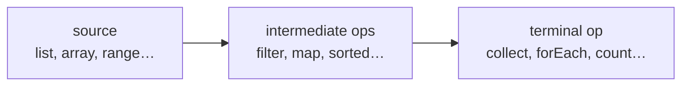

# Streams — Basics & Pipeline Thinking

## What is a stream?

A **pipeline of operations over data** — declarative, chainable, and lazily evaluated.
You describe *what* you want; the library decides *how* to loop.



```java
import java.util.*;
import java.util.stream.*;

public class FirstStream {
    public static void main(String[] args) {
        List<String> names = List.of("anil", "BALU", "chitra", "dev", "esha");

        List<String> result = names.stream()
                .filter(n -> n.length() > 3)     // keep long names
                .map(String::toLowerCase)        // normalize
                .sorted()                        // natural order
                .collect(Collectors.toList());   // gather into a list

        System.out.println(result);
    }
}
```

**Output:**

```
[anil, balu, chitra, esha]
```

The same logic with loops needs a temp list, an if, a transform and a sort call —
streams read like the requirement itself.

## Creating streams

```java
import java.util.*;
import java.util.stream.*;

public class Sources {
    public static void main(String[] args) {
        Stream<String> fromValues = Stream.of("a", "b", "c");
        Stream<Integer> fromList = List.of(1, 2, 3).stream();
        IntStream range = IntStream.rangeClosed(1, 5);          // 1,2,3,4,5
        Stream<Double> generated = Stream.generate(Math::random).limit(2);
        Stream<Integer> iterated = Stream.iterate(1, n -> n * 2).limit(6);

        System.out.println(fromValues.count());
        System.out.println(fromList.count());
        System.out.println(range.sum());
        System.out.println(generated.count());
        System.out.println(iterated.toList());
    }
}
```

**Output:**

```
3
3
15
2
[1, 2, 4, 8, 16, 32]
```

## Intermediate operations tour

```java
import java.util.*;
import java.util.stream.*;

public class Intermediates {
    public static void main(String[] args) {
        List<Integer> nums = List.of(5, 3, 8, 3, 1, 9, 8);

        System.out.println("filter  : " + nums.stream().filter(n -> n > 4).toList());
        System.out.println("map     : " + nums.stream().map(n -> n * 10).toList());
        System.out.println("distinct: " + nums.stream().distinct().toList());
        System.out.println("sorted  : " + nums.stream().sorted().toList());
        System.out.println("desc    : " + nums.stream().sorted(Comparator.reverseOrder()).toList());
        System.out.println("limit   : " + nums.stream().limit(3).toList());
        System.out.println("skip    : " + nums.stream().skip(4).toList());

        // flatMap: flatten nested structure
        List<List<Integer>> nested = List.of(List.of(1, 2), List.of(3), List.of(4, 5));
        System.out.println("flatMap : " + nested.stream().flatMap(List::stream).toList());
    }
}
```

**Output:**

```
filter  : [5, 8, 9, 8]
map     : [50, 30, 80, 30, 10, 90, 80]
distinct: [5, 3, 8, 1, 9]
sorted  : [1, 3, 3, 5, 8, 8, 9]
desc    : [9, 8, 8, 5, 3, 3, 1]
limit   : [5, 3, 8]
skip    : [1, 9, 8]
flatMap : [1, 2, 3, 4, 5]
```

**map vs flatMap:** map transforms each element 1→1; flatMap turns each element into a
stream and concatenates them (n→many, flattened).

## Laziness — nothing runs until the terminal op

```java
import java.util.stream.*;

public class LazyDemo {
    public static void main(String[] args) {
        Stream<Integer> pipeline = Stream.of(1, 2, 3, 4)
                .filter(n -> { System.out.println("filter " + n); return n % 2 == 0; })
                .map(n -> { System.out.println("  map " + n); return n * 10; });

        System.out.println("pipeline built — nothing printed yet!");
        System.out.println("first even ×10 = " + pipeline.findFirst().orElseThrow());
    }
}
```

**Output:**

```
pipeline built — nothing printed yet!
filter 1
filter 2
  map 2
first even ×10 = 20
```

Elements flow **one at a time** through the whole pipeline, and `findFirst` stopped after
element 2 — 3 and 4 were never touched (short-circuiting).

## Streams golden rules

- A stream can be consumed **once** — reusing it throws `IllegalStateException`.
- Streams **don't modify the source** — they produce new results.
- Don't mutate outside state from inside a pipeline (no side effects in `map`/`filter`).
- Use `IntStream`/`LongStream`/`DoubleStream` for numeric crunching (no boxing,
  plus `sum()`, `average()`, `max()` for free).

> 💡 **Interview line:** "Intermediate ops are lazy and return a stream; terminal ops are
> eager and produce a value or side effect — no terminal, no work."
