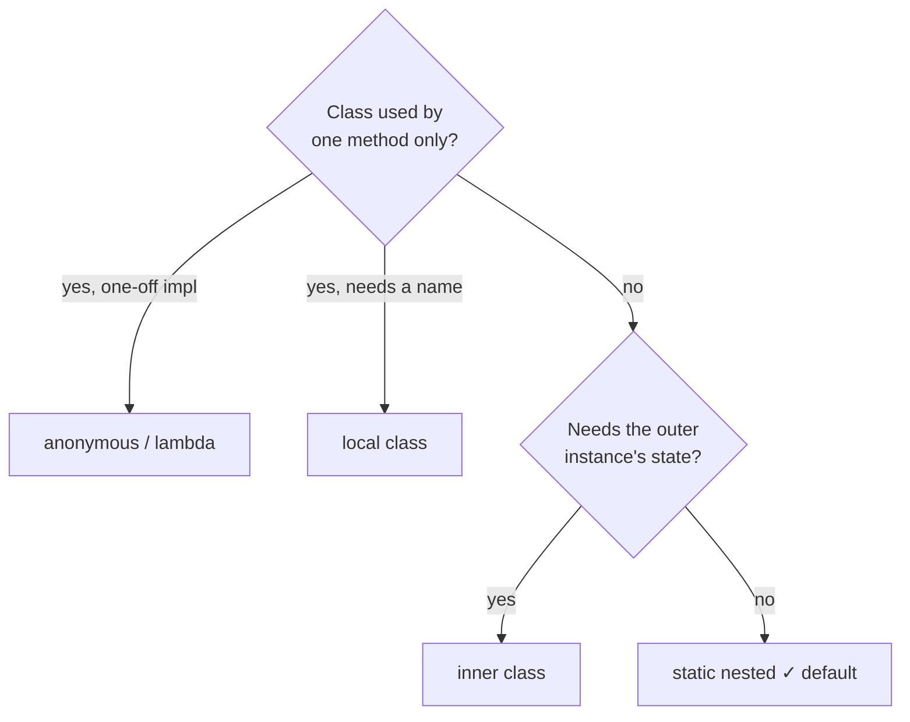

# Nested & Inner Classes — All Four Kinds

Java lets you define a class inside another. Four kinds, each with a job:

| Kind | Declared | Needs outer instance? | Typical use |
|------|----------|----------------------|-------------|
| **static nested** | `static class` inside a class | ❌ | helper/grouping (Builder, Node) |
| **inner** (non-static) | `class` inside a class | ✅ | tightly coupled helper needing outer state |
| **local** | inside a method | ✅ (implicit) | one-method-only helper (rare) |
| **anonymous** | inline, no name | depends | one-off interface implementations |

## 1. Static nested class

Behaves like a top-level class that lives in the outer's namespace. The most common and
recommended kind:

```java
public class LinkedStack {
    private Node top;                 // uses the nested type

    static class Node {               // no hidden reference to LinkedStack
        int value; Node next;
        Node(int value, Node next) { this.value = value; this.next = next; }
    }

    void push(int v) { top = new Node(v, top); }
    Integer pop() {
        if (top == null) return null;
        int v = top.value; top = top.next; return v;
    }

    public static void main(String[] args) {
        LinkedStack s = new LinkedStack();
        s.push(1); s.push(2); s.push(3);
        System.out.println(s.pop() + ", " + s.pop() + ", " + s.pop());
    }
}
```

**Output:**

```
3, 2, 1
```

## 2. Inner (non-static) class

Every instance carries a hidden reference to an **outer instance** and can read its
fields directly:

```java
public class Radio {
    private String station = "101.5 FM";

    class Speaker {                          // inner: tied to a Radio instance
        void announce() {
            System.out.println("Playing " + station);   // outer field, direct access
        }
    }

    public static void main(String[] args) {
        Radio radio = new Radio();
        Radio.Speaker sp = radio.new Speaker();   // note the odd syntax!
        sp.announce();
    }
}
```

**Output:**

```
Playing 101.5 FM
```

⚠️ Because of that hidden reference, an inner class **keeps its outer object alive** —
a classic memory-leak source (especially in Android). Prefer `static` nested unless you
truly need outer state.

## 3. Local class

Declared inside a method; can capture effectively-final locals:

```java
public class Greeter {
    void greetAll(String[] names) {
        String prefix = "Hello, ";                 // effectively final

        class Formatter {                           // local class
            String format(String n) { return prefix + n + "!"; }
        }

        Formatter f = new Formatter();
        for (String n : names) System.out.println(f.format(n));
    }
    public static void main(String[] args) {
        new Greeter().greetAll(new String[]{"Anil", "Balu"});
    }
}
```

**Output:**

```
Hello, Anil!
Hello, Balu!
```

## 4. Anonymous class

Declare-and-instantiate in one expression — an unnamed subclass/implementation:

```java
public class ButtonDemo {
    interface ClickListener { void onClick(); }

    static void setListener(ClickListener l) { l.onClick(); }

    public static void main(String[] args) {
        // anonymous class: implement the interface inline
        setListener(new ClickListener() {
            @Override public void onClick() {
                System.out.println("clicked (anonymous class)");
            }
        });

        // for functional interfaces, a lambda is the modern replacement
        setListener(() -> System.out.println("clicked (lambda)"));

        // but anonymous classes can still do what lambdas can't:
        // implement multi-method interfaces or extend classes, hold state
        Thread t = new Thread("worker") {
            @Override public void run() {
                System.out.println("custom thread subclass: " + getName());
            }
        };
        t.start();
    }
}
```

**Output:**

```
clicked (anonymous class)
clicked (lambda)
custom thread subclass: worker
```

## Which one should I use?



Rules of thumb:

- **Default to static nested** — no hidden reference, no surprises.
- Lambda beats anonymous class whenever the target is a functional interface.
- Inner classes: only when the coupling to outer state is the whole point (e.g.
  `Iterator` implementations inside collections).

> 💡 **Interview line:** "A non-static inner class holds an implicit `Outer.this`
> reference — that's both its superpower (direct field access) and its danger
> (unexpected object retention)."
