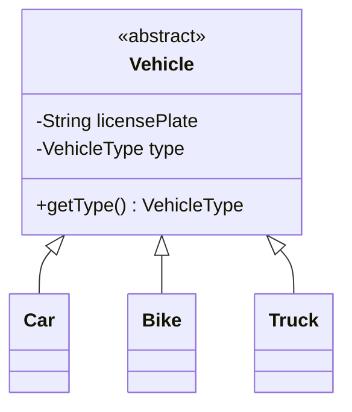

# 1.1 OOP in Java — The Four Pillars, Done Right

> Every LLD interview is secretly an OOP exam. Interviewers rarely ask "what is encapsulation?" — they watch whether your *code* encapsulates. This chapter turns the pillars from definitions into habits.

---

## The four pillars — as behaviors, not definitions

| Pillar | Definition (1 line for the interview) | What it looks like in your code |
|---|---|---|
| **Encapsulation** | Data + behavior together; internals hidden behind a small API | `private` fields, no setters unless needed, invariants enforced in methods |
| **Abstraction** | Expose *what*, hide *how* | Interfaces (`PaymentStrategy`), callers never see implementation details |
| **Inheritance** | *is-a* reuse of interface + implementation | `abstract class Vehicle` → `Car extends Vehicle` — use sparingly |
| **Polymorphism** | One call site, many behaviors at runtime | `fee.calculate(ticket)` dispatches to hourly/flat/weekend strategy |

**The interview one-liner:** "I encapsulate state, expose behavior through interfaces, and use polymorphism instead of `if/else` chains. I inherit only for true is-a relationships — otherwise I compose."

---

## Encapsulation — protect your invariants

Bad (anemic — data class + logic elsewhere):

```java
class Wallet { public double balance; }          // anyone can corrupt it
// elsewhere: wallet.balance -= amount;          // no validation, duplicated everywhere
```

Good (invariant lives *inside* the object):

```java
public class Wallet {
    private long balanceInPaise;                  // money as long, never double!

    public void debit(long amount) {
        if (amount <= 0) throw new IllegalArgumentException("amount must be positive");
        if (amount > balanceInPaise) throw new InsufficientBalanceException(amount, balanceInPaise);
        balanceInPaise -= amount;
    }
}
```

**Rules that impress:**
- No setters by default. Ask: "does anyone *need* to mutate this?"
- Never return mutable internals: return `List.copyOf(items)` or an unmodifiable view.
- Money = `long` minor-units or `BigDecimal`. Saying "never double for money" earns instant credibility.

## Abstraction — program to interfaces

```java
public interface ParkingSpotAssignmentStrategy {
    Optional<ParkingSpot> findSpot(ParkingLot lot, Vehicle vehicle);
}
// callers depend on the interface; NearestSpotStrategy / RandomStrategy are swappable
```

**When interface vs abstract class?**
- **Interface**: pure capability/contract, multiple implementations expected, no shared state. Default choice.
- **Abstract class**: shared *state* or a skeletal implementation (Template Method, Ch 2.4). A class can extend only one — spend that budget wisely.

## Inheritance — the sharpest knife, use least



Inheritance is fine for closed, stable hierarchies (vehicle types, chess pieces). It breaks when:
- The hierarchy grows on two axes → class explosion (`ElectricSportsCar`, `PetrolSportsCar`…) → use **composition/Bridge/Strategy**.
- You inherit to *reuse code* rather than to *be* the parent → violates LSP (Ch 1.2).

**Litmus test to say aloud:** "Is a `Car` always a `Vehicle` in every context this code runs? Yes → inherit. Am I just borrowing methods? → compose."

## Composition over inheritance — the default

```java
// A vehicle HAS an engine; engines vary independently of vehicle kinds.
public class Car {
    private final Engine engine;        // composition: swap Electric/Petrol freely
    public Car(Engine engine) { this.engine = engine; }
    public void start() { engine.ignite(); }
}
```

Composition wins because: no fragile base class, testable via mocks, behavior swappable at runtime, and hierarchies stay one level deep.

## Polymorphism — kill the if/else chain

```java
// ❌ what interviewers penalize                     // ✅ what they reward
double fee(Ticket t) {                               interface FeeStrategy { long fee(Ticket t); }
    if (t.type == CAR) ...                           Map<VehicleType, FeeStrategy> strategies;
    else if (t.type == BIKE) ...                     strategies.get(t.type()).fee(t);
    else if (t.type == TRUCK) ...
}
```

Adding a new vehicle type: left = edit every switch in the codebase; right = add one class + one map entry (Open/Closed, Ch 1.2).

---

## Java essentials interviewers probe

**`equals`/`hashCode` — always together, on identity fields only:**

```java
public final class SpotId {
    private final int floor; private final int number;
    @Override public boolean equals(Object o) {
        if (this == o) return true;
        if (!(o instanceof SpotId s)) return false;
        return floor == s.floor && number == s.number;
    }
    @Override public int hashCode() { return Objects.hash(floor, number); }
}
```

Break the contract and `HashMap`/`HashSet` silently misbehave — a classic bug they ask about.

**Immutability — your default for value objects:**

```java
public record Money(long amountPaise, Currency currency) {   // records: free equals/hashCode/toString
    public Money add(Money other) {
        if (!currency.equals(other.currency)) throw new CurrencyMismatchException();
        return new Money(amountPaise + other.amountPaise, currency);
    }
}
```

Immutable objects are thread-safe for free, cacheable, and safe as map keys. Use `record` for value objects (Java 16+), `enum` for fixed sets (`VehicleType`, `OrderStatus`).

**`enum` with behavior — a mini pattern:**

```java
public enum VehicleType {
    BIKE(1), CAR(1), TRUCK(2);                 // spots each occupies
    private final int spotsNeeded;
    VehicleType(int n) { this.spotsNeeded = n; }
    public int spotsNeeded() { return spotsNeeded; }
}
```

---

## ✅ Key Takeaways
- Encapsulation = invariants enforced inside the object; no naked fields, no reflex setters.
- Program to interfaces; abstract classes only for shared state/skeletons.
- Inheritance for true is-a in stable hierarchies; **composition is the default**.
- Polymorphism (strategy map) replaces `if/else`-on-type everywhere.
- Value objects: immutable `record`s with proper `equals/hashCode`; money is never `double`.

## 💡 Tips & Tricks
- In machine coding, start every entity `private final` and relax only when forced — reviewers notice.
- Narrate the litmus tests aloud ("this is has-a, so I'll compose") — the interviewer is grading your *reasoning*, not just the result.
- If you write a `switch` on a type enum, immediately say "I'd refactor this to Strategy if more variants come" — it defuses the follow-up.
- Records + enums + `Optional` return types make your interview code look senior with zero extra effort.

## 🎯 Interview Q&A

**Q1. Composition vs inheritance — when do you choose which?**
> Inheritance only for a true, permanent is-a relationship in a closed hierarchy where I want polymorphic dispatch (Chess pieces, vehicle categories). Composition everywhere else: it avoids the fragile-base-class problem, lets behavior vary at runtime, keeps testing easy, and survives requirement changes on multiple axes. Practical signal: if I'm inheriting *to reuse code* rather than to *be substitutable* for the parent, that's composition's job.

**Q2. Interface vs abstract class in Java — real differences?**
> Interface: contract only, multiple inheritance of type, fields are implicitly constants, since Java 8 can carry default methods. Abstract class: can hold state, constructors, and non-public members; single inheritance. Design answer: interfaces define *capability* (Comparable, PaymentStrategy); abstract classes provide a *partial implementation* for a family (Template Method). Default to interfaces — you can always add a skeletal abstract class implementing the interface later.

**Q3. Why must equals and hashCode be overridden together?**
> The contract: equal objects must have equal hash codes. Hash collections first bucket by hashCode, then confirm with equals. Override only equals → two "equal" objects land in different buckets → `set.contains()` returns false, duplicate map keys. Override only hashCode → lookups find the bucket but equals rejects the match. Either way, silent data corruption.

**Q4. What makes a class immutable, and why care in LLD?**
> final class (or no subclassing of mutators), all fields private final, no setters, defensive copies of mutable inputs/outputs, `this` not leaked from the constructor. Benefits: thread-safe with zero locking, safe as `HashMap` keys, freely shareable/cacheable, and reasoning stays local. In interviews, immutable value objects (Money, SpotId, Position) eliminate whole classes of concurrency questions before they're asked.

**Q5. Is Java pass-by-value or pass-by-reference?**
> Strictly pass-by-value — but for objects, the value passed is the reference. So a method can mutate the object it receives, but reassigning the parameter never affects the caller. This is why defensive copies matter for encapsulation: handing out your internal `List` reference hands out write access.
