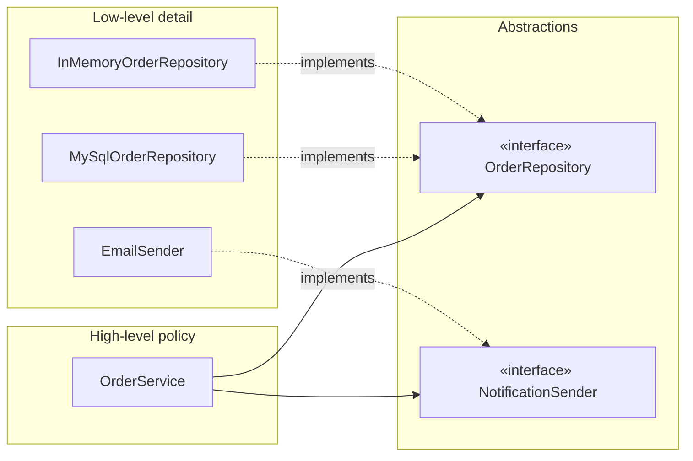

# 1.2 SOLID Principles — With Java Refactors

> SOLID is the grading rubric of LLD interviews. You won't be asked to recite it — but every design choice you make will be silently scored against it. Learn each principle as **smell → refactor**.

---

## S — Single Responsibility Principle (SRP)

> A class should have **one reason to change** — one actor whose requirements affect it.

**Smell:** a `ParkingLotService` that finds spots *and* computes fees *and* prints receipts *and* writes to DB. Pricing team, receipt team, and DBA all force edits to one class.

```java
// ❌ God class                                  // ✅ One job each
class ParkingService {                           class SpotAllocator   { ... }   // assignment rules
    park(); calcFee(); printReceipt();           class FeeCalculator   { ... }   // pricing rules
    saveToDb();                                  class ReceiptPrinter  { ... }   // formatting
}                                                class TicketRepository{ ... }   // persistence
```

**How to use it live:** when your class hits a second responsibility, say *"I'll split this — fee logic changes for different reasons than allocation logic."* That sentence is worth more than the split itself.

**Caution:** SRP ≠ one method per class. Over-splitting into 30 two-line classes is a red flag too. Group by *reason to change*.

## O — Open/Closed Principle (OCP)

> Open for **extension**, closed for **modification** — add features by adding code, not editing tested code.

**Smell:** `switch (vehicleType)` inside fee calculation. Every new type reopens the file.

```java
public interface FeeStrategy { long fee(Duration parked); }

public class HourlyFee implements FeeStrategy {
    private final long ratePerHour;
    public HourlyFee(long r) { ratePerHour = r; }
    public long fee(Duration d) { return Math.max(1, d.toHours()) * ratePerHour; }
}
// New "weekend surge pricing"? New class + registration. Zero edits to existing code.
```

Mechanisms in Java: interfaces + polymorphism (Strategy), abstract hooks (Template Method), composition (Decorator).

**Caution to say aloud:** "I apply OCP on the axis that's *likely to change* — abstracting everything upfront is speculative generality."

## L — Liskov Substitution Principle (LSP)

> Subtypes must be usable **anywhere** the base type is expected — without surprises.

**The classic trap (know it cold):** `Square extends Rectangle` — `setWidth(5)` on a Square silently sets height too; code that worked on Rectangle breaks. Also: `penguin.fly()` throwing `UnsupportedOperationException`.

**Rules:** subclasses may *weaken* preconditions and *strengthen* postconditions, never the reverse; never throw new exception types the base doesn't; never no-op an inherited method.

```java
// ❌ Penguin forced to lie                       // ✅ model the capability separately
class Bird { void fly() {...} }                  interface Flyable { void fly(); }
class Penguin extends Bird {                     class Sparrow extends Bird implements Flyable {...}
    void fly() { throw new UOE(); }              class Penguin extends Bird {...}   // simply not Flyable
}
```

**Real interview relevance:** in Chess, if `Piece.possibleMoves()` returns legal moves, *every* piece must honor that contract — no piece may return "call a different method for me."

## I — Interface Segregation Principle (ISP)

> No client should be forced to depend on methods it doesn't use. **Many small interfaces > one fat one.**

```java
// ❌ fat interface                               // ✅ role interfaces
interface Machine {                               interface Printer { void print(Doc d); }
    void print(Doc d);                            interface Scanner { void scan(Doc d); }
    void scan(Doc d);                             class OldPrinter implements Printer { ... }
    void fax(Doc d);                              class AllInOne implements Printer, Scanner { ... }
}
```

ISP is LSP's prevention: fat interfaces are *why* implementations end up throwing `UnsupportedOperationException`.

## D — Dependency Inversion Principle (DIP)

> High-level policy shouldn't depend on low-level detail; **both depend on abstractions**.

```java
// ❌ policy welded to detail                       // ✅ inverted
class OrderService {                                class OrderService {
    private final MySqlOrderDao dao =                   private final OrderRepository repo;   // interface
        new MySqlOrderDao();                            private final NotificationSender sender;
    private final SmtpMailer mailer =                   OrderService(OrderRepository r, NotificationSender s) {
        new SmtpMailer();                                   this.repo = r; this.sender = s;   // injected
}                                                   }   }
```



**Machine-coding payoff:** inject an `InMemoryRepository` in tests, a real one in prod — no framework needed, constructor injection is enough. *"I'll constructor-inject the repository interface so the design is testable"* is a top-tier sentence.

---

## SOLID cheat table

| Principle | One-line pitch | Smell that violates it | Fix |
|---|---|---|---|
| SRP | One reason to change | God class, "and" in class description | Split by actor/concern |
| OCP | Extend, don't edit | `switch` on type, editing old code per feature | Strategy / polymorphism |
| LSP | Subs behave like base | UnsupportedOperationException, no-op overrides | Rethink hierarchy; capability interfaces |
| ISP | Small role interfaces | Clients implementing dummy methods | Split interface by client |
| DIP | Depend on abstractions | `new MySqlDao()` inside business logic | Inject interfaces (constructor) |

---

## ✅ Key Takeaways
- SOLID is the *why* behind design patterns: Strategy = OCP, Template = OCP+LSP, Adapter = DIP, role interfaces = ISP.
- Apply on demand — abstract the axes that change; don't build cathedrals of interfaces speculatively.
- Constructor injection of interfaces gives DIP + testability with zero frameworks.
- LSP is about **behavioral** substitutability, not just compiling — contracts, not signatures.

## 💡 Tips & Tricks
- Narrate principles by *consequence*, not name-dropping: "new pricing rules shouldn't touch tested code" beats "I'm applying OCP."
- If asked "where does your design violate SOLID?" — have an answer ready. Knowing your trade-offs impresses more than claiming purity.
- The `switch` you keep: a `switch` over an `enum` that's *sealed by nature* (chess piece types) is acceptable — say you chose it consciously for locality.
- SRP question to self-check any class in 5 seconds: "describe it without using 'and'."

## 🎯 Interview Q&A

**Q1. Isn't SOLID overkill for a 90-minute machine coding round?**
> The principles cost nothing when applied at the right altitude: constructor injection, strategy for the one axis the problem statement says will vary, small interfaces. What I skip under time pressure: speculative abstractions for axes nobody mentioned. I'd say: design the extension point they *hinted at* ("support new fee rules later") and keep the rest simple.

**Q2. Give a real LSP violation you've seen and the fix.**
> `ReadOnlyList extends ArrayList` overriding `add()` to throw. Any code holding a `List` breaks at runtime. Fix: composition — wrap the list and expose only read methods (`Collections.unmodifiableList` does exactly this), or model capability with a separate `ReadableList` interface. General fix pattern: if a subclass must disable parent behavior, the hierarchy is wrong — extract the narrower contract upward.

**Q3. How do OCP and Strategy pattern relate?**
> Strategy is OCP's most common implementation: variability is captured behind an interface, each variant is a class, and the consuming code is closed to modification. Adding a variant = adding a class + registering it (map, factory, or DI config). The `switch` statement is the "modification" that Strategy deletes.

**Q4. DIP vs dependency injection vs IoC container — untangle them.**
> DIP is the *principle*: depend on abstractions. Dependency injection is a *technique* for satisfying it: dependencies are handed in (constructor/setter) instead of constructed inside. An IoC container (Spring) is a *tool* that automates injection. You can honor DIP with plain `new` at the composition root and no framework — which is exactly what I do in machine coding rounds: a `main()` that wires implementations into constructors.

**Q5. When would you deliberately break SRP?**
> When cohesion beats separation: a small immutable value object computing its own derived values (Money.add), simple CRUD where splitting creates ceremonial layers, or a prototype where requirements are still moving. The senior answer: SRP violations are debt — acceptable if taken knowingly, logged aloud ("I'm keeping fee calc inline for now; first thing I'd extract"), and cheap to pay back because the code is small.
