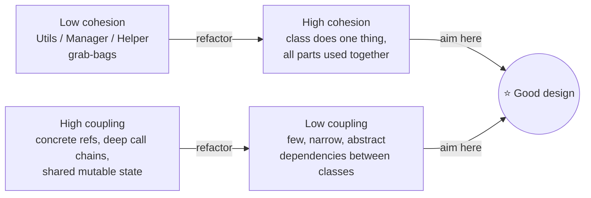

# 1.3 Beyond SOLID — DRY, KISS, YAGNI, Law of Demeter & Cohesion

> SOLID gets the headlines, but interviews are often decided by these quieter principles — especially **KISS and YAGNI**, because over-engineering is the #1 reason strong coders fail LLD rounds.

---

## DRY — Don't Repeat Yourself (but don't over-DRY)

Every piece of **knowledge** should have one authoritative home. Note: *knowledge*, not *text*.

```java
// ❌ the rule "15 min grace period" lives in 3 places
if (minutes <= 15) return 0;         // in FeeCalculator
if (parked < 15) waiveFee();         // in ExitGate
GRACE = 15;                          // in a random constant file

// ✅ one home
public class GracePeriodPolicy {
    private static final Duration GRACE = Duration.ofMinutes(15);
    public boolean isWithinGrace(Duration parked) { return parked.compareTo(GRACE) <= 0; }
}
```

**The senior nuance — accidental duplication:** two code blocks that *look* identical but represent different business rules (e.g., "max 4 passengers per cab" vs "max 4 items per order") must **stay separate** — merging them couples unrelated concepts that will diverge. Say: *"same shape, different knowledge — I won't unify these."*

## KISS — Keep It Simple

The simplest design that satisfies stated requirements wins. Complexity must be *pulled in* by requirements, never *pushed in* by cleverness.

| Over-engineered (red flag) | Simple (hired) |
|---|---|
| `AbstractVehicleFactoryProvider` for 3 vehicle types | `enum VehicleType` + one factory method |
| Event bus inside a single-process Tic-Tac-Toe | Direct method call `board.place(move)` |
| Custom thread pool for a single-user CLI app | Single-threaded; note where locks would go |
| 6 layers (controller/service/manager/helper/impl/dao) | Entity + service + repository |

**Interview script:** *"I'll start with the simplest model that meets the requirements and flag the extension points; tell me if you want me to build any of them out."* This sentence prevents both over- and under-engineering.

## YAGNI — You Aren't Gonna Need It

Don't build for imagined futures. But — critical for interviews — **YAGNI applies to code, not to design seams.**

- ❌ Building multi-floor, multi-gate, valet parking when asked for a single-lot MVP.
- ✅ Putting fee calculation behind an interface (1 minute of work) because pricing *always* changes.

Rule of thumb: **abstractions are cheap, implementations are expensive.** Add the seam, skip the speculative implementation.

## Law of Demeter — talk to friends, not strangers

A method should only call methods on: its own class, its fields, its parameters, objects it creates. **One dot of behavior, not a train of gets.**

```java
// ❌ train wreck — knows Wallet internals 3 levels deep
order.getCustomer().getWallet().getBalance().isGreaterThan(total);

// ✅ tell, don't ask
customer.canPay(total);          // Customer internally consults its wallet
```

Why it matters: the train wreck couples `Order` to the *shape* of Customer→Wallet→Balance; any refactor breaks it. "Tell, don't ask" also moves logic next to the data it uses (encapsulation, SRP).

**Exception:** fluent builders and streams (`list.stream().filter().map()`) are fine — each call returns the same conceptual object.

## Cohesion & Coupling — the two dials



- **Cohesion** (within a class): do its fields and methods form one concept? A `Utils` class is zero cohesion.
- **Coupling** (between classes): how many things break if this class changes? Reduce with interfaces (DIP), events (Observer), and Demeter.

Almost every principle in this part is a strategy for **high cohesion + low coupling** — say this and you've shown the map, not just the streets.

## Supporting cast (know in one line each)

- **Principle of Least Astonishment**: `getX()` never mutates; `add()` never removes. Name = contract.
- **Fail fast**: validate at the boundary, throw early with context — don't let bad state travel.
- **Separation of concerns**: domain logic never knows about I/O, formatting, or persistence details.
- **Encapsulate what varies** (GoF's meta-principle): find the axis of change, put an interface on it — this single sentence generates half the patterns in Part 2.

---

## ✅ Key Takeaways
- DRY is about knowledge, not text; keep look-alike code separate when it encodes different rules.
- KISS/YAGNI: complexity must be justified by a requirement; seams are cheap, speculative features are not.
- Law of Demeter: tell, don't ask; one dot of behavior; no get-chains into other objects' guts.
- Every principle serves the same goal: **high cohesion, low coupling**.

## 💡 Tips & Tricks
- Over-engineering fails more candidates than under-engineering. When unsure, build simple + *narrate* the extension: "if we later need X, this interface is where it plugs in."
- Spot your own train wrecks while coding and fix them live — interviewers love visible self-correction.
- Never name a class `Manager`, `Helper`, `Util`, or `Processor` in an interview without a defense ready — they're cohesion smells.
- "Encapsulate what varies" is the answer skeleton for *any* "how would you design X to support Y later?" follow-up.

## 🎯 Interview Q&A

**Q1. Your interviewer says "just hardcode it, it's an interview." Do you?**
> For genuinely fixed facts, yes — a chess board is 8×8, hardcode it. For stated variability (fee rules, vehicle types), I put in the interface but implement only one variant. The skill being tested is *calibration*: hardcode invariants, seam the variants, and say which is which.

**Q2. How is the Law of Demeter different from just "encapsulation"?**
> Encapsulation hides *my* internals; Demeter stops me from exploiting *others'* internals. A getter-chain respects encapsulation technically (all getters are public) but still couples me to the object graph's shape. Demeter pushes behavior to where the data lives: instead of pulling wallet data out of Customer to make a decision, I ask Customer to make the decision.

**Q3. When is duplication better than abstraction?**
> When the two copies represent different business knowledge that will evolve independently, when the abstraction would need flags/conditionals to serve both callers (a config-flag abstraction is worse than two honest copies), or when it's too early to see the right shape — wrong abstractions cost more than duplication ("prefer duplication over the wrong abstraction"). I deduplicate on the third occurrence, when the pattern is proven.

**Q4. What does "tell, don't ask" change in a Splitwise design?**
> Ask-style: service pulls `group.getMembers()`, `member.getBalances()`, loops and mutates balances externally — logic smeared across the service, Group is a dumb bag. Tell-style: `group.addExpense(expense)` and the Group updates its own balance sheet, enforcing invariants (split sums to total) internally. Result: invariants have one enforcement point, and the service layer shrinks to orchestration.

**Q5. How do you keep cohesion high as requirements grow mid-interview?**
> Each new requirement gets routed to the class that owns that knowledge — or triggers a split. "Add discount coupons" lands in the pricing area, not in `Order`; if `FeeCalculator` starts holding both rates and coupons, I split `CouponPolicy` out. The habit: after every added feature, re-ask "can I still describe each class without 'and'?" — the moment I can't, refactor before adding more.
